## 13 GitHub Copilot 助力代码创建

在本章中，我们将讨论 GitHub Copilot 如何成为你的终极编程助手，帮助你轻松编码。GitHub Copilot 在各种编程语言中提供实时代码建议，显著提高你的编码效率和创造力。通过本章，你将学习如何使用 Copilot 生成代码片段、最佳实践，甚至进行单元测试，所有这些都旨在改进你的编码项目。到本章结束时，你将熟练利用 GitHub Copilot 来简化你的编码流程、创建更干净的代码，从而加快你在新编程语言中的学习曲线。

在本章中，我们将涵盖以下主要主题：
* 了解 GitHub Copilot，你的编程助手
* 使用 Copilot 进行代码补全和建议
* 使用 Copilot 实现整洁代码和最佳实践
* 使用 GitHub Copilot 进行提示工程
* GitHub Copilot 对在校程序员免费吗？

## 技术要求

在深入本章之前，请确保已安装 `Visual Studio Code`，因为它是与 GitHub Copilot 一起使用的主要 IDE。访问 Copilot 还需要一个 GitHub 账户。首先安装 Visual Studio Code 的 GitHub Copilot 扩展，可在 [`marketplace.visualstudio.com/items?itemName=GitHub.copilot`](https://marketplace.visualstudio.com/items?itemName=GitHub.copilot) 找到。从 [`github.com/PacktPublishing/GitHub-for-Next-Generation-Coders/tree/main/Chapter%2013`](https://github.com/PacktPublishing/GitHub-for-Next-Generation-Coders/tree/main/Chapter%2013) 下载名为 `Chapter 13` 的 GitHub 文件夹，以跟进动手部分。

# 了解 GitHub Copilot，你的编码助手

想象一下，你正在尝试搭建一个又大又漂亮的乐高城堡，但你对乐高并不擅长。幸运的是，你有一个非常擅长乐高的朋友。他们可以建议你使用哪块积木开始搭建，或提出你从未想过的酷炫设计点子。这基本上就是 GitHub Copilot 的作用，只是它不是搭建乐高，而是用于几乎任何编程语言的编码。

图 13.1 – GitHub Copilot

`GitHub Copilot` 就像你一直想要的超级聪明的朋友，帮助你编写代码。你用简单的英语告诉它你想做什么，它就会建议可能帮助你实现的代码块。它是由 GitHub 开发的工具，利用互联网上大量代码数据为你提供建议。它使用 `Artificial Intelligence` (`AI`) 来根据你已编写的注释和代码，建议代码行、完成函数，甚至编写整个代码块。

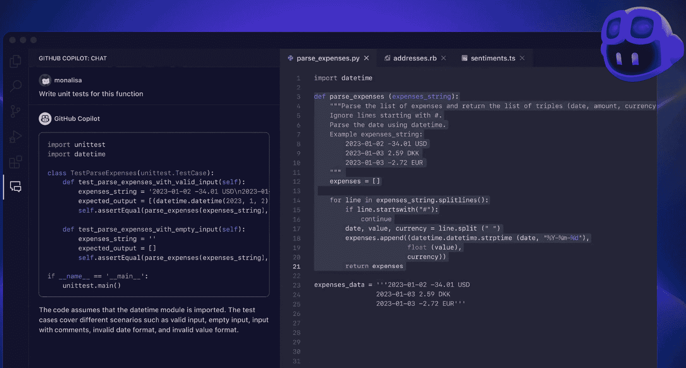
图 13.2 – 一次 GitHub Copilot 演示

## 它是如何工作的？

GitHub Copilot 由一种名为 `Large Language Models` (`LLMs`) 的技术驱动。Copilot 已在互联网上大量公开可用的代码上进行训练。这意味着它见过许多不同的编码风格、语言和常见问题的解决方案。

当你在代码编辑器中开始输入时，Copilot 会查看你正在编写内容的上下文。它理解你使用的语言、已导入的库以及正在处理的函数。

基于上下文，Copilot 会建议可能适合你正在尝试做的事情的代码行或整个函数。你可以选择接受、修改或忽略这些建议。

假设你正在制作你的单页作品集网站，并且只想添加一个新功能，例如你的项目幻灯片或联系页面。你开始在代码编辑器中输入注释，例如 `Create a slideshow of projects`。然后，GitHub Copilot 跳出来并建议一段可以创建该项目幻灯片或联系页面的代码块，如图 13.3 所示。就好像它刚刚与你交谈并递给你想要的确切乐高积木。

你查看建议的代码片段，如果看起来不错，你可以接受它并继续编码另一部分。如果不行，你可以要求 Copilot 提供另一个建议或按你认为最好的方式增强它。就好像与你的乐高朋友一起合作，共同决定如何建造最酷的城堡。

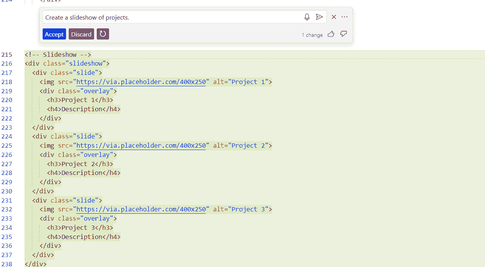
图 13.3 – GitHub Copilot 实际操作

## AI 和 LLM 的快速介绍

AI 是一种让计算机执行通常需要人类智能的任务的方法。LLM 是一种能够理解和生成类人类文本的 AI 类型。它们在大型数据集上进行训练，可以预测句子或代码片段的下一个内容。

LLM 的工作原理如下：

*   **训练**：LLM 在大量文本数据上进行训练，包括书籍、文章和代码。在训练期间，模型学习预测句子中的下一个词或代码片段中的下一行。
*   **生成文本**：训练完成后，模型可以根据收到的输入生成文本。例如，如果你开始编写一个函数，模型可以预测并建议函数的下一部分。
*   **随着时间的推移而改进**：随着越来越多的人使用 Copilot 等工具，模型可以继续学习和改进，提供更好、更准确的建议。

## 为什么 Copilot 很酷？

不必为每件小事在 Google 上搜索、在各种网站上查找、阅读文档、在论坛上提问，或试图记住如何做某事，Copilot 会直接在你的代码编辑器中为你提供建议，例如 `Visual Studio Code` 或 `Codespaces`，直接在 GitHub 上。看到 Copilot 的建议可以帮助你学习新的编码方式，或介绍新的功能和最佳实践。有时，Copilot 的建议会激发你在项目中尝试你甚至从未想过的事情。

## 使用 Copilot 编码时需要注意什么

就像你的乐高朋友有时可能会递给你一块不太合适的积木一样，Copilot 的建议也不总是完全符合你的需求。你仍然需要审查并可能对其进行调整。Copilot 是来帮忙的，而不是替你完成全部工作。最好的项目来自你的创造力和解决问题的能力，而 Copilot 则是你的助手。

## 如何开始

要开始为个人项目使用 GitHub Copilot，你需要注册试用或订阅。

首先，前往 GitHub Copilot 页面。你可以通过在线搜索 `GitHub Copilot` 找到它，或直接前往 GitHub Copilot 的网站：[`github.com/features/copilot`](https://github.com/features/copilot)。

你也可以从你的 GitHub 账户访问 GitHub Copilot。以下是快速指南：

1.  点击 GitHub 上的个人资料照片并选择 `Your Copilot`。
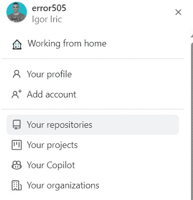
图 13.4 – 从个人资料菜单访问 GitHub Copilot
1.  在设置页面中，选择 `Start free trial`。
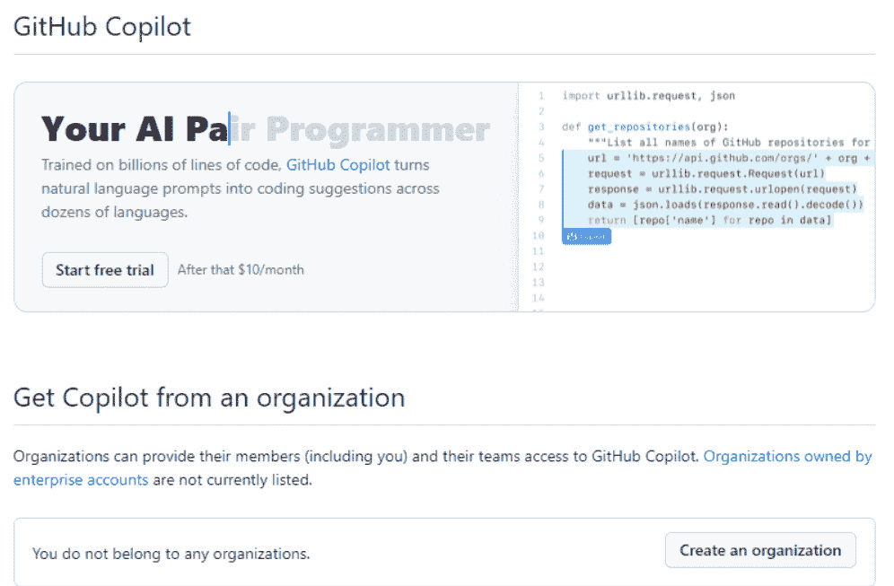
图 13.5 – 开始 GitHub Copilot 免费试用
1.  在月付或年付之间选择，然后点击 `Get access to GitHub Copilot`。
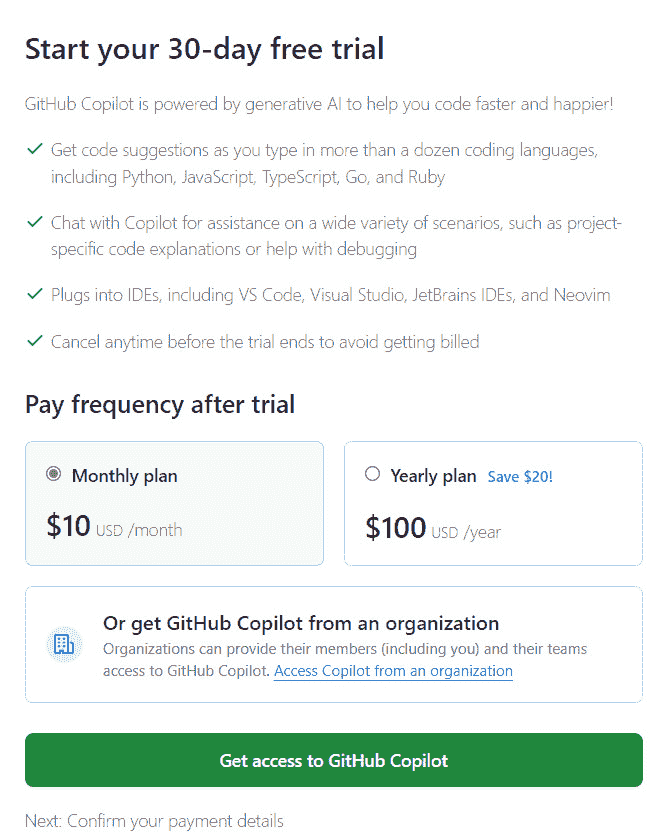
图 13.6 – 获取 GitHub Copilot 访问权限
1.  输入你的付款详情并提交。

图 13.7 – 添加付款详情
1.  设置你的偏好，然后点击 `Save and complete setup`。
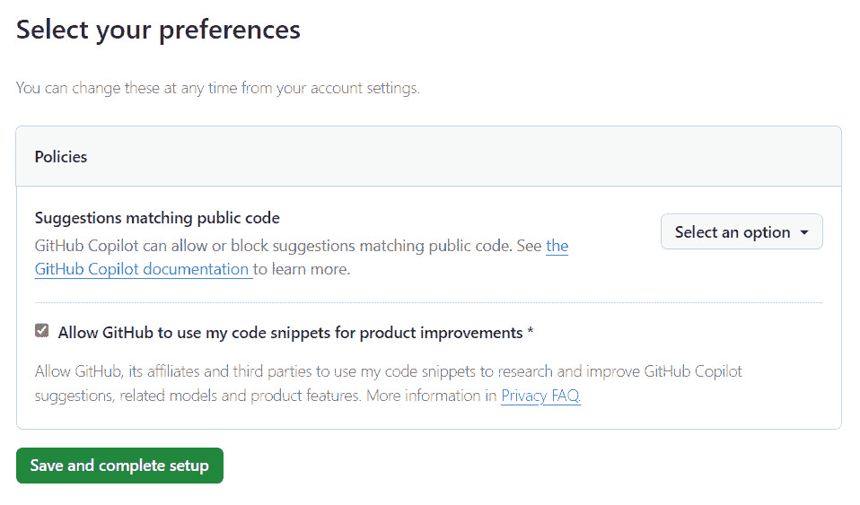
图 13.8 – 选择你的偏好设置

接下来，确保你的计算机上已安装 `Visual Studio Code` (`VS Code`)，以便你可以添加 GitHub Copilot 插件，从而有效地利用 GitHub Copilot 的功能。

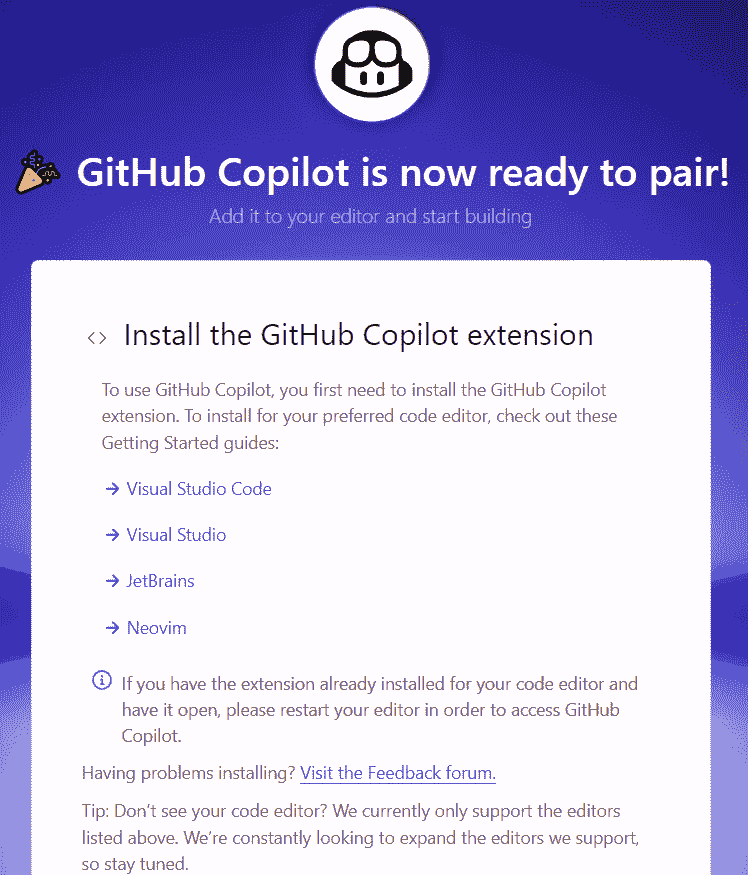
图 13.9 – 安装受支持的 IDE

## 安装 GitHub Copilot 扩展

打开 VS Code 并通过点击侧边栏上的方形图标找到 `EXTENSIONS` 视图，或按 `Ctrl` + `Shift` + `X`。

在顶部的搜索栏中，输入 `GitHub Copilot` 并查找 GitHub Copilot 扩展。它应该是最先弹出的，如图 13.10 所示。

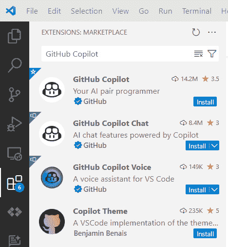
图 13.10 – 安装 GitHub Copilot VS Code 扩展

点击蓝色的 `Install` 按钮。这就像告诉 VS Code，“嘿，我想添加这个智能助手！” Visual Studio 将安装 GitHub Copilot 扩展，然后你将看到如图 13.11 所示的屏幕。

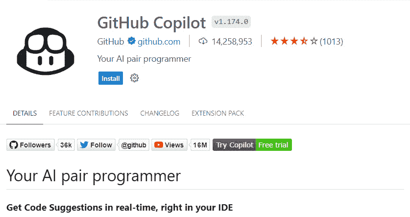
图 13.11 – 安装后带有代码扩展的 GitHub Copilot

一旦在 VS Code 中安装了 Copilot，如果尚未将其链接到你的 GitHub 账户，你将被要求在 VS Code 内登录 GitHub。如果已将 VS Code 与 GitHub 账户关联，GitHub Copilot 将自动设置并准备好使用。如果未看到授权提示，可以单击位于 VS Code 窗口底部面板的铃铛图标来检查通知。

# 使用 Copilot 进行代码补全和建议

登录后，在 VS Code 中打开一个新文件或现有项目并开始输入代码。

当你输入时，GitHub Copilot 将开始建议补全内容，甚至是整段代码。就像有一个朋友建议：“*嘿，试试**下一步！*”

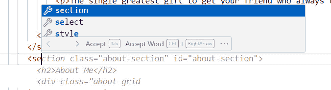
图 13.12 – GitHub Copilot 提供代码建议

让我们在本书中构建的单页个人资料网站上尝试一下（[`https://github.com/PacktPublishing/GitHub-for-Next-Generation-Coders/blob/main/Chapter%2013/index.html`](https://github.com/PacktPublishing/GitHub-for-Next-Generation-Coders/blob/main/Chapter%2013/index.html)) 并请 Copilot 为你创建 **联系我们** 部分。使用 `Ctrl` + `Enter` 键盘快捷键打开 Copilot 聊天（它会打开一个单独的面板显示 10 条建议）。你可以使用类似 **我希望你为我创建带有 Google 地图、地址、电话、电子邮件和联系表单的新联系部分。使用与上一部分类似的代码并添加****CSS 样式。** 的提示。

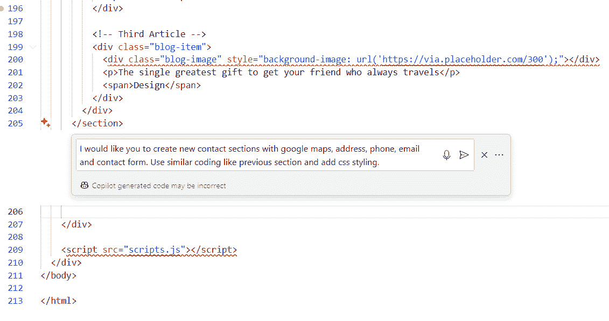
图 13.13 – 与 GitHub Copilot 聊天

按下 `Enter` 或单击聊天框中的箭头后，你将看到 Copilot 如何开始为你的新 **联系我们** 部分编写代码。你可以选择接受、丢弃或重试。

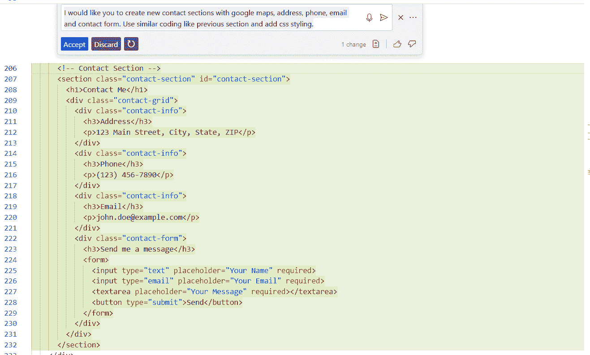
图 13.14 – GitHub Copilot 提供代码片段

你还可以将光标悬停在为你建议的代码片段上，Copilot 将为该特定代码块显示替代建议。然后你可以选择最符合你需求的一个。

现在，你可以接受 Copilot 为你提供的代码，并通过开始输入来获取建议以进一步增强它。此外，你还需要为我们创建的每个类添加 CSS 样式。

在 `Chapter 13` 目录中，打开你的 `styles.css` 文件并开始输入以获取有关你想要创建的样式的建议。当你看到喜欢的建议时，可以按 `Tab` 键接受它。这就像对朋友的建议说 *好主意！*。如果不喜欢该建议，只需继续输入，Copilot 将尝试提供其他内容。它非常灵活，旨在以最好的方式帮助你。

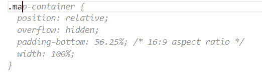
图 13.15 – GitHub Copilot 提供 CSS 建议

经过几次提示后，你的单页作品集网站上将拥有一个漂亮的 **联系我们** 部分。你可以在 *图 13**.16* 中看到同样的内容。

图 13.16 – 你单页作品集网站上的联系我们部分

GitHub Copilot 就像有一个助手，之前看过很多代码，可以提供建议来加快你的编码速度，甚至教你一些新技巧。它在以下方面非常出色：

* 通过在你输入时建议代码来加快你的编码速度
* 通过展示不同的编码方式帮助你学习
* 让编码过程不那么孤单，尤其是在你刚开始时

现在我们已经了解了 Copilot 如何帮助代码补全和建议，让我们继续前进。在下一节中，我们将看到 Copilot 的用途不仅仅是填充代码。我们将探讨它如何支持干净的编码实践、帮助生成单元测试、鼓励测试驱动开发，以及通过重构帮助完善和改进你的代码。

# 使用 Copilot 进行干净的代码和最佳实践

除了帮助你编写更好的代码外，GitHub Copilot 还可以为你提供遵循最佳实践和指南的建议，帮助你创建测试以检查代码是否正常工作，甚至提供使代码更干净、更高效的技巧。让我们现在学习一些这些最佳实践。

## 单元测试生成

*什么是**单元测试？*

**单元测试**就像为网站的每个部分提供一个小测验，以确保每个部分都了解自己的任务。例如，如果你的网站是一个拼图，每个单元测试都会检查单个拼图块是否正好放在它应该在的位置。这很重要，因为它可以及早发现错误，确保在将所有内容组合在一起之前，网站的每个部分，例如你的 `index.html` 文件中的 **我的文章** 部分，都能正常工作。

GitHub Copilot 可以帮助你编写这些测验（单元测试）。它会建议向代码的每个部分提出的问题（测试），以确保它们已准备好参加期末考试（你的成品网站）。Copilot 通过根据你的代码预测你可能需要检查的内容，帮助你更快地编写这些测试。

*图 13**.17* 显示你正在处理与游戏中创建道具相关的 JavaScript 函数。你已要求 GitHub Copilot 为 `powerUpTypes` 函数编写一些单元测试。单击 VS Code 左侧 **活动** 栏上的 GitHub Copilot 图标将打开 **Copilot** 侧边栏，你可以在其中与 Copilot 交互。GitHub Copilot 可以建议测试，例如确认属性已设置并且行为在预期时间内发生，确保每个道具都能按计划增强游戏。

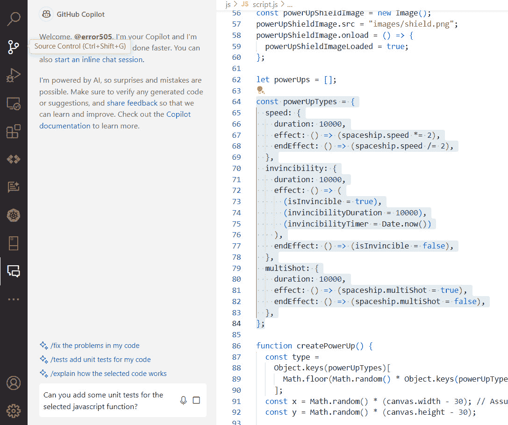
图 13.17 – 请求 GitHub Copilot 为所选代码添加单元测试

在你要求它帮助为所选代码编写单元测试后，GitHub Copilot 将开始执行。

现在，你可以复制这些单元测试并将它们添加到新文件中，稍后可以使用 GitHub Actions 运行它们。以下图示演示了 Copilot 如何为 `Spaceship` 对象建议 `powerUpTypes` 的测试，该对象控制飞船在游戏中的某些行为，例如速度和无敌。

GitHub Copilot 提供使用 Jest 创建单元测试，Jest 是一个流行的 JavaScript 测试框架。它建议的测试会检查 `powerUpTypes` 对象的 `effect` 和 `endEffect` 方法是否按预期运行。例如，当应用 `speed` 道具效果时，飞船的速度应加倍，而当效果结束时，速度应恢复正常。

你可以检查建议的测试，看看它们是否与你的预期和 `spaceship` 对象功能的规范一致。如果它们符合你的需求，你可以将这些测试纳入你的测试套件。

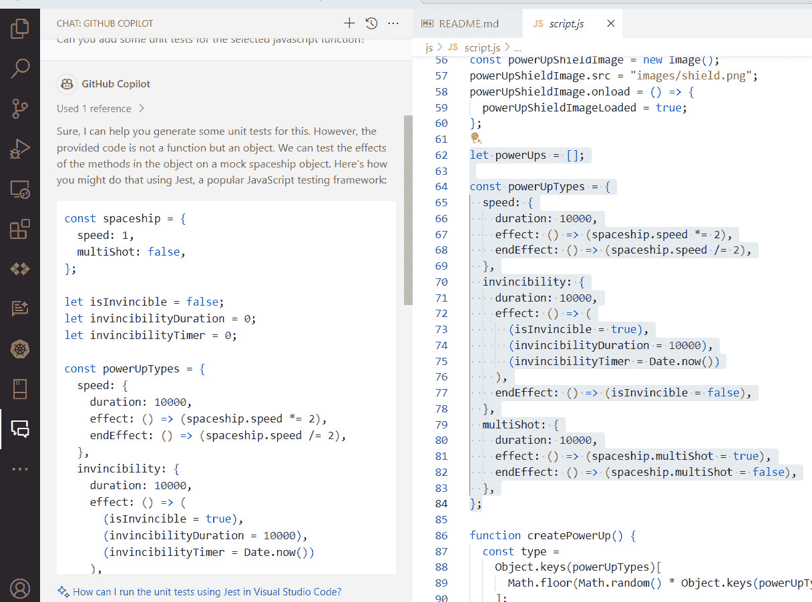
图 13.18 – GitHub Copilot 编写单元测试

本质上，GitHub Copilot 充当编码助手，自动编写测试以帮助确保游戏功能正常工作。通过编写单元测试，你确保每个功能，例如游戏中的道具，都能独立按预期工作。在 Copilot 的帮助下，你可以快速、更高效地编写这些测试，为玩家保持稳定、无错误的游戏体验。

## 测试驱动开发实践

# 测试驱动开发 (TDD)

`Test-Driven Development` (`TDD`) 类似于在进入厨房之前为你的餐点创建详细的食谱。你决定成品菜肴应该是什么样子以及实现它所需的步骤。这样，你就制定了一个计划，以确保最终菜肴完全符合你的期望。
在实际的网站构建术语中，TDD 意味着你在为网站的新功能编写实际代码之前，先写出该功能的检查（测试），例如 `MY ARTICLES` 部分。通过这样做，你确切地知道需要编写什么代码才能通过测试。
例如，你可能会决定 `MY ARTICLES` 部分需要显示最近的五篇文章，并且在两秒内加载。TDD 会要求你先为这些需求编写测试。然后，在构建功能时，你可以持续将其与这些测试进行对照，这些测试可作为你的指南。
这种方法非常有用，因为它专注于你的编码工作，并且可以在以后节省修复错误的时间，因为你在进行过程中一直在检查。这是一种系统的方法，可以确保你的网站最终正如你设想的那样，为任何访问者顺畅运行。
现在你知道了 TDD 是什么，你可以告诉 Copilot 你想要编码的功能，并要求它帮助你使用 TDD 技术实现它。在提示 Copilot 之后，它将开始为你生成代码片段，其中包含测试和可能的代码实现。

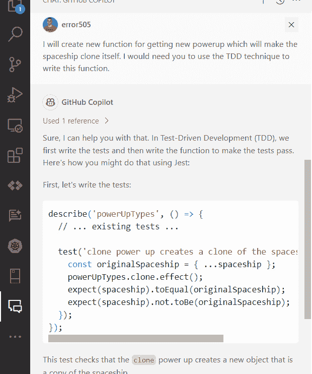
图 13.19 – GitHub Copilot 使用 TDD 方法进行编码

如果你想了解更多关于 TDD 的信息，我建议以下资源：
*   *通过示例进行测试驱动开发* 作者 *Kent Beck*：一本经典书籍，介绍了 TDD 的基础知识，并附有实用示例和逐步方法
*   *Clean Code: 敏捷软件工艺手册* 作者 *Robert C. Martin*：虽然不完全是关于 TDD，但这本书涵盖了许多补充 TDD 实践的原则，例如编写干净、可维护的代码
*   *由测试指导的面向对象软件的成长* 作者 *Steve Freeman 和 Nat Pryce*：这本书深入探讨了 TDD 在面向对象设计中的上下文，重点是创建健壮且可维护的软件

## 代码重构

所以，你已经烹饪了你的菜肴，但现在你想让它在盘子上看起来更漂亮。`Refactoring` 就像重新排列你煮好的菜肴，使其更具吸引力，而不会改变其味道。
有时，你的代码可以正常工作，但可以更整洁或更容易理解。Copilot 可以建议整理代码的方法，使其更干净、更有条理，就像厨师可能会帮助你更漂亮地摆盘一样。
你可以选择代码的一部分并要求 Copilot 根据我们迄今为止在本节中讨论的干净代码最佳实践重构你的代码。然后，它将开始生成更干净、更有组织的代码建议，你可以使用它们。

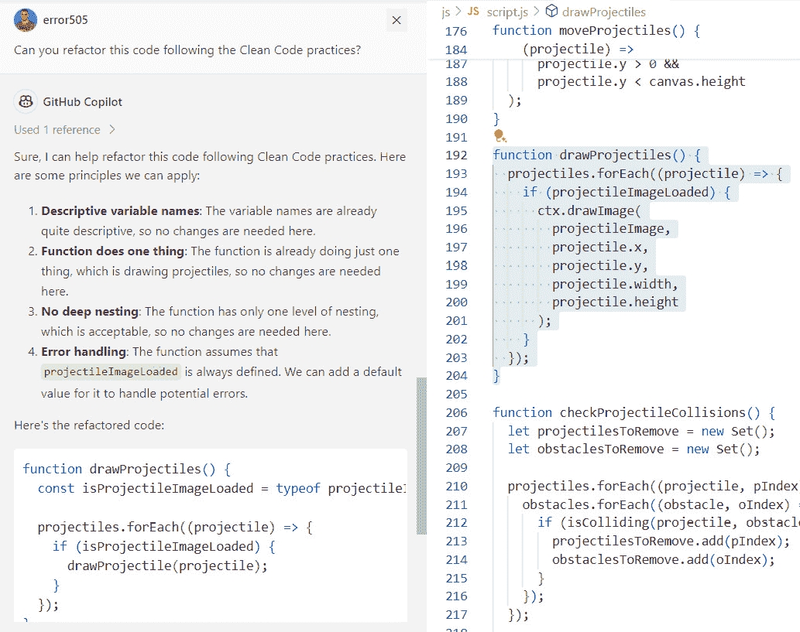
图 13.20 – GitHub Copilot 重构所选代码

在构建网站时使用 GitHub Copilot 就像有一位乐于助人的向导在你身边，提供建议，帮助你测试你的创作，并确保你的代码尽可能好。它不仅帮助你解决问题，还教你成为更好的编码员，就像和厨师一起烹饪教你成为更好的厨师一样。接下来，我们将探索使用 GitHub Copilot 的提示工程，这对于充分利用这个工具至关重要，通过学习如何有效地与它沟通来改善你的编码工作流程。

# 使用 GitHub Copilot 进行提示工程

想想一个神灯和里面住着一个会编程的精灵。那精灵就是你的 GitHub Copilot。然而，与其擦亮灯并告诉精灵你的愿望，不如使用 `prompts` 或特殊指令告诉他们你想要他们执行哪种编程魔法。你不会只说，*做一个三明治*。你会给精灵逐步的指示，例如 *拿两片面包*、*在一片上涂花生酱* 等等。
给精灵具体指示并告诉他们你确切想要什么的过程被称为 `prompt engineering`。

图 13.21 – GitHub Copilot 作为灯神精灵

## 提示工程是如何工作的？

假设你正在构建你的单页作品集网站，并且想要添加一个新功能，例如照片库。与其自己编写所有代码，不如向 GitHub Copilot 寻求帮助。但这里的诀窍是——你需要清楚地说明你要求的内容。
对你的愿望更具体，提供的细节越多，Copilot 就越能满足你的请求。例如，与其说 `I want a website gallery`，你可以说，`I want a responsive gallery section where you will display the first four pictures with hover-over effects. The pictures are stored in the database, for which we need to have the connection string and a query that takes the first four photos`。
在编码术语中，这些 `magic words` 实际上是代码片段或描述，有助于 GitHub Copilot 理解你试图构建的内容。例如，`Create a function that calculates the average of three numbers` 是一个清晰直接的提示。
通过给出这些具体指示，Copilot 理解你试图实现的目标，并可以建议符合你需求的代码。
这就是为什么清晰的指示很重要：
*   `You avoid misunderstandings`：如果没有清晰的指示，Copilot 可能会猜错。就像因为你没有具体说明涂抹位置而导致两片面包上都抹上了花生酱。
*   `You achieve better results`：你越清晰，Copilot 生成你真正想要的代码的可能性就越大。它能更高效地将你的想法变为现实。

## 使用 GitHub Copilot 进行提示工程的酷例子

想象你想要创建一个根据你拥有的食材查找食谱的应用程序。你可能会提示 Copilot `Write a Python function that takes a list of ingredients and searches for recipes online that use those ingredients`。Copilot 可能会生成如图 *图 13**.22* 所示的结果。

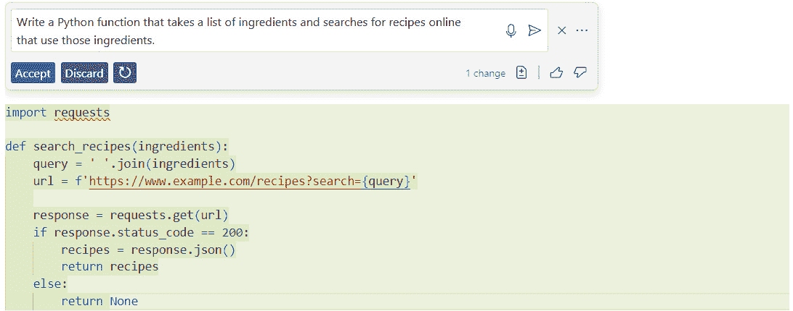
图 13.22 – GitHub Copilot 编写 Python 函数

另一个很酷的提示工程例子是要求 Copilot，`Design a JavaScript program that tracks my spending and categorizes expenses into 'Food', 'Bills', 'Entertainment', etc.` Copilot 将基于你的详细提示开始起草代码，如下图所示。

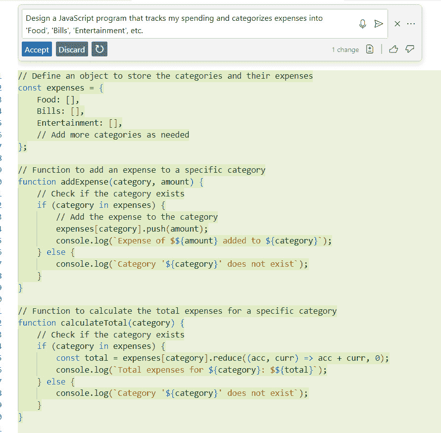
图 13.23 – GitHub Copilot 编写 JavaScript 应用

## 优秀提示工程的技巧

在使用 Copilot 练习提示工程时应牢记以下几点：
*   `Think about the end goal`：你希望你的代码实现什么？从那里开始，反向工作，制作你的提示以引导 Copilot 朝向该目标。
*   `Be clear and detailed`：你提供的细节越多，Copilot 生成有用代码就越容易。
*   `Experiment and refine`：没有得到预期的代码？调整你的提示，尝试不同的措辞，或添加更多细节。这就像根据精灵的回应来完善你的愿望。

使用 GitHub Copilot 进行提示工程将编程转变为与渴望帮助实现你想法的数字伙伴的协作冒险。通过掌握编写提示的艺术，你本质上是在学习如何与一位准备实现你编程愿望的精灵有效沟通。现在你已经了解了提示工程的基础知识，让我们将重点转向实践见解，包括 GitHub Copilot 是否对在校编程者免费以及如何获取 GitHub 的教育福利。

# GitHub Copilot 对在校编程者免费吗？

如果你在学习期间投身编程世界，GitHub Copilot 将作为免费的友好伙伴出现。以下是与 Copilot 结伴所需具备的条件：

* **作为学生**：你必须年满 13 岁并在学校或学院积极学习。
* **拥有学校电子邮件**：学校发放的电子邮件地址证明你属于教育机构。如果没有，也不用担心！你可以出示一些证明你正在学习的证件。

## 如何申请免费的 GitHub 福利

这非常简单。只需访问 [`github.com/edu`](https://github.com/edu) 并点击 **加入 GitHub 教育**，如 *图 13.24* 所示。

图 13.24 – GitHub 教育页面

在下一个屏幕上，你需要选择你是学生，提供学校名称和学校电子邮件，然后点击 **继续** 以完成学生福利的设置。

图 13.25 – 在 GitHub 教育页面上选择你的角色

作为学生，你不仅可以免费使用 GitHub Copilot，还可以获得学生开发者套件，它提供了丰富的资源和工具来提升你的学习和发展之旅。

以下是包含的一些免费资源：

* **免费 GitHub Pro**：在你作为学生的期间，你可以免费使用 GitHub Pro，其中包括私有仓库和高级协作功能
* **GitHub 学生开发者套件合作伙伴优惠**：解锁各种工具和服务的折扣和免费访问，例如云托管、生产力工具和开发者平台
* **Azure 积分**：你将获得 Microsoft Azure 服务的积分，让你能够探索云计算并构建应用程序
* **Codespaces**：直接从浏览器访问基于云的开发环境
* **学生画廊**：展示你的项目并与其他学生协作
* **GitHub 校园专家培训**：合格的申请者可以成为 GitHub 校园专家并为当地开发者社区做出贡献

## 给学生的忠告

虽然 GitHub Copilot 是一个很棒的工具，但明智地使用它很重要。这就像学习骑带辅助轮的自行车。它们非常有帮助，但你也需要学会自己保持平衡。同样，请确保做到以下几点：

* **理解代码**：不要只是复制粘贴 Copilot 的建议。尝试理解建议代码为何以及如何工作。
* **保持好奇**：将 Copilot 作为学习工具使用。提问、探索建议，并深入概念。

简而言之，GitHub 为刚开始编程之旅的学生提供免费、智能且支持性的学习体验，在本节中，我们了解了如何利用其服务。

# 摘要

在 *第 13 章* 中，我们探索了 GitHub Copilot，这是一种实时建议代码的工具，使编程更高效、更不孤单，尤其对初学者而言。我们学习了如何使用 Copilot 进行代码补全、最佳实践，甚至单元测试。这些知识很有用，因为它可以加快编程项目并帮助你学习新的编程方法。现在，你了解如何让 Copilot 成为你的编程伙伴，这可以提升你的编程技能和项目质量。

# 测验

请回答以下问题：

1. GitHub Copilot 主要用于什么？
    1. 设计网站
    2. 实时建议代码
    3. 管理团队项目
    4. 自动化电子邮件回复
    *答案*：B. 实时建议代码

2. 真假 – GitHub Copilot 只能帮助 JavaScript 编程。
    1. 真
    2. 假
    *答案*：B. 假

3. 填空 – GitHub Copilot 的建议可以让你了解新的 ______ 和最佳实践。
    *答案*：功能

4. GitHub Copilot 如何帮助编写更干净的代码？
    1. 通过建议代码重构
    2. 通过更改 IDE 主题
    3. 通过删除未使用的文件
    4. 通过整理你的书签
    *答案*：A. 通过建议代码重构

5. 真假 – 要开始使用 GitHub Copilot，你从一开始就需要付费订阅。
    1. 真
    2. 假
    *答案*：B. 假

6. 有效使用 GitHub Copilot 需要哪种 IDE？
    1. Microsoft Word
    2. VS Code
    3. Notepad++
    4. Eclipse
    *答案*：B. VS Code

7. 使用 GitHub Copilot 的提示工程是什么？
    1. 设计计算机硬件
    2. 编写清晰的指令以改进代码建议
    3. 电气工程的方法
    4. 编程电子游戏
    *答案*：B 编写清晰的指令以改进代码建议

8. 真假 – GitHub Copilot 可以为你的代码生成单元测试。
    1. 真
    2. 假
    *答案*：A. 真

9. 谁可以免费访问 GitHub Copilot？
    1. 仅专业开发者
    2. 仅 GitHub 员工
    3. 学生
    4. 每个人自动
    *答案*：C. 学生

10. GitHub Copilot 如何提高编程生产力？
     1. 通过提高互联网速度
     2. 通过在你输入时建议代码片段
     3. 通过清洁你的电脑屏幕
     4. 通过整理你的办公桌
     *答案*：B. 通过在你输入时建议代码片段

# 索引

由于本电子书版没有固定分页，以下页码仅供参考，基于本书印刷版的超链接。

A

访问控制 255

操作 233

Actions 部分 25

操作工作流

创建 233

活动页面 179\-181

高级 Git 命令 200

`git alias` 200

`git blame` 201

`git fetch --all` 202

`git log follow` 200

`git rebase` 201

`git remote` 202

`git stash` 201

`git stash pop` 201

`git tag` 201

人工智能 (AI) 326, 328

自动化测试 239

B

分支 5, 98, 179

创建 124\-126

分支保护规则 269, 270

C

集中式版本控制系统 (CVCS) 6, 7

流程 7

用于编码 7

挑选提交 193\-195

# 索引
## C
克隆 288
`CODEOWNERS` 264, 265
好处 265, 266
`CODEOWNERS` 文件
创建 264
CodeQL 功能 275
代码部分 22, 23
Codespaces 215, 218
删除 218, 219
启动 216, 217
协作
在网站仓库中设置 252\-255
邀请协作者 64
检查访客列表 65
查找邀请位置 64, 65
等待 RSVP 65
提交 11, 100, 194
回滚到以前版本 188\-190
联系我 表单
添加到网站 99
Creative Commons 许可证 294
## D
增量 8
在编码中工作 8, 9
Dependabot 260, 273
实际操作中 262\-264
设置 260, 261
工作 260
依赖项 260
部署 239
DevHub 219
功能 221
设置 221
URL 220
`diff` 命令 190
`git diff <REF-1> <REF-2>` 命令 192
`git diff HEAD` 命令 192
`git diff origin/main main` 命令 192, 193
`git diff --staged` 命令 191
直接编辑 142
Discussions 部分 24
分布式版本控制系统 (DVCS) 10, 11
草稿
分享 128
## E
环境变量 243
好处 243
使用，用于 `MY ARTICLES` 243\-246
ESLint 239
事件 231
## F
功能分支
创建 98
需要 99
文件
添加到 Git 109\-111
检查 未跟踪文件 111
已更改文件 选项卡 134, 135
过滤器
用于减少通知洪流 75
## G
Git 13\-15, 174
配置级别 44\-46
下载 43
历史记录 (或 仓库) 115, 116
安装 43, 44
与 GitHub 的交互 32
网络交互 39
暂存区 (索引) 114
工作区 113, 114
`git alias` 命令 200
`git bisect` 182, 183
缺少 CSS 样式的情况 183\-187
使用 187
`git blame` 命令 201
Git cherry-picking
功能分支 194
主分支 194, 195
Git 命令
`git add` 命令 34, 35
`git clone` 命令 32\-34
`git commit` 命令 37
`git fetch` 命令 38
`git pull` 命令 39
`git push` 命令 38
`git fetch --all` 命令 202
Git 历史
平行宇宙 179
GitHub 13\-15
好处 4
创建文件 35, 36
邻域 40
仓库 39, 40
创建仓库 40, 41
管理仓库 42
工作区 118
GitHub 账户
组织账户 16, 21, 22
设置 16, 17
用户账户 16, 18\-20
GitHub Actions 230, 272
常见问题 247
Marketplace 230
单页作品集网站，部署和测试 240\-242
优化 248
起始页 233
步骤 232
故障排除 247
GitHub Actions Marketplace 234
GitHub 分支
删除 139
删除，意义 139
本地分支，在 PR 批准后删除 140
本地功能分支，删除 141
本地主分支，升级 140
不需要的分支，修剪 141
GitHub Copilot 326

## 索引
代码补全和建议 [334]-[337]
代码重构 [341], [342]
功能 [328]
在校程序员 [345]-[347]
个人项目 [328]-[331]
提示工程 [342]
测试驱动开发实践 [339], [340]
单元测试生成 [337]-[339]
工作 [326], [327]

## GitHub Copilot 扩展
安装 [332]-[334]

## GitHub Desktop [208]
优势 [214]
功能 [211]-[215]
设置 [209], [210]
URL [209]

## `github.dev` [143]
激活 [143], [144]
需求 [144]

## GitHub Discussions [77], [78]
公告 [78]
综合 [77]
想法 [77]
投票 [78]
问答 [78]
展示与分享 [78]
开始 [78]-[80]
构建更强大的团队 [81]

## GitHub Education [345], [346]
URL [345]

## GitHub Flow [98], [103]
带功能分支的实际主分支 [106]
创建分支 [103]
推送分支 [104]
进行更改 [99], [100]
推送更改 [100]
创建功能分支 [98], [100], [104]
添加文件 [105]
提交文件 [105]
批准拉取请求 [102]
创建拉取请求 [101]
在 GitHub 上创建拉取请求 [104], [105]
讨论拉取请求 [101]
合并拉取请求 [102], [104], [105]
清理工作区 [102], [103]

## GitHub 历史 [174]

## GitHub 界面
Actions 部分 [25]
Code 部分 [22], [23]
Discussions 部分 [24]
Insights 部分 [26]
Issues 部分 [23]
导航 [22]
Projects 部分 [25]
Pull requests 部分 [24]
Security 部分 [26]
Settings 部分 [27], [28]
Wikipedia 部分 [26]

## GitHub Pages
用于展示作品 [320]
用于部署网站的工作流语法 [231]-[233]

## GitHub PR 界面 [128], [129]

## GitHub 个人资料 [303]
徽章 [306]
贡献图 [305]
添加贡献和亮点 [318]-[320]
头像和个人简介 [304]
置顶项目 [304]
显示项目 [317], [318]
添加统计数据和成就 [315]

## GitHub 项目 [53]

## GitHub 仓库
创建许可证 [294]-[297]

## GitHub 仓库洞察 [89]

## GitHub Stats 小部件 [312]-[314]
参考链接 [313]

## GitHub 奖杯 [316]
展示 [316]

## GitHub 版本控制 [5]
集中式版本控制系统 (CVCS) [6], [7]
增量 [8]
编码中的增量工作 [8], [9]
分布式版本控制系统 (DVCS) [10], [11]
快照 [11], [12]

## `.gitignore` 文件 [267]

## `git log` [175]
`git log follow` 命令 [200]
`git log --oneline` 命令 [176]
`git log --oneline --graph` 命令 [176]
`git log --oneline --graph --decorate --all` 命令 [177]
`git log --oneline --graph --decorate` 命令 [177]

## `git push` 命令
推送更改到远程 GitHub 仓库 [116], [117]
`--set-upstream` [117]

## `git rebase` 命令 [200], [201]

## `git reflog` [178]

## `git remote` 命令 [202]

## Git 仓库
Activity 页面 [179]-[181]
本地查看历史 [174]-[178]

## `git reset`
硬重置 [193]
混合重置 [193]
软重置 [193]

## `git revert` [188]-[190]

## Git 暂存区
添加文件更改 [112], [113]
`git stash` 命令 [201]

## G
`git stash pop` 命令 201
`git tag` 命令 201
GNU 通用公共许可证 (GPL) 293

## H
HTMLHint 239

## I
洞察 89
优势 92
代码频率 91
贡献者 89
脉冲 91
流量 90
洞察部分 26
问题 66
分配 68, 69
创建 66, 67
讨论 67
链接，至拉取请求 69
问题部分 22, 23

## J
作业 232

## K
看板 82
看板板
需要 86
看板项目
设置，用于在 GitHub 上的一页网站 82

## L
大型语言模型 (LLMs) 326
工作 328
许可证 291
创建，用于 GitHub 仓库 294\-296
Creative Commons 许可证 294
GNU 通用公共许可证 (GPL) 293
法律考虑 291
MIT 许可证 292
参考链接 294
选择 292
仓库的本地副本
创建 106
项目，克隆 106\-108
切换，到正确分支 108

## M
main 分支 98
Marketplace 230, 234
合并冲突 150\-153
处理 153
文件，移除 164
文件，恢复 165
实际操作中 153\-155
多个合并冲突 159
解决 155\-158
使用命令行解决 161\-163
使用已移除文件解决 164
MIT 许可证 292
多个合并冲突 159
冲突文件，解决 160
PR，完成 160
使用命令行解决 160, 161
选择正确的更改 160
我的文章部分 230
使用机密和环境变量 243\-246

## N
通知泛滥
使用过滤器减少 75
通知 72
自定义提醒 76
调整频道 73, 74
标记 74
发现 73
邮件发送更新 76, 77

## O
开源
最佳实践 297
礼仪 297
开源项目 282\-286
项目页面 283, 284
组织账户 16, 21, 22
所有权 254

## P
个人访问令牌 (PAT) 47
创建 48\-51
安全保存 51
使用，与 `Git` 配合 51
预构建操作 234\-237
项目
在 GitHub 上创建 82\-85
设置 81
设置，用于一页作品集网站 81
重要性 81
项目设置
修改 86
项目部分 25
提示工程 342
示例 343, 344
提示 344
工作 342
提示 342
Pull Request 页面 161
拉取请求 5, 70, 101, 124, 133
合并更改 138
创建 124, 130\-133
链接到问题 69
合并 72
确保质量 136, 137
审查 71, 133, 137
重要性 72, 130
在网站项目中使用 70
Pull requests 部分 24

## R
`README` 文件 52
在 GitHub 上编辑 55\-57
示例 52
提示 53, 54
使用 53
`README` 个人资料 306
关于我部分 310
添加徽章 309
简历 309
认证 311
创建 306, 307
图像 311
设置名称 309
个人资料图片 309
技能 310
在 GitHub 上的真实项目

贡献 286\-291
重构 341
仓库，GitHub 39, 40
创建 40, 41
管理 42
仓库 3, 40
本地副本，创建 106
仓库权限
协作者 252
所有者 252
可重用工作流 238
运行器 232

### S
密钥 243, 268
优点 243
使用，用于我的文章 243\-246
Secret Scanning 功能 276
安全开发策略 267
规划 267\-277
安全功能 272\-275
SECURITY.md 文件 274
安全选项卡 272
设置部分 27, 28
SHA 代码 178
Shields.io
URL 310
快照 11, 12
Sourcetree 203
分支，创建 206
分支，合并 206
分支，切换 207
下载 204
Fetch 按钮 207, 208
项目时间线，查看 205
Pull 按钮 207, 208
Push 按钮 207, 208
快速命令 206
仓库，设置 204
URL 204
暂存区 113
步骤 232
Streak Stats 313
Stylelint 239

### T
测试驱动开发 (TDD) 339, 340
主要语言 312
双因素认证 (2FA) 251, 255
优点 255
设置 255\-259

### U
单元测试 337
未跟踪文件 111
检查 112
检查，原因 112
用户账户 16\-20
uses 关键字 237
工作 237

### V
版本控制系统 (VCSs) 5
Visual Studio Code (VS Code) 215, 332
URL 109
漏洞扫描 260

### W
网站仓库
协作，设置 252\-255
小部件 312
GitHub Stats 312\-314
Streak Stats 313
主要语言 312
wiki 87
创建，用于 GitHub 上的单页网站 87\-89
Wikipedia 部分 26
工作流 231

### Y
YAML Ain’t Markup Language (YAML) 231

[packtpub.com](http://packtpub.com)

订阅我们的在线数字图书馆，即可完全访问超过 7,000 本书籍和视频，以及业界领先的工具，帮助您规划个人发展并推进职业生涯。欲了解更多信息，请访问我们的网站。

# 为什么订阅？
* 用来自 4,000 多名行业专业人士的实用电子书和视频，花更少时间学习，花更多时间编码
* 使用专为你打造的技能计划提升学习效果
* 每月免费获得一本电子书或视频
* 完全可搜索，便于快速访问重要信息
* 复制粘贴、打印和书签保存内容

你知道 Packt 为每本出版的书籍都提供电子书版本，并且提供 PDF 和 ePub 文件吗？你可以在 [packtpub.com](http://packtpub.com) 升级到电子书版本，如果你是印刷书籍客户，你有权享受电子书副本的折扣。欲了解更多详情，请联系我们 customercare@packtpub.com。

在 [www.packtpub.com](http://packtpub.com)，你还可以阅读大量免费技术文章，订阅多种免费通讯，并获得 Packt 书籍和电子书的独家折扣和优惠。

# 你可能感兴趣的其他书籍
如果你喜欢这本书，你可能对 Packt 出版的这些其他书籍感兴趣：

 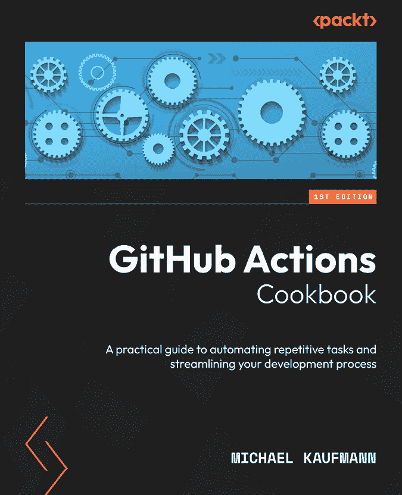

**GitHub Actions 实用手册**

Michael Kaufmann

ISBN: 978-1-83546-894-4

* 使用 VS Code 和 Copilot 编写和调试 GitHub Actions 工作流
* 在 GitHub 提供的虚拟机（Linux、Windows 和 macOS）上运行你的工作流，或在你的基础设施中托管自己的运行器
* 了解如何使用 GitHub Actions 保护你的工作流
* 通过使用 GitHub 的强大工具（如 CLI、API、SDK 和访问令牌）自动化工作流来提高生产力
* 以分阶段或环形部署的方式，以安全可靠的方式部署到任何云和平台

**使用 Git 和 GitHub 解放 DevOps**

Yuki Hattori

ISBN: 978-1-83546-371-0

* 掌握 Git 和 GitHub 的基础知识
* 解锁推动自动化、持续集成和持续部署（CI/CD）以及监控的 DevOps 原则
* 促进无缝的跨团队协作
* 使用 GitHub Actions 提高生产力
* 衡量和改进开发速度
* 利用 GitHub Copilot AI 工具提升你的开发者体验

# Packt 正在寻找像你这样的作者
如果你有兴趣成为 Packt 的作者，请访问 authors.packtpub.com 并立即申请。我们已与数千名开发人员和技术专业人士合作，帮助他们与全球技术社区分享他们的见解。你可以进行一般申请，申请我们正在招聘作者的特定热门主题，或提交你自己的想法。

# 分享你的想法

现在您已完成 *GitHub 面向下一代程序员*，我们很想听听您的想法！扫描下方二维码即可直接前往本书的亚马逊评论页面，并在您购买的网站上分享反馈或留下评论。

[`packt.link/r/1835463045`](https://packt.link/r/1835463045)

您的评论对我们和技术社区都很重要，将帮助我们确保提供优质的内容。

# 下载本书的免费 PDF 副本

感谢您购买本书！

您喜欢在旅途中阅读，但无法随身携带纸质书吗？

您的电子书购买与您选择的设备不兼容吗？

不用担心！现在购买每本 Packt 书籍，您都可免费获得该书的无 DRM PDF 版本。

随时随地在任何设备上阅读。直接从您喜爱的 technical 书籍中搜索、复制并粘贴代码到您的应用程序中。

福利还不止于此，您还可以每天通过电子邮件独家获得折扣、新闻通讯和优质免费内容

按照以下简单步骤获取福利：

1. 扫描二维码或访问以下链接：

[`packt.link/free-ebook/9781835463048`](https://packt.link/free-ebook/9781835463048)

1. 提交您的购买证明。

2. 就这样！我们会直接将您的免费 PDF 和其他福利发送到您的电子邮件。

