# 第 1 部分

## 学习 Godot 引擎的工作原理

在本书的第一部分中，您将建立使用 Godot 游戏引擎的坚实基础。我们将首先探索 Godot 的起源以及使其成为游戏开发独特而强大的工具的原因。然后，您将亲手操作引擎的界面，了解场景、节点和编辑器如何协同工作。您还将迈出进入 3D 游戏开发的第一步，并使用 GDScript 进行脚本编写，这是一种直观、类似 Python 的 Godot 语言。到本部分结束时，您将准备好自信地开始创建交互式游戏。

本书的这一部分包含以下章节：

- *第 1 章，开始使用 Godot！*
- *第 2 章，探索 Godot 引擎界面*
- *第 3 章，3D 简介*
- *第 4 章，使用 GDScript 编程*

## 1

## 开始使用 Godot！

在本章中，我们将探索 Godot 4.0 的历史和核心功能，这是一款以多功能性和易用性著称的游戏开发引擎。无论您是有抱负的独立开发者还是寻求新工具的资深创作者，了解 Godot 的独特性都将为您的游戏开发之旅奠定基础。

本章有两个主要目的。首先是向您介绍 Godot 的背景和关键功能，展示其为何成为游戏开发社区中备受青睐的选择。其次是指导您设置 Godot 4.0 并创建第一个项目，确保您拥有开始制作自己的游戏所需的工具和信心。

在本章中，我们将涵盖以下主要主题：

- Godot 是什么？
- 设置 Godot 4
- 创建新项目

到本章结束时，您不仅将掌握使 Godot 脱颖而出的基本功能，还将具备在引擎中安装、启动和创建第一个项目的知识。这些是为我们在后续章节中完成的一切奠定基础的基本步骤。

## 充分利用本书——了解您的免费福利

解锁随购买而来的独家免费福利，经过精心设计，可助您学习之旅更上一层楼，帮助您无限制地学习。

以下是您通过本书获得的内容的快速概览：

### 下一代阅读器

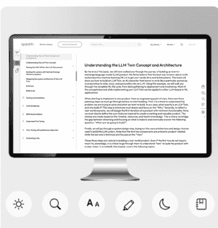

图 1.1：下一代 Packt Reader 功能的插图

我们的基于网络的阅读器旨在帮助您有效学习，具有以下功能：

- 多设备进度同步：从任何设备学习，进度同步无缝。
- 高亮和笔记：让您的阅读转化为持久的知识。
- 书签：随时重温您最重要的学习内容。
- 深色模式：通过切换到深色或棕褐色模式，专注于学习并减少眼部疲劳。

### 交互式 AI 助手（测试版）

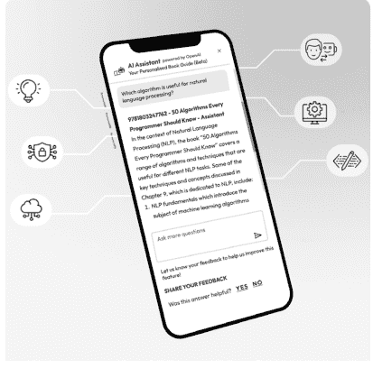

图 1.2：Packt AI 助手的插图

我们的交互式 AI 助手已在本书内容上进行训练，以最大化您的学习体验。它具有以下功能：

- ✨ 总结它：总结关键章节或整章内容。
- ✨ AI 代码解释器：在下一代 Packt Reader 中，点击每个代码块上方的 Explain 按钮即可获得 AI 驱动的代码解释。

注意：AI 助手是下一代 Packt Reader 的一部分，仍处于测试阶段。

### 无 DRM 的 PDF 或 ePub 版本


图 1.3：免费 PDF 和 ePub

通过购买包含的以下特权，无限制地学习：

- 📄 使用本书的无 DRM PDF 副本，随时随地学习。
- 📄 使用您最喜欢的电子阅读器，使用本书的无 DRM ePub 版本进行学习。

## 立即解锁本书的独家福利

扫描此二维码或访问 packtpub.com/unlock，然后按名称搜索本书。确保是正确的版本。

注意：在开始之前请准备好您的购买发票。


## 技术要求

您可以在 GitHub 仓库中找到本书的示例项目和代码：https://github.com/PacktPublishing/Godot-4-for-Beginners

本章的代码文件可在以下位置获取：https://github.com/PacktPublishing/Godot-4-for-Beginners/tree/main/ch1/godotintro

访问此链接查看代码运行的视频：https://packt.link/RjbW3

### Godot 是什么？

简短的回答是 Godot 是一个游戏引擎。它最初由 Juan Linietsky 和 Ariel Manzur 于 2007 年创建，作为阿根廷多个工作室的内部工具。您接下来的问题可能是，“游戏引擎到底是什么？”以及“Godot 有什么特别之处？”

制作游戏很难——真的很难！有无数个 moving parts 都需要完美协同工作。虽然可以从零开始构建一切，但大多数开发者依赖游戏引擎来处理繁重的工作。

因此，游戏引擎是一个简化游戏开发的软件框架。它提供构建游戏的核心工具和系统——例如渲染、物理、输入处理和资源管理——以便开发者可以更多地关注游戏玩法、故事和设计，而不是低级技术代码。


## 让 Godot 如此特别的原因是什么？

有很多原因让 Godot 成为初学者和经验丰富的游戏开发者都喜爱的选择。以下是让这款引擎脱颖而出的核心特性：

- **开源且免费：** 2014 年，Godot 在 MIT 许可证下作为开源项目发布。这意味着它完全免费使用——即使用于商业项目——并且开发者可以完全访问源代码。这使得 Godot 具有高度可定制性且由社区驱动。
- **多样的场景系统：** Godot 最具代表性的特性之一是其场景系统。Godot 中的一切都是一个场景——而场景由节点组成。场景还可以嵌套在其他场景中，使得构建复杂、可重用且模块化的组件变得容易。这种结构使组织和扩展游戏项目变得异常直观。
- **强大的 2D 和 3D 支持：** Godot 包含专用于 2D 和 3D 开发的工具。无论你是在制作像素艺术平台游戏还是功能齐全的 3D 体验，Godot 都为两种维度提供专门的工作流程。虽然其他引擎也支持两者，但 Godot 的 2D 系统尤其常因其精确性和灵活性而受到赞誉。
- **资源——另一面：** 除了场景和节点之外，Godot 使用被称为资源的东西——它们无处不在。精灵上的纹理是一个资源。你播放的音频是一个资源。甚至 Path2D 节点中的路径也是一个资源。资源是可以跨项目重用、在检查器中编辑或从磁盘保存和加载的数据容器。它们促进一致性，减少重复，并使项目保持轻量和有序。
- **轻量且跨平台：** Godot 轻量、安装快速，即使在较旧的机器上也能流畅运行。这种低系统要求是可访问性和包容性的巨大胜利——任何人无需高端 PC 即可开始制作游戏。此外，当你的游戏完成后，你可以将其导出到多种平台，包括 Windows、macOS、Linux、Android、iOS 和 HTML5。
- **蓬勃发展的社区和活跃的开发：** Godot 拥有友好且不断增长的开发者和教育者社区。无论你是刚入门还是经验丰富的编码者，都可以通过论坛、Discord 频道、教程和文档获得大量支持。引擎处于持续开发中，定期更新并拥有开放的路线图。

现在你已经了解了使 Godot 成为功能强大且适合初学者的游戏引擎的关键特性——从灵活的节点和场景系统到充满活力的开源社区——你对为什么它是游戏开发之旅的绝佳选择有了坚实的理解。

是时候从理论转向实践了！

在下一节中，我们将指导你下载和安装 Godot，并帮助你首次运行引擎。很快，你将设置自己的项目并逐步构建你的第一个游戏。让我们开始吧！

## 设置 Godot 4

要下载最新版本的 Godot 4，请按照以下步骤操作：

1. 前往 Godot 的网站 (https://www.godotengine.org) 并点击 **下载最新版本** 按钮，如图 1.4 所示。请注意，撰写本文时使用的是 4.3 版本（详情请参阅 *前言*）。

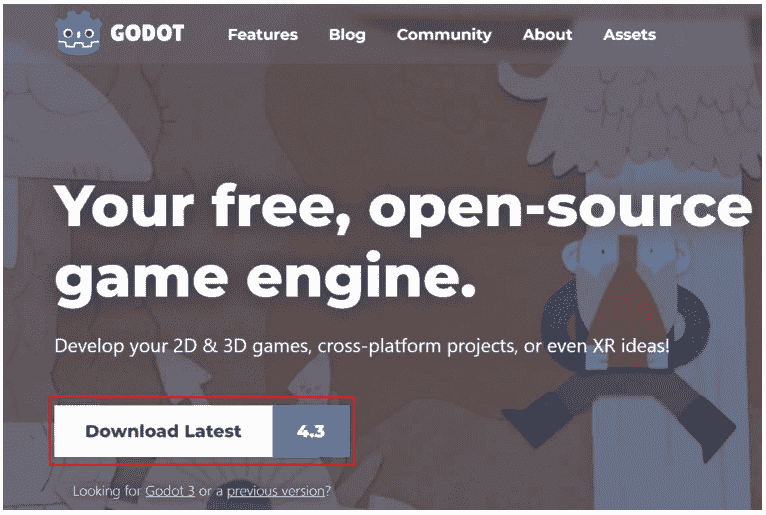

*图 1.4 – Godot Engine 4 for Windows 的下载页面*

2. 网站应检测你的操作系统平台并带你到正确的下载页面。点击 **Godot 引擎** 按钮，而不是 .NET 按钮：

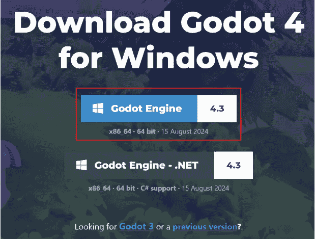

图 1.5 – 浏览器已检测到 Windows 操作系统

3. 如果无法检测到你的平台，你可以滚动页面进一步向下选择受支持的平台之一：


图 1.6 – 从可用选项中选择你自己的平台

4. 下载完成后，是时候创建我们的文件夹结构了。

5. 在 Windows 上，打开 ZIP 文件。主可执行文件将命名为类似 Godot_v4.3-stable_win64.exe。

- 在 macOS 上，双击 ZIP 文件
- 在 Linux 上，在终端中运行以下命令：

```
Unzip Godot_v4.3-stable_linux.x86_64.zip -d Godot
```

6. 将此文件提取到电脑上的一个文件夹中。我建议将文件夹命名为 Godot4。

7. 在此文件夹内，创建一个名为 Godot 4 Projects 的文件夹。这是你将使用 Godot 4 创建的所有项目的存储位置：

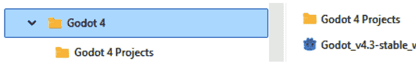

图 1.7 – Godot 文件夹结构

8. 是时候启动 Godot 了！*右键单击* .exe 文件并选择 **固定到“开始”屏幕** 以便在 **开始** 菜单中拥有 Godot：

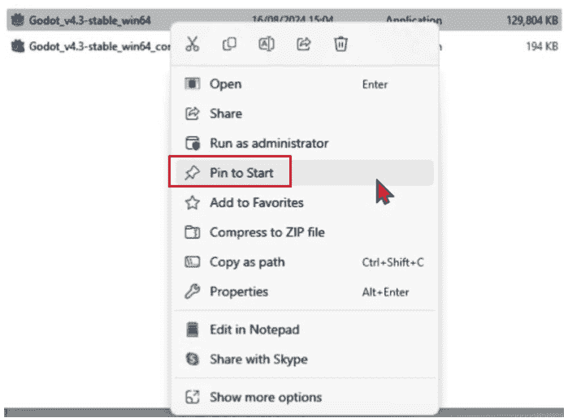

图 1.8 – 如何固定到“开始”屏幕

9. 你也可以点击 显示更多选项 然后选择 固定到任务栏，这样 Godot 将始终准备就绪，等待在屏幕底部：

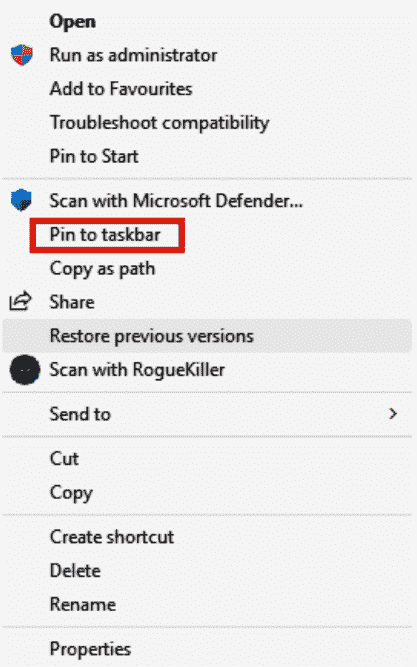

图 1.9 – 显示更多选项并固定到任务栏

10. 双击 Godot 4 文件夹内的提取的 .exe 文件以启动 Godot 4！

Godot 已启动并运行。我们的下一步是创建我们的第一个项目——我们的游戏开发奇妙冒险现在开始！

## 创建新项目

按照上一节的步骤后，你现在会看到 Godot 项目管理器：

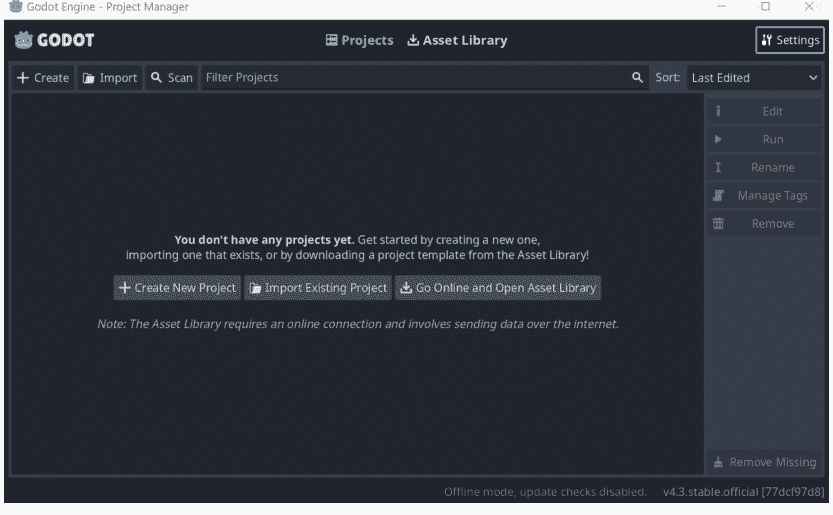

图 1.10 – Godot 项目管理器

这是每次启动 Godot 时看到的第一个窗口。在这里，你可以创建、删除、导入、编辑和播放游戏项目。

由于深色模式下打印图像需要大量黑色墨水，我们将通过切换到浅色模式来为拯救地球尽一份力。除了外观外没有其他区别。要做到这一点，请按照以下步骤操作：

1. 点击右上角的 设置 按钮：

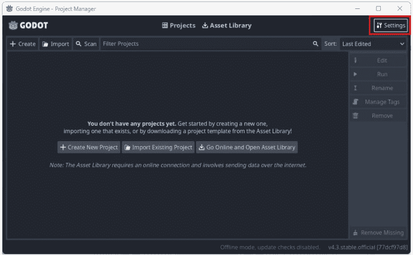

图 1.11 – 项目管理器设置按钮

2. 现在，将 界面主题 下拉菜单更改为 浅色：

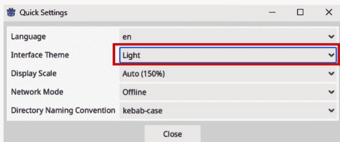

图 1.12 – 在快速设置菜单中更改为浅色主题

现在，让我们逐步了解在 Godot 4 中设置新项目的步骤：

1. 点击左上角的 + 创建 按钮以创建新项目：

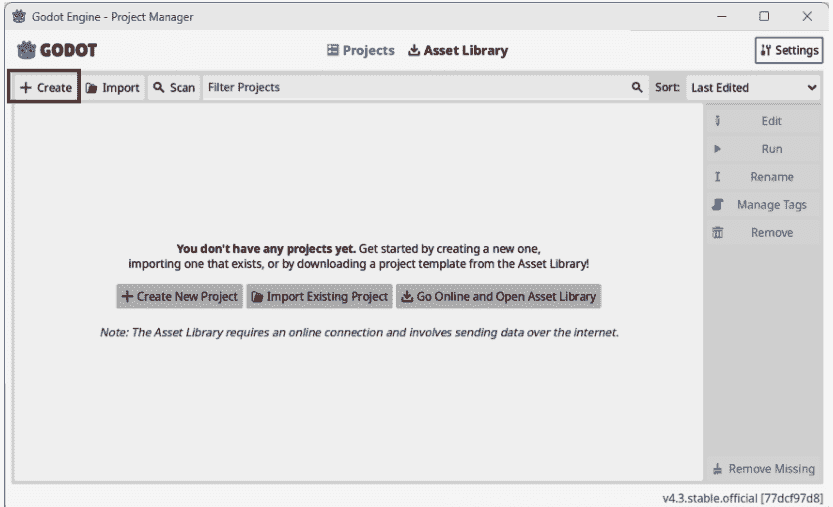

*图 1.13 – 如何在 Godot 项目管理器中创建新项目*

2. 我们现在会看到一个新窗口，可以在其中调整项目的详细信息：

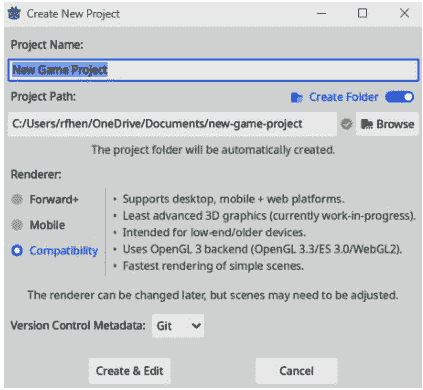

*图 1.14 – 创建新项目子菜单*

3. 下一步是为我们的项目命名。让我们将其命名为 GodotIntro。

另外，确保 Project Path 指向我们之前创建的 Godot 4 Projects 文件夹，并且 创建文件夹 按钮已切换为开启：

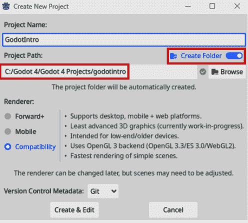

图 1.15 – 我们新 Godot 项目的初始设置

4. 这将在 Godot 4 Projects 内创建一个名为 GodotIntro 的新文件夹。为每个新 Godot 项目创建新文件夹将帮助我们保持一切井井有条。

你可以将 渲染器 保留在 兼容性 模式下。每个渲染器选项在此解释：

- **Forward+** 是旨在改善桌面平台光照渲染的渲染器。这不推荐用于移动开发，因为效率不高。
- **Mobile** 使用更高效的光照方法，专为移动平台设计，但也可以在桌面上运行。然而，此渲染器不提供高端图形功能。
- **Compatibility** 比 **Mobile** 具有更少的高端图形功能，但它可在大多数硬件上运行。

5. 点击 **创建并编辑**，你将看到以下窗口：

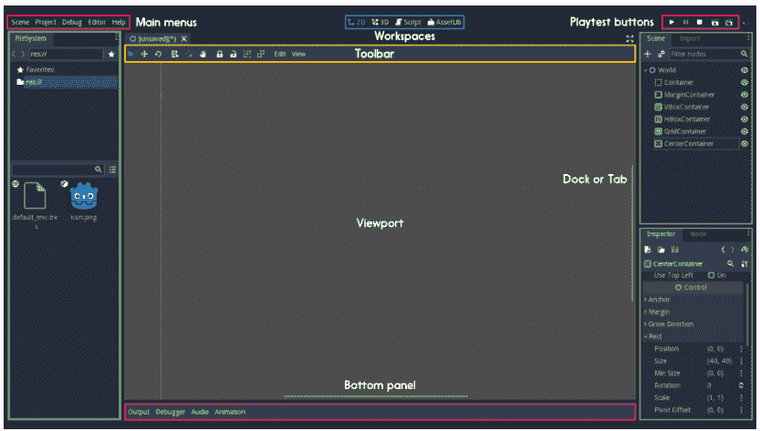

图 1.16 – Godot 引擎主编辑器界面

6. 默认情况下，Godot 以 3D 视图打开。我们可以使用顶部的视图菜单更改此设置；然而，一旦我们添加第一个节点，Godot 将自动更改视图。

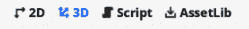

图 1.17 – 切换视图的上下文菜单

从这里，我们将创建我们的第一个小项目，然后在下一章更详细地查看界面：

1. 点击屏幕左上角的 **2D 场景**：

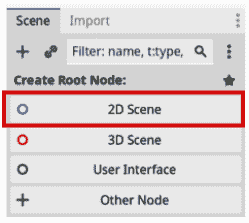

图 1.18 – 场景窗口


2. 点击此按钮会创建 **Node2D** 作为我们场景的根节点。你可以在左侧的 **Scene** 窗口中看到它。我们将通过选中它并按下 *F2* 来重命名它。将其命名为 *Main*，因为它目前将是我们的主节点：

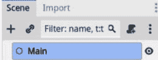

*图 1.19 – 将 Node2D 重命名为 Main*

3. 从一开始养成井然有序的习惯非常重要。在编辑器左下角的 **FileSystem** 窗口中，创建一个新文件夹并命名为 *Scenes*。可以通过在 **FileSystem** 窗口中任意位置右键单击并选择 **New Folder...** 来完成：

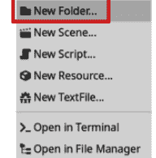

*图 1.20 – 在 FileSystem 窗口中创建新文件夹*

4. 现在，通过按下 *Ctrl + S* 并选择刚刚创建的 Scenes 文件夹，将场景保存为 *main.tscn*：

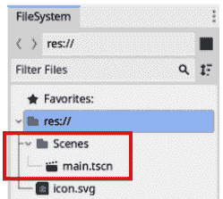

*图 1.21 – 在 Scenes 文件夹中保存主场景*

5. 将 Label 节点作为 Main（即我们之前创建的 Node2D）的子节点添加：

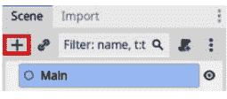

图 1.22 – 点击 + 按钮添加新节点

6. 现在，搜索 Label 节点：

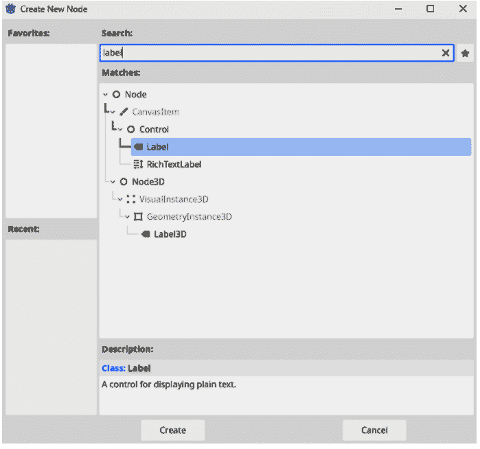

图 1.23 – 搜索 Label 节点

7. 找到后选中它，你会看到它已添加到你的场景树中：

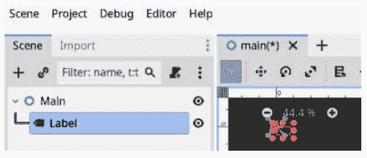

图 1.24 – 编辑器中的 Label 节点

8. 现在，将 Label 节点重命名为 GreetingsLabel：

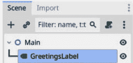

图 1.25 – 重命名 Label 节点

9. 选中 GreetingsLabel 后，在检查器的右侧，我们可以看到 Label 节点的属性。在 Text 属性中输入你的问候语：

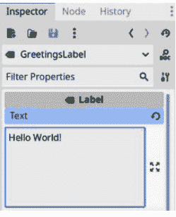

图 1.26 – 在检查器中编辑 Label 节点的 Text 属性

我们现在可以通过按下 F6 来运行场景以查看输出，因为这将运行当前场景。启动项目的另一种方法是按下 F5。会出现一个窗口要求我们选择主场景。由于我们只有一个场景，我们将按下 Select Current 按钮。但是，如果我们有多个场景，我们可以选择想要作为第一个运行的场景：

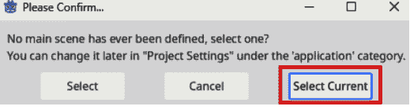

图 1.27 – 选择项目的主场景

10. 项目启动时，你将在屏幕左上角看到你的问候语：

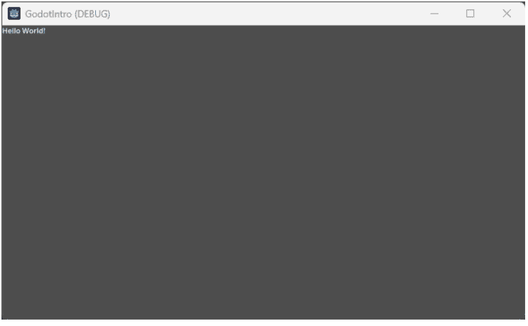

图 1.28 – 我们项目的输出

11. 我们可以在检查器中或使用代码更改 Label 节点的 Text 属性的值。

脚本允许我们为节点编程自定义行为。我们使用它为节点添加逻辑，例如播放音效、移动角色或更改文本。

12. 在为 Label 节点添加脚本之前，让我们在 FileSystem 中为脚本创建一个文件夹。在 FileSystem 中右键单击，选择 New Folder，并将其命名为 Scripts：

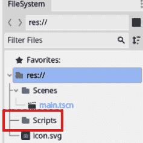

图 1.29 – 向项目添加 Scripts 文件夹

13. 右键单击 GreetingsLabel 并选择 Attach Script...：

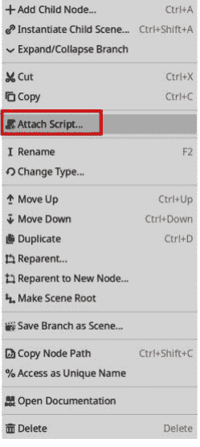

图 1.30 – 将脚本附加到节点

14. 弹出一个窗口。暂时不要更改任何内容，也不要过于担心所有选项。只需注意语言是 GDScript，脚本名称已为我们创建。检查路径，并在必要时将其更改为你的 Scripts 文件夹：

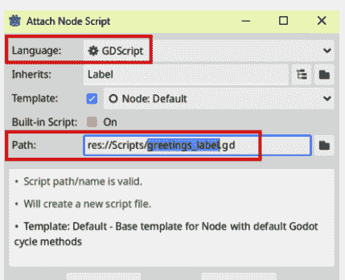

图 1.31 – 附加节点脚本菜单

15. 编辑脚本使其与以下代码匹配，然后通过点击播放按钮再次启动项目：

```
extends Label

#### Called when the node enters the scene tree for the first time.
func _ready():
    text = "Go Go Godot!"

#### Called every frame. 'delta' is the elapsed time since the previous frame.
func _process(delta):
    pass
```

注意，现在项目的输出已从 Hello World! 更改为：Go Go Godot!。

💡 **快速提示：** 使用 **AI Code Explainer** 和 **Quick Copy** 功能提升你的编码体验。在 next-gen Packt Reader 中打开本书。点击 **Copy** 按钮 (1) 快速将代码复制到你的编码环境，或点击 **Explain** 按钮 (2) 让 AI 助手为你解释一段代码。

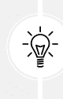

```
function calculate(a, b) {
  return {sum: a + b};
};
```

🔒 **下一代 Packt Reader** 随本书购买免费提供。扫描二维码或访问 packtpub.com/unlock，然后使用搜索栏按名称查找本书。仔细检查所示的版本，以确保你获得正确的版本。


最后，我们可以通过让标签像著名的 DVD 屏幕保护程序一样在屏幕上弹跳，使场景更具动态性！

## 使场景动态化

为此，我们需要将问题分解为更小的部分：

- 1. 给标签一个初始速度（速度和方向）。
- 2. 找出屏幕的尺寸。
- 3. 找出标签的大小。
- 4. 测试标签是否已到达左侧或右侧边缘并反转方向。
- 5. 测试标签是否已到达顶部或底部边缘并反转方向。
- 6. 不断更新标签的位置使其移动。

速度变量同时控制移动的速度和方向。因为它是一个 Vector2，所以我们可以在一个容器中同时传递 x 和 y 值。

在此示例中，我们将初始速度设置为沿 x 轴 150 像素/秒（向右，因为它是正值）以及沿 y 轴 120 像素/秒（向下，因为 Godot 的坐标系从左上角开始）。

从程序的第二行开始添加以下行：

```
var xVelocity = 150 #150 pixels per second to the right
var yVelocity = 120 #120 pixels per second downwards
var velocity = Vector2(xVelocity, yVelocity)  #Initial speed and direction
```

为了让标签移动，我们需要在每一帧中不断更新其位置。_process(delta) 函数每帧运行一次，使其成为处理此类更新的理想位置。通过在 _process() 内部添加一行调整标签位置的代码，我们可以创建平滑、持续的移动。

将以下代码作为 _process() 函数内部的第一行添加并运行游戏。你会看到标签沿对角线向下并向右移动！

```
position = position + velocity * delta
```

在前一行中，我们反复将当前位置加上 velocity 乘以 delta 的值。这里，delta 是自上一帧以来经过的时间，用来确保在所有硬件上移动都平滑且一致。

你现在已迈出了让文本移动的第一步——就像经典的 DVD 标志一样！

在我们继续并使运动平滑且一致之前，了解一个控制 Godot 中事物随时间行为的关键概念非常重要：delta。

让我们花点时间探索 delta 是什么以及为什么它如此重要。

## Delta

当我们在游戏中让某物移动时，我们通常希望它以一致的速度移动——例如每秒 150 像素。但棘手之处在于，并非所有计算机运行游戏的速度都相同。有些可能以每秒 60 帧运行，而其他则可能根据硬件运行得更慢或更快。

这就是 delta 发挥作用的地方。

delta 是一个小数字，告诉我们自上一帧绘制以来经过了多少时间。如果你的游戏运行很快，delta 可能是 0.016 左右（约 1/60 秒）。如果运行较慢，delta 会稍大，例如 0.03。

通过将移动速度乘以 delta，我们的意思是：

> “根据实际经过的时间而不是经过的帧数来移动此对象。”

这意味着无论你的计算机能绘制多少帧，对象都会以正确的每秒速度移动。

因此，与每帧移动 150 像素（这会太快！）不同，我们每帧移动 150 × delta 像素，这会根据性能自动调整。

## 继续弹跳标签项目

回到我们的弹跳标签项目，下一步是设置有关屏幕和标签本身的一些重要信息。这将使我们能够检测到标签何时撞到边缘并需要反弹。

现在，我们应该添加变量来存储屏幕大小和标签的大小。重要的是要理解，我们在场景加载之前无法确定这些值。

一旦场景准备就绪，第一个运行的函数是 _ready() 函数。因此，我们应该在那里初始化（为其分配值）我们的变量。首先在顶部将变量添加到我们的集合中，然后在设置文本后，将它们作为 _ready() 函数中的第一行赋值：

```
var xVelocity = 150 #150 pixels per second to the right
var yVelocity = 120 #120 pixels per second downwards
var velocity = Vector2(xVelocity, yVelocity) # Initial speed and direction
var screen_size_x #screen horizontal dimension
var screen_size_y #screen vertical dimension
var label_size_x #label width
var label_size_y #label height
```

现在，在 _ready() 函数中按如下方式为这些变量赋值：

```
func _ready():
    text = "Go Go Godot!"
    # Get the screen size (viewport size)
    screen_size_x = get_viewport_rect().size.x
    screen_size_y = get_viewport_rect().size.y
    label_size_x = size.x
    label_size_y = size.y
```

现在剩下的就是测试标签是否已到达屏幕的左侧、右侧、顶部或底部边缘，如果已到达，则将其反转。

我们在设置方向后在 _process() 函数中执行此操作。首先进行左右屏幕边缘的测试，如下所示：

```
#### Bounce off left/right edges
if position.x < 0 or position.x + label_size_x > screen_size_x:
    velocity.x *= -1
```

此行检查标签是否已撞到屏幕的左侧或右侧边缘，如果是，则通过反转其水平方向使标签反弹。

从技术上讲，我们的反弹是可行的，可以保留，但存在一些罕见的边缘情况，在其中标签可能在一帧内移动到屏幕边缘之外，方向反转，但我们已经超出边缘，因此标签可能会卡住或抖动。为防止这种情况，我们可以使用内置方法将值限制在最小值和最大值之间：

```
#### Bounce off left/right edges
if position.x < 0 or position.x + label_size_x > screen_size_x:
    velocity.x *= -1
    position.x = clamp(position.x, 0, screen_size_x - label_size_x)
```

顶部和底部边缘的检查类似：

```
#### Bounce off top/bottom edges
if position.y < 0 or position.y + label_size_y > screen_size_y:
    velocity.y *= -1
    position.y = clamp(position.y, 0, screen_size_y - label_size_y)
```

弹跳标签的完整代码如下所示：

```
extends Label
var xVelocity = 150 #150 pixels per second to the right
var yVelocity = 120 #120 pixels per second downwards
var velocity = Vector2(xVelocity, yVelocity) # Initial speed and direction
var screen_size_x #screen horizontal dimension
var screen_size_y #screen vertical dimension
var label_size_x #label width
var label_size_y #label height

func _ready():
    text = "Go Go Godot!"
    # Get the screen size (viewport size)
    screen_size_x = get_viewport_rect().size.x
    screen_size_y = get_viewport_rect().size.y
    label_size_x = size.x
    label_size_y = size.y

func _process(delta):
    position = position + velocity * delta
    # Bounce off left/right edges
    if position.x < 0 or position.x + label_size_x > screen_size_x:
        velocity.x *= -1
        position.x = clamp(position.x, 0, screen_size_x - label_size_x)

    # Bounce off top/bottom edges
    if position.y < 0 or position.y + label_size_y > screen_size_y:
        velocity.y *= -1
        position.y = clamp(position.y, 0, screen_size_y - label_size_y)
```

好了——这就是你自己的经典弹跳 DVD 标志版本！现在你已经在 Godot 中构建了第一个简单动画，你已准备好更深入地探索创建交互式和动态游戏。

## Summary

在本章中，我们了解了 Godot 的历史及其节点和场景设计理念。我们下载了 Godot 并运行它。我们创建了第一个项目并在游戏窗口中输出了第一个结果。我们还通过处理标签的位置和速度使场景动态化。我们还了解了屏幕尺寸以及如何将其限制在一定范围内，以及 delta 变量发挥的重要作用。

在下一章中，我们将更仔细地查看 Godot 编辑器界面以及如何使用它提供的工具。

## Unlock this book’s exclusive benefits now

扫描此二维码或访问 packtpub.com/unlock，然后按名称搜索本书。

*Note: 在开始之前请准备好购买发票。*


## 2

## Exploring the Godot Engine Interface

在本章中，你将在 Godot 4 中编辑你的第一个项目并探索界面的基本功能。你还将更深入地了解支撑 Godot 的节点和场景设计理念。每天使用 Godot 时，了解其设计用途是至关重要的。

在本章中，我们将涵盖以下主要主题：

- Important terms
- Editing an existing Godot project
- Creating an additional scene
- Reacting to player input

到本章结束时，你将能够轻松创建新项目、构建场景并导航界面——这是任何游戏开发者必备的技能。

## Technical requirements

本章的代码文件可在本书的 GitHub 仓库中获取：https://github.com/PacktPublishing/Godot-4-for-Beginners/tree/main/ch2/godotintro

访问此链接查看代码运行的视频：https://packt.link/2R1xc

## Important terms

这是重要部分。在深入本章并遇到我们不熟悉的术语之前，让我们快速了解一下：

- **Nodes:** 节点是 Godot 4 场景的基本构建块。每个节点代表游戏世界中的单个对象，例如精灵、音效、UI 元素等。多个节点通常形成层次结构，通常父节点控制其子节点的行为。

在使用节点时，我们可以按 Q、W、E 和 S 使用不同的工具：

- Q – Select tool: 允许我们选择节点并将其定位在视口中
- W – Move tool: 允许我们沿各个轴移动节点
- E – Rotate tool: 允许我们在各个轴上旋转对象
- S – Scale tool: 允许我们在各个轴上调整对象的大小

每个节点都有决定其行为和外观的属性。例如，精灵节点具有纹理、位置和缩放等属性，如图 2.1 所示：

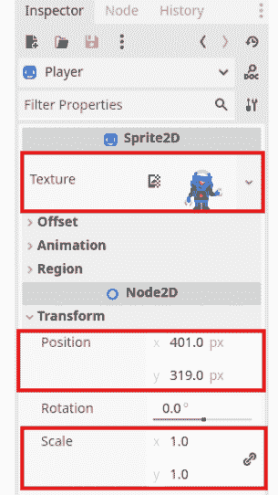

Figure 2.1 – Sprite2D 节点的一些属性

- **Scenes:** 场景是节点的集合。它们可以构成关卡、菜单、角色、敌人或游戏的任何其他部分。场景可以保存为单独的文件，并在需要时通过实例化加载到游戏中。
- **Scripts:** 脚本是游戏开发的重要组成部分。它们允许你创建自定义操作和交互，使你的游戏独一无二。

要可视化节点如何组合形成场景，请查看 *Figure 2.2*，其中显示了 **Strawberry**，这是一个可收集物品。它由 **Area2D** 节点、**CollisionShape2D** 节点和 **AnimatedSprite2D** 节点组成。它们共同构成了 **Strawberry** 场景。

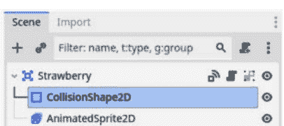

Figure 2.2 – 组合成场景的节点

让我们进入本章！

## Editing an existing Godot project

我们在上一章创建了 Godot 项目，当我们启动 Godot 时，可以在 **Project Manager** 窗口中看到它，并且可以通过选择 **Edit** 或按 *Ctrl + E* 然后双击我们的项目名称 GodotIntro 来重新打开它：

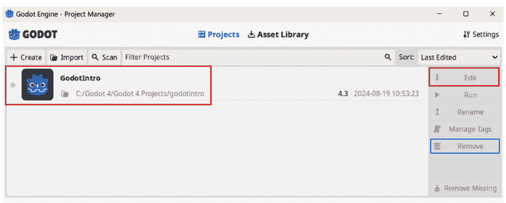

Figure 2.3 – 来自第 1 章的现有 Godot 项目

Godot 编辑器将打开并显示你最后正在处理的内容。在我的例子中，它是 **Script** 视图。通过点击屏幕顶部的 2D 将视图更改为 2D：

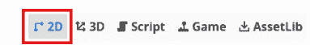

*Figure 2.4 – 通过点击屏幕顶部的 2D 切换到 2D 视图*

现在我们可以更仔细地查看 Godot 编辑器的主要功能。你的屏幕现在应该如 Figure 2.5 所示：

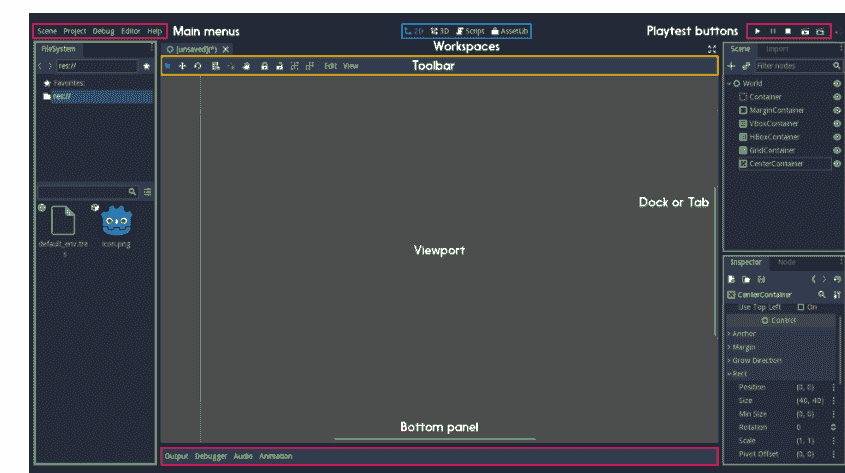

*Figure 2.5 – Godot 界面概览*

🔍 **Quick tip**: 需要查看此图像的高分辨率版本？在下一代 Packt Reader 中打开本书或在 PDF/ePub 副本中查看。

🔒 **The next-gen Packt Reader** 和本书的 **free PDF/ePub copy** 已包含在你的购买中。扫描二维码或访问 packtpub.com/unlock，然后使用搜索栏按名称查找本书。请仔细检查所示的版本以确保获取正确版本。

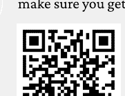


编辑器中使用最多的部分标记为 1 到 4：

- 1. The **scene tree** 区域显示构成当前场景的所有节点。我们可以看到我们的 **Main** 节点（**Node2D**）和我们的 **GreetingsLabel**（**Label** 节点）。
- 2. The **FileSystem** 区域显示项目中的所有文件。我们可以看到我们创建的 Scenes 和 Scripts 文件夹。
- 3. 在这里，我们看到 **Viewport**。可以将其视为想象中摄像机框架内的内容。在这里，我们将在场景的 2D 空间中放置节点。
- 4. 最右侧是 **Inspector** 区域。通过它，你可以查看当前选中节点的属性。你也可以在子菜单中找到许多设置。例如，你可以点击 **Transform** 属性展开 **Position**、**Rotation** 和 **Scale** 的设置。


## LEGO – 理解 Godot 工作原理的有用隐喻

在 Godot 中构建游戏就像搭建 LEGO 模型。在这个类比中，节点就像单个 LEGO 积木。每块积木都有特定功能——有些是基础的，像简单的积木块，而其他则可能有专门用途，像轮子、窗户或齿轮。

Godot 系统真正的强大之处在于其灵活性。正如你可以拆卸并重新组合 LEGO 模块来构建全新事物一样，你可以在 Godot 中混搭场景，以快速组装游戏的不同部分。这种模块化让你能够以更易管理、高效且富有创意的方式创建复杂游戏。

在 Godot 中，你使用节点来表示游戏的不同元素，例如角色、环境和行为。就像你可以以各种方式连接 LEGO 积木来创建不同结构一样，你可以在 Godot 中组合节点来构建复杂的游戏对象和系统。

现在，把场景想象成由那些 LEGO 积木制成的预建部分或模块。一个场景可以是像汽车或树这样的小部件，也可以是像整栋建筑这样更大的东西。在 Godot 中，场景是一组按特定方式排列的节点，用来创建游戏中有意义的部分。你可以重用场景，就像你可以把预建的 LEGO 模块附加到更大的结构上一样。

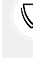

但拼图还有最后一块：资源。如果节点是 LEGO 积木，场景是 LEGO 模块，那么资源就像随 LEGO 套装附带的贴纸、蓝图和说明书。贴纸代表视觉元素，如纹理和材质。蓝图或手册描述某物如何表现或动画——就像 Godot 中的动画资源、脚本和音频流。

正如你可以把同一张贴纸应用到多个积木上，或用同一本手册进行多次搭建一样，Godot 中的资源是可重用、可自定义的，并且可在整个游戏中共享。

它们本身并不构建结构，但为你已组装好的部件添加样式、数据和行为。

这种分层方法——Nodes（积木）、Scenes（模块）和 Resources（自定义细节和说明）——使 Godot 成为构建游戏的强大且直观的工具，就像 LEGO 让构建富有想象力的创作变得有趣且易于上手一样。

## 创建额外场景

假设我们想断开其中一块 LEGO 积木（参见前文中的 *LEGO – 理解 Godot 工作原理的有用隐喻*）。让我们从我们的 **Main** 场景中移除我们的 **Label** 节点，并将其放入自己的场景中：

- 1. 我们可以通过右键单击 **GreetingsLabel** 节点并选择 **Save Branch as Scene...** 来实现。这在 *图 2.6* 中显示：

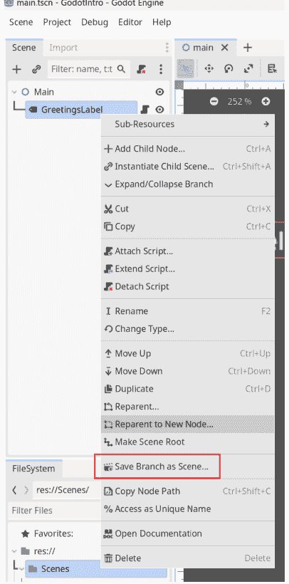

Figure 2.6 – Save Branch as Scene...

- 2. 将场景保存为 greetings_label.tscn 到我们的 Scenes 文件夹中：

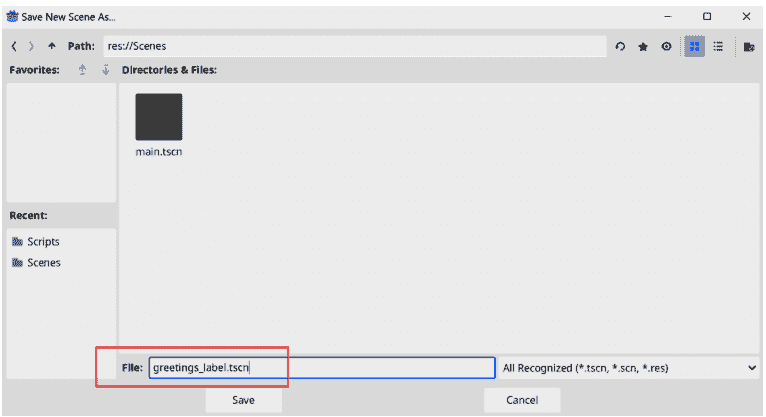

Figure 2.7 – Saving the greetings_label as its own Scene

你会注意到 GreetingsLabel 并没有从场景中消失。然而，现在我们有了标签的独立场景副本，我们可以将其从 Main 场景中删除，并轻松将其添加回来或向场景中添加多个标签。

- 3. 如果你在 FileSystem 区域中双击 greetings_label.tscn，它将在新的场景窗口中打开：

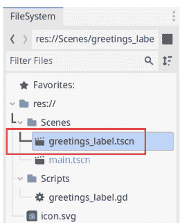

Figure 2.8 – Double-click greetings_label.tscn to open it in its own scene tab

- 4. 现在，从 **Main** 场景中删除 **GreetingsLabel**。
- 5. 然后通过从 **FileSystem** 区域将 greetings_label.tscn 拖放到 Viewport 中将其添加回来：

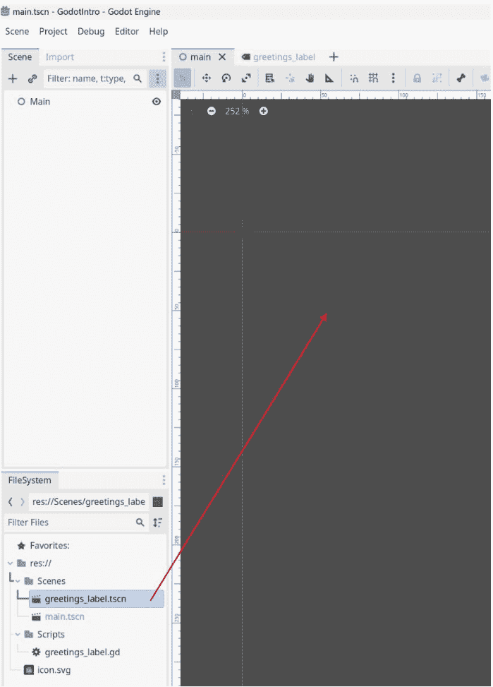

Figure 2.9 – Drag and drop the greetings_label.tscn back into the Viewport

现在我们可以看到标签返回到场景后的样子：

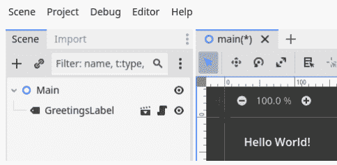

Figure 2.10 – Main Scene with the GreetingsLabel node returned

我们现在可以将多个 greetings_label 场景的实例拖放到 Main 场景中，并可以在 Inspector 的 Text 属性中更改每个实例的文本属性。然而，当我们运行 Main 场景时，每个标签都会恢复为 Go Go Godot!。这是因为每个实例都附加了相同的脚本，而我们之前将文本属性更改为读取 Go Go Godot!。

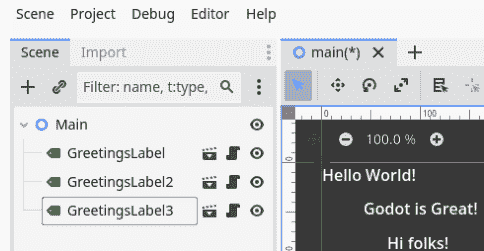

Figure 2.11 – Multiple instances of greetings_label in the Main scene

## 实例是什么？

实例化是从蓝图或主要设计中生成游戏对象的过程。实例化与场景配合良好。它使你能够将游戏划分为可重用组件，提供结构化复杂系统的工具，并提供一种以自然方式思考游戏结构的语言。

我们可以通过让游戏对用户输入做出反应来演示实例化。

## 对玩家输入做出反应

现在，我们可以做一个实验，根据用户收到的输入显示不同的标签。在这种情况下，我们将添加一个精灵并将其标签放在其头部上方。**sprite** 是游戏中用于表示角色、对象或其他视觉元素的 2D 图像或动画。简单来说，它就是你在游戏中看到并会移动或与环境交互的图片或图形。

如果玩家左键单击精灵，我们将显示 **Hello Folks!** 如果他们对精灵 *右键单击*，我们将显示 **Godot is Great!**，如果他们按下键盘上的 *Enter / Return*，我们将显示 **Hello World!**

首先，我们需要一个精灵。获取免费游戏资产的好地方是 **Kenney**。你可以在这里找到网站：https://kenney.nl/。我在此实验中使用的资源可以在这里找到：https://kenney.nl/assets/toon-characters-1。

我选择的精灵在你解压文件夹后可以在这里找到：`\kenney_toon-characters-1\Robot\PNG\Poses HD \character_robot_interact`。

这就是我们的精灵的样子：

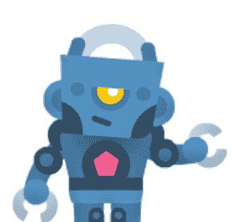

*Figure 2.12 – The robot sprite character for our experiment*

然而，你可以使用任何你喜欢的角色进行此实验。我们现在将精灵添加到场景中：

- 1. 在 FileSystem 中创建一个新文件夹并命名为 Sprites：

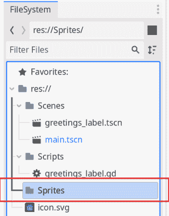

Figure 2.13 – Create the Sprites folder

- 2. 现在将你选择的角色拖入此 Sprites 文件夹：

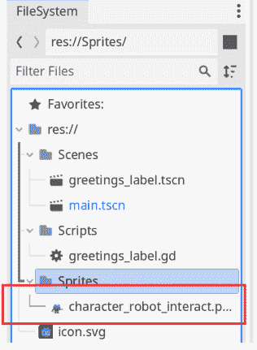

Figure 2.14 – Your chosen image within the Sprites folder in FileSystem

- 3. 现在我们将为角色创建一个新场景。点击 Scene 菜单并选择 New Scene（按 Ctrl + N），或点击场景标签附近的 + 符号：

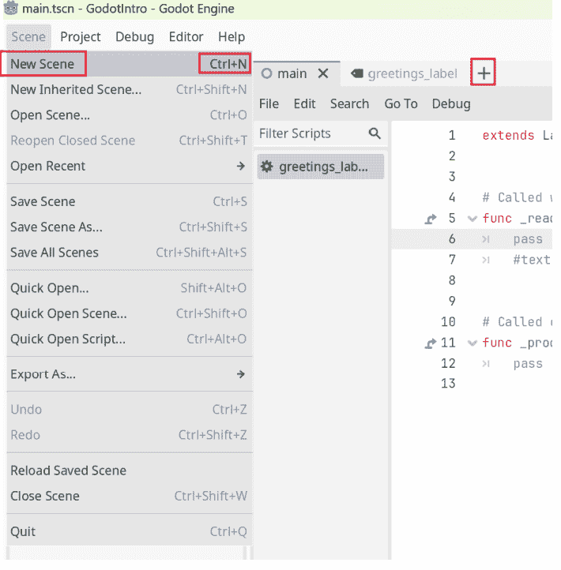

Figure 2.15 – Multiple ways of creating a new scene

- 4. 现在通过按 Ctrl + A、点击场景视图中的 + 图标，或点击 Other Node 按钮来添加场景的父节点或主节点：

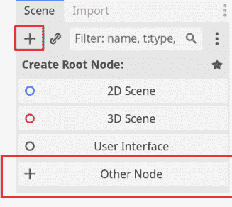

Figure 2.16 – Multiple ways to add a node to a scene

- 5. 搜索 Sprite2D 节点并添加它：

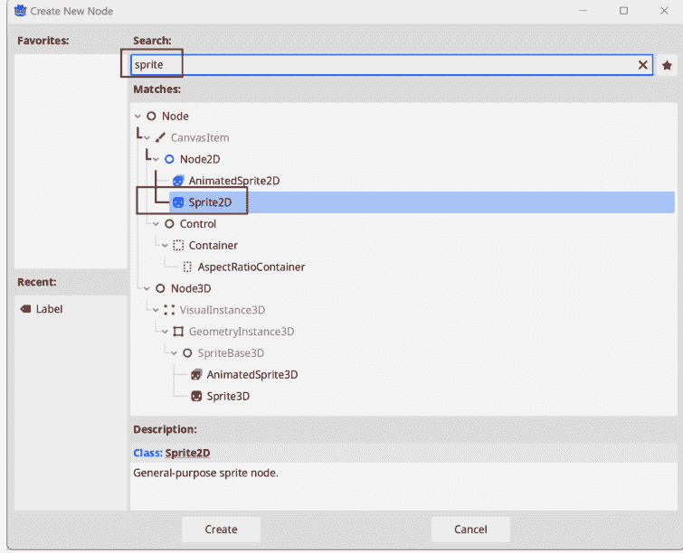

Figure 2.17 – Add a Sprite2D node to the scene

- 6. 将节点重命名为 Player：

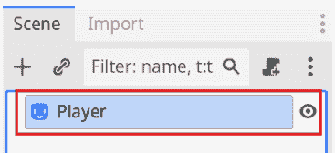

Figure 2.18 – Sprite2D renamed as Player

- 7. 现在按 Ctrl + S 将场景保存为 player.tscn 到我们的 Scenes 文件夹中：


Figure 2.19 - The saved player.tscn scene

- 8. 确保你处于 2D 视图。如果需要，通过点击屏幕顶部的 2D 切换到它。

- 9. 现在将你选择的角色图像拖放到 Player 节点的 <Empty> Texture 属性上：


Figure 2.20 - Place your character image in the Texture property of the Player node

- 10. 现在你的角色已在 Player 场景中：


Figure 2.21 – The Player sprite in the Viewport


11. 现在我们将为 Player 附加一个脚本。右键单击 Player 节点并选择“附加脚本...”或单击“滚动+”图标：


图 2.22 – 将新脚本附加到 Player 节点

12. 按 *Ctrl + S* 保存脚本并将其保存在 Scripts 文件夹中。现在你在 Scripts 文件夹中将有一个新的 player.gd 脚本：


图 2.23 – Scripts 文件夹中的 player.gd 脚本

在我们编写一些代码以允许玩家对不同的用户输入做出反应之前，请记住我们希望对 *左键点击*、*右键点击* 和 *Enter/回车* 被按下时显示不同的问候语。

如果你还记得我们的 LEGO 类比，我们需要将 **问候标签** 砖块（节点）附加到我们的 **玩家** 砖块（节点）上。我们通过将 greetings_label.tscn 从 **文件系统** 拖到 **玩家** 场景中的 **玩家** 节点来实现这一点：


图 2.24 – 将 greetings_label.tscn 拖到 Player 节点上使其成为子节点

在 Godot 中，原点或起始位置是从屏幕左上角或位置 0, 0 开始测量的。几乎总是情况下，你会希望保持原点不变，但仅为本示例，我们将移动它。

使用选择工具（看起来像光标）或通过在键盘上按 Q 来在视口中定位 Player 和 GreetingsLabel：


图 2.25 – 选择工具

你的 Player 场景应该看起来像这样：


图 2.26 – Player 场景

现在我们的精灵已经位于场景中心附近，我们需要编写一个脚本使其对用户输入做出响应。

## 对输入进行玩家反应脚本编写

我们编写本节代码的目标是允许用户根据按下的鼠标按钮从精灵处获得不同的响应。我们将处理三种类型的交互：

- *左键点击：* 显示问候语 **嗨，大家好！**
- *右键点击：* 显示 **Godot 很棒！**
- *按下 Enter：* 显示 **你好，世界！**

让我们首先确保问候标签初始时是隐藏的。

### 在用户提供输入之前隐藏标签

我们不希望在场景首次运行时问候语可见。我们希望通过调用其 hide() 函数来隐藏标签。

由于 _ready() 函数是在节点及其所有子节点加载到场景树后首先运行的函数，因此我们可以使用 Godot 快捷操作符 $ 访问 GreetingsLabel 节点。

一旦我们获得了对该节点的访问权限，我们只需调用 hide() 函数即可：

```gdscript
#### Called when the node enters the scene tree for the first time.
func _ready() -> void:
    $GreetingsLabel.hide()
```


重要提示

请注意 GDScript 是一种缩进语言。这意味着函数后的第一行（如前述代码中所示）会缩进一次。游戏引擎要求这样做才能使代码正常工作。我建议所有使用本书数字版的人手动重新输入代码或从本书的 GitHub 仓库复制代码文件，以避免因复制和粘贴代码而导致的错误。

有了这段代码，运行游戏时 GreetingsLabel 将不再可见。你可以通过按 F6 或单击图 2.27 所示的“运行当前场景”按钮来测试此场景：


图 2.27 – 运行当前场景按钮

你会注意到你再也看不到问候语了。

### 输入处理

现在，为了让我们的实验保持简单，我们将使用内置方法来处理输入。**内置方法** 只是指已经创建并作为 Godot Engine 组成部分的方法。你可以通过方法名以下划线开头来判断它是内置的。你到目前为止已经见过两个：`_ready()` 和 `_process()`。

对于输入，我们将使用 `_unhandled_input()`。现在不必太担心它，只要知道如果没有其他函数/方法来捕获用户输入并处理它，那么此方法将被运行。

我们声明 `_unhandled_input` 函数头，然后在函数内部处理不同类型的输入。在我们的实验中，我们正在监听两种类型的输入：*鼠标* 和 *键盘*。对于键盘，我们只监听一个键 – *Enter*。对于鼠标，我们监听 *左键点击* 和 *右键点击*。让我们更详细地看一下：

- 当我们检测到来自鼠标的输入时，我们需要再次显示标签，因此我们调用标签的 show() 函数。
  - 如果听到左键点击，我们将 **问候标签** 的文本更改为 **嗨，大家好！**
  - 如果是右键点击，我们将其设置为 **Godot 很棒！**
- 当我们检测到来自键盘的输入时，我们需要再次显示标签，因此我们调用标签的 show() 函数。
  - 如果听到按下 Enter，我们将文本设置为 **你好，世界！**

现在，让我们来看代码实现：

```gdscript
extends Sprite2D
#### This script is attached to a Sprite2D node.
#### It listens for mouse and keyboard input and displays
#### different messages on a Label depending on what was pressed.

#### Called when the node enters the scene tree for the first time (i.e.,
#### when the scene starts).
func _ready():
    # Hide the Label at the beginning so it's not visible until an input
    # event happens.
    $GreetingsLabel.hide()

#### Called every frame. 'delta' is the time in seconds since the last frame.
func _process(delta):
    # We're not doing anything every frame in this example, but the
    # function is here in case we want to later.
    pass

#### Called when the player performs an input action that hasn't already been
handled.
func _unhandled_input(event):
    # Check if the event was a mouse button press.
    if event is InputEventMouseButton:
        # Show the label whenever a mouse button is pressed.
        $GreetingsLabel.show()
        # Check which mouse button was pressed.
        if event.button_index == MOUSE_BUTTON_LEFT:
            # If the left mouse button was clicked, set the label's text
            # to "Hi Folks!"
            $GreetingsLabel.text = "Hi Folks!"

        elif event.button_index == MOUSE_BUTTON_RIGHT:
            # If the right mouse button was clicked, set the label's text
            # to "Godot is Great!"
            $GreetingsLabel.text = "Godot is Great!"

    # Check if the event was a key press.
    elif event is InputEventKey:
        # Only show the label and set the text if the Enter key was
        # pressed.
        if event.keycode == KEY_ENTER:
            $GreetingsLabel.show()
            $GreetingsLabel.text = "Hello World!"
```

现在我们已经测试了 **玩家** 场景，并且知道它按预期工作。我们可以返回到 **Main** 场景并移除 **问候标签** 节点，然后将 player.tscn 拖到 **Main** 节点上。然后再次运行游戏并检查一切是否正常工作：


图 2.28 – 我们新的 Main 场景

这是一个重要的章节，向你介绍了 Godot 的基本构建块。我建议你经常重温它，甚至可以返回章节末尾的总结，以提醒自己场景、节点和脚本的要点和目的。

## 总结

在本章中，我们探索了 Godot 4 的基础功能，从编辑现有项目和创建额外场景开始。你学习了如何导航界面、有效保存场景，并掌握了 Godot 核心的节点和场景设计理念。我们还介绍了如何通过对玩家输入做出反应使你的项目具有交互性。通过掌握这些核心概念和工具，你已迈出了自信使用 Godot 开发游戏的第一步。

在下一章中，我们将对 3D 进行介绍，并了解如何使用材质和光照。


## 在 Discord 上加入我们的社区

加入我们的 Discord 社区空间，与作者和其他读者进行讨论：

https://packt.link/godot-4-game-dev


## 3
## 3D 简介

在 Godot 中使用 3D 就像踏入游戏开发的全新维度——几乎就是字面意思！本章是您了解 Godot 中 3D 基础的入口，将引导您学习必备的工具和概念。无论您是在设计广阔的开放世界还是紧凑的 3D 拼图，这些基础技能都将为您取得成功奠定基础。

我们将首先学习如何创建 3D 对象，任何 3D 场景的构建块。接下来，我们将探讨如何通过应用材质使这些对象在视觉上更具吸引力，材质赋予它们颜色、纹理和细节。最后，我们将向您介绍光照，这是使 3D 环境栩栩如生、增加深度、氛围和真实感的关键组件。

本章我们将涵盖以下主要主题：

- 创建 3D 对象
- 为您的对象创建材质
- 为场景创建光照

到本章结束时，您不仅将了解如何构建和照亮一个简单的 3D 环境，还将对在 Godot 的 3D 工作区中导航充满信心。这些技能对于任何有志于游戏开发的人来说都是必不可少的，并为创建沉浸式的 3D 体验提供了坚实的基础。

## 技术要求

本章的代码文件可在本书的 GitHub 仓库中获取：https://github.com/PacktPublishing/Godot-4-for-Beginners/tree/main/ch3/introto3d

访问此链接查看代码运行的视频：https://packt.link/6Se0U

## 创建 3D 对象

到目前为止，我们一直专注于 2D 场景和 2D 节点，以及使用 GDScript 进行一些脚本编写。需要注意的是，您并不局限于 2D，因为 Godot 是一款功能极其强大的 3D 游戏引擎。

我们将通过在项目管理器窗口中点击 +Create 按钮来创建新的 Godot 项目，从而开始探索 3D。请记住为您的项目创建一个文件夹并命名。我将我的项目命名为 IntroTo3D，如图 3.1 所示：


图 3.1 – 创建新的 Godot 项目

默认情况下，新的 Godot 项目以 3D 视图打开——这很方便！现在我们可以创建第一个 3D 场景。由于 Godot 使用场景树结构，我们需要为树选择一个根节点。最简单的方法是点击 3D Scene 按钮：


图 3.2 – 使用 Node3D 作为根创建新的 3D 场景

您的 Godot 界面现在应如下图 3.3 所示。请注意，我们现在多了一个维度——Z——代表深度，并且我们将 Node3D 作为场景树的根。


图 3.3 – 我们第一个 3D 场景的概览

🔍 **快速提示：** 需要查看此图像的高分辨率版本吗？在下一代 Packt Reader 中打开本书或在 PDF/ePub 副本中查看。

🔒 **下一代 Packt Reader** 和一本 **免费的 PDF/ePub 副本** 已包含在您的购买中。扫描二维码或访问 packtpub.com/unlock，然后使用搜索栏按名称查找本书。请仔细检查所示的版本，以确保您获得正确的版本。


现在通过按 *Ctrl + S* 或点击 **Scene** 菜单并选择 **Save Scene** 来保存您的新场景。将场景命名为 main.tscn，如图 3.4 所示：


图 3.4 – 将我们的场景保存为主

探索场景的舞台已经准备就绪。我们可以利用快捷键轻松完成此操作。

### 在场景中移动

您可以在 3D 场景中移动，就像在大多数 3D 游戏中一样：

- 按住鼠标右键环顾四周
- 使用 WASD 在场景中飞行（按住右键时）
- 使用 E 向上飞行
- 使用 Q 向下飞行
- 使用鼠标中键围绕屏幕上显示内容的中心飞行

在 2D 中，我们使用 Sprite2D 来可视化事物。在 3D 中，我们将使用 MeshInstance3D。

在 3D 图形中，网格是 3D 对象或形状的数字模型，通过连接点（称为顶点）、线（边）和平面（面）创建。

要在场景中创建网格实例，我们可以拖入预先创建的 3D 模型，也可以与 MeshInstance3D 一起使用基本形状。为此，将新的 MeshInstance3D 节点添加到场景树中：


图 3.5 – 向我们的场景添加 MeshInstance3D 节点

虽然我们现在有了网格，但仍然没有任何可见内容。您可以将其视为没有纹理的精灵。我们需要选择一个基本形状。使用右侧的检查器窗口，点击 Mesh 属性下拉菜单并选择 New BoxMesh。

这将创建一个新的立方体，您可以使用相同的 **Select**、**Move**、**Rotate** 和 **Scale** 工具进行操作。


图 3.6 – 向我们的 MeshInstance3D 添加 BoxMesh

现在 **MeshInstance3D** 有了网格形状，我们可以在 Viewport 中看到立方体或盒子：


图 3.7 – MeshInstance3D 现在在 Viewport 中作为 3D 立方体可见

> 注意
> 
> 在 2D 中，对象的大小和位置以 *像素* 为单位测量，而在 3D 中，Godot 使用 *公制系统*，因此每个单位为 1 米，表示 1 米乘 1 米的面积。

我们可以使用 *MeshInstance3D* 中的多个简单形状制作一个 3D 棍人。查看以下结果并尝试使用 *Selection*、*Move*、*Rotate* 和 *Scale* 工具自行重现。您 *不必* 使用与我相同的形状，因此您的棍人可能看起来与我的非常不同，这也没关系。


*图 3.8 – 使用简单网格形状制作棍人*

如 *图 3.8* 所示，我结合了不同的基本形状来创建一个棍状人形。

请注意，如果您选择 *父级 StickMan* 节点，即原始的 *Node3D*，您对它所做的任何操作——例如使用 *Scale* 或 *Rotate*——都将作用于所有子节点。

## 为您的对象创建材质

在 2D 中工作时，我们为 Sprite2D 提供纹理，以便在屏幕上看到它。在 3D 中，我们使用材质。

材质描述了游戏引擎应如何显示对象。一旦网格具有材质，就可为其分配颜色和阴影等属性。它还可以与场景中的光照交互。我们的棍人已经有一个默认的灰色材质，否则我们就看不到它！

### 创建材质

Godot 将材质保存为资源。这意味着一旦我们创建了一个材质，就可以在不同的对象上反复使用。让我们在 FileSystem 中创建一个名为 Materials 的新文件夹：


图 3.9 – Materials 文件夹

现在右键单击 Materials 文件夹，选择 Create New，然后选择 Resource...：


图 3.10 – 创建新资源

在接下来显示的 Resource 菜单上，搜索 material，选择 StandardMaterial3D，并为其命名。我将其命名为 stick_material.tres：


图 3.11 – 添加 StandardMaterial3D

创建材质后，可以在检查器窗口中修改它。材质具有许多可更改的属性，例如纹理、粗糙度、光泽度、颜色和透明度。我们可以通过点击 Albedo 下拉菜单并选择喜欢的颜色来更改材质的颜色：


图 3.12 – 在 Albedo 下拉菜单中更改材质颜色

单词 albedo 来自拉丁语 albus，简单意思是白色。Albedo 传统上用于更改材质的颜色和透明度。

我选择了棕色，使材质看起来更像木头。现在尝试调整 Roughness 值以进一步改善外观：


图 3.13 – Roughness 的值范围为 0 到 1


可以用来实验的材料选项非常多。然而，如果你真的想创建看起来像要复制的物体的材质，我建议使用诸如 **Material Maker** 这样的工具，它是免费的，并且使用 Godot Engine 制作：

https://rodzilla.itch.io/material-maker

## 应用材质

实际上，将材质应用到网格上就像把材质资源文件拖放到视口中的网格上一样简单！

你可以在图 3.14 中看到这种效果：


图 3.14 – 将你的材质拖放到你的网格上

正如你在图 3.14 中看到的，当你把材质放在其中一个网格形状上时，网格会立即采用该材质的颜色和纹理。

如果你更改材质的任何属性，已应用该材质的任何网格也会实时更新。我建议你现在就试试看效果。

你可以在图 3.15 中看到这种效果——所有网格都已用新材质更新：


图 3.15 – 更改粗糙度更新了所有网格上的材质

你注意到材质的粗糙度如何改变了棍人看起来？

## 挑战自己

在本小节中，我们将挑战自己练习刚刚学到的技能。

尝试复制图 3.16 中显示的三种材质。第一种仅使用 Albedo，粗糙度低且金属度值高。第二种使用 Transparency，第三种具有 Texture 值。


图 3.16 – 金属（左）、透明（中）和纹理（右）材质

为了完成挑战，首先，在场景中添加三个 MeshInstance3D 节点。在检查器窗口中，选择一个基本的 CapsuleMesh 并通过按 `Ctrl + D` 复制它。

这些步骤的预期结果如图所示 3.17：


图 3.17 – 具有 CapsuleMesh 形状的三个 MeshInstance3D 网格

挑战的下一步是创建第一个材质。

### 第一个材质

现在我们需要在 **Materials** 文件夹中创建三个新资源。我们将为每个材质使用 **StandardMaterial3D** 资源。为了便于识别，将材质命名为 `metal_material.tres`、`transparent_material.tres` 和 `textured_material.tres`：


图 3.18 – 我们的新材质

你可以将每个材质点击并拖放到每个胶囊上，这样如果我们开始更改材质属性，我们将实时看到网格更新：


图 3.19 – 将你的材质拖放到胶囊上

在你的金属材质上，打开 Albedo 属性并将颜色更改为挑战中的那种颜色（天蓝色）。另外，调整粗糙度和 Metallic 属性，直到你满意它看起来像金属一样闪亮和反射。


图 3.20 – 创建闪亮的金属材质

注意图 3.20 中你应该调整的属性以创建想要的金属效果。

### 第二个材质

再次开始，通过将材质的 **Albedo** 属性更改为明亮的粉红色以匹配挑战。同时将 **Alpha** 通道降低到大约一半。你会注意到现在没有效果。这是因为我们需要调整 **Transparency** 属性以使用 **Alpha**。


图 3.21 – 创建透明粉红色胶囊

注意图 3.21 中材质的属性，你需要调整它们以创建想要的透明效果。

### 第三个材质

最终材质使用纹理而不是颜色。纹理只是一个图像，包裹在胶囊形状周围。我们可以简单地使用我们在第 2 章中在 2D 中工作时为精灵使用的相同机器人图像。展开 Albedo 下拉菜单并将图像拖到空的 Texture 属性上：


图 3.22 – 向材质添加纹理

你可以看到平面的 2D 机器人图像已被应用到胶囊形状上并被拉伸在其周围。

任何 3D 场景的另一个基本部分是照明。在下一节中，我们将探索不同类型的灯光以及如何在 3D 场景中有效地使用它们。

## 为场景创建照明

为了影响情绪和氛围，并视觉上增强游戏，照明至关重要。良好的照明增加深度，突出细节，并可以引导玩家的注意力，这一切都使游戏世界更具沉浸感和吸引力。

Godot 提供了多个照明节点。我们现在将查看其中几个主要节点。我们将把这些节点添加到当前场景并检查它们对三个胶囊的影响。

点击场景树中的 + 以向场景添加新节点。使用关键字 light 搜索。你会看到 Godot 中有三种与光相关的节点类型，如图 3.23 所示：


图 3.23 – Godot 中的三个主要光节点

**Directional light** 通过在整个 3D 场景上投射平行光线来模拟阳光，提供来自特定方向的一致照明，使其非常适合户外环境。现在是时候在 Godot 中实现定向光了。

### Directional light

添加一个 **DirectionalLight3D** 节点到场景。这种类型的光模仿太阳并以平行光线的形式向单一方向发出无限光线。它用于远离场景且强度高的光线。

在视口中，该节点是一个指向光线来源方向的白色箭头。你可以 *rotate* 该节点以更改光线的方向。该节点的位置不会影响场景，因为光线来自四面八方。

尝试旋转灯光以查看它对场景的影响。你也可以在 **Inspector** 窗口中更改灯光的 **Color** 和 **Energy** 属性。

你可以在图 3.24 中看到光线来源方向显示为一个大的 *white arrow*：


*图 3.24 – 注意金属胶囊中的反射就像太阳正好在头顶一样*

金属表面会反射光线，如图 3.24 所示。

在图 3.25 中，你可以看到 Color 和 Energy 属性，可以调整它们来改变光线的颜色和强度：


图 3.25 – DirectionalLight3D 的 Color 和 Energy 属性

在我们向场景添加新灯光之前，点击眼睛图标将 DirectionalLight3D 节点的可见性切换为关闭，以便我们可以看到下一个灯光的效果：


图 3.26 – 将 DirectionalLight3D 节点的可见性切换为关闭

点击场景树中的 + 以向场景添加新节点。使用关键字 light 搜索（参见图 3.23）。

### Omni light

添加一个 OmniLight3D 节点到场景。该节点从单点向所有方向发出光线，就像灯泡一样。与现实生活中的灯泡一样，越靠近它越亮。你可以通过点击其线框边缘出现的橙色圆圈来调整灯光的范围，如图 3.27 所示：


图 3.27 – OmniLight3D 范围手柄

你也可以更改 **OmniLight3D** 的 **Color** 和 **Energy** 属性。然而，没有表面反射时很难看到。按照以下步骤修复此问题：

- 1. 利用你的新技能通过添加另一个 **MeshInstance3D** 节点来为场景添加地面表面。将它重命名为 Ground。
- 2. 给它 **PlaneMesh** 形状。缩放并移动平面，使其看起来像胶囊下方的大地板。


-   3. 创建一个新的材质并将其保存为 `ground_material.tres`。
-   4. 将材质的 **Albedo** 属性设置为 **白色** 并将其应用到 **Ground**。它应该看起来像 *图 3.28* 一样：


*图 3.28 – 添加了白色材质的地面平面网格*

继续尝试更改 **OmniLight3D** 的 **Color** 和 **Energy** 属性。注意它如何改变场景的氛围。

你在 *图 3.29* 中看到地板上灯光的 *红色* 光晕吗？


图 3.29 – 更改 OmniLight3D 的颜色属性

你也可以使用 DirectionalLight3D 启用阴影。但是，要看到阴影，你需要将 DirectionalLight3D 的 Energy 属性设置为 0 以将其关闭。然后阴影将由 OmniLight3D 投射。打开 Shadow 属性下拉菜单并启用它：


图 3.30 – 在 DirectionalLight3D 上启用阴影

一旦启用了阴影，你就可以看到场景中物体投射的阴影，如图 3.31 所示。有时由于 Godot 4 中的错误，阴影不会出现。在这种情况下，你应该保存你的工作并重新启动引擎。


图 3.31 – 由 DirectionalLight3D 投射的阴影

现在我们只有一个灯光可以继续实验。

## Spotlight

就像在剧院一样，SpotLight3D 是一个节点，它以锥形朝单一方向发射光线。这对于前照灯或路灯等灯光效果很好。通过在场景树中点击它们右侧的眼形可见性切换按钮来禁用 OmniLight3D 和 DirectionalLight3D。

现在向场景中添加一个 Spotlight3D 节点。你将看到灯光的锥形线框，并且我们再次可以使用小橙色圆圈来改变灯光的范围和角度。

你可以在图 3.32 中看到斑点将投射的光锥显示为白色锥体：


图 3.32 – 将 SpotLight3D 放在我们的纹理胶囊网格上

当然，我们也可以更改灯光的 **Color** 和 **Energy** 属性，并且我们可以像对 **DirectionalLight3D** 所做的一样启用阴影：


*图 3.33 – 更改聚光灯的颜色和角度并启用阴影*

现在你知道如何在 Godot 中添加和操作三种类型的灯光，你就拥有了为你的 3D *Made in Godot* 游戏营造合适氛围的工具。

## Summary

在本章中，你迈出了使用 Godot 进行 3D 游戏开发的第一步。你学习了如何使用网格创建基本的 3D 对象，为你的场景提供构建模块。然后我们探讨了如何通过应用材质、添加颜色、纹理和深度来增强这些对象，使其栩栩如生。最后，我们介绍了照明，演示了如何使用不同类型的灯光来营造氛围、突出重要区域并为场景增添真实感。

通过掌握这些技能，你现在拥有设计和照亮简单 3D 环境的工具，为你在游戏开发之旅中继续进行更复杂的项目奠定了基础。

在下一章中，我们将详细了解如何使用 GDScript，这是一种专为与 Godot Engine 配合使用而设计的内置编程语言。

## Unlock this book’s exclusive benefits now

扫描此二维码或访问 packtpub.com/unlock，然后按名称搜索本书。

*注意：在开始之前请准备好你的购买发票。*


## 4

## Scripting with GDScript

在本章中，你将开始使用 GDScript 的旅程，GDScript 是 Godot 核心的脚本语言。脚本是游戏开发的关键部分，使你能够控制游戏世界中的行为和交互。通过学习 GDScript，你将获得定义游戏机制、创建动态交互并构建超出静态资源的功能的能力。

我们将首先向你展示如何在 Godot 中创建、编辑和保存脚本。然后，我们将向你介绍关键的编程概念，例如变量和数据类型，以及它们如何与 Godot 的执行顺序协同工作。你将探索允许你执行计算和比较的数学和逻辑运算符，然后介绍使用 if、else if 和 else 语句进行决策。

最后，我们将深入探讨函数的使用，包括内置函数和自定义函数，以高效地组织你的代码。

在本章中，我们将涵盖以下主要主题：

-   Understanding GDScript
-   Creating scripts
-   Understanding functions
-   Understanding variables
-   Understanding operators
-   Relational and comparison operators
-   Using custom functions

到本章结束时，你将具备脚本化基本游戏机制的基础知识，并能够自信地控制游戏的逻辑和流程。

## Technical requirements

本章的代码文件可在本书的 GitHub 仓库中获取：https://github.com/PacktPublishing/Godot-4-for-Beginners/tree/main/ch4/introtoscripting

访问此链接查看代码运行的视频：https://packt.link/1mzgi

## Understanding GDScript

Godot 拥有自己的内置脚本语言 GDScript，这是一种类似于 Python 的高级编程语言。与 Python 不同，GDScript 针对 Godot 的基于场景的设计理念进行了优化，并且可以指定变量的严格类型。

脚本用于为我们的节点编程自定义行为。在接下来的几个小标题中，我们将了解如何创建脚本、编辑它们并保存它们。

## Creating scripts

我们已经使用过脚本，但重复是良好的老师。所以，让我们记住脚本通常附加到节点上。

首先创建一个新的 Godot 项目。我将其命名为 IntroToScripting。现在创建一个新的 2D 场景，这将在场景树中为我们提供 Node2D 作为根节点。

有几种不同的方法可以将脚本附加到此节点。选择 **Node2D**，在 **Inspector** 中找到 **Script** 属性，然后从 `<empty>` 下拉菜单中选择 **New Script...**。


图 4.1 – 通过 Inspector 为节点添加新脚本

你也可以对想要附加脚本的节点进行 *右键单击*，然后在弹出菜单上点击 **Attach Script...** 或点击带有加号的脚本图标。


图 4.2 – 通过右键单击节点附加脚本

为你的脚本命名，例如 IntroToScripting，然后点击 Create。


图 4.3 – 命名并创建脚本

现在我们面前出现了脚本编辑器。这就像 Godot 中 GDScript 编程语言的内置 **Integrated Development Environment (IDE)**。与其它引擎相比，这是 Godot 的一个主要优势，因为你不需要依赖第三方程序进行编码。

如果你查看 *图 4.3*，你会看到我们创建脚本时勾选了 **Template** 旁边的复选框以使用默认节点。这意味着脚本将被预先填充一些代码。

在 *图 4.4* 中，我们可以看到在脚本编辑器中预先填充的生成代码：


图 4.4 – 脚本编辑器

如 *图 4.4* 所示，我们的脚本文件现在已出现在 **FileSystem** 下，并带有 .gd 扩展名。此外，我们可以看到两个列表：**Filter Scripts**，其中包含我们的新脚本；以及 **Filter Methods**，其中包含脚本中存在的函数。请注意，我还将 **Node2D** 重命名为 IntroToScripting 以匹配我的脚本名称。

脚本编辑器带有代码格式化功能。你可以看到格式化是因为代码的不同部分颜色不同。这有助于我们快速理解和识别代码的各个部分。你会注意到 func 关键字为红色，函数名为蓝色。**Auto-complete** 也是一个功能，编辑器会尝试预测你正在输入的内容并提示选项。这提高了效率，并在你不确定名称时帮助你找到事物。


让我们逐行分析图 4.4 中显示的代码：

- 1. **第 1 行：** extends 关键字为红色，因此我们知道它是一个关键字，而 Node2D 为深绿色，表示它是一个类引用。

GDScript 是一种面向对象编程语言，这意味着它将代码组织成类。可以把类想象成创建某物的蓝图。Node2D 是 Godot 中的内置类，已由开发者定义。通过编写 extends Node2D，我们是在告诉 Godot 我们希望使用 Node2D 的所有功能，同时添加自己的新特性和行为。

- 2. **第 4 行：** 该行为灰色，表示它是一条注释。这行是由程序员编写的，用来解释其后代码的作用。它有助于使代码更易于理解。井号符号（#）告诉计算机在运行程序时忽略该行；它只是给人类阅读的。

- 3. **第 5 行：** func 关键字为红色，表示它是 GDScript 中的特殊关键字。_ready() 为浅绿色，表示它是由开发者为我们创建的内置函数。圆括号 () 告诉我们这是一个方法，而冒号 : 表示其后缩进的所有内容都属于该方法。

- 4. **第 6 行：** pass 关键字告诉计算机跳过该行。函数不能为空，因此 pass 可防止程序报错。这里还有一个内联注释，它是一个提醒，提示你用自己的代码替换此行以在此函数中执行操作。

- 5. **第 9 行：** 此处的注释解释了 _process 函数在游戏的每一帧运行一次。可以把帧想象成快速动画中的一张图片。游戏每秒显示大量帧以创建流畅的运动。delta 变量是当前帧与上一帧之间的时间差，我们使用它来确保游戏的移动和动画保持流畅和一致，无论运行游戏的计算机快慢如何。

- 6. **第 10 行：** 我们再次看到 func 关键字，它告诉我们正在定义一个函数。_process 显示为绿色，表示它是 Godot 提供的内置函数。在括号内，我们看到单词 delta。这是一个参数，就像一小段信息被传递给函数以帮助它执行任务。在这种情况下，delta 用于表示帧之间的时间，确保游戏流畅运行。

- 7. **第 11 行：** pass 关键字再次出现。pass 关键字告诉计算机跳过该行。函数不能为空，因此 pass 可防止程序报错。

现在你已经学习了脚本的基础知识，下一个部分将探讨 GDScript 中最重要工具之一：函数。我们将深入了解函数的工作原理，从诸如 _ready 和 _process 之类的内置函数开始，它们有助于控制游戏的流程和行为。

## 理解函数

一个 **函数** 就像一组指示计算机执行特定操作的指令。可以把它想象成代码内部的一个迷你程序。你给它一个名字，当你 *调用* 这个名字时，函数就会运行并完成其工作。例如，如果你有一个名为 player_jump() 的函数，每次调用它时，计算机都会按照该函数中的步骤让玩家跳跃。函数有助于组织代码，因此你不必重复编写相同的指令。

有些函数是内置的，因为编程语言或引擎（如 Godot）的创建者已经创建了它们来处理常见或必要的任务。

例如，有一个内置函数告诉游戏每帧更新屏幕。你不需要自己编写，因为几乎每个游戏都需要它，而且可以节省时间。

但我们也需要编写自己的函数，因为每个游戏或程序都不同。你可能想要创建一个以特殊方式移动角色的函数，或检查玩家是否赢得关卡的函数。由于只有你知道游戏确切需要做什么，因此可以创建自定义函数来处理这些特定任务。

在 Godot 中，诸如 _ready 和 _process 之类的内置函数在控制游戏行为和随时间更新方面发挥着至关重要的作用。以下是这些函数各自的作用：

- _ready: The _ready 函数就像节点的 *起点*。可以把它想象成一切准备就绪、即将开始的时刻，就像戏剧开场时幕布升起一样。_ready 函数是在节点连同其所有子节点进入场景树后运行的第一个函数。节点从底部到顶部加载，子节点在父节点之前加载。你可以在此函数中放置任何想要在对象准备好时立即运行的代码，例如在屏幕上显示角色或开始动画。

- **_process**: The _process 函数就像游戏对象的 *心跳*。它会重复运行，每帧运行一次（就像游戏的每一张快照）。你可以用它来持续更新事物，例如移动角色或跟踪时间。函数中的 delta 是一个小值，告诉你自上一帧以来经过了多少时间，这样你就可以确保一切顺利进行，无论计算机运行游戏的速度快慢。

现在你了解了函数的工作原理，可以掌握游戏循环的概念。

## 理解游戏循环

大多数游戏都在一个循环内运行，该循环不断更新游戏中的情况——例如移动角色、检查碰撞以及将图形绘制到屏幕上。这被称为 **游戏循环**。它每秒运行多次（通常为每秒 60 次或更多），每次运行时都会更新并重绘游戏。

在 Godot 中，你通常不需要自己编写循环。相反，Godot 会为你处理它，并提供特殊函数供你接入游戏循环。后续章节将讨论其中三种最常见的函数。

### _ready()

此函数在节点及其子节点被添加到场景树并准备就绪时调用一次。它就像在游戏开始前搭建你的乐高模型。

使用 _ready() 执行以下操作：

- 设置初始值
- 连接信号
- 开始时隐藏或显示内容
- 准备只需发生一次的内容

### _process(delta)

此函数每帧运行一次。它用于应不断发生的事情，例如检查输入、更改动画或平滑移动某物。

使用 _process(delta) 执行以下操作：

- 玩家输入
- 动画
- UI 更新
- 与物理无关的更新

请注意，delta 是自上一帧以来经过的时间（以秒为单位）。这有助于在帧率变化时保持移动流畅。

### _physics_process(delta)

这与 _process 类似，但以固定速率运行（默认为每秒 60 次）。这使其非常适合涉及物理的任何事物，例如带碰撞的角色移动。

使用 _physics_process(delta) 执行以下操作：

- 物理计算
- 使用 move_and_slide() 或 move_and_collide() 的移动
- 重力和跳跃

为了演示 physics_process 函数的工作原理，请按照以下步骤操作：

- 1. 创建一个新场景，以 Sprite2D 作为根节点，如图 4.5 所示：


图 4.5 – 将 Sprite2D 节点作为场景的根节点

- 2. 使用 Godot icon.svg 文件作为精灵的纹理。

- 3. 通过右键单击节点并选择 Attach Script... 或单击带有 + 符号的脚本图标，将脚本附加到节点。将以下代码添加到脚本中：

```
extends Sprite2D
var speed = 100
var velocity = Vector2.ZERO

func _ready():
    print("Sprite is ready to move!")

func _process(delta):
```

```
#### Check input and set direction
velocity = Vector2.ZERO
if Input.is_action_pressed("ui_right"):
    velocity.x += 1
if Input.is_action_pressed("ui_left"):
    velocity.x -= 1

func _physics_process(delta):
    # Move the sprite using physics
    position += velocity * speed * delta
```

💡 **快速提示：** 借助 AI 代码解释器和快速复制功能提升你的编码体验。在 next-gen Packt Reader 中打开本书。点击复制按钮 (1) 即可快速将代码复制到你的编码环境，或点击解释按钮 (2) 让 AI 助手为你解释一段代码。

```
function calculate(a, b) {
    return {sum: a + b};
};
```

🔒 下一代 Packt Reader 随本书购买免费提供。扫描二维码或访问 packtpub.com/unlock，然后使用搜索栏按名称查找本书。请仔细核对所示的版本以确保获取正确版本。


运行场景时，场景加载后你会在输出窗口中看到消息出现，然后你可以使用方向键将精灵向左和向右移动，游戏循环会不断更新屏幕。

在下一节中，我们将探讨编程中最基础的方面之一——变量。你将了解变量是什么、它们如何存储数据，以及它们如何用于管理游戏信息，例如玩家状态、分数等。

## Understanding variables

把变量想象成一个贴了标签的盒子，可以用来存储信息。就像你可以把东西放进盒子里然后稍后再使用一样，变量保存着一段信息，例如数字或单词，你可以在程序运行期间使用并更改它。

例如，如果你正在制作游戏并想跟踪玩家的生命值，你会创建一个名为 health 的变量。每当玩家找到一个心形道具或受伤时，你就可以增加或减少 health 变量。它帮助你的程序记住并处理数据，就像盒子在你需要时保存你的东西一样。

我们可以在变量中存储不同类型的数据，但最常见的是以下几种：

- 整数（整数）例如 1, 2, 3
- 实数（浮点数或小数）例如 0.1, 0.2, 0.3
- 文本字符串（字符集合）例如 Hello World, ABC, "@: !3"
- 布尔值（真假值）例如 True, False, 0, 1

在下一节中，我们将探讨变量这一编程中的基本概念。你将学习如何在 Godot 中定义变量并遵循在脚本中组织它们的最佳实践。

## Creating a variable

在编程中，将变量放在脚本顶部、类的定义或扩展之下是一个良好的实践。我们将把变量放在 extends Node2D 行下方。

变量需要通过为其命名并存储值来定义。我们写 var 关键字来告诉编译器这是一个变量。现在我们通过给它命名来标识变量（我们将使用名称 health）。要为其赋值，我们使用等号。这在编程中称为赋值运算符，它与数学中的相等不同。它的作用是将右侧的值赋给左侧的变量。

最后，我们必须分配一个初始或默认值——在本例中，我们将 health 设置为 100：

```gdscript
extends Node2D
var health = 100
```

创建变量并赋值只是为了将值存储在计算机的内存中。我们可以通过使用变量的名称来访问该值。然后我们可以对该值做一些事情，例如将其输出到屏幕上。

为此，我们需要调用内置的 print 函数并提供要打印的变量名称。我们只能在节点准备好后显示此值。调用 print 函数的最佳位置是从 _ready 函数中：

```gdscript
extends Node2D
var health = 100

#Called when the node enters the scene tree for the first time.
func _ready():
    print(health)
```

接下来，运行程序。如果提示，请选择将当前场景用作主场景。请注意，你不会在游戏窗口中看到任何输出。相反，该值将显示在输出窗口的控制台中。


图 4.6 – health 变量的值显示在输出控制台中

在建立了变量之后，了解它们可以保存的不同数据类型非常重要。在下一节中，我们将探讨数据类型，它定义了变量存储的信息类型，从数字到文本等等。

## Data types

我在章节开始时提到了可以在变量中存储的不同数据类型。把数据类型想象成用于保存特定类型信息的不同容器可能会有所帮助。就像你不会把水存放在纸盒里或把食物放在瓶子里一样，在编程中，你会根据处理的数据类型使用不同类型的变量。

这里有一些例子：

- 数字存放在名为 int（用于整数）或 float（用于带小数点的数字）的容器中
- 文本存放在名为 string 的容器中，表示像串在绳子上的珠子一样分组的字符（字母、数字或符号）
- Boolean 只保存 true 或 false——就像简单的 yes 或 no 答案

使用正确的类型有助于程序知道预期内容以及如何处理信息。

由于 GDScript 与 Python 一样是一种动态编程语言，我们不必指定要存储的变量类型。这使编程更快。然而，随着程序变大，更多团队成员参与项目，通过指定变量的数据类型更容易找到错误和 bug。

这将防止人们尝试在错误的变量中存储错误类型的数据。

我们可以按如下方式更改 health 变量：

```
extends Node2D
var health : int = 100
```

这不会影响程序输出。

当我们想要对值进行精细调整时，例如更精细地控制玩家的跳跃高度，我们可以使用 float。这是一个十进制数，可以按如下方式创建：

```
extends Node2D
var health : int = 100
var jump_strength : float = 220.5
```

在这段代码中，我们声明了一个名为 jump_strength 的变量，并指定其数据类型为 float，这允许它存储十进制数。通过将其设置为 220.5，我们可以更精确地控制角色可以跳多高，因为小数值比整数提供更精细的调整。这对于跳跃高度等游戏机制尤其有用，因为微小的调整可能会对游戏玩法产生很大影响。

在下一节中，我们将探讨编程中的命名约定，这是为变量、函数和其他元素命名的重要指南。遵循这些约定不仅使代码更易于阅读和理解，还有助于避免错误和混淆，防止项目增长时出现问题。

## Naming conventions

我们为节点、场景、变量和函数命名的方式也很重要。命名约定就像是在编程中为事物命名（如变量、函数或类）的指南。它们有助于使你的代码更易于阅读和理解，不仅对你自己，也对可能参与你项目的其他人。

良好的命名约定能清楚地表明某物的作用。想象一下，如果你随意命名，例如将玩家的分数命名为 x，将敌人的生命值命名为 y。这会令人困惑且难以跟进，尤其是在大型项目中。

通过遵循命名约定，你可以保持代码的有序和可读性，使其更易于维护和与他人共享。

GDScript 和 Godot 开发者使用的命名约定如下：

- **snake_case**：用于场景、变量和函数。它被称为 snake_case，因为每个新词都用下划线连接，使组合看起来像一条小蛇。
- **SCREAMING_SNAKE_CASE**：用于常量。所有字母字符均为大写。
- **PascalCase**：用于场景中的类和节点。每个新词都以大写字母开头。

在命名事物时最重要的要素是名称应有意义且描述性，以便程序具有自文档化特性。

通常，为了冷却和测试游戏中事物的状态，我们会使用 Boolean 值。例如，可以检查玩家是否正在冲刺：

```
extends Node2D
var health : int = 100
var jump_strength : float = 220.5
var is_dashing : bool = true
```

在前面的代码中，声明了一个名为 is_dashing 的 Boolean 变量并将其初始化为值 true。这意味着玩家当前处于冲刺状态。像这样的 Boolean 变量通常用于跟踪游戏中某个条件是否为真或假。

我们在这里要查看的最后一个变量是 String。String 用于存储字符组合，最常见的是用于存储文本。请注意，当我们定义 String 时，我们用大写字母书写。这是因为 String 是一个类，与其他数据类型不同，因为它不是原始类型。此外，String 与之关联了许多方法。我们可以使用 String 来存储玩家的名字。

在下一个示例中，我们声明并初始化一个 String 变量。Strings 用于存储文本，例如玩家的名字。下面的代码行创建了一个名为 player_name 的变量并为其分配默认值 "Unknown Player"。这使我们能够在游戏中存储和显示玩家的名字。

如果你查看以下代码，你会注意到字符串被分配了自己独特的金色，以便在代码中轻松识别。

```
extends Node2D
var health : int = 100
var jump_strength : float = 220.5
var is_dashing : bool = true
var player_name : String = "Unknown Player"
```

在即将到来的章节中，我们将探讨编程中运算顺序的概念。理解操作如何按特定顺序执行对于编写准确高效的代码至关重要。这确保计算和逻辑按正确的顺序执行以实现预期结果。


## 理解运算符

**运算符**是编程中用于执行操作的符号。

这些运算符是必不可少的工具，可让你执行不同的操作，例如数学计算、比较和逻辑评估，帮助你控制代码的行为以及与数据交互的方式。

首先，让我们来看一下**数学运算符：**

- **加法：** + 号用于按一定量增加变量的值
- **减法：** – 号用于按一定量减少变量的值
- **乘法：** * 号用于将变量的值乘以另一个值
- **除法：** / 号用于将变量的值除以另一个值

我们可以用程序中的 player_level 变量来尝试使用这些运算符。

在我们的代码中，玩家等级为 23。如果我们加上 7，它将变为 30。看这里的 _ready 函数即可看到实际效果：

```
func _ready():
    print(player_name)
    print(player_level)
    print(player_exp)
    print(has_key)

    player_level = player_level + 7
    print(player_level)
```

你现在会注意到输出首先是 23，然后再次打印时，它会变为 30。

需要注意的是，赋值操作是从右到左执行的。在这种情况下，我们取值为 7，将其加到 player_level 的当前值上，然后使用赋值运算符 (=) 将结果存储回左侧的 player_level 变量中。这意味着 player_level 的现有值会被新的结果更新。

编程时，我们总是希望关注效率，这意味着避免重复。如你所见，我们重复了变量名。为了避免这种情况，我们可以使用一个名为快捷运算符的新运算符，并更有效地重构代码如下：

```
#player_level = player_level + 7
player_level += 7
print(player_level)
```

如果我们想将等级降到 0，可以减去 30：

```
player_level -= 30
print(player_level)
```

我们也可以对乘法和除法做同样的操作：

```
25  >>  player_level *= 2
26  >>  print (player_level)
27  >>
28  >>  player_level /= 2
29  >>  print (player_level)
```

图 4.7 – 乘法和除法

你也可以将变量相加。如果我们创建一个名为 spike_damage 的变量，那么每次玩家撞到尖刺时，我们就可以按该值减少其生命值：

```
30  >>  var spike_damage : int = 10
31  >>  print(health)
32  >>  health -= spike_damage
33  >>  print(health)
```

图 4.8 – 使用 spike_damage 变量

在开始解决更复杂的表达式之前，了解数学中运算执行的顺序非常重要。

## 运算顺序

尽管计算机一次从程序顶部到底部运行一行代码，就像烹饪一样，你需要按一定顺序做事（比如烘烤前先混合配料），在数学和编程中，计算有一个特定的执行顺序。

运算顺序告诉计算机先执行计算的哪一部分。这里有一个简单的方法使用 **PEMDAS** 来记住它：

- **括号：** 先计算括号内的内容
- **指数：** 然后计算幂或根（例如对数字求平方）
- **乘法和除法：** 接下来，从左到右进行乘法和除法
- **加法和减法：** 最后，从左到右进行加法和减法

例如，在表达式 3 + 5 * 2 中，计算机首先进行乘法（5 * 2 = 10），然后进行加法（3 + 10 = 13），因为在运算顺序中乘法优先于加法。

理解这一点很重要，因为它确保你的计算是正确的！

## 练习

为了练习使用变量，请尝试创建四个可用于存储玩家信息的变量。这些变量应使用不同的数据类型。

*本练习还引入了一个重要概念：变量作用域 – 请在下面的解释中注意它。*

四个变量如下：

- 玩家姓名
- 玩家等级
- 玩家经验值
- 玩家是否有钥匙？

练习的解决方案如下：

- `var player_name : String = "Riptide"`
- `var player_level : int = 23`
- `var player_exp : float = 123.45`
- `var has_key : bool = false`

我们可以在 _ready 函数中将它们全部打印出来，每行一个：

```
func _ready():
    print(player_name)
    print(player_level)
    print(player_exp)
    print(has_key)
```

执行上述代码将把值打印到控制台。

## 变量作用域

在之前的解决方案中，变量是在 _ready 函数内声明并初始化的。这将变量的作用域限制为局部，意味着它只能在声明它的 _ready 函数内访问。与类变量（在程序顶部定义并可在整个类中访问）不同，局部变量只能在定义它的特定函数或代码块中使用。这就是变量作用域。


在下一节中，我们将探索 Godot 中的关系运算符和比较运算符。这些运算符允许你比较值，帮助你的代码通过检查条件（例如一个值是否大于、小于或等于另一个值）来做出决策。

## 关系运算符和比较运算符

通常，我们需要比较值以确定它们是否满足特定条件——真或假。这允许我们的代码分支并根据比较结果执行不同的操作。为了评估这些条件，我们使用关系运算符，帮助我们比较值。

可用于比较的不同运算符如下：

- **相等：** 两个等号 (==) 用于测试两个值是否相同
- **大于：** 使用尖括号 (>)，我们可以比较一个值是否更大
- **大于或等于：** 使用 (>=)，我们可以测试该值是否大于或等于另一个值
- **小于：** 使用尖括号 (<)，我们可以比较一个值是否更小
- **小于或等于：** 使用带等号的尖括号 (<=)，我们可以测试该值是否小于或等于另一个值
- **不相等：** 使用感叹号和等号 (!=)，我们可以测试一个值是否与另一个值不相同

我们将这些运算符与 if 语句一起使用，if 语句是编程中的基础。这些 if 语句允许我们检查条件是否成立，只有在为真时语句内的代码块才会运行。这使我们的游戏更灵活，能够根据测试条件的結果执行不同的操作。

所有这些都在以下代码中演示：

```
var player_lives : int = 3
if health == 0:
    player_lives -= 1

if player_lives < 1:
    print("GAME OVER!")

if player_lives <= 0:
    print("GAME OVER!")

if spike_damage > health:
    print("GAME OVER!")

if player_exp >= 1000:
    player_level += 1
    print("LEVEL UP")

if has_key != true:
    print("DOOR LOCKED")
```

在上述代码中，我们的游戏会根据比较的变量值产生不同的输出。

为了让游戏根据某些条件做出不同的响应，我们可以使用 if、elif 和 else 关键字。if 语句检查条件是否成立并运行其中的代码。如果条件为假，我们可以使用 elif（else if 的简写）来检查另一个条件。最后，else 用作默认值，如果之前的所有条件都不成立则运行。

例如，假设我们想检查玩家拥有的生命值数量并相应地做出响应，如以下代码所示：

```
if player_lives > 0:
    print("Keep playing!")
elif player_lives == 0:
    print("Game Over!")
else:
    print("Invalid number of lives!")
```

上述代码允许玩家在仍有生命值时继续游戏；如果没有，则打印游戏结束，对于异常值则显示错误。

## 练习

为了获得一些实践经验，请编写一个脚本，使用我们创建的 health 变量检查玩家的健康状况。根据其健康状况显示不同的消息。

- 如果 health 为 80 或以上，打印 "You're in great shape!"
- 如果 health 在 50 到 79 之间，打印 "You're doing okay, but be careful!"
- 如果 health 低于 50，打印 "Warning! Your health is low!"
- 如果 health 为 0 或更低，打印 "Game over! You've run out of health."

使用 if、elif 和 else 语句完成此任务。

解决方案如下：

```
#### Check the player's health and print the appropriate message
if health >= 80:
    print("You're in great shape!")
elif health >= 50:
    print("You're doing okay, but be careful!")
elif health > 0:
    print("Warning! Your health is low!")
else:
    print("Game over! You've run out of health.")
```

上述代码会根据玩家 health 变量的值显示正确的消息。


在下一节中，我们将深入探讨在 Godot 中创建自定义函数。你将学习如何定义自己的函数来组织代码，使其可重用，并为你的游戏项目添加独特功能。

## Using custom functions

保持代码整洁有序的一部分是创建自己的自定义函数。自定义函数允许我们将代码分解为更小、可重用的部分，使其更易于理解和维护。我们并不仅限于使用 Godot 自带的函数——我们可以定义自己的函数来执行游戏中的特定任务。

要创建自定义函数，我们使用 func 关键字，后跟函数名（这就是我们在代码中识别函数的方式）。在名称之后，我们添加一对圆括号（），其中可以存放我们想要传递给函数的任何信息（参数）。最后，我们用冒号（:）结束函数头，并在下一行定义函数将执行的操作（这称为函数体）。

我们已经有一个变量存储尖刺造成的伤害量。如果我们编写一个自定义函数，每次被尖刺击中时都可以调用它会怎样：

```
#### Custom function to handle spike damage and return remaining health
func take_spike_damage():
    health -= damage_amount
    if health <= 0:
        print("Game Over")
        return 0 # Return 0 if health is depleted
    else:
        print("Player's current health: ", health)
```

前述代码可以在玩家受到尖刺伤害时随时被调用（要求运行）。

为了使前述代码正常工作，我们需要将 spike_damage 移到顶部，使其成为类（脚本）变量。如下所示：

```
extends Node2D
var health : int = 100
var jump_strength : float = 220.5
var is_dashing : bool = true
var player_name : String = "Riptide"
var player_level : int = 23
var player_exp : float = 123.45
var has_key : bool = false
var spike_damage : int = 10
```

在前述代码中，spike_damage 变量已被移至程序顶部，以将其作用域更改为包含整个脚本（类）。

要运行 take_spike_damage 函数中的代码，我们需要调用它。这将取决于游戏的上下文，但对于我们的示例，我们将从 _ready 函数中调用它：

```
#### Called when the node enters the scene tree for the first time.
func _ready():
    take_spike_damage()
```

在前述代码中，我们调用 take_spike_damage() 函数（要求其运行），函数内部的所有代码都会运行，并且游戏会根据结果进行更新。

在下一节中，我们将探讨函数中的参数和参数。你将学习如何将信息传递到自定义函数中，使其更灵活和动态，从而根据你提供的值控制其行为。

## Arguments and parameters or function inputs

函数可以接受输入值并产生输出，使我们能够编写适应性强、可重用的代码。这些输入在 GDScript 中称为参数，允许我们在调用函数时传递信息。我们发送给函数的数据称为参数，而参数就像一个占位符变量，在函数内部保存该值。

例如，在 Godot 内置的 _process(delta) 函数中，delta 参数会被传入，表示自上一帧以来经过的时间。参数使得函数可以根据接收到的数据表现出不同的行为，从而为我们的代码提供灵活性。

我们可以更新 take_spike_damage() 函数，使其接受一个参数来定义尖刺造成的伤害量。这样，无论何时调用函数，它都可以处理不同的伤害值：

```
#### Custom function to handle spike damage with a parameter
func take_spike_damage(damage_amount):
    health -= damage_amount
    if health <= 0:
        print("Game Over")
    else:
        print("Player's current health: ", health)
```

在前述代码中，我们为函数添加了一个参数，以便我们可以更改每个尖刺造成的伤害量。

请记住，我们也必须更改对函数的调用，因为我们必须为伤害量提供一个值：

```
#### Called when the node enters the scene tree for the first time.
func _ready():
    #Calling the function with different damage values
    take_spike_damage(10) #Spike causes 10 damage
    take_spike_damage(5) #Spike causes 5 damage
```

在前述代码中，我们必须记住向函数提供尖刺造成的伤害量。

在下一节中，我们将通过使用 return 关键字来了解函数如何在 Godot 中返回输出。这允许函数在执行任务后将结果或值发送回，之后可以在游戏的其他地方使用。

## Functions can return output

函数不仅仅接受输入；它们还可以产生输出。在编程中，这通过返回值实现。返回值是函数在执行任务后提供的结果。通过使用 return 关键字，你可以将值发送回函数被调用的位置。这允许函数执行计算或数据处理，然后将结果返回以供进一步使用。

我们可以修改之前的示例，加入一个函数来计算并返回玩家受到伤害后的剩余生命值。这将演示函数如何提供有用的结果。

```
#### Custom function to handle spike damage and return remaining health
func take_spike_damage(damage_amount) -> int:
    health -= damage_amount
    if health <= 0:
        print("Game Over")
        return 0 # Return 0 if health is depleted
    else:
        print("Player's current health: ", health)
        return health # Return the remaining health
```

在前述代码中，我们已更改函数使其返回玩家生命值变量的值。

我们还需要修改对函数的调用并存储和使用结果：

```
#### Called when the node enters the scene tree for the first time.
func _ready():
    #Example of using the function and storing the returned value
    var remaining_health = take_spike_damage(10)
    #Assume damage_amount is 10
    print("Remaining Health: ", remaining_health)
```

在前述代码中，我们现在将函数返回的结果存储在新变量中，然后将其打印出来。

现在是时候练习所学内容了。

创建一个函数来根据所受伤害管理玩家生命值。为此，请按照以下步骤操作：

- 1. 创建一个名为 calculate_health_after_damage 的函数。
- 2. 该函数应有两个参数：current_health 和 damage。
- 3. 在函数内部，从 current_health 中减去 damage 并返回新的生命值。

这是调用该函数时使用示例：

```
#Called when the node enters the scene tree for the first time.
func _ready():
    var player_health = 100
    var spike_damage = 20
    var new_health = calculate_health_after_damage(player_health, spike_damage)
    print("Player's new health:", new_health)
```

在前述代码中，我们将计算玩家受损后生命值的结果存储在新变量中，然后打印出该结果。

练习的解决方案如下所示：

```
#### Define the function to calculate the player's health after taking damage
func calculate_health_after_damage(current_health: int, damage: int) -> int:
    var new_health = current_health - damage
    return new_health
```

在前述代码中，解决方案显示我们必须声明一个接受两个参数的函数，将它们相减，并将结果作为整数返回。

## Summary

在本章中，我们探讨了 GDScript 的基本概念，从创建、编辑和保存脚本到理解变量、数据类型和执行顺序。我们还深入研究了数学和逻辑运算符、使用 if、elif 和 else 语句的控制流，以及 ready 和 process 等内置函数和自定义函数的重要性。这些技能对于脚本化基本游戏机制至关重要，为你提供了开始构建动态、交互式游戏世界所需的工具。

在下一章中，我们将深入探讨向量——游戏开发中的一个重要概念，它支撑着游戏中移动、方向和定位。理解向量是下一步的逻辑，因为它们在控制 2D 或 3D 空间中物体的流动和交互方面发挥着关键作用。


## 在 Discord 上加入我们的社区

加入我们的 Discord 社区空间，与作者和其他读者进行讨论：

https://packt.link/godot-4-game-dev


