## 5 理解向量

向量是游戏开发中最基础的概念之一，帮助开发者在 2D 和 3D 空间中表示方向、移动和定位。在本章中，你将深入了解向量是什么的基础知识，以及它们为何在游戏机制中发挥至关重要的作用。你将学习如何在 Godot 引擎中有效使用向量——通过可视化界面和代码——来控制和影响你的游戏对象。

在本章中，我们将涵盖以下主要主题：

- 向量是什么？
- 在 Godot 中使用向量

到本章结束时，你将获得对如何操作向量、将其应用于移动以及解决涉及方向和位置的游戏开发问题的实践理解。无论你是在开发平台游戏、角色扮演游戏还是 3D 冒险游戏，掌握向量都将为你提供强大的工具来控制玩家移动、敌人 AI 和环境交互。

### 技术要求

本章的代码文件可在本书的 GitHub 仓库中获取：https://github.com/PacktPublishing/Godot-4-for-Beginners/tree/main/ch5/vectors

访问此链接查看代码运行的视频：https://packt.link/6sNsX

### 向量是什么？

如果你熟悉点的概念，可以将 **向量** 想象成类似但有一个关键区别：向量不仅表示空间中的 *位置*，还包含有关 *方向* 和 *大小* 的信息（从其起点或原点移动多远以及朝哪个方向移动）。**点** 另一方面，只是一个位置，不包含任何关于方向或移动的信息。这在 *图 5.1* 中显示：

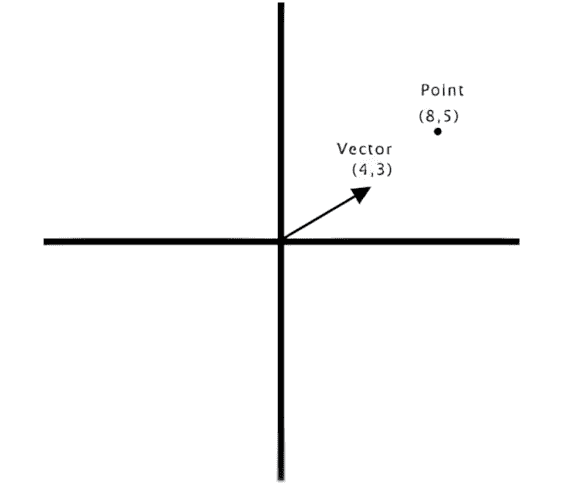

### 向量与点

*图 5.1 – 在 2D 空间中向量与点的演示*

在 *图 5.1* 中，向量显示为箭头。箭头指示向量指向的 *方向*，而箭头的长度（从尾部到头部）代表其 *大小*，或它从起点延伸多远。位置为 **(8,5)** 的点是一个静态位置，没有方向或大小。

如果我们从原点向我们定义的点画一条箭头，我们就创建了一个向量。这在图 5.2 中显示：

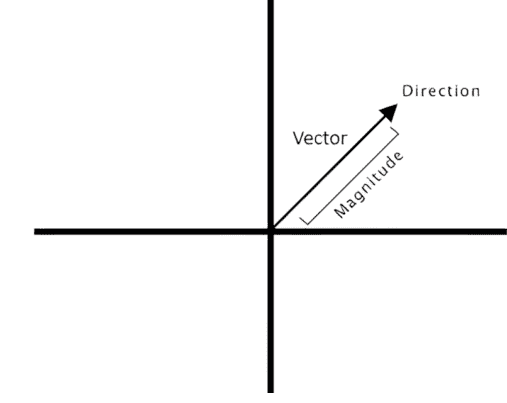

图 5.2 – 向量具有方向（角度）和大小

在电子游戏中，向量用于表示玩家的速度，控制他们的瞄准方向，并确定他们的视野（他们面向的方向）——全部使用一个向量。同时，我们使用点来持续跟踪玩家的位置。这在图 5.3 中显示：

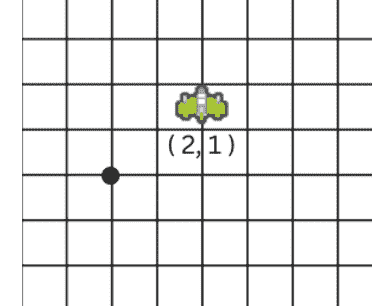

图 5.3 – 表示玩家当前位置的点

在图 5.3 中，我们可以看到玩家位于原点以东 2 个单位、以北 1 个单位。

**速度** 是某物在特定方向上的速度。在游戏开发中，它用于描述对象（如玩家或敌人）移动有多快以及朝哪个方向移动。速度通常由向量表示，向量同时显示 *速度*（大小）和运动的 *方向*。

如果我们希望玩家向上并向左移动，我们可以使用速度向量 **(-2,3)** 来实现。这在 *图 5.4* 中表示：

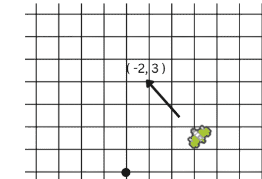

*图 5.4 – 描述玩家速度的向量*

在 *图 5.4* 中，*速度向量* 表明玩家将向左移动 2 个单位，向上移动 3 个单位。请注意，*x* 坐标始终在 *y* 坐标之前给出。

向量还可以告诉我们玩家面向的方向。*图 5.5* 显示了向量如何用于指示游戏中玩家面向的方向。

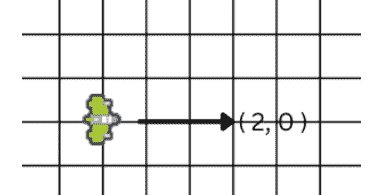

*图 5.5 – 用于指示方向的向量*

在图 5.5 中，*方向向量* 告诉我们玩家正指向右侧（旋转 90 度）。

单独来看，向量只是数字——如果没有上下文，它们意义不大。例如，向量 (1, 0) 根据使用方式可能表示方向、位置或速度。为了使这些向量有意义，我们需要分配单位。在 Godot 中，2D 单位以 *像素* 计量，而 3D 单位以 *米* 计量。

例如，如果我们在 2D 游戏中有一个玩家角色，向量 (1, 0) 表示向右移动。在这种情况下，适用以下内容：

- “1” 表示玩家在水平方向（x 轴）移动一个单位（或像素）
- “0” 表示玩家在上下方向（y 轴）不移动

如果玩家在每一帧都按照此向量移动，角色将稳定地每帧向右移动 1 像素。

当我们只想要方向而不关心距离或速度时，我们可以 *归一化* 向量。**归一化向量** 的长度（或大小）为 1，并且仍然指向同一方向。这在将方向与其他值结合时特别有用，例如将方向向量乘以速度以获得速度时。

例如，如果我们对向量 (2, 0) 进行归一化，得到 (1, 0)。它仍然指向右侧，但现在具有标准长度 1，使得在游戏逻辑中易于一致缩放。

### Godot 中的坐标

屏幕的一个重要特点是原点 (0, 0) 位于屏幕左上角。这意味着 y 在向上移动时为负，向下移动时为正。这由图 5.6 中的向量 (4, 3) 显示：

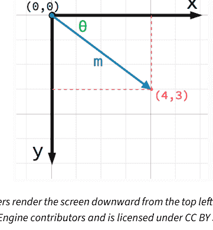

图 5.6 – 计算机从左上角向下渲染屏幕（此图像由 Godot Engine 贡献者提供，并根据 CC BY 3.0 许可）

在图 5.6 中，向量 (4, 3) 具有角度 theta 的方向或旋转，以及长度或大小 m。在这种情况下，箭头是一个位置向量，表示相对于原点的空间中的一个点。

关于向量需要记住的一件重要事情是，它们通常显示方向和大小（某物移动多远或多快），但不显示起始位置。把向量想象成箭头：它告诉你往哪个方向走、多快走，但不告诉你在地图上的位置。要知道物体的实际位置，你需要将向量与起始点或参考点结合起来。

然而，有一个值得提及的特殊情况：位置向量。在数学和游戏开发中（包括 Godot），诸如 Vector2(2, 3) 的向量也可以表示 2D 空间中的位置。这类向量被理解为从原点 (0, 0) 开始并指向坐标 (2, 3)。在这种情况下，向量告诉你某物相对于原点的位置。

因此，根据上下文，向量可以执行以下任一操作：

- 显示某物移动多远以及朝哪个方向移动（速度或力）
- 指示相对于原点的位置（就像空间中的坐标）


理解这种差异有助于避免混淆，尤其是在处理游戏中的移动系统、物理或空间推理时。如果反转一个位置向量，你实际上是从该位置指向原点——这也是理解向量在不同上下文中如何工作的一种有帮助的方式。

例如，在游戏中，向量可以告诉你玩家移动的方向和速度，但玩家的起始位置会单独作为一个点给出。这在图 5.7 中有所展示：

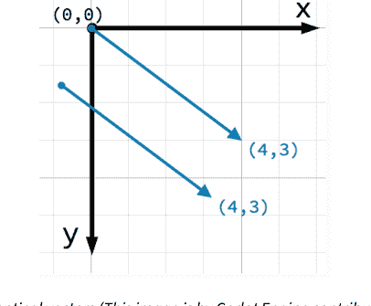

*图 5.7 – 两个相同的向量（此图片由 Godot Engine 贡献者提供，采用 CC BY 3.0 许可）*

在图 5.7 中，两个向量都表示从起始点向右 4 个单位、向下 3 个单位的位置。

我们现在对向量有了概念上的理解。在下一节中，我们可以看看如何在 Godot 中实现它们。

## 在 Godot 中使用向量

在 Godot 中，有两个类来表示向量。2D 向量使用 Vector2，3D 向量使用 Vector3。Vector2 接受 x 和 y 参数，Vector3 接受 x、y 和 z 参数。让我们更详细地了解一下 Vector2。

Vector2 是一个类，这意味着它不仅仅是一个像数字一样简单的数据类型——它是一个更高级的结构，包含内置函数（或方法）来处理 2D 坐标。虽然它像数据类型一样行为，因为它保存两个数字（x 和 y），但它也允许你执行诸如加法、缩放或旋转向量等操作。

值得注意的是，Godot 将许多看似简单类型的数值作为类来处理。例如，如第 4 章所述，即使是 Godot 中的文本也是由 String 类管理的。这与其他一些将字符串视为没有方法的基类型引擎或语言略有不同。

因此，当你使用像 Vector2 这样的东西时，你实际上是在使用一个强大的工具，它旨在帮助你轻松管理游戏中 2D 位置、方向和移动，内置了大量有用的函数。

如果我们希望玩家在水平方向（x 轴）移动一个单位（或像素），并且完全不上下移动，并确保玩家每帧都移动，我们可以使用以下代码：

```
var movement_vector = Vector2(1, 0)

func _process(delta):
    position += movement_vector
```

在 Godot 中，这种效果表现为 Sprite2D 在屏幕上移动，如图 5.8 所示：

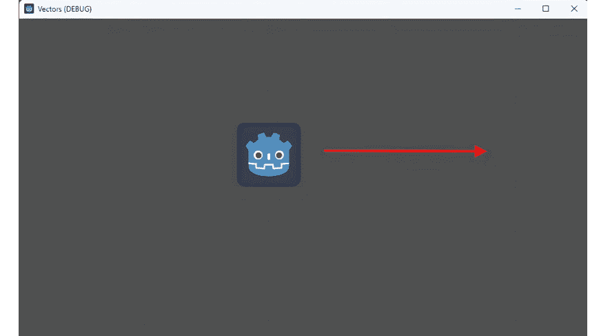

图 5.8 – Godot 精灵在屏幕上向右移动

图 5.8 显示精灵在屏幕上移动，x 值每帧变化 1，而 y 值完全不变。

需要注意的是，我们可以使用点符号单独访问向量的 x 和 y 变量，如以下代码所示：

```
#### Access the individual x and y components of the position
var x_position = position.x
var y_position = position.y

#### Display the x and y components in the output console
print("Sprite Position - X: ", x_position, " Y: ", y_position)
```

在此代码中，我们将精灵当前的 x 和 y 位置存储在单独的变量中，然后打印出来，以观察精灵在屏幕上移动时它们如何变化。

在 Godot 中，这种效果在 Sprite2D 在屏幕上移动时显示在输出控制台中，如图 5.9 所示：

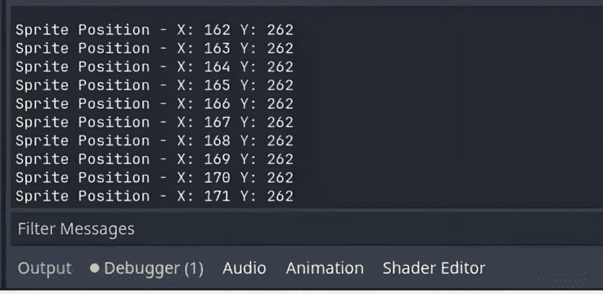

图 5.9 – 控制台在精灵移动时显示向量的 x 和 y 参数

图 5.9 演示了我们始终可以访问向量的参数。我们可以使用此信息检测何时接近 Viewport 的边缘，然后反转 movement_vector。这将使精灵从屏幕边缘反弹。使用以下代码实现此行为：

```
#### Store the x and y positions of the edges of the screen
var horizontal_edge = get_viewport_rect().size.x
var vertical_edge = get_viewport_rect().size.y

#### Check for screen boundaries to reverse direction
if x_position < 0 or x_position > horizontal_edge:
    # Reverse the x direction
    movement_vector.x *= -1
if y_position < 0 or y_position > vertical_edge:
    # Reverse the y direction
    movement_vector.y *= -1
```

此代码成功限制或钳制精灵的移动，使其保持在屏幕边界内。

我们还可以对向量执行诸如加法、减法和乘法等数学运算。这至关重要，因为它允许我们以更动态和灵活的方式操纵物体的位置、移动和方向。值得庆幸的是，游戏引擎会为你执行所有这些计算，但了解它在做什么仍然很好。

## 移动与定位

在游戏开发中，移动和定位是创建动态且引人入胜的游戏玩法的核心。在 Godot 中，向量是定义 2D 和 3D 空间中位置、方向和速度的重要工具。通过了解如何使用向量，你可以在游戏世界中平滑而准确地移动角色、投射物和物体。

本节将介绍你在 Godot 中使用向量的工作方式，展示如何计算方向、处理玩家移动以及有效定位物体。这些概念构成了创建响应迅速且逼真的游戏机制的基础。

## 向量加法

我们使用 **加法** 通过将移动向量添加到其当前位置来更新物体的位置。例如，当你将角色移过屏幕时，你在每一帧都将方向向量添加到角色的位置向量中。

向量加法在图 5.10 中显示。对应的 x 和 y 值相加（蓝色向量 A(2,5) 加上绿色向量 B(3,1)，结果为红色向量 C(5,6)）。

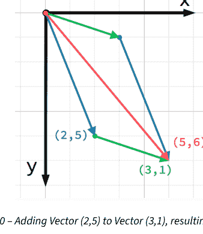

图 5.10 – 将向量 (2,5) 加到向量 (3,1) 上，结果为向量 (5,6)

图 5.10 还显示了相加向量的顺序无关紧要，因为结果向量始终相同。

为了理解这在游戏中如何工作，我们可以考虑角色跳跃的例子。
这在图 5.11 中显示：

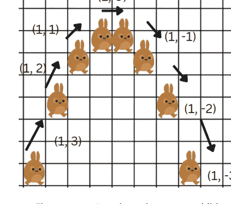

图 5.11 – 使用向量加法跳跃

为了理解跳跃机制，我们可以逐帧查看。重力始终将角色向下拉；因此，加速度向量始终为 (0, -1)。

起始位置为 (0,0)。当按下跳跃按钮时，速度向量被设置为 **(1,3)**，角色向上并向右移动。如果我们将速度加到位置向量上，我们会得到新的速度向量 **(1,3)**。然而，我们必须加上加速度向量，新的结果是速度 **(1,2)**。如果我们以这种方式继续，我们可以完成整个跳跃循环。

## 向量减法

**减法** 有助于计算两点之间的距离或差异，例如玩家与敌人之间的距离，可用于碰撞检测或 AI 行为。

**向量减法** 以类似的方式工作——逐个减去每个分量，向量减法有助于确定从一个位置指向另一个位置的向量。

例如，想象一个球位于 **(1,2)**，而洞位于 **(4,3)**。为了找到球滚动到洞所需的方向，你可以通过从洞的位置减去球的位置来找到差异。

这在图 5.12 中有所说明：

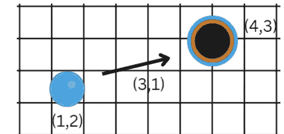

图 5.12 – 向量减法

图 5.12 演示了如何使用向量减法计算到达某一点所需的长度和方向。

我们对向量执行的下一个基本操作是乘法。

## 向量乘法

向量同时具有方向和大小的值，但仅表示大小的值称为标量。

当我们谈论向量时，向量中的每个数字称为分量，而单个数字本身称为标量。例如，(3, 4) 是一个向量，而 5 是一个标量。在游戏中，将向量乘以标量可以用于改变其大小（幅度）而不改变其方向。

归一化向量是一种特殊的向量，其长度（或大小）恰好为 1。它仍然指向同一方向，但其大小已缩减为 1 个单位。这通常用于表示方向而不影响距离或速度。

例如，如果玩家面向右侧，我们可能会使用归一化方向向量，例如 (1, 0)。如果我们然后将它乘以标量值，例如 100，我们得到 (100, 0)，这可以表示向右 100 像素的位置。这对于计算目标或到达位置很有用：

```
var direction = Vector2(1, 0).normalized()
var distance = 100
var arrival_position = player.position + direction * distance
```

我们还可以看到向量乘法如何用于缩放图像。想象玩家获得一个让他们变大的增益道具。玩家的尺寸表示为向量，例如 (1, 2)，意味着宽度为 1，高度为 2。如果增益道具使玩家长到原来的两倍，我们将尺寸向量乘以标量 2。


This is illustrated in Figure 5.13:

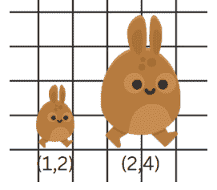

图 5.13 – 缩放（标量乘法）的影响

在图 5.13 中，将大小向量乘以一个标量会使玩家在宽度和高度上都变大两倍，但其整体形状和比例保持不变。

将向量乘以标量实际上会延长向量而不改变方向。这也可以用箭头来演示，如图 5.14 所示：

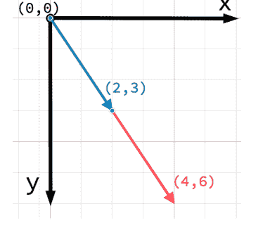

图 5.14 – 说明标量乘法（此图像由 Godot Engine 贡献者提供，并根据 CC BY 3.0 许可）

图 5.14 显示，将向量乘以标量会得到一个更长的向量。还需要注意的是，乘以负标量会反转方向。

## 向量长度

从原点到向量的 x 和 y 位置的距离被称为**向量的长度**。这也被称为**向量的大小**。要找到这个长度，Godot 有一个内置 length() 函数：

```
var vector_length: float = vector.length()
```

为了理解 length() 函数的工作原理，请考虑这个例子。如果一个角色在 2D 平台游戏中以速度向量 v(4, 3) 移动，我们可能想要确定角色移动的速度，以便调整动画或实现落地时产生尘云等效果。

为了找到角色的速度，我们计算速度向量 v 的长度（或大小）。我们可以将该向量可视化为构成一个直角三角形，其中一边为 3（x 分量），另一边为 4（y 分量）。利用毕达哥拉斯定理，我们可以找到斜边，它代表角色的速度。具有分量 (x, y) 的向量的大小公式以及由此得到的速度如图所示 5.15：

Speed = √4² + 3² = √16 + 9 = √25 = 5

图 5.15 – 使用毕达哥拉斯定理确定向量大小

图 5.15 演示了 length() 函数如何计算向量的大小。这意味着角色在游戏世界中以每秒 5 个单位的速度移动。这在图 5.16 中进行了可视化：

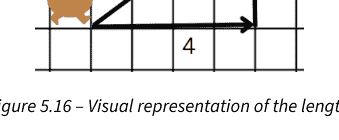

图 5.16 – 长度的可视化表示

图 5.16 演示了如何计算向量的长度。请注意，这也适用于 3D 向量。

## 距离

通常，我们想要找到两个物体之间的**距离**，例如玩家和运动传感器，以确定玩家是否足够接近以触发警报。我们可以使用 Godot 中的 distance_to() 函数来做到这一点。例如，如果玩家位于位置 (3,3)，而运动传感器位于位置 (1,2)，我们可以计算它们之间的距离，以检查玩家是否在传感器的范围内，这可能会激活警报。

distance_to() 函数背后的数学原理结合了向量减法和向量长度。要计算距离 [D]，我们从运动传感器向量 [M] 中减去玩家向量 [P]，然后计算所得向量的长度：

D = (P - M).length()

D = √[(3 - 1)² + (3 - 2)²] = √[4 + 1] = √5 ≈ 2.24

该方程在图 5.17 中进行了演示：

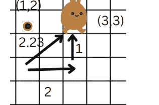

图 5.17 - 计算到物体的距离

图 5.17 显示了如何计算到另一个物体的距离。无论是从运动传感器向量中减去玩家向量，还是反过来，结果都是一样的。

## 归一化

在处理方向（而不是位置或速度）时，确保它们具有单位长度，即长度为 1 至关重要。这简化了我们的计算。

例如，想象一个机器人需要以 20 m/s 的恒定速度沿 (1,0) 方向移动以递送包裹。机器人的速度会是多少？由于方向向量的长度为 1，我们可以轻松地将其乘以机器人的速度来计算其速度：(20,0)。如果方向向量有其他长度，机器人就会移动得过快或过慢。

长度为 1 的向量称为**归一化**。那么，我们如何归一化一个向量（将其长度设为 1）？

很简单：我们只需将每个分量除以向量的长度即可。

由于这是一个非常常见的操作，Godot 有一个内置函数来为我们完成它。该函数称为 normalized()，可以在我们的示例中如下使用：

```
extends Node2D

#### Called when the node enters the scene tree for the first time.
func _ready():
    # Normalize direction vector so it has a length of 1
    direction = direction.normalized()

    # Calculate velocity by multiplying direction by speed
    velocity = direction * speed
```

关于向量还有很多东西需要学习，还有其他操作，例如**点积**和**叉积**。所有这些都是称为**线性代数**的数学领域的一部分。然而，你现在已经有足够的理解来制作出色的 Godot 游戏，而引擎会为我们完成所有的数学计算！

## 摘要

在本章中，我们探讨了向量的基本概念及其在游戏开发中的关键作用。你学习了如何在 Godot 引擎中操作向量，应用向量加法、减法和乘法来控制移动和定位。我们还涵盖了诸如计算向量长度、确定物体之间的距离以及归一化向量以保持方向一致等重要主题。

通过掌握这些概念，你现在能够在游戏项目中有效地使用向量，增强游戏玩法机制和交互。

在下一章中，我们将从理论转向实践，开始在 Godot 中创建我们的第一个 2D 小游戏！

## 立即解锁本书的独家福利

扫描此二维码或访问 packtpub.com/unlock，然后按名称搜索本书。

*注意：在开始之前请准备好购买发票。*


## 6

## 在 Godot 中创建 2D 小游戏 — 第 1 部分

在本章中，你将通过在 Godot 中构建你的第一个 2D 平台游戏关卡迈出重要一步。你将学习如何使用瓦片地图设计和构建关卡，然后填充关键的游戏元素：可以移动和跳跃的玩家角色、需要避免的巡逻敌人以及奖励探索的可收集物品。你还将设置一个检查点系统，让玩家能够在关卡中推进。

这种体验将为你提供将游戏开发技能提升到下一个水平的实践，因为你将学习如何在 Godot 中操作关卡设计和游戏玩法机制的关键元素。有了这些知识，你将能够在未来的项目中设计更复杂的关卡和游戏功能。

在本章中，我们将涵盖以下主要主题：

- 使用 TileMap 构建关卡
- 创建和控制玩家
- 为玩家脚本添加 CharacterBody2D 模板
- 清理代码

到本章结束时，你将能够创建一个交互式、完全可玩的平台游戏关卡，并理解这些组件如何协同工作以构成许多平台游戏的基础。

## 技术要求

开始本章时，你应该知道如何执行以下操作：

- 创建一个新的 Godot 项目
- 创建节点
- 创建场景

你还应该了解 GDScript 中使用的变量和函数（参见第 4 章）。

本章的代码文件可在本书的 GitHub 仓库中获取：https://github.com/PacktPublishing/Godot-4-for-Beginners/tree/main/ch6

访问此链接查看代码运行的视频：https://packt.link/DcrOS

本项目中使用的游戏资源由 Pixel Frog 以知识共享零许可（CC0）发布。Pixel Frog 已允许我们在任何媒介或格式中分发、重新混合、改编和在材料之上构建，甚至用于商业目的。

它们可以在这里找到：

- **Pixel Adventure:** https://pixelfrog-assets.itch.io/pixel-adventure-1
- **Pixel Adventure 2:** https://pixelfrog-assets.itch.io/pixel-adventure-2

## 使用 TileMap 构建关卡

使用 TileMaps 构建 2D 关卡是一种高效且有条理的方式，通过重复使用小型的预设计瓦片来创建游戏环境。这种方法不仅节省时间和资源，还允许在关卡设计中轻松调整并保持视觉一致性。

在本节中，我们将通过使用 TileMap 创建关卡来构建 2D 平台游戏的基础，从而高效地设计和组织游戏环境。TileMaps 至关重要，因为它们使创建详细的基于网格的关卡变得容易，同时优化性能，保持游戏世界易于管理且视觉一致。

让我们通过创建新场景并添加必要的节点来开始构建关卡的过程。按照以下步骤使用 TileMapLayer 设置一个功能齐全、组织良好的关卡：

- 1. 创建一个新的 Godot 项目并为其命名 – 我将其命名为 PixelAdventure。
- 2. 我们需要一个场景来代表游戏的第一个关卡。为此，我们创建一个新的 2D 场景，它将以 Node2D 作为根节点。将 Node2D 重命名为 Level1。


3. 我们现在准备向 Level1 场景添加一个 TileMapLayer 节点。TileMapLayer 节点使用一个 TileSet，其中包含用于创建基于网格地图的瓦片列表。TileMaps 在 2D 游戏开发中用于通过重用小型预定义瓦片高效地创建大型、一致的关卡。这提高了游戏性能，也使编辑和自定义关卡变得容易。

4. 将一个新的 TileMapLayer 节点作为 Level1 的子节点添加。你的场景树将类似于图 6.1。图 6.1 显示如下：

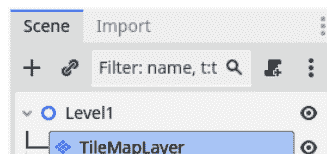

图 6.1 – 添加 TileMapLayer 节点后的场景树

5. 每个 TileMapLayer 节点都需要一个 TileSet，以便我们可以在场景中放置单个瓦片来创建关卡。要创建 TileSet，请选择 TileMapLayer 节点，然后在 Inspector 中找到 Tile Set 属性并点击 New TileSet，如图 6.2 所示：

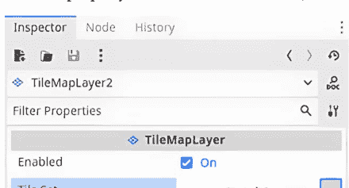

图 6.2 – 创建新的 Tile Set

6. 然后点击 TileSet，这将使屏幕底部中央的 TileMap 和 TileSet 选项卡可见，如图 6.3 所示：

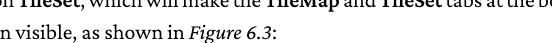

图 6.3 – TileSet 和 TileMap 选项卡

7. 在 Pixel Adventure 资源包的 Terrain 文件夹中，有一个名为 Terrain (16 x 16).png 的图像文件。在你的 Godot 文件系统中创建一个名为 Assets 的文件夹，然后创建一个名为 TileMap 的子文件夹。将 Terrain 图像文件拖放到 TileMap 文件夹中，如图 6.4 所示：

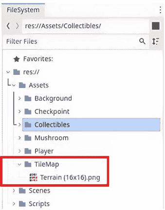

图 6.4 – Terrain.png 已添加到 TileMap 文件夹

8. 现在图像已在我们的 FileSystem 中，我们可以将其拖放到 TileSet 选项卡中，这将允许我们使用单个瓦片。这在图 6.5 中显示：

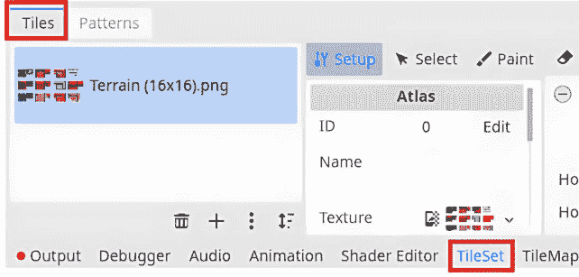

图 6.5 – TileSet 现在已加载

9. 我们目前不会更改 TileSet 的任何内容。我们的目标是绘制关卡。为此，切换到 TileMap 选项卡并按 D 或点击 Paint 按钮。现在在地图中选择瓦片并在屏幕上的 Viewport 中绘制它们，如图 6.6 所示：

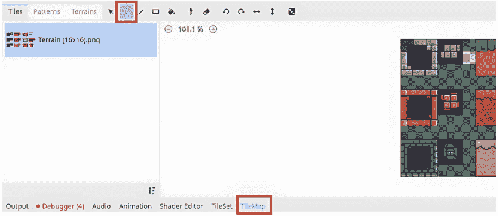

图 6.6 – 通过选择瓦片并使用 Paint 工具绘制瓦片

图 6.6 显示了如何使用 Paint 工具选择瓦片，然后通过点击将其绘制到场景中。你也可以按住 shift + 点击同时绘制多个瓦片。现在开始绘制一个关卡。你可以随意做任何事情，也可以复制我的关卡，如图 6.7 所示：

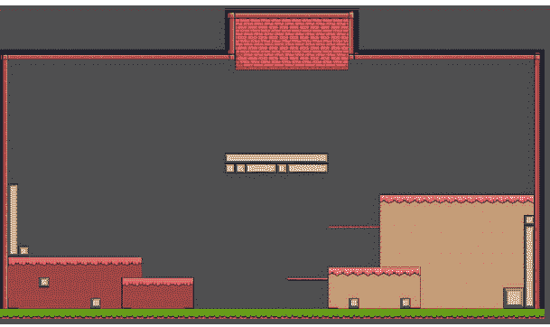

图 6.7 – 一个封闭关卡的示例

如 图 6.7 所示，我们现在有一个供玩家探索的关卡。重要的是要理解，这个关卡目前纯粹是装饰性的——我们甚至无法检测碰撞，因为这个世界没有物理！在下一节中，我们将添加玩家，然后返回我们的 TileSet 来实现物理。

## 创建和控制玩家

现在我们有了世界，我们需要一个玩家来探索它！在本节中，我们将专注于为完全交互式的 2D 关卡构建基础。每个步骤都将帮助我们创建可玩的环境，同时介绍 Godot 的基本工具和技术。

首先，我们将添加一个背景，为关卡提供视觉上下文。然后，我们将创建一个 CharacterBody2D 节点作为玩家，并配置它，包含一个 AnimatedSprite2D 节点使其栩栩如生，以及一个 CollisionShape2D 节点以实现物理交互。在设置好玩家的动画后，我们将通过编写角色控制器脚本来结束，允许玩家移动并与关卡交互。

到本节结束时，你将拥有一个功能齐全且视觉上吸引人的玩家角色，可以探索你创建的 2D 世界。

## 添加背景

我们将按照以下步骤为关卡添加背景：

- 1. 添加一个新的 TextureRect 节点作为 Level1 的子节点。在文件系统中创建一个名为 Background 的新文件夹，并将下载资源中 Background 文件夹中的图像添加到其中。
- 2. 在 Inspector 中，使用 Brown.png 背景图像作为 Texture。设置 Expand Mode 属性为 Keep Size，Stretch Mode 属性为 Tile。

3. 现在，将 TextureRect 拖动以填充整个 Viewport，甚至更多。我们刚刚创建了一个平铺背景。

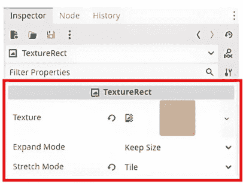

图 6.8 – 更改 TextureRect 的属性

4. 为确保背景出现在场景中每个其他节点的后面，请将 TextureRect 节点定位在场景树的顶部，如图 6.9 所示：

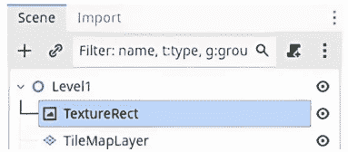

图 6.9 – 下方节点出现在上方节点前面

图 6.9 演示了节点在树中处理的顺序。它是自上而下进行的，从根开始依次向下遍历每个分支。关卡现在有了背景，看起来更精致。

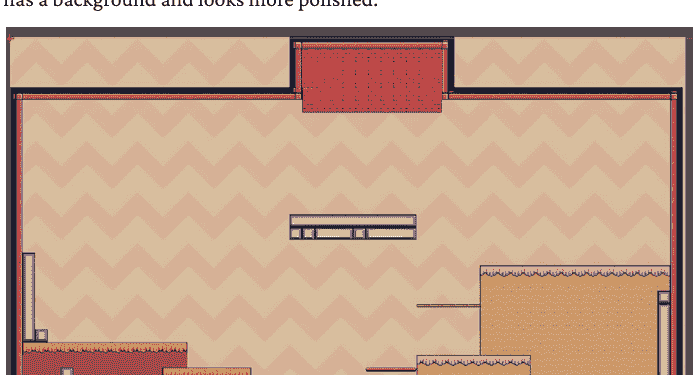

图 6.10 – 背景有助于完善关卡

玩家角色现在准备登场。创建一个新场景并添加一个 CharacterBody2D 节点作为根，然后将其重命名为 Player。添加一个 AnimatedSprite2D 节点作为子节点，如图 6.11 所示：

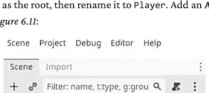

图 6.11 – 向玩家添加 AnimatedSprite2D 节点

图 6.11 显示了 AnimatedSprite2D 节点。这是一个包含多个纹理作为动画帧的精灵节点。在下一节中，我们将为玩家的操作设置各种动画。

## 设置玩家动画

要为精灵制作动画，我们使用多个帧来描绘精灵在运动各个阶段的样子。这些帧通常被组合在一个单一图像中，称为 **sprite sheet**。要为精灵制作动画，我们首先导入 sprite sheet，然后将其分割成单独的帧。为此，选择 **AnimatedSprite2D** 节点，并在 **Inspector** 中，在 **Sprite Frames** 属性上点击 **New SpriteFrames**。这在图 6.12 中显示：

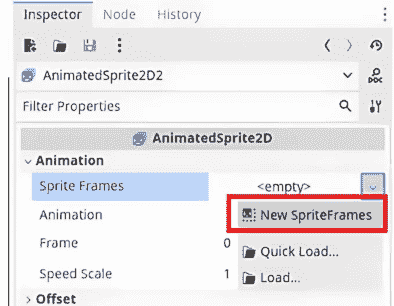

图 6.12 – 新建 SpriteFrames

点击 **Inspector** 中的 **SpriteFrames**，如图 6.12 所示，将在屏幕底部打开 **SpriteFrames** 区域（见图 6.13）。这是我们可以导入帧并创建新动画的空间。

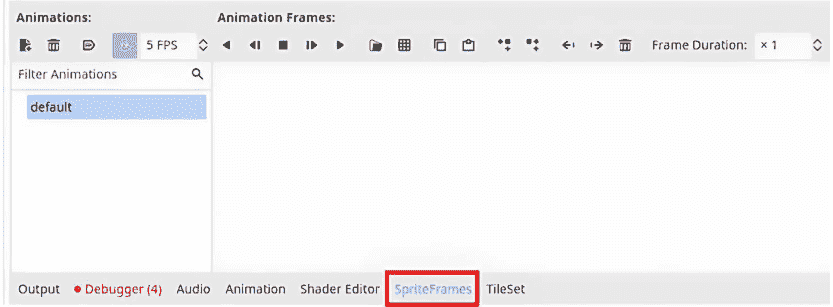

图 6.13 – SpriteFrames 区域

如 图 6.13 所示，我们目前只有默认动画，且没有与之关联的图像或帧。我们现在将为玩家的所有操作创建动画，然后从其 sprite sheet 导入每个操作相关的精灵。为此，请按照以下步骤操作：

- 1. 首先将默认动画重命名为 idle。然后点击 Add Animation 按钮或按 Ctrl + N。将该动画重命名为 run。
- 2. 创建以下动画列表：double_jump、fall、jump 和 wall_slide。这些在图 6.14 中显示：

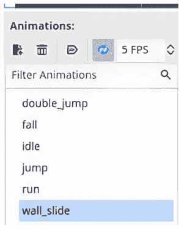

图 6.14 – 玩家操作的全部动画

现在动画名称已准备好，如图 6.14 所示，我们可以引入与每个动画关联的图像。

- 3. 在 FileSystem 中创建一个名为 Player 的新文件夹。现在，找到从 Pixel Frog 下载的资源中的 Main Characters 文件夹，并将玩家角色的图像拖到文件系统中的 Player 文件夹中。我选择使用忍者青蛙角色。选择 idle 动画，然后点击 Add frames from sprite sheet 按钮或按 Ctrl + Shift + O。
- 4. 现在在你的 Assets 文件夹中选择 idle 图像文件。你必须统计玩家图像的数量并按需更新 Horizontal 和 Vertical 帧属性。然后点击 Select All 按钮，然后点击 Add x Frame(s) 按钮。这在图 6.15 中以忍者青蛙的 idle 帧为例显示：

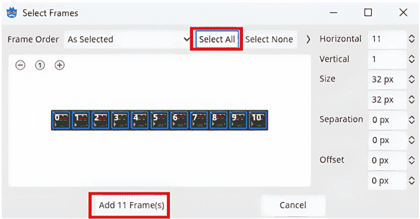

Figure 6.15 – 设置水平和垂直帧并将它们添加到动画中

5. 如图 6.15 所示，从图像（精灵表）中剪切出单个帧后，你的 SpriteFrames 窗口将更新为用于空闲动画的图像。这在图 6.16 中显示：

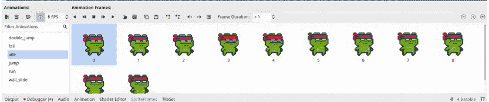

Figure 6.16 – 空闲动画的帧

如图 6.16 所示，顶部栏中有动画控件。我已将空闲帧率设置为 8 FPS，并且循环已开启。你可以尝试这些设置以找到自己喜欢的设置。这在图 6.17 中可以看到。

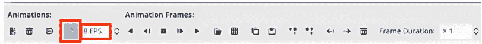

Figure 6.17 – 动画控件，突出显示循环和 FPS

要设置其余玩家动画，请遵循并重复你为闲置动画所做的相同步骤。我们的下一个任务将是通过为其分配碰撞盒来确保玩家可以与物体发生碰撞。

> 重要提示
> 
> 你可能注意到玩家在场景中看起来模糊。这是因为默认纹理过滤器。点击 Project | Project Settings | Rendering | Textures 并将 Default Texture Filter 改为 Nearest。这是对像素艺术的最佳设置。

## 检测碰撞

检测游戏中物体何时何地发生碰撞，以及识别涉及的物体，是游戏开发的关键方面。在 Godot 中，我们通过将每个物体分配给 CollisionShape2D 节点来处理此问题。该节点允许我们定义和调整围绕物体的形状，确保准确的碰撞检测。

以下是为 CollisionShape2D 节点分配的步骤：

- 1. 将 CollisionShape2D 节点作为 Player 的子节点添加。
- 2. 在 Inspector 中为 Shape 属性选择 RectangleShape2D 并调整其大小以适应你的玩家。这个矩形构成了玩家碰撞的边界框，如图 6.18 所示：

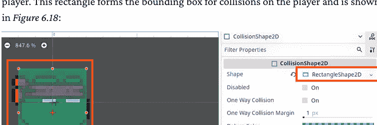

Figure 6.18 – 将 RectangleShape2D 分配给 CollisionShape2D 节点以及 resulting 边界框

如图所示 Figure 6.18，任何进入矩形碰撞形状的东西都会注册一次碰撞。游戏过程中形状不可见。

- 3. 将 **Player** 场景保存为 player.tscn，然后从 **FileSystem** 将文件拖放到 **Level1** 场景中。

你现在在关卡中拥有一个玩家！然而，如果你玩游戏，玩家是静止的，因为还没有实现移动。我们稍后会实现这一点。

## TileMap 碰撞

如前所述，我们当前的关卡只是一幅画；没有任何图块具有碰撞检测，我们的玩家无法移动。为了在图块上设置碰撞，我们需要在物理层中添加一个元素。为此，请按照以下步骤操作：

- 1. 在 **Inspector** 中选择 **TileMapLayer** 节点并点击 **Tile Set**。
- 2. 在 **Physics Layers** 属性中，点击 **Add Element**。这在图 6.19 中显示：

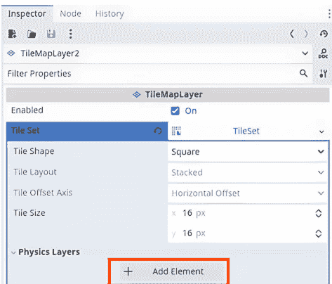

Figure 6.19 - 向 TileSet 的 Physics Layers 添加元素

一旦你如图所示 Figure 6.19 向 TileSet 的 **Physics Layers** 添加了一个元素，你的 TileSet 将在 **Physics Layers – Collision Layer** 和 **Collision Mask** 中拥有两个新属性。这在图 6.20 中显示：

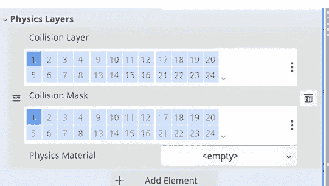

Figure 6.20 – TileSet 的 Collision Layer 和 Collision Mask

如图所示 Figure 6.20，Godot 4 中碰撞层和掩码的概念在管理游戏世界中不同元素之间的碰撞和交互方面发挥着至关重要的作用。了解如何使用层和掩码对于创建复杂且交互式的游戏环境至关重要。这些将在下一节中更详细地解释。

请确保你已添加两个 **Physics Layers** 元素，因为一组用于地面图块，另一组将用于穿透图块。

## 碰撞层和碰撞掩码

碰撞层是物体所属的类别或组，决定了它可以与哪些其他物体交互。通过将物体分配给特定的 **Collision Layer**，我们将其置于一个定义其潜在交互的组中。例如，如果物体 X 被分配到第 1 层，它就被视为第 1 层的部分。然后可以根据它们自己的碰撞设置设置其他物体以检测并响应该层中的物体。

碰撞掩码另一方面定义了物体可以检测和交互的层。例如，如果物体 X 在第 1 层但 **Collision Mask** 设置为第 2 层，物体 X 仅会与位于第 2 层的物体发生碰撞。层与掩码之间的这种分离使我们能够控制哪些物体交互，从而轻松确保例如敌人只与玩家碰撞而不是彼此碰撞。

在图 6.20 中，Collision Layer 1 已开启，且 Collision Mask 1 已开启。这意味着第 1 层的物体将与掩码 1 上的物体发生碰撞。这不是很有用，因为这意味着物体将与自身发生碰撞（这是不可能的），所以我们很快会更改它。

跟踪哪些数字与哪些数字发生碰撞可能非常困难，随着游戏变得更大更复杂则更加困难。因此建议你重命名你的层以表示它们上存在的内容。

在我们的关卡中，大多数图块将作为玩家可以站立并与其碰撞的实体物体发挥作用。然而，为了使关卡更具动态性，一些图块将作为“跳跃穿过”或“穿透”平台发挥作用。这些允许玩家从下方跳起并落在平台上。如果玩家在平台上按下向下键，他们将落回下方的地面，增加游戏玩法的交互性。这在图 6.21 中显示。

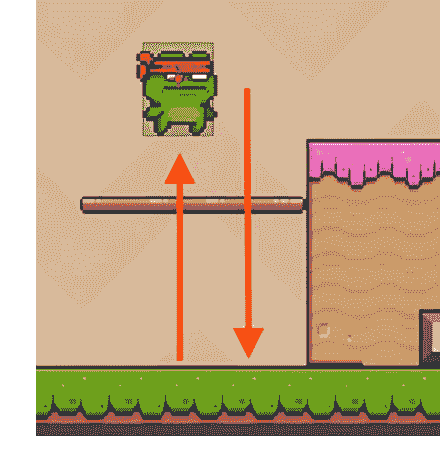

Figure 6.21 – 一个可跳跃穿过的平台

由于我们的一些图块需要是实体的，而一些需要是穿透的，我们将为 TileSet 的 Physics Layers 添加第二个元素，然后命名层以便我们能跟踪交互。方法是点击层号右侧的三个垂直点并点击 Edit Layer Names。我已将 Layer 1 命名为 player，Layer 2 命名为 ground，Layer 3 命名为 pass_through。这在图 6.22 中显示：

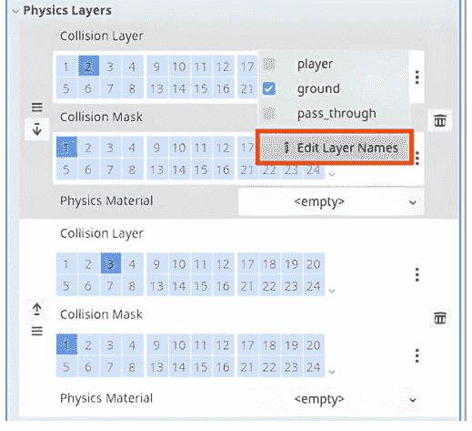

Figure 6.22 – 两组物理层和 Edit Layer Names 按钮

如图所示 Figure 6.22，点击 Edit Layer Names 将允许你为每个层命名。你可以在图 6.23 中看到我如何命名我的层：

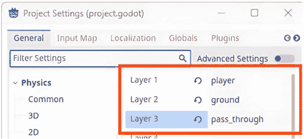

Figure 6.23 – 为碰撞层命名

如果你查看图 6.22，在第一个物理层中，Collision Layer 2（ground）已开启且 Collision Mask 1（player）已开启。这意味着地面将与玩家发生碰撞。

在第二个物理层中，Collision Layer 3（pass_through）已开启，且 Collision Mask 1 已开启。这意味着穿透将与玩家发生碰撞。

我们还必须记住在 Player 节点中打开相应的层，如图 6.24 所示。这样玩家才会查找地面和 pass_through 层的碰撞；否则，他们会穿过关卡。

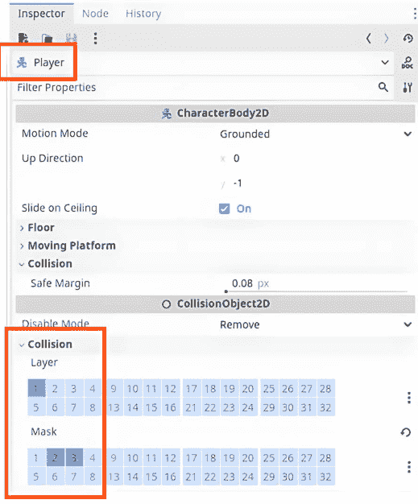

Figure 6.24 – 在 Player 中设置碰撞层

在图 6.24 中，我们在 Player 节点中，已打开 Collision Layer 1（player）并打开 Collision Mask 2（ground）和 Collision Mask 3（pass_through）。这意味着我们在相反方向启用了碰撞，因此玩家现在将与地面和穿透发生碰撞。

使我们的关卡具有交互性的最后一步是将在 TileSet 中将图块绘制为碰撞图块。

## 绘制图块

要将 TileSet 中的图块绘制为碰撞图块，请按照以下步骤操作：

- 1. 首先，我们需要选择我们的 TileMapLayer 节点，打开屏幕底部的 TileSet，然后点击 Paint。
- 2. 在 Paint Properties 中，选择 Physics Layer 0。这是地面层。现在，涂抹所有你想要作为地面图块的图块。我选择将最右边的图块保留为 pass_through 图块并且没有将它们绘制为碰撞体。这在图 6.25 中显示：

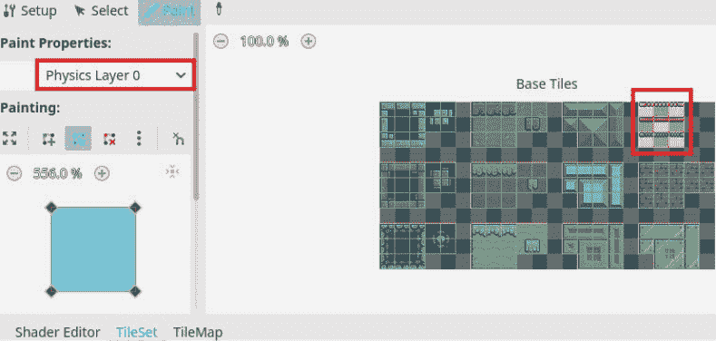

Figure 6.25 – 地面图块已着色 – 请注意保留用于穿透的未着色图块

快速提示：需要查看此图像的高分辨率版本吗？在 next-gen Packt Reader 中打开本书或在 PDF/ePub 副本中查看。

next-gen Packt Reader 和本书的免费 PDF/ePub 副本已包含在你的购买中。扫描二维码或访问 packtpub.com/unlock，然后使用搜索栏按名称查找本书。仔细检查所示的版本以确保你获得正确的版本。


3. 现在切换到物理层 1。这是 pass_through 瓷砖的图层。现在我们将绘制已保存的瓷砖。你可以为每个单独的瓷砖调整碰撞多边形。确保你也将 polygon_0_one_way 设置为已勾选。这样玩家就可以从下方跳过该瓷砖。现在用此画刷绘制所有 pass_through 瓷砖。这在图 6.26 中显示：

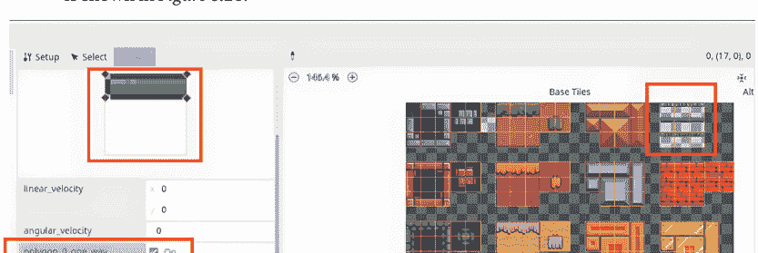

图 6.26 – 调整碰撞多边形、单向碰撞以及绘制穿透瓷砖

4. 调整瓷砖如 图 6.25 和 图 6.26 所示后，你可以运行并测试游戏。虽然玩家可以与瓷砖发生碰撞，但没有作用于玩家的力（如重力），并且它不会响应输入——你基本上会被卡在放置的位置。

在下一节中，我们将着手为玩家编写脚本，以控制移动、动画和交互，并施加诸如重力之类的力。

## 为玩家脚本添加 CharacterBody2D 模板

Godot 提供了用于基本玩家移动的预写代码模板。这让我们不必重新发明轮子，并能更快地制作游戏。

在 Player 场景中，选择你的 Player 节点并点击如图 6.27 所示的附加新脚本图标：

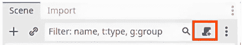

图 6.27 – 附加新脚本按钮

如图 6.27 所见，你可以通过选择节点并点击附加新脚本按钮，将脚本附加到 Godot 中的任何节点来自定义其行为。点击按钮后，你将看到创建脚本的一些选项，如图 6.28 所示：

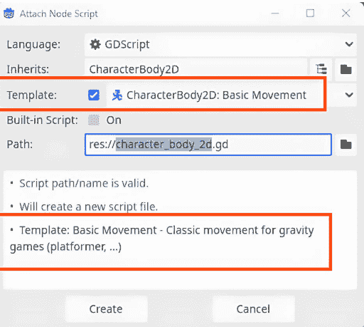

图 6.28 – 请注意正在使用的基本移动模板

如图 6.28 所示，脚本将使用模板创建，这意味着将有用于基本移动和重力的预生成代码。脚本如下：

```
extends CharacterBody2D
const SPEED = 300.0
const JUMP_VELOCITY = -400.0

func _physics_process(delta):
    # Add the gravity
    if not is_on_floor():
        velocity += get_gravity() * delta

    # Handle jump
    if Input.is_action_just_pressed("ui_accept") and is_on_floor():
        velocity.y = JUMP_VELOCITY

    # Get the movement direction and handle deceleration
    var direction = Input.get_axis("ui_left", "ui_right")
    if direction:
        velocity.x = direction * SPEED
    else:
        velocity.x = move_toward(velocity.x, 0, SPEED)

    move_and_slide()
```

💡 **快速提示：** 使用 AI 代码解释器和快速复制功能提升你的编码体验。在 next-gen Packt Reader 中打开本书。点击 **Copy** 按钮 (1) 即可快速将代码复制到你的编码环境，或点击 **Explain** 按钮 (2) 让 AI 助手为你解释一段代码。

```
function calculate(a, b) {
    return {sum: a + b};
};
```

🔒 **The next-gen Packt Reader** 随本书购买免费提供。扫描二维码或访问 packtpub.com/unlock，然后使用搜索栏按名称查找本书。仔细核对所示的版本，以确保获取正确的版本。

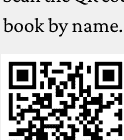


为了使我们的项目更易于管理并赋予其更多结构，我们将把大量代码移入新函数。在此之前，我们应该逐行理解代码：

- `extends CharacterBody2D`：此行告诉 Godot 该脚本正在扩展（或使用）名为 **CharacterBody2D** 的内置节点的功 能。该节点专门为 2D 移动角色（如玩家）设计。
- `const SPEED = 300.0` 和 `const JUMP_VELOCITY = -400.0`：这两行定义了 **常量**。常量是在游戏过程中不会改变的值。
- `SPEED`：这控制角色左右移动的速度。
- `JUMP_VELOCITY`：这定义了角色跳跃的速度和高度。负值意味着角色跳跃时会向上移动。
- `func _physics_process(delta)`：此函数在游戏处理物理时每次都会被调用，并固定为每秒 60 帧。`delta` 参数表示自上一帧以来经过的时间，确保移动流畅。
- 接下来，让我们查看以下代码块：

```gdscript
#### Add the gravity
if not is_on_floor():
    velocity += get_gravity() * delta
```

此代码块在角色未在地面上（在空中）时为其添加重力：

- `is_on_floor()` 检查角色是否接触地面。
- `get_gravity()` 获取当前重力值，并乘以 delta，确保重力以一致的速率影响角色。
- `velocity` 变量是一个内置变量，表示角色在 x（水平）和 y（垂直）方向上的移动速度。添加重力值会影响 y 速度（使角色下落）。

让我们查看下一个代码块：

```gdscript
#Handle jump
if Input.is_action_just_pressed("ui_accept") and is_on_floor():
    velocity.y = JUMP_VELOCITY
```

此代码块处理跳跃。解释如下：

- Input.is_action_just_pressed("ui_accept") 检查玩家是否按下了跳跃按钮（默认映射到 "ui_accept"）。这是 *空格键*。
- is_on_floor() 确保玩家只有在站在地面上时才能跳跃。
- 当两个条件都为真时，角色的 y 速度被设置为 JUMP_VELOCITY，使其向上跳跃。

现在，我们继续下一个代码块：

```
#Get the movement direction and handle deceleration
var direction = Input.get_axis("ui_left", "ui_right")
```

此行获取玩家左右移动的输入：

- Input.get_axis("ui_left","ui_right") 如果玩家按住 *左* 键则返回 -1，如果按住 *右* 键则返回 +1，如果两者都不按则返回 0。

继续下一个代码块：

```
if direction:
    velocity.x = direction * SPEED
else:
    velocity.x = move_toward(velocity.x, 0, SPEED)
```

如果有输入（玩家按下 *左* 或 *右* 键），角色的 x 轴速度将被设置为以 SPEED 定义的速度向该方向移动。

如果没有输入，角色将使用 move_toward() 逐渐减速，使 x 速度平滑接近 0，模拟减速。

- move_and_slide()：这根据速度移动角色。它还处理沿表面（如地面或墙壁）滑动，使移动流畅。

现在我们理解了基本移动代码的工作原理，是时候专注于改进其结构了。编写干净、有组织的代码对于使我们的项目更易于阅读、维护并在复杂性增长时扩展至关重要。为此，我们将通过将其分解为单独的函数来重构移动代码，这将增强可读性和可重用性。

## 清理代码

将代码拆分为 *独立函数* 是 **整洁代码** 概念的一部分，有助于在项目增长时保持组织性和清晰度。通过这种方式构建代码，使其更易于阅读、测试和调试。每个函数专注于特定任务，减少冗余，使在出现问题时更容易发现和修复。此方法还使项目更具可扩展性，因为在不使核心代码混乱的情况下添加新功能或更改变得更顺畅。

添加重力、处理跳跃和获取方向都可以放在各自的函数中。将你的代码更改为与以下代码块中显示的内容相匹配：

```gdscript
extends CharacterBody2D

#### Constants for how fast the player moves and how high they can jump
const SPEED = 300.0
const JUMP_VELOCITY = -400.0

#### This function runs every physics frame (ideal for movement and collision)
func _physics_process(delta):
    # Apply gravity if the player is not on the floor
    apply_gravity(delta)
    # Check for jump input and apply jump force
    handle_jump()
    # Handle left/right movement input
    handle_movement(delta)
    # Move the character and handle collisions with the environment
    move_and_slide()

#### This function adds gravity to the player's velocity
func apply_gravity(delta):
    # Only apply gravity if the player is in the air
    if not is_on_floor():
        velocity += get_gravity() * delta

#### This function makes the player jump when the jump key is pressed
func handle_jump():
```


```
#### Only allow jumping if the player is currently on the ground
if Input.is_action_just_pressed("ui_accept") and is_on_floor():
    velocity.y = JUMP_VELOCITY

#### This function handles horizontal movement input
func handle_movement(delta):
    # Get the left/right movement input as a value between -1 and 1
    var direction = Input.get_axis("ui_left", "ui_right")

    # If there is movement input, update the velocity in that direction
    if direction:
        velocity.x = direction * SPEED
    else:
        # If no input, gradually slow the player down to a stop
        velocity.x = move_toward(velocity.x, 0, SPEED)
```

代码的功能与之前相同，但现在特定的操作位于各自的函数中，因此更容易查找错误并进行改进。

代码现在变得整洁，并被拆分为更小、更易维护的部分。在下一章中，我们将进一步自定义玩家的行为并播放动画。我们还将添加可收集物品、敌人和用于完成关卡的检查点。

## 摘要

在本章中，我们介绍了在 Godot 中构建第一个 2D 平台游戏关卡的基本步骤。我们首先在 TileMapLayer 节点中设置了带有碰撞层的 TileSet，并使用 TileMap 系统绘制关卡。之后，我们创建了玩家角色，导入了不同动画所需的动画精灵帧。在角色就位后，我们使用 Godot 的 CharacterBody2D 模板实现了一个默认脚本。最后，我们花时间通过将其拆分为单独的函数来清理和组织代码，这是遵循整洁代码原则的关键部分。

在下一章中，我们将为玩家制作动画并编码特殊能力，例如双跳和贴墙滑行。我们还将设置可收集物品、需要击败的敌人以及用于完成关卡的检查点。

## 加入我们的 Discord 社区

加入我们的 Discord 社区空间，与作者和其他读者进行讨论：

```
https://packt.link/godot-4-game-dev
```


## 7

## 在 Godot 中创建 2D 小游戏 — 第 2 部分

在上一章中，我们指导你完成了在 Godot 中创建第一个完整的 2D 平台游戏关卡的过程。我们使用 **TileMap** 构建了关卡，设置了带动画的玩家角色，并清理了默认的基础移动脚本。现在，是时候通过添加更复杂的机制并改进玩家与游戏世界的交互方式，让事情更进一步了。

在本章中，你将学习如何直接通过代码触发玩家动画。我们还将深入探讨诸如贴墙滑行、双跳和穿过平台等自定义行为——这些是许多平台游戏中常见的机制。我们还将添加可收集物品和巡逻敌人。最后，我们将为完成关卡编写检查点系统，让玩家能够在游戏中推进。

在本章中，我们将涵盖以下主要主题：

- 使用代码控制玩家动画
- 贴墙滑行和双跳机制
- 穿过平台
- 添加可收集物品
- 添加巡逻敌人
- 实现关卡完成

到本章结束时，你将更深入地了解如何通过代码让游戏机制栩栩如生，并创建更具动态性和吸引力的平台游戏体验。

## 技术要求

到本书的这个阶段，你应该知道如何执行以下操作：

- 创建节点
- 创建场景

你还应该了解 GDScript 中变量和函数的使用方法（参见第 4 章）。

本章的代码文件可在本书的 GitHub 仓库中的这里找到：https://github.com/PacktPublishing/Godot-4-for-Beginners/tree/main/ch7

访问此链接查看代码运行的视频：https://packt.link/goVK2

本项目中使用的游戏资源由 Pixel Frog 以知识共享零许可 Creative Commons Zero (CC0) 发布。Pixel Frog 已允许我们在任何媒介或格式上分发、 remix、改编和基于该材料构建，甚至用于商业目的。

它们可以在这里找到：

- Pixel Adventure 1: https://pixelfrog-assets.itch.io/pixel-adventure-1
- Pixel Adventure 2: https://pixelfrog-assets.itch.io/pixel-adventure-2

## 使用代码控制玩家动画

动画在让游戏栩栩如生方面发挥着至关重要的作用，使玩家的操作感觉流畅且响应迅速。在本节中，我们将探讨如何在代码中触发不同的玩家动画。通过学习如何以编程方式控制动画，你将能够在空闲、奔跑和跳跃等移动状态之间无缝转换，从而增强游戏的整体感觉和精致度。

花点时间考虑一下我们在上一章中创建的每个动画会触发的条件。我们应该尝试想象是什么原因导致动画播放，以便我们可以在代码中实现它：

- 空闲动画在玩家静止时触发（x 和 y 速度均为 0）。
-奔跑动画在玩家向左或向右移动时触发。为了确保精灵面向正确的方向，我们将根据移动方向翻转它。
- 下落动画在玩家向下移动（y 速度增加）且未贴墙滑行时触发。
- 跳跃动画在玩家向上移动（y 速度减小）期间的第一次跳跃时播放（以防止玩家通过不断跳跃来漂浮或飞行）。

- *双跳* 动画发生在玩家已在空中、再次跳跃且未贴墙滑行时。
- *贴墙滑行* 动画在玩家沿墙下滑并朝向墙壁按压时触发。精灵将翻转以背向其滑行的墙壁。

在上一章中，我们导入并命名了所有动画，现在我们清楚地了解了在何种条件下应触发每个动画。然而，要有效地实现这些动画，仍缺少一些要素：

- 我们无法知道玩家当前是否正在贴墙滑行
- 我们无法知道这是玩家的第一次跳跃
- 我们无法知道这是否是双跳

这些检查至关重要，因为我们的动画需要准确地代表玩家的操作和状态。例如，触发贴墙滑行动画要求我们检测玩家是否正在墙壁上滑动。同样，区分第一次跳跃和双跳可确保为每次操作播放正确的动画。

## 辅助变量

通过使用 **辅助变量** 来解决这些差距，我们可以创建一个更具动态性和响应性的玩家角色，其中动画与上一章中建立的游戏机制无缝对齐。

为了确保我们的角色动画反映玩家的操作，我们需要跟踪某些状态，例如玩家是否正在贴墙滑行或已执行了多少次跳跃。为此，我们将引入两个新变量。

在 Player 脚本顶部，在常量之后添加以下变量：

```
var jump_count = 0
var is_wall_sliding = false
```

这些变量将帮助我们管理和检测触发正确动画所需的条件。

前述变量将解决我们的问题；我们只需在正确的位置使用它们。从 jump_count 变量开始。当玩家跳跃或双跳时，我们将 jump_count 增加 1。当玩家再次落地时，我们将 jump_count 重置为 0。

在 handle_jump() 函数中，按如下方式递增 jump_count：

```
func handle_jump():
    # Reset jump count if the player is on the floor
    if is_on_floor():
        jump_count = 0
    # Jump from the floor (first jump)
    if Input.is_action_just_pressed("ui_accept") and is_on_floor():
        velocity.y = JUMP_VELOCITY
        jump_count += 1

    # Double jump in the air
    elif Input.is_action_just_pressed("ui_accept") and jump_count < 2:
        velocity.y = JUMP_VELOCITY
        jump_count += 1
```

在前面的代码中，当玩家跳跃时，jump_count 会增加 1，而当玩家落在地面上时，jump_count 会重置为 0。

现在我们已添加必要的变量来跟踪玩家的状态，我们可以在下一节开始实现使用它们的机制。

## 贴墙滑行和双跳机制

在本节中，我们将创建专用函数来处理贴墙滑行和双跳，确保玩家移动流畅且响应迅速。这些机制不仅能增强游戏玩法，还能直接与触发适当动画相关联。我们还将创建一个 animate 函数来调用所有特定动画。

贴墙滑行和双跳是需要额外逻辑才能正确运行的独特玩家移动方式。通过将这些操作分离到各自的函数中，我们可以保持代码的有序性和更易于维护，同时确保每个机制按预期运行。让我们开始创建这些专用函数。

## 双跳函数

双跳是平台游戏中经典的机制，可为玩家提供额外的推进力和更大的移动控制。为了实现此功能，我们需要跟踪玩家何时在空中，并确定是否允许第二次跳跃。


本节将指导你创建一个函数来处理双跳逻辑，确保玩家获得流畅且响应迅速的体验。

让我们来看下面的代码：

```
func double_jump():
    # Handle double jump
    if Input.is_action_just_pressed("ui_accept") and !is_on_floor() and jump_count < 2:
        velocity.y = JUMP_VELOCITY
        jump_count += 1
```

在前面的双跳函数中，首先检查玩家是否按下了跳跃键、是否当前处于空中（不在地面上）以及跳跃次数是否小于 2（以防止飞行）。如果所有这些条件都为真，则玩家可以进行第二次跳跃。

## 墙滑函数

墙滑功能依赖于另一个值才能工作：摩擦力。这样我们就可以以比自由下落更慢的速度沿墙下滑。要看到其效果，按如下方式在程序顶部添加一个新常量：

```
const SPEED = 150.0
const JUMP_VELOCITY = -400.0
const FRICTION = 100
```

前面的名为 friction 的常量将是我们沿墙下滑的速度。100 这个值是经过选择的，因为它能带来最佳效果；不过，你也可以在测试时选择任何你认为看起来最好的数字。

现在，实现 wall_slide 函数：

```
func wall_slide(delta):
    if is_on_wall() and !is_on_floor():
        if Input.is_action_pressed("ui_left") or Input.is_action_pressed("ui_right"):
            is_wall_sliding = true
        else:
            is_wall_sliding = false
    else:
        is_wall_sliding = false
```

```
if is_wall_sliding:
    velocity.y = min(velocity.y, FRICTION)
```

wall_slide 函数通过检查特定条件并修改玩家的移动来启用墙滑机制。为了更好地理解此函数的工作原理，让我们在以下各节中逐步分解。

### 检查条件

第一个 if 条件检查玩家是否触碰到墙壁（is_on_wall()）并且未着地（!is_on_floor()）。

这验证了两件事：

-   使用 is_on_wall() 函数是否玩家正在触碰墙壁
-   是否玩家未着地，由 !is_on_floor() 条件决定

### 检测输入

在墙壁检测块内，以下行检查玩家输入：

```
if Input.is_action_pressed("ui_left") or Input.is_action_pressed("ui_right")
```

此条件确定玩家是否按下左侧（ui_left）或右侧（ui_right）移动键。这会导致两种情况：

-   如果任一键被按下，代码将 is_wall_sliding 设置为 true，启用墙滑
-   如果没有键被按下，该变量将被设置为 false，停止墙滑

### 重置墙滑

else 块确保如果玩家不在墙上或站在地面上，is_wall_sliding 将被设置为 false。这可以防止意外的滑动。

### 限制向下速度

最后的检查 if is_wall_sliding: 在其块内应用行 velocity.y = min(velocity.y, FRICTION)。

在这里，min() 函数将当前向下速度（velocity.y）与预定义的 FRICTION 值进行比较。如果 velocity.y 大于 FRICTION（意味着玩家下落过快），min() 将返回两者中较小的值——FRICTION 值。这有效地限制了墙滑期间的下落速度，确保玩家以受控的较慢速度下降。

这带来了更流畅、更易控制的墙滑体验，防止沿墙快速失控地坠落。

通过结合这些检查和操作，wall_slide 函数确保玩家可以根据输入和环境无缝地进入和退出受控的墙滑。这为直观的游戏玩法机制奠定了基础。

请记住在 process 函数中调用我们的新函数，以便我们可以使用它们：

```
func _physics_process(delta):
    apply_gravity(delta)
    double_jump()
    wall_slide(delta)
    move_and_slide()
```

_physics_process(delta) 函数是我们调用所有自定义移动和物理相关函数的地方。通过调用它们，我们要求 Godot 将这些函数作为物理引擎的一部分运行。_physics_process() 是 Godot 游戏循环的一部分，以固定间隔运行，确保玩家的动作及其与游戏世界的交互能够一致且实时地更新。

使用 _physics_process() 处理基于物理的逻辑很重要，因为它与物理引擎同步。如果改用 _process()——它在每个渲染帧运行，并且可能因帧率而异——可能会导致卡顿或不一致的移动，尤其是在性能较低的机器上。这是因为 _process() 不能保证一致的计时，而这对于物理计算至关重要。

## 动画函数

下一步是重写代码中的动画触发条件。每个动画触发条件都用注释描述。

AnimatedSprite2D 节点将播放相应的动画，但我们需要对该节点的引用来调用其函数。我们可以在场景准备好（加载）时获取引用，因此我们为变量添加 @onready 注解，如以下代码所示：

```
extends CharacterBody2D
@onready var animations = $AnimatedSprite2D
```

接下来，我们将声明一个新函数并将其命名为 animate：

```
#Handle Animations
func animate():
    # Stationary player
    if velocity.x == 0 and velocity.y == 0:
        animations.play("idle")

    # Player moving horizontally (left or right)
    elif velocity.y == 0:
        animations.play("run")

    # Player is falling
    elif velocity.y > 0 and !is_wall_sliding:
        animations.play("fall")

    # Player is jumping (first jump)
    elif velocity.y < 0 and jumpCount == 0:
        animations.play("jump")

    # Player is double-jumping
    elif !is_on_floor() and jumpCount > 0 and !is_wall_sliding:
        animations.play("double_jump")

    # Player is sliding on wall
    elif is_wall_sliding:
        animations.play("wall_slide")

    # Flip the sprite based on movement direction
    animations.flip_h = velocity.x < 0
```

请记住在 _physics_process() 函数中调用 animate() 函数：

```
func _physics_process(delta):
    apply_gravity(delta)
    standard_player_movement()
    double_jump()
    wall_slide(delta)
    animate()
    move_and_slide()
```

在前面的代码中，我们再次确保在 physics_process 函数中重复调用所有自定义函数。

现在，测试游戏，你的玩家应该会有动画！我们的下一步是设置穿透平台，以便玩家可以从下方跳过平台并从上方按下以穿过平台。

## 穿过平台

我们在第 6 章中在 TileMap 上创建了两个不同的物理层，以便玩家可以通过某些平台向上跳跃并向下穿过。由于我们将这些图块制作成单向图块，因此可以从下方跳过它们，无需编码。

现在，我们需要设置代码，以便当我们站在这些平台上并按下时，玩家可以穿过这些平台。我们的代码应检查玩家是否按下向下键，然后简单地关闭碰撞掩码编号 3（穿透层）。这意味着玩家将停止在 pass_through 层上检测碰撞，并将下落直到到达它检测碰撞的层，即地面层。这在 check_pass_through() 函数中有所演示，如下所示：

```
func check_pass_through():
    if Input.is_action_pressed("ui_down"):
        set_collision_mask_value(3, false)
    else:
        set_collision_mask_value(3, true)
```

如前面的代码所示，已创建了一个名为 check_pass_through() 的新函数。它随后检查用户是否按下向下键，如果是，则将碰撞掩码层编号 3 的值设置为 false（禁用）。如果玩家未按下向下键，该值将被重置为 true（启用）。


请记住在 _physics_process() 中的函数调用列表中添加 check_pass_through()；否则，该函数将不会运行！

```
func _physics_process(delta):
    apply_gravity(delta)
    standard_player_movement()
    double_jump()
    wall_slide(delta)
    animate()
    check_pass_through()
    move_and_slide()
```

玩家现在可以奔跑、跳跃、双跳和在关卡中进行墙滑，以及穿过特殊平台掉落。我们的下一步是在关卡中散布一些物品供玩家收集。

## 添加可收集物品

在许多游戏中，**collectible items** 在通过为玩家提供奖励、增益或必要的资源来增强游戏玩法方面发挥着至关重要的作用。这些物品可以营造出一种进展感，鼓励探索，并为游戏增添策略层次。在本节中，我们将探讨如何在 Godot 中创建可收集物品系统。

你将学习如何设计一个可收集物品，检测玩家何时与其交互，并实现授予奖励或效果的逻辑。到本节结束时，你将拥有一个可重用的系统，可以扩展以包含关卡中各种可收集物品。

对于可收集物品，我们将使用 Items | Fruits 文件夹中的 Strawberry。但是，只要你对以下步骤进行一些调整，你可以使用任何你想要的物品。

## 草莓场景（我们的可收集物品）

对于我们的游戏，玩家将收集草莓。一旦玩家收集了关卡中的所有草莓，一个旗帜就会出现，玩家触碰它即可完成关卡。

请按照以下步骤创建可收集物品场景：

- 1. 创建一个新场景并添加 **Area2D** 作为根节点。**Area2D** 是一个不可见的节点，用于定义 2D 空间的区域，可检测对象是否发生碰撞或停止碰撞。
- 2. 添加一个 **AnimatedSprite2D** 节点作为子节点。
- 3. 回想一下，要为精灵制作动画，我们使用多个帧来描绘精灵在运动各个阶段的样子。这些帧通常被组合在一个单一图像中，称为 **sprite sheet**。
- 4. 要为精灵制作动画，我们首先导入 sprite sheet，然后将其分割成单独的帧。为此，选择 **AnimatedSprite2D** 节点，并在 **Inspector** 中的 **Sprite Frames** 属性中，点击 **New SpriteFrames**。这在图 7.1 中显示：

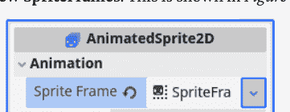

Figure 7.1 – 创建新的 SpriteFrames
- 5. 如图 7.1 所示，在 **Inspector** 中点击 **New SpriteFrames** 将在屏幕底部打开 **SpriteFrames** 区域。这里是我们导入帧并创建和命名新动画的空间。这在图 7.2 中显示：

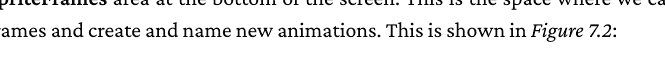

Figure 7.2 – SpriteFrames 区域

如图 7.2 所示，我们目前只有默认动画，且没有关联的图像或帧。我们现在将为 **idle** 动画创建动画，然后从 sprite sheet 导入与其关联的精灵。
- 6. 首先将默认动画重命名为 **idle**。
- 7. 在 **FileSystem** 中，创建一个名为 **Collectibles** 的新文件夹。
- 8. 现在，在从 Pixel Frog 下载的资源中找到 **Items | Fruits** 文件夹（参见 *技术要求* 部分），并将草莓的图像拖到 **FileSystem** 中的 **Collectibles** 文件夹。
- 9. 选择 **idle** 动画，然后点击 **Add frames from a Sprite Sheet** 按钮或按 *Ctrl + Shift + O*。现在，在你的 Collectibles 文件夹中选择 Idle 图像文件。
- 10. 现在，你必须数出精灵图像的数量并按需更新 **Horizontal** 和 **Vertical** 帧属性（见图 7.3）。
- 11. 然后，点击 Select All 按钮，然后点击 Add x Frame(s) 按钮。这在图 7.3 中以草莓的 idle 帧为例显示：

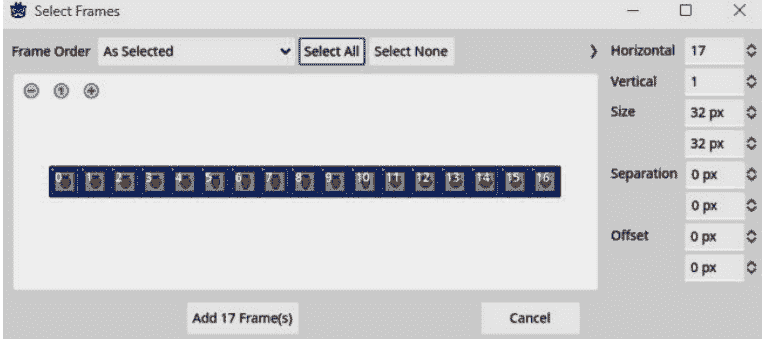

Figure 7.3 – 设置 Horizontal 和 Vertical 帧并将它们添加到动画中

现在，如图 7.3 所示，你已从图像（sprite sheet）中裁剪出单独的帧，你的 SpriteFrames 窗口将更新为用于 idle 动画的图像。这在图 7.4 中显示：

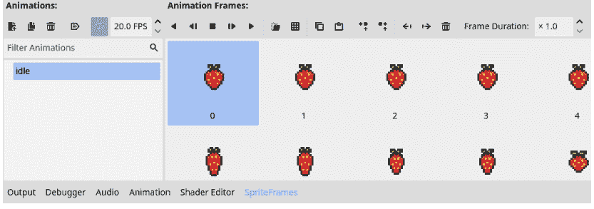

Figure 7.4 – 用于 idle 动画的帧

快速提示：需要查看此图像的高分辨率版本吗？在 next-gen Packt Reader 中打开本书或在 PDF/ePub 副本中查看。

next-gen Packt Reader 和本书的免费 PDF/ePub 副本包含在你的购买中。扫描二维码或访问 packtpub.com/unlock，然后使用搜索栏按名称查找本书。仔细检查所示的版本，以确保你获得正确的版本。


- 12. 如图 7.4 所示，顶部栏中有动画控件。我已将 idle 帧率设置为 20 FPS，并且循环已打开。你可以尝试这些设置以找到你喜欢的设置。这在图 7.5 中可见：

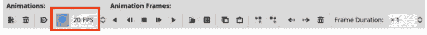

Figure 7.5 – 带有循环和 FPS 高亮的动画控件
- 13. 为了完成草莓可收集物品的设置，我们需要在 Area2D 节点的子节点下添加一个 CollisionShape2D 节点。对于该节点的 Shape 属性，选择 CapsuleShape2D 并在 Viewport 中调整以适应草莓。这在图 7.6 中显示：


Figure 7.6 – 调整碰撞以适应草莓

草莓现在可以与对象发生碰撞并检测对象是否与其发生碰撞。我们需要编写代码来为草莓制作动画，并在玩家与其碰撞时执行某些操作，例如移除草莓并将玩家的草莓收集分数加 1。

## 实现草莓脚本

草莓只需要做两件事：动画播放，并在玩家收集时消失。我们现在将编程草莓执行这两件事。

在草莓场景中，选择你的草莓节点并点击 Attach New Script 按钮/图标，如图 7.7 所示：


Figure 7.7 – Attach New Script 按钮/图标

idle 动画必须重复播放；我们已经将其设置为循环，因此在 ready 函数中，我们只需要启动动画。为了更轻松地引用场景中的其他节点，Godot 提供了一个内置快捷方式。通过在节点名称前加上美元符号（$），我们可以直接快速访问该节点及其函数。

此快捷方式在频繁与场景中的其他节点交互时特别有用，例如控制角色的动画或更新 UI 元素，因为它使代码更易读且高效。使用此快捷方式播放草莓的 idle 动画，如以下代码所示：

```
func _ready():
    $AnimatedSprite2D.play("idle")
```

当我们的玩家与草莓发生碰撞或重叠时，我们希望向草莓发出信号以执行一个函数。在该函数中，我们可以从关卡中移除草莓并将玩家收集的草莓数量加 1。Area2D 节点可以响应多种内置信号，其中之一是当一个物体进入节点区域时。

要设置此功能，选择草莓节点，然后点击 Node 选项卡（位于 Inspector 选项卡右侧）。在 Signals 类别下，在 Area2D 下，选择 body_entered 信号并点击右下角的 Connect，或直接双击信号名称。这在图 7.8 中显示：


Figure 7.8 – Area2D 的 body_entered 信号

一个新窗口将会弹出，如图 7.9 所示。你现在无需担心细节，只需点击 Connect 按钮即可。


Figure 7.9 – 将信号连接到方法（函数）


点击 Connect 按钮，如图 7.9 所示，将在 Strawberry 脚本中创建一个名为 _on_body_entered(body) 的新函数。参数 body 包含与 Strawberry 碰撞的对象的引用。为了确定该 body 是否为玩家，我们可以将玩家标记为 Player 组的一部分。

就是这样做的：

- 1. 切换到你的 Player 场景并选择 Player 节点。
- 2. 再次点击 Inspector 右侧的 Node 选项卡，然后选择 Groups 子选项卡。
- 3. 点击 + 符号添加一个组。
- 4. 将组命名为 Player。

这些步骤如图 7.10 所示。


Figure 7.10 – Node 选项卡、Groups 子选项卡以及添加新组的 + 符号

组准备好后，我们可以检查进入 Strawberry 的 body 是否在 Player 组中，如果是则相应地做出反应。我们可以在 Strawberry 脚本中按如下方式实现：

```
func _on_body_entered(body):
    if body.is_in_group("Player"):
        #add to player score
        #remove the strawberry
```

Player 将跟踪它收集了多少个 Strawberries。我们需要在 Player 脚本中添加一个变量来记录玩家收集的 Strawberry 数量，并在 Player 脚本中添加一个函数，每次收集到 Strawberry 时将分数加一。

返回 Player 脚本并按代码所示添加变量和函数：

```
var jumpCount = 0
var is_wall_sliding = false
var strawberry_count = 0

func add_score(amount):
    strawberry_count += amount
```

前面的代码每次调用时都会按指定量增加 strawberry_count 变量。我们将在 Strawberry 的 _on_body_entered(body) 函数中调用它，并在收集后从场景中移除 Strawberry，如下所示：

```
func _on_body_entered(body):
    if body.is_in_group("Player"):
        body.add_score(1)
        queue_free() #remove strawberry
```

内置的 queue_free() 函数会在当前帧结束时，只要安全就立即从内存中删除一个节点。它是移除场景中节点的推荐方法。

有了这段代码，当 Strawberry 信号有另一个 body 进入其空间时，玩家 Strawberry 计数将增加 1，且 Strawberry 将从场景中移除。

随意多次将 strawberry.tscn 文件拖放到你的关卡中，以便玩家有东西可收集，如图 7.11 所示：


Figure 7.11 – 将 Strawberry 拖放到关卡中

玩家可以在关卡中移动并收集 Strawberry。为了增加挑战性，我们需要一个巡逻的敌人。

## 添加巡逻敌人

请注意，敌人可以在此处找到：https://pixelfrog-assets.itch.io/pixel-adventure-2.

我们将使用 **Mushroom** 敌人。创建一个新场景并使用 **CharacterBody2D**、**AnimatedSprite2D** 和 **CollisionShape2D** 进行设置，其中 **CapsuleShape2D** 仅覆盖蘑菇的一部分，如 *图 7.12* 所示：


*图 7.12 – 设置 Mushroom 场景*

使用 Mushroom 敌人文件夹中提供的精灵表，并设置 SpriteFrames 和动画 **idle** 与 **run** 以 **20 FPS** 循环播放。我使用 **idle** 中的一帧并对其进行旋转创建了自己的 **death** 动画，如 *图 7.13* 所示：


*图 7.13 – Mushroom 敌人的动画*

将新脚本附加到 **Mushroom** 节点，并确保使用的模板为空对象，如 *图 7.14* 所示：


*图 7.14 – 为 Mushroom 敌人使用 Object: Empty 模板*

使用 Empty 模板可确保我们的脚本以无默认或额外代码的方式创建，并且尽可能简单。

添加代码以设置 Mushroom 的速度、方向和生命值，如代码所示：

```
extends CharacterBody2D

const SPEED = 75
var direction = 1
var health = 1
```

请注意，direction 变量的值为 -1 或 1，分别表示向左或向右移动。

现在，我们有了控制 Mushroom 敌人速度、方向和生命值的变量。

此外，添加一个函数为 Mushroom 应用重力，使其能够下落并接触地面，如以下代码所示：

```
func add_gravity(delta):
    # Add gravity.
    if not is_on_floor():
        velocity += get_gravity() * delta
```

如果 Mushroom 不在地面上，重力会将其向下拉。

现在，创建一个使 Mushroom 移动的函数。我将其命名为 update_direction()，它所做的只是让敌人以恒定速度向右移动，如代码所示：

```
func update_direction():
    # Move enemy at constant speed
    velocity.x = SPEED * direction
```

Mushroom 在水平面上的速度乘以速度和方向。

这两个函数也必须在 _physics_process(delta) 函数中与 move_and_slide() 一起调用，如代码所示：

```
func _physics_process(delta):
    add_gravity(delta)
    update_direction()
    move_and_slide()
```

我们还必须设置 Mushroom 的碰撞，使其能够与地面和玩家发生碰撞。通过打开 Collision Layer 1 并打开 Collision Mask 1、2 和 3 来实现。

如果你现在将 Mushroom 放入关卡并运行游戏，Mushroom 将开始向右移动，直到与墙壁碰撞。

我们将使用内置的 is_on_wall() 函数检测 Mushroom 是否与墙壁碰撞并反转其方向，如代码所示：

```
func reverse_direction():
    #Reverse direction when hitting a wall
    if is_on_wall():
        direction = -direction
```

请注意，通过反转或否定 direction 的值，我们可以确定 Mushroom 是向左还是向右移动。

确保在调用 move_and_slide() 之后调用 reverse_direction()，如下代码所示，否则碰撞将无法正确检测：

```
func _physics_process(delta):
    add_gravity(delta)
    moveEnemy()
    move_and_slide()
    reverse_direction()
```

如果你将 Mushroom 放在一个漂浮平台上，当它到达平台边缘时就会掉落。为防止这种情况，使用 RayCast2D 节点检测 Mushroom 是否接近边缘然后反转方向。将 RayCast2D 节点作为 Mushroom 的子节点添加，如图 7.15 所示：


Figure 7.15 – 向我们的 Mushroom 节点添加 RayCast 节点

RayCast2D 只是由对象投射的不可见射线，用于在发送方向上查找碰撞。在本例中，我们正在寻找下方的碰撞以确定何时不再在地面上。我们的射线投射在 Mushroom 的右侧一点（我使用 Target Position x: 0, y: 14 和 Transform Position x: 15 和 y: 7），这样我们就可以看到何时接近无地面区域并在掉落前反转方向！将你的射线放置如下图 7.16 所示：


Figure 7.16 – 从 Mushroom 右侧向下投射射线

现在，我们可以编写一个函数，当射线未与地面碰撞时反转 Mushroom 的方向，并将射线移动到另一侧，使其始终在 Mushroom 移动方向上寻找无地面，如下所示：

```
func platform_edge():
    if not $RayCast2D.is_colliding():
        direction = -direction
        $RayCast2D.position.x *= -1
```

在前面的代码中，只要射线不再与地面碰撞，Mushroom 的移动方向就会反转，并且射线会移动到 Mushroom 的另一侧以检测 Mushroom 移动方向上的碰撞。我们还必须为 RayCast2D 节点打开 Collision Mask 2 和 3，以便它能够检测到地面。

请记住在 _physics_process() 函数中在 move_and_slide() 之后调用此函数，以便在检测到碰撞后运行。最后，将一个 Mushroom 放在平台上以测试它是否巡逻平台且不会掉落。


## 蘑菇踩踏

玩家应该只能从上方攻击蘑菇来伤害它。我们将为蘑菇创建一个受伤区域或死亡区域，它将由一个 Area2D 和 CollisionShape2D 节点组成，其中放置了一个 RectangleShape2D 节点在蘑菇顶部。

如果玩家从侧面攻击，蘑菇会伤害玩家。我们将在蘑菇两侧创建一个伤害玩家区域，同样由 Area2D 和 CollisionShape2D 以及 RectangleShape2D 组成。这在图 7.17 中显示：


图 7.17 – 创建死亡区域和伤害玩家区域

有了这些，我们就可以利用信号来检测玩家是否进入了其中一个区域，然后做出相应反应。

将 _on_death_zone_body_entered() 和 _on_hurt_player_zone_body_entered() 信号连接到蘑菇脚本。然后，在空函数中编写代码，如代码所示：

```
func _on_death_zone_body_entered(body):
    if "Player" in body.name:
        body.velocity.y = -500
        health -= 1
```

```
func _on_hurt_player_zone_body_entered(body: Node2D):
    if "Player" in body.name:
        body.hurt()
```

Player 脚本中目前还没有 hurt() 函数。我们现在应该创建它。

打开 Player 脚本并添加以下函数，以便玩家可以被蘑菇敌人伤害：

```
func hurt():
    print("Player hurt")
```

请注意，目前我们只是使用了一种称为 stub testing 的技术，即简单地显示一条消息来验证函数是否被正确调用。稍后，我们将完成此函数的完整实现。

_on_death_zone_body_entered(body) 函数在有物体进入死亡区域时运行（从上方跳到蘑菇上）。我们检查进入该区域的物体名称中是否包含单词 Player。这是一种替代且等效于检查 body.is_in_group("Player") 的方法。如果物体的名称中确实包含单词 Player，我们将玩家的速度增加 500，使其看起来像是从蘑菇上弹开，并将蘑菇的生命值减 1。

_on_hurt_player_zone_body_entered() 函数在物体从侧面进入蘑菇时运行。同样，如果该物体是玩家，我们将运行玩家的 hurt() 函数，减少玩家的生命值。

当蘑菇的生命值为 0 时，它应该禁用碰撞，停止与玩家的碰撞检测，并播放死亡动画。这是通过以下所示的自定义函数实现的：

```
func mushroom_death():
    if health <= 0:
        $CollisionShape2D.disabled = true
        $HurtPlayerZone.monitoring = false
        $AnimatedSprite2D.play("death")
```

mushroom_death() 函数应该在 _physics_process() 函数中调用，如代码所示：

```
func _physics_process(delta):
    add_gravity(delta)
    moveEnemy()
    move_and_slide()
    reverse_direction()
    platform_edge()
    mushroom_death()
```

连接蘑菇的 AnimatedSprite2D 节点的 _on_animated_sprite_2d_animation_finished() 信号。当死亡动画结束时，它将触发移除蘑菇场景的函数，如代码所示：

```
func _on_animated_sprite_2d_animation_finished():
    if $AnimatedSprite2D.animation == "death":
        queue_free()
```

在你的关卡中添加更多蘑菇和可收集物。为了防止场景树过于拥挤，添加一个类型为 Node 的新子节点。将它重命名为 Enemies 并将所有蘑菇拖到其下。你可以对 Collectibles 做同样的操作，如图 7.18 所示：


图 7.18 – 通过分组节点来组织场景树

现在关卡中有敌人和可收集物，我们需要一个胜利条件。对于我们的目的，它将是玩家收集完所有草莓后，检查点旗帜会升起。触碰该旗帜将结束关卡。让我们在下一节了解更多关于关卡完成的知识。

## 实现关卡完成

关卡完成机制是任何游戏的重要组成部分，为玩家提供成就感和 closure。在本节中，我们将创建一个系统，其中收集所有草莓会触发一系列事件：检查点旗帜动画播放并飞出，标志着目标的完成。玩家随后移动到旗帜处，触碰它以结束关卡。

该系统不仅增加了视觉和互动效果，还强化了玩家的进度和目标达成感。到本节结束时，你将拥有一个精致且令人满意的关卡完成序列，以提升游戏的整体体验。

创建一个具有以下内容的新场景：

- **Area2D** 作为根节点（重命名为 CheckPoint）
- **AnimatedSprite2D**
- **CollisionShape2D** 带有 **RectangleShape2D**

场景树如图 7.19 所示：


图 7.19 – 检查点场景的场景树

为旗帜创建三个动画，命名为 flag_fly、idle 和 trigger。在 Pixel Frog 的资源文件夹中，导航到 Items | Checkpoints | Checkpoint 文件夹。

- 对于 idle 动画，使用名为 Checkpoint (No Flag).png 的单帧。
- 对于 trigger 动画，使用 Checkpoint (Flag Out).png 精灵表。不要循环动画并以 20 FPS 运行。
- 对于 flag_fly 动画，使用 Checkpoint (Flag Idle).png 精灵表。循环动画并以 20 FPS 运行。

flag_fly 动画的示例图像如图 7.20 所示：


图 7.20 – 为检查点设置旗帜动画

将脚本附加到 CheckPoint 节点以自定义其行为。我们将创建自己的信号来触发旗帜飞出。一旦玩家在关卡中收集了所有草莓，玩家将发出 trigger 信号。CheckPoint 代码如下所示并进行了解释：

```
extends Area2D
signal trigger
var level_complete = false

#### signal that runs when the animation is finished playing
func _on_animated_sprite_2d_animation_finished():
    $AnimatedSprite2D.play("flag_fly")
    level_complete = true

#### our own custom signal
func _on_trigger():
    $AnimatedSprite2D.play("trigger")

#### A signal that runs when a body enters
func _on_body_entered(body):
    if level_complete:
        get_tree().quit()
```

如图所示，我们创建自己的信号并将其命名为 trigger。然后，在 Inspector 中，我们将该信号连接到我们的脚本。我们还有一个布尔变量 level_complete 用于确定关卡是否完成。链接到我们信号的 trigger 函数播放 trigger 动画，然后发出动画完成的信号，这会切换到 flag_fly 动画并将 level_complete 设置为 true。目前，当玩家触碰旗帜时，游戏将退出。

然而，我们需要从 Player 脚本发出 trigger 信号，一旦他们收集了所有草莓。返回 Player 脚本并添加一个名为 level_strawberries 的新变量来跟踪关卡中草莓的数量，如下所示：

```
var strawberry_count = 0
var level_strawberries
```

首先，我们应该创建一个名为 checkpoint 的组并将 CheckPoint 节点添加到该组。为此，在 Inspector 中选择 CheckPoint 节点，选择 Node 选项卡，然后选择 Groups 子选项卡并添加一个名为 checkpoint 的新组。这如图 7.21 所示：


图 7.21 – 创建检查点组

我们还需要一个自定义函数来检查关卡是否完成，然后发出 trigger 信号。如果 strawberry_count（玩家收集的草莓数量）与 level_strawberries（关卡中草莓的总数量）匹配，则我们通过其组名获取对检查点的引用并发出检查点的 trigger 信号。最后，我们将草莓重置为 0，以便信号只发出一次而不是不断发出。这在以下代码中显示：

```
func complete_level():
    if strawberry_count == level_strawberries:
        var checkpoint =
        get_tree().get_first_node_in_group("checkpoint")
        checkpoint.emit_signal("trigger")
        strawberry_count = 0
```


请记住在 _physics_process(delta) 函数中调用新的 complete_level() 函数。

由于所有的草莓都在 Level1 场景中，我们需要将一个脚本附加到 Level1 节点上，以便它可以统计场景中的草莓数量并更新玩家变量。这在图 7.22 中显示：


图 7.22 – 将脚本附加到关卡节点

关卡脚本中统计草莓的代码如下所示：

```
extends Node2D
@onready var player = $Player
@onready var strawberries = $Collectibles

func _ready() -> void:
    player.level_strawberries = strawberries.get_child_count()
```

在前面的代码中，我们获取了 Player 场景的引用以及 Collectibles 场景组（多个草莓）的引用。在 _ready 函数中，我们通过将其设置为关卡中所有草莓的数量来更新玩家的 level_strawberries 变量。

现在，将一个 CheckPoint 场景添加到关卡中，你就有了完成它的方法。

这样，关卡现在就可以游玩了！

## 摘要

在本章中，我们通过基本游戏玩法机制扩展了我们的 2D 平台游戏，并改进了玩家交互。我们通过代码控制玩家动画，确保跑步、跳跃和墙滑等动作具有流畅的视觉反馈。我们还实现了墙滑和双跳，增加玩家移动的多样性，并引入了可穿透平台以实现动态关卡导航。同时，我们还添加了可收集物品以鼓励探索、巡逻敌人以增加挑战，以及用于跟踪关卡完成的检查点。

在下一章中，我们将迁移我们的 2D 技能并制作一个 3D 平台游戏！

## 立即解锁本书的独家福利

扫描此二维码或访问 packtpub.com/unlock，然后按书名搜索本书。

*注意：开始前请准备好您的购买发票。*


