# 第 3 部分

## 构建与超越
你的游戏开发之旅

在本书的这一最终部分，你将通过两个详细的章节从零开始构建一个 3D 小游戏，从而将你的技能提升到下一个水平。然后你将探索如何通过视觉和音频增强——通常称为“游戏精华”——来提升玩家体验。我们还将退一步审视核心游戏设计原则，帮助你批判性地思考是什么让游戏引人入胜且令人愉快。最后，我们将以精心挑选的资源汇编作为收尾，以支持你作为游戏开发者的持续学习和成长。到本部分结束时，你将完全具备开始创建自己的完整游戏并打磨技艺的能力。

本书的这一部分包含以下章节：

- *第 8 章，在 Godot 中创建 3D 小游戏 – 第 1 部分*
- *第 9 章，在 Godot 中创建 3D 小游戏 – 第 2 部分*
- *第 10 章，添加游戏精华*
- *第 11 章，理解游戏设计*
- *第 12 章，下一步去哪里？*

## 8

## 在 Godot 中创建 3D 小游戏 — 第 1 部分

创建一个结构良好的 3D 游戏世界需要理解如何组合场景、设计关卡以及实现功能性控制器。在本章中，我们将深入 Godot 中 3D 游戏创建的基本构建块。通过学习如何组合和组织场景，你将为创建动态、交互式环境奠定坚实的基础。

你将首先构建一个 3D 角色场景并附加脚本来控制其移动。接下来，你将学习如何通过组合静态对象、碰撞体和网格来设计关卡。我们还将实现一个摄像机控制器，提供流畅且响应迅速的玩家视角。最后，我们将把所有内容整合到一个完整的关卡中并进行测试以确保功能正常。

在本章中，我们将涵盖以下主要主题：

- 在 3D 中工作：Godot 中的新维度
- 构建一个 3D 角色
- 创建关卡设计
- 使用 Character Controller 脚本
- 使用变量
- 探索函数
- 实现摄像机控制器
- 运行测试

到本章结束时，你将能够创建可重用的 3D 场景、控制玩家角色，并设计在视觉上吸引人且功能正常的关卡。这些技能对于构建沉浸式 3D 游戏至关重要，并将为未来章节中的更高级功能奠定基础。

## 技术要求

本章的代码文件可在本书的 GitHub 仓库中获取：https://github.com/PacktPublishing/Godot-4-for-Beginners/tree/main/ch8

本项目中使用的游戏资源由 Essssam 以知识共享零许可 Creative Commons Zero (CC0) 发布。Essssam 已允许我们在任何媒介或格式上分发、 remix、改编并基于该材料进行构建，甚至用于商业目的。

它们可以在这里找到：

https://essssam.itch.io/3d-leap-land

访问此链接查看代码运行的视频：https://packt.link/6dr7h

## 在 3D 中工作：Godot 中的新维度

到目前为止，我们一直完全在 2D 中工作——通过平面场景、精灵和屏幕空间移动学习 Godot 的基础知识。在本章中，我们将进入 3D，在那里我们将处理深度、透视、光照和更复杂环境中的物理。

虽然从 2D 过渡到 3D 起初可能看起来令人生畏，但 Godot 一致的节点和基于场景的设计使得这一飞跃变得更加容易管理。模块化和层次结构的相同原则仍然适用——只是现在我们处理的是 Node3D、MeshInstance3D 和 Camera3D 等 3D 节点，并在三维空间中构建场景。

本章将指导你创建基本 3D 角色的过程。你将学习如何组装和组织必要的组件到一个独立的场景中，该场景以后可以像我们在 2D 中所做的一样被重用并整合到更大的 3D 世界中。

## 构建一个 3D 角色

仅仅因为我们现在在三维中工作并不意味着 Godot 的节点和场景设计理念发生了变化。我们将继续在各自的场景中设计游戏的不同组件，然后使用它们构建关卡或主场景。

## 重要说明

请注意，你可以通过按住 *右鼠标按钮* 并像大多数游戏中一样使用 *WASD* 键在 3D 场景中飞行。如果在按住 *右鼠标按钮* 的同时使用鼠标滚轮，你可以设置移动速度。

我们将从 Player 场景开始。按照以下步骤，你将创建一个完全功能的 3D 玩家角色——它可以使用键盘输入在你的 3D 世界中移动并对物理做出真实响应。这将为构建完整的 3D 游戏奠定基础，从其最基本元素之一——玩家开始。

1. 创建一个新的 Godot 项目并将其命名为 Leap Land。
2. 现在，单击 **Other Node** 并添加一个 **CharacterBody3D** 节点作为根节点，如 *图 8.1* 所示：
3. 将 **CharacterBody3D** 节点重命名为 Player。该节点被设计为物理体，旨在由用户控制。

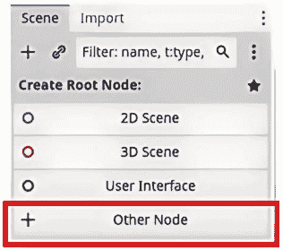

图 8.1 – 开始一个新的 3D 场景

4. 在 FileSystem 中创建一个新文件夹并命名为 assets。将 3D Leap Land 资源包中的 obj 和 tex 文件夹拖放到此文件夹中。这在图 8.2 中显示：

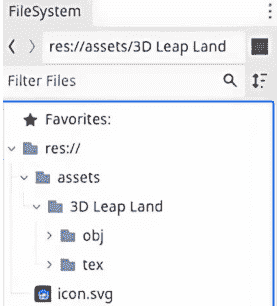

图 8.2 – 从 3D Leap Land 导入 obj 和 tex 文件夹

5. 在 2D 中，我们需要在 CharacterBody2D 节点上附加一个精灵以显示其纹理。在 3D 中，我们将 MeshInstance3D 节点作为 CharacterBody3D 节点的子节点添加，如图 8.3 所示：

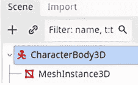

图 8.3 – 将 MeshInstance3D 添加为子节点

6. 选择 MeshInstance3D 节点，并在 Inspector 中找到 Mesh 属性。它当前为 <empty>，但将 slime.obj 从 FileSystem 拖放到 Mesh 属性上，如图 8.4 所示：

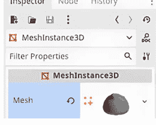

图 8.4 - 将 slime.obj 设置为 Mesh


7. 场景中的史莱姆是*灰色*的。为纠正这一点，我们必须将纹理文件 palette.png 从 tex 文件夹拖到视口中的史莱姆上。史莱姆的纹理将如 图 8.5 所示：

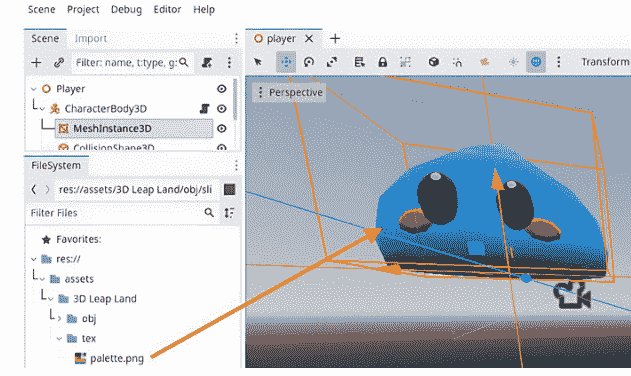

图 8.5 – 为史莱姆添加纹理

8. 现在，通过添加一个 **CollisionShape3D** 节点作为子节点为玩家添加一个碰撞盒。然后，在 **Inspector** 中，找到 **Shape** 属性，并选择一个新的 **SphereShape3D**。使用 *橙色* 的手柄调整碰撞盒大小以适应史莱姆。我为 **CollisionShape3D** 节点的 **Position** 值设置为 x: 0.0, y: 0.15, z: 0.0，但你的值可能有所不同。

9. 要看到任何东西，我们需要在场景中添加一个摄像机。添加一个 **Camera3D** 节点作为子节点并移动它，使其处于可以看到整个史莱姆的位置。我将其放置在 x: 0, y: 1, z: -2.5 处，并将旋转设置为 x: -15, y: -175, z: -1。这在 图 8.6 中显示：

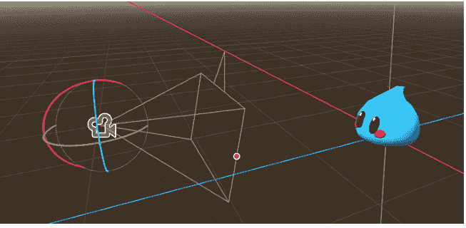

图 8.6 – 在场景中定位摄像机

10. 没有光，我们仍然看不到多少。添加一个 **DirectionalLight3D** 节点作为 **CharacterBody3D** 根节点的子节点。这是像太阳一样向所有方向无限延伸的光。你可以将光线角度调整到玩家身上。

11. 在 **MeshInstance3D** 节点的 **Transform** 属性中，将网格绕 *y* 轴旋转 180 度。

12. 将场景保存为 `player.tscn` 并通过按 *F6* 预览。它应看起来像 *图 8.7*：

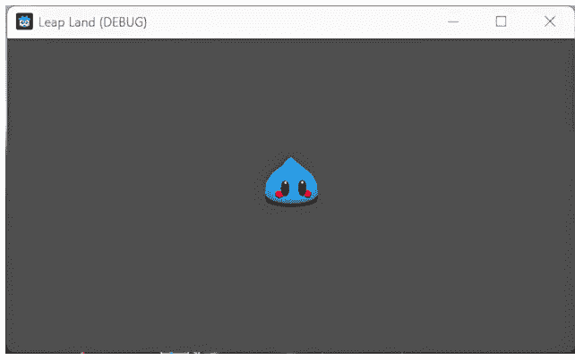

图 8.7 – 游戏中史莱姆的视图

**Player** 场景现在基本完成，可以导入到更复杂的场景中，例如关卡场景，这就是我们接下来要做的工作。

## 创建关卡设计

现在我们已经创建了 3D 玩家角色，下一步是为其构建一个可以存在和移动的关卡。

**Level design** 在 Godot 中指的是创建环境 – 地板、墙壁、平台和景物 – 它们构成了游戏的可玩世界。在 3D 中，这涉及在空间中放置和排列 3D 对象，以定义玩家可以去哪里、可以与什么交互以及游戏玩法如何展开。

在本节中，我们将使用 Godot 的内置节点和工具创建一个基本的 3D 关卡。最后，你将拥有一个角色可以走动并测试移动的空间。

## 创建关卡组件

为了构建关卡，我们使用各种 **level components**。这些是构成环境的各个部分，例如地板、墙壁、坡道或平台。关卡组件通常由 **StaticBody3D**、**MeshInstance3D** 和 **CollisionShape3D** 节点组成。

关卡的大部分部分，例如地面、墙壁、栅栏、桥梁和其他非移动结构，都是使用 **StaticBody3D** 节点创建的。这些对象在游戏过程中不打算移动，也不受物理力和碰撞的影响。相反，它们为游戏环境提供稳定且优化的基础。

出于以下几个原因，使用 **StaticBody3D** 节点作为静止元素很重要：

- **Performance:** Godot 通过将 **StaticBody3D** 节点排除在涉及移动和碰撞解析的昂贵物理计算之外来优化它们。这显著降低了 CPU 使用率，尤其是在复杂场景中。
- **Physics stability:** 因为这些刚体固定在原地，它们为玩家或敌人等移动对象提供可靠的碰撞表面，确保交互一致。
- **Lighting and baking:** 静态刚体也适用于光照烘焙和全局光照系统。由于它们不会移动，光照贴图和阴影可以准确预先计算，在不影响运行时性能的情况下提高视觉质量。

尽管 **StaticBody3D** 节点不会响应物理力，但它们仍可通过代码或动画手动重新定位，例如在触发时抬起吊桥或降低平台。这在不牺牲效率的情况下提供了灵活性。

为了在 3D 空间中可视化这些组件，我们使用 **MeshInstance3D** 节点，它显示对象的可见形状。为了使这些对象在游戏世界中可交互，例如允许玩家在其上行走或撞击它们，我们将它们与 **CollisionShape3D** 节点配对。让我们在下一节中看一个创建关卡组件的示例。

### 示例：创建草地平台

创建关卡组件的过程如下所示，并且需要为每个组件重复：

1. 创建一个以 **StaticBody3D** 节点作为根的新场景。将其重命名为 Grass。保存为 grass.tscn。
2. 添加一个 **MeshInstance3D** 节点并将 **Mesh** 属性设置为 ground_grass_4.obj。
3. 将 palette.png 拖到网格上以设置纹理。
4. 添加一个 **CollisionShape3D** 节点并选择 **New BoxShape3D**。
5. 使用手柄使碰撞盒适应地面模型周围。

场景应如 图 8.8 所示：

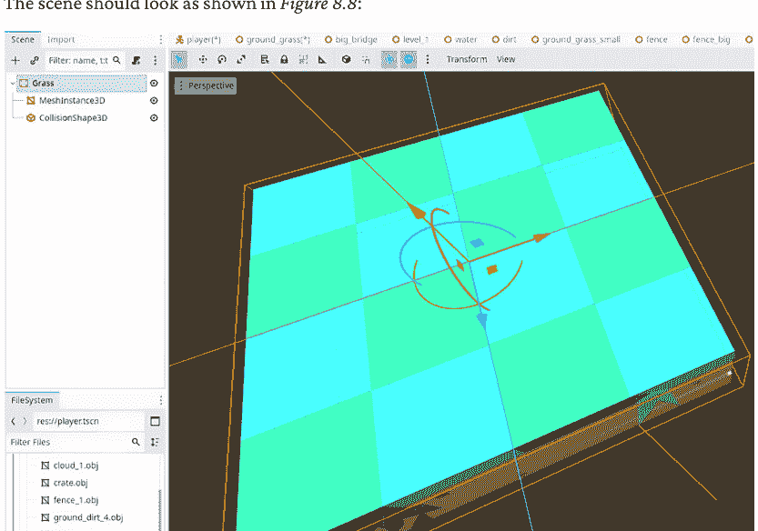

图 8.8 – 地面场景

### 重要说明

请注意，此过程需要为你想要添加到关卡中的每个组件（关卡的一部分）重复。这在 图 8.9 中有注释。

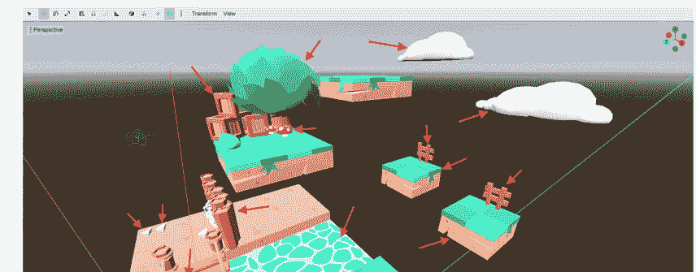

图 8.9 – 指向不同关卡组件的箭头（所有单独场景）

在下一节中，我们将学习如何处理不规则碰撞形状。

## 处理不规则碰撞形状

有些模型不符合诸如盒子或球体之类的常规碰撞形状——例如，弯曲或不平整的结构，如桥梁。幸运的是，Godot 提供了工具，可以帮助自动为这些更复杂的模型生成碰撞形状。

为了在实践中了解其工作原理，我们将使用不规则网格设置一个 Bridge 场景，并让 Godot 为其生成碰撞结构：

1. 创建一个以 **StaticBody3D** 作为根的新场景。将其重命名为 Bridge 并将场景保存为 bridge.tscn。
2. 添加一个 **MeshInstance3D** 节点并将 **Mesh** 属性设置为 bridge_1.obj。
3. 将 palette.png 拖到网格上以设置纹理。
4. 选择 **MeshInstance3D** 节点（Bridge 模型）。
5. 点击屏幕顶部的 Mesh 菜单并点击 Create Collision Shape...，如 图 8.10 所示：

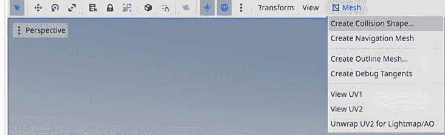

图 8.10 – 为 Bridge 场景自动生成碰撞形状

点击 Create Collision Shape... 后，会出现一个弹出菜单。对于碰撞形状放置，选择 Sibling，对于碰撞形状类型，选择 Trimesh。这在 图 8.11 中显示：

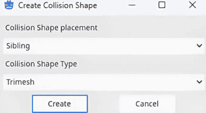

图 8.11 – Godot 创建碰撞形状的选项

- 选择 **Sibling** 可确保生成的碰撞形状作为单独的节点与网格并列添加，而不是作为其子节点。这保持了场景层次结构的整洁，并使网格及其碰撞形状更容易独立管理。
- 将 **Trimesh** 作为碰撞类型选择对于不打算移动的静态 3D 模型（如关卡几何体）来说是理想的。**Trimesh** 碰撞会创建与网格表面匹配的详细形状，从而实现准确的碰撞检测。然而，它最好仅用于静态对象，因为它计算成本高，不适合动态或移动对象。

6. Godot 将为 **Bridge** 生成一个碰撞形状多边形，结果的场景树如 *图 8.12* 所示：

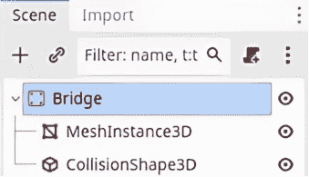

图 8.12 – Bridge 场景的场景树

### 重要说明

允许 Godot 为对象生成碰撞形状的一个缺点是 *性能*。使用简单或原始形状进行碰撞是首选，因为它减少了场景所需的物理计算。

## 创建关卡布局

开始创建关卡时，我首先探索了资源包中包含的模型。这些模型代表各种环境元素，例如地形、结构和道具。我使用了之前设置草地和桥梁时遵循的相同流程：*将模型导入 Godot 并将每个模型变成自己的场景。*

通过为各个组件创建单独的场景，我能够构建一套模块化的关卡元素。这些场景随后被组合起来形成完整的关卡布局。你可以遵循相同的方法——从下载的资源包中选择模型（参考 *Technical requirements* 部分），为每个组件创建场景，然后在新场景中组装它们以设计你的关卡。

最后，请确保在你的关卡场景中添加一个 **DirectionalLight3D** 节点。这确保环境得到适当的照明，并且模型以逼真的阴影和深度出现。


我创建的关卡如 图 8.13 所示：

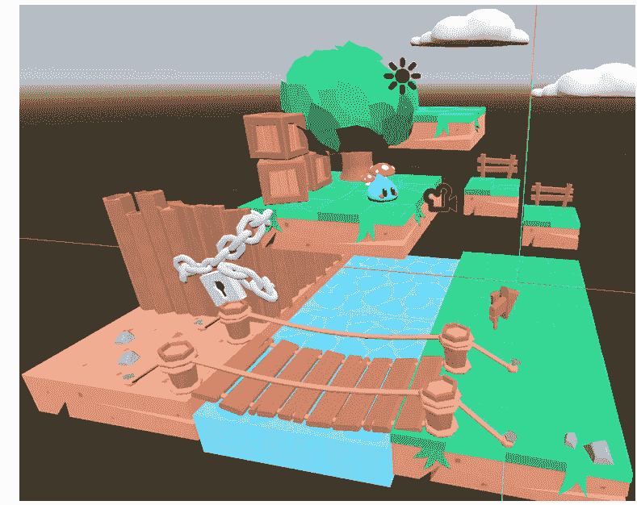

Figure 8.13 – 一个示例关卡

接下来，我们将学习如何更有效地组织关卡场景。

## 组织关卡场景

在图 8.13 中，关卡中的每个组件都是一个单独的场景，这样可以轻松地重复使用并独立管理它们。图 8.14 显示了我用来构建关卡的场景节点列表。请注意，我已将相似或重复的对象——例如 Fences、Grass、Crates 和 Rocks——分组到它们自己的父节点中：

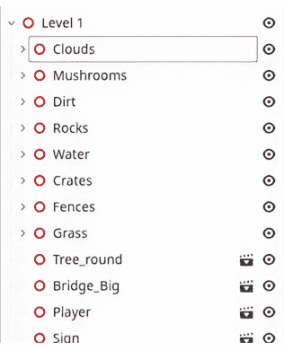

Figure 8.14 – 构成关卡的各个场景

**分组**很重要，因为它能保持场景树的整洁，尤其是在较大的关卡中。它允许你一起移动或操作整个类别的对象，从而节省时间并减少错误。例如，如果你想禁用所有栅栏或为所有草地应用着色器，分组会使这变得容易得多。

还值得注意的是，其中大多数对象，例如地面、栅栏、岩石和桥梁，都是静态的。它们在游戏过程中不会移动，应使用 **StaticBody3D** 实现，以获得更好的性能和准确的物理效果。

相比之下，动态对象（如玩家）设计为移动并对环境做出反应，因此使用启用物理的节点（如 **CharacterBody3D**）实现。

这种结构不仅有助于关卡设计，还能确保项目增长时性能流畅、代码管理更清晰。

如图 8.14 所示，我们现在拥有一个复杂的 **Level 1** 场景，它由许多较小的场景组成。尽管场景中已有玩家，但目前无法控制它。在下一节中，我们将处理角色控制器脚本。

## 使用角色控制器脚本

在本节中，我们将编写一个脚本，允许玩家在 3D 世界中移动角色。该脚本至关重要，因为没有它，我们的角色将保持静止——无法在关卡中行走、奔跑或跳跃。到本节结束时，你将拥有一个完全可控的玩家角色，它可以响应输入并以有意义的方式与游戏环境交互。

让我们开始为 Player 场景中的 CharacterBody3D 节点添加一个新脚本。确保在 Empty 中取消选中 Template，这样我们就不会获得任何预制代码，可以像图 8.15 所示那样制作一个完全自定义的角色控制器：

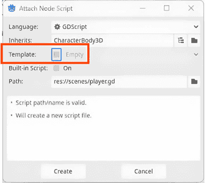

Figure 8.15 – 为玩家添加一个空脚本

当未选中 Template 复选框时，如图 8.15 所示，我们会看到一个仅有一行的脚本：

```
extends CharacterBody3D
```

这行代码意味着该脚本正在添加或自定义 Godot 中的内置 CharacterBody3D 节点。CharacterBody3D 节点用于创建 3D 角色，例如玩家或敌人，它们可以移动、跳跃或与环境交互。通过扩展它，我们可以编写自己的代码，使角色的行为完全符合我们的期望。

尽管我们在 Player 场景中添加了摄像机，但这在游戏过程中不会是唯一的摄像机。相反，我们将在关卡中设置第二个静态摄像机，以便我们可以旋转它从不同角度查看玩家。在 Godot 中，一个场景可以包含多个摄像机，你可以通过在 Inspector 中将其标记为 Current 来选择哪个摄像机处于活动状态。

## 使用变量

在深入代码之前，让我们花点时间了解它在做什么。在此脚本中，我们将定义一些重要的属性来控制玩家角色的移动方式，例如他们行走的速度或跳跃的高度。我们将使用导出变量，这意味着这些属性不仅在代码中定义，还可以在 Godot 编辑器的 Inspector 面板中直接查看和编辑。

这使得开发更加灵活和高效。例如，设计师和艺术家可以微调诸如移动速度、跳跃高度或重力等值，而完全无需触及代码。同时，程序员可以将逻辑保持在脚本中有序。这种关注点的分离有助于团队更有效地协作，使每个人都能快速测试和平衡游戏玩法，而不会冒着破坏代码的风险。

## 将玩家脚本与摄像机链接

我们现在可以开始准备角色与游戏世界中的其他组件交互。一个重要元素是摄像机，它需要在玩家穿过关卡时平滑地跟随玩家。为了实现这一点，我们将设置一种方式，让 Player 脚本与控制摄像机的单独场景进行通信。

稍后，我们将创建一个 View 场景，它将充当摄像机控制器。我们将为摄像机指定一个跟随目标（即玩家）。我们还将添加对该 View 的引用，以便可以直接从 Player 脚本控制摄像机的行为，例如旋转或缩放。

首先，将这两行添加到 Player 脚本中：

```gdscript
@export_subgroup("Components")
@export var view: Node3D
```

在这里，@export 注解使变量在 Inspector 中可见。在本例中，它还将变量组织在 CharacterBody3D 节点的属性中名为 Components 的新类别或子组下。view 变量现在将出现在该子组中，并设计为引用一个 Node3D 节点，我们稍后将创建它以用作摄像机控制器。这在图 8.16 中显示：

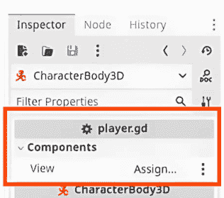

Figure 8.16 – 导出名为 Components 的组和名为 View 的变量

如图 8.16 所示，添加 @export 注解可使变量直接在 Godot 编辑器中可编辑，允许你在不修改代码的情况下更改其值。这在测试时尤其有用，因为你可以在游戏运行时实时调整值。

接下来，为玩家的移动属性导出另一个组，并为移动速度和跳跃强度添加变量：

```
@export_subgroup("Properties")
@export var movement_speed = 250
@export var jump_strength = 7
```

因为这些变量在 Inspector 中可用，所以我们可以通过在测试游戏时调整值来找到玩家移动的合适手感。

现在让我们为玩家添加一些通用变量：

- movement_velocity: 存储玩家在 3D 空间中的移动方式
- rotation_direction: 跟踪玩家转向的方向
- gravity: 模拟重力对玩家的影响

因此，让我们在 Player 脚本中添加以下行：

```
var movement_velocity: Vector3
var rotation_direction: float
var vertical_velocity = 0
```

让我们了解此代码片段中的重要元素：

- movement_velocity 存储基于玩家输入的移动速度向量
- rotation_direction 保存角色应基于移动方向旋转的角度
- vertical_velocity 跟踪作用在角色上的垂直力

除了移动之外，我们还需要变量来管理玩家的跳跃能力并跟踪可收集物品。具体来说，我们将添加变量来执行以下操作：

- 检测玩家是否在地面上
- 控制单跳和双跳
- 统计玩家收集了多少颗宝石

让我们在脚本中定义这些变量：

```
var previously_floored = false
var jump_single = true
var jump_double = true
var gems = 0
var smoothing_factor = 10

const GRAVITY = 25
```

在此代码片段中，previously_floored 跟踪角色在上一帧是否在地面上，这对于检测着陆很有用。当它在后续代码中使用时，这一点会更清楚。

最后，我们需要一个引用变量来表示角色的 3D 网格。我们将使用此引用在跳跃和着陆期间调整模型的比例——这是一种在动画中称为挤压和拉伸的简单增加视觉吸引力的方法。

```
@onready var model = $MeshInstance3D
```

这行代码告诉 Godot 将 MeshInstance3D 节点（当前节点的子节点）分配给变量 model，但仅在场景完全加载并准备就绪后。@onready 关键字确保在建立此引用时节点存在。

## 添加引用变量的替代方法

有一种快捷方式可以添加引用变量，例如前面用于玩家模型的引用变量。你将要引用的节点拖入脚本，并在即将释放鼠标按钮时按住键盘上的 Ctrl。Godot 会自动为你输入引用，你也可以重命名它。这在图 8.17 中显示：

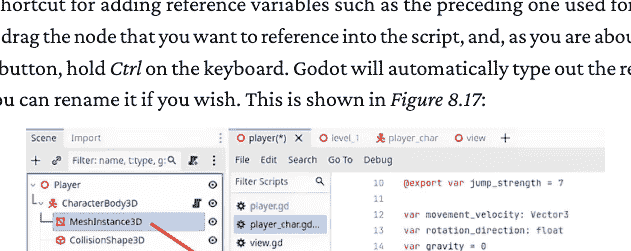

Figure 8.17 – 将节点拖入脚本并在释放时按住 Ctrl


随着我们的 Player 脚本不断增长，保持其组织性和可读性非常重要。 而不是把所有逻辑写在一个长块中，我们将把它拆分为更小、更专注的函数。 函数允许我们将相关的代码行归纳在单个名称下，使脚本更简洁、更易于理解，也更易于维护。

在下一节中，我们将开始定义函数来处理角色行为的关键部分。 每个函数将专注于一项具体任务，帮助我们构建结构良好且可复用的角色控制器。

## Exploring functions

如前所述，随着玩家变得更具交互性，控制它的脚本将变得更复杂。 为了保持代码整洁且易于管理，我们将把它拆分为函数：每个函数处理一项特定任务的可复用逻辑块。

在本节中，我们将定义函数来控制重力、处理移动输入、管理跳跃行为并跟踪 Gem 收集。 以这种方式组织代码是编写可扩展且可维护的 Godot 脚本的关键步骤。

让我们先创建一个处理重力的函数：

```
func handle_gravity(delta):
    vertical_velocity += GRAVITY * delta
    if vertical_velocity > 0 and is_on_floor():
        jump_single = true
        vertical_velocity = 0
```

让我们分解一下：

- vertical_velocity += GRAVITY * delta: 这会随着时间逐渐增加重力，模拟下落效果
- if vertical_velocity > 0 and is_on_floor(): 检查玩家是否正在下落（vertical_velocity > 0）并且已着地（is_on_floor() 返回 true）
- jump_single = true: 玩家着地后，我们允许他们再次跳跃
- vertical_velocity = 0: 将垂直速度重置为零，以免玩家继续向下加速

此函数确保玩家受重力影响，并且只有在着地后才能再次跳跃。

现在，让我们创建一个处理跳跃的函数：

```
func jump():
    vertical_velocity = -jump_strength
    model.scale = Vector3(0.5, 1.5, 0.5)

    if jump_single:
        jump_single = false
        jump_double = true
    else:
        jump_double = false
```

让我们详细查看：

- vertical_velocity = -jump_strength: 将重力反转，推动玩家向上并产生跳跃效果。
- model.scale = Vector3(0.5, 1.5, 0.5): 添加挤压和拉伸视觉效果，压缩宽度并夸大玩家高度以增加游戏韵味。你将在第 10 章学习关于游戏韵味的内容。
- if jump_single: 检查这是否是第一次跳跃。
- jump_single = false: 标记第一次跳跃已使用。
- jump_double = true: 在空中启用第二次跳跃。
- else: 检查第一次跳跃是否已使用。
- jump_double = false: 禁用进一步跳跃。

此函数在管理单跳和双跳逻辑的同时控制跳跃的物理效果和视觉反馈。

在这一点上，为我们的控制方案创建自定义输入映射是良好的实践。 让我们在下一节深入探讨这一点。

## Creating an input map

Godot 允许我们创建自己的输入映射，这是一个系统，可让我们定义自定义操作，例如 jump 或 move_left，并为每个操作分配一个或多个键、鼠标按钮或手柄输入。 这有助于保持代码整洁和灵活，因为我们可以按名称引用操作，而无需直接检查特定的按键。

现在，让我们查看创建输入映射的步骤：

- 1. 首先，单击 **Project | Project Settings | Input Map**。
- 2. 单击显示 **Add New Action** 的位置，输入操作名称，例如 `left`，然后按 *Enter*。 多次重复此操作，为 `right`、`up`、`down` 和 `jump` 添加名称。 稍后，我们需要用于独立移动摄像机的操作，因此添加诸如 `camera_left`、`camera_right`、`camera_up` 和 `camera_down` 之类的操作。
- 3. 现在，为每个新操作单击 + 号，然后按您希望链接到该操作的键。 这在图 8.18 中显示。

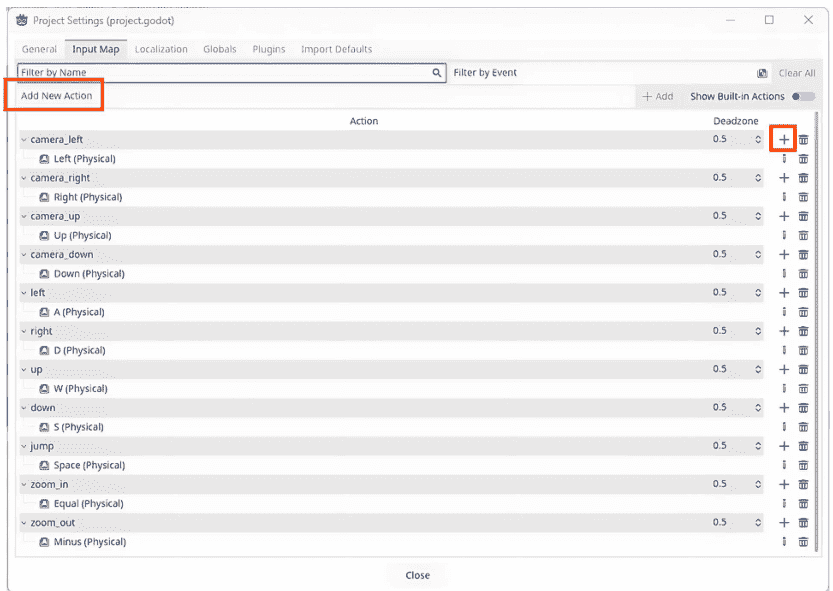

图 8.18 – 添加我们自己的操作事件和键

如图 8.18 所示，现在我们已创建自己的自定义操作来关联输入，可以继续创建玩家移动的函数。

## Implementing player controls and actions

让我们添加 handle_controls 函数来处理玩家移动的控制：

```
func handle_controls(delta):
    # Movement
    var input := Vector3.ZERO
    input.x = Input.get_axis("left", "right")
    input.z = Input.get_axis("up", "down")

    input = input.rotated(Vector3.UP, view.rotation.z)
    if input.length() > 1:
        input = input.normalized()

    movement_velocity = input * movement_speed * delta

    # Jumping
    if Input.is_action_just_pressed("jump"):
        if jump_single or jump_double:
            jump()
```

handle_controls 函数将玩家方向（左、右、上或下）存储在 input 向量中。 然后，它根据摄像机位置调整玩家移动方向（input），使其与当前视角或方向对齐。 如果不进行此更改，移动将始终基于全局 x 和 z 位置，而不是根据玩家摄像机的视角而变化。

为了使玩家在所有方向（尤其是对角线）的速度保持一致，我们必须规范化 input 向量（将其长度设为 1）。 这可确保对角线移动不会比沿单个轴移动更快，否则同时按下两个键时会给玩家带来意外的速度提升。

现在我们必须根据输入和速度更新移动速度。

为了处理跳跃，我们必须检测跳跃按钮是否已被按下，然后在玩家能够跳跃时（即单跳或双跳）调用 jump() 函数。

## Handling game events and feedback

当玩家收集 Gems 时，我们将增加宝石计数并发送信号以提醒游戏的其他部分宝石计数已更改。 为此，我们将在脚本顶部创建自己的自定义信号。

作为脚本中的第二行代码，添加以下内容：

```
signal gem_collected
```

现在，Inspector 中将出现一个新信号，如图 8.19 所示：

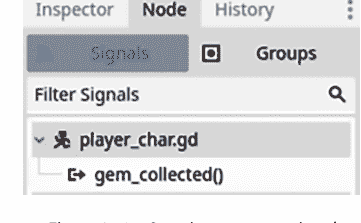

图 8.19 – 创建自定义信号

接下来，我们将在脚本中创建一个名为 collect_gems() 的新函数。 该函数如下所示：

```
func collect_gems():
    gems += 1
    gem_collected.emit(gems)
```

在此函数中，我们将更新 Gems 的当前计数并发出 gem_collected 信号，同时附带当前的 Gem 计数。

现在，创建一个名为 handle_movement(delta) 的函数来处理玩家的移动，如以下代码所示并解释：

```
func handle_movement(delta):
    var applied_velocity: Vector3

    applied_velocity = velocity.lerp(movement_velocity,
    delta * smoothing_factor)
    applied_velocity.y = -gravity
    velocity = applied_velocity
    move_and_slide()
```

这里，局部变量 applied_velocity 计算并存储每一帧玩家速度。 该计算使用 lerp 函数，该函数使用线性插值使当前速度（velocity）缓慢地向目标速度（movement_velocity）移动。 这使玩家的移动更加平滑。

Note

**Linear interpolation** 是一种技术，通过让计算机计算并填充中间的所有值，从而平滑或逐渐地从一个值移动到另一个值。

将速度的垂直部分设为负重力可确保玩家在水平速度被插值时仍受重力影响。

最后，如代码最后两行所示，我们必须更新当前速度并调用 move_and_slide 以移动角色并检测碰撞。

现在我们需要一个函数来处理玩家的旋转：

```
func handle_rotation(delta):
    if Vector2(velocity.z, velocity.x).length() > 0:
        rotation_direction = Vector2(velocity.z,
        velocity.x).angle()

    rotation.y = lerp_angle(rotation.y, rotation_direction,
    delta * smoothing_factor)
```

在前面的代码中，handle_rotation 函数检查玩家是否正在移动，然后通过以弧度计算移动方向的角度来更新 rotation_direction 全局变量。

最后，角色的 y 轴使用角度插值平滑旋转以面向移动方向，以防止任何突然的旋转变化。


我们玩家的最终自定义函数将处理着陆时的重生和动画效果。按所示代码创建 handle_respawn() 函数：

```
func handle_respawn(delta):
    var border_position_y = -10
    # Threshold below which the player respawns
    if position.y < border_position_y:
        get_tree().reload_current_scene()

    # Animation for scale (jumping and landing)
    model.scale = model.scale.lerp(Vector3(1, 1, 1), delta
    * smoothing_factor)

    # Animation when landing
    if is_on_floor() and vertical_velocity > 2 and
    !previously_floored:
        model.scale = Vector3(1.25, 0.75, 1.25)

    previously_floored = is_on_floor()
```

让我们研究 handle_respawn() 函数：

- **场景重载（重生）：** 如果玩家的位置.y 低于 -10（意味着他们已掉出关卡），我们调用 get_tree().reload_current_scene() 来重新加载当前场景并使玩家在起始位置重生。
- **重置缩放（恢复大小）：** 我们使用 model.scale.lerp(Vector3(1, 1, 1), delta * smoothing_factor) 在跳跃或着陆产生的挤压和拉伸效果后，逐渐将玩家的缩放插值回正常状态。
- **着陆动画（挤压效果）：** 如果玩家当前在地面上（is_on_floor()），下落速度很快（gravity > 2），并且在上一帧不在地面上（!previously_floored），我们通过将 model.scale 改为 Vector3(1.25, 0.75, 1.25) 触发挤压效果。
- **地面状态跟踪：** 最后，我们更新 previously_floored 变量以跟踪玩家在上一帧是否在地面上。

为了让所有这些机制平稳运行，我们需要在 Godot 的主物理循环中调用自定义函数：

```
func _physics_process(delta):
    handle_controls(delta)
    handle_gravity(delta)
    handle_movement(delta)
    handle_rotation(delta)
    handle_respawn(delta)
```

_physics_process(delta) 函数是 Godot 用于物理计算的内置循环，每帧物理帧调用一次（默认每秒 60 次）。它确保我们的游戏逻辑在任何帧率下都能一致运行。通过在此处调用自定义函数，我们可使重力、移动、跳跃、摄像机效果和重生与物理引擎保持同步。

现在我们的角色控制器已能正常工作——处理移动、跳跃和着陆动画——是时候设置摄像机，使其在 3D 空间中正确跟随玩家了。配置良好的摄像机通过帮助玩家保持方向感和专注于周围环境来提升游戏体验。在下一节中，我们将把摄像机连接到玩家并编写脚本，使其能平滑响应玩家的移动和旋转。

## 实现摄像机控制器

开始配置摄像机时，我们将先创建一个新场景作为摄像机控制器，然后将其链接到玩家。

- 1. 创建一个新场景并添加一个 Node3D 节点作为根节点。将此节点重命名为 View。现在添加一个 Camera3D 节点作为子节点。场景树如图 8.20 所示：

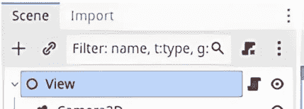

图 8.20 - View 的场景组成

- 2. 选择 Camera3D 节点，并在 Inspector 中将 Current 属性设置为 On——标记此摄像机为要使用的摄像机。你还可以通过将 FOV 属性设置为 40 来调整视野范围。如图 8.21 所示：

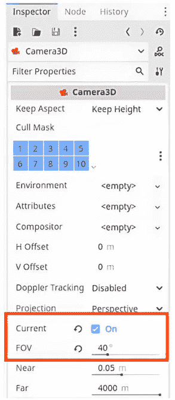

图 8.21 – 将摄像机设为当前并调整 FOV

- 3. 现在，将脚本附加到 View 节点并将其保存为 view.gd。确保将模板设置为 Empty。

现在我们准备开始构建摄像机控制器脚本，该脚本将允许玩家使用键盘上的按键（我们在输入映射中定义）移动摄像机并调整缩放。

摄像机需要一个目标节点来注视或聚焦。这将是我们的 Player 节点。我们将按以下代码所示将此目标导出为变量：

```
@export_group("Properties")
@export var target: Node
```

此导出的 target 变量将出现在 Inspector 中，允许我们将 Player 节点拖放到其中。摄像机随后将知道它应该跟随什么。

现在导出变量以控制摄像机的缩放级别和旋转速度：

```
@export_group("Zoom")
@export var zoom_minimum = 16
@export var zoom_maximum = 4
@export var zoom_speed = 10
```

这些变量定义了缩放行为：zoom_minimum 和 zoom_maximum 决定摄像机可以缩放的进出范围。此外，zoom_speed 控制在触发输入时缩放发生的速度。

接下来，让我们定义 rotation_speed 变量：

```
@export_group("Rotation")
@export var rotation_speed = 120
```

此变量设置摄像机在玩家旋转或使用输入转动摄像机时围绕玩家旋转的速度。

我们将使用两个标准变量来跟踪摄像机的当前旋转和缩放：

```
var camera_rotation: Vector3
var zoom = 10
```

让我们进一步探讨：

- camera_rotation 将存储摄像机的当前旋转角度（以度为单位）
- zoom 跟踪当前缩放值，我们将根据玩家输入随时间修改它

最后，我们需要对场景中实际的 Camera3D 节点的引用，以便我们可以操作它：

```
@onready var camera = $Camera3D
```

使用 @onready 可确保此变量在节点添加到场景并准备好使用时设置一次。

在内置的 _ready() 函数中，我们将存储摄像机的初始旋转：

```
func _ready():
    camera_rotation = rotation_degrees # Initial rotation
```

这使用摄像机的当前旋转角度初始化 camera_rotation 变量，以便我们可以从已知的起点更新和修改它。

与玩家类似，摄像机也可以在场景中移动。让我们创建一个函数来处理摄像机输入：

```
func handle_input(delta):
    # Rotation
    var input := Vector3.ZERO
    input.y = Input.get_axis("camera_left", "camera_right")
    input.x = Input.get_axis("camera_up", "camera_down")

    camera_rotation += input.limit_length(1.0) *
    rotation_speed * delta
    camera_rotation.x = clamp(camera_rotation.x, -80, -10)

    # Zooming
    zoom += Input.get_axis("zoom_in", "zoom_out") *
    zoom_speed * delta
    zoom = clamp(zoom, zoom_maximum, zoom_minimum)
```

handle_input(delta) 函数根据玩家的输入处理摄像机旋转和缩放。水平和垂直旋转存储在名为 input 的变量中，基于用户按下的键。

接下来，摄像机旋转根据此输入进行更新。输入限制为最大 1.0，我们将其乘以 rotation_speed 变量和 delta 以使一切平滑。最后，我们将垂直旋转限制在 -80 到 -10 度之间。这是为了避免过度倾斜。

对于缩放，我们根据玩家输入更新 zoom 变量，然后将其乘以缩放速度和 delta 以确保平滑缩放。同样，我们将缩放级别限制在预定义的最小和最大缩放值之间。

接下来，_physics_process 函数需要按如下方式实现：

```
func _physics_process(delta):
    # Set position and rotation to targets
    self.position = self.position.lerp(target.position,
    delta * 4)
    rotation_degrees =
    rotation_degrees.lerp(camera_rotation, delta * 6)

    camera.position = camera.position.lerp(Vector3(0, 0,
    zoom), 8 * delta)

    handle_input(delta)
```

再次使用线性插值使摄像机位置平滑地朝向目标（玩家）移动。

我们乘以 delta * 4 来控制重新定位的速度。

现在当前旋转使用线性插值平滑地朝向期望旋转移动，并乘以 delta * 6 来控制速度。

为了实现平滑的缩放效果，我们沿 z 轴移动摄像机位置以匹配缩放级别。我们乘以 delta * 8 来控制速度。

最后，我们调用 handle_input(delta) 函数，该函数处理玩家的输入并控制摄像机的移动。

虽然我们希望一切按预期运行，但我们需要对其进行测试、修正，然后再次测试。这使得游戏开发成为一个迭代过程，我们进行更改，测试以查看更改是否产生预期结果，然后继续如此。因此，我们的下一步是测试我们迄今为止所做的工作。


## 运行测试

返回 Level 1 场景。将 View 场景拖入关卡。将 Player 场景拖入关卡。选择 View 节点并将 Player 场景拖入 View 的 Target 属性中，如图 8.22 所示：

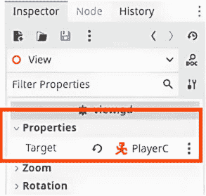

图 8.22 – 将玩家设为摄像机跟随的目标

现在选择 Player 节点。在 Inspector 中，将 View 场景拖入 View 属性，使玩家使用我们的 View 场景作为摄像机控制器。这在图 8.23 中显示：

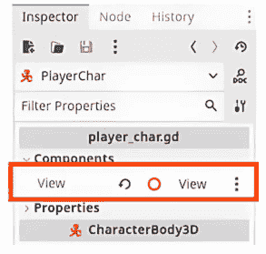

图 8.23 – 将我们的 View 场景设为玩家的摄像机控制器

现在运行 Level 1 场景并测试游戏。你可以移动玩家和摄像机在关卡中移动！

## 摘要

本章中，我们探讨了如何为关卡构建和组织场景。我们首先使用 **StaticBody3D**、**MeshInstance3D** 和 **CollisionShape3D** 节点创建简单的场景来表示游戏世界中的物体。

接下来，我们设计了一个带有脚本以控制移动的 **Player** 场景，并添加了一个单独的 **View** 场景，其中包含玩家可以控制的 **Camera3D** 节点。最后，我们通过组装复杂的关卡场景，将所有单独的场景组件组合在一起。

在下一章中，我们将添加危险物和可收集物。

## 在 Discord 上加入我们的社区

在作者和其他读者之间讨论，请加入我们社区的 Discord 空间：

https://packt.link/godot-4-game-dev


## 9

## 在 Godot 中创建 3D 小游戏 — 第 2 部分

精通游戏机制和完善玩家体验是创建引人入胜关卡的重要步骤。在本章中，我们将更深入地探讨设计交互式和动态元素，以增强游戏玩法并提升关卡整体手感。你将学习如何创建在短时间内赋予临时能力的收集型增益道具，引入挑战玩家的障碍，并添加视觉和音效效果让环境栩栩如生。

通过实践活动，你将实现一个暂时提升玩家跳跃高度的可收集物，使其能够到达新的平台。你将设计一个发射炮弹的大炮，为玩家提供一个激动人心的躲避挑战。最后，你将通过为动作添加音效反馈、为氛围添加背景音乐以及添加诸如移动云朵等视觉效果来打磨关卡，创造更具沉浸感的体验。

在本章中，我们将涵盖以下主要主题：

- 探索可收集物
- 引入障碍
- 完成我们的关卡
- 打磨我们的关卡

到本章结束时，你将拥有一个完全可玩且视觉上吸引人的关卡，其机制在挑战与奖励之间取得平衡，为你未来处理更复杂的设计做好准备。

## 技术要求

本章的代码文件可在本书的 GitHub 仓库中获取：https://github.com/PacktPublishing/Godot-4-for-Beginners/tree/main/ch9

本项目使用的游戏资源由 Essssam 以 **Creative Commons Zero (CC0)** 许可证发布。Essssam 允许我们在任何媒介或格式上分发、remix、改编并基于该材料进行构建，甚至用于商业用途。

可在此处找到：https://essssam.itch.io/3d-leap-land

访问此链接查看代码运行的视频：https://packt.link/SDDNS

## 探索可收集物

**可收集物** 是一种为关卡添加目标的方式。通过分散放置，我们可以鼓励玩家并奖励他们的探索。可收集物还可以赋予玩家新的能力（临时或永久）或只是增加他们的分数。它们可以纯粹为了好玩而收集，也可以作为完成关卡的要求。我们将在关卡中添加一些宝石供玩家收集。

## 创建 Gem 场景

现在我们了解了可收集物的作用，让我们使用 Godot 中的专用场景来构建第一个可收集物——Gem：

1. 创建一个新场景，以 **Node3D** 节点作为根节点。
2. 将其重命名为 Gem。3D 中的可收集物的工作方式与 2D 类似。在 2D 示例中，我们使用 **Area2D** 节点和 **CollisionShape2D** 节点来检测 **CharacterBody2D** 节点何时进入 **Strawberry** 节点的区域。在 3D 中，我们将使用 **Area3D** 节点和 **CollisionShape3D** 节点执行相同的操作，这使我们能够检测 **CharacterBody3D** 节点（玩家）何时进入 Gem 的区域。
3. 将 **Area3D** 节点添加为 **Gem** 的子节点。
4. 然后添加一个 **MeshInstance3D** 节点，以便我们拥有 Gem 本身的视觉模型。在 **MeshInstance3D node** 的 Mesh 属性中使用 `gem.obj` 文件作为网格。这与在 2D 中为精灵添加纹理非常相似。请记住将 `palette.png` 纹理文件拖到场景中的 Gem 网格上以赋予其颜色。

5. 最后，将 CollisionShape3D 节点添加为 Area3D 的子节点。对于 Shape 属性，最简单的方法就是用 BoxShape3D 包含 Gem。所有这些在图 9.1 中显示：

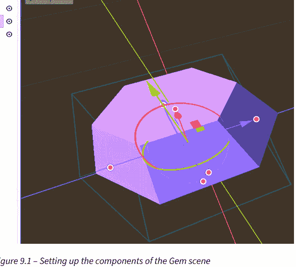

图 9.1 – 设置 Gem 场景的组件

如 图 9.1 所示，Gem 可以检测到有东西进入其区域。然而，我们需要对其进行编程以按我们预期的方式做出反应。为此，我们将向 Gem 添加一个脚本。

## 添加 Gem 脚本

你应该问自己当玩家收集到 Gem 时希望它做什么。在我们的 2D 游戏中，我们要求玩家收集所有草莓才能完成关卡。在本游戏中，Gem 将暂时提高玩家的跳跃高度，使他们能够到达最高平台，那里将放置检查点旗帜。

在确定了 Gem 的用途后，让我们将其设置为暂时提升玩家跳跃高度的增益道具：

1. 首先将一个新脚本附加到 Gem 节点。
2. 选择 Area3D 节点并按图 9.2 所示连接 body_entered 信号：
3. 我们希望检查进入 Gems 区域的物体是否为玩家。为此，我们首先需要创建一个名为 player 的组并将玩家添加到其中。
4. 返回 Player 场景。在 Inspector 中，单击 Node，然后单击 Groups。单击 + 并添加一个名为 player 的组。将其设为 Global 组。这在图 9.3 中演示如下：

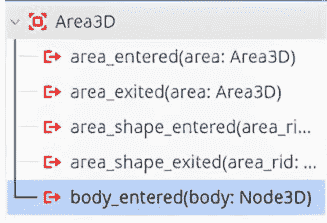

图 9.2 – 连接 Area3D 节点的 body_entered 信号

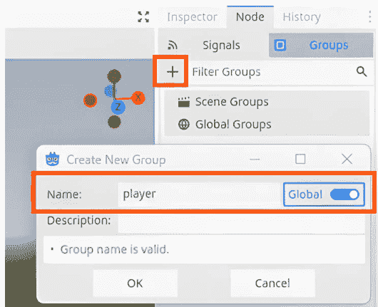

图 9.3 – 创建玩家组

5. 一旦你创建了全局 **player** 组，如 *图 9.3* 所示，你会注意到 **Player** 场景现在是该组的一部分，因为 **player** 组的复选框已被选中。

6. 因为我们只想暂时提高玩家的跳跃高度，所以需要在玩家中添加一个计时器作为冷却机制。在 **Player** 场景中，添加一个 **Timer** 节点作为子节点。将其实名重命名为 Jump_cooldown_timer，如 *图 9.4* 所示：

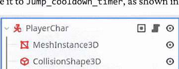

*图 9.4 – 为玩家添加计时器以使跳跃强度逐渐消失*

7. 当玩家收集到 Gem 时，我们将启动计时器。如果计时器正在运行，玩家可以跳得更高，但一旦计时器超时，我们将跳跃强度恢复到初始值。在 **Inspector** 中，将计时器设为 **One Shot** 并将 **Wait Time** 设为 3 秒，如 *图 9.5* 所示：

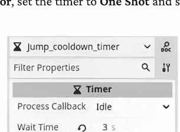

*图 9.5 – 将跳跃增益道具设为持续 3 秒*

8. 如 *图 9.5* 所见，**Wait Time** 表示增强跳跃的持续时间。如果希望跳跃增益道具持续更久，只需增加此值即可。

9. 接下来，按 *图 9.6* 所示连接 **Timer** 的 **timeout()** 信号：

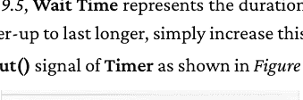

*图 9.6 – 连接计时器的超时信号*


10. 在图 9.6 所示的方式将计时器的 timeout() 信号连接到 Gem 脚本后，添加以下代码：

在第 23 行添加一个名为 default_jump_strength 的新变量，并将其值设为 7：

```
var default_jump_strength = 7
```

现在，按如下所示编写超时函数：

```
func _on_jump_cooldown_timer_timeout():
    jump_strength = default_jump_strength
```

这段代码将在计时器达到持续时间（等待时间）后将跳跃强度重置为默认值。

💡 快速提示：使用 AI 代码解释器和快速复制功能提升您的编码体验。在 next-gen Packt Reader 中打开本书。点击复制按钮 (1) 快速将代码复制到您的编码环境，或点击解释按钮 (2) 让 AI 助手为您解释一段代码。

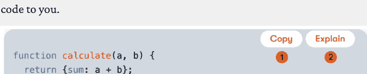

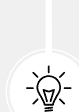

🔒 next-gen Packt Reader 随本书购买免费提供。扫描二维码或访问 packtpub.com/unlock，然后使用搜索栏按名称查找本书。仔细核对所示版本，确保获取正确的版本。

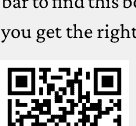

11. 在离开 Player 脚本之前，我们应该为计时器添加一个引用变量，以便我们可以从 Gem 场景启动它。在 MeshInstance3D 的 onready 变量下方，添加计时器的变量，如下所示：

```
@onready var model = $MeshInstance3D
@onready var jump_cooldown_timer = $Jump_cooldown_timer
```

12. 在 Player 脚本中，添加一个用于道具跳跃强度的变量：

```
var powerup_jump_strength = 10
```

现在添加一个函数，在 Gem 被收集时增加跳跃强度并启动计时器：

```
func on_gem_collected():
    jump_cooldown_timer.start()
    jump_strength = powerup_jump_strength
```

13. Player 场景现在是 player 组的一部分。它还设置了计时器来计时增加的跳跃强度持续时间，并且我们已提供对计时器的访问。现在返回 Gem 场景以完成 body_entered() 函数：

```
func _on_area_3d_body_entered(body):
    if body.is_in_group("player"):
        body.on_gem_collected()
        queue_free()
```

当有物体进入 Gem 区域时，这段代码将被触发。如果该物体属于 player 组，则该物体（玩家）会将 jump_strength 增加到 10。物体的 jump_cooldown 计时器会启动并运行直到超时，queue_free() 确保 Gem 将从场景中移除。

14. 在 Level 场景中实例化一个 Gem 场景（在 Level 场景中按 Ctrl + Shift + A，然后选择 Gem 场景），并测试玩家在收集 Gem 后现在可以到达最高平台。您现在可以围绕关卡策略性地放置 Gems。

玩家以 Gem 的形式获得奖励，Gem 会增加跳跃强度。现在我们将在关卡中添加一个障碍，使奖励没有那么容易获得。

## 介绍障碍

障碍通过创建玩家必须绕过或克服的危险，为关卡引入挑战和刺激。它们鼓励玩家制定策略、提高技能，并在游戏中不断保持参与。随着游戏进程，障碍可以采用多种形式，例如移动平台、尖刺或环境陷阱，并可为游戏玩法增添多样性。在本节中，我们将在关卡中添加一些障碍来测试玩家的敏捷性和时机把握，创造更动态和更具奖励性的体验。

## 创建 Cannon 场景

一个有趣且动态的障碍是添加一门大炮，定期发射子弹，玩家必须在到达检查点之前避开它。大炮是静态的，纯粹是装饰性的或布景。然而，子弹将从大炮移动，穿过关卡。按照以下步骤设置 Cannon 场景：

- 1. 使用 Node3D 节点作为根节点创建一个新场景。将此重命名为 Cannon。
- 2. 添加一个 StaticBody3D 节点作为子节点。
- 3. 添加一个 MeshInstance3D 节点并使用 cannon.obj 作为 Mesh 属性。
- 4. 记得将 palette.png 拖到大炮对象以进行纹理贴图。
- 5. 添加一个 CollisionShape3D 节点并使用新的 BoxShape3D 属性将大炮包围。
- 6. 添加一个 Timer 节点并将其重命名为 Cannonball_timer。
- 7. 添加一个 Marker3D 节点并将其放置在大炮的炮口/开口处：x 位置 0.0，y 位置 0.5，z 位置 -1.0。

按照这些步骤，Cannon 场景树应如下图所示 9.7：

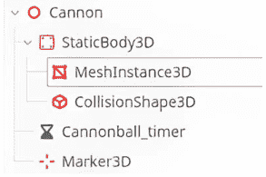

图 9.7 – Cannon 场景的场景树

图 9.7 中的组件将用于使大炮发挥功能。它是一个静态体，因为它不会移动，但玩家可以跳到上面并站在上面。大炮弹计时器将定期生成炮弹，这些炮弹在关卡中移动。标记用于精确定位炮弹应出现的位置。

我们希望大炮每三秒发射一颗球。为此，调整 **Cannonball_timer** 节点的设置，如图 9.8 所示：

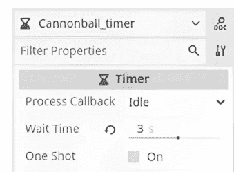

图 9.8 – 炮弹计时器的设置

使用图 9.8 所示的设置，大炮将每三秒自动发射一颗球。如果您想更改发射频率，请调整 **等待时间**。

大炮现在已准备好进行脚本编写；然而，我们仍然需要一个球或子弹供其发射。我们现在将准备 **Ball** 场景，以便从大炮发射投射物。

## 创建 Ball 场景

创建一个新场景并使用 **CharacterBody3D** 节点作为根节点。将它重命名为 Ball。

需要注意的是，我们通常会为投射物使用 **Area3D** 节点，因为这允许我们检测碰撞并触发事件，例如在撞击时应用伤害或销毁投射物。然而，在我们的游戏中，炮弹仅作为物理障碍物——它不会伤害玩家，但如果接触到玩家则应简单地将其推开。

按照以下步骤完成 Ball 场景：

- 1. 您已经使用 **CharacterBody3D** 节点作为根节点创建了一个新场景。
- 2. 您已将根节点重命名为 **Ball**。
- 3. 添加一个 **MeshInstance3D** 节点作为子节点并使用 Bullet.obj 作为 Mesh 属性。
- 4. 将 palette.png 应用为子弹对象的纹理。
- 5. 添加一个 **CollisionShape3D** 节点并用新的 **CapsuleShape3D** 包围子弹。
- 6. 在 *x* 轴上旋转 **CapsuleShape3D** 并调整其大小以 neat 地贴合模型。
- 7. 添加一个 **Timer** 节点并将其重命名为 `Destroy_timer`。

按照这些步骤，**Ball** 场景树应如下图所示 *图 9.9*：

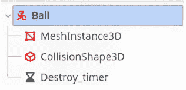

*图 9.9 – Ball 场景的组件*

*图 9.9* 中看到的一个重要组件是球的 **Destroy_timer** 节点。它代表球的生命周期。一旦超时，我们销毁球并将场景从关卡中移除。将计时器的设置调整为 *图 9.10* 所示：

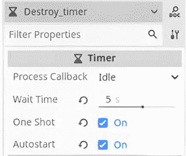

*图 9.10 – 用于销毁球的计时器设置*

*图 9.10* 将球的生命周期设置为 5 秒；计时器自动启动，但每个球仅运行一次。球需要在关卡中穿行并被销毁。为此，我们将编写脚本。

## 编写 Ball 脚本

没有炮弹，大炮用处不大——所以让我们用脚本赋予它们生命，该脚本处理它们的移动和碰撞。请按照以下步骤操作：

- 1. 将脚本附加到 **Ball** 节点。设置一个 speed 变量并赋值为 3。这是一个导出变量，以便您在测试游戏时可以更改此值，从而找到最适合您游戏的值：
- 2. 在 process 函数中，我们将沿 z 轴移动球。这是深度轴，表示球朝向或远离我们进入或离开屏幕移动。为了平滑移动球，我们将通过 *相乘* speed 与 delta 来改变位置，如下所示：
- 3. 连接 **Destroy_timer** 的 **timeout()** 信号，并在其中编写代码，使球在达到计时器的等待时间后被销毁：

```
@export var speed = 3
```

```
func _process(delta):
    position.z -= speed * delta
```

```
func _on_destroy_timer_timeout():
    queue_free()
```

有了这个脚本，炮弹可以完成我们想要的两个任务。它可以在关卡中移动，并在一定时间后被销毁。现在为大炮编写脚本以生成炮弹。

## 编写 Cannon 脚本

要编写 Cannon 脚本，首先，我们将脚本附加到 **Cannon** 节点。在整本书中，我对应在场景首次创建时初始化的变量使用了 @onready var。这次，我将向您展示使用 _ready 函数初始化变量的替代快捷方式。让我们在这里看看：

- 1. 我们将实例化 **Ball** 场景（生成一个球），因此我们需要一个场景变量来存储对 **Ball** 场景的引用。我们还需要一个变量来表示球本身（ball 变量），它将是场景的一个实例。我们还需要一个引用变量（marker 变量）指向 **Marker3D** 节点，以便我们可以将球定位到不可见标记所在的位置：

```
var ball_scene
var ball_instance
var marker
```


2. 前述代码中的变量均未初始化，也就是说它们没有初始值。我们将在 _ready() 函数中为它们赋值：

```
#### Called when the node is added to the scene tree
func _ready():
    # Load (preload) the Ball scene so we can create a new instance of it
    ball_scene = preload("res://Assets/Scenes/ball.tscn")

    # Load (preload) the Smoke Particle scene for visual effects
    particles = preload("res://Assets/Scenes/smoke.tscn")

    # Create an instance of the Ball from the preloaded scene
    ball_instance = ball_scene.instantiate()

    # Get a reference to the Marker3D node in the scene
    marker = $Marker3D

    # Set the Ball's position to the same location as the Marker3D
    ball_instance.position = marker.position

    # Add the ball instance to the current scene as a child
    add_child(ball_instance)
```

_ready 函数在火炮被添加到场景时只调用一次，用于设置火炮的初始状态。下面对这里的代码进行逐行解释：

- 从指定路径加载炮弹场景，并将其存储在 ball_scene 变量中。preload 关键字确保场景在游戏运行时即可使用，并且在使用 GDScript 时相比 load 函数提供了性能提升。
- Ball 场景的一个实例（原始场景的副本）存储在 ball_instance 变量中。
- Marker3D 节点的引用存储在 marker 变量中。
- 新创建的炮弹的位置被设置为与 marker 的位置相匹配。
- 最后，球实例被添加到 Cannon 节点层级（场景树）中，使其在场景中可见并处于活动状态。

3. 为了让火炮以规律的速率发射炮弹，我们需要使用 **Cannonball_timer**。连接 timeout() 信号并添加以下代码：

```
func _on_cannonball_timer_timeout():
    ball = ball_scene.instantiate()
    ball.position = marker.position
    add_child(ball)
```

因为我们将 **Wait Time** 设置为 3 秒，所以 timeout() 函数中的代码每 3 秒运行一次。将在 marker 位置创建一个新的炮弹实例，并将其添加到 **Cannon** 场景的层级中。此计时器确保炮弹从火炮中重复发射。

4. 在 **Level** 场景中实例化 **Cannon** 场景，并测试一切是否按预期工作。

该关卡现在拥有可收集物和障碍物。我们现在应关注胜利条件或目标。为此，我们将放置一面用户必须到达以完成关卡的旗帜。

## 完成我们的关卡

要完成关卡，玩家必须到达 *flag*。旗帜位于最高平台上，唯一到达它的方式是获得 Gem 来增强玩家的跳跃能力，避开炮弹并冲向旗帜。

这些都是设计决策，关卡中的资源让我们可以考虑不同的选项。我们本可以要求玩家获得钥匙来解锁通往旗帜的大门。这就是游戏开发如此令人满意的原因！现在我们应该为旗帜创建一个场景。

## 创建 Flag 场景

在创建 **Flag** 场景之前，确定旗帜应该做什么会很有帮助，因为这有助于我们确定使用哪些节点。在我们的简单案例中，旗帜唯一需要做的就是在玩家触碰到它时退出游戏。当然，如果我们制作更多关卡，同样可以轻松切换关卡。知道这一点，**Area3D** 节点是旗帜的最佳选择。按照以下步骤进行设置：

- 1. 使用 **Area3D** 作为根节点创建一个新场景。
- 2. 将其重命名为 Flag。
- 3. 添加一个 **MeshInstance3D** 节点并使用 `flag.obj` 作为 Mesh 属性。
- 4. 应用 palette.png 来为旗帜贴图。
- 5. 将 **CollisionShape3D** 节点作为旗帜的子节点添加。
- 6. 用 **New BoxShape3D** 包围旗帜。

按照步骤操作后，您的 **Flag** 场景层级将如下图 9.11 所示：

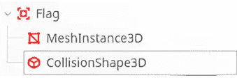

图 9.11 – Flag 场景层级

- 7. 我们再次利用 **Area3D** 节点的多功能性来检测 **CharacterBody** 节点（例如玩家）何时进入其空间。为 **Flag** 节点添加一个脚本并将其保存为 flag.gd。
- 8. 现在连接 **Flag** 节点的 _on_body_entered 信号，然后按如下方式编写代码：

```
extends Area3D
func _on_body_entered(body):
    if body.is_in_group("player"):
        get_tree().quit()
```

这段简单的代码测试进入旗帜空间的物体是否在 **player** 组中。如果是，我们就退出游戏。

## 切换场景

创建多个关卡超出了本书的范围；然而，如果你创建了另一个关卡并希望玩家到达旗帜后切换到它，这非常简单。

首先，你需要将第二个关卡创建并保存为场景，例如 level_2.tscn。将场景文件的路径保存在变量中，然后使用内置的 get_tree().change_scene_to_file() 函数切换到下一个场景。代码如下所示：

```
extends Area3D
func _on_body_entered(body):
    if body.is_in_group("player"):
        var next_scene_file =
        "res://scenes/level_2.tscn"
        get_tree().change_scene_to_file(next_scene_file)
```

此代码检查玩家是否进入了特定区域。如果是，则加载游戏的下一关。它使用组来确保只有玩家触发该操作。它使用场景路径来确定要加载哪个关卡。下面逐行解释：

- 当一个物体进入旗帜的区域时
- 代码检查该物体是否在 "player" 组中
- 将关卡 2 场景文件的路径存储在名为 next_scene 的变量中
- 使用 change_scene_to_file 方法切换到已保存的场景

现在玩家有可收集的增益道具、可避免的障碍和需要到达的目标，关卡已可基本游玩。让我们现在着手为关卡添加润色，例如粒子、移动和颜色。

## 润色我们的关卡

创建一个功能性关卡是游戏开发中的重要第一步，但要使其在视觉上吸引人并让玩家沉浸其中，需要额外的努力——这就是关卡润色的作用所在。

润色关卡意味着通过动态视觉、流畅动画和鲜艳效果等元素来增强其外观和手感。这些补充不仅使游戏更具沉浸感，还有助于传达氛围、增添个性并使游戏玩法更令人满意。

在本节中，我们将探讨如何添加移动、颜色和粒子效果为关卡注入活力，将其从基本设计转变为玩家会喜欢的体验。

Godot 提供了一个名为 WorldEnvironment 的节点，用于设置整个场景的默认环境属性，包括后期处理效果、照明和背景设置。

在 Level 1 场景中，添加一个 WorldEnvironment 节点。在 Inspector 中，找到 Environment 属性并选择 New Environment。如图 9.12 所示：

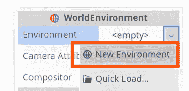

图 9.12 – 向世界添加新环境

一旦我们加载了新环境，如图 9.12 所示，我们现在可以访问更多属性和设置。

## 设置背景颜色

通过点击 **Environment**，选择 **Background**，然后选择 **Custom Color**，并找到天蓝色，将关卡的背景颜色更改为天蓝色。如图 9.13 所示：

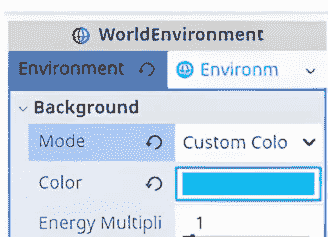

图 9.13 – 为关卡设置自定义背景颜色

现在我们已为关卡添加了背景颜色，如图 9.13 所示，我们应该在每次发射后为火炮添加一些烟雾效果。

## 添加粒子效果

**Particle effects** 是游戏开发中为游戏增添视觉魅力并增强氛围的强大工具。它们可以模拟各种自然现象，如火焰、烟雾、雨水或爆炸，也可以创建抽象效果，如闪光、轨迹或魔法光晕。通过融入粒子效果，你可以让游戏感觉更具动态性和吸引力，帮助玩家更好地与你创造的世界产生联系。在本节中，我们将探讨如何创建和自定义粒子效果以让场景栩栩如生。

## 创建烟雾场景

如前所述，我们将创建一个小烟雾 puff，在每次炮击后升入天空。我们将使用其中一个云模型，并将其缩小并旋转。按照以下步骤创建烟雾场景：

- 1. 使用 **CPUParticles3D** 作为根节点创建一个新场景。
- 2. 将节点重命名为 Smoke。
- 3. 展开 **Drawing** 部分并找到 **Mesh** 属性。


4. 将 cloud_1.obj 文件拖入 Mesh 属性中。这在图 9.14 中显示：

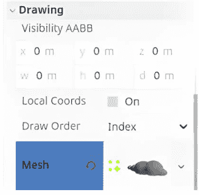

图 9.14 – 使用其中一个云作为 Mesh 来表示烟雾

5. 记得通过应用 palette.png 纹理来为网格贴图。

6. 展开 Gravity 部分并使 y 值变为正值。完成后，烟雾会上升。

7. 将 Amount 属性减少到 1，以便一缕烟雾从大炮中升起。

8. 将 One Shot 属性设置为 On。这在图 9.15 中显示：

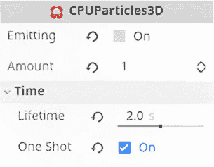

图 9.15 - 更改数量并将 One Shot 设置为 On

9. 通过展开 **Node3D** 的 **Transform** 部分并将 z 轴旋转 90 度，使云垂直定向。这在图 9.16 中显示：

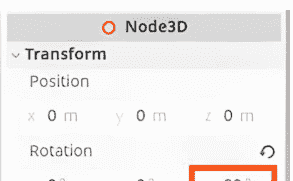

图 9.16 – 在 z 轴上旋转模型使其垂直

10. 随时间调整云的缩放比例，从 0 到完整大小（1）。通过展开 **Scale** 部分并将 **Scale Amount Minimum** 设置为 0，**Scale Amount Maximum** 设置为 1 来实现。

11. 通过点击 **New Curve** 创建 **Scale Amount** 曲线并随时间调整缩放比例，如图 9.17 所示：

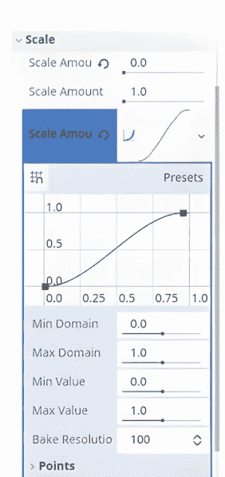

图 9.17 – 设置最小值、最大值和缩放曲线

这将缩放比例从 0 设置到 1；不过，我建议尝试不同的曲线值，直到找到满意的结果。

烟雾场景已完成，可以在 Cannon 脚本中实例化。当我们在 Cannon 脚本中实例化一个炮弹时，之后应立即实例化烟雾。现在，让我们返回到 Cannon 脚本。

12. 添加两个新的全局变量 particles（用于引用粒子场景文件）和 smoke（作为场景的实例）：

```
extends Node3D
var ball_scene
var ball_instance
var marker
var particles
var smoke
```

13. 修改 _ready 函数，以便我们也预加载烟雾粒子场景。以下代码中新增的行已注释。创建烟雾实例，将其定位到标记处，使其成为 Cannon 场景的子节点，并将 emitting 属性设置为 true：

```
func _ready():
    scene = preload("res://scenes/ball.tscn")
    particles = preload("res://scenes/smoke.tscn")
    ball = scene.instantiate()

    # Create an instance of the smoke particles
    smoke = particles.instantiate()

    marker = $Marker3D
    ball.position = marker.position

    # Also place the smoke effect at the Marker3D position
    smoke.position = marker.position

    add_child(ball)

    # Add the smoke effect to the current scene as a child
    add_child(smoke)
```

```gdscript
#### Start the smoke particle effect so it emits immediately
smoke.emitting = true
```

14. 最后，我们必须在 timeout 函数中创建新实例，以便每次大炮发射时都出现一缕烟雾：

```gdscript
func _on_cannonball_timer_timeout():
    ball_instance = ball_scene.instantiate()
    smoke = particles.instantiate()
    smoke.position = marker.position
    ball_instance.position = marker.position
    add_child(ball_instance)
    add_child(smoke)
    smoke.emitting = true
```

通过对大炮脚本的这些修改，你可以再次测试关卡。你会注意到每次发射炮弹时，都会有两朵小烟云飘向空中。这是一种为关卡增添动感的简单方法。

另一种使关卡更具吸引力的方法是添加音频，例如音效和背景音乐。在下一节中，我们将学习如何处理音频。

## Adding audio to our level

如果玩家角色在跳跃时发出声音会很有趣！让我们添加一些音频！

- 1. 为此，我们需要自己录制声音或找到一个处于公共领域且具有 Creative Commons 许可的声音。这里有一个可用于本项目的声音：https://opengameart.org/content/jump-sound-16bit.
- 2. 下载 jump.wav 文件。在 **FileSystem** 中，进入 assets 文件夹，并创建一个名为 audio 的子文件夹。按图 9.18 所示将声音文件拖入其中：

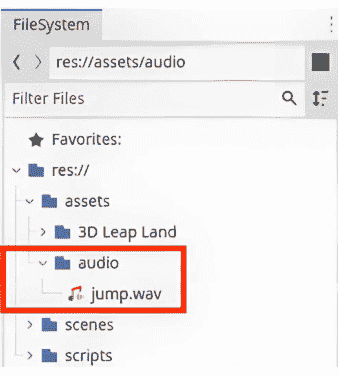

图 9.18 – 将 jump.wav 文件添加到我们的 audio 文件夹

3. 打开 Player 场景并添加一个 AudioStreamPlayer 节点作为子节点。在 Stream 属性中，拖放音频文件。保持其他属性不变。这在图 9.19 中显示：

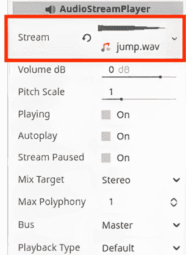

图 9.19 – 为 AudioStreamPlayer 提供要播放的声音文件

4. 打开 Player 脚本并为 AudioStreamPlayer 添加一个引用变量到你的 onready 变量列表中：

```
@onready var model = $MeshInstance3D
@onready var jump_cooldown_timer = $Jump_cooldown_timer
@onready var audio_stream_player = $AudioStreamPlayer
```

5. 我们只希望在玩家跳跃时播放跳跃音效。为此，我们告诉 AudioStreamPlayer 在 jump 函数运行时播放文件。将该请求添加为 jump 函数的第一行：

```
func jump():
    audio_stream_player.play()
```

6. 这就是在玩家跳跃时播放音效所需做的全部。

但如果我们想在玩家落地时播放音效呢？

1. 从 Open Game Art 获取另一个 CC0 许可的音效（https://opengameart.org/content/jump-landing-sound）并将其添加到 audio 文件夹。

2. 为了在正确的时间播放正确的声音，代码必须调整为先将对应的音频文件加载到 AudioStreamPlayer 中，然后再尝试播放。

3. 在 jump 函数的第一行添加另一行，先加载文件再播放：

```
func jump():
    audio_stream_player.stream =
    preload("res://assets/audio/jump.wav")
    audio_stream_player.play()
```

4. 同样地，当玩家落地时，我们必须加载对应的音频文件然后播放。在 handle_respawn() 函数中，在玩家落地时缩放玩家之后添加这些行即可：

```
if is_on_floor() and gravity > 2 and !previously_floored:
    model.scale = Vector3(1.25, 0.75, 1.25)
    audio_stream_player.stream =
    preload("res://assets/audio/jumpland.wav")
    audio_stream_player.play()
```

5. 使用代码中的技术，我们确保在播放之前将正确的音频文件加载到播放器中。下一步是在关卡中添加背景音乐。首先下载背景音乐（https://opengameart.org/content/background-music-2-the-ice-caves）并将其添加到 audio 文件夹。

6. 这次，我们将在 **Level 1** 场景中添加一个 **AudioStreamPlayer** 节点。我们将 Background Music 2.ogg 文件拖放到 **Stream** 属性中。将 **Autoplay** 属性设置为 **On**。这在图 9.20 中显示：

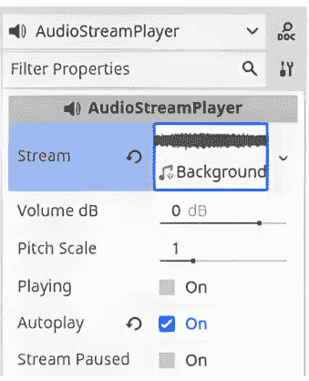

图 9.20 - 设置 Stream 播放器的 Autoplay 属性

7. 还有最后一步，那就是确保音轨循环。展开 **Parameters** 部分并按图 9.21 所示打开循环：

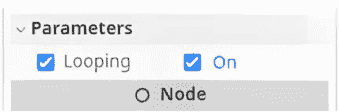

图 9.21 - 为背景音乐打开循环

如图 9.21 所示，通过打开循环，我们可以让背景音乐在关卡中重复播放。

在游戏设计中，重复性运动常用于创建动态逼真的效果，例如云朵在天空中漂移、海浪拍打岸边，或道具缓慢旋转或上下悬浮。这类运动通常通过使用正弦波的振荡，以平滑自然的方式来回调整物体的属性（例如位置、大小或角度）来实现。在我们最后的部分中，我们将使用正弦函数使关卡中的云朵缓慢地来回移动。

## Using the sine function

如前所述，与其让云朵静止在天空中，我们将使用正弦波使它们来回漂移。返回 Cloud 场景并将脚本附加到根节点（Cloud）。

使云朵漂移的完整代码如下所示，之后将逐行解释：

```gdscript
extends Node3D
@onready var mesh_instance_3d: MeshInstance3D = $MeshInstance3D
var time: float
func _process(delta):
    time += delta
    mesh_instance_3d.position =
    Vector3(get_sine(),get_sine(),get_sine())

func get_sine():
    return sin(time * 0.5) * 0.5
```

让我们在这里分解这段代码，以便更好地理解：

- 声明一个名为 time 的 float 变量来跟踪经过的时间。它用于计算移动的正弦波。
- 为云的 StaticBody3D 节点创建了一个引用，因为这本质上是我们将要移动的云对象。
- 在 process 函数中，我们每帧增加 time 变量。这确保正弦波动画随时间平滑进展。
- 接下来，在每一帧更新云（StaticBody3D）的 position 属性。
- x,y, 和 z 坐标使用 get_sine() 函数设置，该函数产生平滑的振荡值。
- get_sine() 函数基于 time 变量计算平滑的振荡。


- `time * 0.5` 是波的 **频率**，这会减缓振荡。
- 在括号外将结果乘以 0.5 是波的 **振幅**。在这里，我们减小了它，使运动不那么极端。
- 整个结果被返回，用于在 transform 属性中更新位置。

本质上，此脚本为云创建了平滑的振荡运动。正弦波使运动更自然。

## 摘要

在本章中，你通过添加关键的游戏玩法元素并完善其整体呈现，将你的关卡转变为动态且引人入胜的体验。你创建了一个可收集的强化道具，它暂时提升了玩家的跳跃高度，使他们能够到达更高的平台并完成关卡。我们引入了大炮障碍物，这增加了挑战层，因为玩家必须躲避其炮弹。

为了完成关卡，你实现了旗帜机制，为玩家提供了清晰且令人满意的目标。最后，你通过添加用于反馈的声音效果、营造氛围的背景音乐以及用于视觉效果的移动云朵来打磨关卡。

在本章结束时，你不仅开发了有趣且互动关卡的基本机制，还增强了其呈现效果，使其对玩家来说更具沉浸感和乐趣。这些技能将为未来创建更复杂和精致的关卡奠定坚实的基础。

**立即解锁本书的独家福利**

扫描此二维码或访问 packtpub.com/unlock，然后按名称搜索本书。

*注意：在开始之前请准备好购买发票。*

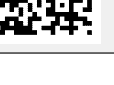

## 10

## 添加游戏果汁

游戏开发不仅仅关乎机制和关卡设计——它还关乎游戏玩起来的手感。这就是游戏果汁发挥作用的地方。*Game juice* 指的是所有让游戏更令人满意和更具响应性的小改进，从视觉效果和音效设计到 UI 反馈和动画。添加游戏果汁可以将一个基础游戏转变为玩家喜爱的精致、引人入胜的体验。

在本章中，我们将探讨游戏果汁是什么以及为什么它很重要。你将学习如何通过添加为玩家提供反馈的动态效果，使游戏感觉更精致和更具响应性。我们将实现几个果汁元素来增强体验：玩家到达检查点时爆发的彩带炮、基于 **抬头显示 (HUD)** 的生命条，随着生命值下降爱心会变灰，以及让关卡栩栩如生的沉浸式背景音频和音效。

在本章中，我们将涵盖以下主要主题：

- 了解游戏果汁
- 实现生命条 HUD
- 添加受击动画
- 创建彩带炮效果
- 添加音频和音效

到本章结束时，你将理解小的改动如何显著改善游戏的手感。你将拥有实践经验，实现增强玩家沉浸感的视觉和音频反馈，使游戏更愉快、更令人满意。

让我们开始为你的游戏增添应有的额外润色吧！

## 技术要求

到书中此时，你应该知道如何执行以下操作：

- 创建节点和场景（参见 *第 2 章*）
- 从 *第 7 章* 开始完成 Pixel Adventure 项目

你还应该了解变量和函数（参见 *第 8 章*），用于 GDScript。

本章的代码文件可在本书的 GitHub 仓库中获取：https://github.com/PacktPublishing/Godot-4-for-Beginners/tree/main/ch10

访问此链接查看代码运行的视频：https://packt.link/W1K5s

## 了解游戏果汁

当游戏玩起来感觉良好时，我们现在知道这通常要归功于一种叫做 **game juice** 的东西。它指的是微小但影响重大的改进——例如细微的动画、粒子效果或音效设计——使游戏玩法更具响应性、更令人满意且更精致。

果汁不会改变游戏的机制，但它改变了玩家体验它们的方式。因此，为游戏添加 *juice* 涉及取一个可工作的游戏并添加满意度层来改善其手感。对玩家来说，满足感是由感官创造的，因此我们需要喂养这些感官。创建视觉效果和添加音频将增强玩家的体验。你可以想象这就像你正在从一个美味的橙子中挤出每一滴果汁。

使用游戏果汁改善玩家体验的一些例子如下：

- 标准跳跃配合 *squash and stretch* 动画会感觉更有冲击力
- 收集硬币配合 *闪光效果和令人满意的音效* 会感觉更有奖励感
- 在战斗中受损配合 *屏幕震动和短暂的冲击停顿* 会更具吸引力

在下一节中，我们将探讨润色的基础方面。

## 润色的基础：动画和音频

本节将介绍润色的基础技术，我们很快将在实践中应用它们，例如受击动画、生命条 HUD、彩带炮和音频反馈。这些基础在 3D 中与在 2D 中一样有用，无论类型或视角如何，都能提升你的游戏。

## 视觉反馈（动画和粒子效果）

视觉反馈在使动作感觉有冲击力方面发挥关键作用。游戏果汁中常用的两种技术如下：

- **Squash and stretch**：当角色着陆、跳跃或改变方向时稍微变形其缩放，使其呈现出弹跳、生动的视觉外观。这种动画技术使移动感觉更具表现力。
- **粒子效果**：在玩家奔跑或跳跃时添加尘埃轨迹，使移动更具动态感和真实感。即使是少量粒子爆发也能清晰地传达能量和运动。

你很快将在自己的游戏中实现这些想法，包括以下内容：

- *受击动画*，使敌人对玩家攻击做出视觉反应
- *彩带炮*，用粒子爆炸庆祝成功

## 音频反馈（音乐和音效）

音频在创造果汁体验方面与视觉一样重要。它强化玩家动作，增加个性并营造氛围。请考虑以下内容：

- **音效**：着陆时令人满意的挤压声或击中敌人时的脆响可以让场景栩栩如生
- **背景音乐**：一首精心挑选的曲目可以设定关卡的情感基调，引导玩家在探索时的感受

我们将在本章后面探讨如何实现环境音乐和角色音效。

## 实现生命条 HUD

游戏中常见的用户界面（UI）元素是作为 HUD 一部分的生命条，它直观地表示玩家的生命值。其目的是提供即时反馈，说明玩家受到的伤害程度以及距离死亡有多近。

图 10.1 显示了三种向用户展示生命值的方式：

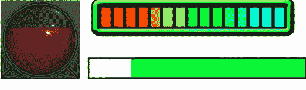

图 10.1 – 游戏中显示生命值的三种不同方式

在后续章节中，我们将实现基于爱心的生命系统，其中每个爱心代表玩家生命值的一部分，随着受到伤害爱心会变灰。这种方法使信息一目了然，同时为 UI 增添了一点视觉吸引力。

## 开发基于爱心的生命系统

为了实现我们的基于爱心的生命系统，我们将设置 UI，编写根据玩家生命值更新爱心的逻辑，并确保系统在造成伤害时动态反应。让我们逐步了解将其实现的过程。

让我们首先打开 Pixel Adventure Godot 项目，并添加一个以 AnimatedSprite2D 节点作为根节点的新场景。将节点重命名为 HUD 并将场景保存为 hud.tscn，如图 10.2 所示：

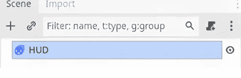

图 10.2 – 表示玩家生命的 HUD 场景

我们将使用一种简单技术来表示生命值的损失。生命条将以三个完整的红色爱心开始。每次玩家受伤时，我们将把其中一个爱心从红色改为灰色。

你可以使用免费的开源图像编辑软件，例如 LibreSprite (https://libresprite.github.io/#!)，来绘制自己的爱心并创建四个代表生命值变化的帧，如我在图 10.3 中所做的那样：


图 10.3 – 表示玩家生命值变化的心形帧


图 10.3 – 表示玩家生命值变化的心形帧

## 资源

如果你不习惯自己绘制爱心，可以使用 Shlok Gupta 创建的爱心。然而，你仍需要对其进行修改，以便在不同生命值水平下显示爱心。它可在他们的 Itch 页面在此处获取：https://gamedevshlok.itch.io/heartpack.

当你的爱心图像准备就绪后，转到名为 HUD 的 AnimatedSprite2D 节点的 Sprite Frames 属性，并选择 New SpriteFrames，如图 10.4 所示：


图 10.4 – AnimatedSprite2D 节点的 New SpriteFrames

现在，单击属性中的单词 SpriteFrames 以打开 Animation Frames 窗口。将默认动画重命名为 idle 并添加四个帧，如图 10.5 所示：


图 10.5 – 生命条的 idle 动画有四个帧表示生命值总数

如图 10.5 所示，每当玩家失去生命值时，我们将更改动画帧以匹配。我们不需要为生命条添加脚本；我们只需要在附加到 level1.tscn 的脚本中引用它即可。

在 Level1 场景中，将你新建的 hud.tscn 拖入你的关卡并将其放置在左上角，如图 10.6 所示：


图 10.6 – HUD 的一个好位置

将 HUD 放置到场景中后，你的 Level1 场景树应包含 HUD 场景，并看起来像图 10.7 所示的场景层次结构：


图 10.7 – level 1 的场景层次结构

如图 10.7 所示场景就位后，是时候打开附加到 Level1 的脚本并进行一些添加，以便 HUD 根据玩家拥有的生命值更新爱心。

## 在 Level 脚本中更新 HUD

现在我们的基于爱心的生命系统已经就位，我们需要确保玩家的当前生命值在屏幕上得到反映。为此，我们将从 Level 脚本更新 HUD。HUD 将根据玩家剩余的爱心数量在视觉上发生变化，随着受到伤害，爱心会变灰。

我们将首先添加一个 @onready 变量来引用 HUD 场景。在 _process() 函数中，我们将更新 HUD 的 frame 属性以匹配玩家的当前生命值。这决定了显示为活动（红色）与非活动（灰色）的爱心数量。例如，如果玩家有三个爱心，我们将把 HUD 帧设置为 3 以显示三个红色爱心。

以下是更新后的 Level1 脚本：

```gdscript
extends Node2D

@onready var update_health_hud = $HUD
@onready var player = $Player
@onready var strawberries = $Collectibles

func _ready():
    player.level_strawberries = strawberries.get_child_count()

func _process(delta):
    update_health_hud.frame = player.get_hearts()
```

让我们分解代码以更好地理解它：

- update_hud 存储对 HUD 节点的引用，以便我们可以轻松访问和更新它。
- 在 _process() 中，每帧运行一次，我们将 HUD 的帧设置为反映玩家的当前爱心数量。这意味着当玩家获得或失去生命值时，HUD 将实时视觉更新。

player.get_hearts() 行依赖于我们需要在 Player 脚本内部创建的新函数。该函数仅返回玩家当前拥有的爱心数量：

```gdscript
func get_hearts():
    return hearts
```

为此支持，在 Player 脚本顶部添加一个新变量来存储玩家的生命值：

```gdscript
var hearts = 3
```

问题是：我们为什么要添加这个变量？

hearts 变量跟踪玩家拥有的生命值。我们将其初始化为 3，意味着玩家以满生命值开始。随着玩家受到伤害，此值会减少。

接下来，让我们创建一个 hurt() 函数，在玩家受伤时减少其生命值：

```gdscript
func hurt():
    hearts -= 1
    if hearts <= 0:
        death()
```

此函数在玩家受伤时减去一个爱心。如果 hearts 达到 0，我们将触发 death() 函数，我们现在将在以下代码中创建它：

```gdscript
func death():
    #shoot the player upward upon death
    velocity.y = -600
```

```gdscript
#disable collisions so the player falls through the level
set_collision_mask_value(2, false)
set_collision_mask_value(3, false)
```

以下是前面代码的分解：

- velocity.y = -600 在玩家死亡时将其向上射出，增加一点手感使死亡感觉更戏剧化
- 我们通过关闭关卡的碰撞层来禁用与环境的碰撞，允许玩家从屏幕上掉落

另一个提供出色视觉反馈给玩家的游戏手感——帮助他们快速识别何时受到伤害——是受击闪烁效果。这种常见技术会短暂改变玩家的外观（通常为白色或红色），以示其已受伤，使体验感觉更灵敏和精致。

## 添加受击动画

在本节中，我们将创建一个简单的动画，当玩家受伤时使其短暂变白。这种效果不仅使受损时刻更具戏剧性，还帮助玩家保持对当前生命状态的了解，尤其是在快节奏的时刻。

在你的文件资源管理器中，定位 Pixel Adventure/Main Characters/Ninja Frog 文件夹（你可以在此处下载所有资源：https://pixelfrog-assets.itch.io/）并将 Hit.png 文件拖入 Godot FileSystem。

在 Player 场景中，选择 AnimatedSprite2D 节点并添加一个名为 hit 的新动画。现在，单击 Add Frames from Sprite Sheet 按钮并将其设置为 7 个水平帧和 1 个垂直帧。然后，选择所有帧并导入它们。将动画速度设置为 16 FPS 且不循环。受击动画将如 图 10.8 所示：


🔍 **快速提示**：需要查看此图像的高分辨率版本吗？在 next-gen Packt Reader 中打开本书或在 PDF/ePub 副本中查看。

🔒 **下一代 Packt Reader** 和一本 **免费的 PDF/ePub 副本** 包含在你的购买中。扫描二维码或访问 packtpub.com/unlock，然后使用搜索栏按名称查找本书。仔细检查所示的版本，以确保你获得正确的版本。


为确保我们的动画在需要时运行，在 Player 脚本顶部 vars 组的变量中添加一个名为 isHit 的辅助变量。它将是一个布尔值，默认为 false：

```gdscript
var isHit = false
```

现在，修改 hurt() 函数，以便在玩家受到伤害时将 isHit 设置为 true：

```gdscript
func hurt():
    isHit = true
    hearts -= 1
    if hearts <= 0:
        death()
```

现在，我们可以修改 animate() 函数以包含对玩家拥有的爱心数量的检查，以及是否已被击中：

```gdscript
func animate():
    if isHit:
        animations.play("hit")
        await animations.animation_finished
        animations.play("idle") # transition back to idle
        return # Prevent further changes this frame
    if hearts == 0:
        return  # Dead, don't animate further

    # Stationary player
    if velocity.x == 0 and velocity.y == 0:
        animations.play("idle")

    # Player moving right
    elif velocity.x >= 0 and velocity.y == 0:
        animations.play("run")
        animations.flip_h = false

    # Player moving left
    elif velocity.x <= 0 and velocity.y == 0:
        animations.play("run")
        animations.flip_h = true

    # Player is falling
    elif velocity.y > 0 and !is_wall_sliding:
        animations.play("fall")

    # Player is jumping (initial jump)
    elif velocity.y < 0 and jump_count == 0:
        animations.play("jump")

    # Player is double-jumping
    elif !is_on_floor() and jump_count > 0 and !is_wall_sliding:
        animations.play("double_jump")

    # Player is wall sliding on the right
    elif is_wall_sliding and Input.is_action_pressed("ui_right"):
        animations.flip_h = false
        animations.play("wall_slide")

    # Player is wall sliding on the left
    elif is_wall_sliding and Input.is_action_pressed("ui_left"):
        animations.flip_h = true
        animations.play("wall_slide")
```


animate() 函数负责根据玩家的移动、生命值以及是否被击中在不同的动画状态之间切换。让我们逐一查看每个条件以了解其工作原理。

首先，让我们来看一下空闲状态的代码：

```
if velocity.x == 0 && velocity.y == 0 && hearts > 0 && isHit == false:
    animations.play("idle")
```

如果玩家没有移动（velocity.x == 0 且 velocity.y == 0）、仍然存活（hearts > 0），并且刚刚没有被击中（isHit == false），我们播放 "idle" 动画。

接下来，让我们检查受击状态：

```
elif isHit:
    animations.play("hit")
```

如果玩家被击中，我们播放 "hit" 动画以显示反应。这通常会短暂播放，然后恢复到其他动画。

这就是我们检测向右奔跑的方式：

```
elif velocity.x >= 0 && velocity.y == 0 && hearts > 0:
    animations.play("run")
    animations.flip_h = false
```

如果玩家水平向右移动（x 速度为正）、垂直方向没有移动，并且仍然存活，我们播放 "run" 动画并确保精灵面向右侧（flip_h = false）。

向左奔跑的代码类似：

```
elif velocity.x <= 0 && velocity.y == 0 && hearts > 0:
    animations.play("run")
    animations.flip_h = true
```

这与之前的条件相同，但用于向左移动。我们水平翻转精灵（flip_h = true）使其面向左侧。

以下是坠落的处理方式：

```
elif velocity.y > 0 and !is_wall_sliding && hearts > 0:
    animations.play("fall")
```

如果玩家向下移动（velocity.y > 0）、没有在墙上滑动，并且仍然存活，我们显示 "fall" 动画。

跳跃逻辑如下：

```
elif velocity.y < 0 and jump_count == 0 && hearts > 0:
    animations.play("jump")
```

此条件检查玩家是否向上跳跃（velocity.y < 0）并且是第一次跳跃（jump_count == 0），这会触发 "jump" 动画。

以下是双跳的检查：

```
elif !is_on_floor() and jump_count > 0 and !is_wall_sliding:
    animations.play("double_jump")
```

如果玩家在空中（不在地面上）、已使用至少一次跳跃，并且没有在墙上滑动，我们显示 "double_jump" 动画。

这处理右侧墙壁滑动：

```
elif is_wall_sliding and Input.is_action_pressed("ui_right"):
    animations.flip_h = false
    animations.play("wall_slide")
```

如果玩家在墙上滑动并且按住向右移动键，我们播放 "wall_slide" 动画并使精灵面向右侧。

最后，这就是我们用于左侧墙壁滑动的内容：

```
elif is_wall_sliding and Input.is_action_pressed("ui_left"):
    animations.flip_h = true
    animations.play("wall_slide")
```

它与右侧墙壁滑动相同，但用于左侧。

一切几乎按我们想要的方式工作。然而，你会注意到玩家卡在受击动画中，这是因为没有事件将 isHit 变量重置为 false。最后一步是返回到 Mushroom 场景，选择 HurtPlayerZone 节点，选择 Node 选项卡，然后选择 Signals 选项卡，并连接 body_exited() 信号。按如下所示编写信号函数：

```
func _on_hurt_player_zone_body_exited(body: Node2D):
    if body.is_in_group("Player"):
        body.isHit = false
```

为了保持一致，我们还应该从 Mushroom 脚本中调用 isHit 函数：

```
func _on_hurt_player_zone_body_entered(body):
    if "Player" in body.name:
        body.hurt()
        body.isHit = true
```

前面的代码确保如果退出 HurtPlayerZone Area2D 节点的物体属于名为 "Player" 的组，则 hit 变量将被重置为 false。这意味着当玩家停止与蘑菇碰撞时，受击动画也会停止。

现在，一切就绪，可以在玩家游戏时提供令人满意的视觉反馈，以提醒他们处于危险之中。

我们的下一步是为检查点旗帜添加一个有趣的视觉效果。我们将发射纸屑大炮，以小规模庆祝完成关卡。

## 创建纸屑大炮效果

为了强化成就感并作为完成关卡的额外奖励，当玩家触碰检查点旗帜时，我们将从旗杆上发射一些多彩纸屑。这将以粒子效果的形式出现，我们将将其作为独立场景设置。让我们开始吧！

我们将首先创建一个以 Node2D 为根节点的新场景。将节点重命名为 Confetti_Cannon，添加一个 GPUParticles2D 节点作为子节点，并将其重命名为 Blue，因为它代表蓝色纸屑。如下图所示 10.9 所示：


图 10.9 – Confetti_Cannon 节点和纸屑粒子

现在，选择 Blue 纸屑粒子节点。在 Inspector 中，找到 Process Material 设置，然后添加 New ParticleProcessMaterial，如图 10.10 所示：


图 10.10 – 创建新的粒子过程材质

接下来，点击 ParticleProcessMaterial（文字）以展开粒子的设置菜单。

纸屑在飞行时应旋转，但不应远离玩家。在 Particle Flags 设置中启用 Rotate Y 并禁用 Z，如图 10.11 所示：


图 10.11 – 粒子标志设置

纸屑应沿弧线移动，以模仿现实中纸屑的行为。为此，调整纸屑生成的角度。你可以根据需要调整数值——我将最小角度设置为 209，最大角度设置为 327，如图 10.12 所示：


图 10.12 – 设置纸屑的最小和最大生成角度

确保将 Direction 变量设置为 x = 0.0、y = -1.0 和 z = 0.0，如图 10.13 所示。

纸屑粒子还应分散开来，而不是全部沿同一路径前进。为了在一定角度范围内分散它们，我选择了 Spread 值为 100，这将为每个新粒子选择介于 −100 到 100 度之间的角度。

此外，由于纸屑通常是爆炸性事件，我们希望改变粒子的 Initial Velocity 值。两个更改均显示在图 10.13 中：


图 10.13 – 改变纸屑粒子的 Spread 和 Initial Velocity 设置

为了使效果更令人印象深刻，我们可以改变每个粒子在关卡中移动时的旋转速率。这可以通过改变 Angular Velocity 值来实现。我已将速率锁定在 280，如图 10.14 所示：


图 10.14 – 设置粒子的角速度可变速率

纸屑还应以恒定速率从中心加速远离，我们可以轻松地在线性加速度设置（即 Linear Accel）中设置此项，如图 10.15 所示：


图 10.15 – 设置粒子的线性加速度

为了防止纸屑离旗帜太远，我们应在 Accelerations 部分增加 Gravity，如图 10.16 所示：


图 10.16 – 增加粒子在 y 方向的重力

要控制纸屑粒子的外观，我们前往 **ParticlesProcessMaterial** 的 **Display** 属性。现在，改变纸屑粒子的 **Scale** 值——我将最小尺寸设置为 5，最大尺寸设置为 20。对于 **Color**，我选择了 *天蓝色*。这些更改可在 *图 10.17* 中看到：


*图 10.17 – 设置粒子的尺寸变化和颜色*

下一步是控制这些粒子在屏幕上停留的时间以及它们在存活期间的行为。这些设置的 **Time** 属性中可以找到。默认生命周期为 1 秒，这很好；然而，我们必须打开 **One Shot**，以便纸屑只发射一次且不会持续生成。你可以改变 **Explosiveness** 和 **Randomness**，或使用 *图 10.18* 中显示的值：


*图 10.18 – 调整粒子的 Time 属性*


最后一步是前往 **Drawing** 属性并勾选使用 **Local Coords** 的复选框。这只是确保粒子遵循自身的路径，而不是它们可能附加到的任何父节点的路径。它使粒子保持在我们在场景中放置的位置。如图 10.19 所示：


*图 10.19 – 在 Drawing 属性中设置粒子使用局部坐标*

要预览此彩纸粒子效果，将 **Inspector** 滚动到最顶部并打开 **Emitting** 复选框。每次勾选时，你应该能在场景中看到蓝色彩纸粒子发射，如图 10.20 所示：


*图 10.20 – 打开 Emitting 会发射粒子*

我们现在有一个天蓝色彩纸粒子的场景，但彩纸炮应该向天空发射彩虹色的粒子。

要实现这一点，请复制蓝色粒子，然后右键单击 ParticleProcessMaterial 并选择 Make Unique，然后在 Display 属性下更改颜色（我们已在图 10.17 中这样做）并重命名粒子节点以匹配。如图 10.21 所示：


图 10.21 – 彩纸炮场景树

请注意，并非所有彩纸粒子都在发射。我们将在下一节中修复这个问题。

## 脚本化彩纸炮

为了确保所有彩纸粒子在正确的时间发射，我们将脚本附加到 Confetti_Cannon 节点并按如下方式定义 fire() 函数。

```
extends Node2D

func fire():
    $Blue.emitting = true
    $Orange.emitting = true
    $Green.emitting = true
    $Yellow.emitting = true
    $Red.emitting = true
    $Pink.emitting = true
```

此 fire() 函数通过将它们的 emitting 属性设置为 true 一次性打开所有彩纸粒子发射器。每一行都针对不同的颜色粒子节点——Blue、Orange、Green、Yellow、Red 和 Pink——并同时激活它们。当调用 fire() 函数时，这会产生庆祝性的彩色彩纸爆发效果。

通过将所有发射器保留在 Confetti_Cannon 节点内并通过此一个函数触发它们，我们保持代码井然有序，并使使用单个命令发射所有彩纸变得容易。

请回忆，炮在玩家完成关卡并触碰检查点旗帜时发射彩纸作为小小的视觉奖励。因此，将炮附加到检查点是有意义的。我们可以在 Godot 中通过将 confetti_cannon.tscn 文件拖入 CheckPoint 场景的场景树中轻松实现这一点，如图 10.22 所示：


图 10.22 – 将彩纸炮添加到 CheckPoint 场景

一旦彩纸炮成为 CheckPoint 场景的一部分，我们需要在 check_point.gd 中添加一些代码，以便在关卡完成后调用 fire 方法。

在场景树中单击 **CheckPoint (Area2D)** 节点以选中它。现在，单击 **Node** 选项卡，然后单击 **Signals** 选项卡。连接 on_body_entered() 信号并按如下方式编写代码：

```gdscript
func _on_body_entered(body):
    if level_complete:
        $Confetti_Cannon.fire()
```

前面的代码在接收到 _on_body_entered() 信号时被调用。这意味着玩家已与检查点旗帜发生碰撞。然后，如果 level_complete 布尔值设置为 true，则会调用彩纸炮的 fire() 方法。fire() 方法随后将炮中所有彩纸的 emitting 属性设置为 true。

现在一切就绪，当你完成关卡并触碰检查点旗帜时，你将获得一次令人愉悦的彩纸爆发作为奖励。

在最后一节中，我们将学习如何为关卡添加音效和音频，以增加另一层精致感和氛围。

## 添加音频和音效

声音是游戏开发中的强大工具，以视觉 alone 无法实现的方式塑造玩家的体验。精心制作的原声带设定了氛围，无论是快节奏的动作序列还是平静的探索场景。[content]
最后一步是前往 **Drawing** 属性并勾选使用 **Local Coords** 的复选框。这只是确保粒子遵循自身的路径，而不是它们可能附加到的任何父节点的路径。它使粒子保持在我们在场景中放置的位置。如图 10.19 所示：


*图 10.19 – 在 Drawing 属性中设置粒子使用局部坐标*

要预览此彩纸粒子效果，将 **Inspector** 滚动到最顶部并打开 **Emitting** 复选框。每次勾选时，你应该能在场景中看到蓝色彩纸粒子发射，如图 10.20 所示：


*图 10.20 – 打开 Emitting 会发射粒子*

我们现在有一个天蓝色彩纸粒子的场景，但彩纸炮应该向天空发射彩虹色的粒子。

要实现这一点，请复制蓝色粒子，然后右键单击 ParticleProcessMaterial 并选择 Make Unique，然后在 Display 属性下更改颜色（我们已在图 10.17 中这样做）并重命名粒子节点以匹配。如图 10.21 所示：


图 10.21 – 彩纸炮场景树

请注意，并非所有彩纸粒子都在发射。我们将在下一节中修复这个问题。

## 脚本化彩纸炮

为了确保所有彩纸粒子在正确的时间发射，我们将脚本附加到 Confetti_Cannon 节点并按如下方式定义 fire() 函数。

```
extends Node2D

func fire():
    $Blue.emitting = true
    $Orange.emitting = true
    $Green.emitting = true
    $Yellow.emitting = true
    $Red.emitting = true
    $Pink.emitting = true
```

此 fire() 函数通过将它们的 emitting 属性设置为 true 一次性打开所有彩纸粒子发射器。每一行都针对不同的颜色粒子节点——Blue、Orange、Green、Yellow、Red 和 Pink——并同时激活它们。当调用 fire() 函数时，这会产生庆祝性的彩色彩纸爆发效果。

通过将所有发射器保留在 Confetti_Cannon 节点内并通过此一个函数触发它们，我们保持代码井然有序，并使使用单个命令发射所有彩纸变得容易。

请回忆，炮在玩家完成关卡并触碰检查点旗帜时发射彩纸作为小小的视觉奖励。因此，将炮附加到检查点是有意义的。我们可以在 Godot 中通过将 confetti_cannon.tscn 文件拖入 CheckPoint 场景的场景树中轻松实现这一点，如图 10.22 所示：


图 10.22 – 将彩纸炮添加到 CheckPoint 场景

一旦彩纸炮成为 CheckPoint 场景的一部分，我们需要在 check_point.gd 中添加一些代码，以便在关卡完成后调用 fire 方法。

在场景树中单击 **CheckPoint (Area2D)** 节点以选中它。现在，单击 **Node** 选项卡，然后单击 **Signals** 选项卡。连接 on_body_entered() 信号并按如下方式编写代码：

```gdscript
func _on_body_entered(body):
    if level_complete:
        $Confetti_Cannon.fire()
```

前面的代码在接收到 _on_body_entered() 信号时被调用。这意味着玩家已与检查点旗帜发生碰撞。然后，如果 level_complete 布尔值设置为 true，则会调用彩纸炮的 fire() 方法。fire() 方法随后将炮中所有彩纸的 emitting 属性设置为 true。

现在一切就绪，当你完成关卡并触碰检查点旗帜时，你将获得一次令人愉悦的彩纸爆发作为奖励。

在最后一节中，我们将学习如何为关卡添加音效和音频，以增加另一层精致感和氛围。

## 添加音频和音效

声音是游戏开发中的强大工具，以视觉 alone 无法实现的方式塑造玩家的体验。精心制作的原声带设定了氛围，无论是快节奏的动作序列还是平静的探索场景。同时，音效为玩家操作提供即时反馈，使游戏世界感觉更生动、更具响应性。

在本节中，我们将探讨如何通过音频增强游戏的感觉。我们将添加背景音乐以营造氛围，并为关键交互引入音效，例如收集物品、受到伤害或完成关卡。到本节结束时，你将了解如何实现和微调音频以使游戏更具沉浸感和吸引力。

那么，让我们通过添加一些有趣的背景音乐使关卡更愉快。**Incompetech** 是一个很好的免版税音乐资源：

https://incompetech.com/music/royalty-free/music.html

我从该网站选择了 Kevin MacLeod 的曲目 *Adventures in Adventureland*。该曲目采用知识共享：署名 4.0 许可（http://creativecommons.org/licenses/by/4.0/）。

让我们开始在 Assets 文件夹中新建一个名为 Audio 的子文件夹，并将 Adventures in Adventureland.mp3 文件拖放到其中，如图 10.23 所示：


图 10.23 – 将背景音乐添加到我们的音频文件夹

要播放音频，Godot 有一个名为 AudioStreamPlayer 的特殊节点。它非常适合播放背景音乐，因为它不会以位置方式播放音频。如果你希望音频从屏幕上的不同来源播放，则使用 AudioStreamPlayer2D 或 AudioStreamPlayer3D 节点。

由于关卡将有背景音乐，请向关场景添加一个新的 AudioStreamPlayer 节点，如图 10.24 所示：


图 10.24 – 向关卡场景添加 AudioStreamPlayer 节点

选中 AudioStreamPlayer 后，查看 Inspector 中的属性。这里，Stream 属性是它将播放的音频源。将 MP3 文件拖放到 Stream 中。将音量降低到 −20 dB 并将 Autoplay 设置为 On。所有这些更改都反映在图 10.25 中：


图 10.25 - 设置我们的音频播放器的流

因为 **Autoplay** 设置为 true，曲目将在关卡加载后立即开始播放。如果你想停止音乐，所有这些设置都可以通过附加到关卡的脚本更改，并且可以将播放设置为 false。

现在我们已经让背景音乐运行起来，让我们继续为游戏添加音效。

### 实现音效

音效不会自动且持续播放。相反，它们由事件触发或与事件配对。一个很好的例子是玩家跳跃或收集东西时。

首先，你需要下载你选择的音效。你可以访问 **Open Game Art**（https://opengameart.org/）并搜索跳跃音效和硬币或可收集物音效。该网站是免费游戏资产的绝佳资源，所有内容均在知识共享 CC0 许可下提供。

一旦你有合适的跳跃音效和收集音效，请将文件添加到 Godot **FileSystem** 中的 Audio 文件夹中。这在图 10.26 中显示：


图 10.26 - 向我们的 Audio 文件夹添加音效

由于我们的游戏中很简单，我们只有两个音效，一个用于 *jumping*，一个用于 *collecting*，我们将在 **Player** 场景中添加两个 **AudioStreamPlayer** 节点来处理此事。重命名 **AudioStreamPlayer** 节点以反映它们将播放的音效，如 *图 10.27* 所示：


图 10.27 – 向 Player 场景添加多个音频流

对于具有多个重叠音效的更复杂游戏，添加多个 **AudioStreamPlayer** 节点不是最佳解决方案，你会考虑 **Sound Manager** 场景或为音乐和音效设置一些音频总线。

每个 **AudioStreamPlayer** 节点都应播放关联的音效，因此请确保将正确的文件拖到每个 **Stream**，如 *图 10.28* 所示：


图 10.28 – 两个不同音效的两个音频流


在设置好两个音频流的正确音效和默认设置后，打开玩家 GDScript 并为 AudioStreamPlayer 节点添加两个 onready 变量引用。你可以通过将节点拖入脚本中，然后在释放之前按住 Ctrl 来实现。代码如下所示：

```
extends CharacterBody2D

@onready var animations = $AnimatedSprite2D
@onready var jump = $Jump
@onready var collect = $Collect
```

现在每个节点的引用都可用了，我们可以找到触发流播放的合适时机。跳跃应在玩家按下跳跃键时触发。

在 standard_player_movement() 函数中，跳跃通过特定的 if 语句处理。

就在检查空格键是否被按下且玩家是否在地面上的条件之后，调用 jump AudioStreamPlayer 节点的 play() 函数，如下所示：

```
func handle_jump():
    # Handle jump.
    if Input.is_action_just_pressed("ui_accept") and is_on_floor():
        jump.play()
```

这段代码将确保每次玩家在地面上并按下跳跃键时，跳跃音效也会播放。

接下来是收集音效，它应在玩家与草莓碰撞时播放。幸运的是，我们在 Player 脚本中已经有一个在这种情况下调用的函数：add_score(amount)。请回忆，该函数在玩家与草莓碰撞时会被调用，以跟踪收集了多少个草莓。我们可以在调用此方法时播放音效，如代码所示：

```
func add_score(amount):
    collect.play()
    strawberry_count += 1
```

前述代码在玩家在关卡中收集草莓时会被调用。它播放收集音效并将一个草莓添加到已收集草莓计数中。

仅用一行代码，我们就为草莓收集添加了令人满意的音频反馈，有助于让这一刻对玩家来说更有回报感。

## Summary

游戏开发不仅仅关乎机制和关卡设计——它还关乎游戏 *感觉* 起来的感觉。在本章中，我们探讨了游戏精髓的概念以及小幅增强如何使游戏更具吸引力、更精致和更令人满意。

我们实施了多个关键元素以改善玩家反馈和沉浸感。首先，我们引入了使用爱心的生命值条 HUD，随着玩家损失生命值而变灰，提供清晰直观的玩家状态反馈。为了进一步增强响应性，我们集成了受击动画，使受伤害感觉更具冲击力。

接下来，我们在检查点添加了纸屑炮效果以庆祝关卡完成，用视觉冲击强化玩家的成就感。最后，我们通过背景音乐和音效让关卡栩栩如生，使游戏世界更具沉浸感和动态感。

通过应用这些技术，我们展示了小的视觉和音频改进如何显著提升玩家的体验。游戏精髓将基础游戏转变为感觉精致、响应迅速且有趣的游戏，有助于让玩家保持参与并投入到游戏世界中。

在下一章中，我们将从动手编码中退一步，探索游戏开发的更大图景：游戏设计。现在你已经体验到细节如何通过打磨和反馈增强游戏玩法，是时候了解这些元素如何融入精心规划的设计中了。你将学习如何构建想法、定义游戏机制并通过深思熟虑的规划塑造玩家的体验。这一基础将帮助你在项目范围扩大时做出更好的设计选择并避免昂贵的返工。

## Join our community on Discord

加入我们在 Discord 的社区空间，与作者和其他读者讨论：

https://packt.link/godot-4-game-dev


