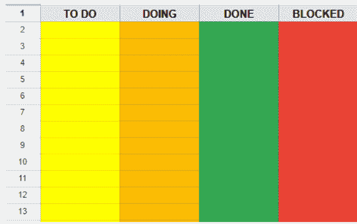
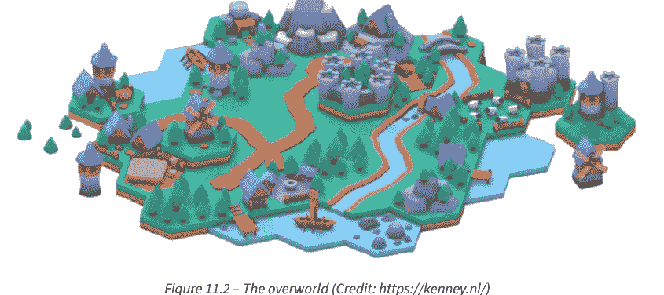
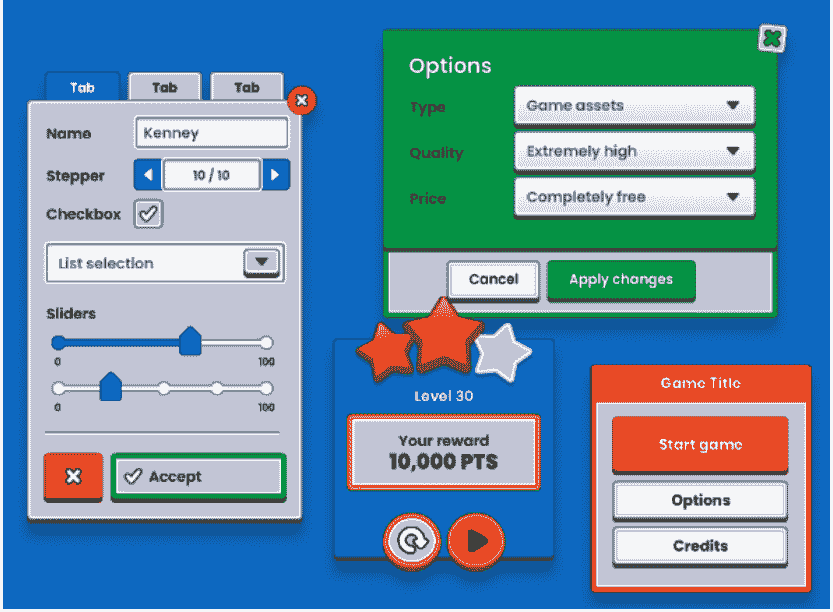
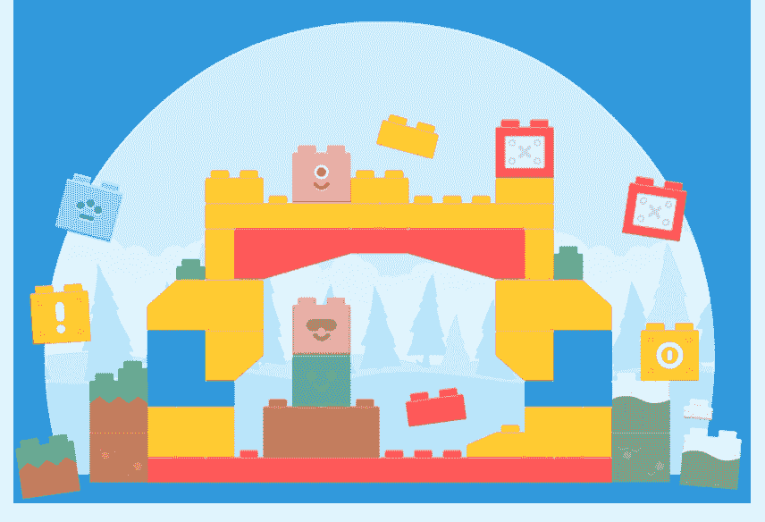
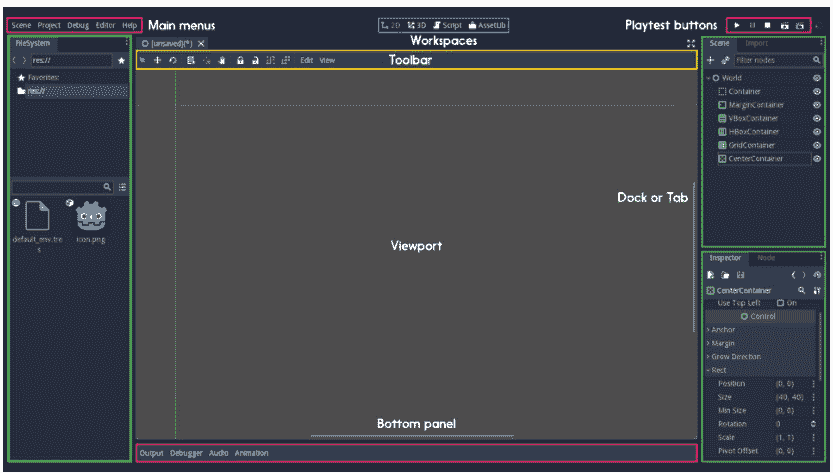
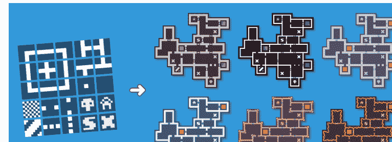
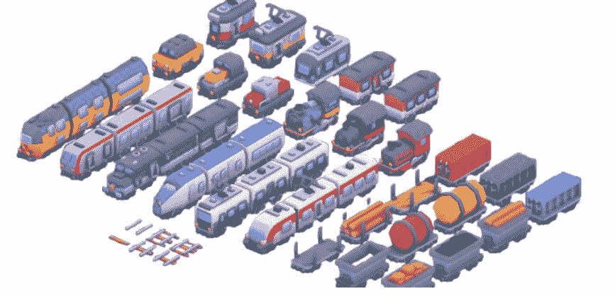
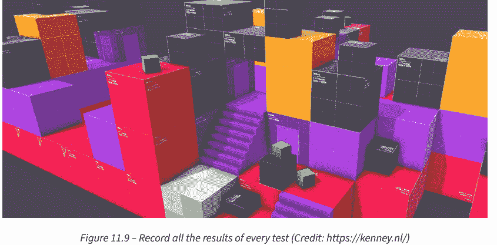
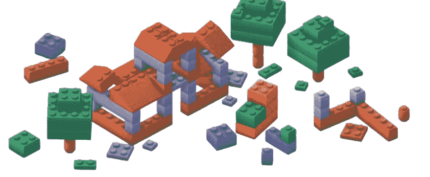

## 11

## Understanding Game Design

到目前为止，本书的重点是提供动手实践的指导，说明如何在 Godot 中开发游戏。然而，游戏很少是通过打开游戏引擎并毫无计划地创建东西而制作的。游戏设计是游戏开发的第一步。它是打造令人愉快、引人入胜且难忘的游戏的蓝图。

本章将探讨游戏设计如何作为指导力量，塑造游戏玩法机制、叙事结构和玩家体验。

在本章中，我们将涵盖以下主要主题：

- 了解游戏设计的基础
- 探索游戏设计文档
- 详细说明 GDD 的关键要素

在本章结束时，你将理解深思熟虑的游戏设计在简化开发、减少昂贵错误和提高玩家满意度方面的价值。无论你渴望设计自己的游戏还是作为开发团队的一部分有效工作，这些经验都将为你提供更清晰的视角，了解伟大游戏是如何制作的。

## Technical requirements

不需要任何游戏设计的先前经验或知识。

## Understanding the foundations of game design

游戏是一种娱乐形式，成功的游戏通常被描述为 *有趣*。但这实际上意味着什么？哪些元素结合在一起创造了有趣、有回报的体验？这些是游戏设计寻求回答的问题。

超逼真的视觉效果和优化的编程本身并不能保证游戏会令人愉快。事实上，一些最受喜爱的游戏之所以成功，并不是因为它们的外观或技术先进程度，而是因为它们让玩家感受到什么。无论图形或性能如何，一个引人入胜、令人满意且难忘的游戏都是深思熟虑的游戏设计的产物。

让我们看一些例子：

- **Stardew Valley（最初于 2016 年发布）**：这款独立农场模拟游戏之所以成为全球热门，并不是因为尖端图形，而是因为其令人满意的游戏循环、进步感以及与角色的有意义互动。其游戏设计专注于玩家选择、日常 routine 和社区建设——所有这些都促成了深度引人入胜的体验。
- **Celeste（最初于 2018 年发布）**：*Celeste* 是一款具有挑战性的 2D 平台游戏，结合了紧凑的控制和情感共鸣的故事讲述。设计鼓励坚持不懈，奖励玩家掌握困难段落，同时提供尊重不同技能水平的辅助选项。它是游戏设计如何同时支持游戏玩法和情感影响的完美例子。
- **Among Us（最初于 2018 年发布）**：这款社交推理游戏因其巧妙的设计而爆红，该设计鼓励沟通、欺骗和协作。尽管其艺术风格简单，但核心循环——找出谁是冒充者——让玩家保持参与并不断回归。

这些例子表明，优秀的游戏设计并不总是意味着复杂性或真实性。相反，它意味着创造与玩家产生联系的系统和体验。

这些体验是在设计过程中打造的，因此尽可能详细和深思熟虑很重要。毕竟，你正在为整个游戏奠定基础。

游戏设计可能比编程感觉更抽象，因为它更偏向艺术和讲故事。正如你已经体验到的，制作游戏很困难；有很多 moving parts 都需要协同工作。游戏设计可能更具挑战性，因为没有成功的严格公式。与编程不同，没有硬性规则——只有原则、模式以及对玩家认为有意义和愉快的事物的深刻理解。

## Introducing the game design document

有一些用于记录设计的既定框架。一旦你有了游戏的想法，使用这些行业认可的框架（如 **游戏设计文档**（**GDD**）或功能清单）来捕捉它，将帮助你更清晰地发展想法并让你更接近游戏设计的精髓。

在 Godot 中工作时，拥有一个扎实的设计计划会带来巨大差异。例如，及早明确定义游戏机制可以让你决定需要哪些节点、脚本和场景。如果你的设计包含角色升级、关卡过渡或特定交互，你可以从一开始就考虑到这一点来构建 Godot 项目。

将你的设计决策直接链接到 Godot 的场景系统、输入处理以及使用 GDScript 的脚本编写，将帮助你避免猜测和返工，并构建一个不仅有趣而且构建整洁、更易维护的游戏。

在下一节中，我们将了解如何有效地记录你的游戏设计。这是至关重要的一步，它帮助你将想法转化为清晰、可执行的计划，并确保你在 Godot 中的开发过程保持专注、高效并与你的原始愿景一致。

## Why is documentation necessary for your game design?

你可能会认为，因为你制作的游戏很小，或者因为你是唯一在上面工作的人，所以没有真正需要写下任何东西。然而，这可能是一个短视的决定。即使是最简单的游戏项目也能从清晰的文档中受益——它帮助你保持组织性，更彻底地思考想法，并在开发后期避免昂贵的失误。

记录你的设计至关重要，这样你——以及任何其他在游戏上工作的人——都能了解游戏的一切以及完成它需要做什么。游戏很复杂，拥有许多交互功能。通常，你只有在解决问题时才会弄清楚如何解决。几个月后，你可能甚至记不起为什么包含某样东西或它是如何工作的。这就是文档变得无价的地方。

为你的游戏设计开发文档在 Godot 中工作时尤其有帮助，因为它能让你更高效地规划游戏结构，决定需要哪些节点，不同对象如何交互，以及如何在 GDScript 中组织脚本。这种前期清晰度降低了混淆或混乱重写的风险，并在项目复杂度增长时帮助你保持专注。

创建 GDD 有助于你做到以下几点：

- 通过明确列出已做出的决策，减少返工并避免重复劳动
- 在休息后返回项目时，记住设计选择背后的 *why*
- 在整个开发过程中跟踪变更和想法
- 识别机制、功能和系统之间的相互依赖关系
- 保持与你的愿景和范围一致
- 如果将来引入额外的团队成员或贡献者，使协作更轻松

你的游戏设计文档承担两项重要工作：回溯以记录迄今为止做出的所有决策，并向前看，指导游戏的开发。它们既是 *你思考的记录*，也是构建游戏的 *roadmap*。

因此，你的 GDD 成为项目的单一事实来源，在整个开发过程中让你保持脚踏实地、专注且高效。

## 了解 GDD 的指导原则

首先，需要注意的是 GDD 是 *living documents*。这意味着它们经常会发生变化，并且在游戏开发过程中应持续查阅和参考。这是因为，虽然游戏的核心想法可能不会改变，但其周围的许多元素应该不断演进，而文档应通过适应来反映这一点。

附加阅读

你可以通过阅读 **Gamescrye** 和 **Roobyx’s** 的 GitHub 仓库中的 GDD 来了解商业游戏是如何制作的：

- https://gamescrye.com/resources/game-design-documents/
- https://github.com/Roobyx/awesome-game-design

为了准备 GDD，任何好的协作文档和设计软件，例如 **Notion** (https://www.notion.com/)、**Obsidian** (https://obsidian.md/) 或 **OneNote** (https://www.OneNote.com)，在这里都能很好地发挥作用。然而，也有针对游戏开发行业量身定制的解决方案，例如 **Codecks** (https://www.codecks.io/) 和 **HacknPlan** (https://hacknplan.com/)。

为了让你的游戏设计文档真正有效，它应遵循一些最佳实践。这些原则将有助于确保你的想法清晰传达，并且实际上可以用来指导开发。让我们在后续章节中查看这些内容。

### 可视化思考

使用文字、系统图、流程图、线框图和其他视觉元素混合来传达你的想法。视觉元素充当一种超越障碍的通用语言，使复杂概念更容易理解。它们改善了沟通，使想法对所有参与者来说更易于获取、可操作且可适应。

### 保持简洁清晰

清晰和简洁是关键。你的文档应具备以下特点：

- **简短扼要：** 使用要点高效传达想法
- **准确：** 要具体——包括速度或跳跃高度等项目的确切数值，并且始终使用现在时
- **优先级明确：** 明确哪些功能对你的 **minimum viable product** (MVP) 至关重要，哪些是锦上添花，哪些是纯粹可选的

### 保持组织有序

一个组织良好的文档更易于使用。最佳实践包括以下内容：

- **使用基于网络的格式：** 这使得访问和更新变得容易，并允许将章节拆分为单独的、专注的页面
- **逻辑地组织信息：** 从总体概述开始，仅在需要时再进入具体细节

### 以例学习

并没有单一 *correct* 的方式来撰写设计文档。一个有帮助的入门方法是研究现实游戏中示例。**Game Docs** 网站 (https://gamedocs.org/documents/) 提供了一个精选的商业发行版设计文档集合。探索这些内容，看看他人如何组织想法，并将适合的部分应用到自己的项目中。

现在你了解了有效文档背后的关键原则，让我们更仔细地看看创建 GDD 需要什么。

## 探索游戏设计文档

到目前为止，我们知道 GDD 是一份高度描述性的、活的视频游戏软件设计文档。对于使用 Godot（或任何游戏引擎）的开发者来说，一份准备充分的 GDD 通过清晰概述游戏玩法系统、场景结构和脚本逻辑来简化开发流程，使将想法转化为 Godot 的基于节点的架构和 GDScript 变得更容易。

GDD 的第一页或主页应是对游戏概念的高层次概述，这将为你提供游戏背后的主要想法。这有时也被称为 *pitch* **document**。在以下章节中，我们将查看此页面应包含的部分。

### 标题：你将如何命名你的游戏？

*title* 通常是工作标题，随着游戏的演进可能会发生变化。标题应代表游戏的主要想法，因此值得花一些时间思考这个问题。

例如，我们的工作标题可以是 *SILENT STATION*。让我们在以下小节中进一步展开。

### 团队：谁将构建或开发游戏？

列出参与游戏工作的人员以及他们具体负责的内容。不要担心头衔；集中关注他们将使项目的哪些方面发挥功能。

### 状态：项目的状态是什么？

最好使用交通灯系统或看板来描述。创建以颜色为主题的标题：**TO DO** *(yellow)*、**DOING** *(orange)*、**DONE** *(green)* 和 **BLOCKED** *(red)*。在每个标题下列出游戏的功能。任何阻碍游戏进展或任何重大问题都应归入红色类别。*Figure 11.1:* 中显示了此示例：

图 11.1 – 开发任务的简单看板示例

### 概念陈述：你的游戏用一句话来说是什么？

用一句话描述游戏的核心功能。尝试包含设定、主角、主要目标和需要克服的障碍。

这是来自 SILENT STATION 的示例：

*一名孤独的宇航员必须仅依靠手电筒在废弃的外星空间站（设定）中穿行以寻找失踪的船员（目标），同时避开对声音有反应的敌对生物（障碍）。*

### 扩展概念段落和 USP：你的游戏有何独特之处，如何更详细地描述它？

在本节中，我们扩展概念陈述并描述游戏玩法。请记住，这是一段简要扩展玩家核心循环和进度的段落。突出游戏的独特卖点（USPs），有时也称为钩子——这将使玩家保持投入。

这是来自 *SILENT STATION* 的示例：

*玩家必须仅依靠有限的光束探索漆黑、幽闭的走廊，同时管理视野和声音。游戏的独特机制是其对声音有反应的敌人，结合实时语音输入可能会吸引危险，使麦克风成为游戏循环的一部分。*

### 类型：你制作的是什么类型的游戏？

这些是具有相似游戏玩法特征的视频游戏类别。虽然单一类型的游戏仍然存在，但这些市场很可能已饱和，你将更成功地将多种类型融合在一起，创造新的游戏风格和机制。

这是来自 *SILENT STATION* 的示例：

*生存恐怖，带有轻度解谜和探索元素。*

### 受众：这款游戏面向谁？

这是你瞄准的市场。在这里，你可能会列出年龄范围和 **Entertainment Software Rating Board (ESRB)** 评级。你将查看该受众玩的游戏类型，甚至可能链接到更详细的玩家画像页面以及游戏如何吸引他们。

这是来自 *SILENT STATION* 的示例：

*成熟玩家（ESRB 16+），他们喜欢《异形：隔离》或《死灵空间》等叙事驱动的科幻恐怖游戏。*

### 体验：玩家在游戏过程中应感受到或体验到什么？

玩家的游戏体验会是什么？游戏会让他们感受到什么？体验持续多长时间？此标题可以链接到有关玩家进度和目标的详细页面，细节可在那里揭示。

这是来自 *SILENT STATION* 的示例：

*游戏旨在营造一种恐惧和紧张感，并伴有短暂的解脱时刻。它鼓励缓慢探索、注意音频线索，并通过营救幸存者建立情感联系。*

## 锚点：核心思想、灵感或参考点是什么？

这些是游戏中的体验，将玩家与角色联系起来，让他们投入故事并保持游戏进行。这些可能是开场场景、重要的 Boss 战，或解锁叙事发展的重大物品发现。在此突出其中的一些内容，然后链接到提供故事弧线更详细信息的页面是关键。

这里是来自 *SILENT STATION* 的示例：

- *宇航员与基地失去联系的初始时刻*
- *在冷冻舱中发现首位幸存者*
- *首次遭遇声控敌人*
- *利用潜行路线为整个区域供电*

## 平台：游戏将在哪些平台发布？

这是你所针对的平台。它可能是 PC、移动设备或主机。它可以是一个或全部，也可以是完全其他的东西。通常，你会缩小范围并专注于单一平台。

这里是来自 *SILENT STATION* 的示例：

*PC（初期），未来有望登陆主机。*

## 竞品评测：存在哪些类似游戏，你的游戏如何脱颖而出？

列出一些相似甚至直接竞争的游戏。然后，链接到一个深入分析竞争对手的页面。突出你的游戏与众不同的地方。

这里是来自 *SILENT STATION* 的示例：

*类似《异形：隔离》和《Observation》，但通过独特的麦克风输入和以声音为核心的机制实现差异化。*

## 资源：游戏需要哪些美术、音效和其他资源？

你可以包含一些概念艺术来确立游戏的整体基调，并链接到更详细的文档，其中列出了游戏所需的所有已知音效和图像资源。这将包括界面、动画、世界和角色的详细内容。

这里是来自 *SILENT STATION* 的示例：

- *音频：环境氛围音、语音台词、生物音效*
- *视觉：模块化科幻室内瓦片集、动态光照资源*
- *UI：氧气表、手电筒电量图标、声音探测表*

## 盈利模式：游戏将如何产生收入（如果有的话）？

在此，你解释游戏将如何产生收入。它可能是一次性购买，也可能是免费游戏，或具有内购。无论情况如何，都需要在系统和功能的相关链接页面上进行扩展。

将这些作为 GDD 第一页的主要标题并链接到 GDD 中的其他页面，其中包含进一步的细节，将为你的游戏概念提供一个很好的概述，并让阅读者清楚地了解这是什么类型的游戏以及面向谁。

设计过程中的下一步将是专注于现在需要更多细节的游戏关键元素。

这里是来自 *SILENT STATION* 的示例：

*付费模式 – 一次性购买。未来 DLC（可下载内容）可增加新的故事线或挑战模式。*

## 详细描述 GDD 中的游戏元素

本节将突出 GDD 中需要更多细节的部分。这些部分需要大量细节的原因是它们是游戏存在的根本要素。

因此，你和其他团队成员需要对游戏将包含的内容以及其工作原理和如何影响游戏中的其他系统有非常清晰的认识。利用后续各节的指导，为你的游戏创意添加尽可能多的细节。请注意，每个标题代表 GDD 中的一个或多个新页面。

## 玩家成长与目标

在本节中，你应回答关于 *玩家* 的以下问题：

- 他们是谁？
- 他们知道什么？
- 他们的叙事弧线是什么？
- 他们的目标是什么？
- 他们如何成长？
- 核心循环是什么？
- 外层循环是什么？

*玩家成长与目标* 页面链接到主页面上的锚点。作为基于网络的文档，这通常是超链接，但这些点在概念上也相互连接，指导游戏随时间展开的方式。

为了清晰地定义成长，将其分解为两个层面是有帮助的：

- **核心游戏循环：** 核心游戏循环代表玩家为玩游戏而重复的基本动作。例如，在平台游戏中，这可能涉及奔跑和跳跃以穿越关卡、攻击敌人和避免危险。
- **外层循环：** 另一方面，外层循环描述的是更广泛的成长系统——玩家因参与核心循环而获得的奖励。这可能包括解锁新关卡、获得升级或推进故事。

核心循环应融入外层循环，反之亦然，创造令人满意且相互强化的游戏体验。

这里是来自 *SILENT STATION* 的示例：

*玩家成长与目标：*

- *开始：在医疗舱醒来*
- *中期：修复通信阵列*
- *后期：撤离剩余船员*
- *核心循环：探索 → 寻找工具 → 避免噪音 → 进展*
- *外层循环：解锁新区域、携带新工具回溯、拼凑故事*

## 游戏世界与背景

在本节中，你应回答关于世界的问题：

- **世界背景设定：** 是否有设定游戏场景的背景故事？
- **世界物理：** 可以奔跑、飞行、坠落、漂浮等吗？
- **世界节点：** 玩家如何在游戏中推进、地点等？
- **彩蛋：** 是否为玩家准备了任何隐藏惊喜？

如果需要，本页面可以链接到世界虚构的新文档。

这里是来自 *SILENT STATION* 的示例：

*游戏世界与背景：*

- *空间站背景设定：位于流浪月球上的废弃研究设施*
- *重力和氧气按房间管理*
- *通过环境叙事暗示秘密政府实验*

游戏世界地图如 *图 11.2* 所示，是游戏世界视觉表示的一个示例，有助于传达游戏设定中的结构、规模和关键位置：

*图 11.2 – 游戏世界地图（来源：https://kenney.nl/）*

这张地图以鸟瞰图展示了游戏世界，显示了不同区域如何连接以及关键事件或挑战可能发生的位置。在 GDD 中包含此类视觉效果有助于你和你的团队保持对游戏空间布局和叙事流程的一致认识。

## 用户界面

本节应详细说明玩家与游戏世界交互以及接收关于世界和自身状态信息的所有方式。同时，请务必关注外观和感觉。你应回答以下问题：

- 控制方案是什么？
- 从一个屏幕移动到下一个屏幕需要什么？（考虑提供线框图。）
- 你提供什么帮助或提示系统，它看起来如何？
- 你如何在屏幕上展示控制？
- **选项** 菜单看起来如何？
- **暂停** 菜单看起来如何？

这里是来自 *SILENT STATION* 的示例：

*极简 UI，主要为叙事内（手电筒光晕、声音条集成于头盔面罩）*

图 11.3 显示了一个 UI  mock-up，展示了按钮和滑块等元素：

图 11.3 – 一个 UI mockup（来源：https://kenney.nl/）

## 音频与视觉风格

本页提供游戏氛围和环境细节。它应清楚地定义游戏应如何呈现和听起来如何。这所有内容都促成了游戏的整体情绪，你应回答以下问题等：

- 色彩搭配是什么？
- 音乐风格是什么？
- 美术风格是什么？
- 包含参考、示例和概念艺术
- 给出环境、角色、敌人、物体等的概念

本页应链接到你的完整游戏资源列表。

这里是来自 *SILENT STATION* 的示例：

- *美术风格：风格化写实*
- *音效：分层环境音调、定位音频、玩家呼吸声*

图 11.4 显示了一个配色方案示例。更多示例可查看 **Lospec**（https://lospec.com/）。

| 颜色 | 十六进制 | RGB |
|---|---|---|
|  | #365655 | (54,86,85) |
|  | #4d3451 | (77,52,81) |
|  | #581929 | (88,25,41) |
|  | #b26245 | (178,98,69) |
|  | #d6c376 | (214,195,118) |

*图 11.4 – 一个配色方案示例*

## 游戏系统与功能

游戏永远不会真正完成——总有诱惑想要添加新颖、酷炫的功能来让游戏变得更好。那么，你如何决定在本节中包含哪些功能？

答案是列出使游戏可玩所需的全部系统和功能，无论是最小可行产品（MVP）还是 **vertical slice**：

- MVP 是游戏的最简版本，仅包含使其功能正常且可测试的核心功能。它是你用来获取初步反馈或确认基本概念是否可行时展示的内容。
- 垂直切片是游戏的一个小型、完全打磨的部分，代表了最终的外观、感觉和玩法。它通常用于向他人展示游戏，例如在推介或预告片中，并有助于明确成品的质量和范围。

本质上，你列出的是游戏不可或缺的关键组件，没有它们游戏将无法游玩。请考虑回答以下问题：

- 此功能为何必需？
- 此功能如何与其他功能交互？
- 每个功能如何贡献于游戏玩法？
- 每个功能如何贡献于变现或不贡献？

以下是来自 *SILENT STATION* 的示例：

*手电筒系统：*

- *所需原因：手电筒是玩家在黑暗环境中唯一的导航方式，营造紧张感并控制可见度*
- *功能交互：与电力管理和潜行系统集成；电池寿命有限，需要策略性使用*
- *对游戏玩法的贡献：控制玩家能看到多少，影响探索、节奏并增加脆弱性*
- *对变现的贡献：并非直接，但对情感基调和市场吸引力至关重要*

Figure 11.5 说明了游戏中各个系统和功能如何像积木一样发挥作用。每个方块代表不同的系统，例如移动、物理、UI 或关卡设计。单独来看，这些系统可能显得简单，但当精心连接时，它们会相互支持和增强，从而创造出连贯、引人入胜的体验。

Figure 11.5 – 系统和功能如何协同工作以创造更大的体验

(Credit: https://kenney.nl/)

就像 Figure 11.5 中一样，正是这些方块的组合和交互构成了游戏的完整结构。

## 软件需求

本节应专门列出用于开发游戏所需的软件工具，以及必要时所需的资源。它还应概述每个工具的目的。你应回答以下问题：

- 将使用什么游戏引擎？
- 世界创建和关卡设计将使用什么？
- 对话树和叙事结构将使用什么？
- 任务和支线设计将使用什么？
- 开发游戏还需要哪些其他工具？

以下是来自 *SILENT STATION* 的示例：

- *Godot 4 用于游戏引擎*
- *Blender 用于建模*
- *Reaper 用于音频编辑*

Figure 11.6 显示了 Godot 引擎界面的截图：

Figure 11.6 – Godot 引擎界面

🔍 **Quick tip:** Need to see a high-resolution version of this image? Open this book in the next-gen Packt Reader or view it in the PDF/ePub copy.

🔒 **The next-gen Packt Reader** and a **free PDF/ePub copy** of this book are included with your purchase. Scan the QR code OR visit packtpub.com/unlock, then use the search bar to find this book by name. Double-check the edition shown to make sure you get the right one.

## 游戏对象

本页应列出游戏中定义的所有对象的详细信息。你应列出这些元素的详细信息，包括以下内容：

- 所有 **non-player characters (NPCs)** 和敌人
- 关于 NPC 和敌人的故事
- NPC 和敌人的对话，包括对话文件的链接
- 所有 NPC 和敌人的属性，例如能力、特殊攻击等
- 其他游戏对象（如移动平台等）的所有属性和数值
- 游戏对象的所有功能、方法或行为
- 本页应链接到资源列表页
- 本页应链接到资源属性和属性列表页

以下是来自 *SILENT STATION* 的示例：

- *敌人：“Echo Wraiths” – 失明但对声音高度敏感*
- *幸存者：拥有对话树和脚本化事件*

Figure 11.7 演示了资源如何链接到世界地图：

Figure 11.7 – 资源链接到游戏世界地图 (Credit: https://kenney.nl/)

## 详细资源列表

这是你的设计文档应被链接的页面。它可以是一个不断更新的电子表格，因为它包含完整的资源列表，定义了每个对象及其属性。这将包括每个对象：游戏中使用的所有文本、图形和音频内容。

你应尽早在开始 *prototyping* 和 *testing* 游戏玩法时建立此列表。这是因为你需要的资源数量会让你很好地了解游戏的范围以及制作所需的时间。如果你不创建资源列表并保持更新，将很难跟踪游戏开发。

以下是来自 SILENT STATION 的示例：

你将链接到显示模型名称、文件类型、多边形数量和使用标签的电子表格

Figure 11.8 – 必须保留游戏中所有资源的列表 (Credit: https://kenney.nl/)

## 原型

通常，你会想要测试想法、功能和机制。当你开发原型来测试这些想法时，应将其链接到你的 GDD。尽可能提供有关原型的详细信息，包括制作日期、原型的目的以及它在测试什么。你还应包括这如何改变了游戏设计。

以下是来自 SILENT STATION 的示例：

- 原型 1：敌人 AI 声音检测测试
- 原型 2：手电筒电池耗尽与关卡节奏

## 试玩测试

在开发游戏时，你会进行大量试玩测试。这是游戏开发中的一个基本步骤，因为它是一个增量过程。你的文档中应包含你进行的每项测试的结果链接。

该页面应包含以下内容的概述：

- 你在测试什么？
- 为什么要测试它？
- 从测试中学到了什么？
- 它如何影响游戏开发？

以下是来自 SILENT STATION 的示例：

*Playtest 1 揭示玩家不理解声音如何影响敌人行为 → 在早期关卡中添加了细微的音频教程*

Figure 11.9 演示了灰盒的概念，这是游戏开发早期测试阶段使用的技术。在灰盒中，使用简单的形状和占位符图形来构建关卡布局，然后再添加最终美术或资源。这使开发人员能够专注于测试核心游戏机制，例如移动、碰撞、关卡流程和挑战平衡，而不会被视觉效果分散注意力。

Figure 11.9 – 记录每次测试的所有结果 (Credit: https://kenney.nl/)

灰盒是更广泛的测试和试玩测试过程的重要组成部分，有助于团队及早发现设计问题、完善玩家体验，并在投入精致视觉效果之前确保游戏有趣且功能正常。

## 归档

随着时间的推移，你会尝试许多不同的想法并测试多个不同的功能来开发你的游戏。这些想法并非全部有效，因此，不要丢弃它们，而是创建一个归档并将它们存储在那里。

在开发的更后期阶段，这些想法和功能的部分内容可能有用。归档还将让你了解你的设计如何随着时间推移而发展，你可以很好地了解自己取得了多少进展。

以下是来自 SILENT STATION 的示例：

*为两名玩家合作的原始想法已归档，但可能在扩展包中回归*

Figure 11.10 – 从归档中提取想法并在你的设计其他地方使用它们 (Credit: https://kenney.nl/)

## 当前关注点和考虑因素

由于你会刻意限制范围，通常仅限于 MVP 或垂直切片所需的范围，许多想法和功能将无法进入生产。然而，它们可以被标记为游戏未来扩展的用途。

同样地，你可能对已实现的功能有所担忧，并且它们目前可能尚未解决或工作方式并不完全符合你的预期。你应该在此列出这些问题，一旦它们得到解决，就应将它们移至已解决问题的新的页面或章节，并详细描述问题是什么以及如何解决的。

以下是来自 *SILENT STATION* 的示例：

*对所有平台麦克风支持的不确定性*

## 实现细节

游戏中每个功能、系统和机制都需要文档来详细说明其实现的细节。它们应详细展示开发者如何实现每个元素。这是设计关注度最低的页面，而更侧重于开发。它应回答以下问题：

- 需要哪些算法和数据结构？
- 导航、资源和对话等功能是如何实现的？
- 需要哪些程序化系统？
- 游戏的经济系统如何运作？
- 需要什么样的网络架构？
- 目标硬件是什么？
- 是否有用于测试目的的游戏作弊码？
- 项目文件夹结构是什么，文件命名规范是什么？

以下是来自 *SILENT STATION* 的示例：

- *声音检测系统使用射线检测和动态分贝阈值*
- *敌人使用状态机在巡逻、警戒和追击之间切换*

在实现细节到位后，设计文档从概念性想法转向实际执行。

本节确保开发者拥有清晰的蓝图，以便有效地构建游戏的系统。在基础工作完成后，下一步是考虑所有这些元素如何在生产、测试和迭代过程中结合在一起。

## 摘要

在本章中，我们探讨了游戏设计在游戏开发中的关键作用，特别关注 GDD 的结构和目的。我们详细分解了 GDD 的每个部分，涵盖从标题和团队构成到货币化策略、游戏系统、原型和游戏测试等各个方面。

通过梳理关键标题——例如概念陈述、受众、USP、资产、玩家成长和视听风格——我们制定了记录游戏每个重要方面的清晰框架。这种结构化方法确保想法得到良好传达、可行且与项目的目标保持一致。

创建设计文档，即使是针对一个小型的单屏游戏，也不仅仅是一种形式——它是让你的愿景变为现实的重要一步。它为开发提供了路线图，帮助你保持专注和一致，同时预见潜在挑战。此外，一个清晰且组织良好的 GDD 充当协作的宝贵工具，无论你是独自工作还是团队合作，都能确保所有参与者理解游戏的核心思想和方向。

最终，投入时间制作 GDD 可以简化开发流程，减少昂贵的修改，并为精致、引人入胜的玩家体验奠定基础。无论你是在构建一个简单的游戏还是一个复杂的多个关卡冒险，深思熟虑的设计规划是将创意想法转变为可玩现实的东西。

现在你已经了解如何详细规划和记录你的游戏，下一个章节将指导你在设计完成后会发生什么。你将探索教育资源、练习技能的方法、与游戏开发社区建立联系、找到有用的工具和资产，并开始建立你的作品集。你还将学习如何提出引人注目的游戏创意并为未来的项目遵循设计流程。

## 立即解锁本书的专属福利

扫描此二维码或访问 packtpub.com/unlock，然后按书名搜索本书。

*注意：在开始之前请准备好你的购买发票。*

