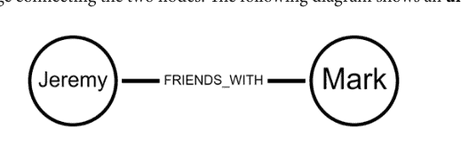
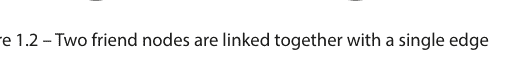
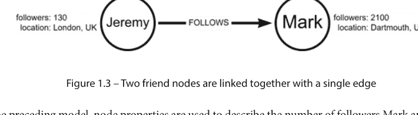
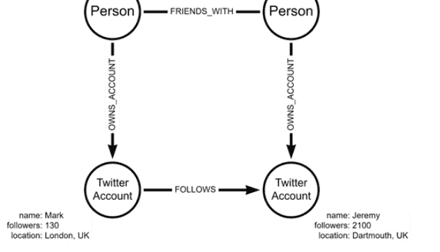
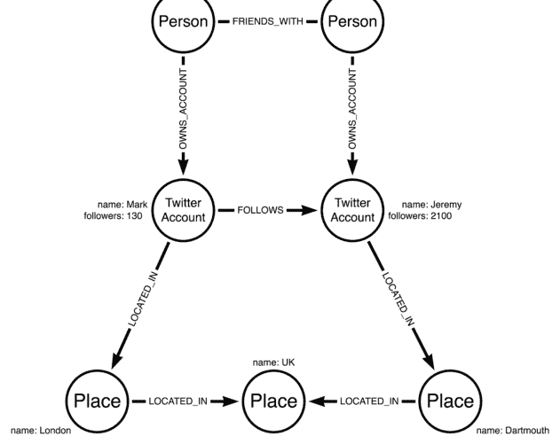
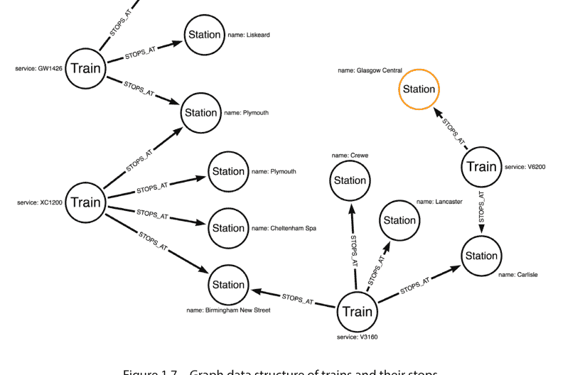
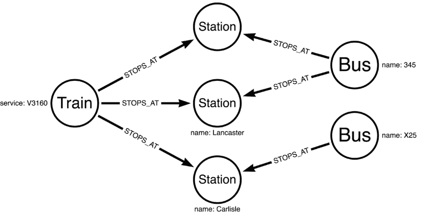

## 现实世界中的图介绍

社交网络分析、欺诈检测、建模系统稳定性（例如铁路和能源电网）以及推荐系统都依赖图作为支撑这些类型网络的核心。在每个示例中，个人、银行账户或其他单个单元之间的关系对于描述和建模数据至关重要。与传统数据模型相比，图是表示相互作用元素组的完美方式。

本章将作为图为何重要以及构成图网络基础的介绍。此外，我们将探讨如何从传统的 **关系型数据库（RDBs）** 存储策略过渡，以及如何利用这些知识来使用 **图数据库（GDBs）**。在整本书中，我们将使用一个流行的图数据库，即 Neo4j。随后将解释图在 *现实世界* 中的使用方式，然后温和地介绍主要的核心包工作马，即 igraph 和 NetworkX，它们是图数据分析和建模最稳定和最好的图包。

在本章中，我们将涵盖以下主题：

- 为什么应该使用图？
- 节点和边的 fundamentals 以及图的属性
- 比较 RDBs 和 GDBs
- 图在各个行业中的使用
- NetworkX 和 igraph 介绍

### 技术要求

我们将使用 Jupyter Notebook 运行我们的编码练习。为此，你需要 python>=3.8.0，以及以下需要通过 pip install 命令安装在你的环境中的包：

- networkx==2.8.8
- igraph==0.9.8

所有笔记本以及编码练习都可在以下 GitHub 链接获得：https://github.com/PacktPublishing/Graph-Data-Modeling-in-Python/tree/main/CH01。

### 为什么应该使用图？

在现代数据驱动的解决方案和企业中，图数据结构变得越来越常见。这是因为在我们现代的数据驱动世界中，事物之间的关系变得与事物本身一样重要，甚至更重要。在现代行业和企业中，图开始变得更常见和强大，有助于理解实体之间的关系。我认为这些关系以及它们如何连接变得比实体本身更重要。我们将在以下章节的用例中展示现实生活的图示例，并提供详细的说明，介绍如何构建这些网络以及图设计所需考虑的核心因素。

图是我们在日常使用的许多系统的基础。每当你在网上收到产品推荐时，很可能是一个图解决方案在驱动此推荐。这就是为什么学习如何处理图数据并利用这些类型的网络是数据科学中快速增长且关键的技能。

### 图的复合组件

网络是表示复杂系统和当今数据中出现的复杂连接性质的工具。我们已经提到图正在为当今一些强大的推荐系统提供动力。

图方法往往分为四个不同的领域：

- **移动**：移动关注事物如何在网络中旅行（移动）。这类图是路由和 GPS 解决方案的驱动因素，并被最大的玩家用于在道路网络中寻找最佳路径。
- **影响**：在社交媒体上，这一领域指定谁是已知的影响者以及他们如何在网络中传播这种影响。


- **群体与交互**：这一领域涉及识别群体以及网络中的参与者如何相互交互。我们将通过一个示例来了解如何应用社区发现方法，通过节点（涉及的参与者）及其连接（边）来发现这些社区。如果你暂时不知道这些术语是什么意思，别担心；我们将在*节点、边和图属性基础*一节中重点介绍这些内容。
- **模式检测**：模式检测涉及使用图来发现网络中可探索的相似性。我们必须从参与者（节点）的角度出发，找出该参与者与网络中其他参与者之间的相似性。在这里，*参与者*指的是人、作者个人资料等。

在本节中，我们通过提供简单的工作定义，解释了图的核心组成部分。在下一节中，我们将更深入地探讨这些基本元素，它们构成了你在行业中遇到的每一个图。我们将介绍节点、边以及图的各种属性。

### 节点、边和图属性基础

图（或网络）是一种非常强大的数据结构，用于建模和描述事物之间的关系，无论这些事物是人、产品还是机器。在图中，我们之前提到的那些*事物*由*节点*（有时称为*顶点*）表示。节点之间通过*边*（有时称为*关系*）连接。在网络中，边表示两个事物之间的关系，表明它们以某种方式相连。

接下来的章节将介绍图的结构和类型。首先，我们从无向图开始，然后介绍有向图。之后，我们将了解节点属性，接着深入探讨异构图，最后研究模式设计考虑事项。

#### 无向图

为了说明这一点，我们可以看一个现实生活中的社交网络示例。在下面的示例中，Jeremy 和 Mark 各用一个节点表示。Jeremy 是 Mark 的朋友，*朋友*关系通过连接两个节点的边来表示。下图展示了一个**无向图**：



图1.1 – 两个朋友节点通过一条边连接在一起

然而，并非所有社交网络都相同，在一些在线社交媒体平台上，社交网络用户之间的关系可能不是相互的。

例如，在 Twitter 上，一个用户可以关注另一个用户，但这并不意味着逆关系也必须成立。在 Twitter 上，Jeremy 可能关注了 Mark，但 Mark 可能没有关注 Jeremy。

#### 有向图

这里，使用有向边来表示 Jeremy 关注了 Mark，而反方向没有边则表示 Mark 并未关注 Jeremy：



图1.2 – 两个朋友节点通过一条边连接在一起

这种类型的图称为有向图。作为参考，有时像图1.1中的无向边会显示为指向两个节点的双向边。这种双向表示在大多数意义上等同于无向边，表示一种相互关系。

重要的是，在创建带有有向边的数据模型时，适当命名关系变得很重要。在我们的 Twitter 示例中，如果表示 Mark 和 Jeremy 之间交互的边是 follows（关注），那么这条边从 Jeremy 节点指向 Mark 节点。

另一方面，如果边表示的是诸如 followed by（被关注）之类的概念，则方向应相反——即从 Mark 指向 Jeremy。这对于一些更复杂的图建模和用例具有特别重要的影响，我们将在第2章“使用图数据模型”中介绍。

#### 节点属性

虽然节点和边（无论是否有向）是图的基本构建块，但它们通常不足以完整描述数据集。节点可能带有与它们关联的数据，而这些数据可能不是关系型的，因此不会被表达为与另一个节点的关系。

在这些情况下，为了表示与节点关联的数据，我们可以使用节点属性（有时称为节点特性）。类似地，当边除了表示关系外还关联了额外信息时，可以使用边属性来保存这些数据。

下图显示一条黑线，表示 Jeremy 关注了 Mark，但 Mark 没有关注 Jeremy——因此黑线表示方向性：



图1.3 – 两个朋友节点通过一条边连接在一起

在上面的模型中，节点属性用于描述 Mark 和 Jeremy 拥有的关注者数量，以及他们 Twitter 个人简介中列出的位置。这类附加的节点信息在查询图数据时尤其重要，因为查询中可能涉及过滤条件。

在我们的 Twitter 示例中，如果我们想知道谁关注了拥有超过 1,000 名关注者的用户，那么图中就需要存在属性。我们将在后续章节中再次讨论如何使用节点、边和属性来回答图问题。

根据数据集的不同，可能会出现不同节点具有不同属性集的情况。在这种情况下，同一个图中通常会有几种不同类型的节点。

#### 异构图

节点类型也可以称为层，或称为具有不同标签的节点，不过在本书中，我们简称为类型。

下图显示了将 Jeremy 和 Mark 表示为人的节点，其中每种节点类型具有不同的属性，并且有多种关系类型。因此，我们可以将这些多重关系称为异构关系：



图1.4 – 一个异构 Twitter 图的示例

现在，我们添加了将 Mark 和 Jeremy 表示为人的节点、表示他们在 Twitter 之外关系的边，以及他们各自账户的所有权。请注意，由于我们增加了节点类型的数量，我们也需要新的边类型来指代不同类型节点之间的不同交互。

具有多种节点类型的图称为异构、多层或多级图，不过在后续内容中，我们将使用“异构”一词来指代具有多种节点类型的图。相比之下，如前面示例所示，只有一种节点类型的图称为同构图。

#### 模式设计

此时，提出这样一个问题是合理的：*数据集的哪些特征应作为节点、边和属性？*

对于任何给定的数据集，都有多种方法将数据表示为图，并且每种方法更适合不同的目的。良好图建模的诀窍就在于此：以问题或用例驱动的模式设计。

如果我们特别关注网络中 Twitter 用户的位置，那么我们可以将 Twitter 用户节点上的位置节点属性移动，以创建 LOCATED_IN 关系类型。如下图所示：



图1.5 – 同一个图，但位置属性已从节点属性移动为节点类型

如果我们特别关注网络中 Twitter 用户的位置，那么我们可以将 Twitter 用户节点上的位置节点属性移动到一个单独的节点类型，并创建 LOCATED_IN 关系类型。我们甚至可以更进一步，将我们已知的这些位置信息表示出来，把每个位置对应的国家作为一个单独的抽象节点添加进来。

这种图结构以不同的方式对相同数据建模，对于特定的用例，其适用性或性能可能更高，也可能更低。我们将在后续章节中探讨模式设计对可提出的问题类型以及性能的影响。

在下一节中，我们将比较图数据结构与传统 RDB 的不同之处。这将进一步阐述为什么在将问题建模为图数据问题时，GDB 可以更具性能优势。

#### 比较 RDB 与 GDB

**关系型数据库（RDBs）** 在很长一段时间里一直是大多数行业数据存储和数据分析的标准。它们的优势在于能够保存包含不同信息的多个表，其中一些表字段出现在多个表中，从而实现数据关联。

有了这种数据关联，就可以对 RDB 中的数据提出复杂的问题。然而，这种关系结构也存在缺点。虽然 RDB 适用于返回满足特定条件的大量行，但不太适合涉及许多链式关系的问题。

为了说明这一点，考虑一个包含列车服务及其停靠站的标准数据库，以及一个可能表示相同信息的图：

| 列车 | 停靠站 |
| --- | --- |
| GW1426 | Truro |
| GW1426 | Liskeard |
| GW1426 | Plymouth |
| XC1200 | Plymouth |
| XC1200 | Bristol Parkway |
| XC1200 | Cheltenham Spa |
| XC1200 | Birmingham New Street |
| VT3160 | Birmingham New Street |
| VT3160 | Crewe |
| VT3160 | Lancaster |
| VT3160 | Carlisle |
| VT6200 | Carlisle |
| VT6200 | Glasgow Central |

图1.6 – 列车及其停靠站的关系数据结构


在 RDB 结构中，检索服务于特定车站的所有列车并不困难。另一方面，这可能是一个缓慢的操作，返回的是可以在两个选定车站之间乘坐的一系列列车。

考虑在传统的 RDB 中查找前表中特鲁罗到格拉斯哥中央的路线所需的步骤。从特鲁罗开始，我们会知道**GW1426**列车服务停靠特鲁罗、利斯凯德和普利茅斯。知道这些车站可以从特鲁罗到达后，我们就需要找到停靠在这些车站中的每个车站的列车服务，以找到我们的路线。

在发现普利茅斯车站可达并且有单独的服务运行到更多车站后，我们需要一遍又一遍地重复此过程，直到到达格拉斯哥中央。

这些步骤本质上导致了对同一张表的系列计算成本高昂的*join*操作，其中一个结果行将为我们提供感兴趣车站之间的路径。

### GDBs 来救援

使用图结构来表示这个铁路网络，更强调我们数据点之间的关系，如以下图所示：



图 1.7 – 列车及其停靠站的图数据结构

使用图结构来表示这个铁路网络，更强调我们数据点之间的关系。从特鲁罗车站开始，如 RDB 示例中那样，我们找到服务该车站的列车。然而，在遍历图以找到特鲁罗和格拉斯哥中央之间可能路线的过程中，在每个车站或列车节点上，我们考虑的数据点更少，因此选择也更少。

这与 RDB 示例形成对比，在 RDB 示例中，需要重复进行表连接才能返回路径。在这种情况下，图表示所需的运算复杂性较低，这相当于一种更快、更有效的方法。在许多其他用例中，那些需要某种*路径查找*的用例通常会从图数据模型中受益。

除了更适合特定类型的查询之外，图在需要灵活、不断演进的数据模型时通常很有用。再次以铁路网络为例，假设作为数据库管理员，您收到了将公交运输链接添加到数据模型的请求。

对于 RDB，需要一个新表，因为每个火车站可能有多个公交服务。在这个新表中，每个车站的名称需要从现有表中复制出来，以便与相关的公交服务一起列出。

这种重复不仅增加了存储的数据量，还增加了数据库模式的复杂性：



当火车站数据以图表示时，关于公交的新信息可以直接作为新节点类型添加到现有数据库中。

就行业中的图而言，由于我们本章已经探索过的理由，它们无处不在。能够快速链接节点和边，并在它们之间创建关系，是更多数据科学问题被建模为图或网络科学问题的[content]

在 RDB 结构中，检索服务于特定车站的所有列车并不困难。另一方面，这可能是一个缓慢的操作，返回的是可以在两个选定车站之间乘坐的一系列列车。

考虑在传统的 RDB 中查找前表中特鲁罗到格拉斯哥中央的路线所需的步骤。从特鲁罗开始，我们会知道**GW1426**列车服务停靠特鲁罗、利斯凯德和普利茅斯。知道这些车站可以从特鲁罗到达后，我们就需要找到停靠在这些车站中的每个车站的列车服务，以找到我们的路线。

在发现普利茅斯车站可达并且有单独的服务运行到更多车站后，我们需要一遍又一遍地重复此过程，直到到达格拉斯哥中央。

这些步骤本质上导致了对同一张表的系列计算成本高昂的*join*操作，其中一个结果行将为我们提供感兴趣车站之间的路径。

### GDBs 来救援

使用图结构来表示这个铁路网络，更强调我们数据点之间的关系，如以下图所示：


图 1.7 – 列车及其停靠站的图数据结构

使用图结构来表示这个铁路网络，更强调我们数据点之间的关系。从特鲁罗车站开始，如 RDB 示例中那样，我们找到服务该车站的列车。然而，在遍历图以找到特鲁罗和格拉斯哥中央之间可能路线的过程中，在每个车站或列车节点上，我们考虑的数据点更少，因此选择也更少。

这与 RDB 示例形成对比，在 RDB 示例中，需要重复进行表连接才能返回路径。在这种情况下，图表示所需的运算复杂性较低，这相当于一种更快、更有效的方法。在许多其他用例中，那些需要某种*路径查找*的用例通常会从图数据模型中受益。

除了更适合特定类型的查询之外，图在需要灵活、不断演进的数据模型时通常很有用。再次以铁路网络为例，假设作为数据库管理员，您收到了将公交运输链接添加到数据模型的请求。

对于 RDB，需要一个新表，因为每个火车站可能有多个公交服务。在这个新表中，每个车站的名称需要从现有表中复制出来，以便与相关的公交服务一起列出。

这种重复不仅增加了存储的数据量，还增加了数据库模式的复杂性：


当火车站数据以图表示时，关于公交的新信息可以直接作为新节点类型添加到现有数据库中。

就行业中的图而言，由于我们本章已经探索过的理由，它们无处不在。能够快速链接节点和边，并在它们之间创建关系，是更多数据科学问题被建模为图或网络科学问题的[content]

在 RDB 结构中，检索服务于特定车站的所有列车并不困难。另一方面，这可能是一个缓慢的操作，返回的是可以在两个选定车站之间乘坐的一系列列车。

考虑在传统的 RDB 中查找前表中特鲁罗到格拉斯哥中央的路线所需的步骤。从特鲁罗开始，我们会知道**GW1426**列车服务停靠特鲁罗、利斯凯德和普利茅斯。知道这些车站可以从特鲁罗到达后，我们就需要找到停靠在这些车站中的每个车站的列车服务，以找到我们的路线。

在发现普利茅斯车站可达并且有单独的服务运行到更多车站后，我们需要一遍又一遍地重复此过程，直到到达格拉斯哥中央。

这些步骤本质上导致了对同一张表的系列计算成本高昂的*join*操作，其中一个结果行将为我们提供感兴趣车站之间的路径。

### GDBs 来救援

使用图结构来表示这个铁路网络，更强调我们数据点之间的关系，如以下图所示：


图 1.7 – 列车及其停靠站的图数据结构

使用图结构来表示这个铁路网络，更强调我们数据点之间的关系。从特鲁罗车站开始，如 RDB 示例中那样，我们找到服务该车站的列车。然而，在遍历图以找到特鲁罗和格拉斯哥中央之间可能路线的过程中，在每个车站或列车节点上，我们考虑的数据点更少，因此选择也更少。

这与 RDB 示例形成对比，在 RDB 示例中，需要重复进行表连接才能返回路径。在这种情况下，图表示所需的运算复杂性较低，这相当于一种更快、更有效的方法。在许多其他用例中，那些需要某种*路径查找*的用例通常会从图数据模型中受益。

除了更适合特定类型的查询之外，图在需要灵活、不断演进的数据模型时通常很有用。再次以铁路网络为例，假设作为数据库管理员，您收到了将公交运输链接添加到数据模型的请求。

对于 RDB，需要一个新表，因为每个火车站可能有多个公交服务。在这个新表中，每个车站的名称需要从现有表中复制出来，以便与相关的公交服务一起列出。

这种重复不仅增加了存储的数据量，还增加了数据库模式的复杂性：


当火车站数据以图表示时，关于公交的新信息可以直接作为新节点类型添加到现有数据库中。

就行业中的图而言，由于我们本章已经探索过的理由，它们无处不在。能够快速链接节点和边，并在它们之间创建关系，是更多数据科学问题被建模为图或网络科学问题的原因。此外，底层数据可以以快速的速度进行查询。这可以替代使用传统的数据库解决方案，而传统数据库解决方案，如我们已经确定的，与 GDB 相比查询速度较慢。

在此之后，在下一节中，我们将介绍图分析和建模的主要两个驱动包。我们将向您展示这些包的基本用法。在随后的章节中，我们将继续构建这些包为何强大的原因。

### NetworkX 和 igraph 简介

在本章中，我们将介绍两个用于创建内存中图的 Python 包：NetworkX 和 igraph。

NetworkX 让你创建图、执行图操作、研究和可视化其结构，并在处理图时执行多种图操作函数。他们的网站（https://networkx.org/）包含对包的主要更改的详细信息以及工具的预期用途。

igraph 包含一套有用的实用分析工具，其目标是使这些工具高效且易于使用，并且可重复。igraph 的优点在于它是开源和免费的，而且它支持在 R、Python、Mathematica 和 C/C++ 中构建网络。这是我们推荐用于创建可比 NetworkX 加载更快的大型网络的包。要了解有关 igraph 的更多信息，请访问 https://igraph.org/。

在以下小节中，我们将查看 NetworkX 和 igraph 的基础知识，并附带易于遵循的编码步骤。这是您第一次亲自动手进行图数据建模。

#### NetworkX 基础

NetworkX 是 Python 原本可用的图库之一，特别注重用户友好和 Pythonic 的风格。它还原生包含计算一些经典网络分析度量的方法：

1. 要将 NetworkX 导入 Python，请使用以下命令：

   ```
   import networkx as nx
   ```

2. 要创建一个空图 g，请使用以下命令：

   ```
   g = nx.Graph()
   ```

3. 现在，我们需要向图中添加节点，这可以通过 g 所属的 Graph 对象的 方法完成。有多种方法可以做到这一点，最简单的方法是一次添加一个节点：

   ```
   g.add_node("Jeremy")
   ```

4. 或者，可以一次将多个节点添加到图中，如下所示：

   ```
   g.add_nodes_from(["Mark", "Jeremy"])
   ```

5. 可以通过将节点和字典元组传递给 Graph.add_nodes_from 在创建期间向节点添加属性：

   ```
   g.add_nodes_from([("Mark", {"followers": 2100}), ("Jeremy", {"followers": 130})])
   ```

6. 要向图中添加边，我们可以使用 Graph.add_edge 方法，并引用图中已有的节点：

   ```
   g.add_edge("Jeremy", "Mark")
   ```

值得注意的是，在 NetworkX 中，添加边时，作为该边一部分指定的任何尚未在图中的节点将被隐式添加。

7. 为了确认我们的图现在包含节点和边，我们可能想使用 matplotlib 和 networkx.draw() 将其绘制出来。with_labels 参数将节点名称添加到绘图中：

   ```
   import matplotlib.pyplot as plt
   nx.draw(g, with_labels=True)
   plt.show()
   ```

本节向您展示了如何使用几行 Python 代码快速上手 NetworkX。在下一节中，我们将把重点转向流行的 igraph 包，它允许我们在比使用流行的 NetworkX 更快的时间内对更大的数据集执行计算。

#### igraph 基础

NetworkX 虽然用户友好，但在处理较大图时速度较慢。这是因为其幕后实现以及它是用 Python 编写的，其中包含一些 C、C++ 和 FORTRAN。

相比之下，igraph 用纯 C 实现，给库在处理大型图和复杂网络算法时带来优势。虽然对于初学者来说不如 NetworkX 立即可访问，但 igraph 是一款在代码效率至关重要时值得掌握的工具。

最初，使用 igraph 与使用 NetworkX 非常相似。让我们看一下：

1. 要将 igraph 导入 Python，请使用以下命令：

   ```
   import igraph as ig
   ```

2. 要创建一个空图 g，请使用以下命令：

   ```
   g = ig.Graph()
   ```

与 NetworkX 不同，在 igraph 中，所有节点都有规定的内部整数 ID。第一个添加的节点 ID 为 0，后续节点分配递增的整数 ID。

3. 与 NetworkX 类似，可以通过使用 Graph 对象的 方法来更改图。可以使用 Graph.add_vertices 方法向图中添加节点（请注意，顶点是节点的另一种说法）。以下代码可将两个节点添加到图中：

   ```
   g.add_vertices(2)
   ```

4. 这将向图中添加节点 0 和 1。要命名它们，我们必须为节点分配属性。我们可以通过访问 Graph 对象的顶点来做到这一点。类似于访问列表中的元素，每个节点的属性都可以通过以下符号访问。在这里，我们设置节点 0 和 1 的 name 和 followers 属性：

   ```
   g.vs[0]["name"] = "Jeremy"
   g.vs[1]["name"] = "Mark"
   g.vs[0]["followers"] = 130
   g.vs[1]["followers"] = 2100
   ```

5. 节点属性也可以按列表方式添加，其中第一个列表元素对应节点 ID 0，第二个对应节点 ID 1，以此类推。以下两行与第 4 步中显示的四行等效：

   ```
   g.vs["name"] = ["Jeremy", "Mark"]
   g.vs["followers"] = [130, 2100]
   ```

6. 要添加边，我们可以使用 Graph.add_edges() 方法：

   ```
   g.add_edges([(0, 1)])
   ```

在这里，我们只添加一条边，但可以向 add_edges 所需的列表参数添加更多边。与 NetworkX 一样，如果为当前不在图中的节点添加边，节点将被隐式创建。然而，由于 igraph 要求节点具有顺序 ID，尝试向只有两个顶点的图中添加边对 (1, 3) 将失败。


### 摘要

在本章中，我们探讨了为什么你应该开始用图的思维方式思考，从这些方法为何正成为各行各业中应用最广泛、讨论最多的方法这一益处出发。我们了解了什么是图，并解释了各种类型的图，例如关注事物如何在网络中流动的图、影响力图（社交媒体上谁在影响谁）、用于识别群体和交互的图方法，以及如何利用图来检测网络中的模式。

接着，我们研究了构成图的基本要素。在此，我们考察了节点、边和属性的基本元素，并深入探讨了无向图和有向图之间的区别。此外，我们还考察了节点的属性，研究了异构图，并检查了图中包含的各类模式。

由此引出了图数据库（GDB）与传统关系型数据库（RDB）的对比，以及为什么在许多情况下，图的遍历和查询更加简单快捷。我们还举例说明了如何利用图来优化火车旅程中的站点停靠，以及如何轻松地将其扩展，将公交站点作为新的数据源加入其中。

随后，我们考察了图在各行各业中的部署情况，以及图在这些行业中至关重要的部分用例，例如金融领域的欺诈检测、政府领域的情报画像、医院中的患者旅程、网络中的客户流失分析，以及营销中的客户细分。图确实正变得无处不在。

在本章的最后，我们介绍了图分析和网络分析的强大工具——igraph 和 NetworkX。我们向你展示了如何仅用几行 Python 代码，就能轻松开始填充一个图。

在下一章中，我们将探讨如何处理和创建图数据模型。下一章将包含更多动手实践示例，教你如何在 Python 中使用图数据模型来组织数据。
