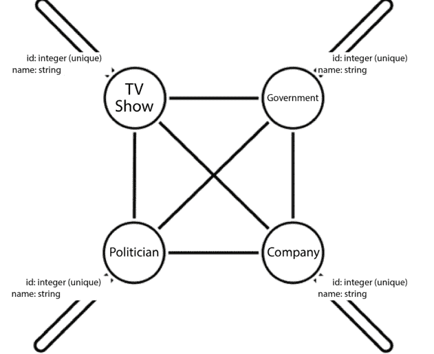
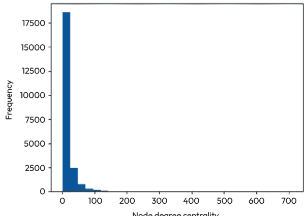

## 2 使用图数据模型

本章将引导你运用迄今所学的内容，从业务问题出发，逐步过渡到如何获取数据，然后让这些数据为图做好准备。本章的目标是教授你快速开始使用图数据模型所需的基础技能。

本章将重点介绍许多关键技能，帮助你迅速掌握图数据模型的使用，以及图结构的许多属性。在接下来的各节中，我们的目标是让你熟悉 igraph，并学会如何使用它将数据导入到图中。

在此基础上，我们将逐步建立你对如何在图中建模节点和边的理解。最终将通过一个用例来巩固和强化你在本章所学的知识。

该用例将涉及建模图结构所需的关键技术，以及度中心性的含义。

在本章中，我们将涵盖以下主要内容：

- 从表格数据过渡到图数据
- 在 Python 中实现模型
- 最受欢迎的电视节目——一个真实世界的用例

### 技术要求

我们将使用 Jupyter notebook 来运行编码练习；这需要 python>=3.8.0，以及以下包，这些包需要通过你环境中的 pip install 命令安装：

- networkx==2.8.8
- igraph==0.9.8
- matplotlib

所有包含编码练习的 notebook 都可以在以下 GitHub 链接中找到：https://github.com/PacktPublishing/Graph-Data-Modeling-in-Python/tree/main/CH02。

### 从表格数据过渡到图数据

为了引入图数据模型的强大功能，我们首先要使用一个真实的社交媒体数据集，该数据集来自 Facebook。这个开源数据包含有关 Facebook 页面的信息，包括页面名称和页面类型。数据中包含了四种类型的页面，即电视节目、公司、政治家和政府组织。此外，我们还有页面之间相互点赞的数据。如果两个页面在 Facebook 上互相点赞，这就会在我们的数据中表现出来。

在这个阶段，我们可以开始思考如何最好地为这个数据集建模。为了构建一个图，我们从第 1 章“真实世界中的图简介”中了解到，我们需要将事物表示为节点，并将这些节点之间的关系表示为边。

在接下来的小节中，我们将研究在设计高效且有效的模式时需要检查的数据、思考和注意事项，然后我们将着手在 Python 中实现该模型。让我们直接开始吧。

### 检查数据

我们需要仔细查看我们的数据，以确定如何将数据转换为图格式。我们的数据以 .csv 格式提供，因此本质上是表格形式的。

我们可以先查看斯坦福大型页面间网络数据集（https://snap.stanford.edu/data/facebook-large-page-page-network.html）的前几行，以及该数据集中的一个文件——即 musae_facebook_target.csv——在编辑器中打开：

```
id,facebook_id,page_name,page_type
0,145647315578475,The Voice of China 中国好声音,tvshow
1,191483281412,U.S. Consulate General Mumbai,government
2,144761358898518,ESET,company
```



图 2.1 – 无向异构图

该模式表示了每种类型的节点之间都可能存在一条边。回环到每种类型节点的边（称为自边）表明，相同类型的节点之间也可以存在关系。最后，列出了每个属性的数据类型，这些数据类型对每个节点都是相同的：ID 为唯一键整数，名称为字符串。

现在，是时候在 Python 中实现这个模型了。我们将从配套的 GitHub notebook（https://github.com/PacktPublishing/Graph-Data-Modeling-in-Python/blob/main/CH02/02.1_Implementing_model.ipynb）中读取数据。

### 在 Python 中实现模型

在接下来的步骤中，我们将加载将要使用的数据。

要开始在 Python 中创建这个图，我们可以使用标准的 Python csv 库从 musae_facebook_target.csv 导入节点：

```
import csv
with open('./data/facebook_large/musae_facebook_target.csv', 'r',
encoding='utf-8') as csv_file:
    reader = csv.reader(csv_file)

data = [line for line in reader]
print(data[:10])
print(len(data))
```

在这里，我们使用 utf-8 编码打开 CSV 文件，因为一些节点名称字符串包含非标准字符。我们使用 csv.reader 读取文件，并通过列表推导式（一种特殊构造，将循环封装在列表中，以根据循环逻辑返回新列表，本质上是从另一个列表创建一个列表）将其转换为列表的列表。最后，我们通过检查前几行并检查导入列表的长度（应等于 22,471，即行数）来确认 CSV 文件已正确加载。

接下来，我们将扩展已加载的数据，向图中添加节点和属性。

### 添加节点和属性

在 igraph 中，我们可以像在第 1 章“真实世界中的图简介”中那样，一次添加一个节点来开始创建图。然而，与 Python 中的许多操作一样，通过一次操作按列表方式添加节点会更快。以下步骤将带你完成添加节点及其属性的过程：

1. 为此准备数据，我们需要节点名称的列表，以及每个节点属性。我们可以使用更多的列表推导式来准备这些列表：

```
node_ids = [int(row[0]) for row in data[1:]]
page_names = [row[2] for row in data[1:]]
page_types = [row[3] for row in data[1:]]
```

请注意，对 data 进行的 [1:] 列表切片是从每个列表中移除 csv 表头，我们不希望将表头作为节点包含在内。

2. 我们需要确认数据的 id 行是否按顺序递增。如第 1 章“真实世界中的图简介”所述，igraph 为添加到图中的每个节点使用一个顺序递增的整数索引。如果我们的 id 列也使用这种方式，那么添加节点将是一个简单的过程。为了确认这一点，我们可以将 id 列与 Python 的 range() 进行比较：

```
assert node_ids == list(range(len(node_ids)))
```

这个 assert 语句确保 range() 从 0 到 node_ids 列表的 len() 与数据中的节点 ID 列表相等。这个 assert 语句不应该引发 AssertionError 错误，因为它们是完全相同的。

3. 这意味着将我们的节点导入 igraph，在这种情况下，只需创建一个新的、无向的、空图，并告诉 igraph 我们想要的节点数量即可：

```
import igraph as ig
g = ig.Graph(directed=False)
g.add_vertices(len(node_ids))
```


与之前处理节点类似，我们使用Python内置的csv库导入csv边列表（见“在Python中实现模型”部分的步骤1）。该文件不包含特殊字符，因此我们无需指定编码。

同样，我们通过打印导入的列表的列表的前几行以及行数，来大致了解我们将向图中添加多少条边。

2. 请注意，该文件也包含一个表头，我们不想不小心将其作为图中的一条边。此外，在igraph中，节点通过其整数ID引用，因此我们需要将列表元素转换为整数，为添加边做准备。我们可以使用列表推导式来完成此操作并删除表头：

```
edges = [[int(row[0]), int(row[1])] for row in edge_data[1:]]
print(edges[:10])
```

然后我们再次打印前10个元素，确认边列表已正确转换为整数。

3. 数据准备好后，就可以使用 g.add_edges() 方法一次性将所有边添加到图中：

```
g.add_edges(edges)
```

4. 我们可以通过访问图的 es 属性并计数来确认边是否已添加：

```
print(len(g.es))
```

该数值应等于 .csv 文件中的行数减一（即171,002条边）。

5. 我们还要确认一条已知应存在于图中的边已被正确添加。查看 musae_facebook_edges.csv 的第一个非表头行，可以看到节点0和节点18427之间应该有一条边。我们可以使用 es 属性和索引访问添加到图中的第一条边：

```
first_edge = g.es[0]
```

6. 这条边应连接ID为0和18427的节点。我们可以通过打印新建的 first_edge 变量的 source 和 target 属性来验证这一点：

```
print(first_edge.source)
print(first_edge.target)
```

7. 最后，为了将其与真实数据集联系起来，我们可以通过访问节点的 page_name 属性来检查这条边代表哪些Facebook主页：

```
print(g.vs[0]['page_name'])
print(g.vs[18427]['page_name'])
```

这表明这些节点对应的Facebook主页是“The Voice of China 中国好声音”和“The Voice Global”，并且这两个Facebook主页有相互点赞关系。

### 编写通用的图导入方法

在上一节中，我们分许多小步骤从数据集创建了图。下次导入类似图时，我们可能希望加快此过程，为此可以编写一些更通用的Python方法。

让我们首先考虑从Facebook相互点赞的 .csv 文件创建图所需的步骤。回顾上一节，我们做了以下工作：

- 创建一个空的 igraph Graph() 对象
- 导入包含节点、节点属性和边的 .csv 文件
- 向图中添加节点，并进行一些测试
- 向图中添加边，并进行更多测试

接下来的系列步骤将引导你了解如何创建函数以在将来加快该过程，并让你轻松地将此代码用于自己的项目：

1. 首先，让我们考虑 .csv 导入。你可能已经注意到，我们以非常相似的过程导入了之前的两个 .csv 文件，将 .csv 文件中的行转换为列表的列表。让我们改为定义一个函数来完成这项工作：

```
def read_csv(csv_path):
    """
    Import a csv file.

    :param csv_path: Path to the csv to import.
    :return: A list of lists read from the csv.
    """

    import csv
    import os

    assert os.path.exists(csv_path), \
        f'File could not be found at {csv_path}.'

    with open(csv_path, 'r', encoding='utf-8') as csv_file:
        reader = csv.reader(csv_file)
        data = [row for row in reader]

    return data
```

read_csv() 方法中包含一条 assert 语句，使用 Python 标准库 os 来确保指定的文件路径存在。assert 语句后跟一个逗号和一个 f 字符串，指示 Python 在 assert 语句失败时将字符串打印到控制台，从而帮助调试。以这种方式使用 assert 语句是进行基本 Python 代码测试的有用工具。

2. 接下来，我们将使用导入的列表的列表，向图中添加节点和边，首先从节点开始。我们将把该函数拆分为多个步骤；首先，我们将添加文档设置来记录函数的输入：

```
def add_nodes(g, nodes, attributes):
    '''
    Add nodes to the graph.

    :param g: An igraph Graph() object.
    :param nodes: A list of lists containing nodes and node attributes, with a header. The first
                  element of each list in nodes should be the
    node ID.
    :param attributes: A list of attributes corresponding to the header (index 0) of the nodes list.
                        The names of attributes in this list will
    be added to the graph.
    '''

    return g
```

3. 然后，我们使用 assert 语句在条件不满足时抛出错误。第一个条件检查导入的列分隔值中是否存在 id 列。下一条 assert 语句检查节点ID是否以连续递增的方式增加。最后一条 assert 语句检查输入到图中的数据是否为 list 类型：

```
assert nodes[0][0] == 'id', \
    f'The first column in the imported csv should be the ID header, "id". Instead, it \
    f'is {nodes[0][0]}.'

    node_ids = [int(row[0]) for row in nodes[1:]]
    assert node_ids == list(range(len(node_ids))), \
        f'Node IDs should increase sequentially in the imported csv, from 0 to the number of\' 
        f' nodes-1, {len(node_ids)}.'

    assert isinstance(attributes, list), \
        f'Attributes to add to the graph should be a list. Instead attributes is of type\' 
        f' {type(attributes)}.'
```

4. 函数的最后部分是在图中添加顶点，遍历导入文件中的属性，并在图中创建这些属性：

```
g.add_vertices(len(node_ids))

    headers = nodes[0]
    for attribute in attributes:
        attr_index = headers.index(attribute)
        g.vs[attribute] = [row[attr_index] for row in nodes[1:]]
```

这个 add_nodes() 方法建立在本章前面的代码基础上，我们首先将数量等于导入的 .csv 文件长度（不含表头）的节点添加到图中，然后为这些节点添加属性。这里，使用用户指定的要包含的属性列表，在 csv 表头中找到这些属性的索引元素，然后从节点列表的列表中的每个列表中取出该索引的每个元素。现在包含节点和属性的 g 图随后被返回。

同样，这里也有 assert 语句来确认导入的数据符合预期格式。我们测试加载的节点属性 csv 表头是否包含 id 字段，并且该字段位于表头的索引 [0] 处。正如本章前面提到的，我们还断言每行第[0]个元素中的节点ID是连续递增的整数，这是 igraph 按预期运行的必要条件。最后，我们断言用户指定的 attributes 参数是 list 类型。这是为了确保导入属性的通用 for 循环按预期运行，即针对 attributes 中的每个属性。

5. 在此步骤中，既然节点和属性已添加，我们可以使用另一个辅助方法将边添加到图中：

```
def add_edges(g, edges):
    '''
    Add edges to the graph, where nodes are already present.
    :param g: An igraph Graph() object.
    :param edges: A list of lists containing edges, with a header.
    '''

    assert len(edges[0]) == 2, \
        f'Each element in the imported edges csv should be of length 2, representing an edge'\
        f' between two linked nodes. Instead, the first element is of length {len(edges)[0]}.'

    edges_to_add = [[int(row[0]), int(row[1])] for row in edges[1:]]
    g.add_edges(edges_to_add)

    return g
```


first_edge = g.es[0]
print(first_edge.source)
print(first_edge.target)
print(len(g.es))
print(g.vs[0]['page_name'])
print(g.vs[18427]['page_name'])

现在我们已经确认图数据模型按预期设置好了，可以开始用它来回答基于网络的问题。有了详细检查图的工具，我们就能以批判性的眼光审视数据集以及我们在图模式中表示它的方式。

在下一节中，我们将运用这里学到的知识并将其应用到一个用例中，假设我们是被 Facebook 聘用的数据科学家，将图数据科学技术付诸实践并解决一个实际用例。

### 最受欢迎的电视节目——一个真实世界的用例

在本节中，我们将有幸扮演 Facebook 数据科学家的角色，以确定数据集中最受欢迎的电视节目等内容。这将考验我们目前所学的知识，并带你经历一个典型的图数据科学家常被要求解决的用例。

为此，我们首先要研究相互点赞图的一般性质。我们将从检查图的结构开始，然后转向你可能需要考虑的其他一些事项，例如称为度中心性的概念。

在这里，你将运用新学到的技能。我们首先检查图的结构，然后分析图中实体的连通性，接着查看图中的高度数节点。

我们将通过以下步骤，利用目前获得的新知识，实现找到最受欢迎电视节目的最终目标：

- 1. 我们首先对图中数据的结构做一些分析；重点将放在常用的数据科学技术上，例如绘制图直方图来可视化分布。
- 2. 接下来是图的连通性。这是一个重要步骤，因为它能让你看到图中的各组成部分彼此之间的连通程度。为此，我们将专注于 Facebook 上的相互点赞数据集，并考察高度数节点的连通性。
- 3. 最后，我们将构建初始推荐引擎，在这种情况下推荐电视节目。

这听起来很有趣，那就让我们开始吧，像耍蛇人一样驯服这个图问题。

### 检查图结构

现在我们已经把数据放入图模型，可以考虑一些基于网络的分析。一个好的起点是检查图的一些一般属性，以了解其结构。

在网络分析中，查看图的度分布是一种常见做法。每个节点都有一个度中心性，其最简单形式就是与该节点共享边的节点数量。因此，度分布本质上就是整个图中节点度中心性的直方图。

下面的步骤将对此进行详细说明，并且与我们在上一节中创建的图有关。在随附的 Jupyter 笔记本中，这些函数已保存在 graphtastic.utils 中，可以使用 graphtastic.utils import graph_from_attributes_and_edgelist 轻松导入。

方便的是，igraph 内置了一种快速构造并打印给定图度分布的方法，即对 Graph() 对象使用 degree_distribution 方法：

```
histogram = g.degree_distribution(bin_width=5)
print(histogram)
```

bin_width 参数可以更改为任何整数，用于指定直方图绘图的精细程度。

我们的直方图显示，在 Facebook 相互点赞图中，有 8,324 个节点最多与 4 个其他节点相连（请注意，打印出的直方图左侧显示的 (0, 5] 区间表示法不包含度中心性为 5 的节点）。在另一端，连接最多的节点的度中心性在 705 到 709 之间，而连接第二多的节点的度中心性在 675 到 679 之间。

让我们使用 matplotlib 库，以更美观的格式绘制这些度频率：

```
import matplotlib.pyplot as plt
bins = 30
plt.hist(g.degree(), bins)
plt.xlabel('Node degree centrality')
plt.ylabel('Frequency')
plt.show()
```

这将得到下图：



图 2.2 – 节点度中心性直方图

我们稍后还会回到这些度分布图，因为它们对于可视化图结构特别有用。

我们在这里看到的图结构类型——许多节点连接很少，而少数节点连接很多——非常常见。作为参考，在任意图中连接度很高的节点被称为枢纽或枢纽节点。这些枢纽节点往往不成比例地承担了节点之间的连通性，从而产生了社交网络中的六度分隔等现象，即只要通过六层朋友的朋友就可以连接任意两个人。我们将在后面的章节中详细探讨这些概念，但现在，我们将专注于识别 Facebook 图中的重要节点。

### 衡量连通性

并非所有图都是完全连通的，了解 Facebook 相互点赞数据集的这一特性可能会很有意义。如果图中某个节点无法通过遍历边从另一个节点到达，那么该图就是碎片化的。在这种情况下，图的每个不同部分被称为连通分量。

让我们使用 igraph 检查 Facebook 相互点赞图中有多少个连通分量。我们可以使用 igraph 内置的 clusters() 方法轻松完成：

```
connected_components = g.clusters()
print(connected_components)
```

我们的打印语句将显示图中有多少个连通分量，以及每个分量包含哪些节点。在此图中，我们只有一个连通分量，表明该图是完全连通的。

请注意，对于无向图，连通分量比有向图更容易理解。在有向图中，有时图的某一部分只能通过沿着一条边的相反方向遍历才能到达。如果是这种情况，那么图的这一部分被称为弱连通分量。相比之下，强连通分量可以由图中其他节点沿着边的自然方向访问。igraph 库允许你将 clusters() 方法的 mode 参数指定为 weak 或 strong。在我们的无向图情况下，我们可以让 igraph 默认模式为强连通分量。

既然我们已经了解了图的结构（这在图应用中始终是一个好习惯），我们就可以开始更深入地研究图数据集中的某些特定元素和区域。

### 查看高度数节点

以下步骤将介绍如何处理网络中的高度数节点，以及如何在 Python 中实现这些步骤：

- 1. 要查看度中心性最高的节点，我们首先使用 zip 将两个元组组合成一个列表包装器；这两个元组分别是 page_name 和节点之间的关联度。接下来，我们使用一个匿名函数（也称为 Lambda）按降序（反转）对 degree 排序：
  ```
  degree = list(zip(g.vs['page_name'], g.degree()))
  sorted_degree = sorted(degree, key=lambda x: x[1], reverse=True)
  print(sorted_degree[:10])
  ```
  从控制台输出中，我们可以看到 US Army 节点的度中心性最高，有 709 个相互点赞。为了将其与真实世界数据联系起来，请思考这对 US Army 的 Facebook 页面意味着什么。它不仅在其他政府机构、政治家、电视节目和公司中是一个广受欢迎的点赞页面，而且还表明 US Army 页面也在积极回赞这些页面。

- 2. 如果我们想查看某种类型的高度数节点，则需要调整我们的 igraph 代码。要找到度中心性最高的电视节目，我们可以使用 vs.select() 方法，并传入一个指定我们正在查找的页面类型的参数 page_type_eq。然后，像前面的代码片段一样，我们将度数和页面名称压缩在一起——这次仅针对电视节目节点——对其进行排序并打印结果：
  ```
  tv_nodes = g.vs.select(page_type_eq='tvshow')
  tv_indices = [node.index for node in tv_nodes]
  ```


```
tv_degree = list(zip(g.vs[tv_indices]['page_name'], g.degree(tv_indices)))
sorted_tv_degree = sorted(tv_degree, key=lambda x: x[1], reverse=True)
print(sorted_tv_degree[:10])
```

这告诉我们，在我们的图中，度最高的是 Today Show，拥有 141 个相互点赞。

### 使用 select() 来查询图

在上一节中，我们使用了 vs.select()，值得更详细地讨论，因为它是一个特别强大的方法。其强大之处在于其灵活的参数，这些参数由节点类型或属性以及比较运算符组成。

在之前的示例中，我们使用了 page_type_eq 参数，设置为 tvshow。这告诉 vs.select() 搜索具有 page_type 属性等于（由 _eq 指定）tvshow 的节点。这里，_eq 可以替换为许多其他运算符，如下所示：

| Select 参数元素 | 比较运算符 |
|---|---|
| _eq | 等于 |
| _ne | 不等于 |
| _lt | 小于 |
| _gt | 大于 |
| _le | 小于或等于 |
| _ge | 大于或等于 |
| _in | 在给定列表中 |
| _not in | 不在给定列表中 |

表 2.1 – select() 的 Dunder 表达式

因此，使用上表，如果我们想找到类型为 government 或 politician 的节点，我们可以使用以下代码：

```
gov_pol_nodes = g.vs.select(page_type_in=['government', 'politician'])
```

在此基础上，在 select() 方法内，在 Graph() 方法前加上下划线，可以在运行时计算节点属性。例如，我们可以使用以下代码查找度在 100 到 140 之间的所有 TV 节点：

```
one_to_three_100_nodes = g.vs.select(_degree_ge=100,
                            _degree_le=140,
                            page_type_eq='tvshow')
print(one_to_three_100_nodes['page_name'])
```

这里，select() 参数被分层以返回更具体的仅满足我们条件的四个节点集合。我们还通过在 degree 关键字前加上下划线在 select() 方法中使用了 degree。例如，要获取度大于 100，我们使用了 magic 方法 _degree_ge=100；这充当了下限，上限指定为 _degree_le=140。

值得注意的是，使用 select() 在运行时计算节点和图特征最适合于度等简单计算。对于一些计算要求更高的网络科学计算，最好将计算的节点属性作为节点属性添加，而不是像前一个 degree 示例中那样计算两次。

与度相比，度计算每个节点的边，一些算法涉及更复杂的例程——例如，在图中沿路径行走的算法。涉及沿路径行走的算法通常涉及更多操作，因此计算时间比简单的节点度计算更长。还有更复杂的算法可供使用，我们将在本书中探讨其中的一些。

为了说明，之前的示例可以重写如下，以便节点度仅计算一次，写入图节点作为 node_degree_property，然后由 select() 查询，而不是为每次比较计算度：

```
g.vs['node_degree'] = g.degree()
one_to_three_100_nodes = g.vs.select(node_degree_ge=100,
                            node_degree_le=140,
                            page_type_eq='tvshow')
print(one_to_three_100_nodes['page_name'])
```

执行这些类型的 select() 操作的最有效方式将因用例而异，但上述考虑可以帮助设计最佳流程。

接下来，我们将看看如何以类似的方式对我们流行的节点使用这些操作。

### 我们流行节点的属性

了解了更多关于 select() 方法的知识后，我们现在可以深入探索我们最受欢迎的 TV 节点属性，并了解其在相互点赞 Facebook 图中的重要性。

我们之前发现，按相互点赞计算，最受欢迎的 TV 节点是 Today Show，其度中心性为 141。我们可以通过检查其邻居来了解更多关于我们最高度中心性节点的信息。在无向网络中，例如我们的 Facebook 相互点赞图，通过边连接的节点称为关联节点。找到 Today Show 的所有关联节点将揭示在我们的数据集中哪些 Facebook 页面彼此共享相互兴趣。

- 1. 为此，我们将再次使用 select() 方法，这次用于边。es.select() 方法可以根据其属性（如果有）查找边，使用与表 2.1 相同的语法。然而，我们的边不包含任何属性，我们更感兴趣的是它们链接的节点。

与 vs.select() 方法一样，es.select() 有一些特殊参数可用于查找链接具有特定条件的节点的边——同样，每个参数都以下划线开头。

下表显示了与 vs.select() 命令一起使用的各种 dunder 方法，也称为 magic 方法。可以通过这些方法访问执行函数列中列出的功能：

| 边 select 参数前缀 | 功能 |
|---|---|
| _incident | 查找与特定节点或节点列表关联的边，忽略边方向。 |
| _source (或 _from) | 在有向图中，查找节点或节点列表为边源的边。 |
| _target (或 _to) | 在有向图中，查找节点或节点列表为边源的边。 |
| _within | 查找边中构成边的两个节点都包含在给定列表中的边。 |
| _between | 查找边中构成边的两个节点包含在单独的列表中的边（这两个列表作为元组提供）。 |

表 2.2 – es.select() 特殊参数

- 2. 现在，由于我们的相互点赞图是无向的，让我们使用 _incident 参数在 es.select() 中选择与 Today Show 关联的边。es.select() 使用节点 ID，因此我们需要先找到我们感兴趣的 TV 节点的节点 ID：

```
today_show_id = g.vs.select(page_name_eq='Today Show')[0].index
print(today_show_id)
```

这里，类似于本章早些时候，我们使用 vs.select() 查找 page name 等于 Today Show 的节点。因为 vs.select() 返回一个可迭代对象，我们需要使用 [0] 取第一个元素，以便访问第一个元素的 .index 属性。我们的 print 语句将显示我们的节点 ID 为 909。

3. 现在，我们可以使用 es.select() 找到包含节点 909 的边。我们指定 _incident 参数等于我们的 today_show_id 变量，并将其放在列表中（注意 es.select() 要求表 2.2 中的所有特殊参数的节点列表）：

```
today_show_edges = g.es.select(_incident=[today_show_id])
```

4. 就像 vs.select() 一样，这一行返回一个包含边的可迭代对象。我们可以使用可迭代对象中每个边的 .source 和 .target 属性提取 today_show_edges 中每条边的两个节点：

```
sources = [edge.source for edge in today_show_edges]
targets = [edge.target for edge in today_show_edges]
print(sources)
print(targets)
```

这将向我们展示两个节点 ID 列表，都存在于与 Today Show 关联的边中。

注意
注意，在我们的相互点赞图中，source 和 target 在现实中是等价的，因为图是无向的。这里，source 和 target 仅由 igraph 为每条边表示，基于之前使用 add_edges() 添加的每个两元素节点对的索引。

5. 注意，节点 909，即 Today Show，在我们的列表中出现了多次。这是可以预期的，因为我们要求 igraph 返回包含它的所有边。然而，对于我们检查 Today Show 的邻居节点的目的，我们需要从结果中删除它。我们可以使用 set() 从 sources 和 targets 列表的连接中返回唯一元素集合，然后删除节点 909，对应 Today Show：

```
neighbor_nodes = list(set(sources + targets))
neighbor_nodes.remove(909)
print(neighbor_nodes)
print(len(neighbor_nodes))
```

我们的第一个 print() 语句现在应该显示一个唯一的节点 ID 列表。我们还可以打印 neighbor_nodes 列表元素的唯一数量，应为 141。请注意，这等于之前计算的 Today Show 的度中心性。


6. 现在我们已经有了唯一邻居节点的列表，我们可以探索它们的属性，看看 Today Show 共享了哪些类型的相互连接。让我们来看看这些邻居节点的 `page_type` 属性：

```
neighbor_page_types = g.vs[neighbor_nodes]['page_type']
print(neighbor_page_types)
```

7. 快速浏览一下我们打印出来的列表，可以看到有多种页面类型与我们感兴趣的电视节目存在共同点。为了统计这些页面类型，我们可以使用原生 Python 库 `collections` 中的 `Counter()` 方法：

```
from collections import Counter
page_type_dict = Counter(neighbor_page_types)
print(page_type_dict)
```

`Counter()` 方法会查找列表中唯一元素的频率，并以字典的形式返回。打印出这个字典，我们可以看到公司占据了 Today Show 共同点赞页面的一半以上，其次是其他电视节目、政府组织，最后是一个政治人物。

8. 让我们看看这位唯一的政治人物是谁。我们可以使用 `zip()` 方法将节点 ID 列表和页面类型列表按元素一一合并，并使用合并后的可迭代对象（一种可以在 Python 中循环或迭代的对象）来定位代表该政治人物的 ID：

```
ids_and_page_types = zip(neighbor_nodes, neighbor_page_types)
politician_id = [id_tuple for id_tuple in list(ids_and_page_types) if id_tuple[1] == 'politician']
print(politician_id)
```

9. 我们发现该政治人物的 ID 为 22243，因此要查找该节点的页面名称，我们可以使用 `g.vs` 来查询节点属性：

```
politician_name = g.vs[22243]['page_name']
print(politician_name)
```

完成上述步骤后，这揭示了唯一与 Today Show 存在共同点赞的政治人物是 Aníbal José Torres。

本章到此结束，你应该感到自豪，因为你已在构建图结构模型方面取得了长足进步。

### Summary

在本章中，我们探讨了在处理图数据模型时需要学习的大量概念。我们首先从将表格数据文件过渡到构建节点、属性、边和边列表开始。随后，我们深入探讨了设计模式的考虑，重点关注社交网络中常见的一种图类型——无向异构图。

这为我们随后在 Python 中实现模型奠定了良好基础，该模型重点介绍了使用 igraph 构建图的以下关键方法。首先，我们查看了如何向图中添加节点和属性——在这里，我们从创建节点开始，然后为这些节点添加属性。图中的节点可以被视为其他面向对象语言中的属性。接下来，我们查看了创建边以连接节点或将关系连接到节点的方法，并讨论了边列表的含义——即描述节点之间连接性的关系（边）列表。最后，我们将这些内容整合为几个辅助函数，以便在项目中快速构建这些连接。

从这些基本构建块过渡后，我们将你置于为 Facebook 工作的数据科学家的新角色中。你需要解决的关键业务问题是确定当前最热门的电视节目，作为一个用例。

在这个用例中，我们查看了如何使用直方图查看图的分布，并扩展了对度中心性的解释——即节点的度中心性就是它拥有的边的数量。一般来说，度越高，节点越重要。就是这么简单。这随后导致我们检查业务问题陈述中最高度节点的。

此外，从中我们特别关注了 `select()` 方法及其对查询图的强大作用。这最终导致我们检查节点的属性，以更深入地探究图结构的一部分。

在下一章中，我们将带你走出将数据以关系方式存储的思维定式。我们将学习为什么你应该在图数据库中存储数据，而不是传统的结构化关系数据库结构。这是在该领域所需的技能，因为我们有许多传统数据工程师被招募到市场，但他们在处理图结构方面的技能却存在空白。我希望你和我们一样对下一章感到兴奋！
