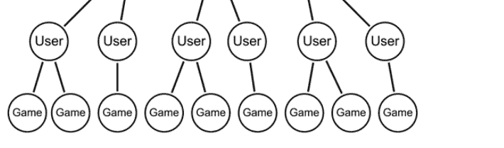
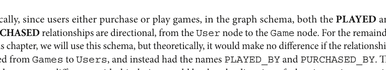

## Data Model Transformation – Relational to Graph Databases

到目前为止，我们一直在为你在真实环境中处理图数据结构做准备。这将进一步扩展你的知识，从设置自己的 MySQL 数据库实例到构建推荐系统。这是向前迈出的一大步，因为野外的许多解决方案都是基于从关系数据库环境中提取的数据，例如 MySQL。

在本章中，我们将首先设置你的 MySQL 图数据库，然后继续学习如何处理图数据和查询数据库引擎。继续下去，我们将查看基于路径的方法来执行分析。随后是图解决方案的模式设计考虑，以及构建推荐解决方案，以便你可以使用用户在流行平台 Steam 上的游戏历史记录，以及一个图来预测或突出显示特定用户可能感兴趣的游戏。这将非常类似于流行的流媒体服务提供的提示：“因为你观看了这个，你可能也会喜欢这个。” 在这里，我们将观看替换为游玩或下载。

在本章中，我们将涵盖以下主要主题：

- Recommending a game to a user
- Using Jaccard similarity and path traversals in graphs
- From relational to graph databases
- Ingestion considerations
- Our recommendation system

### Technical requirements

我们将使用 Jupyter Notebooks 运行需要 `python>=3.8.0` 的编码练习，以及以下需要通过 `pip install` 命令在你的环境中安装的包：

- `igraph==0.9.8`
- `mysql==0.0.3`
- `mysql-connector-python==8.0.31`

所有 Notebooks 以及编码练习都可在以下 GitHub 链接获得：https://github.com/PacktPublishing/Graph-Data-Modeling-in-Python/tree/main/CH03。

### Recommending a game to a user

在 *Chapter 2, Working with Graph Data Models* 中，我们展示了如何使用 Python 将表格节点和边数据建模并构建图。我们可以使用此图提出使用原始表格数据难以且低效的问题，从而展示图模型的强大功能。

在本章中，我们将更详细地研究使用关系数据库回答类图问题时出现的问题。在 *Chapter 1, Introducing Graphs in the Real World* 中，我们提到由于需要重复的表连接，使用表格数据进行基于路径的操作效率低下。

然而，在实际情况中，数据通常不是以节点属性和边列表的形式存在。大量数据，遍及各个行业，都是以关系数据表的形式存储。关系数据通常使用 SQL 或类似 SQL 的存储系统和查询语言进行存储和访问（例如 MySQL）。

在本章中，我们将使用来自 Steam 在线视频游戏分发服务的数据。我们将使用两个单独的表中的数据，每个表包含单独的客户交互。在一个表中，我们有用户在 Steam 平台上购买游戏的信息，而在另一个表中，我们有用户花费在玩游戏上的总时长信息。

首先，我们将通过从我们的数据集中创建 MySQL 数据库并尝试使用 SQL 执行一些基本的图查询来演示使用关系数据库回答基于路径问题的问题。

### Installing MySQL

为了演示如何与关系数据库协作，我们需要安装一个并将数据迁移到其中。我们将使用 MySQL，这是一个免费的开源、SQL 兼容数据库。


对于本节，我们将使用 MySQL 版本 5.7.39。较新版本的 MySQL 可用，但将数据加载到较新版本 MySQL 表中需要额外的配置。如果你已经安装了 MySQL，可以跳过安装步骤并直接进入 设置 MySQL 数据库 部分。

导航至 https://downloads.mysql.com/archives/installer/ 并选择适用于你操作系统的 MySQL 5.7.39 (https://downloads.mysql.com/archives/get/p/25/file/mysql-installer-community-5.7.39.0.msi) 发行版。使用所有默认选项安装 MySQL（如果你愿意，可以取消选中为网络访问打开 Windows 防火墙端口——我们将只在本地连接数据库）。在提示输入服务器密码时，为本章选择一个虚拟密码，因为我们将使用 Python 连接到数据库，而密码会可见。

如果安装过程中出现任何问题，请参阅 https://dev.mysql.com/doc/mysql-getting-started/en/ 中的设置指南获取特定于操作系统的提示。

### 设置 MySQL 数据库

以下步骤将帮助你设置 MySQL 数据库：

- 1. 要开始设置 MySQL 数据库，首先，导航到安装文件夹二进制文件。对于 Windows 机器，它们可能位于 `C:/Program Files/MySQL/MySQL Server 5.7/bin`。在此处打开一个命令提示符终端。或者，从开始菜单打开命令提示符，并使用 cd 命令导航到此文件夹：

```
cd "Program Files/MySQL/MySQL Server 5.7/bin"
```

- 2. 进入 bin 文件夹中的命令提示符后，通过运行以下命令访问 MySQL shell：

```
mysql -u root -p
```

在提示输入密码时，输入你在之前 MySQL 安装期间设置的密码。

- 3. 现在我们进入了 MySQL shell，可以创建数据库，如下所示：

```
CREATE DATABASE steam_data;
```

此数据库现在需要添加表和数据。首先，我们需要将 `steam_play.csv` 和 `steam_purchase.csv` 文件移动到 MySQL 可以访问的区域。将这些 CSV 文件复制并粘贴到 `C:\ProgramData\MySQL\MySQL Server 5.7\Uploads`。

- 4. 现在 MySQL 可以访问我们的数据，我们可以创建我们的两个表。在此 MySQL shell 中，我们可以使用以下命令准备我们的表，每个命令单独运行：

```
USE steam_data;
CREATE TABLE steam_play (id VARCHAR(100), game_name VARCHAR(255), type VARCHAR(10), hours FLOAT(10, 1), misc_column INT);
CREATE TABLE steam_purchase (id VARCHAR(100), game_name VARCHAR(255), type VARCHAR(10), game_purchased_flag FLOAT(2, 1), misc_column INT);
```

- 5. 我们将在下一节中数据加载到 MySQL 后，再回到我们的数据结构及其字段。目前，为了填充我们创建的空白表，运行以下行：

```
LOAD DATA INFILE 'C:/ProgramData/MySQL/MySQL Server 5.7/Uploads/steam_play.csv' INTO TABLE steam_play FIELDS TERMINATED BY ',' OPTIONALLY ENCLOSED BY '\"' LINES TERMINATED BY '\r\n';
LOAD DATA INFILE 'C:/ProgramData/MySQL/MySQL Server 5.7/Uploads/steam_purchase.csv' INTO TABLE steam_purchase FIELDS TERMINATED BY ',' OPTIONALLY ENCLOSED BY '\"' LINES TERMINATED BY '\r\n';
```

导入成功后，MySQL shell 窗口应打印出已添加的记录数。对于 `steam_play` 表，应有 70,489 行，而对于 `steam_purchase` 表，应有 129,511 行。

在我们的关系数据库设置好后，我们现在准备开始评估和分析数据。

### 在 Python 中查询 MySQL

为了将我们的关系数据库转换为图，我们的第一步必须是检查数据并设计一个合理的图模式来表示它。正如我们在第 2 章《使用图数据模型》中所做的，让我们检查数据集的前几行。

从这一点开始，我们将通过使用 `mysql.connector` 驱动程序从 Python 访问 MySQL 中的数据。我们可以使用 `mysql.connector.connect()` 方法以经过身份验证的方式打开与本地托管数据库的连接并查询其表中的数据。从 Python 到你的 MySQL 数据库实例的步骤如下所示：

- 1. 首先，我们需要导入驱动程序并连接到我们的数据库。连接到 `localhost` 意味着我们正在访问本地机器上的数据库，而 `root` 意味着我们将以管理员身份访问数据库。我们的数据库名称等于我们在 MySQL shell 中之前设置的那个。用你在上一节 MySQL 设置期间选择的密码替换 `password`：

```
import mysql.connector
PASSWORD = '<Your MySQL password upon creating MySQL instance>'
connection = mysql.connector.connect(
    host="localhost",
    user="root",
    passwd=PASSWORD,
    database="steam_data"
)
```

- 2. 现在，我们可以指定一些示例 SQL 来查询表：

```
sql = 'SELECT count(*) FROM steam_purchase;'
```

- 3. 我们可以使用 `connection.cursor()` 和 `cursor.execute()` 在变量中的 SQL 字符串运行。然后，我们可以使用 `cursor.fetchall()` 和 `print` 语句检索并打印结果，最后使用 `connection.close()` 关闭连接：

```
cursor = connection.cursor()
cursor.execute(sql)
result = cursor.fetchall()
print(result)
connection.close()
```

- 4. 现在，因为我们将多次访问这些表，让我们为此过程设置一个可重用方法。我们将只是更改到同一数据库的 SQL 查询，以便我们可以将查询抽象为新的方法参数：

```
import mysql.connector
def query_mysql(query, password, host='localhost', user='root', database='steam_data'):
    connection = mysql.connector.connect(
        host=host,
        user=user,
        passwd=password,
        database=database
    )
    cursor = connection.cursor()
    cursor.execute(query)
    result = cursor.fetchall()
    connection.close()
    return result
```

- 5. 现在，我们可以调用新的 `query_mysql()` 方法再次获取 `steam_purchase` 表的长度，以检查它是否按预期运行：

```
result = query_mysql('SELECT count(*) FROM steam_purchase;', password=PASSWORD)
print(result)
```

我们的方法返回 `result` 变量，打印它显示 `steam_purchase` 表包含 129,511 行。

### 在 Python 中检查数据

现在我们可以通过 Python 查询 MySQL 数据库中的数据，让我们开始检查我们表中的数据。

按照以下步骤在 MySQL 中检查你的数据：

- 1. 首先，让我们查看 `steam_play` 表，其中包含 Steam 用户的游戏时间数据。我们可以使用在上一节中定义的方法，使用另一个简单的 SQL 查询查看前几行：

```
result = query_mysql('SELECT * FROM steam_play LIMIT 4;', password=PASSWORD)
for row in result:
    print(row)
```

- 2. 查看打印的 `steam_play` 前几行，我们可以看到有五列：

```
('151603712', 'The Elder Scrolls V: Skyrim', 'play', 273.0, 0)
('151603712', 'Fallout 4', 'play', 87.0, 0)
('151603712', 'Spore', 'play', 14.9, 0)
('151603712', 'Fallout: New Vegas', 'play', 12.1, 0)
```

根据数据的来源，第一列包含唯一的 user ID。第二列包含用户玩过的游戏名称。第三列在每一行中都包含 'play' 字符串，这给我们很少的信息。第四列显示该行用户玩游戏的小时数。最后，一列似乎只包含 0；我们今后可以安全地忽略此列。

- 3. 另一个表 `steam_purchase` 包含有关用户购买的信息。同样，我们应该检查此数据集的前几行：

```
('151603712', 'The Elder Scrolls V: Skyrim', 'purchase', 1.0, 0)
('151603712', 'Fallout 4', 'purchase', 1.0, 0)
('151603712', 'Spore', 'purchase', 1.0, 0)
('151603712', 'Fallout: New Vegas', 'purchase', 1.0, 0)
```

`steam_purchase` 表似乎也包含五列。在 `steam_purchase` 表中，第一列再次包含唯一的 user ID。与 `steam_play` 一样，第二列包含游戏名称。第三列始终包含 'purchase' 字符串。此表中的第四列始终包含浮点数 1.0，表示该行游戏被用户购买。最后一列与前一个文件一样，全部为 0。

一眼就能看出，`steam_play` 和 `steam_purchase` 表中都有用户 `151603712` 的数据。因此，我们的数据集中用户既有游戏购买数据也有游戏时间数据。从对数据的简要查看中，我们可以看到有很多列我们今后不需要，所以我们可以通过查询特定行开始将它们从分析中排除。


在下一节中，我们将探讨处理本节所查看的表格数据的基于路径的方法。这将使我们能够深入了解用户在Steam上喜欢玩哪些类型的游戏。

### 表格数据中的基于路径的分析

既然我们了解了表格的内容，就可以针对数据提出一些问题。例如，我们可以问：“根据用户之前的购买习惯，他们还可能喜欢哪些游戏？”这类问题是推荐系统的基础，销售和营销行业常利用推荐系统来驱动额外购买。

为了简单回答这类问题，我们需要找出用户购买过的游戏，然后找到购买过相同游戏的其他用户。接着，我们会查看这些用户之间的共性，并向原用户推荐新游戏。

由于所需的基于路径的操作，这类系统通常由图数据模型驱动。查找与某个用户关联的所有游戏，然后查找与这些游戏关联的用户，最后查找这些用户关联的游戏，这一过程代表了一种基于路径的查询，图数据库在这类查询上比关系数据库更合适。在关系数据库中，我们需要反复查询同一张表，并执行一系列自连接来找出用户和游戏之间的多级关系。我们在第1章“现实世界中的图简介”中简要探讨过这些概念，但这里我们也可以用一个更实际的示例来演示不同数据库类型之间的差异。

下图显示了用户偏好与他们所玩游戏之间的关系。我们可以使用图推荐引擎查看我们的用户玩的游戏，然后查看与这些游戏相关的其他用户还玩哪些游戏。因此，基于这棵树，我们可以根据相似用户及其（所有其他用户）所玩的游戏，了解我们的用户（网络中的顶层节点）可能喜欢哪些游戏：



图3.1 – 向用户推荐游戏所需的信息

在以下步骤中，我们将带您了解如何查询图以获得最佳信息，从而根据前面介绍的内容形成对用户想要玩什么游戏的推荐：

- 1. 首先，我们需要查询MySQL，找出特定用户购买的所有游戏。以steam_purchase表格顶部的用户151603712为例。再次使用我们的查询方法，我们可以查询steam_purchase表格来获取此信息：

```
result = query_mysql('SELECT game_name from steam_purchase WHERE id = "151603712";', password=PASSWORD)
print(result[:10])
print(len(result))
```

- 2. 从print()语句可以看出，该用户购买了40个不同的游戏。注意，MySQL将数据返回为元组列表，其中每个元组都有一个空元素。我们需要访问每个元组的第一个元素，并将每个游戏括在引号中，以找到与这些游戏关联的用户。我们还需要将这次初始查询的结果以字符串形式添加到新的SQL查询中，因此让我们准备好这个字符串：

```
games = ['"' + game[0] + '"' for game in result]
games_string = ','.join(games)
print(games_string)
```

- 3. 现在，我们可以使用这些结果再次查询表格，找出同样购买了这些游戏的用户（不包括我们的原始用户）：

```
query_2 = f'SELECT id from steam_purchase WHERE game_name ' \
    f'IN ({games_string}) AND id != "151603712";'
result_2 = query_mysql(query_2, password=PASSWORD)
users = [user[0] for user in result_2]
print(users[:10])
print(len(users))
```

- 4. 结果中有一个包含16223个用户的列表，但其中包含重复项，因此我们使用set()操作去除重复项：

```
users = list(set(users))
print(users[:10])
print(len(users))
```

  我们的print语句现在显示，我们有7728个唯一用户，他们至少玩过与我们最初选择的用户相同的一款游戏。

- 5. 现在，我们需要根据已识别用户的购买行为，找到新游戏推荐给所选用户。我们以与上一个查询类似的方式，为这些需求设置一个新SQL查询的参数：

```
users = ['"' + user + '"' for user in users]
users_string = ','.join(users)

query_3 = f'SELECT game_name from steam_purchase WHERE id IN ({users_string}) ' \
    f'AND game_name NOT IN ({games_string});'

result_3 = query_mysql(query_3, password=PASSWORD)
recommended_games = [game[0] for game in result_3]
print(recommended_games[:10])
```

- 6. 现在，我们只需在返回的游戏里找出最受欢迎的游戏，向我们的原始用户进行推荐。我们可以使用Python collections库中的内置Counter()方法实现这一点：

```
from collections import Counter
game_frequency = Counter(recommended_games)
print(game_frequency)
```

这个游戏频率字典告诉我们，我们可以向指定用户推荐游戏Unturned。

考虑到数据模型，请思考找到这个游戏推荐所涉及的操作。使用关系数据库时，我们不得不反复查询同一张表，结果集越来越大。这也可以通过steam_purchase表格的多次自连接来实现。这两种方法都相当低效，因为要反复读取相同数据来构建答案。

这类问题正是图数据模型和数据库的闪光点；相关对象和实体之间天然路径的存在，使图成为基于路径的关系遍历的理想选择。接下来，让我们考虑如何将数据改而用图数据模型表示。

### 从关系数据库到图数据库

由于关系数据库在回答类似图的问题时表现不佳，我们可能需要将表格数据转换为图格式。

首先，在编写将数据从MySQL迁移到Python igraph网络的管道之前，我们将基于现有信息，为数据设计一个合理的图模式。通过这样做，我们可以对基于图的方法在处理路径问题时的表现进行基准测试，并与我们之前用SQL回答的同一问题进行比较。

#### 模式设计

在表格中，我们有两类实体：用户和游戏，它们具有不同的属性。因此，明智的做法是将用户和游戏视为不同的节点类型。

对于用户，每个用户只有一个唯一ID。要将数据添加到igraph图中，我们需要为每个不同节点添加递增的整数igraph节点ID，正如我们在第1章“现实世界中的图简介”和第2章“使用图数据模型”中学到的那样。

另一方面，对于游戏，我们以字符串形式给出游戏名称。我们还必须以与用户节点相同的方式，为不同游戏节点添加igraph ID。

我们已经考虑了节点的模式设计，但还必须考虑应如何表示关系。就我们的目标而言，我们关注用户与游戏之间的交互。我们拥有用户购买游戏的信息以及用户玩某款游戏的时长信息。

因此，将这两种不同交互视为不同边类型是合理的。购买游戏仅通过steam_purchase表格中是否存在相应行来表示，这种关系本质上要么存在，要么不存在。我们没有额外数据来表示此交互，因此对于游戏购买，不会设置边的属性。

然而，对于表示游戏时长的关系，我们有用户玩某款游戏的小时数信息。在这种情况下，我们可以使用边属性来表示用户玩某款游戏的小时数。

综合考虑以上因素，我们可以为图设计如下模式：



图3.2 – 有向异构图模式

从逻辑上讲，由于用户要么购买要么玩游戏，在图模式中，PLAYED和PURCHASED关系都是从用户节点指向游戏节点的有向关系。在本章的其余部分，我们将使用这个模式，但理论上，如果关系从游戏流向用户，并命名为PLAYED_BY和PURCHASED_BY，也不会有什么不同。这种设计的唯一后续差异在于，对图的任何查询中，边的方向都需要反向。

#### 数据导入注意事项

现在我们已经决定了图的模式，可以开始将数据从MySQL关系数据库迁移到igraph图。后续步骤详细说明了如何实现这一点：

- 1. 我们要做的第一件事是从MySQL数据库中提取数据并将其移到Python中。我们可以使用本章前面编写的query_mysql()方法来实现。现在我们对数据有了更多了解，并且已经设计了图模式，我们可以只提取创建图所需的列：

```
play_query = 'SELECT id, game_name, hours FROM steam_play'
play_data = query_mysql(play_query, password=PASSWORD)
```


```python
print(play_data[:10])

purchase_query = 'SELECT id, game_name FROM steam_purchase'
purchase_data = query_mysql(purchase_query, password=PASSWORD)
print(purchase_data[:10])
```

在 play_data 中，我们拥有关于用户、他们玩过的游戏以及他们在每个游戏上花费的时间的信息。在 purchase_data 中，我们只需要用户和他们购买的游戏。

接下来，如同在 schema 设计过程中所述，为了使用 igraph，我们需要在 User 和 Game 节点上都添加一个递增的整数 igraph 节点 ID，从 0 开始。

- 2. 以下代码行将从 play_data 和 purchase_data 列表中的用户生成一个 `set()` 的唯一用户 ID。然后，一个字典推导式结合 `enumerate()` 方法将生成一个字典，其键包含 Steam 用户 ID，值包含我们的 igraph ID：

```python
users = set([row[0] for row in play_data] + [row[0] for row in purchase_data])
user_ids = {user_id: igraph_id for igraph_id, user_id in enumerate(users)}
print(len(user_ids))
```

使用 `len()` 打印我们的字典长度，给出了唯一用户的数量，12393。

- 3. 与用户类似，我们也需要为游戏生成 igraph ID。我们可以使用与前面非常相似的过程，但对 `enumerate()` 方法参数做一个小的改动。我们可以使用 `enumerate()` 的第二个参数生成递增整数，但与其从 0 开始，我们可以从分配给用户的最高 igraph ID 之后开始，使用 `user_ids` 字典的 `len()`：

```python
games = set([row[1] for row in play_data] + [row[1] for row in purchase_data])
game_ids = {user_id: igraph_id for igraph_id, user_id in enumerate(games, len(user_ids))}
print(len(game_ids))
```

与用户一样，我们的打印语句显示了我们数据集中唯一游戏的数量，5155。使用带第二个参数的 `enumerate()` 应避免用户和游戏之间的 ID 冲突。即使它们的节点类型不同，igraph 仍然要求所有节点的 ID 都是从 0 开始的递增整数。

- 4. 我们可以通过使用 `sorted()` 方法和控制台 `print()` 语句检查用户最高 igraph ID 和游戏最低 igraph ID 来验证 ID 是否已按预期创建：

```python
print(sorted(user_ids.values(), reverse=True)[:10])
print(sorted(game_ids.values(), reverse=False)[:10])
```

- 5. 这将显示为用户生成的最高 ID 为 12,392，而为游戏生成的最低 ID 为 12,393，正如预期的那样。让我们进一步确认所有节点的 igraph ID 从 0 以 1 的增量递增。我们可以通过首先连接并排序我们 ID 字典的两个 ID 值列表来创建 `all_ids` 变量。然后，我们可以断言我们的所有 ID 都等于从 0 到 `all_ids` 长度的整数范围：

```python
all_ids = sorted(list(user_ids.values()) + list(game_ids.values()))
assert all_ids == list(range(len(all_ids)))
```

由于此断言语句未引发任何异常，我们可以确信我们生成的 ID 已被正确创建。

- 6. 现在，我们可以开始向我们的图添加节点。首先，我们必须导入 igraph 并使用 `Graph()` 对象创建一个空的有向图：

```python
import igraph as ig
g = ig.Graph(directed=True)
```

- 7. 现在，我们可以按列表方式向图添加节点和节点属性。通过对 `user_ids` 和 `game_ids` 字典进行排序，我们保留了 0 索引的 igraph ID 到 Steam ID 关系的顺序：

```python
user_ids = dict(sorted(user_ids.items(), key=lambda item: item[1]))
game_ids = dict(sorted(game_ids.items(), key=lambda item: item[1]))
```

- 8. 我们现在可以取出这些字典的键并将其转换为列表，以便作为属性添加：

```python
steam_user_ids = list(user_ids.keys())
steam_game_ids = list(game_ids.keys())
```

- 9. 现在，我们准备添加节点。我们可以使用 `add_vertices()` 添加等于我们两个 ID 列表长度的节点；igraph 将从 ID 0 创建节点到这些组合列表长度减 1。我们可以通过断言图中所有节点的 `len()` 属性等于组合列表长度来确认这一点：

```python
g.add_vertices(len(steam_user_ids) + len(steam_game_ids))
assert len(g.vs) == len(steam_user_ids) + len(steam_game_ids)
```

- 10. 图中有了节点后，我们可以添加属性。由于一次向所有节点添加属性最高效，让我们创建一个包含用户 ID 和游戏名称的 Steam ID 列表：

```python
all_steam_ids = steam_user_ids + steam_game_ids
```

- 11. 让我们也使用列表推导式创建一个包含节点类型的列表，它将是用户或游戏：

```python
node_types = ['user' for _ in steam_user_ids] + ['game' for _ in steam_game_ids]
```

- 12. 准备好列表后，我们现在可以通过访问 igraph `Graph()` 对象的 `vs` 属性，按列表方式向图中所有节点添加属性：

```python
g.vs['steam_id'] = all_steam_ids
g.vs['type'] = node_types
```

- 13. 为确保节点属性已按预期添加，我们可以将其打印到控制台。为了更彻底的检查，我们可以将图中游戏节点的数量与第 6 步 Path-based analytics in tabular data 部分中计算的唯一游戏数量进行比较：

```python
print(g.vs['steam_id'][:10])
print(g.vs['type'][:10])

game_nodes = g.vs.select(type_eq='game')
print(len(game_nodes))
```

使用我们在第 2 章 Working with Graph Data Models 中学到的 `vs.select()` 方法，我们可以看到游戏节点的数量为 5155，这与我们之前在数据集中统计的游戏数量相同。

- 14. 接下来，我们需要在图中添加边。边包含在 steam_purchase 和 steam_play 的数据中，现在包含在 `purchase_data` 和 `play_data` 变量中。让我们通过查找用户和游戏的 igraph ID 为这两种类型的交易生成边。这些 igraph ID 包含在我们之前创建的 `user_ids` 和 `game_ids` 字典中，因此我们可以使用列表推导式来设置我们的 igraph 兼容边列表：

```python
purchase_edges = [[user_ids[user], game_ids[purchase]]
    for user, purchase in purchase_data]
play_edges = [[user_ids[user], game_ids[game], hours]
    for user, game, hours in play_data]
```

- 15. 对于 `play_edges`，还包括了小时数，因此我们可以将其作为边属性添加到图中。让我们先以列表方式添加 PLAYED 边及其 `hours` 属性，使用更多列表推导式：

```python
g.add_edges([(n, m) for n, m, _ in play_edges])
g.es['hours'] = [hours for _, _, hours in play_edges]
```

- 16. 现在，我们可以添加表示 PURCHASED 关系的边。与游戏购买相关的属性没有要添加到我们数据集的属性，因此我们可以使用以下命令：

```python
g.add_edges(purchase_edges)
```

- 17. 最后，为完成我们的图，我们可以向所有边添加 `edge_type` 作为边属性：

```python
edge_type = ['PLAYED' for _ in play_edges] + ['PURCHASED' for _ in purchase_edges]
g.es['edge_type'] = edge_type
```

- 18. 始终应确认我们的数据已正确添加。回想一下，本章前面我们检查了特定用户 ID 为 151603712 的购买游戏数量，为 40。我们可以通过首先使用 `g.vs.select()` 找到 `steam_id` 为 151603712 的节点的 `.index` 属性，然后使用 `g.es.select()` 找到源为该用户 ID 的 PURCHASED 类型的所有边，使用两个参数来缩小搜索范围，来检查这在我们新创建的图中是否相同：

```python
user_id_ex = g.vs.select(steam_id='151603712')[0].index
purchased_ex = g.es.select(_source_eq=user_id_ex, edge_type='PURCHASED')
print(len(list(purchased_ex)))
```

此打印语句确认以该用户为源的边的 `len()` 属性为 40，与 steam_purchase 数据集中的情况相同。

现在我们已将所有节点和边添加到 `igraph.Graph()` 对象中，我们准备好分析其属性。

### Path-based analytics in igraph

图数据模型专为基于路径的分析而设计。与本章前面介绍的 MySQL 不同，使用图时，我们不需要对数据库进行一系列查询或执行一系列自连接来查找相关对象的路径。为了演示这一点，让我们使用我们创建的图，使用新的 schema，再次查找特定用户可能喜欢的游戏。

上次，我们只使用了 steam_purchase 表的数据，但这次，我们的图包含 steam_purchase 和 steam_play 表的数据，因此我们可以使用两者信息来做出推荐。我们将再次为 ID 为 151603712 的用户做出推荐，但这次使用基于图的方法。

我们的用户节点 igraph ID 存储在 `user_id_ex` 变量中，因此我们可以在此基础上继续。与重复查询或连接不同，这里我们将使用 igraph 中的 `get_all_simple_paths()` 方法查找路径。我们要查找的路径是图 3.1 中的那些，从指定用户到相似用户玩的游戏。这些路径从我们的初始用户到推荐的目的地游戏节点包含三跳。

以下步骤将展示我们如何实现这一点：

- 1. 让我们使用 `get_all_simple_paths()` 找到这些路径。我们需要指定路径的起始节点，以及这些路径应有的长度上限。不包括初始起始节点，这些路径长度为 3。我们还需使用 `mode` 参数指定我们愿意在路径中遍历的边的方向。由于我们图中所有的关系都从用户指向游戏，并且我们希望在这种情况下以不同方向遍历多个关系来获得路径，因此我们将 `mode` 设为 `all`：

```python
paths = g.get_all_simple_paths(user_id_ex, cutoff=3, mode='all')
print(paths[:10])
```


通过我们的`print()`语句，我们可以查看一些已找到的路径。`paths`变量包含从原始用户节点遍历的节点的igraph ID，以列表的列表形式存储。

> **注意**
> 有些列表的长度不是4，而这正是我们做出推荐所需的长度。推荐用户已购买的游戏没有意义，比如长度为2的路径；也没有理由向我们的指定用户推荐其他用户，比如长度为3的路径。

- 2. 因此，我们需要从`paths`列表中移除长度小于4的路径。我们只需要这些列表中的第四个元素，它对应一个可以作为推荐依据的游戏。我们可以使用带条件运算符的列表推导式来满足这两个要求，确保所有路径长度均为4：

```
rec_game_ids = [path[3] for path in paths if len(path) == 4]
```

- 3. 现在，我们得到了表示游戏的节点的igraph ID列表。我们需要这些游戏的名称，因此我们将使用另一个列表推导式，通过`g.vs`访问每个节点的`steam_id`属性：

```
game_names = [g.vs[game_id]['steam_id'] for game_id in rec_game_ids]
```

- 4. 前面的代码会给我们一个游戏名称列表。然而，这个列表包含我们的指定用户已经玩过或购买过的游戏，因此我们不想推荐它们。我们可以先使用igraph中的`neighbors()`方法找到所选用户的邻居节点，从而移除这些游戏。然后，我们可以使用与之前代码片段类似的列表推导式，通过`g.vs`查找`steam_id`值，找到对应的游戏名称：

```
neighbors = g.neighbors(user_id_ex)
purchased_games = [g.vs[node_id]['steam_id'] for node_id in g.neighbors(user_id_ex)]
```

- 5. 让我们用另一个列表推导式移除用户已玩的游戏，比较这些列表：

```
game_names = [game for game in game_names if game not in purchased_games]
```

- 6. 与之前使用MySQL实现相同功能的示例一样，让我们使用Python的`collections`库和`Counter()`来查看路径末端出现频率最高的游戏：

```
from collections import Counter
game_frequency = Counter(game_names)
print(game_frequency)
```

查看打印出的`Counter()`对象开头，我们可以看到可能推荐给用户的前三款游戏是《反恐精英：全球攻势》、《未转变者》和《传送门2》。

在本节中，我们使用图对数据进行了基于路径的分析。当涉及路径时，图是表示和查询实体之间关系的理想数据模型。我们研究了使用Steam数据图向用户推荐游戏的简单方法，但现实世界中的推荐引擎通常使用更复杂的方法。

接下来，我们将了解图数据模型如何帮助我们实现一种更智能的推荐方法。

### 我们的推荐系统

现在我们已经将数据放入Python图中，让我们更进一步，设计一个更健壮的推荐流程，这类流程通常使用图数据完成。

让我们以解决方案工程师或数据科学家的身份，基于Steam数据编写一个游戏推荐系统。推荐系统大量用于面向客户的应用中，向用户展示他们可能感兴趣的产品。产品推荐通常基于行为相似的用户玩过和购买过的内容。

### 通用的MySQL到igraph方法

这次，我们将编写一组可复用的通用方法，从MySQL表中的列创建igraph图。这些函数将设计为在给定一组列名的情况下，创建一个异构、二分、有向图。

让我们从编写主函数`mysql_to_graph()`开始。该方法需要接受一个MySQL表名、该表的源列名和目标列名，以及一个边权重列。在本例中，我们将使用`steam_play`表，其中权重是每个游戏（目标）被用户（源）游玩的小时数。我们将按步骤来组织这些方法，以便更容易实现：

- 1. 在我们的新方法中，我们可以使用f字符串和替换来生成符合所需搜索条件的SQL查询。`SELECT`后面的列名以及`FROM`要选择的表，现在可以通过`mysql_to_graph`接受的参数动态设置。然后，我们可以使用在*使用MySQL查询SQL*一节的第4步中定义的方法`query_mysql()`，从MySQL数据库获取一个列表的列表：

```
def mysql_to_graph(table, source, target, weights, password):
    import igraph as ig

    sql_query = f'SELECT {source}, {target}, {weights} FROM {table}'

    data = query_mysql(sql_query, password=PASSWORD)
```

- 2. 现在我们有了数据，我们可以使用一系列列表推导式将数据拆分为源节点和目标节点。这有助于我们以合理的格式获取数据，以便分配igraph ID。在编写完主方法`mysql_to_graph()`之后，我们将编写一个单独的方法`create_igraph_ids()`，用于创建{Steam ID: igraph ID}对的字典：

```
    source_nodes = sorted(list(set([source for source, _, _ in data])))
    target_nodes = sorted(list(set([target for _, target, _ in data])))

    source_igraph_ids = create_igraph_ids(source_nodes)
    target_igraph_ids = create_igraph_ids(target_nodes, len(source_igraph_ids))
```

- 3. 然后，我们需要使用所创建字典`source_igraph_ids`和`target_igraph_ids`中的键值对生成igraph边列表。我们可以使用另一个列表推导式，以source和target作为键来做到这一点。最后，在创建图之前，我们必须从MySQL返回的列表的列表中提取边权重，以备稍后添加到图的边中：

```
    edges = [(source_igraph_ids[source], target_igraph_ids[target])
        for source, target, _ in data]
    weights = [weight for _, _, weight in data]
```

- 4. 现在，所有数据都已准备好以正确的格式添加到igraph图中。首先，我们必须使用`ig.Graph()`创建一个空的有向`Graph()`对象。然后，我们必须使用`g.add_vertices()`添加节点，节点数等于我们的两个节点列表的长度之和。“内部ID”——在本例中即Steam ID——然后通过访问图的`g.vs`属性，使用`source_igraph_ids`和`target_igraph_ids`字典键添加到节点上。节点类型同样通过`g.vs`添加，方法是创建类型字符串列表source和target，就Steam数据而言，它们分别对应用户和游戏。最后，可以从包含源和目标igraph ID的`edges`列表中添加边，并通过访问图的`g.es`属性按列表添加边权重和游玩小时数。然后返回我们的图`g`，以便在单独的函数中进行分析：

```
    g = ig.Graph(directed=True)
    g.add_vertices(len(source_nodes + target_nodes))
    g.vs['internal_id'] = list(source_igraph_ids.keys()) + list(target_igraph_ids.keys())
    g.vs['type'] = ['source' for _ in source_nodes] + ['target' for _ in target_nodes]
    g.add_edges(edges)
    g.es['weight'] = weights

    return g
```

- 5. 在我们前面定义的`mysql_to_graph`方法中，我们调用了一个单独的用户自定义函数`create_igraph_ids()`，我们需要单独定义它。我们可以像本章前面所做的那样为每个节点创建igraph ID——即使用字典推导式并利用Python的`enumerate()`方法。然后，我们的`create_igraph_ids()`方法需要接受的参数只是节点名称列表和`enumerate()`的起始索引：

```
def create_igraph_ids(nodes, from_index=0):
    igraph_ids = {internal_id: igraph_id for igraph_id, internal_id
                  in enumerate(nodes, from_index)}
    return igraph_ids
```

我们现在有了一个可复用的通用方法，可以从MySQL数据创建图，描述任意具有源、目标以及该关系权重的关系。回到我们的Steam用例，在我们的图中，有用户、他们玩过的游戏，以及他们花费在这些游戏上的时间。这些信息足以让我们就现有用户接下来可能想购买哪些游戏提出建议。

在本章前面，我们根据用户是否玩过与指定用户相同的游戏，以及他们玩过哪些游戏，为一个新游戏做了一个非常简单的推荐。然而，这只是推荐系统的一个非常简单的例子。使用我们的图，我们可以实现一个更健壮的系统，该系统可以产品化，将用户ID作为输入，并使用更复杂的方法（即Jaccard相似度）推荐游戏。使用igraph还可以应用其他相似度方法，例如Dice相似度和逆对数加权相似度，它们也是比较节点组的有效方法。选择Jaccard相似度是因为它简单且总体性能良好，但请随意尝试不同的相似度方法。


### 使用Jaccard相似度的更高级推荐系统

为了更智能地推荐游戏，我们将实现一个基于节点相似度的解决方案。节点相似度比较两个节点的相邻节点并返回一个分数。在我们的方法中，将使用igraph中可用的Jaccard相似度，即`similarity_jaccard()`。`similarity_jaccard()`得到的分数等于两个节点共同邻居的数量，除以与这两个节点中至少一个相邻的邻居数量。结果将是0到1之间的数字，其中0表示没有相似性，1表示节点具有相同的邻居。

结合我们的用例，在Steam图中，用户节点与游戏节点相邻。因此，与其他用户节点具有高Jaccard相似度的用户节点会玩相似的游戏。我们可以利用这些信息向用户提供新的推荐。现在我们将逐步简化这一过程：

- 1. 让我们定义一个函数`make_recommendations()`。我们的函数将接受一个igraph图`g`和一个特定用户`user`，为其生成推荐。我们将利用图边上的权重，指定一个游戏需要被游玩的最少小时数`min_hours`，才能纳入我们的推荐。这样，如果用户购买了游戏但只玩了很短时间，我们可以假设他们不喜欢这款游戏，并且不在推荐新游戏时使用该信息：

```
def make_recommendations(g, user, min_hours):
```

- 2. 首先，我们需要找到由`user`参数表示的节点，使用`g.vs.select()`查询图中`internal_id`等于`user`的节点。这将返回一个包含一个元素的列表，因此我们可以通过列表切片访问第一个也是唯一的元素，并找到该节点的`index`属性，即igraph ID：

```
user_node = g.vs.select(internal_id_eq=user)
user_node = user_node[0].index
```

- 3. 然后，我们将使用另一个自定义方法`prune_graph()`，根据游戏被游玩的小时数来删除图中的边。我们将在定义完`make_recommendations()`的其余部分后稍后回到这个方法：

```
g = prune_graph(g, min_hours)
```

修改后的图现在可用于生成推荐。为了与其他用户节点进行比较，我们需要找到`type`等于`'source'`的节点，这代表我们之前定义的`mysql_to_graph()`方法中的用户。我们可以使用`g.vs.select()`找到`source`类型的节点。然后，我们需要设置一个包含要比较的节点对的列表的列表。我们希望将指定用户与图中的所有其他用户进行比较，因此我们将编写一个列表推导式来创建一个列表的列表，其中每个元素是一个包含所选用户的igraph ID和另一个用户的igraph ID的两元素列表。我们不希望将选定的用户节点与其自身进行比较，因此我们将在推导式中使用条件`!=`来防止这种情况：

```
other_user_nodes = g.vs.select(type_eq='source')
pairs = [[user_node, other_user.index] for other_user in other_user_nodes if other_user.index != user_node]
```

现在，有了要进行的比较列表，我们可以运行igraph的`similarity_jaccard()`为我们的节点对生成相似度分数。在这种情况下，由于我们的边从用户指向游戏，是有向的，我们感兴趣的是“out”方向，这在`similarity_jaccard()`的`mode`参数中指定。我们的相似度分数将作为列表返回，因此需要将它们与对比较相关的节点ID关联起来。我们可以使用列表推导式，取`pairs`中每个列表第二个元素中的被比较用户igraph ID，并使用`zip()`将其与分数关联：

```
similarities = g.similarity_jaccard(pairs=pairs, mode='out')
node_similarity = [[pair[1], similarity] for pair, similarity in zip(pairs, similarities)]
```

我们想要找到与指定用户最相似的用户，因此需要按Jaccard相似度分数降序对`node_similarity`列表进行排序。我们可以使用Python的`sorted()`方法，通过一个匿名函数按`node_similarity`中每个列表的第二个元素进行排序。我们将指定`reverse=True`以降序排序。然后，我们可以通过访问排序后列表的第一个元素来获得最相似用户的igraph ID：

```
node_similarity = sorted(node_similarity, key=lambda x: x[1], reverse=True)
most_similar_node = node_similarity[0][0]
```

有了相似用户的igraph ID，我们可以使用`g.neighbors()`查找该用户玩过的游戏的igraph ID，并通过`g.vs`查找`internal_id`节点属性来访问这些游戏对应的Steam ID。我们可以对最初指定的用户执行相同操作，从而得到两个相似用户玩过的游戏列表。最后，让我们使用最后一个列表推导式来查找`game_recommendations`列表中不存在于原始用户`owned_games`列表中的所有游戏，并将此列表作为`new_games`返回：

```
game_recommendations = g.vs[g.neighbors(most_similar_node)]['internal_id']
owned_games = g.vs[g.neighbors(user_node)]['internal_id']
new_games = [game for game in game_recommendations if game not
in owned_games]
return new_games
```

接下来，我们将回到在`make_recommendations()`方法中调用的`prune_graph()`辅助方法。在这里，我们需要一种根据边权重（代表游戏被游玩的小时数）删除边的方法。对于`prune_graph()`，我们接受图`g`和游戏被考虑纳入推荐系统所需的最少小时数`min_hours`作为参数。

此方法将使用`g.es.select()`，以`min_hours`作为`weight`参数，查找所有权重小于我们最小游玩时间的边。然后，`delete_edges()`可以与`select()`的结果一起使用，根据我们的标准修剪图中的边：

```
def prune_graph(g, min_hours):
    edges_to_remove = g.es.select(weight_lt=min_hours)
    g.delete_edges(edges_to_remove)

    return g
```

让我们测试在前面步骤中创建的新函数。我们可以使用`steam_play`表、`source`和`target`列（`id`和`game_name`）以及边权重列`hours`调用`mysql_to_graph()`函数。然后，使用此图，我们可以通过调用`make_recommendations()`为特定用户生成推荐，传入我们的图`g`、用户ID（如`87907200`）以及图边将表示的最少小时数——例如2：

```
g = mysql_to_graph('steam_play', 'id', 'game_name', 'hours')
recommendations = make_recommendations(g, '87907200', min_hours=0.5)
print(recommendations)
```

将为我们的用户打印一个推荐列表。尝试使用不同的用户ID（可以在`steam_play`表的`id`列中找到它们），以及同一用户的不同`min_hours`数值。请注意，在我们更复杂的系统中，最少小时数可以改变为单个用户推荐的游戏。这是因为当边被移除时，图的结构会发生变化，节点之间的相似度也会改变。

在生成推荐的生产系统中，可以改变`min_hours`参数并进行实验测试，以找到能够产生有用游戏推荐的理想值。

这结束了我们使用Jaccard相似度的推荐引擎的更高级示例，也结束了本章。我希望你喜欢掌握从关系数据到图中心数据的转换。

### 总结

在本章中，我们比较和对比了传统关系数据库和图数据库，以执行基于路径的分析。我们选择的基于路径的分析是在Steam发布平台上向用户推荐游戏，并在MySQL和igraph中进行了实现。

MySQL和其他关系数据库可用于查找相关实体表之间的路径，例如用户及其游玩和购买的游戏。然而，这涉及在同一表上执行自连接或重复查询同一表。另一方面，图数据库和数据模型天生支持基于路径的查询，因此我们使用igraph根据图中用户和游戏之间的路径向用户推荐游戏。

然后，我们介绍了如何将数据从MySQL迁移到Python igraph，既逐步进行，也使用了一组可用于任何有向、异构图的通用方法。

最后，我们通过使用图数据模型建立了一个更复杂的系统来向用户推荐游戏。我们的推荐基于相似用户玩过的游戏，使用Jaccard相似度来估计相似性。我们的方法允许我们根据图中的边权重调整结果，边权重对应于每个用户-游戏对的游玩时间。这种基于相似度的推荐系统可用于实验，以确定用户应该玩一个游戏多少小时，才能让它影响对Steam用户的推荐。

在下一章中，我们将进一步巩固你目前所学的内容。下一章的核心将是使用图构建知识图谱，我们将研究医学摘要，并使用这些文档来关联术语和文档。


