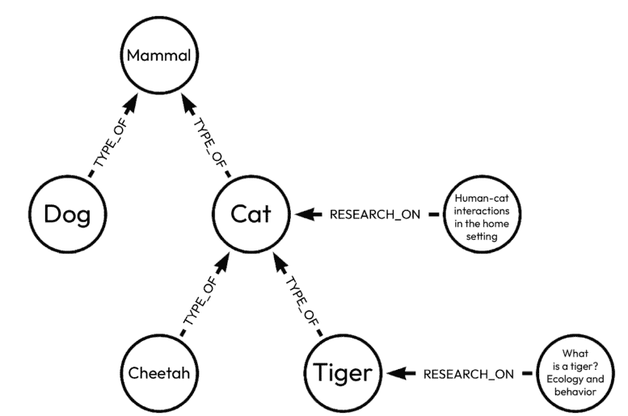
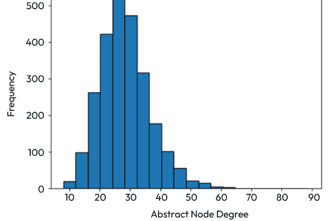
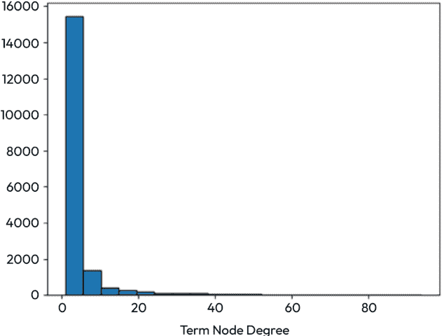
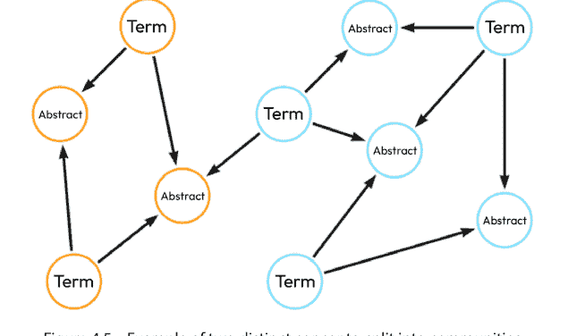

## 构建知识图谱

本章将进一步扩展你的知识并介绍知识图谱。在学习知识图谱是什么的同时，你还将通过清理数据以便导入图谱的实践操作来获得动手经验。这将让你了解数据科学和图建模的隐藏一面，在其中你花费大量时间清理数据并使其准备好开始建模。

此外，我们将教你将数据最佳地导入图谱的方法。之后，你就可以分析你的知识图谱了，知识图谱将通过一种称为社区检测的技术进一步扩展，以在你的知识图谱中寻找社区。

社区检测通常用于在网络中发现相似项目的组或集群。这些方法可以被利用，例如，找到在社交媒体上发布关于特定叙事的有影响力的群体，或在我们将要使用的示例中，用于在比较研究摘要时寻找相似的文献。

为了以结构化的方式分解这一点，我们将涵盖以下主要主题：

- 介绍知识图谱
- 清理我们知识图谱的数据
- 将数据导入知识图谱
- 知识图谱分析与社区检测

### 技术要求

我们将使用 Jupyter Notebook 运行我们的编码练习，这需要 python>=3.8.0。此外，以下包需要在你的环境中通过 pip install 命令安装：

- `igraph==0.9.8`
- `spacy==3.4.4`
- `scispacy==0.5.1`
- `matplotlib`

或者，你也可以运行 `pip install -r requirements.txt`，在支持的 requirements 文件中，以安装本章所需的所有支持依赖项。

对于本章，你还需要安装一个用于部分 **自然语言处理 (NLP)** 的文本语料库。前往 https://allenai.github.io/scispacy/ 并下载 `en_core_sci_sm` 模型。在命令提示符或终端窗口中，导航到下载位置并运行 `pip install en_core_sci_sm-0.5.1.tar.gz`。

所有包含编码练习的笔记本都可在以下 GitHub 链接获得：https://github.com/PacktPublishing/Graph-Data-Modeling-in-Python/tree/main/CH04。

### 介绍知识图谱

在科学和医学等复杂领域，特定主题上可用的数据和文献 sheer 数量难以夸大。同样，对于成熟公司和行业中的知识管理而言，随着时间的推移，以文本信息形式存在的机构知识不断积累，变得太大而无法合理传播。在这两种情况下，知识图谱可能有助于缓解与过多分散信息相关的问题。

知识图谱的目标是以合理且可搜索的方式将相关信息、文本和文档链接在一起。

在以文本为基础的知识图谱中，图中的链接通常代表相关的文档或文章。文本处理和 NLP 本身就是巨大的领域，因此在本章中，我们将保持处理文本的方法简单。当然，文本数据的质量对准备数据以供知识图谱导入有很大影响。我们在这里使用简单的 `.txt` 文件，但文档（特别是来自较旧来源的文档）可能以图像、PDF 或类似格式存储，使得文本提取成为连接数据的挑战的重要部分：



图 4.1 – 一个示例知识图谱摘录

知识图谱也通常与本体相关联。本体是一组链接的概念，通常与特定主题相关。由于这个原因，本体也可以被视为一种图，其中概念是节点，链接代表这些概念之间的关系。

本体通常具有层次结构，其中一个宽泛的概念可能包含几个不那么宽泛的概念。例如，如果我们要创建一个哺乳动物的分类法，我们可能会在哺乳动物和狗的概念之间建立关系，以及哺乳动物和猫的概念之间建立关系。反过来，由于猫本身是一个宽泛的概念，我们还可能从猫到老虎和猫到猎豹建立关系。

我们可以在知识图谱构建中使用本体来定位文档中的概念；在两个文本体中出现相似概念时，我们可能会将一对文档链接在一起。再次取决于所使用文本处理的复杂程度，这可能像匹配单词一样简单，也可能更复杂，通过使用 NLP 工具如词形还原来帮助匹配。就知识图谱创建而言，这可以被视为自上而下的方法——我们知道我们正在寻找哪些术语以及它们如何相关，但我们不会找到任何新概念。

将这个想法颠倒过来，我们也可以使用文档中的文本在知识图谱内创建本体。这被称为自下而上方法，与之前示例中预定义的本体使用形成对比。在自下而上方法中，我们可以依赖于这样的假设：如果概念或术语在文本中共同出现（与某物共享位置），它们更有可能相关。例如，在一篇关于国际旅行的文档中，你很可能会看到 *机场*、*飞机* 等术语。在同一文档中，你不太可能看到例如与太空旅行相关的术语，如 *火箭* 或 *月亮*。利用这些想法，可以使用术语的共现来链接概念并开始构建一个初步的本体。当然，这不会是完美的，像由专家精心构建的本体那样，但这种方法启动起来要快得多，也更容易。机器构建的本体如果需要也可以由专家进一步整理。

在本章中，我们将使用 *自上而下* 和 *自下而上* 方法的想法来创建知识图谱。为了构建图谱，我们将使用来自 PubMed 的公开可用的研究论文摘要和一个医学术语语料库。我们可以通过使用摘要文本来链接共现术语，从而为术语和摘要增加价值。

现在，我们将看看如何在创建知识图谱之前清理你的数据。

### 清理我们知识图谱的数据

知识图谱通常包含代表相关文档之间共同点的关系，并且是使用这些文档文本中的内容构建的。因此，知识图谱构建很大一部分是清理和准备该文本以供后续图创建使用。

让我们先来看看 `20k_abstracts.txt` 中的原始摘要数据。该数据以以下摘要样式显示：

**Aspergillus fumigatus**

BACKGROUND IgE 致敏于 Aspergillus fumigatus 以及阳性的痰真菌培养结果在难治性哮喘患者中很常见。

BACKGROUND 目前尚不清楚这些患者是否会从抗真菌治疗中受益。

OBJECTIVE 我们旨在确定 3 个月的伏立康唑疗程是否改善了 IgE 致敏于 Aspergillus 的哮喘患者的哮喘相关结局。

我们可以看到，每个摘要都由哈希前缀的参考编号给出，每个句子前面都有大写字母的句子类型。此外，每个摘要都由一个换行符分隔。

文本数据通常在使用前需要处理，本例也不例外。在我们的案例中，摘要文本已为另一个 NLP 应用准备，并包含我们不需要的信息，例如句子类型和参考编号。对于我们的目的，我们只需要每个摘要的文本，所以让我们下一步清理数据以使其进入更可用的格式。

在后续步骤中，我们将带你完成导入和清理数据的过程，这些数据随后将被使用并有助于构建我们的知识图谱：

1. 首先，我们需要导入内置的 `csv` 模块并打开文件。我们需要在 `csv.reader` 中使用 delimiter 参数指定我们的 `.txt` 文件的格式为制表符分隔。


我们还会使用列表推导式将这个文件中的数据转换为列表的列表，并利用 `!= []` 运算符去除任何空行：

```
import csv
with open('CH04/data/20k_abstracts.txt') as c:
    reader = csv.reader(c, delimiter='\t')
    data = [line for line in reader if line != []]
```

数据加载完成后，我们现在可以将其转换为不同的格式。我们想要将每篇摘要中的各个句子拼接成一个完整的摘要——目前句子分布在不同行中——同时移除不必要的数据。

2. 由于清理这些数据的逻辑涉及多个步骤，我们用一个 for 循环以可读的方式执行数据清理，而不是使用高度复杂的列表推导式。我们可以先创建一个空列表，稍后用于存放清理后的数据。我们还需要初始化一个空的摘要字符串，以便将句子拼接进去，构建出完整的摘要：

```
clean_data = []
abstract = ''
```

3. 现在，我们可以开启 for 循环并添加一些逻辑。我们知道句子从第二行开始，因此我们可以对列表的列表进行切片处理，从 `data[1:]` 开始循环遍历各行。我们现在需要使用 if 语句以不同方式处理不同的行。当某行的长度仅为 1 时，我们知道这只包含一个我们不需要的引用编号。由于我们从原始数据的第二行开始循环，我们也知道长度为 1 的行意味着我们之前看到的句子构成了一个完整的摘要。将这个逻辑应用到循环中，当我们看到 `len(line) == 1` 时，可以使用 `append()` 将一篇摘要添加到 clean_data 列表中，并初始化一个新的空摘要字符串。如果当前行的长度不为 1，我们可以将当前行的第二个元素添加到摘要字符串中，以多行文本构建出一个完整的摘要，同时忽略句子类型注释：

```
clean_data = []
abstract = ''
for line in data[1:]:
    if len(line) == 1:
        clean_data.append(abstract)
        abstract = ''
    else:
        abstract += ' ' + line[1]
```

4. 最后，我们只需将数据写回文件，这样在之后每次构建知识图谱时就不必重复进行此清理步骤了。我们可以再次使用 csv 模块将每篇摘要写入单独的一行。我们还可以借此机会，通过使用 `enumerate()` 为每篇摘要分配一个依次递增的整数 ID，igrapg 稍后会需要用到它：

```
with open('CH04/data/20k_abstracts_clean.csv', 'w', newline='') as d:
```

```
writer = csv.writer(d)
for i, line in enumerate(clean_data):
    writer.writerow([i, line])
```

此方法会在你的目录中写入一个干净的摘要文件，格式如下面的示例所示：

```
0," IgE sensitization to Aspergillus fumigatus and a positive sputum fungal culture result are common in patients with refractory asthma . It is not clear whether these patients would benefit from antifungal treatment . We sought to determine whether a 3-month course of voriconazole improved asthma-related outcomes in patients with asthma who are IgE sensitized to A fumigatus . Asthmatic patients who were IgE sensitized to A fumigatus with a history of at least 2 severe exacerbations in the previous 12 months were treated for 3 months with 200 mg of voriconazole twice daily , followed by observation for 9 months , in a double-blind , placebo-controlled , randomized design . Primary outcomes were improvement in quality of life at the end of the treatment period and a reduction in the number of severe exacerbations over the 12 months of the study . Sixty-five patients were randomized . Fifty-nine patients started treatment ( 32 receiving voriconazole and 27 receiving placebo ) and were included in an intention-to-treat analysis . Fifty-six patients took the full 3 months of medication . Between the voriconazole and placebo groups , there were no significant differences in the number of severe exacerbations ( 1.16 vs 1.41 per patient per year , respectively ; mean difference , 0.25 ; 95 % CI , 0.19-0 .31 ) , quality of life ( change in Asthma Quality of Life Questionnaire score , 0.68 vs 0.88 ; mean difference between groups , 0.2 ; 95 % CI , -0.05 to -0.11 ) , or any of our secondary outcome measures . We were unable to show a beneficial effect of 3 months of treatment with voriconazole in patients with moderate-to-severe asthma who were IgE sensitized to A fumigatus on either the rate of severe exacerbations , quality of life , or other markers of asthma control ."
```

现在，我们已经完成了让数据变得更完善、更整洁的步骤，可以开始设计图数据导入的方法了。这就是你付出的努力得到回报的时候。正如他们所说，数据科学家的生活始于你清理完第一个数据集。让我们准备好开始将数据导入我们的知识图谱吧。

### 将数据导入知识图谱

在直接着手从清理后的摘要数据创建知识图谱之前，有很多事情需要考虑。和之前的章节一样，我们必须首先考虑目标图的结构。然后，我们需要处理摘要以提取感兴趣的术语。接着，一旦我们有了术语，就可以创建要导入到 igraph 中的边列表。

正确地将数据导入知识图谱至关重要，而这完全取决于你如何从概念上和实际操作上设计你的图模式。以下部分展示了如何设计你的模式，以确保你的知识图谱按你期望的方式工作。

### 设计知识图谱模式

在直接进行数据导入之前，我们必须考虑知识图谱的结构。针对我们的用例，我们对连接相关的文档和概念感兴趣。

在节点方面，我们同时有摘要和术语。我们的摘要只有 ID 和文本。我们的术语也需要类似的东西，尽管文本会更短。因此，我们的节点属性很简单，每个节点只需要两个不同的属性。

> **重要说明**
> 值得注意的是，我们的摘要通常是非常大的文本字段，超过 1000 个字符。就本章的目的而言，将摘要文本添加为节点属性不会成为问题，因为整体图的规模相对较小。然而，在一个拥有数百万节点的更大规模的图中，如此大的属性可能会极大地增加整个图在内存中的大小，并影响性能。在处理非常大规模的图时，通常合理的做法是在节点本身上存储一个代表该属性的 ID，同时将文本数据保存在一个单独的、带键值的非图数据库中，例如 SQL。访问文本本身（而不是查询图的结构）则可以由另一个高性能的独立进程来处理。

在我们的假设图中存在两种类型的实体，即摘要和术语，这意味着我们的图是异质的（包含多种类型的对象或多种类型的链接）。当我们在摘要中找到术语时，合理的做法是将它们与包含这些术语的摘要链接起来。这种单一类型的关系就足以创建一个基础的知识图谱，其中的实体可以在摘要中被找到。当唯一种类的链接存在于两种不同类型的节点之间时，这被称为二部图。

我们可能还对特定摘要中术语的频率感兴趣，以表示摘要与某个概念的关联强度。这可以在后续分析中用于过滤图表，类似于第三章《数据模型转换——从关系到图数据库》中所执行的操作。

下图展示了一个二部知识图谱关系的示例，在术语和摘要之间有一条 FOUND_IN 边。本质上是说明哪些术语在哪些摘要中可以被找到：


图 4.2 – 二部知识图谱

上图表明，我们可以在每个术语与摘要的 FOUND_IN 属性之间建立关系，因此我们实质上是在表述“获取在某篇摘要中被找到的某个术语”，并带有一条有向边。


使用我们之前加载的语料库对我们的文本进行处理。现在，我们可以通过访问分析后文本的 ents 属性来打印 spacy 提取的实体：

```
text = data[0][1]
doc = nlp(text)
print(list(doc.ents))
```

我们可以看到，像 IgE 和 asthma 这样看起来像技术术语的实体被提取出来了，这些正是我们需要用来将摘要连接起来的生物医学语言术语。然而，我们也可以看到 positive 和 severe 这样的实体，虽然在技术文献中使用，但不足以具体地告知我们摘要的内容。此外，我们看到有些实体带有大写字母。这可能会阻止在摘要之间链接相同的术语，因为术语匹配但大小写不同。

在这一点上，我们可以直接构建知识图谱，通过在抽象关系中构建找到的术语并将它们添加到 igraph 中。然而，由于我们已识别出的限制，如果我们先对提取的术语进行预处理，我们的图谱将更有用。

3. 让我们首先使用与之前方法类似的方法，但现在使用列表推导式，从每个摘要中提取所有生物医学实体。每行的第二个元素包含摘要的文本，因此我们将把该文本输入到 nlp() 方法中：

```
abstract_entities = [[row[0], nlp(row[1]).ents] for row in data]
```

4. 现在我们可以处理在查看第一个摘要时遇到的大小写问题。我们可以再写一个列表推导式，将每个实体转换为字符串术语，然后使用 lower() 方法将每个术语转换为小写：

```
abstract_entities = [
[row[0], [str(ent).lower() for ent in row[1]]
] for row in abstract_entities]
print(abstract_entities[:5])
```

现在，我们看到提取的术语全部为小写，这意味着当我们稍后用它们创建节点时，不会为 Asthma 和 asthma 这样的术语创建多个节点。

5. 接下来，让我们关注 scispacy 提取的生物医学语言类型的问题。我们确定了一些提取的技术术语将有助于连接摘要，而有些则可能在不相关的摘要中非常常见，例如 positive。在许多 NLP 应用中，经过进一步处理的提取实体数量是有限的。这通常通过使用实体在文档中出现的频率来处理。提取的术语 positive 很可能出现多次，对于知识图谱而言，这意味着连接许多不相关的文档，而没有任何实际益处。

6. 为了研究这个问题，我们可以先检查我们所有摘要中提取实体的频率。首先，我们通过列表推导式抓取数据中每一行中的第二个元素，将实体与摘要 ID 分离：

```
all_entities = [row[1] for row in abstract_entities]
```

7. 现在，all_entities 包含一个列表的列表，其中每个列表包含许多术语。我们想查看术语在所有摘要中的频率，因此我们需要将这些列表合并成一个大列表。为此，让我们使用 Python 内置的 itertools 模块，其中包含许多用于处理结构复杂的列表的有用功能。对于我们的情况，我们需要使用 itertools.chain.from_iterable() 将我们的列表的列表转换为一个列表：

```
import itertools
entities = itertools.chain.from_iterable(all_entities)
```

8. 将所有术语放在一个列表中后，我们可以使用另一个内置 Python 库 collections.Counter() 来计算它们的频率，它会将我们的列表转换为 {term: frequency} 键值对的字典。然后，我们可以使用 sorted() 方法以相反顺序对 resulting 字典进行排序，按 entity_freq.items() 中每个项的第二个元素排序，使用匿名函数：

```
from collections import Counter
entity_freq = dict(Counter(entities))
entity_freq = dict(sorted(entity_freq.items(),
    key=lambda item: item[1], reverse=True))
print(entity_freq)
```

我们的 print 语句显示，频率最高的术语是 patients、treatment、study 和 groups，其次是研究文献中发现的许多其他通用术语。这些术语对我们的知识图谱没有任何价值，因为我们将连接许多不相关的摘要。往下看打印的频率，频率较低的术语更有可能对我们有用。

9. 在这一点上，我们需要为我们将允许进入知识图谱的高频术语选择一个截止点。数据太多，无法逐项进行，因此选择阈值或阈值选择方法可能具有任意性。为了本章的目的，我们将删除频率高于 100 的任何术语，认识到这将删除一些有用的术语，并保留一些低频的通用术语。在为真实知识图谱设计处理时，此频率截止值可能会与一些下游分析结合修改，以检查对 resulting 图的影响并确定最佳阈值。让我们看看设置 100 的上限频率阈值将删除多少术语。我们可以使用带条件的字典推导式来限制我们的 entity_freq 字典为高频实体并打印 resulting 字典的长度：

```
high_freq = {ent: value for ent, value in entity_freq.items() if value > 100}
```

```
print(len(high_freq))
print(len(entity_freq))
```

我们的第一个 print 语句显示，使用此上限阈值，我们将从图谱中删除 199 个术语。我们的第二个 print 语句显示，在删除任何术语之前提取的唯一术语总数为 47,667，因此我们的 100 的上限阈值导致删除了约 0.4% 的术语。

在删除将被带入知识图谱构建的高频实体之前，我们还必须考虑非常低频的术语。仅在一条摘要中出现的术语不会连接摘要，因此在旨在创建相关文档之间关系的知识图谱中，其用途有限。

10. 我们可以使用与之前用于高频术语的类似字典推导式来检查有多少术语在我们整个摘要集中仅出现一次。在这里，我们将 value > 100 条件替换为 value == 1，以获取频率为 1 的术语字典：

```
low_freq = {ent: value for ent, value in entity_freq.items() if value == 1}
print(len(low_freq))
```

这显示有 29,364 个术语仅出现一次。这比高度常见的术语数量大得多，这对于 NLP 管道来说是相当典型的。回顾我们的总数，我们可以计算出频率为 1 的术语约占提取的唯一术语的 61.6%。由于低频术语数量众多，选择不将它们包含在下游图谱构建中将提高知识图谱分析后期的整体性能。

11. 现在我们可以实施我们选择的阈值，首先创建一个我们不想提取的术语列表。在这里，我们使用带条件的列表推导式，选择出现次数超过 100 次或仅出现一次的实体字符串：

```
removed_terms = [ent for ent, value in entity_freq.items() if value > 100 or value == 1]
```

12. 有了要排除的术语列表后，我们现在可以精简 abstract_entities 变量中与每个摘要关联的实体。让我们再次使用列表推导式来选择不在 removed_terms 列表中的术语，同时保留它们与每个单独摘要的关系。然后，我们可以打印第一个摘要的新精简实体，以确认我们的方法按预期工作：

```
abstract_entities = [[row[0], [ent for ent in row[1] if ent not in removed_terms]] for row in abstract_entities]
print(abstract_entities[0])
```


将本节开头打印的实体与打印的实体进行比较，我们可以看到一些非常常见的术语已被删除，以及一些不太可能出现在另一篇摘要中的高度特定术语。

虽然我们在此处用于文本处理的方法相当简单，但 NLP 管道也可以高度复杂和精致。为文本设计预处理工作流程有点像是一门艺术，通常需要对主题有深入的了解，并在任何实现之前对文本数据进行分析。我们本可以做更多的事情来改进摘要和术语的预处理，但为了专注于图数据建模，下一步将是把我们的数据作为节点和边添加到图中。

### 构建知识图谱

现在我们的数据已经清理完毕，并且我们拥有与术语关联的摘要，我们就可以开始构建知识图谱了。这将在以下步骤中得到突出显示，第一步是从我们之前各节中已处理的数据创建节点和边：

- 1. 当我们在本章前面最初处理原始摘要数据时，我们为每个连续的摘要创建了一个递增的整数 ID。这些现在可以用作节点创建中的 igraph ID。然而，我们没有术语的节点 ID，因为在从摘要中提取术语之前，我们不知道将向图添加多少个节点。

  让我们接下来为每个术语创建节点 ID。我们需要一个唯一术语的列表，我们可以从 abstract_entities 变量中访问，每个子列表的第一个元素。然后，正如我们在本章前面所做的那样，我们可以使用 itertools.chain.from_iterable() 来连接我们术语的列表中的每个列表：

  ```python
  terms = [abstract[1] for abstract in abstract_entities]  # get just ents no abstract IDs
  unique_terms = list(set(itertools.chain.from_iterable(terms)))
  ```

  现在，我们需要找到所有唯一术语并为每个术语分配一个整数 ID。这些 ID 也必须从我们分配给摘要的最后一个 ID 开始加 1，以便每个节点无论其类型如何都有唯一的 igraph ID。为此，我们可以使用字典推导式与 enumerate() 结合，为每个唯一术语创建一个 {term: ID} 对的字典。使用 len() of data 作为 enumerate() 中的第二个参数，该参数等于摘要的数量，确保分配给术语的第一个 ID 是先前分配给摘要的最高 ID 之后的下一个整数：

  ```python
  term_ids = {term: i for i, term in enumerate(unique_terms, len(data))}
  ```

- 2. 让我们通过查找 `ige` 的 ID 来确保术语已分配 ID：

  ```python
  print(term_ids['ige'])
  ```

好，现在我们有了图所需的所有节点信息，我们需要构建一个 edgelist 来表示术语和摘要之间的交互。我们需要的所有信息都已保存在 `abstract_entities` 变量中，但我们需要将摘要和术语转换为整数 ID，以便导入到 igraph 图中。我们需要遍历 `abstract_entities` 列表中的每个列表，并用相应的整数替换字符串。为此，让我们打开一个 `for` 循环并将每个列表解包为 `abstract_id` 和术语子列表。我们还需要创建一个新的空列表来保存 igraph 兼容的边：

```python
edgelist = []
for abstract_id, terms in abstract_entities:
    term_freq = dict(Counter(terms))
```

在我们的模式中，我们为 FOUND_IN 关系添加了一个边属性。这是 frequency，它将表示术语在单个摘要中使用的次数，并作为术语与其来源相关性的权重。

要找到摘要中每个术语的频率，我们再次可以使用 `collections.Counter()` 方法。这将创建一个 {term: frequency} 对的字典，我们可以用它为每条边添加权重。Python 中的字典数据结构始终遵循键值关系，允许您添加、引用或删除现有索引。

- 3. 现在，我们需要遍历与当前摘要关联的子列表中的每个术语，并从整数 ID 拼装一条边。对于每个术语，我们将一个表示边的列表附加到 *edgelist* 列表中。每个列表包含当前术语的整数，表示取自我们之前创建的 `term_ids` 字典，强制转换为整数的摘要 ID，以及取自 `Counter()` 字典的摘要中术语的频率。然后我们可以打印 `edgelist` 中的前几条边，以检查它们是否按预期结构化：

  ```python
  for term, freq in term_freq.items():
      edgelist.append([int(term_ids[term]),
                       int(abstract_id), freq])

  print(edgelist[:10])
  ```

- 4. 让我们也确认 edgelist 中确实存在我们知道应该存在的边。在我们的第一个摘要中，术语 `ige` 被使用了四次。这意味着我们的边的权重应等于 4。我们可以使用 `assert` 来确保从 `ige` 的 ID 到 ID 为 0 的节点（代表我们的第一个摘要）的边存在，并确保其权重，即第三个列表元素，与预期一致：

  ```python
  assert [term_ids['ige'], 0, 4] in edgelist
  ```

- 5. 该建图了——现在我们有了正确格式的节点和边，让我们继续将它们添加到 *igraph* 图中。我们可以导入 *igraph* 并使用 `igraph.Graph()` 创建一个有向图，指定 directed 选项：

  ```python
  g = igraph.Graph(directed=True)
  ```

- 6. 我们首先需要向图中添加节点。这是一个简单的案例，使用 `add_vertices` 方法添加等于我们拥有的术语和摘要数量的节点：

  ```python
  g.add_vertices(len(term_ids) + len(data))
  ```

- 7. 我们可以通过访问图的 vs 属性 g 来将摘要和术语文本作为属性添加到节点。我们可以按列表方式执行此操作，通过创建包含来自我们清理后的数据列表的摘要文本和来自 term_ids 字典的 items() 的术语文本的单个列表：

  ```python
  text = [abstract[1] for abstract in data] +
      [ent for ent, _ in term_ids.items()]
  g.vs['text'] = text
  ```

  让我们简要确保代表术语 `ige` 的节点的 text 属性确实等于 `ige`，通过打印它：

  ```python
  print(g.vs[term_ids['ige']]['text'])
  ```

- 8. 我们还需要向图中的节点添加节点类型。我们有两种类型的节点，摘要和术语。由于摘要的 ID 首先分配，我们知道 ID 从 0 到 len(data) - 1 是摘要，随后的节点 ID 代表术语。由于这一点，我们可以按列表方式添加节点类型，通过使用两个列表推导式创建两个字符串列表，然后将这些字符串添加到 g.vs 中的 type 节点属性：

  ```python
  types = ['abstract' for _ in data] +
      ['term' for _ in term_ids.items()]
  g.vs['type'] = types
  ```

- 9. 再次，让我们确保此操作按预期成功，通过打印 `ige` 节点的类型。这应等于 term：

  ```python
  print(g.vs[term_ids['ige']]['type'])
  ```

- 10. 在所有节点就位后，我们现在可以将边添加到图中。为此，我们需要首先创建一个没有边权重的成对边列表和一个单独的边权重属性列表。我们可以使用列表推导式完成这两个任务：

  ```python
  edges = [[source, target] for source,
      target, _ in edgelist]
  frequencies = [freq for _, _, freq in edgelist]
  ```

- 11. 最后，为了完成知识图谱的设置，我们可以使用 add_edges() 方法添加这些边，并通过将频率属性添加到 g.es 来分配属性：

  ```python
  g.add_edges(edges)
  g.es['frequency'] = frequencies
  ```

有了这个，我们的知识图谱已设置完成，可以进行分析。接下来，我们可以使用图来回答关于我们数千篇生物医学摘要中包含的知识的有趣问题。

### 知识图谱分析和社区检测

在我们更深入地研究知识图谱之前，了解其结构是有意义的。关于图结构的 information 将为我们进行的进一步分析提供框架。此分析至关重要，我们将研究如何通过查看哪些组件是连接的来检查知识图谱结构；相反，断开的组件意味着我们的知识图谱中存在独立的术语和摘要，这些术语和摘要与我们医学摘要的主要知识是分开的。从那里，我们将查看常见术语和方法以识别感兴趣的摘要。让我们开始检查知识图谱结构。

#### 检查知识图谱结构

我们流程中的下一步系列将是检查知识图谱结构：

- 1. 让我们首先找到图中节点和边的数量，因为在本章中，我们构建的图不是来自离散数据点，而是来自文本。我们可以通过打印 g.vs 属性的 len() 来找到节点数量，并通过打印 g.es 属性的 len() 来找到边数量：

  ```python
  print(len(g.vs))
  print(len(g.es))
  ```

  这向我们展示了我们的知识图谱中有 20,603 个节点和 71,463 条边。

- 2. 了解我们的图是否完全连接也很重要，尤其是在知识图谱的情况下。断开的图意味着我们在摘要组中的技术领域从不使用相同的短语或生物医学术语。我们可以通过使用 g.clusters() 方法找到连通分量。我们可以选择将参数 mode 设置为 strong 或 weak。强连通节点必须具有无向边或它们之间双向的有向边才能被视为集群的一部分而连接。对我们仅从术语到摘要单向的边有向图的影响将是一个完全断开的图。由于强连通分量算法高估了像我们的知识图谱这样的二分图的断开程度，我们将使用 weak 选项。我们可以打印结果以检查集群的数量和结构：

  ```python
  connected_components = g.clusters(mode='weak')
  print(connected_components)
  ```


我们的打印结果显示，我们只有一个弱连通分量，包含图中所有节点。考虑到我们创建的一些术语节点，即使经过高频过滤，也相当通用，这是一个预期的结果。即使是差异很大的领域，也很可能使用共同的科学语言，这反映在组件数量上。

如果我们使用的是包含我们预期不相关的术语的文档，并从中创建知识图谱，那么连通分量可以作为实体抽取期间术语频率阈值是否设置正确的一个有用指标。在为知识图谱设计数据摄取管道时，可以调整这些阈值以达到预期的弱连通分量数量。

3. 我们可以检查的另一个结构元素是我们知识图谱中节点的度分布。节点的度是邻居节点的数量，即与我们感兴趣的节点共享边的节点。查看整个图中的度分布将帮助我们理解摘要和术语在大规模上是如何连接的。由于我们有一个包含两种类型节点的异构图，因此对每种节点类型的度分布进行单独检查是有意义的。这在二分图中尤其重要，因为我们知道术语只连接到摘要，反之亦然。鉴于我们从每个摘要中提取了大量生物医学术语，我们可能会期望不同类型节点的这些度分布差异很大。

   要创建我们的分布，我们首先需要再次使用 `vs.select()` 方法来仅选择特定类型的节点，首先是标记为 abstract 的节点。我们可以使用自定义的 `type_eq` 参数来做到这一点，其中 type 指定我们之前创建的节点属性类型，而 `_eq` 后缀指定它必须等于字符串 `abstract`。我们可以使用非常相似的 `select()` 方法来获取术语节点的列表：

```
abstract_nodes = g.vs.select(type_eq='abstract')
term_nodes = g.vs.select(type_eq='term')
```

4. 要找到我们的摘要和术语节点的度，我们可以使用 igraph 的 `degree()` 方法。重要的是要记住我们的图是有向的，而 `degree()` 有一个 mode 参数，指定边应朝哪个方向才能计入度。然而，由于 mode 的默认值是 degree，我们这次可以省略 mode 参数：

```
abstract_degree = g.degree(abstract_nodes)
term_degree = g.degree(term_nodes)
```

5. 我们的 abstract_degree 和 term_degree 变量包含节点度的列表。我们可以使用 matplotlib 模块的 pyplot 在直方图中绘制这些数据。在将模块导入为 plt 之后，让我们首先使用 plt.hist() 绘制 abstract_degree 中的值，其中包含将数据划分为若干个箱的 bins 数以及 edgecolor 为黑色，以便区分每个箱。然后，我们可以设置图表的 xlabel() 和 ylabel()，最后使用 plt.show() 绘制图表：

```
import matplotlib.pyplot as plt
plt.hist(abstract_degree, bins=20, edgecolor='black')
plt.xlabel('Abstract Node Degree')
plt.ylabel('Frequency')
plt.show()
```

下图显示了相关术语按其度数的频率：



图 4.3 – 知识图谱中摘要节点的度分布

我们可以看到，从直方图中，我们的数千个摘要节点中的大多数有大约 25-35 个相关术语，而少数几个超过 65 个。这里摘要节点的度更接近正态分布，而非许多其他图度分布的示例。

6. 我们将对术语节点重复此过程，这将使我们能够以并列和并排的方式查看分布：

```
plt.hist(term_degree, bins=20, edgecolor='black')
plt.xlabel('Term Node Degree')
plt.ylabel('Frequency')
plt.show()
```

此代码生成了 **Term Node Degree** 的图表，可在 *Figure 4.4:* 中观察到：



图 4.4 – 知识图谱中术语节点的度分布

可以立即看出，我们的术语节点的度分布与摘要节点非常不同。大多数术语连接到 1 到 10 个摘要之间，我们的分布形状严重偏斜，具有很长的尾部，这在许多图度分布中很典型。很少有术语的度超过 50。

回顾我们在使用实体抽取为知识图谱准备数据时应用的阈值，这些图表可以进一步帮助在图构建管道中进行参数调优。随着术语频率阈值的设定，这些分布可能会发生巨大变化，并为我们提供图结构的良好洞察。我们两种节点类型、摘要和术语的度分布差异巨大，表明在异构图中，分别分析节点类型是有益的。如果不独立绘制，我们的节点类型的不同分布形状很可能会丢失。

现在我们对图的结构有了基础的理解，我们可以深入进行更具体的分析和知识图谱用例。我们对图结构的检查将帮助我们将进一步的结果置于上下文中。

### 识别感兴趣的摘要

在组装了知识图谱后，我们现在可以利用它来探究摘要中包含的信息。知识图谱相对于更经典的可搜索数据库提供了几个优势。在摘要数据库中，我们可以搜索特定术语并找到与其关联的所有摘要。然而，从那里，如果我们想找到这些摘要中的主题或相关概念，就需要用户手动进行此分析。这通常还依赖于数据库用户对数据库中文档所涵盖的主题领域的专业知识，以便从原始文本中找到共同点和见解。

在我们的知识图谱中，我们使用已知的生物医学语言语料库提取了科学术语。我们以一种无偏见的方式完成了此操作，无需特定领域的专业知识。我们的术语现在连接了使用它们的摘要，很可能这些摘要反过来包含其他共同术语或相关概念。

以下步骤将展示如何为识别我们感兴趣的摘要设置 Python 逻辑：

1. 让我们通过从一个选定的术语开始来检查我们知识图谱中的一个概念。如果我们想找到使用一个术语的所有摘要，我们可以使用 vs.select() 方法。例如，让我们通过利用 select() 的 text_eq 参数，找到知识图谱中包含术语 yoga 的所有生物医学摘要。vs.select() 方法始终返回一个节点列表，尽管我们知道应该只有一个 yoga 术语节点，所以我们可以使用列表索引选择第一个也是唯一的元素。然后，我们想要用于进一步分析的 igraph 节点 ID，因此我们可以使用 .index 属性来访问它：

```
yoga_node_id = g.vs.select(text_eq='yoga')[0].index
```

2. 一旦我们有了术语 yoga 的节点 ID，要找到相关的摘要，我们可以识别其邻居。在 igraph 中，我们可以通过使用 neighbours() 方法并添加 yoga 节点的 ID 作为参数来做到这一点：

```
yoga_abstract_nodes = g.neighbors(g.vs[yoga_node_id])
```

3. 这返回一个邻居节点 ID 的列表，由于我们的二分图结构，这些都将是摘要节点。利用我们的邻居 ID 列表，让我们使用列表推导式访问 text 节点属性来找到每个节点关联的摘要文本，利用 g.vs：

```
yoga_abstracts = [g.vs[neighbor]['text'] for neighbor in yoga_abstract_nodes]
print(yoga_abstracts)
```

4. 打印这些结果显示，与术语 yoga 关联的摘要有六个。现在，如果这是例如搜索引擎的结果，我们需要阅读每个摘要并理解其中的概念，以便找到与 yoga 相关的生物医学主题。


然而，由于我们的技术术语已被提取并转换为知识图谱，我们可以使用该图谱来定位与这些摘要相关联的术语。

要做到这一点，我们需要再次使用 `neighbors()` 方法，这次使用包含术语 `yoga` 的摘要的节点 ID，包含在之前分配的 `yoga_abstract_nodes` 变量中。我们想要为一组节点找到邻居，这可以通过列表推导来完成：

```
related_term_nodes = [g.neighbors(node) for node in yoga_abstract_nodes]
```

- 5. 这将返回一个列表的列表，包含每个摘要节点的邻居的节点 ID。要获得所有唯一术语的列表，我们需要先展平我们的列表的列表。正如我们之前所做的，我们可以使用 `itertools.chain.from_iterable()` 来实现这一点，首先导入内置的 `itertools` Python 库并在 `related_term_nodes` 上调用该方法：

```
import itertools
related_term_nodes = itertools.chain.from_iterable(related_term_nodes)
```

- 6. 然后，我们需要找到与我们展平列表中的每个术语节点关联的文本节点属性。我们可以使用 `g.vs` 来查找文本属性，包含在 `set()` 中以去除重复项：

```
related_terms = set(g.vs(related_term_nodes)['text'])
print(related_terms)
print(len(related_terms))
```

这完成了查找我们特定查询术语的相关术语的步骤。打印 `related_terms` 显示了我们从包含术语 `yoga` 的摘要中提取的所有生物医学术语。从中，我们可以找到与瑜伽研究相关的术语和概念，例如心理健康、内脏脂肪和慢性中风。总共有 168 个唯一术语与这 6 个摘要相关联。

在我们的图谱中，我们所有的边都明确表示在摘要中发现的术语。在一些更先进的知识图谱中，你可能会发现关系反映了节点所代表的词语、短语或概念之间的上下文。例如，而不是 `yoga` 通过 `FOUND_IN` 关系链接到也包含 `mental health` 的摘要，术语 `yoga` 可能会通过上下文链接连接到 `mental health`，例如 `USED_TO_TREAT`。创建上下文链接需要挖掘文本以获取上下文，而且 notoriously 难以推断上下文。有时，这可能不存在于数据中，而且它肯定超出了本章的范围。

然而，通过更复杂的 NLP 方法来为图构建生成节点和边，可以创建更先进、更细致的知识图谱。

### 使用社区检测识别领域

在上一节中，我们使用了生物医学知识图谱来识别包含特定术语的摘要，并通过这些摘要找到与我们原始感兴趣术语相关的术语。这可以被认为是在建立一组相关信息，或者也许是一个概念，或一个领域。

如果我们知道感兴趣的术语，我们可以从起点访问这些节点组。但如果我们想要一种更通用的方法来检查摘要中可能包含的领域呢？我们可能会问：我们的一些摘要是否与特定的科学研究领域相关？

在没有起点的情况下，我们可以查看图的<|message|> 来回答这些问题。当摘要和术语相关时，通常它们之间会有更多的边。例如，如果一组科学文章是由研究大脑的科学家撰写的，你不会期望它们与关于肝脏功能研究的文章包含大量相同的语言。我们可以使用这些假设来尝试将图拆分为强连接的部分，具有共同的语言，使用一组称为社区检测的方法。

社区检测算法通常会找到与其它邻近区域相比高度互连的图的区域。这些方法将连通图拆分为称为社区的部分。

在本节的目的中，我们将使用多层方法进行社区检测。多层社区检测，也称为 Louvain 方法，通过逐渐将每个节点分配给邻近社区并计算图中社区的模块度来将图拆分为社区。模块度可以被认为是一组节点的互连性，即连接的状态。该算法旨在改变社区节点属于不同社区，直到模块度尽可能高或模块度变化的最小阈值达到为止。最终结果是图被拆分为不同的社区。

值得注意的是，与我们在上一节中检查的图的连通分量相比，社区可以通过边连接。区别在于，虽然社区仍然可以相互链接，但它们之间的链接可能不如社区内的节点那样紧密。

多层社区检测算法只是将图拆分为社区以找到高层结构信息的一种方法，并且不需要设置太多参数，同时也相当容易理解。一些方法非常有效且更复杂，但在大型图上扩展性很差，例如 `walktrap`，它使用随机游走作为在连接路径上上下移动的驱动力。其他方法运行速度极快，即使在数百万个节点上也是如此，但通常提供的结果较少有用，例如 `label propagation`。还有一些方法为同一图上的每次运行提供一致、相同的结果，而许多社区检测方法，包括多层方法，由于算法的随机初始化和迭代，每次运行可能会生成不同的结果。不同的方法适用于不同的图结构，善于辨别的图专家会在为特定用例确定一种方法之前使用并比较几种方法。`igraph` 中提供了许多选项。

下面的图表显示了具有不同社区的术语和摘要，即与特定主题相关的研究主体。这些可能是关于某些疾病的医学摘要，例如心血管和肿瘤学疾病，例如：



图 4.5 – 示例：两个不同的概念，被拆分为社区

正如我们在之前的示例中所做的那样，我们现在将突出显示在我们的知识图谱上运行多层社区检测算法的步骤：

- 1. 让我们尝试在我们的知识图谱上运行多层社区检测以找到一些相关摘要和术语的区域。首先，我们需要将有向图转换为同一图的无向表示。这是因为在 `igraph` 中，多层算法未配置为在有向边上运行。由于我们的图只包含一种类型的边，并且这些边始终从术语运行到摘要，因此在这种转换中我们不会丢失任何信息。在 `igraph` 中，将图转换为无向格式的最简单方法是使用 `as_undirected()` 方法：

```
g_u = g.as_undirected()
```

- 2. 我们的新图 `g_u` 现在包含我们知识图谱的无向版本。我们现在准备执行社区检测，因此让我们使用 `igraph` 的 `community_multilevel()` 方法在图上运行该算法。`community_multilevel()` 有一些可选参数，但现在，我们可以在没有这些参数的情况下运行该方法：

```
community_membership = g_u.community_multilevel()
print(len(community_membership))
```

`community_membership` 变量包含 `igraph` 特定的 `VertexClustering` 对象的列表，其中每个对象包含一个社区标签和属于该社区的节点。

打印 `community_membership` 的长度将显示图被拆分为多少个社区。由于多层算法具有随机种子组件，这个数字每次运行可能略有不同，尽管所发现的社区的结构应该保持相对稳定。如果图构建步骤中的阈值参数保持不变，你可以期望大约 20 个社区。

- 3. 接下来，让我们看看这些社区的大小。如果我们使用 `enumerate()` 遍历 `community_membership` 中的 `VertexClustering` 元素，我们可以使用 f-string 打印社区 ID 和每个社区的大小：

```
for i, community in enumerate(community_membership):
    size = len(community)
    print(f'Community: {i}, size: {size}')
```

社区的大小可能非常不同，因为每个社区都是根据算法反复尝试最大化模块度而不是任何其他度量来分隔的。如果存在一个小的社区，其节点与其它附近社区中的邻近节点相比很可能高度互连。

- 4. 让我们看看单个社区的成员，以了解这种方法是否可用于找到相关的研究术语和领域。我们可以通过简单地将社区检测结果强制转换为 `list()` 来将我们的 `VertexClustering` 元素转换为仅包含节点成员的列表的列表。我们还可以通过使用 `sorted()` 并使用每个元素的 `len()` 作为 `key` 参数，然后取排序后列表的第一个元素，来查看最小社区中的节点：

```
smallest_community = sorted(list(community_membership), key=len)[0]
print(smallest_community)
```

打印语句显示最小社区的节点 ID。为了了解这些术语代表什么概念或领域，我们接下来需要找到该社区中的术语节点以及这些节点持有的文本属性。

我们可以通过调用 `vs.select()` 方法来找到术语节点，正如我们在本章中多次所做的那样。我们可以使用 `select()` 仅使用 `g.vs` 属性返回的社区节点列表，并通过在 `type_eq` 参数中指定来指定我们只想找到术语节点：

```
community_nodes = g.vs[smallest_community].select(type_eq='term')
```

- 5. 然后，我们可以通过在我们的 `community_nodes` VertexSeq 对象上指定 `text` 属性来找到这些术语节点的文本节点属性，然后打印术语：

```
community_terms = community_nodes['text']
print(community_terms)
```


Voila！这就是启动你的第一个社区检测算法所需做的全部工作。然而，由于多层社区检测算法的随机性，最小的社区在每次运行中可能包含不同的术语。

这有助于检查属于该社区的术语，并且在回答问题或关键业务问题时非常有帮助，例如：它们之间是否有任何关联？有些是通用的，而另一些是具体的且相关的吗？这种方法可用于在摘要组之间，或实际上任何其他类型的文档之间发现关系，而你可能并不期望它们存在。

此外，社区检测与其他图结构元素一样，在设置知识图谱构建的阈值和参数方面还有另一种用途。如果我们期望来自特定领域的紧密关联的摘要集在完整的知识图谱中得到体现，那么它是否出现了？如果没有，也许阈值和使用的方法，例如实体提取和图构建，应该被修改。通常，与文档内容或图试图表示的知识领域的专家或领域专家一起工作，可以帮助知识图谱的数据建模和管道构建。

至此，本章结束。我们已带你了解了创建知识图谱、正确处理数据以及将实体分离到相互连接的社区以查找术语所需了解的一切。

### Summary

本章带你经历了一场过山车式的旅程，了解如何使用强大的 *igraph* 包开发知识图谱。首先，我们深入探讨了知识图谱构建的数据准备阶段，通过查看如何分离每个 *abstract* 然后将其保存到单独的清理后摘要文件中。

接下来，我们研究了以正确方式设计图模式所需的步骤。这涉及使用流行的 NLP 库 *spacy*，以及我们下载并通过 pip 安装的用于生物医学 NLP 任务的 *scispacy* 库。在此之后，我们研究了从数据集中提取术语并为包含或排除的实体设置频率边界。

一旦基础工作就绪，我们迅速转向从零开始构建知识图谱。这涉及执行我们在迄今为止的章节中一直在研究的许多关键数据建模任务。此外，我们确保图包含后续分析所需的摘要和术语。

然后我们通过在 `matplotlib` 中创建简单的可视化来进行分析，查看摘要和术语的分布，涉及它们的度中心性（与邻居节点的关联数量）。

这过渡到识别感兴趣的摘要并使用社区检测来识别研究领域。在这里，我们使用了多层社区检测方法，并提出了其他可研究的选项，例如标签传播和随机游走方法。使用社区检测模型，我们能够通过使用该算法将不同的组或集群分开。然后我们查看生成的节点，以查看这些社区节点中包含的具体术语。这随后导致我们为这些社区提取文本实体。

在本章结尾，我们总结了一些关于社区检测和知识图谱的关键要点。这种方法可用于在摘要组之间，或实际上任何其他类型的文档之间发现关系，而你可能并不期望它们存在。

我们希望你觉得本章有用，并且它可以作为你可能想要为其构建知识图谱的项目的蓝图，以及帮助你探索社区检测。

在下一章中，我们将研究如何将图存储在内存中以及如何查询它。
