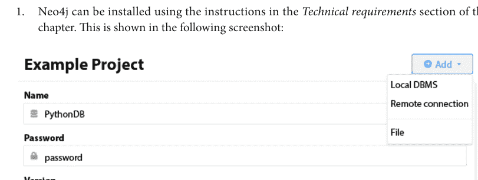
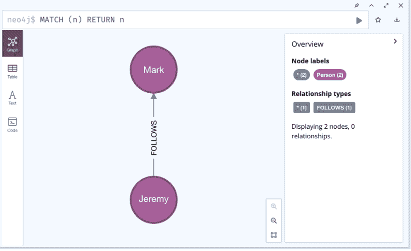
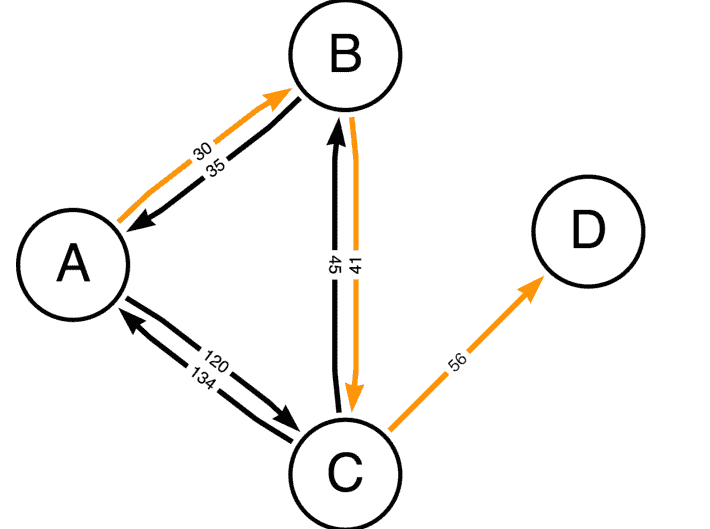

## Working with Graph Databases

本章向你介绍内存图数据库。我们将向你展示如何使用非常流行的图数据库 Neo4j 的步骤。我们将带你了解如何在自己的机器上下载此软件以使用，并解释为什么 Python 在尝试大规模部署图数据库和模型时会变得缓慢。在设置阶段之后，我们将探讨如何在该 *in-memory* 图数据库应用程序中创建关系，然后如何使用流行的查询语言 Cypher 对其进行查询。

然后，我们将研究在 Neo4j 中存储信息的各种方式，并使用 Python 与应用程序交互。我们将稍作偏离，查看 Neo4j 的替代方案，例如 Memgraph，以及它们如何使用。但本章的重点主要在 Neo4j，因为它不需要你配置机器以使用 Docker 和微服务。

最后，我们将研究一个用例，说明 Python 和 Neo4j 如何协同用于大规模和大数据分析，以快速且可重复的方式进行。这将最终利用我们新获得的 Neo4j 和 Python 技能来解决一个现实用例。该任务的用例是使用图网络在城市之间绘制最佳旅行路线，我们将复制在大多数常见映射软件中使用的功能，例如 Google Maps。

以下是本章将要涵盖的主题：
- Using graph databases
- Storing a graph in Neo4j
- Optimizing travel with Python and Cypher
- Moving to ingestion pipelines

### Technical requirements

我们将使用 Jupyter Notebook 运行我们的编码练习，这需要 `python>=3.8.0`，以及以下需要通过 `pip install` 命令安装到你的环境中的包：
- `igraph==0.9.8`
- `geopy==2.3.0`
- `neo4j==5.5.0`

对于本章，你需要首先执行以下步骤：
1. 安装 Neo4j Desktop，它是免费的。主要，我们将使用 Neo4j 进行长期图数据库存储，尽管 Neo4j Desktop 会同时安装一个桌面图浏览器。要安装 Neo4j Desktop，请前往 `https://neo4j.com/download-center/#desktop` 并填写一些详细信息。在安装期间你需要激活密钥，请记下它，并选择适用于你机器的相关操作系统安装程序。
2. 安装 Neo4j 后，打开 Neo4j Desktop 并创建一个新数据库（这可以通过导航到应用程序中的数据库选项卡并使用 **Add** 下拉菜单创建新的本地 DBMS 来实现），使用唯一名称，例如 `Python DB`。为本章的目的，使用一个你可以在明文代码中舒适书写的密码——我们将使用 `testpython`。在真实的 Neo4j 设置中，你可能会希望通过加密来屏蔽此密码，但这超出了本章的范围。

这些步骤将在下一节中更详细地介绍，所以现在先等等。

所有包含编码练习的笔记本都可在以下 GitHub 链接获得：`https://github.com/PacktPublishing/Graph-Data-Modeling-in-Python/tree/main/CH05`。

### Using graph databases

在之前所有的章节中，我们一直在 Python 脚本中将图创建在内存中。这对于分析工作或创建概念验证应用程序来说是可以的，但对于需要扩展的工作流程或长期存储而言，Python 和 `igraph` 将不够用。

在涉及图的生产系统中，图数据库充当持久数据存储解决方案。除了保存大量数据外，图数据库通常设计为高效且并发地执行大量读写操作。它们很可能成为任何依赖于大量图数据处理的生产管道的一部分，例如大型在线零售商的推荐系统。

除了保存数据外，图数据库还允许对它们保存的数据进行基本查询。许多这些数据库可以使用至少一种常见的图查询语言进行查询，


例如 **Cypher**、**GraphQL** 或 **Gremlin**。在本章中，我们将使用一些基本的 Cypher 来读写图数据库。Neo4j 提供了大量 Cypher 查询及其用途的列表；请参阅 https://neo4j.com/developer/cypher/。

值得注意的是，尽管这些查询语言在访问和写入数据方面非常强大，但它们目前还不能提供像 *igraph* 这样的包所提供的分析和算法的广度。在本章中，我们将把 Python 与图数据库连接起来，以演示 *igraph* 如何用于复杂的分析管道中。

### 将 Neo4j 作为图数据库

我们将在这里使用的图数据库是 Neo4j，这是一个常用的高性能数据库，提供免费的本地版本。可以使用 Cypher 查询 Neo4j，在图查询语言中，Cypher 可以说是对新用户最友好的语言，因此非常适合本入门介绍。有关 Cypher 用法的更深入理解，请参阅文档：https://neo4j.com/developer/cypher/。

Neo4j 拥有与我们之前章节中遇到的所有图概念相对应的概念。在 Cypher 文档中，节点仍然称为节点，但边通常被称为关系，而节点和边的属性被称为属性。

我们在异质图中遇到过包含多种节点类型的图，而在 Neo4j 中，这些节点类型具有不同的*标签*。标签在 Cypher 查询语言中被大量用于访问特定的节点和模式；我们将在读写图数据库时回到这个概念。

要启动并运行 Neo4j，我们需要执行以下步骤：

- 1. 可以按照本章*技术需求*部分中的说明安装 Neo4j。这如下面的截图所示：

  

  图 5.1 – Neo4j 数据库设置

- 2. 单击新数据库上的 **Start** 使其运行，示例数据库将被停止，因为 Neo4j 桌面版只支持同时运行一个数据库。现在可以删除示例数据库了。

- 3. Neo4j 桌面版捆绑了 Neo4j Browser。单击我们新创建的数据库旁边的 **Open** 以打开 Neo4j Browser 窗口。我们主要将重点放在使用 Neo4j 作为数据库的功能上，而不是其以可视化方式显示网络的能力。从这里，我们还可以创建一个新用户，我们将使用该用户的凭据从 Python 访问数据库。在窗口顶部的命令行中，输入以下内容：

  ```
  :server user add
  ```

- 4. 将出现一个包含新用户填写字段的窗口。在用户名字段中添加 admin。对于密码，我们同样使用 testpython。对于角色，从下拉菜单中选择 **admin** 和 **PUBLIC**，这样新用户将拥有对数据库的完全读写访问权限。

- 5. 最后，单击 **Add User** 创建我们新的 admin 用户。

现在，Neo4j 已安装，且我们的 Neo4j 数据库已创建并配置好，接下来我们需要学习如何通过 Cypher 查询语言与之交互。

### Cypher 查询语言

Cypher 是一种开源查询语言，兼容包括 Neo4j 在内的多种图数据库。它与 SQL 等更常见的查询语言有一些相似之处，但它是为图而设计的，而不是为表格数据而设计的。Cypher 的许多设计都围绕着匹配图中的节点和边模式展开，使用一种几乎看起来像绘制网络路径的特殊语法。

当我们想使用 Cypher 引用一个节点时，我们将其括在圆括号中。类似地，为了表示特定的边，我们使用方括号。节点和边用连字符和箭头连接，如下所示：

```
(node) - [edge] -> (node)
```

此模式将匹配图中以有向方式连接到其他节点的节点。在实践中，我们可能会对创建或返回的节点有更具体的要求。

在我们开始直接从 Python 查询 Neo4j 之前，我们可以先在 Neo4j Browser 窗口中执行一些简单的 Cypher 查询。让我们从创建一些节点开始：

- 1. 可以在行首使用 CREATE 函数来指示 Neo4j 创建新节点。要创建名为 Jeremy 的 Person 类型新节点，我们打开圆括号并使用冒号指定节点类型。然后，使用花括号为该节点添加 name 属性，值为 Jeremy。我们可以按照此模式创建两个 Person 节点：

  ```
  CREATE (:Person {name: "Jeremy"})
  CREATE (:Person {name: "Mark"})
  ```

- 2. 这些节点现在已经添加到数据库中，但目前还没有连接。我们可以使用 MATCH 函数在数据库中搜索这些节点，然后使用另一个 CREATE 函数来连接它们。这次，我们通过在每个 MATCH 的冒号前添加 Jeremy 和 Mark 来为匹配到的节点提供临时变量。然后，我们通过在圆括号中引用它们的变量来创建 Jeremy 和 Mark 之间的新边，并使用 - [:FOLLOWS] -> 关系来表示 Jeremy 在社交媒体平台上关注 Mark：

  ```
  MATCH (jeremy:Person {name: "Jeremy"})
  MATCH (mark:Person {name: "Mark"})
  CREATE (jeremy)-[:FOLLOWS]->(mark)
  ```

- 3. 在处理大量数据时，我们可能会遇到重复信息，或者需要更新数据库而不是创建新条目。MERGE 函数就是为了处理这些情况而存在的，它结合了 MATCH 和 CREATE 的功能。使用 MERGE 时，会进行匹配以检查图数据库中是否已经存在指定的模式。如果存在匹配，则不执行写入操作。如果没有精确匹配，则将模式用于 CREATE 函数以添加到图中。下面这行代码不会产生效果，因为已经存在一个名为 Jeremy 的 Person 节点：

  ```
  MERGE (:Person {name: "Jeremy"})
  ```

- 4. 但是，如果我们运行这个 MERGE 函数调用，我们将创建一个名为 Sophie 的新 Person 节点，因为该节点尚不存在于图中：

  ```
  MERGE (:Person {name: "Sophie"})
  ```

MERGE 函数也适用于边和更长的路径模式。

- 5. 我们已经介绍了写入 Neo4j 数据库的基础知识，但让我们简要地看一下如何通过读取操作从图中检索信息。我们已经使用了 MATCH，可以继续使用它来查找符合特定模式和特征的节点或边进行报告。然后，我们可以使用 RETURN 来检索这些信息。以下代码将查找所有 Person 节点并将它们返回到 Neo4j Browser 窗口：

  ```
  MATCH (n: Person)
  RETURN n
  ```

- 6. 除了访问整个节点，我们还可以使用 `.` 来访问节点或边属性，就像访问 Python 对象的属性一样。要仅返回图中节点的 name 属性，我们可以运行以下代码：

  ```
  MATCH (n: Person)
  RETURN n.name
  ```

- 7. Cypher 还有用于对结果进行基本分析的方法，包括 count()、sum() 和 max() 等聚合函数。例如，我们可以如下计算并返回数据库中节点的数量：

  ```
  MATCH (n)
  RETURN count(n)
  ```

- 8. 最后，我们可以使用 DETACH DELETE 从数据库中删除数据。这里，我们匹配数据库中的所有节点，并删除与它们相连的边，然后再删除节点本身：

  ```
  MATCH (n) DETACH DELETE n
  ```

Neo4j 可以通过这种方式用于创建节点和关系，以及查询数据库和检查图的各个部分。然而，在现实世界的案例中，读写操作通常需要由外部进程触发，而不是直接在 Neo4j Browser 窗口中输入。此外，当数据库中存储的图变得很大时，可视化功能会变得不那么有用，因为无法显示每个节点和边。考虑到实用性，在本章的其余部分，我们将主要从 Python 与 Neo4j 数据库进行交互。

### 从 Python 查询 Neo4j

Neo4j 安装完成后，我们就可以准备通过 Python 连接数据库了。为此，我们将使用 neo4j Python 模块，它包含从 Python 脚本连接数据库并向其发送查询所需的一切。我们将按以下步骤逐步进行：

- 1. 让我们首先为 Python 到 Neo4j 的连接创建一个 driver 对象。我们首先需要从 neo4j 模块导入 GraphDatabase 类。然后，要创建 driver，我们需要向 GraphDatabase.driver() 函数提供 uri、username 和 password 参数：

  ```
  from neo4j import GraphDatabase
  driver = GraphDatabase.driver(uri='bolt://localhost:7687',
      auth=('admin', 'testpython'))
  ```

  我们的 uri 参数是本地运行的 Neo4j 实例的地址。如果 Neo4j 数据库托管在单独的服务器上，则应将其替换为相应的互联网协议（IP）地址和端口。我们还已经将以元组形式将数据库的用户名和密码传递给了 auth 参数。

- 2. 现在，我们需要创建一个会话来向 Neo4j 数据库发送查询，使用 driver 对象的 session() 方法：

  ```
  session = driver.session()
  ```


3. 设置好会话后，我们现在可以查询数据库了。在本例中，我们将在 Neo4j 会话中添加用于创建图关系的查询参数：

```python
query = 'CREATE (:Person {name: "Jeremy"})-[:FOLLOWS]->(:Person {name:"Mark"})'
result = session.run(query)
driver.close()
```

这些代码行不会返回任何内容，因为我们对 Neo4j 数据库执行了写操作。不过，我们可以通过打开 Neo4j 浏览器或使用 Python 中的读取查询来确认操作是否成功。对于这第一个查询，我们将同时演示这两种方法，先从浏览器开始。

4. 回到我们 Python DB 数据库的 Neo4j 浏览器，在窗口顶部的命令行中运行以下查询：

```python
MATCH (n) RETURN n
```

该查询本质上匹配数据库中的每个节点并将其返回以供查看。我们在 Python 中添加的节点和关系将显示出来：



图 5.2 – Neo4j 浏览器结果

5. 另外，我们可以在 Python 中编写读取查询，以确认我们的写操作按预期运行。为了建立会话，我们将使用与之前的写查询相同的代码框架：

```python
driver = GraphDatabase.driver(uri='bolt://localhost:7687',
                            auth=('admin', 'testpython'))

session = driver.session()
```

6. 现在，不要向图数据库写入，而是让我们定义两个读取查询。一个查询将匹配图中的所有 Person 节点，而另一个查询将匹配所有 FOLLOWS 边：

```python
node_query = 'MATCH (n:Person) RETURN n'
edge_query = 'MATCH () -[e:FOLLOWS]->() RETURN e'
```

7. 现在，我们可以在关闭连接之前运行这两个查询。访问 run() 的 data() 方法可将结果转换为更易处理的格式，从而更容易在 Python 中处理：

```python
node_result = session.run(node_query).data()
edge_result = session.run(edge_query).data()
driver.close()
print(node_result)
print(edge_result)
```

打印结果显示，我们有两条 n 的结果，每条结果都包含我们添加的 Person 节点之一。我们还看到找到了一条 FOLLOWS 边，确认我们的写过程按预期运行。

此时，你可能会注意到，要实现 Python 与 Neo4j 的交互，我们需要经常运行这类查询。因此，我们将创建一个可重用的 Python 类来处理与数据库的连接和查询，从而无需每次运行查询时都手动连接数据库。

8. 让我们定义一个名为 Neo4jConnect 的 Python 类。该类将有一个 __init__ 方法，当 Neo4jConnect 被实例化时，该方法会被自动调用。因为我们总是希望在调用 Neo4jConnect 时连接数据库，所以我们可以在构造函数中处理驱动程序连接，使用提供给该类的 uri、user 和 password 参数。我们还将在这个类中定义一个 close() 方法来关闭连接。一个 query() 方法将完善这个类，该方法接收一个 Cypher 查询，并使用已建立的连接执行它，然后返回结果：

```python
class Neo4jConnect:
    def __init__(self, uri, user, password):
        self.driver = GraphDatabase.driver(uri, auth=(user, password))
    def close(self):
        self.driver.close()
    def query(self, query):
        session = self.driver.session()
        result = session.run(query)
        return result
```

9. 让我们通过重新运行之前执行的读取查询来确保我们的类按预期工作。现在，我们可以创建一个 Neo4jConnect 类的连接对象，该对象处理认证和驱动程序。现在可以通过访问连接对象的 query() 方法来运行查询，并且可以使用 close() 方法关闭连接：

```python
connection = Neo4jConnect('bolt://localhost:7687', 'admin', 'testpython')

node_cypher = 'MATCH (n:Person) RETURN n'
edge_cypher = 'MATCH ()-[e:FOLLOWS]->() RETURN e'

node_result = connection.query(node_cypher).data()
edge_result = connection.query(edge_cypher).data()

connection.close()
print(node_result)
print(edge_result)
```

打印 node_result 和 edge_result 显示的结果与我们之前获得的结果相同，表明我们的类实现正确。在本章的其余部分，我们将继续使用 Neo4jConnect 类来读写 Neo4j。

接下来，我们将介绍一个图数据库的实际用例，并使用 Python 和 Cypher 查询数据库并执行复杂的分析。

### 在 Neo4j 中存储图

搭建好图数据库并编写好与 Neo4j 交互的方法后，我们就可以开始使用 Python 和 Neo4j 来存储和探索图数据了。

在本节中，我们将研究一个美国与加拿大之间的航空旅行网络，并分析其属性以找到两地之间的高效航线。

#### 预处理数据

首先，让我们看一下我们的数据（来源：斯坦福大学：https://snap.stanford.edu/data/reachability.html）。我们有两个文件：reachability_250.txt 和 reachability-meta.csv。

如果我们打开 reachability-meta.csv 并查看前几行，我们会看到一份关于美国和加拿大城市的信息列表：

```text
"node_id","name","metro_pop","latitude","longitude"
0,"Abbotsford, BC",133497.0,49.051575,-122.328849
1,"Aberdeen, SD",40878.0,45.45909,-98.487324
2,"Abilene, TX",166416.0,32.449175,-99.741424
3,"Akron/Canton, OH",701456.0,40.79781,-81.371567
```

该文件包含我们城市节点的节点属性，以节点 ID 为键。我们有城市名称、城市人口以及各自的纬度和经度。这个 CSV 文件可以直接加载到 Neo4j 中，因此我们不需要进行任何预处理。

然而，我们的另一个文件 reachability_250.txt 不是 CSV 格式，而 Neo4j 导入时更倾向于 CSV 格式。打开 reachability_250.txt 并查看前几行，我们可以看到其中包含一个边列表：

```text
# 
# 
# 
# 
# 
# 
57 0 -84
113 0 -90
235 0 -170
```

根据数据源，该图是有向的。每条边表示两个城市之间的旅行，由节点 ID 表示。边的权重衡量两个城市之间的旅行时间，其中更负的值表示更远的距离。还有六行信息我们需要移除。

在接下来的步骤中，我们将开始清理和预处理这些数据，使其为图做好准备。

为了将这些信息预处理为可供 Neo4j 导入的格式，我们将其转换为 CSV 格式并移除头部行。我们还可以将距离度量改为非负值，以简化权重。所有这些预处理都可以通过 Python 的 csv 模块和一些列表推导式来处理，正如我们在前几章中所做的那样：

```python
import csv
with open('./data/reachability_250.txt', 'r') as txt:
    reader = csv.reader(txt, delimiter=' ')
    edges = [edge for edge in reader][6:]
    edges = [[edge[0], edge[1], int(edge[2])*-1] for edge in edges]

with open('./data/reachability.csv', 'w', newline='') as c:
    writer = csv.writer(c)
    for edge in edges:
        writer.writerow(edge)
```

这一次，我们的数据源已经具有合理的图格式，包含一个节点属性文件和一个边列表。该数据源还为我们提供了图模式的信息。图包含有向边，并且这些边始终连接城市，因此它是一个同构图。我们的每个节点的节点属性类型相同，因此这个航空旅行图的模式相当简单：

```text
node_id: int (unique)
name: str
population: int
latitude: float
longitude: float
```


图 5.3 – 美国和加拿大航空旅行图模式

我们的数据已具备可供 Neo4j 导入的正确格式，航空旅行模式也已确定，接下来我们可以开始在 Neo4j 数据库中创建图。

#### 将节点、边和属性移入 Neo4j

我们将使用 Python 向 Neo4j 数据库写入数据。我们需要先编写一些 Cypher 查询，然后再让 Python 将它们发送给 Neo4j。

在这个阶段，我们还应该确保 Neo4j 数据库是空的；如果不是，可以在开始之前在 Neo4j 浏览器窗口中运行 MATCH (n) DETACH DELETE n 查询。

我们的 Cypher 脚本将从 CSV 文件中读取数据，在本地安装的 Neo4j 中，CSV 文件应放在 Neo4j 可以访问的特定文件夹中。请按照以下步骤将数据导入 Neo4j：

1. 在 Neo4j 主应用程序窗口（不是当前数据库的浏览器窗口）中，单击我们新建数据库旁边的 ... 图标。
2. 然后，选择“打开文件夹”再选择“导入”，以打开操作系统文件浏览器中的 /import 文件夹。
3. 将 reachability.csv 和 reachability-meta.csv 复制到该导入文件夹中。


- 4. 现在 Neo4j 可以读取文件了，让我们编写一些 Cypher 来访问其内容。我们可以使用 `LOAD CSV WITH HEADERS` 来加载 `reachability-meta.csv` 数据，并且 `as` 函数告诉 Neo4j 对每一行 csv 运行剩余的代码，其中每一行现在命名为 `row`。头部会被读取并可用于访问对应的 csv 列，我们在 `CREATE` 中引用它们来构建具有正确属性的节点。节点 ID 和人口数会使用 `toInteger()` 转换为整数，而我们的纬度和经度属性则使用 `toFloat()` 转换为浮点数。从 Neo4j Browser 运行时，以下脚本将加载节点属性文件：

```cypher
LOAD CSV WITH HEADERS from 'file:///reachability-meta.csv' as row
CREATE (city:City {
    node_id: toInteger(row.node_id),
    name: row.name,
    population: toInteger(row.metro_pop),
    latitude: toFloat(row.latitude),
    longitude: toFloat(row.longitude)
})
```

- 5. 接下来，我们将再次使用 Cypher 加载边文件。与我们的节点属性文件不同，`reachability.csv` 不包含头部，因此我们使用 `LOAD CSV` 将数据导入 Neo4j。我们的两个 `MATCH` 函数使用切片表示法（例如 `[0]`）来查找我们边对应的节点，以引用 csv 列。我们也可以使用 Cypher 的 `toInteger()` 函数将我们的节点属性转换为整数，用于匹配和合并。这标识了我们在上一步中加载的节点。然后，`MERGE` 步骤在这些节点之间添加一个 `:AIR_TRAVEL` 边，并将 `travel_time` 作为属性从第三个 csv 列添加：

```cypher
LOAD CSV from 'file:///reachability.csv' as row
MATCH (from:City {node_id: toInteger(row[0])})
MATCH (to:City {node_id: toInteger(row[1])})
MERGE (from)-[:AIR_TRAVEL {travel_time: toInteger(row[2])}]->(to)
```

- 6. 将数据加载到 Neo4j 后，我们现在应该确认其是否符合预期并尝试从 Python 访问它。为了在 Python 中执行 Cypher 查询，我们将再次使用本章前面准备的 Neo4jConnect 类。它可以从我们为本章制作的自定义包 `graphtastic` 中导入，位于 GitHub 仓库（`https://github.com/PacktPublishing/Graph-Data-Modeling-in-Python/blob/main/CH05/`）中，并且可以在 Python 代码中实现如下：

```python
from graphtastic.database.neo4j import Neo4jConnect
```

- 7. 让我们在 Python 中编写一些简单的 Cypher 查询，以测试我们的数据导入是否成功并且我们的图仍然可以访问。如前所述，我们使用 Neo4jConnect 类建立连接并使用 `connection.query()` 运行一些 Cypher。这里的 Cypher 只是匹配所有节点，并且 count(n) 将这些节点聚合为一个总和。然后我们可以关闭连接并打印结果：

```python
connection = Neo4jConnect('bolt://localhost:7687', 'admin', 'testpython')
cypher = 'MATCH (n) RETURN count(n)'
result = connection.query(cypher).data()
connection.close()
print(result)
```

结果应显示我们的图中有 456 个节点，这与 reachability-meta.csv 中的行数相同，减去一行为头部。

- 8. 接下来，让我们确保 Neo4j 中应该存在的一条边已正确添加。我们可以使用与节点计数示例相同的模式从 Python 运行 Cypher 查询，但这次使用替代的 Cypher 代码。reachability.csv 第一行的边是在节点 ID 57 和节点 ID 0 之间。这次，为了测试，让我们创建一个包含两个元素的列表来表示这条边。我们将在 Cypher 查询中引用这些元素：

```python
edge_test = [57, 0]
```

- 9. 现在，我们可以将一些 Cypher 写成 Python 字符串，它将使用 f-string 替换接受来自 edge_test 的属性。我们可以使用 MATCH 函数匹配整条边，将 n 和 m 分配为我们的节点，r 分配为我们的关系。节点属性我们想要匹配的地方使用双大括号，以转义这些区域中 Python 的 f-string 行为。我们想要替换的地方是我们在 Cypher 查询中引用每个节点的 node_id 属性，使用 edge_test 中的值。然后，我们可以添加一个 RETURN 语句以返回两个节点的名称以及它们之间的旅行时间，作为分配给 n、m 和 r 的节点和边的属性。由于这里进行的字符串修改量很大，让我们也打印我们的 Cypher 查询，看看 Neo4j 将如何接收它：

```python
cypher = f'MATCH (n:City {{node_id:{edge_test[0]}}})' \
    '-[r:AIR_TRAVEL]->' \
    f'(m:City {{node_id:{edge_test[1]}}})' \
    'RETURN n.name, m.name, r.travel_time'

print(cypher)
```

- 10. f-string 替换和转义字符将被解析为有效的 Cypher 查询，准备发送到 Neo4j。我们可以以与之前相同的方式发送此查询：

```python
connection = Neo4jConnect('bolt://localhost:7687', 'admin', 'testpython')
result = connection.query(cypher).data()
connection.close()
print(result)
```

从 print 语句中，你应该会看到我们匹配到一条边，从 Calgary, AB 到 Abbotsford, BC，旅行时间为 84。尝试更改 edge_test 中的节点 ID 并重新运行，以检查 reachability.csv 中存在的更多边。

此时，你可能开始看到使用 Python 和 Cypher 并行带来的一些强大功能，其中 Cypher 中的条件和参数可以通过使用 f-string 或其他字符串替换方法动态设置。当然，这不仅在检查数据是否正确摄取时有用，而且在 Python 中的下游分析和管道构建中也很有用。在本章的剩余部分，我们将使用这些方法在 Cypher 和 igraph 中进行一些静态分析，使用从 Neo4j 流式传输的数据。我们将在第 6 章《Pipeline Development》中重点关注涉及 Neo4j 和 Python 的数据摄取和分析管道。

### 使用 Python 和 Cypher 优化旅行

我们的图已完全加载到 Neo4j 中，并且我们已设置使用 Cypher 和 Python 查询数据的方法，我们现在可以执行更复杂的分析。在本节开始时，我们将使用 Cypher 回答问题并在 Python 中返回答案。稍后，我们将通过从 Neo4j 采样图数据并在 igraph 中处理样本来进行更复杂的分析。

让我们首先深入了解我们图的<|message|>

- 1. 我们将运行的第一个查询将找出城市中人口最高者，并返回城市名称和城市人口作为结果。ORDER BY 将按这些节点（n）的<|message|>

```python
cypher = 'MATCH (n) ' \
    'RETURN n.name, n.population ' \
    'ORDER BY n.population ' \
    'DESC LIMIT 1'
connection = Neo4jConnect('bolt://localhost:7687', 'admin', 'testpython')
result = connection.query(cypher).data()
connection.close()
print(result)
```

- 2. 我们的结果显示人口最高的城市是纽约。我们可以向我们的图提出另一个简单的问题，即我们可以从纽约以相对较短的旅行时间飞往哪些城市。对于此，我们可以利用 WHERE 函数，其效果与 SQL 中的对应函数非常相似。在 MATCH 语句之后使用时，我们可以在返回容易从纽约到达的城市名称之前，使用 WHERE 函数按其旅行时间属性过滤匹配的节点。像往常一样，我们然后使用 Python 将查询执行到 Neo4j 数据库：

```python
cypher = 'MATCH (n:City {name: "New York, NY"}) ' \
    'MATCH (n) -[r:AIR_TRAVEL]->(m) ' \
    'WHERE r.travel_time < 100 ' \
    'RETURN m.name'

connection = Neo4jConnect('bolt://localhost:7687', 'admin', 'testpython')
result = connection.query(cypher).data()
connection.close()

print(result)
print(len(result))
```

这些第一次分析相当简单，可以使用关系数据库实现。让我们现在转向一些最好用图数据结构和图数据库解决的问题，例如计算路径。

我们的图包含美国和加拿大城市之间的航班，但要进行一些旅程，需要进行中转，途中涉及停靠。作为示例，让我们看看我们如何可能从加州圣地亚哥一路向北前往纽芬兰的圣约翰。

- 3. 我们将开始，如许多 Cypher 查询一样，使用 MATCH 语句。首先，我们匹配感兴趣的城市，以找到它们对应的节点。接下来，我们使用 [*..3] 通配符匹配这些节点之间的路径，代替特定的边或边类型。此表示法允许匹配从起始节点 n 开始长达三跳的路径。我们还将这些匹配的整个路径分配给变量 p。我们需要做的最后一步是返回路径 p，以及使用 relationships(p) 的关系详细信息并将其映射到 rels 变量：

```python
cypher = 'MATCH (n:City {name: "San Diego, CA"}) '\
    'MATCH (m:City {name: "St. John's, NL"}) '\
    'MATCH p=(n)-[*..3]->(m) ' \
    'RETURN p, relationships(p) as rels'

connection = Neo4jConnect('bolt://localhost:7687', 'admin', 'testpython')
result = connection.query(cypher).data()
connection.close()
```


```
```python
print(result)
print(len(result))
```
```

在下一节中，我们将扩展这部分内容，研究如何围绕选择哪条路线提出旅行建议。这是一个更复杂的问题，但幸运的是，我们可以使用 Dijkstra 算法（https://isaaccomputerscience.org/concepts/dsa_search_dijkstra?examBoard=all&stage=all）。这将在接下来的部分中加以说明。

### 旅行推荐

许多处理旅行推荐和优化的系统都会在后台使用图技术。当你使用 Uber 这样的打车应用时，系统会计算起点和终点之间的优化路径，并考虑交通状况、限速以及任何其他可能影响行程的因素。在这个例子中，这些参数可以看作是边的权重，道路交叉口则是节点。系统会综合考虑行程中各路段的距离，或通过每个路段所需的时间，从而高效地将你从 A 点送到 B 点。

在我们的数据集中，包含了美国和加拿大城市之间的航空旅行信息，包括以时间单位衡量的城市间旅行时间。这些信息可以像前一个例子中公路旅行那样使用，以找出城市之间最高效的航空旅行路线。

为了抽象这个问题，我们可以研究一种经典的图论方法，许多旅行优化解决方案都可能使用这种方法。Dijkstra 算法通常用于在加权图中寻找优化路径。

我们可以用一个简单的例子来演示 Dijkstra 算法。在*图 5.3*中，如果我们要从城市 A 到城市 D，就需要规划一条经停多个城市的路线。步数最少的路线是从 A 到 C，再到目的地 D。乍一看，这似乎是最有效的，因为这条路径的长度最短。然而，将所经过边的旅行时间权重相加，总和为 176。另一方面，走一条不同的路线，从 A 到 B，再到 C，最后到 D，总旅行时间为 127，尽管步数更多，但总时间更短：



### 

为了在我们所选的城市之间找到最快路径，让我们回到使用 Python 和 igraph。第一阶段是将最近一次 Cypher 查询得到的结果解析为更适合在 Python 中处理的格式。使用 igraph 时，请记住我们需要为每个节点定义节点属性列表、边列表和 igraph ID。这可以通过以下步骤来实现：

- 1. 回顾一下，我们查找圣迭戈（San Diego）和圣约翰斯（St. John's）之间路径的查询，返回了路径和关系。我们可以先用列表推导式将查询结果中的路径分离出来，从之前由 query.data() 返回的字典中提取 p 的结果：
```
paths = [path['p'] for path in result]
```

- 2. 路径列表中的每条路径都包含节点和分隔相邻节点的 [:AIR_TRAVEL]。出于定义节点属性列表和 ID 的目的，我们不需要有关节点邻接性或 [:AIR_TRAVEL] 字符串的任何信息。因此，我们可以使用带有 if 语句的双重列表推导式，将路径展平为节点列表：
```
nodes = [node for path in paths for node in path if node != 'AIR_TRAVEL']
```

3. 这个节点列表现在包含重复节点，即出现在多条路径中的节点。让我们使用一个巧妙的临时字典推导式创建一个临时字典，其中键是节点 ID，以过滤掉重复节点。.values() 方法会将我们的节点转换回字典节点对象列表：
```
node_attributes = {node['node_id']:node for node in nodes}.values()
```

4. 现在我们可以生成节点属性列表，将其添加到用于旅行时间图的属性集中。我们还可以创建一个字典，包含新生成的 igraph 递增整数 ID，并使用 enumerate() 将这些 ID 映射到原始 node_ids，正如我们在前几章中所做的那样。以下代码可以帮助我们实现这一点：
```
node_ids = [node['node_id'] for node in node_attributes]
names = [node['name'] for node in node_attributes]
populations = [node['population'] for node in node_attributes]
latitudes = [node['latitude'] for node in node_attributes]
longitudes = [node['longitude'] for node in node_attributes]
igraph_ids = {node['node_id']: i for i, node in enumerate(node_attributes)}
```

5. 设置好节点属性和 igraph 节点 ID 后，现在该创建边列表了。边存在于我们从 Neo4j 的 query.data() 结果中提取的路径中，其中相邻节点由 :AIR_TRAVEL 字符串分隔。可以通过访问结果中的 rels 提取距离：
```
travel_time_paths = [path['rels'] for path in result]
print(travel_time_paths)
```

6. 现在，下一步是从每条路径中提取相邻节点，并分配对应的 travel_time 边属性。这是一个更复杂的操作，因此将在一个 for 循环中完成。

7. 首先，我们为 edge_list 和 edge_attributes 创建空列表。在一个 for 循环中，我们将遍历 zip 打包后的 paths 和 travel_time_paths，这两个列表长度相同。对于每条路径，我们将获取 node_id 属性并删除 AIR_TRAVEL 字符串，从而得到一个仅包含节点 ID 的路径。我们对旅行时间也做同样的处理，得到一个边属性列表。接下来，我们使用 zip() 将 clean_path 与其自身进行 zip 打包，并使用 [1:] 偏移 1，从而生成表示每条边的节点对。然后，我们再用 zip() 将它与旅行时间打包，此时旅行时间的长度将与我们生成的边数相同。最后，我们可以遍历这个 zip() 对象，将每条边追加到边列表，并以同样的方式在对应索引处添加旅行时间。这样可以确保我们后续能够以列表方式向 igraph 添加边属性：
```
edge_list = []
edge_attributes = []
for path, times in zip(paths, travel_time_paths):
```

```
clean_path = [node['node_id'] for node in path if node != 'AIR_TRAVEL']
    travel_times = [rel['travel_time'] for rel in times]
    for n, time in zip(zip(clean_path, clean_path[1:]), travel_times):
        edge_list.append([igraph_ids[n[0]], igraph_ids[n[1]]])
        edge_attributes.append(time)
```

8. 准备好节点属性、边列表和边属性后，我们现在可以创建图了。和往常一样，我们使用 igraph.Graph() 创建一个空白图，并在本例中指定 directed=True。在这个例子中，指定有向图尤为重要，因为往返两个城市之间的旅行时间可能因方向不同而有所差异。接下来，我们将 add_vertices() 设置为 node_ids 的数量，并添加相应的节点属性。然后，我们使用 add_edges() 添加边，并以与添加节点属性相同的方式为这些边添加边属性：
```
import igraph
g = igraph.Graph(directed=True)
g.add_vertices(len(node_ids))
g.vs['node_id'] = node_ids
g.vs['name'] = names
g.vs['population'] = populations
g.vs['latitude'] = latitudes
g.vs['longitude'] = longitudes
g.add_edges(edge_list)
g.es['travel_time'] = edge_attributes
```

现在，我们的图已在 Python 中组装完成，表示从圣迭戈到圣约翰斯的路径所构成的子图。让我们查看一些边，确认这些边在 Neo4j 中同样存在，并且我们的代码已按预期工作。

9. 我们可以通过列表推导式访问每条边中的 g.vs[edge.source]['node_id'] 和 g.vs[edge.target]['node_id']，以及每条边的 travel_times，从而打印相邻节点 ID（与 Neo4j 中的一致）的边。打印结果将向我们展示一个应存在于 Neo4j 中的边列表：
```
print([[g.vs[edge.source]['node_id'], g.vs[edge.target]['node_id'], edge['travel_time']] for edge in g.es])
```

10. 我们选择节点 ID 294 和节点 ID 401 之间的一条边，并在 Neo4j Browser 中运行一个小查询（转到 Neo4j Browser，运行以下 Cypher 语句）来确认它存在于 Neo4j 数据库中。我们可以简单地匹配这些节点之间的路径并返回节点，以确认我们的 Neo4j 到 Python 的 igraph 代码已按预期工作。现在让我们前往 Neo4j Browser 并执行这条 Cypher 语句：
```
MATCH (n:City {node_id:294})-[:AIR_TRAVEL]->(m:City {node_id:401})
RETURN n, m
```


11. 回到 Python，现在我们准备在 igraph 中进行更复杂的分析，找出从圣地亚哥到圣约翰斯的最短出行方式。在建立好图之后，用代码实现其实相当简单。我们可以先用 `g.vs.select()` 指定要查找路径的节点，并将其命名为 source 和 target。要运行 Dijkstra 算法，我们可以在源城市和目标城市之间调用 igraph 的 `get_shortest_paths()` 方法。只要将权重参数指定为 `travel_time`，igraph 就会在路径计算中将出行时间作为边的权重，并返回最小距离路径：

```
source = g.vs.select(name_eq='San Diego, CA')
target = g.vs.select(name_eq='St. Johns, NL')
shortest_path = g.get_shortest_paths(source[0], target[0], weights='travel_time')
```

12. `get_shortest_paths()` 的结果将包含 igraph 的整数 ID，因此让我们获取路径中这些节点对应的每个城市的名称并查看：

```
shortest_path = [g.vs[node]['name'] for node in shortest_path]
print(shortest_path)
```

13. 我们可以看到，在出行时间方面最优的路径是经由芝加哥，然后到蒙特利尔。要获取每一步的距离，我们可以在 `get_shortest_paths()` 中指定一个可选参数 `output='epath'`，它会返回边的 ID。然后，我们可以用列表推导式访问这些边 ID 关联的出行时间并查看。我们还可以进行求和以找出总出行时间：

```
short_path_rels = g.get_shortest_paths(source[0], target[0], weights='travel_time', output='epath')
short_path_distances = [g.es[edge]['travel_time'] for edge in short_path_rels]
print(short_path_distances)
shortest_travel_time = sum(short_path_distances[0])
print(shortest_travel_time)
```

因此，我们可以使用这种方法在我们的数据集中找到城市之间的最优出行路线。然而，如果我们想查看边的其他特征来推荐城市之间的特定路径呢？例如，节点之间的物理距离可能是个关注点。同样，计算这个更适合用 Python 而不是图数据库，所以让我们看看如何实现。

14. 我们可以首先通过访问 `g.es` 和 `g.vs` 并执行推导式来从 igraph 图中提取边以及纬度和经度。我们将使用节点 ID 将节点与对应的边匹配：

```
edges = [[g.vs[edge.source]['node_id'], g.vs[edge.target]['node_id']] for edge in g.es]
latitudes = {node['node_id']: node['latitude'] for node in g.vs}
longitudes = {node['node_id']: node['longitude'] for node in g.vs}
```

15. 接下来，我们需要一个函数根据纬度和经度计算距离。让我们定义一个函数 `find_distances()`，它将接收一个边列表以及两个字典 `latitudes` 和 `longitudes`，每个字典以节点 ID 为键。我们可以使用 geopy 模块导入 `geodesic()`，它会计算两个经纬度坐标点之间的距离。对于每条边，我们为 source 和 target 分别构造一个包含纬度和经度的元组，即 `loc_1` 和 `loc_2`。我们可以使用 `geodesic()` 并将这些点作为参数来计算距离，然后通过访问 `km` 属性将距离转换为千米。每对连接节点之间的距离被追加到一个列表中并返回：

```
from geopy.distance import geodesic
def find_distances(edges, latitudes, longitudes):
    distances = []
    for n, m in edges:
        loc_1 = (latitudes[n], longitudes[n])
        loc_2 = (latitudes[m], longitudes[m])
        distance = geodesic(loc_1, loc_2).km
        distances.append(int(distance))
    return distances
```

16. 现在，我们可以在准备好的边、纬度和经度上调用我们的方法，并使用 `g.es` 将距离应用到图中的每条边：

```
distances = find_distances(edges, latitudes, longitudes)
g.es['distance'] = distances
```

17. 将距离添加到 igraph 后，我们可以使用与之前相同的过程，找到圣地亚哥和圣约翰斯之间在物理距离方面的最短路径：

```
source = g.vs.select(name_eq='San Diego, CA')
target = g.vs.select(name_eq='St. Johns, NL')
shortest_path = g.get_shortest_paths(source[0],
    target[0], weights='distance')
shortest_path = [g.vs[node]['name'] for node in shortest_path]
print(shortest_path)
short_path_rels = g.get_shortest_paths(source[0],
    target[0], weights='distance', output='epath')
short_path_distances = [g.es[edge]['distance'] for edge in short_path_rels]
print(short_path_distances)
shortest_travel_time = sum(short_path_distances[0])
print(shortest_travel_time)
```

这给了我们一个不同的答案，路径是经过芝加哥再到多伦多。

在旅行推荐系统中，客户可能对其拟议旅行路线的其他特征感兴趣。在物理距离受关注的场景中，我们可能希望预先计算这些距离并将它们添加到服务于 Web 应用的图数据库中。

这样，每次进行推荐时就不必重新计算它们。我们可以为美国和加拿大的航空旅行图做到这一点，方法是先用一些简单的 Cypher 从 Neo4j 数据库中提取所有边、节点、纬度和经度，然后对这些查询运行 Neo4j：

```
edges_cypher = 'MATCH (n)-[:AIR_TRAVEL]->(m) \
' 'RETURN n.node_id, m.node_id'
nodes_cypher = 'MATCH (n) \
' 'RETURN n.node_id, n.latitude, n.longitude'
connection = Neo4jConnect('bolt://localhost:7687', 'admin', 'testpython')
edges = connection.query(edges_cypher).data()
lat_longs = connection.query(nodes_cypher).data()
connection.close()
```

18. 然后，我们可以使用类似于子图示例的方法来计算所有边的物理距离，并重用我们自定义的 `find_distances()` 方法。这些可以写入 CSV 文件，准备导入 Neo4j：

```
edges = [[edge['n.node_id'], edge['m.node_id']] for edge in edges]
latitudes = {node['n.node_id']: node['n.latitude'] for node in lat_longs}
longitudes = {node['n.node_id']: node['n.longitude'] for node in lat_longs}
distances = find_distances(edges, latitudes, longitudes)
distances = list(zip(edges, distances))
import csv
with open('chapter05/data/distances.csv', 'w', newline='') as c:
    writer = csv.writer(c)
    for edge in distances:
        writer.writerow(edge)
```

19. 现在，就像我们之前首次在 Neo4j 中组装图时那样，我们可以将生成的 `distances.csv` 文件移动到 Neo4j 的导入文件夹中。使用我们在本章中学到的知识，一些简单的 Cypher 就能将所有新的距离边属性导入 Neo4j。这里唯一的新函数是 `SET`，它为指定的节点或边更新给定的特征：

```
LOAD CSV from 'file:///distances.csv' as row
MATCH (n:City {node_id: toInteger(row[0])})
MATCH (m:City {node_id: toInteger(row[1])})
MATCH (n)-[r:AIR_TRAVEL]->(m)
SET r.distance = toInteger(row[2])
```

现在，让我们进入下一节！

### 进入摄取管道

在本章中，我们创建了一个静态的 Neo4j 图，对其进行了查询和分析，并更新了其特征。这类解决方案可能会在生产环境中使用，用于在应用程序中提供结果。

然而，这类流程中还有一些我们尚未涵盖的元素。在生产系统中，节点和边可能会定期以小块的形式读写到图数据库中。复杂处理可能会在数据摄取之前使用 Python 或其他语言在 Neo4j 之外进行。想一想真正的旅行优化或推荐服务实际会提供多少选项——每一个都必须嵌入到图数据库管道中。

在第 6 章“管道开发”中，我们将看一个复杂图数据管道的示例，并探讨如何使其可靠且高效。

### 总结

我们在本章中涵盖了大量内容，现在你应该对内存数据库（如 Neo4j）的强大之处有了很好的理解。我们开始求知之旅时，先了解了如何设置 Neo4j 实例，在那里我们完成了所有配置，安装了本地版本的 Neo4j 并快速启动运行。

接下来，我们了解了如何使用一种名为 Cypher 的查询语言对 Neo4j 数据库执行查询。对你们中的一些人来说，这可能是第一次接触 Cypher，我们向你介绍了这种语言如何与其他查询语言（如 SQL）相似。为了更好地理解如何使用 Cypher，Neo4j 网站（https://neo4j.com/developer/cypher/）是一个很好的资源。

更进一步，我们开始研究如何结合使用 Cypher 和 Python 的 cypher 包在 Neo4j 图数据库中存储数据，从而开始与图数据库进行交互。

最终，我们探索了一个用例：推荐最佳的出行路线，并分析两点之间的最优路径。在这里，我们介绍了 Dijkstra 算法（https://isaaccomputerscience.org/concepts/dsa_search_dijkstra?examBoard=all&stage=all），并用它来计算两点之间的最短路径。这模拟了你日常使用的管道和应用程序，例如 Google 地图或 Uber 的路线规划系统。在这里，你亲手实践了 Python、Cypher、igraph 和 Neo4j。可以说，为了在高潮中结束，我们接着开始解释在下一章中我们将如何扩展摄取管道，并将拓展本章中提供的示例。

自从第一章以来，你已经取得了长足的进步，所以恭喜你走到这里。我们期待在下一章中带你学习如何创建可用于生产的图管道，这将是下一章的重点。


对于本章，你还需要安装 Neo4j Desktop。请参阅 *第 5 章，操作图数据库* 中的 *技术要求* 部分，如果尚未安装 Neo4j，因为本章的教程需要跟随时使用它。

所有包含编码练习的笔记本，均可在以下 GitHub 链接获取：https://github.com/PacktPublishing/Graph-Data-Modeling-in-Python/tree/main/CH06。
