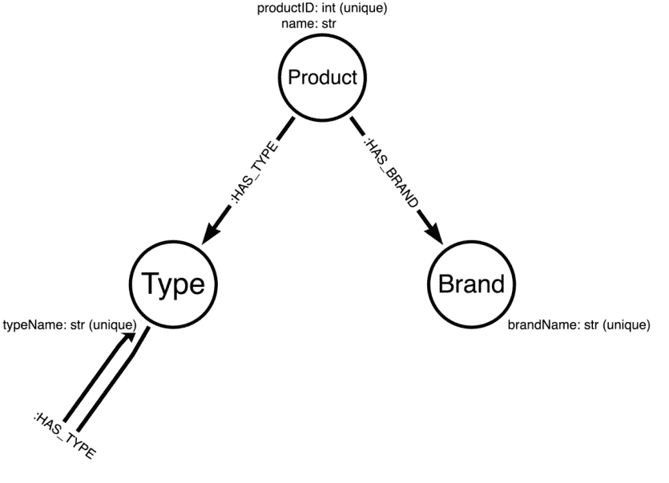
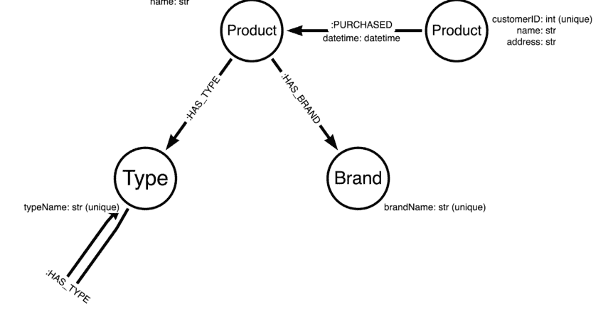

## 图管道开发

在上一章中，我们学习了如何将 Python 与 Neo4j 数据库进行接口。我们利用 Neo4j 的长期图存储解决方案，搭建了一个更真实、更接近生产环境的系统，可以根据多个参数查询航空旅行路线。

我们通过使用静态查询向其中写入大量数据来设置图数据库。在设置数据库时，我们知道想要存储什么数据，并编写了 Cypher 查询以批量导入数据。 resulting 图的重点在于向例如前端 Web 应用程序提供读取查询结果。这些读取查询仅在我们对数据提出问题时才针对数据库执行。

然而，实际上，这些图数据库系统通常作为应用程序的后端，为应用程序频繁且自动地向图数据库发送查询提供服务。这些查询可能不仅由直接用户行为驱动，还可能被执行以被动收集和计算信息。

例如，考虑一家金融服务公司如何存储金融交易图，以便寻找可疑活动。对于这种用例，公司希望在活动发生时检测可疑行为，而不是等待批量数据上传，到那时欺诈活动可能已经发生。在这种情况下，很可能在图数据库（如 Neo4j）之外存在数据管道中的组件，通过小查询进行交互，以便写入数据并寻找感兴趣的模式。

就写入查询而言，与上一章中批量写入图不同，来自许多用户的小信息事务可以同时写入图。在图数据库中，对于以这种方式运行的系统，有一些额外的注意事项，我们将在本章中介绍。

在以下各节中，我们将设置一个新的 Neo4j 图数据库，并查看如何处理大量小的读取和写入查询，通过模拟在线零售商的用户和用户交互。像以前一样，我们将使用 Neo4j 和 Python 来实现这一点，充分利用各自的优势。

### 零售图数据库

在本节中，我们将设计一个后端系统来处理由 Web 应用程序或移动应用程序产生的请求。在一个实际示例中，我们将探讨将零售商入驻以向客户提供产品推荐所需的方法。我们将为一家在线电子产品零售商构建后端数据库，客户可以在其中浏览、比较和购买产品，同时获得他们可能感兴趣的查看推荐。

对于这个复杂系统，就像生产数据库设置一样，我们需要考虑几个元素以及它们如何交互。我们需要初始化一个图数据库以接受查询并模拟与应用程序的交互，从而触发对数据的查询。

### 设计模式和管道

让我们一次解决我们需要设置的一个个元素。对于我们的后端系统，我们需要一个图数据库，因此第一阶段是设置一个新的空白 Neo4j 数据库。

#### 设置新数据库

正如我们在第 5 章《操作图数据库》中所做的那样，让我们启动 Neo4j Desktop。一旦加载桌面，我们需要按照以下步骤添加新数据库：

1. 在主 Neo4j 窗口中，选择 Add，并选择 Local DBMS。
2. 为新数据库选择一个名称，例如 Store DB。
3. 使用一个通用密码，例如 testpython。我们将在本示例的开放代码中使用此密码，因此请确保不要使用敏感的密钥短语。在真实的生产系统中，任何由第三方脚本所需的对该数据库的身份验证很可能使用密码密钥系统，以防止此密码以明文和代码形式暴露。
4. 接下来，单击 Create，并等待新图数据库创建完成。
5. 一旦图数据库创建完成，请确保你可以通过 Neo4j Desktop 连接到它，方法是单击新数据库名称旁边的 Start。数据库将显示为 Starting。再次等待数据库加载，然后单击 Open，以打开一个新的 Neo4j Browser 窗口，连接到我们的新数据库。
6. 我们需要创建一个新的管理员用户，以便从 Python 访问图数据库。在窗口顶部的 Neo4j 命令行中，运行以下命令：

```
:server user add
```

7. 在 resulting 窗口中，添加用户名和密码。对于我们的示例，我们将再次使用 admin 作为用户名，testpython 作为密码。对于此密码与数据库密码相同：不要使用你在开放代码中输入会不舒服的密码（如果提交到 GitHub 等存储库，则会以强类型且对所有人可见的形式出现）。
8. 接下来，从下拉角色列表中添加用户角色 PUBLIC 和 admin。然后，选择 Add user 以创建管理员用户。我们稍后将使用这些凭据访问数据库。

数据库设置完成后，我们现在需要决定要存储什么类型的数据。第一阶段，如同往常一样，是考虑并设计模式。

#### 模式设计

我们希望在客户身上保存什么数据？什么可以帮助我们向他们推荐产品？

让我们看看我们的在线电子产品零售商销售的产品。我们可以通过打开 `products.csv` 并检查前几行来大致了解我们拥有的信息：

| productID | name | brand | mainType | subType |
|-----------|------|-------|----------|---------|
| 1001 | WX100 In-ear Headphones | Hans | Audio | Bluetooth Headphones |
| 1002 | WX-B210 Bluetooth Headphones | Hans | Audio | Bluetooth Headphones |
| 1003 | Hans-3 Bluetooth Headphones | Hans | Audio | Bluetooth Headphones |
| 1004 | J9 Bluetooth Headphones | JLB | Audio | Bluetooth Headphones |
| 1005 | J8-I In-ear Headphones | JLB | Audio | Bluetooth Headphones |
| 1006 | J-Basics Wired Headphones | JLB | Audio | Wired Headphones |

从此数据的结构来看，我们的零售商当前提供的每种产品都列在单独的 CSV 行上。我们为每种产品都有产品 ID、名称和产品品牌。我们还有每个产品的分类级别，位于 `mainType` 和 `subType` 列中。因此，我们有三种不同类型的实体需要保存在我们的图中，可以由节点类型 Product、Brand 和 Type 表示。每个唯一产品都有一个类型和一个品牌，我们可以用命名边 `HAS_TYPE` 和 `HAS_BRAND` 分别表示。

对于每个主要类型，有几种产品子类型。我们可以将这些描述性类别视为一种本体论，我们在 *第 4 章，构建知识图谱* 中更深入地探讨了这一概念，我们在那里处理了知识图谱。在这种情况下，我们可以考虑在图中将子类型连接到产品的主要类型，并以不同的粒度表示产品类别。一种方法是在子类型和主要类型之间创建更多 `HAS_TYPE` 关系。

这些数据将构成我们数据库的骨干，包含产品、品牌及其类型之间的链接。我们的图模式将在我们考虑不同元素时发展，并变得更加复杂，但首先，让我们为仅产品设计一个数据模型：



*图 6.1* 说明了我们产品的模式，但我们可能也想存储客户信息。我们可以通过跟踪他们的过去购买来了解客户对哪些类型产品感兴趣。要存储客户，我们需要为每个客户提供唯一的客户 ID，以及存储有关他们的其他有用信息，例如姓名和地址。

要存储这些特征，我们可以创建客户节点，其中 **ID**、**name** 和 **address** 作为节点属性。对于购买，我们可以创建与产品的关系。对于每次购买，我们可以在边上存储 **date** 和 **time**，以区分同一客户对同一商品的多次购买。


Figure 6.2 shows an extended schema, containing both product and customer information:



Figure 6.2 – Adding customer purchases to the graph schema

Representing all the features of our products, and the features of customers that interact with them, results here in a directed heterogeneous graph. The fact that customers can make multiple purchases of the same item will result in the potential for more than one edge between a pair of nodes, meaning that our network is classed as a multigraph.

The information in our graph schema is such that if we want to find what types or brands of products a customer tends to purchase, we can traverse paths in our graph to find an answer. We will come back to this idea later, when making product recommendations. We may also want to add to this schema later, to capture additional information about our customers. Thankfully, a heterogeneous graph schema is more flexible than a relational database, as we explored in Chapter 1, Introducing Graphs in the Real World, and allows for additional types of nodes and edges to be added when required, without affecting the data currently modeled.

Now that we have a plan for representing data in our graph database, we can start to create processes to store it.

### Adding static product information

As we mentioned previously, the products on offer in our online store will form the backbone of our graph data. We have a list of products already on offer, as well as extra information on them, in products.csv.

To get started, let’s populate our graph database with product information:

1. Neo4j can easily access data in a given database’s import folder, so let’s first move `products.csv` (this will be stored in the supporting GitHub repositories data folder at `https://github.com/PacktPublishing/Graph-Data-Modeling-in-Python/tree/main/CH06/data`) to that location. From the main Neo4j Desktop window, click the three dots … next to **Store DB**, or whatever name you have used for this chapter’s database.

2. From the pop-up list, choose **Open folder**, then click on **Import**. This will open the database’s import folder in the file browser of your operating system. Copy and paste, or drag `products.csv` into this folder to give Neo4j access to it in Cypher queries.

3. With our data in the correct location, we can start to think about how to turn this tabular CSV into nodes and edges, according to the graph schema we have specified. For the initial transfer of data, we can use the Neo4j Browser and the command line, by opening up the Browser window for our **Store DB** database.

4. Next, let’s write some Cypher to load this data. As we did in *Chapter 5, Working with Graph Databases*, we can use the `LOAD CSV WITH HEADERS` function to read our data into Neo4j. We specify the filename and location in the `/import` folder by using `FROM 'file:///products.csv'`, and read one line at a time with `AS row`.

5. From there, we start to add nodes to our graph with `MERGE`. We add nodes with the Product, Brand, and Type types, and add their node attributes using the `row.column` syntax. We use the aliases `p`, `b`, `m`, and `s` for each type of node added or matched with `MERGE` in order to easily add edges next. We can use even more `MERGE` functions to now add the `HAS_BRAND` and `HAS_TYPE` relationships, including the relationships between the main types and sub-types:

```cypher
LOAD CSV WITH HEADERS FROM 'file:///products.csv' AS row
MERGE (p:Product {productID: toInteger(row.productID), name: row.name})
MERGE (b:Brand {brandName: row.brand})
MERGE (m:Type {typeName: row.mainType})
MERGE (s:Type {typeName: row.subType})
MERGE (p)-[:HAS_BRAND]->(b)
MERGE (p)-[:HAS_TYPE]->(s)
MERGE (s)-[:HAS_TYPE]->(m)
```

> **Important note**
> 
> It is important to remember that using `MERGE`, rather than `CREATE` here, ensures that duplicate nodes are not created for each row. Using `CREATE` could potentially be manageable for Product nodes, of which one per CSV row is added, but for Brands and Types, the `CREATE` function would add Brand and Type nodes with identical names to the graph, as well as creating extraneous edges.

6. Before moving on to the next stage, we should confirm that product data has been correctly added to our graph using some simple Cypher queries, executed in the Neo4j Browser. Looking at our data in `products.csv`, we can use the first row to validate our graph data. We can first write Cypher to confirm that the product with ID 1001 has the correct node attributes, and run this in the Neo4j Browser:

```
MATCH (n:Product {productID:1001})
RETURN n.productID, n.name
```

This should show us that this node has the name `WX100 In-ear Headphones`.

7. Let’s now confirm that relationships were added correctly. We can find the brand of these headphones using another MATCH function, and RETURN the connected Brand nodes:

```
MATCH (n:Product {productID:1001})-[:HAS_BRAND]->(m)
RETURN m.brandName
```

This will show that these headphones are of the Hans brand.

8. Finally, let’s make sure product types and connected sub-types are as expected. In this case, we need to traverse (travel across or through) several edges to find the subtype, and then the main type of the product with productID 1001. This can be done over two MATCH functions for clarity:

```
MATCH (n:Product {productID:1001})-[:HAS_TYPE]->(subtype:Type)
MATCH (subtype)-[:HAS_TYPE]->(maintype:Type)
RETURN n.name, subtype.typeName, maintype.typeName
```

We should see in the resulting table that the subtype of these headphones is **Bluetooth Headphones**, with a main type of **Audio**.

These are all the steps needed to complete the process of getting your data into your Neo4j graph, by extensively using the Neo4j Browser to execute the Cypher queries.

With our product data successfully assembled into a graph, we can now think about how customers might interact with products, and how to simulate and store this information in the Neo4j database. This will be the purpose of the upcoming section.

### Simulating customer interactions

Depending on its size, an online retailer could have thousands of customers browsing products on their web application or app. Each of these customers sends queries to a backend database when they search for a product, are recommended a product, or purchase something, among other actions. This way, a retailer can serve a customer with the information they need, as well as storing data on customer behavior.

We will be focusing on the product recommendation system for our online electronics store, as this is often handled with a graph database. From our graph schema in *Figure 6.2*, we can see that we want to store data on customer purchases, where each customer has a unique ID, a name, and an address.

Of course, we don’t have real customers interacting with an application to store data on for this example, but we can mock up some fake customers and simulate the queries they would send to our database. In a real software development team, creating fake customers and customer interactions might be part of a testing framework for a new data pipeline.

These types of query transactions are, in practice, often handled by a publish/subscribe messaging service (pub/sub) or similar, which in turn is often managed with a cloud computing service. These transactions typically take place between multiple machines, which has implications on machine setup, security, and permissions, which is an entire subject in itself, the field of DevOps. For our purposes, in this chapter, our fake customers will be generated in Python, and make purchases by sending queries from Python to Neo4j. This will all take place on a local machine, meaning we can focus on graph data modeling and network analysis.

Let’s begin by creating a customer. In our schema, a customer has a `customerID`, name, and address. Python has some nice tools for generating fake data, which we will lean on in this chapter by using the `Faker` library.

Faker comes bundled with a variety of methods to simulate different types of data, from simple things such as telephone numbers to entire sets of fake personal information. For our purposes, we need to generate names and addresses to give to our customers.

In the upcoming steps, we will generate fake data to use in our graph use cases going forward:

1. To import Faker, we import the `Faker` class from the `faker` (lowercase) library. We then create an instance of Faker by assigning it to a variable, here named *fake*. We can optionally set the random seed of the Faker library, so that our randomly generated data is consistent between Python script runs:

```python
from faker import Faker
fake = Faker()
Faker.seed(0)
```

2. We can now use our instantiated *fake* object to generate names and addresses, by simply calling the `name()` and `address()` methods of the class:

```python
name = fake.name()
address = fake.address()
print(name)
print(address)
```

Printing our results shows some realistic name and address data. You may notice from the address that this data is US-localized, which is the default setting. It is possible to change the locale of the Faker library if needed, for which you should consult the Faker documentation.

3. Now that we can create fake data, let’s attach this data to a customer. A sensible way to do this is to create a `Customer` class, which holds a `customerID`, name, and address attribute for each person. We can use the `__init__()` method to assign attributes to each customer.


当它被实例化时。我们将为每个客户传递一个唯一的 customerID，并在 Customer 对象创建时使用 Faker 为其生成姓名和地址：

```
```python
class Customer:
    def __init__(self, customerID):
        self.customerID = customerID
        self.name = fake.name()
        self.address = fake.address()
```
```

+   4. 让我们通过生成一个客户来测试我们新的类。为了测试目的，我们可以用任意 ID 9999 创建一个客户，并打印我们 Customer 对象的属性：

```
```python
new_customer = Customer(9999)
print(new_customer.customerID)
print(new_customer.name)
print(new_customer.address)
```
```

+   5. 每次调用 Customer 类时，__init__() 方法都会自动生成客户的姓名和地址。有了我们新的类，我们现在能够快速生成客户来填充我们的图数据库。

+   6. 为了将此客户信息传递到我们的图数据库，以及我们整个管道，我们需要像第 5 章《使用图数据库》中那样从 Python 访问 Neo4j。实例化时，此类使用传递给它的凭据建立与 Neo4j 的连接。它还可以使用 query() 方法与 Neo4j 建立会话并运行查询，以及使用 close() 关闭连接。这是我们在上一章中使用的同一个 Neo4jConnect 类，因此有关如何将 Python 连接到 Neo4j 的更多信息，请参阅第 5 章《使用图数据库》。尽管我们还包含了一个名为 Graphtastic 的自定义包，您可以使用 from graphtastic.database.neo4j import Neo4jConnect 快速导入此类。为了透明起见，此连接方法的完整实现再次包含在以下代码块中：

```
```python
from neo4j import GraphDatabase
class Neo4jConnect:
    def __init__(self, uri, user, password):
        self.driver = GraphDatabase.driver(uri,
                      auth=(user, password))
    def close(self):
        self.driver.close()
    def query(self, query):
        session = self.driver.session()
        result = session.run(query)
        return result
```
```

+   7. 我们现在准备好生成并向 Neo4j 添加客户。这可以被视为客户注册我们的在线零售应用或网站。接下来我们需要能够将生成的客户数据传递到图数据库的能力。为此，我们可以创建一个方法 `add_customer()`。该方法将接受一个 `Customer` 对象 `c`，以及一个使用我们的 `Neo4jConnect` 类创建的经过身份验证的 Neo4j 连接。有了这些参数，我们就可以创建一个 Cypher 查询来添加客户，将节点属性替换为我们客户的属性，使用 `c.customerID`、`c.name` 和 `c.address`。这一切都通过 Python 的 f 字符串功能处理，围绕一个简单的 MERGE 函数。使用的额外大括号是为了在某些地方转义 f 字符串行为，因为 Cypher 指定节点属性的语法也使用 `{ }` 字符。根据我们的图模式，我们还指定新节点的 `customerID` 属性应为整数，使用 Cypher 的 `toInteger()`。组装好的查询然后可以使用 `connection.query()` 调用：

```
```python
def add_customer(c, connection):
    query = f'MERGE (:Customer {{customerID: toInteger({c.customerID}), '\
        f'name: "{c.name}", '\
        f'address: "{c.address}"}})'
    connection.query(query)
```
```

+   8. 让我们通过创建一个另一个示例客户来尝试这个新方法。使用我们的 `Customer` 类，我们可以生成一个具有所需属性的新 `Customer` 对象。与所有从 Python 到 Neo4j 的 Cypher 查询一样，我们然后使用 `Neo4jConnect` 建立连接，然后使用我们生成的 `Customer` 和我们的 Neo4j 连接调用新的 `add_customer` 方法，该方法处理向我们的图数据库写入节点。最后，我们使用 `connection.close()` 关闭会话：

```
```python
test_customer = Customer(9999)
connection = Neo4jConnect('bolt://localhost:7687',
    'admin', 'testpython')
add_customer(test_customer, connection)
connection.close()
```
```

+   9. 回到 Neo4j Browser，我们可以以多种方式检查节点是否已正确添加，但为了更直观，让我们打开 Neo4j Desktop 用于 Store DB 数据库，我们已写入该数据库。使用非常简单的 Cypher 匹配所有类型为 Customer 的节点，我们可以将客户返回到浏览器：

```
```cypher
MATCH (c:Customer) RETURN c
```
```

我们应该看到返回了一个节点。点击该 Customer 节点应该在 Neo4j Browser 窗口右侧显示节点属性，确认我们的属性已正确设置。接下来，我们现在可以向我们的图添加客户，但目前它们仍然与数据库中其余节点断开连接。根据我们的模式，我们需要创建关系来表示产品购买，但我们仍然需要一个模拟这些交易的流程。

10. 让我们接下来创建一个用于添加客户购买的方法，与我们定义 add_customer() 的方式类似。我们可以命名该方法为 add_purchase，这次，为了正确建模购买，我们需要更多参数。函数将接受一个客户 c、产品 ID、当前时间以及 Neo4j 连接。我们再次使用 f 字符串处理 Cypher 查询的组装。当客户选择产品并购买它时，为了在我们的图中建模这一点，我们需要在正确的 Customer 节点的 customerID 属性上 MATCH，并在匹配的 Product 节点的 productID 上 MATCH。这些 ID 适合匹配，因为我们在模式中将它们定义为唯一的——没有两个客户或两个产品会共享相同的 ID。我们查询的最后一步是在我们别名的 Customer 和 Product 节点 c 和 p 之间 MERGE 一条边。我们使用 PURCHASED 关系来描述这条边，并在 datetime 边属性上标注时间参数。最后一步是将查询发送到我们的 Neo4j 数据库，使用 connection.query()：

```
def add_purchase(c, productID, time, connection):
    query = f'MATCH (c:Customer {{customerID: toInteger({c.customerID})}})' \
    f'MATCH (p:Product {{productID: toInteger({productID})}})' \
    f'MERGE (c)-[:PURCHASED {{datetime:"{time}"}}]->(p)'
    connection.query(query)
```

11. 现在我们可以测试 add_purchase() 的行为。让我们使用我们已创建的 ID 为 9999 的 Customer 对象，它也已存在于数据库中，并模拟一次购买。我们可以在 products.csv 原始数据中或在 Neo4j 中找到客户要购买的产品——对于本示例，我们将使用 productID 为 1010 的节点。

12. 首先，我们从 datetime 导入 datetime，以便在购买时访问当前时间。然后我们建立与数据库的连接。我们使用我们的 add_purchase() 方法，并向其传递我们现有的 test_customer，以及 productID 1010、datetime.now() 的当前时间，以及 Neo4j 连接。边的添加将由我们的函数处理，因此我们可以关闭连接完成：

```
from datetime import datetime
connection = Neo4jConnect('bolt://localhost:7687',
    'admin', 'testpython')
add_purchase(test_customer, 1010, datetime.now(),
    connection)
connection.close()
```

13. 如同之前所做，让我们进入 Store DB 数据库的 Neo4j Browser，看看是否能找到我们新创建的边。我们可以再次运行一些 Cypher 来查找 Customer 和 Product 节点之间具有 PURCHASED 边类型的边，并返回我们匹配的节点：

```
MATCH (c:Customer)-[:PURCHASED]->(p:Product) RETURN c, p
```

如果边已正确添加，在浏览器中，我们应该看到两个节点由 PURCHASED 关系连接。如同新添加的 Customer 节点一样，我们可以通过点击它并检查 Browser 窗口右侧的其属性来检查 datetime 属性是否已正确添加到我们的新边。

+   14. 在我们的图模式中，我们注意到客户可能想要重复购买同一产品，并且这种行为应由同一对 Customer 和 Product 节点之间的多条边表示。我们应该确保我们的 Python 管道方法能够实现这种行为。为此，让我们再次运行相同的代码，其中 `test_customer` 第二次购买 ID 为 1010 的产品：

```
```python
connection = Neo4jConnect('bolt://localhost:7687',
    'admin', 'testpython')
add_purchase(test_customer, 1010, datetime.now(),
    connection)
connection.close()
```
```

+   15. 当我们的代码运行时，让我们通过在 Neo4j Browser 中运行另一个 Cypher 查询来检查是否已在我们的 Product 和 Customer 节点之间添加了一条新的独立关系。我们可以要么使用之前运行的查询在视觉上显示我们在节点之间有两条边，要么运行一个查询将客户和产品详细信息打印到表格中，以及节点之间关系的 datetime：

```
```cypher
MATCH (c:Customer)-[purchase:PURCHASED]->(p:Product)
RETURN c.name, p.name, purchase.datetime
```
```

我们应该看到在这对节点之间成功添加了两条边。在 `add_purchase()` 中，我们使用 MERGE 添加边，我们在 *第 5 章，使用图数据库* 中了解到，Cypher 的 MERGE 函数如果已存在匹配指定模式的节点或边，则不会创建新的节点或边。在我们的图中，我们可以通过在 MERGE 模式中指定 datetime 来允许多条边。因为我们在节点对之间不存在具有完全相同毫秒日期和时间的边，所以模式不匹配，从而创建了新的边。

+   16. 我们的测试表明 `add_customer()` 和 `add_purchase()` 按预期工作，并成功将客户数据写入我们的 Neo4j 数据库。让我们在继续之前快速清理我们添加到图中测试客户和购买。 为此，我们可以专门匹配客户节点，防止任何产品数据被删除。然后我们可以 DETACH 它们的关系，并从数据库中 DELETE 它们。这可以从 Neo4j Browser 运行：

```
```cypher
MATCH (c:Customer) DETACH DELETE c
```
```

+   17. 在设置了自定义方法后，我们现在拥有了模拟客户使用我们应用程序基本行为所需的一切。然而，在现实场景中，通常在很短的时间内会有许多客户与在线零售商互动。我们接下来可以使用 Python 函数


我们已经编写了代码来模拟许多用户与应用程序交互，并将这些交互数据存储在图数据库中。

18. 之前，我们用硬编码的产品ID 1010测试了`add_purchase()`方法。然而，如果我们要模拟许多客户的购买行为，可以假设他们很可能想购买不同的产品。首先，虽然不太现实，我们假设客户随机购买产品。这里，我们旨在测试管道快速连续处理多个查询的能力，而不是测试现实行为。

19. 让我们简要定义一个从Neo4j检索产品的方法。因为起初我们的客户会随机购买产品，所以我们只需要Neo4j中`Product`节点的产品ID。为了获取这些ID，我们可以在方法`get_product_ids()`中编写一个Cypher查询，使用`MATCH`语句。在同一个查询中，我们可以使用`RETURN`返回每个节点的产品ID。接下来，我们使用`connection.query()`运行查询。结果以字典列表形式返回，每个字典包含一个键值对，键为`productID`。因此，我们可以使用列表推导式从每个字典中提取产品ID，并将它们添加到列表中：

```
def get_product_ids(connection):
    query = 'MATCH (p:Product) RETURN p.productID as productID'
    result = connection.query(query).data()
    result = [product['productID'] for product in result]
    return result
```

20. 我们将通过打开一个Neo4j连接并调用该方法，来确保`get_product_ids()`正常工作：

```
connection = Neo4jConnect('bolt://localhost:7687',
    'admin', 'testpython')
product_ids = get_product_ids(connection)
connection.close()
print(product_ids)
print(len(product_ids))
```

我们的打印语句应显示一个ID列表，并且该列表包含27个元素，等于`products.csv`中的数据行数。

21. 现在我们可以生成大量客户，他们将注册我们的在线零售应用程序并进行购买。我们可以在列表推导式中创建`Customer`类的实例，每个实例都会由Faker生成相应的数据。如果我们在10000到10100的范围内执行此操作，我们将生成100个具有唯一客户ID的客户：

```
customers = [Customer(customerID) for customerID in range(10000, 10100)]
```

22. 现在，我们可以使用for循环将所有客户快速连续地添加到图数据库中。我们可以为列表中的每个客户创建一个连接，并调用`add_customer()`：

```
for customer in customers:
    connection = Neo4jConnect('bolt://localhost:7687',
        'admin', 'testpython')
    add_customer(customer, connection)
    connection.close()
```

请注意，我们每次都会打开和关闭一个Neo4j连接，以避免数据写入数据库失败的错误。如果你尝试在不关闭连接的情况下打开许多连接，Neo4j驱动维护的连接池将会耗尽，下一个请求连接的会话将超时，从而导致错误。

客户数据添加完毕后，接下来我们可以向图中添加一些购买记录。目前，我们随机添加购买记录，以开始用客户和产品之间的边来填充图数据库。

23. 为此，我们可以使用Python内置的`random`库。对于列表中的每个客户，我们可以从之前通过查询Neo4j创建的`product_ids`列表中随机抽取一个产品。然后我们可以打开连接，使用`add_purchase()`方法在图中创建类似于客户购买行为的边：

```
import random
for customer in customers:
    product = random.choice(product_ids)
    connection = Neo4jConnect('bolt://localhost:7687',
        'admin', 'testpython')
    add_purchase(customer, product, datetime.now(),
        connection)
    connection.close()
```

我们现在已经向图中添加了客户数据，这为我们接下来考虑如何向在线零售商的用户推荐更多产品提供了一个很好的起点。此时，我们可以通过查询图的子集，或者例如计算节点和路径的数量，在Neo4j Browser中可视化地查看一些客户数据。

24. 此外，我们还可以运行几次之前的循环，以生成更多客户和购买记录。如果希望实时监控图的填充情况，可以考虑使用Python `time`库中的`sleep()`方法减慢循环，并在逻辑中调用`sleep()`。例如，以下代码将Python执行代码的时间延迟一秒钟：

```
from time import sleep
sleep(1)
```

通过使用`sleep()`，在脚本运行期间，你可以切换到Neo4j Browser，看到节点和边的数量逐渐增加。在Python中使用f字符串组装Cypher查询，是一种通用化图数据库处理的强大方式。当然，在数据管道构建中常用的其他语言（如Java）也提供了类似的行为，不过在考虑我们流程和模式所需的设计元素时，Python是一个很好的起点。

至此，我们已经创建了新的类和方法，拥有了存储客户与在线零售应用程序交互数据所需的一切。我们可以就此打住，因为我们知道正在正确捕获数据，但这并没有充分利用我们建立的图数据模型。相反，接下来让我们看看如何利用收集到的数据来推动进一步的客户交互。

### 做出产品推荐

通常，在使用在线零售应用程序或服务时，你会发现自己会收到产品推荐。这些推荐可能由浏览器Cookie、你已经查看过的产品或之前的购买记录驱动。在我们的案例中，我们有之前产品购买的信息，因此我们将使用这些数据进行推荐。

即使选择使用之前的购买记录来提供推荐，向你推荐特定产品的决策方式也有很多种。如果客户购买了某个品牌的商品，他们是否会感兴趣拥有同一品牌的更多产品？或者，我们是否应该根据其他客户的行为来向客户推荐产品？

在接下来的部分中，我们将设计和测试几种不同的推荐方法，从下一节开始，我们将研究按品牌进行的产品推荐。

#### 按品牌推荐产品

正如我们在模式设计部分简要讨论的，我们可以将产品信息视为图结构的支柱。它包含有关产品类型和品牌的分类信息，可以被视为一种产品本体。我们可以利用本体中的信息，基于客户之前的购买记录，创建一种简单的产品推荐方法。

为此，我们可以假设消费者更有可能对购买他们过去曾购买过品牌的商品感兴趣。我们将在本节的后续步骤中介绍这一点：

- 1. 让我们定义一个新方法，名为`rec_by_brand()`。与我们现有的方法类似，该方法同样接收`c`（一个`Customer`对象）和`connection`（一个经过身份验证的Neo4j会话）。在此函数中，我们可以编写一个使用多个`MATCH`语句的Cypher查询。

2. 我们首先通过查找客户ID来匹配`c`代表的客户。在同一个语句中，我们通过匹配`PURCHASED`边到`Product`节点，来找到我们所讨论的客户已经购买的产品。这些产品被赋予别名`p`，我们使用该节点通过`HAS_BRANDS`边找到这些产品的品牌。这些品牌依次被赋予别名`b`，我们最后的模式匹配步骤是使用`MATCH`遍历回与这些品牌关联的`Product`节点，记为`r`。此时，我们需要确保不会推荐用户已经购买的且具有相同品牌的产品。为此，我们添加一个`WHERE`子句，指定我们只想要`Customer`节点与推荐`Product`节点之间没有现有关系的结果。为了完成查询，我们返回别名为`r`的节点的`productID`属性，并将其重命名为`productID`。我们还使用`DISTINCT`生成一组结果，确保不推荐重复产品。在同一个方法中，我们运行查询并通过调用`data()`获取返回数据，将其赋值给`result`，然后使用列表推导式访问返回字典列表中的每个产品ID，将它们分配到一个列表中，并返回该列表：

```
def rec_by_brand(c, connection):
    query = f'MATCH (c:Customer {{customerID: toInteger({c.customerID})}})' \
        '-[ :PURCHASED ]->(p:Product) ' \
        'MATCH (p)-[:HAS_BRAND]->(b:Brand) ' \
        'MATCH (b)<-[:HAS_BRAND]-(r:Product) ' \
        'WHERE NOT (c)-[:PURCHASED]->(r) ' \
        'RETURN DISTINCT r.productID as productID'

    result = connection.query(query).data()
    result = [product['productID'] for product in result]

    return result
```

3. 现在我们可以测试该方法，并为单个客户获取一些结果。我们再次使用Neo4j Connect打开一个连接，并从列表中选择一个客户作为参数传递给`rec_by_brand()`：

```
connection = Neo4jConnect('bolt://localhost:7687', 'admin', 'testpython')
brand_recommendations = rec_by_brand(customers[10], connection)
connection.close()
print(brand_recommendations)
```

4. 这将打印一个推荐给该特定客户的产品ID列表。此时，我们可以通过打开Neo4j Browser并运行查询，使用与`rec_by_brand()`方法中类似的逻辑，找到该客户与具有相同品牌的已购买产品之间的路径，来进一步验证这一点：

```
MATCH (c:Customer {customerID:10010})-[:PURCHASED]->(p:Product)
MATCH (p)-[:HAS_BRAND]->(b:Brand)
```


```
MATCH (b)<-[:HAS_BRAND]-(r:Product)
WHERE NOT (c)-[:PURCHASED]->(r)
RETURN c, p, b, r
```

与其返回推荐的产品 ID，在此查询中我们返回匹配到的 Customer、Brand 和 Product 节点，并可以验证它们之间的路径是否符合预期。我们可以调整 RETURN 语句以仅筛选推荐的产品或其他感兴趣的节点类型。

5. 当我们对按品牌进行的推荐功能感到满意后，可以为所有客户执行这些操作，并基于这些推荐模拟购买。对于客户列表中的每个 Customer 对象，我们可以使用 rec_by_brand() 进行推荐，并将结果分配到一个列表中。我们指定一个条件，即 brand_recommendations 的长度必须不为 0，因为对于没有任何购买历史的新客户，使用此方法无法选择推荐产品。空列表也会导致下一步失败，在下一步中我们再次使用 random.choice() 方法从列表中为客户选择一个推荐产品进行购买。我们再次使用 add_purchase() 函数在图中创建一条边，连接我们的 Customer 与其基于推荐而新购买的产品：

```
for customer in customers:
    connection = Neo4jConnect('bolt://localhost:7687', 'admin', 'testpython')
    brand_recommendations = rec_by_brand(customer, connection)
    connection.close()
    if len(brand_recommendations) != 0:
        product = random.choice(brand_recommendations)
        connection = Neo4jConnect('bolt://localhost:7687', 'admin', 'testpython')
        add_purchase(customer, product, datetime.now(), connection)
        connection.close()
```

6. 当然，我们可能还想通过其他简单方法推荐产品，例如基于之前购买的类型或子类型。这将是更改 rec_by_brand() 中的路径匹配逻辑以遍历不同类型的关系、不同类型的节点的情况。我们可能还想防止基于产品是否与已购买的产品类型相同来推荐产品，假设客户不太可能购买自己已拥有的东西。在 Neo4j Browser 中，开始设计此过程的 Cypher 可能看起来像这样，利用模式匹配查找产品类型，并通过在 WHERE 子句中添加额外条件来否定为推荐匹配这些类型：

```
MATCH (c:Customer {customerID:10010})-[:PURCHASED]->(p:Product)
MATCH (p)-[:HAS_TYPE]->(st:Type)
MATCH (p)-[:HAS_BRAND]->(b:Brand)
```

```
MATCH (b)<-[:HAS_BRAND]-(r:Product)
WHERE NOT (c)-[:PURCHASED]->(r) AND (r)-[:HAS_TYPE]->(st)
RETURN DISTINCT r
```

一旦确认此逻辑工作正确，我们就可以更新 rec_by_brand() 方法以使用此逻辑。现在，让我们继续介绍另一种真实在线零售商常用的产品推荐类型。这将在下一节中介绍。

#### 利用其他客户的购买行为

基于品牌推荐产品是一种简单但合理的方式，利用我们的图本体驱动进一步的客户购买。然而，这并不是在线零售商促进销售所采用的唯一方法，并且只使用了我们图数据库中可用的部分数据。

到目前为止，我们一直在收集模拟客户购买的许多数据，我们可以更整体地使用这些数据来查找客户感兴趣的产品。考虑一位过去通过我们的 Web 应用进行过购买的客户。这将作为图中一条边存储在我们的图中，同时还有其他客户购买相同产品的边。通过遍历与其他客户的关系，我们可以找到购买初始产品的客户随后购买的其他产品，并推荐它们。这种类型的推荐依赖于客户更可能购买彼此相似的一组产品，而不是随机购买商品的假设。

以下步骤展示了我们如何实现这一点：

- 1. 让我们编写一个方法，使用其他客户的购买行为向客户推荐产品，命名为 rec_by_copurchase()。该方法的结构与 rec_by_brand() 相似，只是 Cypher 修改为沿 PURCHASED 边回溯到我们目标客户已购买产品的其他客户。我们使用 WHERE 子句防止回溯到我们正在为其做推荐的原始客户。然后我们可以从具有相同购买历史的客户，即别名为 c2，到他们购买的其他产品。我们还确保不推荐客户 c 已购买的产品，同样使用 WHERE。其余部分与 rec_by_brand() 相同，并返回产品 ID 列表：

```
def rec_by_copurchase(c, connection):
    query = f'MATCH (c:Customer {{customerID: toInteger({c.customerID})}})' \
        '-[ :PURCHASED]->(p:Product)' \
        'MATCH (p)<-[:PURCHASED]-(c2:Customer)' \
        'WHERE c2 <> c ' \
        'MATCH (c2)-[:PURCHASED]->(r:Product)' \
        'WHERE p <> r ' \
        'RETURN DISTINCT r.productID as productID'
```

#### 使用相似度分数推荐产品

在本章中我们将考虑的最后一个推荐产品的方法更依赖于 Python 及其与 Neo4j 数据库的接口。之前基于联合客户购买的推荐系统利用了客户数据，可能在零售应用中完成购买后使用，以引导用户关注其他感兴趣的产品。然而，我们可以通过查看整体购买历史相似度来扩展客户可能购买相似产品集合的想法。这种基于过去购买集合的通用推荐，更可能在应用的首页向客户提供。

为了比较客户购买情况，我们可以查看相似度度量。这些度量根据两个集合中元素的相似性返回一个分数。几种方法，每种都源于集合论，可用于计算节点组之间的相似性。示例有重叠相似度、Dice 系数，以及由于其易于实现和可解释性而常用的 Jaccard 相似度。

Jaccard 相似度定义为两个集合的交集除以同一集合的并集。基本上，这会产生 0 到 1 之间的值，其中 0 表示没有相似性，分数为 1 表示两个集合相同。我们可以使用此度量来查找在购买方面相似的客户。我们将为 Jaccard 相似度的计算定义自己的简单实现，但更多信息和示例可在 scikit-learn 文档中找到。

就我们的目的而言，当找到具有较高但不完全重叠的产品购买的相似客户时，我们可以识别它们购买集合之间剩余的差异并向客户推荐这些产品。到目前为止，我们的数据库包含我们 100 位客户的大量购买记录，因此充分利用我们可用的数据，让我们继续在 Python 中实现本章的最终推荐方法。以下步骤将展示如何在我们的用例中使用 Jaccard 相似度：

- 1. 计算客户购买之间的 Jaccard 相似度比之前的方法更复杂一些，而 Cypher 在基于路径的计算中表现出色，Python 更适合相似度计算。因此，让我们首先定义一个简单的方法，使用与 rec_by_brand() 和 rec_by_copurchase() 类似的步骤来提取给定客户 ID c_id 的所有购买记录：

```
def get_customer_purchases(c_id, connection):
    query = f'MATCH (c:Customer {{customerID: toInteger({c_id})}})' \
            '-[ :PURCHASED ]->(p:Product)' \
            'RETURN DISTINCT p.productID as productID'
    result = connection.query(query).data()
    result = [product['productID'] for product in result]
    return result
```


- 2. 对单个客户调用此方法应返回他们已购买的产品 ID 列表：

    ```python
    connection = Neo4jConnect('bolt://localhost:7687',
        'admin', 'testpython')
    purchases = get_customer_purchases(
        customers[10].customerID, connection)
    connection.close()
    print(purchases)
    ```

- 3. 为了确保正确性，我们可以将打印出的列表与在 Neo4j Browser 中通过简单等效查询找到的结果进行比较：

    ```
    MATCH (c:Customer {customerID:10010})-[:PURCHASED]-(p:Product)
    RETURN DISTINCT p.productID as productID
    ```

- 4. 现在 `get_customer_purchases()` 正常工作，我们可以通过对客户对象列表中的所有客户使用字典推导式来获取所有客户的购买记录。对每个客户，我们调用该方法并传入 Neo4j 连接：

    ```python
    connection = Neo4jConnect('bolt://localhost:7687',
        'admin', 'testpython')
    all_purchases = {customer.customerID:
        get_customer_purchases(customer.customerID,
        connection)
        for customer in customers}

    print(all_purchases)
    ```

    这会生成一个字典，其键包含客户 ID，值包含客户已购买的产品 ID 列表。

- 5. 接下来我们需要定义一个函数来计算这些已购买产品集合之间的 Jaccard 相似度。我们可以根据标准实现来完成，这需要两个集合，因此首先将参数 `list1` 和 `list2` 转换为 Python 集合。接下来，我们找到 `set1` 和 `set2` 之间的交集，同时也找到并集。最后，通过将集合交集的长度除以集合并集的长度来计算 Jaccard 相似度，并返回该值：

    ```python
    def jaccard_similarity(list1, list2):
        set1 = set(list1)
        set2 = set(list2)
        intersection = set1.intersection(set2)
        union = set1.union(set2)
        jaccard = len(intersection) / len(union)
        return jaccard
    ```

- 6. Jaccard 相似度可以手动轻松计算简单集合，因此我们可以通过创建一些测试数据并使用 `assert` 检查是否得到正确的相似度分数来确保我们的方法按预期运行：

    ```python
    list1 = [1, 2, 3, 4]
    list2 = [5, 6, 7, 8]
    list3 = [1, 2]
    assert jaccard_similarity(list1, list1) == 1
    assert jaccard_similarity(list1, list2) == 0
    assert jaccard_similarity(list1, list3) == 0.5
    ```

- 7. 在定义并测试了 `jaccard_similarity()` 方法后，我们就可以计算客户购买历史之间成对的相似度。为此，我们需要一个包含所有客户 ID 对的列表，一个快速的方法是使用 Python 内置的 `itertools` 库。如果我们先从 `all_purchases` 字典中获取所有包含客户 ID 的键，然后就可以使用 `itertools.combinations()` 找到所有唯一对，将客户 ID 和值 2 传入，后者指定仅返回由两个元素组成的组合：

    ```python
    import itertools
    customer_ids = list(all_purchases.keys())
    print(customer_ids)
    customer_pairs = list(itertools.combinations(
        customer_ids, 2))
    print(customer_pairs[:10])
    ```

    现在，有了 `customer_pairs` 列表，让我们使用另一个字典推导式计算客户购买的 Jaccard 相似度。该推导式会遍历 `customer_pairs` 中的每一对，使用每对的值作为键访问 `all_purchases` 字典中存储的购买列表值。然后这些列表会传入我们的 `jaccard_similarity()` 方法。这会生成另一个字典，以客户对作为键，以相似度分数作为值，我们将其命名为 `similarity`：

    ```python
    similarity = {pair: jaccard_similarity(all_purchases[
        pair[0]], all_purchases[pair[1]]) for pair in
        customer_pairs}
    ```

- 8. 让我们查看 `similarity` 字典中客户对分数的分布。我们可以使用 `collections` 库和 `Counter` 方法来实现这一点，就像我们在之前几章中所做的那样，并打印字典值分布的快速视图：

    ```python
    from collections import Counter
    grouped_similarities = Counter(similarity.values())
    print(grouped_similarities)
    ```

- 9. 此时，根据数据库中包含的购买次数和客户数量，你会得到不同的分布。然而，很可能存在一些客户对的 Jaccard 相似度为 1，这意味着他们的购买完全相同。在这种情况下，我们无法合理地向任一客户推荐产品，因为他们已经拥有对方客户拥有的所有产品。很可能也存在相似度分数为 0 的客户对。在这种情况下也很难做出推荐，因为 0 分表示购买历史没有重叠，因此没有迹象表明一个客户会特别受益于第二个客户购买的产品，反之亦然。

    相反，我们希望关注购买历史存在一定重叠的客户，这表明可能存在原因使一个客户购买特定产品集合，而第二个客户可能出于类似原因也想这样做。例如，这可能适用于产品组合良好的情况，如电视和音响。或者，仅仅是两个客户在品牌或产品风格上的品味相似。使用相似度进行产品推荐的美妙之处在于，我们不需要知道客户购买相似的根本原因；他们对相似客户购买的产品感兴趣的可能性仍然高于他们选择购买随机挑选的商品。

    考虑到这一点，我们希望针对相似但不完全相同的购买历史，并利用这些历史推荐进一步的产品购买。为此，我们将定义一个基于我们已进行的相似度分析结果的 Jaccard 相似度阈值。让我们把这一切结合起来，定义最后一个方法，该方法可用于在推荐管道中根据客户相似度向客户推荐产品。

- 10. 我们新方法将命名为 `rec_by_similarity()`，并接受两个客户 ID，`c1` 和 `c2`。我们的流程一部分是添加新购买，但我们现有的 `add_purchase()` 方法以 Customer 对象作为参数。因此，我们应该重新定义 `add_purchase()` 方法以接受客户 ID，如下所示，并将其命名为 `add_purchase_id()`：

    ```python
    def add_purchase_id(c_id, productID, time, connection):
        query = f'MATCH (c:Customer {{customerID: toInteger({c_id})}})'
        ' \
        f'MATCH (p:Product {{productID: toInteger({productID})}})'
        ' \
        f'MERGE (c)-[:PURCHASED {{datetime:"{time}"}}]->(p)'
        connection.query(query)
    ```

- 11. 让我们回到定义 `rec_by_similarity()`，并查看我们还需要另一个参数 `threshold`。我们的阈值将针对 Jaccard 相似度高于某一水平的客户。这里我们将其设为 0.7，但可以根据需要更改以针对不同范围的相似度：

    ```python
    threshold = 0.7
    ```

- 12. 现在参数规划完成，我们就可以定义 `rec_by_similarity()` 方法了。我们首先通过重用之前定义的 `get_customer_purchases()` 方法来查找 `c1` 和 `c2` 的客户购买记录。然后，使用返回的产品列表，我们用 `jaccard_similarity()` 计算它们之间的 Jaccard 相似度。接下来，我们可以检查相似度是否高于某个阈值，同时检查两个产品集合是否不相同，使用 if 语句。如果 Jaccard 相似度值符合此条件，我们就可以继续，并使用两个列表推导式找到两个客户尚未购买的产品，并将它们存储在变量 `p1_recs` 和 `p2_recs` 中。现在剩下的就是通过为 `p1_recs` 和 `p2_recs` 中的每个新产品调用我们的 `add_purchase_id()` 方法来模拟零售商产品基于这些推荐的购买：

    ```python
    def rec_by_similarity(c1, c2, threshold, connection):
        p1 = get_customer_purchases(c1, connection)
        p2 = get_customer_purchases(c2, connection)
        similarity = jaccard_similarity(p1, p2)
        if similarity >= threshold and similarity != 1:
            p1_recs = [p for p in p2 if p not in p1]
            p2_recs = [p for p in p1 if p not in p2]
            for p in p1_recs:
                add_purchase_id(c1, p, datetime.now(), connection)
            for p in p2_recs:
                add_purchase_id(c2, p, datetime.now(), connection)
    ```

- 13. 在为我们这种新型推荐做好一切准备后，我们只需要调用 `rec_by_similarity()` 为我们所有的客户做出基于相似度的推荐，就像我们对之前的推荐方法所做的那样：

    ```python
    for pair in customer_pairs:
        connection = Neo4jConnect('bolt://localhost:7687', 'admin', 'testpython')
        rec_by_similarity(pair[0], pair[1], 0.7, connection)
        connection.close()
    ```

为了探索这种推荐类型对我们存储的客户数据的影响，此时可能很有趣打开 Neo4j Browser 并运行一些简单查询。拥有多种不同推荐系统的在线零售商可能会在 A/B 测试中将不同系统相互比较，并监控它们如何推动购买。这些系统代表了使用表示客户和产品数据的图数据模型可能实现的几种推荐方法。

至此，本章结束。我们将扩展在此处完成的工作，以查看在设置架构时需要进行重构的考虑因素，以及演进架构。本章非常精彩，我们很高兴把它拼凑起来，因为这就是我们许多管道的运行方式，即 Neo4j 与 Python 之间的接口——让我们称之为幸福的婚姻。

### Summary

我们从本章开始研究了图数据库管道的设计考虑因素，并重新熟悉了如何设置 Neo4j 图数据库。我们本章的用例是为零售创建图数据库，并设计了架构和管道。在我们的架构中


