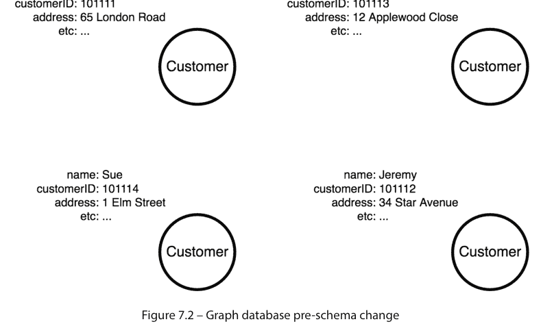
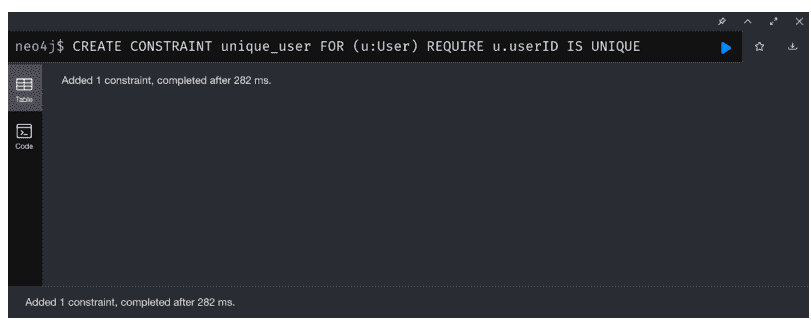
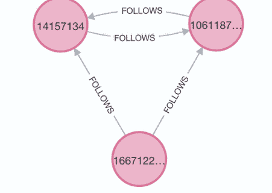
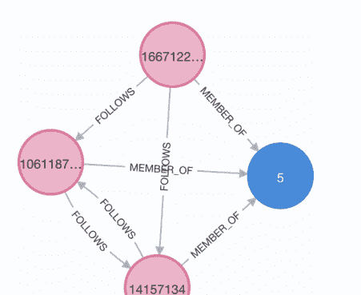

### 重构与模式演进

本章将花一些时间讨论什么才是好的模式，以及当你需要重构或变更模式时可以采取的方法。我们将探讨在图数据库中，实体可以发生哪些变化以及如何变化。这将进而引出为什么需要考虑模式演进。在这里，重点将放在如何让你的模式在演进过程中无懈可击。

接下来，我们将介绍一个 Twitter 圈子（Circles）的用例，其中会涉及设置 Neo4j 与 Python 之间的接口（这一点我们已在其他章节中详细介绍过）、为我们将在 Neo4j 中构建图数据模型所编写的 Cypher 查询添加约束，以及在模式变更前关于节点和边列表关系需要做的一些考量。然后，我们将根据假设的需求变更模式，同时不中断线上服务。最后，我们将反思为什么演进模式的设计对于成功的图数据管道至关重要。

总而言之，本章将涵盖以下主要内容：

- 重构的考量
- 有效演进
- 将变更投入开发

然而，对于关系型数据库来说，事情会随着数据点之间关系的不同而变得更加复杂。现在设想一下，我们希望为系统中的每位客户存储多个收货地址，以便客户可以从中选择。在我们的关系型数据库中，一个列将不再足以描述这些数据。每位客户可以有任意数量的地址，因此在客户表中为每个地址创建一列也不是一个可行的选择。在这种情况下，我们不知道要创建多少列；即使知道，档案中拥有大量地址的客户可能也不常见，结果会导致其他所有客户在这些列中包含大量空值。

相反，为每位客户添加多个地址需要对关系型数据库进行重构。一种典型的解决方案是创建一个新表，每个客户-地址对占一行，并从客户主表中删除地址列。这样既保持了唯一客户与其地址之间的关系，又需要在两个表之间复制客户 ID（或其他唯一标识属性）。

下图展示了演进中的模式对传统关系型数据库模式的影响：

| 客户 ID | 姓名 | 地址 | 其他.... |
|---|---|---|---|
| 101111 | Mark | 165 London Road | ... |
| 101112 | Jeremy | 34 Star Avenue | ... |
| 101113 | Johnson | 12 Applewood Close | ... |
| 101114 | Sue | 1 Elm Street | ... |

| 客户 ID | 姓名 | 其他.... |
|---|---|---|
| 101111 | Mark | ... |
| 101112 | Jeremy | ... |
| 101113 | Johnson | ... |
| 101114 | Sue | ... |

| 客户 ID | 地址 |
|---|---|
| 101111 | 165 London Road |
| 101112 | 34 Star Avenue |
| 101112 | 63 Hill View |
| 101113 | 12 Applewood Close |
| 101114 | 1 Elm Street |
| 101114 | 59 Sparrow Lane |

图 7.1 – 数据库模式演进的影响

在图数据库中，这种类型的模式变更实现起来更简单。图得益于没有固定结构，这是由数据点之间关系建模方式所赋予的特性。只要使用得当，图数据库对所建模的关系类型不加区分；无论是一对一、一对多还是多对多，关系始终由两个节点之间的边表示。这正是图 7.2 所强调的那类变更：



图 7.2 – 模式变更前的图数据库

由于每位客户可以有多个地址，我们可以将**地址**属性移动到一个独立的**地址**类型节点上，并通过一条边连接。现在，当为客户添加更多地址时，我们只需在图中增加另一个节点和一条边。这里，无需预先规定每位客户允许的地址数量，也无需在数据库的不同部分复制数据。

在*图数据模型*中，关系是有方向的。如果一个用户关注了另一个用户，并不要求反向关注也成立。

现在，设想在 Twitter 的持续开发过程中，它将发布一个名为*圈子（Circles）*的新功能。在早期版本中，每个用户只能与其他用户一起加入一个*圈子*。此时，我们可能会决定将用户圈子的 ID 作为属性添加到 User 节点上。使用属性来表示这一点是合理的，因为目前用户与其圈子之间是一对一的关系。

下图展示了当用户只属于一个圈子时，如何设置带有 FOLLOWS 关系的 User 节点：


图 7.4 – 每位用户一个圈子的模式

如果每个用户只能属于一个圈子，这种模式可以完美地工作。然而，如果 Twitter 的新更新允许用户属于多个圈子，会发生什么？在这次更新之后，用户与圈子之间的关系将变成一对多。如果我们将它们列在一个属性中，可能会变得难以处理，因为表示用户圈子成员身份的字符串可能会非常大。随着时间的推移，如果我们想利用图数据库中保存的信息来驱动前端应用中与圈子相关的任何行为，查询起来将非常困难。由于必须在一个长列表中搜索特定圈子，查询性能将受到影响。

相反，我们可以提前规划，把圈子属性移到独立的节点类型 Circle 上。每个节点都可以有唯一 ID，并可以从 User 节点向 Circle 节点建立关系。我们将这种关系称为 MEMBER_OF。

添加 Circle 节点不仅避免了为每个 User 积累冗长的属性列表，还消除了该属性中保存的圈子 ID 的重复问题。现在，每个圈子都由一个单独节点表示，并连接多个 User 节点。这将进一步提高性能，使图查询能够遍历现已连接起来的 User/Circle 网络。

此图显示了 User 作为某个特定圈子成员的情况，并通过关系展示还有谁关注该用户：

- 4. 和之前一样，我们需要添加一个具有管理员权限的新用户，以便从 Python 对 Neo4j 数据库运行 Cypher。在 Neo4j Browser 控制台中，运行以下命令：

```
:server user add
```

- 5. 这会打开一个窗口，你可以在其中输入新用户的用户名和密码。这里，我们将使用用户名 admin 和密码 testpython。在 Roles 下拉列表中，同时选择 admin 和 PUBLIC。最后，单击 Add User。

数据库设置完毕后，我们就可以添加 Twitter 模式的第一个迭代版本了。

#### 添加约束

在图数据库中，数据准确性绝对关键，因此我们可能需要考虑其他方法来确保数据严格符合我们的模式。我们之前已经探讨过，在发送写查询时使用 MERGE 语句而不是 CREATE 语句，以确保不会向数据库中添加重复节点。然而，使用约束会为我们的图数据增加一层额外的控制。

可以在 Neo4j 数据库中设置约束，以确保节点、边及其属性符合严格的规则。我们之前探讨过使用 MERGE 语句而不是 CREATE 语句，以确保在发送写查询时不会向数据库添加重复节点。然而，在防止重复方面，使用约束会为我们的图数据增加额外的一层控制。Neo4j 中可以使用多种类型的约束；更多实现方式请参阅 https://neo4j.com/docs/cypher-manual/current/constraints/。

在我们的 Twitter 模式中，我们确定了一些节点属性，它们在特定类型的所有节点中都应是唯一的。让我们为 User 节点添加一个唯一性约束，每个 User 节点都应具有唯一的 userID 属性。为此，我们需要编写一些 Cypher。创建此约束的步骤如下：

- 1. 我们可以使用 CREATE CONSTRAINT 函数添加约束，并为其命名为 unique_user。然后使用 FOR 指定该约束适用的节点类型，后面跟一个节点和所选别名——此处为 u。接着使用 REQUIRE 指定适用于该节点的约束类型，并断言 u.userID IS UNIQUE：

```
CREATE CONSTRAINT unique_user
FOR (u:User)
REQUIRE u.userID IS UNIQUE
```

可以在我们数据库的 Neo4j Browser 中运行这些语句来设置约束。运行后，浏览器应确认已添加一个约束。如图 7.6 所示：




Figure 7.6 – Neo4j Browser constraint

2. 现在让我们测试一下当我们尝试违反约束规则时会发生什么，在 Neo4j Browser 窗口中。首先，我们可以创建一个 userID 设为 100 的节点：

```
CREATE (u:User {userID: '100'})
```

然后，再次运行此查询。如果约束设置正确，浏览器窗口应返回类似“Node(2) already exists with label User and property userID = '100'.”的内容。此约束通过抛出错误来防止使用已存在的用户 ID 写入新节点。

3. 相比之下，让我们尝试使用 MERGE 添加同一个节点：

```
MERGE (u:User {userID: '100'})
```

在 Neo4j Browser 中运行后，我们应该会看到数据库没有变化。MERGE 语句匹配了 ID 为 '100' 的现有节点，并且随后没有向数据库写入任何新数据。

4. 在继续之前，我们应该通过在 Neo4j Browser 中运行以下命令来清除本节中添加到数据库的测试数据，就像我们在前几章中所做的那样：

```
MATCH (n) DETACH DELETE n
```

约束是确保数据符合诸如属性唯一性之类的模式要求的绝佳方式。在为用户设置了唯一性约束并对图数据模型有了更严格的控制后，让我们接下来看看如何向 Neo4j 添加一些 Twitter 数据。

2. 在函数准备好连接我们的 Neo4j 数据库后，我们可以考虑使用数据填充我们的图，首先从 edgelist 开始。我们需要使用内置的 Python csv 库打开 edges1.csv，并将每一行转换为列表，从而得到一个列表的列表：

```
import csv
with open('./data/edges1.csv', 'r') as c:
    reader = csv.reader(c)
    edgelist = [edge for edge in reader]
print(edgelist[:5])
```

3. 我们的 print 语句显示边已正确读入 Python。现在我们需要一种方法将这些用户 ID 及其 FOLLOWS 关系传输到 Neo4j，因此我们将为此编写一个单独的函数。函数将接收 n，即关注另一位用户的用户 ID，另一位用户的 ID 为 m。它还将接收使用 Neo4jConnect 建立的 Neo4j 连接。然后，我们可以使用这些参数组装一个简单的 Cypher 查询，使用 MERGE 以便不会复制现有节点和边。每个 User 节点首先合并到图中，然后是它们之间的 FOLLOWS 边。用户 ID 属性周围使用引号以确保它们作为字符串添加，符合我们在上一节中设计的模式。最后一步是使用我们的连接将写查询发送到数据库：

```
def add_edge_neo4j(n, m, connection):
    cypher = f'MERGE (u1:User {{userID: "{n}"}}) ' \
             f'MERGE (u2:User {{userID: "{m}"}}) ' \
             'MERGE (u1)-[:FOLLOWS]->(u2)'
    connection.query(cypher)
```

4. 让我们通过从 Python 添加一条边来测试此函数是否正常工作。我们可以使用列表切片获取导入的 CSV 中第一条边的源和目标：

```
connection = Neo4jConnect('bolt://localhost:7687', 'admin', 'testpython')
add_edge_neo4j(edgelist[0][0], edgelist[0][1], connection)
connection.close()
```

5. 如果操作成功，你应该会看到两个 User 节点和一条 FOLLOWS 边已添加到 Neo4j，使用 Neo4j Browser。为确认，我们可以在 Neo4j Browser Terminal 中运行以下命令：

```
MATCH (u:User) RETURN u
```

node attribute, using data read in from a CSV. We will first import the circles1.csv data, similarly to how we imported our edgelist, using the csv library:

```
with open('./data/circle1.csv', 'r') as c:
    reader = csv.reader(c)
    circles_raw = [row for row in reader]
print(circles_raw)
```

我们的 print 语句显示我们有一个列表的列表，每个列表都包含第一个元素中的 circle ID，其后是属于该 circle 的用户。我们需要将此格式解析为在 Cypher 查询中更易于处理的格式。

8. 让我们定义一个快速函数将此数据格式转换为 circle ID 和 user ID 的配对。我们称之为 get_user_circle_pairs()，它将仅接收从 circle1.csv 读取的数据。我们定义一个空列表，对于每个 circle 及其用户列表，使用列表推导式取 circle ID 从索引 0，以及一个 user ID。因为由此推导产生的列表中的第一个元素将包含两次 circle ID，所以我们取从第二个元素开始的切片。然后我们将每对追加到 pairs 列表并返回它：

```
def get_user_circle_pairs(circles):
    pairs = []
    for circle in circles:
        circle_pairs = [[user, circle[0]] for user in circle]
[1:]
        [pairs.append(pair) for pair in circle_pairs]
    return pairs
```

9. 一旦此函数定义完成，我们可以将 circle 数据传递给此函数，然后将相关输出打印到控制台：

```
pairs = get_user_circle_pairs(circles_raw)
print(pairs)
```

print() 的结果将显示 circle ID/user ID 配对。借助这种更易于消费的数据格式，我们可以继续将 circle ID 属性添加到图中的 Users。

10. 一旦此函数定义完成，我们可以将 circle 数据传递给此函数，然后将相关输出打印到控制台。

11. 我们需要为向 Neo4j 添加数据定义另一个函数。让我们称之为 add_circles_neo4j()。它将接收用户 ID、circle ID 和经过身份验证的 Neo4j 连接。正如我们在 add_edge_neo4j() 中所做的那样，我们将使用 f 字符串创建 Cypher 查询以替换字符串的一部分。我们的查询将使用 MATCH 查找具有特定用户 ID 的 User 节点，然后使用 SET 将 circle 属性添加到该节点。然后，只需使用 connection.query() 将写查询执行到 Neo4j 数据库即可：

```
def add_circles_neo4j(user_id, circle_id, connection):
    cypher = f'MATCH (u:User {{userID: "{user_id}"}})' \
```

```
f'SET u.circle = "{circle_id}"'
connection.query(cypher)
```

+   12. 在定义了添加 `circle` 属性的函数后，让我们为每个用户 ID/circle ID 对运行 `add_circles_neo4j()`：

```
for user_id, circle_id in pairs:
    connection = Neo4jConnect('bolt://localhost:7687', 'admin', 'testpython')
    add_circles_neo4j(user_id, circle_id, connection)
    connection.close()
```

+   13. 前往 Neo4j Browser 并通过实现类似于以下内容的 Cypher 查询来确认是否已为 User 添加了所需属性：

```
MATCH (u:User) RETURN u.circle
```

我们的图数据库目前已设置了 Twitter 数据的模式，在 Circles 功能的假设更改之前。现在，假设请求了一个新功能，允许用户成为多个 Circle 的成员。需要对模式和数据库进行更改以反映此新功能产生的数据。

在下一节中，我们将介绍如何更改模式以便在预模式更改时有效地更新。

#### Updating the schema

为了最好地说明为什么在允许每个用户拥有多个 Twitter Circles 时，我们可能更倾向于一种模式设计而不是另一种，我们将设想运行哪些查询来检索此数据。这些将在以下步骤中概述：

+   1. 目前，查找特定 circle 中的用户，当用户只能有一个时，可以通过简单的 MATCH 指定 `circle` 属性来完成：

```
MATCH (u:User {circle: '5'}) RETURN u
```

+   2. 然而，如果我们开始向 `circle` 属性添加内容以存储用户所属的额外 circle 的额外信息，例如作为列表，我们就需要更改此查询以包含 WHERE 语句并定位特定的 circle：

```
MATCH (u:User)
WHERE '5' in u.circle RETURN u
```

运行 Cypher 后，Neo4j Browser 窗口中的查询将如下所示：



Figure 7.8 – Follower connections with the updated schema

3. 现在，虽然当每个用户的 circle 数量较少时，这种查询是可以接受的，就像此功能更新发布时可能的情况一样，但随着用户成为越来越多 circle 的成员，这可能会扩展得非常糟糕。随着列表长度的增加，数据库引擎需要搜索越来越长的列表才能找到特定 circle 的成员。如果我们要查找共享多个 circle 的用户，或者如果我们尝试查找不互相关注但共享一个 circle 的用户以推荐新的 Twitter 用户，查询也可能变得非常复杂。通过提前规划，我们可以避免这些性能陷阱，因为数据库随着时间的推移变得越来越庞大。

4. 相反，我们可以重构数据库并将模式更改为图 7.5 中的模式，其中 circles 作为节点添加而不是属性。有了此模式，我们可以更好地利用我们的数据，因为基于路径的查询以查找远距离用户和 circles 之间的关系更容易计算。

5. 重要的是，考虑到在此示例中我们的数据库为活跃平台提供服务，我们不能像在前几章中所做的那样运行类似 MATCH (n) DETACH DELETE n 的操作。我们希望保留数据库中当前的数据以继续支持应用程序的当前状态。

6. 因此，我们将首先根据新模式添加数据，并在假设的功能部署完成时，删除符合旧的一用户一 circle 数据模型的数据。


``` 
'MERGE (u)-[:MEMBER_OF]->(c)'
connection.query(cypher)
```

12. 在此步骤中，我们可以使用 `add_circles_neo4j_new_schema()` 来通过遍历 `pairs2` 中的用户/圈子对向图中添加圈子节点：

```
for user_id, circle_id in pairs2:
    connection = Neo4jConnect('bolt://localhost:7687', 'admin', 'testpython')
    add_circles_neo4j_new_schema(user_id, circle_id, connection)
    connection.close()
```

13. 在添加了新的 Circle 节点后，让我们转到 Neo4j Browser 并创建一个 Cypher 查询来提取用户和圈子信息。我们的新模式允许我们使用 MATCH 来查找路径，而不是使用 WHERE 在大型属性列表中搜索，这是一种更适合图的查询类型。现在，我们可以使用 MATCH 来查找具有到特定圈子的 MEMBER_OF 关系的用户：

```
MATCH (u:User)-[:MEMBER_OF]->(c:Circle {circleID: '5'})
RETURN u, c
```

这会返回到特定圈子的 MEMBER_OF 关系，如 Neo4j Browser 结果中可视化所示：



图 7.9 – MEMBER_OF 关系

14. 我们需要做的最后一步，现在我们已经将新的图数据模型推广以反映我们对 Twitter Circles 的模拟更改，是删除旧数据。想象一下，现在我们的功能已完全上线，我们不再使用 User 节点上的 circle 属性，而是改用 Circle 节点来向应用程序的前端呈现信息。由于

从这一点开始，我们研究了构建初始模式（标记为更改前模式），它涉及 Python 和 Neo4j 脚本（用 Cypher 查询语言编写）的组合。

最后，最后一个阶段是考虑到我们所学到的所有内容并将其应用于我们更新的模式设计。

本章重点介绍了构建处理不断演进和更新模式所需的一切内容，这是在设计时应尽可能牢记的事情。

在下一章中，我们将进一步在我们迄今为止获得的所有知识的基础上进行构建，当我们研究图投影以及它们如何用于下游分析任务时。这些投影可以包含主图在分析上相关的、潜在聚合的拓扑和属性信息。此存储视图将包含图的在分析上相关的、潜在聚合的拓扑属性信息。
