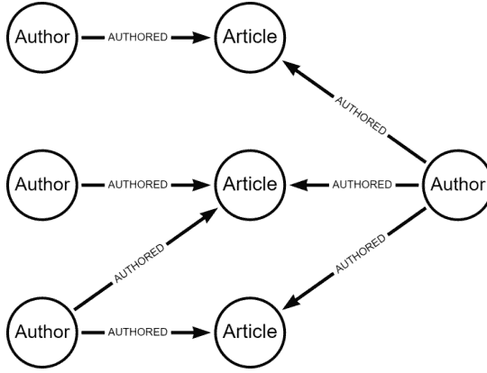
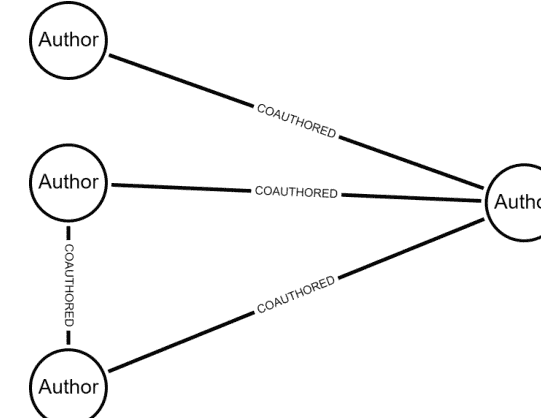
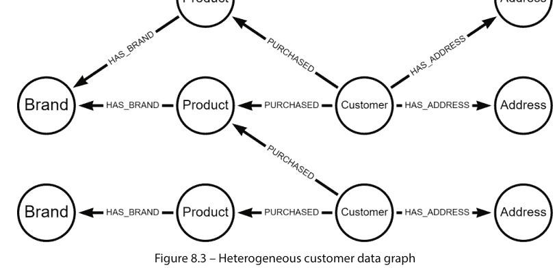
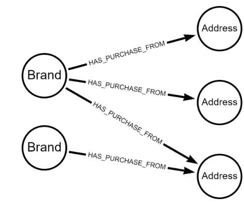
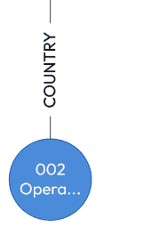
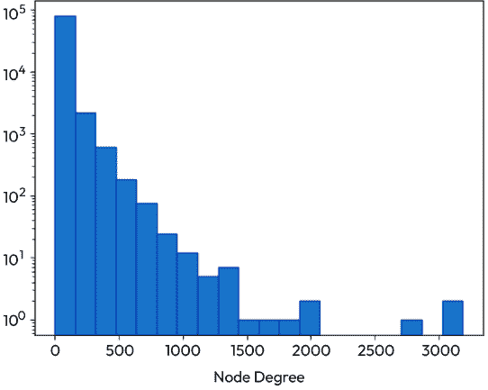
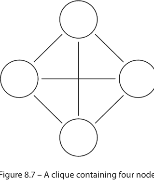

## 完美投影

在本章中，我们将重点关注创建图投影，您可以在其上执行复杂的分析，甚至使用机器学习和统计方法等其他算法来形成洞察。我们将首先解释投影是什么，然后介绍如何在实践中使用投影。我们将借鉴您如何在 igraph 和 Neo4j 中创建投影，使用 Cypher 查询语言和 Python 的组合。

对于我们的用例，我们将重点关注热门电影，重点使用图数据科学来查找演员出演过的电影、共同主演的电影以及我们可以用灵活的图结构定义的其他多种关系。到本章结束时，您将能够为您的用例创建投影并将其投入使用。

我们将涵盖以下主要主题：

- 什么是投影？
- 如何使用投影
- 让投影发挥作用

### 技术要求

我们将使用 Jupyter Notebook 运行我们的编码练习，这需要 `python>=3.8.0`，以及以下需要使用 `pip install` 命令安装到您环境中的软件包：

- `neo4j==5.5.0`
- `igraph==0.9.8`
- `matplotlib==3.6.3`

对于本章，您还需要安装 Neo4j Desktop。请参阅 *第 5 章，操作图数据库* 的 *技术要求* 部分，如果 Neo4j 尚未安装，因为它将需要用于跟随本章中的教程。

所有包含编码练习的笔记本都可在以下 GitHub 链接获得：`https://github.com/PacktPublishing/Graph-Data-Modeling-in-Python/tree/main/CH08`。

### 什么是投影？

图数据模型中的数据通常包含事物之间的关系，无论是人、语言、交通枢纽，还是我们在前几章中看到的其他示例。许多数据模型具有多种类型的节点和关系，使得一个节点或边在含义或价值上不等于另一个。

这类图被称为异构图，我们在本书中已多次看到它们。一种异构图是二分图，其中有两种类型的节点。在二分图中，只有不同类型的节点才能共享边。例如，引用网络可以用二分图表示，作者与他们撰写的文章相连。

使用多种节点和边类型的异构图的分析可能很棘手。为了说明这一点，首先考虑 *图 8.1* 中的作者图。我们可以轻松地使用该图的原生结构回答一些简单问题，例如使用节点度找到作者撰写的文章数量，或者相反，使用相同方法找到一篇文章的作者数量。

然而，要衡量作者群体合作的倾向，例如使用社区检测等算法（我们在 *第 4 章，构建知识图谱* 中使用过），我们需要遍历文章和作者之间的路径才能找到合理的社区。在二分图上运行社区检测等算法的结果在尝试检查仅作者或仅文章的群体的连通性时可能并不一定有意义：



图 8.1 – 二分作者图的示例

为了回答这些主要涉及作者而非文章本身的问题，我们可以使用投影。投影是图的表示形式——通常是复杂网络的简化版本。投影通常将图数据 *折叠* 成特定实体之间更简化的交互，这意味着在转换过程中信息会丢失。虽然信息会丢失，但分析变得更容易、更直观，并允许对图提出更直接的问题。

*图 8.2* 包含 *图 8.1* 所示二分图的单分投影。该图现在仅包含 **Author** 节点，如果原始二分图节点共享对同一合著 **Article** 的关系，则它们共享一条边。通过此投影，我们丢失了某些信息，例如每对作者合作的个别文章。然而，我们获得了在同构图上运行图算法的能力，例如前面提到的社区检测。我们可以在图仅包含 Author 节点时算法地将图 sensibly 分割为作者社区：



图 8.2 – 作者图的对应单分投影

其他类型的异构网络可能更复杂，具有众多节点和边类型，例如知识图。

知识图可以以高度复杂的模式表示大量信息——例如，包含详细客户信息的图，可能包含信息相互关联的许多不同方式。

*图 8.3* 显示了示例客户图数据库的样本，其中包含许多类型的节点和关系。在这种情况下，与二分图不同，简单的图度量，例如某些类型节点的度，将为您提供很少有用的信息。如果我们找到 **Customer**


此图中的节点是客户购买的产品与其地址信息的合并。

此外，在图形数据模型中，节点和关系类型数量众多时，以高效方式提出某些类型的问题可能很困难。考虑如何将地址信息与所购产品的品牌关联起来；我们必须遍历三条关系才能从 Address 节点到达 Brand 节点：



图 8.3 – 异构客户数据图

这里，我们可能会考虑使用客户数据的图投影来回答特定问题，尤其是如果我们经常向图数据库提出此类问题，例如作为推荐系统的一部分。

为了回答品牌与客户地址之间关系的问题，我们可以将这两种节点类型之间的路径压缩为一条边。这样做会丢失地址如何通过客户和产品与品牌关联的信息，但通过大幅减少在这些节点之间遍历所需的中继跳数，大大提高了回答这些节点类型之间关系问题的效率。现在我们可以轻松计算与某个地址关联的品牌数量，或者世界上哪些地点与购买特定品牌产品相关。

这些与不同地址关联的品牌可以在下图中看到，其中建立了 HAS_PURCHASE_FROM 边到节点关系：



图 8.4 – 复杂异构客户数据的二部投影

既然你已经了解了为什么我们可能会使用投影，我们将在下一节将该想法付诸实践。我们将探索一个大型电影信息数据集，创建投影以回答在异构知识图谱中难以回答的一些问题，并使用 Neo4j 中的一些技巧以高效方式处理数据。

### 如何使用投影

以下步骤将涉及设置 Neo4j 实例、创建数据存储以及使用 Cypher 处理我们的投影。这将结合我们在后续章节中学到的技能并将其集中应用：

- 1. 首先像前几章那样创建一个新的 Neo4j 数据库，用于存储电影知识图谱。我们将其命名为 Projection DB，并再次使用密码 testpython，然后启动数据库。
- 2. 正如我们在第 5、6、7 章中详述的那样，我们将使用 `:server user add`（在 Neo4j Browser 中）创建一个新的管理员用户，用户名为 admin，密码为 testpython，并添加 PUBLIC 和 admin 角色。有关如何执行此操作的更详细信息，请回顾前三章中的任何一章。
- 3. 在本章中，由于我们的数据集较大，我们将使用 LOAD CSV 将数据导入 Neo4j。为此，我们必须先将 movie.csv 移动到 Neo4j 可以访问的文件夹中。

在 Neo4j Desktop 主窗口中，点击 Projection DB 旁边的 ... 图标，然后选择 Open folder | Import。这将在文件资源管理器中打开该数据库的数据导入文件夹，我们应将 movie.csv 复制到其中（可在配套的 GitHub 仓库的 data 文件夹中找到）。

4. 我们还将使用 Neo4j 的 Awesome Procedures on Cypher（APOC）插件（https://neo4j.com/labs/apoc/4.1/installation/）进行数据导入步骤。要安装它，请转到 Neo4j Desktop 主窗口，选择 Projection DB 数据库，在窗口右侧找到 Plugins 选项卡。点击此选项卡，在 APOC 下方点击 Install and Restart。

5. 安装完成后，重启 Projection DB 数据库。

6. 完成所有这些设置后，是时候考虑向数据库添加数据了。一如既往，为了了解我们处理的数据，让我们查看添加至数据库导入文件夹的 movie.csv 文件的前几行：

```
002 Operazione Luna,COUNTRY,Italy
002 Operazione Luna,DIRECTOR,Lucio Fulci
002 Operazione Luna,STARRING,Ciccio Ingrassia
002 Operazione Luna,STARRING,Franco Franchi
002 Operazione Luna,STARRING,Linda Sini
```

这里我们看到 movie.csv 包含边数据，第一列和第三列包含相关实体的名称。通过检查，这些实体可以是不同类型的电影相关数据。每个实体通过第二列中的概念（COUNTRY、DIRECTOR 等）相关联。这种数据结构在创建图数据库时很常见，每一行被称为一个三元组。

7. 这次，我们的数据集似乎比以前处理的大得多。在将其加载到 Neo4j 之前，我们应该检查导入数据的一些属性。在 Python 中，我们可以读取数据集并首先检查行数：

```
import csv
with open('./data/movie.csv', 'r') as c:
    reader = csv.reader(c)
    data = [line for line in reader]

print(len(data))
```

8. 从 print 语句可以看到，movie.csv 包含超过 410,000 个三元组。我们还可以通过取第二列的 `set()` 来检查将要导入 Neo4j 数据库的边类型数量：

```
edge_types = set([triple[1] for triple in data])
print(edge_types)
```

这表明 movie.csv 中有四种不同的边类型：AWARD、DIRECTOR、COUNTRY 和 STARRING。这意味着我们的节点实体必须对应于奖项、导演、国家和演员，以及它们关联的电影。现在我们对可访问的数据有了更好的了解，可以设计 Neo4j 数据导入的方法。

随后使用 YIELD，它传递 `apoc.create.relationship` 的输出。我们可以传递 rel 输出，但不会使用它，因为我们正在写入图，不需要使用任何返回值。类似地，我们的子查询要求返回某些内容，但由于我们不需要，可以返回一个虚拟变量 x：

```
:auto LOAD CSV FROM 'file:///movie.csv' AS row
CALL {
    WITH row
    MERGE (n:Entity {name:row[0]})
    MERGE (m:Entity {name:row[2]})
    WITH n, m, row[1] as type
    CALL apoc.create.relationship(n, type, {}, m)
    YIELD rel
    RETURN 1 as x
} IN TRANSACTIONS OF 1000 ROWS
RETURN x
```

此查询将分批运行，根据 Neo4j 数据库运行的机器，可能需要几分钟。数据加载完成后，我们可以在 Neo4j Browser 中运行查询来检查数据结构是否符合预期。

14. 让我们查找一条应该存在于数据库中的边，例如对应于 movie.csv 中第一行的边。该边有两个实体：电影 002 Operazione Luna 和 Italy，通过 COUNTRY 边连接。我们可以使用 Cypher 匹配此边并返回它，以确认它在 Neo4j 中存在。运行此查询后，我们应该在 Neo4j Browser 中看到节点和 COUNTRY 边被返回：

```
MATCH (n:Entity {name:'002 Operazione Luna'})-[:COUNTRY]-(m:Entity {name:'Italy'})
RETURN n, m
```

匹配到电影的国家将显示在图形关系图中：



图 8.5 – 边上的实体匹配

将电影数据集加载到持久化数据库后，我们可以创建各种投影，以使用图数据回答不同问题。如果我们想查看哪些演员在各种电影中合作过，我们可以创建联合主演演员的投影。我们还可以创建投影，更深入地探讨哪些电影拥有共同演员，以及这在多大程度上受到拍摄国家的影响。接下来我们将解决如何生成这两个投影，然后再使用投影来合理且高效地分析数据。

### 在 igraph 中创建投影

让我们在 Python 中创建第一个投影，从 Neo4j 数据库读取数据并导入 igraph。为此，我们将使用一个我们创建的包来导入在这些图项目中反复使用的函数。我们将使用的函数是 Neo4jConnect，可以从 graphtastic 包中导入，该包位于配套的 GitHub 仓库中（本章 Technical requirements 部分提供了链接）。以下步骤将介绍导入此模块以连接 Neo4j，然后如何逐步使用 igraph 和 Python 创建投影。让我们开始吧：

- 1. 从 graphtastic 包导入 Neo4jConnect 类：

```
from graphtastic.database.neo4j import Neo4jConnect
```

- 2. 有了连接 Neo4j 数据库的类和方法，我们现在可以思考如何以图投影的形式从 Neo4j 获取一些数据。我们目标的投影是包含演员在电影中合作共演信息的图。在 Neo4j 数据库中，我们有 STARRING 关系，它将电影 Entity 节点连接到演员 Entity 节点。

- 3. 让我们通过在 Neo4j Browser 中使用一些 Cypher 查询一对共同出演同一部电影的演员，快速查看这些关系。这里，我们可以通过使用特定 STARRING 关系类型的 MATCH 来识别正确的 Entity 节点类型：

```
MATCH (act1:Entity)<-[:STARRING]-(film:Entity)-[:STARRING]->(act2:Entity)
RETURN act1, film, act2 LIMIT 1
```

从浏览器结果中我们可以看到演员通过电影相互连接。但在我们的投影中，我们希望连接共同主演的演员。因此，我们在 Python 中运行以获取投影边数据的任何 Cypher 查询，都需要找到具有此模式的节点和边，并且只返回包含演员信息的节点。

- 4. 知道了这一点，我们可以在 Python 中编写一个方法来访问这些演员数据，即 get_co_stars_neo4j()。该方法只需一个 Neo4j 连接对象，并使用我们在 Neo4j Browser 中通过 MATCH 语句找到的模式来查找共同主演的演员。我们只需要返回模式边缘的节点，此处别名为 act1 和 act2。我们使用 connection.query() 方法执行查询，并使用 result.data() 访问包含查询结果的字典列表。最后一步，我们通过访问


我们最终得到的节点名称属性包含在字典中，接下来将这些属性转换为共同出演演员的两两列表：

```
def get_co_stars_neo4j(connection):
    query = 'MATCH (act1:Entity)<-[:STARRING]-(film:Entity)'  \
            '-[:STARRING]->(act2:Entity)  '  \
            'RETURN act1, act2'

    result = connection.query(query).data()
    result = [[act['act1']['name'], act['act2']['name']] for act in result]

    return result
```

5. 现在，我们可以使用包含凭据的 Neo4jConnect 类创建 Neo4j 连接，调用 `get_co_stars_neo4j()` 获取共同出演演员的配对，之后记得关闭数据库连接。让我们打印前几对数据，确保一切符合预期：

```
connection = Neo4jConnect('bolt://localhost:7687', 'admin', 'testpython')
co_stars = get_co_stars_neo4j(connection)
connection.close()
print(co_stars[:5])
```

6. 有了包含演员配对的列表的列表，我们实际上就拥有了 Python 中的边列表，可以用它创建图。正如前面章节所介绍的，我们还需要节点列表和属性列表才能在 igraph 中组装图。

7. 我们可以使用双重列表推导式获取边列表中的所有节点，再对该列表取集合，从而得到唯一节点列表：

```
nodes = list(set([node for edge in co_stars for node in edge]))
```

8. 此外，我们可以通过创建字典为这些节点分配递增的整数 igraph ID。使用字典推导式，在唯一节点列表上调用 `enumerate()`，为每个节点创建映射后的递增 ID：

```
igraph_ids = {film:node_id for node_id, film in enumerate(nodes)}
```

9. 在 igraph 中，我们需要使用这些新 ID 向图添加边，因此必须将每个节点名称替换为 `igraph_ids` 中对应的唯一 igraph ID。我们可以再次使用推导式完成此项任务，得到一个对应于我们影片的整数对边列表：

```
edgelist = [[igraph_ids[n], igraph_ids[m]] for n, m in co_stars]
```

10. 现在我们已经拥有了组装图所需的一切：

    - I. 首先导入 *igraph*，并使用 `igraph.Graph()` 创建一个空图。

    - II. 接下来，使用 `add_vertices()` 向图添加节点，数量等于我们唯一 *igraph* 节点 ID 的数量。

    - III. 然后，通过图对象 `g` 的 `add_edges()` 方法，并将 ID 边列表作为参数传入，来连接这些节点。

    - IV. 最后，通过访问 `g.vs`，我们可以将演员属性按列表方式添加到每个节点，这些属性就是唯一节点列表中每位演员的名称：

```
import igraph
g = igraph.Graph()
g.add_vertices(len(igraph_ids))
g.add_edges(edgelist)
g.vs['actor'] = nodes
```

11. 作为最后一步，我们应该确保图的元素符合预期。我们可以使用 Python 中的 `assert` 语句来确保节点属性的命名正确，将其与节点演员名称列表进行比较。我们还可以确保节点数量符合预期：

```
assert g.vs[2]['actor'] == nodes[2]
assert len(g.vs) == len(nodes)
```

12. 为了最终确认我们的投影已按预期应用，让我们在 *igraph* 图中找到一条边，并在 Neo4j 中存储的原始图数据库中找到对应的路径。首先，为找到 *igraph* 图中一条边上的节点，我们可以访问图的 `g.es` 属性，并通过依次访问 `source` 和 `target` 属性，找到索引为 0 的边所连接节点的 ID。然后，使用这些 *igraph* 节点 ID，将该索引传入 `g.vs`，找到我们将在 Neo4j 中查找对应路径所用的演员属性，并将它们赋值给 `actor1` 和 `actor2` 变量：

```
actor1 = g.vs[g.es[0].source]['actor']
actor2 = g.vs[g.es[0].target]['actor']
```

13. 现在，我们可以使用 Neo4jConnect 打开一个到 Neo4j 的连接，并将这些演员名称插入 Cypher 查询中。我们可以使用 f-strings 构造有效的 Cypher 查询，查找我们最初查询 Neo4j 以创建投影时的 Entity | Film | Entity 模式。返回演员和影片后，使用 `.data()` 创建结果字典，然后使用 `.close()` 关闭连接，并将其打印到控制台：

```
connection = Neo4jConnect('bolt://localhost:7687', 'admin',
'testpython')
query = f'MATCH (act1:Entity {{name:"{actor1}"}}) \
          <-[:STARRING]-(film:Entity)' \
        f'-[:STARRING]->(act2:Entity {{name:"{actor2}"}}) ' \
        'RETURN act1, film, act2'
result = connection.query(query).data()
connection.close()
print(result)
```

这里的 print 语句应显示原始图中的有效路径，与我们在 igraph 中投影的边相对应，从而确认投影已正确创建：

```
[{'act1': {'name': 'Roger Pryor (actor)'}, 'film': {'name': 'The Man with Nine Lives (film)'}, 'act2': {'name': 'Boris Karloff'}}]
```

至此，我们从 Neo4j 中原始、复杂的知识图谱中提取了共同出演演员的投影，并将其设置在 igraph 中，以便进行进一步分析。我们将在最后一节回到这个投影，进一步探索这些数据。现在，我们将回到 Neo4j 浏览器，介绍另一种生成投影的方法，以备需要更持久地存储投影时使用。

### 在 Neo4j 中创建投影

虽然 Python 中的投影支持一些高度高级的数据分析，但它存储在内存中，因此不是持久的。如果我们想要一个可重复访问或需要长期存储的投影，我们可能也希望使用像 Neo4j 这样的图数据库。要构建我们的 Neo4j 投影，我们需要执行以下步骤：

1. 在 Projection DB 中，接下来我们将创建一个投影，将影片按照共享演员及其拍摄国家连接起来，以便进行更多分析。就本章而言，我们可以将这个投影与原始图数据一起存储，只要确保使用新的标签和边类型来保持该图独立即可。这可以防止之后在查询图获取见解时混淆信息。

2. 我们的新图将包含具有 name 属性的 Film 节点。正如我们对主要电影信息图所做的那样，我们首先为 Film 节点在 name 属性上创建索引。这将大幅加快使用影片名称进行匹配的操作。我们将使用本章前面“如何使用投影”部分第 9 步中相同的语法：

```
CREATE INDEX film
FOR (f:Film)
ON f.name
```

3. 接下来，我们可以继续查询现有的 Entity 节点以获取特定信息，并将这些信息添加到新的独立图投影中。这里我们将再次使用一些相当高级的 Cypher，并再次借助 APOC 插件。这次，我们使用 `apoc.periodic.iterate()` 函数将查询的执行分批进行。这可以防止 Neo4j 一次性加载过多数据到内存中，从而避免因达到内存限制而引发错误。我们将通过使用 CALL 调用 `periodic.iterate()` 来启动此查询，后面跟一个左括号，其中第一个参数包含匹配 Entity 节点的 Cypher 逻辑。我们希望在投影中连接具有共同演员的影片，因此需要匹配包含两部影片的路径，每部影片都与另一个实体具有 STARRING 关系，且该实体包含一位演员。路径匹配后，我们通过返回 film1 和 film2 结束第一个 Cypher 字符串，这两个节点就是我们想要添加到投影中的节点。

在 `periodic.iterate()` 中，第二个参数包含另一个 Cypher 字符串，其中包含对前一个查询返回结果进行处理的逻辑。对于找到的每条路径，我们希望合并两个新的 Film 节点，并为它们设置 name 属性。然后，我们可以将新创建的节点别名 f1 和 f2 用 HAS_COMMON_ACTORS 边连接起来。函数的最后一个参数是一个字典，包含如何执行批处理查询的信息。`batchSize` 值为 1000 告诉函数先从第一个 Cypher 查询参数中查找 1,000 条结果，然后再用这些结果执行第二个参数的 Cypher。我们传入的另一个选项是 `parallel`，当设为 True 时，允许以每批 1,000 条进行并行处理。在这个特定案例中，并行处理这些批次会因为更新期间节点锁定而导致错误，我们将在第 9 章“常见错误与调试”中详细讨论。现在，让我们用右括号结束这个复杂的 APOC 函数，并在 Neo4j 浏览器中运行查询：

```
CALL apoc.periodic.iterate(
  "MATCH (film1:Entity)-[:STARRING]->(actor:Entity)
    <-[:STARRING]-(film2:Entity)
  RETURN film1, film2",
  "MERGE (f1:Film {name:film1.name})
  MERGE (f2:Film {name:film2.name})
  MERGE (f1)-[:HAS_COMMON_ACTORS]->(f2)",
  {batchSize:1000, parallel:false}
)
```

这个批量查询可能需要几分钟才能运行完成，具体取决于运行它的机器配置。完成后，Neo4j 浏览器将显示完成 `apoc.periodic.iterate()` 任务所需的批次数，以及是否有任何批次失败。如果我们此处使用了 `parallel:true`，很可能会注意到一些批次失败，并且由于可能同时写入相同节点，一些写操作将无法完成。

4. 图结构设置好后，我们现在可以向节点添加额外属性。对于我们的图投影，我们关注影片拍摄的国家，而在主图中，这些关系由 COUNTRY 边表示。我们可以将此关系转换为一个属性，即影片拍摄国家列表。


2. 我们投影中的节点数量很有用，但我们本可以通过在原始知识图谱中搜索具有传入 STARRING 关系的唯一节点来找到数据中 Actor 节点的数量。边的数量相当于共同出演的演员数量，找到起来会稍微复杂一些，但这将涉及搜索与我们构建投影时所搜索的模式相同的唯一路径。

3. 让我们继续讨论一个使用知识图谱计算会更棘手，而使用投影则很简单的问题——度分布。通过从影片开始并返回到每位代表演员的节点的共同主演来搜索路径，以找到共同主演的数量，在原始图数据中会非常耗时。然而，有了我们的共同主演投影，我们只需统计每个节点关联的边数即可。

4. 我们可以使用 igraph g 对象上的 degree() 方法，找到每个 Actor 节点的边数，从而得出每位演员拥有的共同主演数量：

```
degree = g.degree(igraph_ids.values())
```

5. 让我们绘制图的度分布，以了解更多关于其结构的信息。我们可以通过导入 matplotlib.pyplot 并使用其 hist() 方法绘制节点度的直方图来实现。这里，我们对 y 轴使用对数刻度，因为现实世界的图通常具有长尾度分布。这些图有很多节点只有少量边，而少数节点则拥有大量边。使用 yscale('log') 将确保我们可以看到度分布右侧高度节点的频率：

```
import matplotlib.pyplot as plt
plt.hist(g.degree(), bins=20, edgecolor='#1260CC',
color='#3A9BDC')
plt.xlabel('Node degree')
plt.ylabel('Frequency')
plt.yscale('log')
plt.show()
```

该图表显示了按节点度划分的频率直方图（表示与各节点相连的边数）：



果然，我们的共同主演图确实具有长尾度分布。这告诉我们，绝大多数演员只与少数其他演员共同出演过，而极少数演员在职业生涯中与数千人合作过。

我们还可以看到，在分布长尾的最右侧，我们有三个 Actor 节点，其影片中的共同主演数量不成比例。让我们检查一下这些演员是谁。

- 6. 我们可以使用 `zip()` 通过访问节点度列表和 `g.vs['actor']` 的演员属性来创建度与演员名称配对的列表。`g.vs` 中每个节点的度结果顺序得以保留，因此我们可以安全地使用 `zip` 将它们并排放置。然后我们可以使用 `sorted()` 方法通过匿名函数按 `actor_degree` 列表中每对的第一元素进行排序，并使用 `reverse=True` 按降序排序：

```
```python
actor_degree = list(zip(degree, g.vs['actor']))
actor_degree = sorted(actor_degree, key=lambda x: x[0],
reverse=True)
print(actor_degree[:3])
```
```

打印我们排序列表中的前三个演员显示，在我们的数据集中，Moe Howard、Larry Fine 和 Mithun Chakraborty 是就与他人合作而言联系最紧密的演员，他们各自通过共同出演角色拥有约 3,000 条连接。

### 探索连通分量

我们图值得探索的另一个特征是连通分量的数量。如前几章所述，运行弱连通分量算法可以揭示我们的图是否完全连通，还是像现实世界图数据中经常出现的那样被分割成不相连的部分。在我们原始的知识图谱中，在进行投影之前，找到共同出演演员的连通分量会很困难。在知识图谱中使用弱连通分量算法并不能为我们提供关于演员关系的任何信息，而只是对我们图中的信息组件是否与其他存储的电影知识重叠的非常粗略的衡量。这将是一个非常粗粒度的衡量——国家节点和关系存在的可能性会使我们的知识图谱看起来比预期更紧密地连接。

以下步骤指导您如何探索构建的图中的连通分量：

- 1. 有了投影，我们可以更可靠地询问关于共同主演演员之间连通性的特定问题——在我们的数据中，是否有完全与其它共同主演群体断开的演员群体？为回答这个问题，让我们在 Python 中使用 igraph 的 components() 方法在图上运行弱连通分量算法。在此指定 mode='weak' 参数可确保我们仍然将边视为连接，而不管方向如何。这很重要，因为虽然边可以在 igraph 中以源和目标存储，但就共同主演演员图而言，边的方向无关紧要：

```
cc = g.components(mode='weak')
print(len(cc))
```

打印连通分量对象的长度，我们可以看到我们的图包含超过 3,000 个分量，因此远非完全连接。在我们的数据中存在孤立的演员孤岛，它们在图中通过共同出演电影与其它演员没有任何联系。

- 2. 我们可以通过查看最大连通分量的大小来进一步探索这一点。使用列表推导式，我们可以获取每个分量的长度，对应其节点数，并按降序对长度列表进行排序。打印列表切片将显示前几个分量的大小：

```
cc_size = [len(component) for component in cc]
cc_size.sort(reverse=True)
print(cc_size[:10])
```

我们的最大分量有 71,115 个节点，几乎构成了整个图。按大小排名第二和第三的分量分别只有 45 和 34 个节点，因此似乎在我们的共同演员图中，弱连通分量的大小也呈现长尾分布。

- 3. 由于从最大分量到接近最大分量的大小急剧减少，而总共又有超过 3,000 个连通分量，我们可能还想检查规模较小端的分量大小。我们可以使用 Python 内置 `collections` 模块中的 `Counter()` 来完成此操作，它会将我们的连通分量大小列表 `cc_size` 转换为大小和频率的字典。然后我们可以通过另一个匿名函数按其键（包含分量大小）对该字典进行排序，以找到分量大小的频率，从大到小：

```
```python
from collections import Counter
cc_freq = dict(Counter(cc_size))
cc_freq = sorted(cc_freq.items(), key=lambda x: x[0],
reverse=True)
print(cc_freq)
```
```

从 Python 控制台的输出中，我们可以看到我们有大量与图完全分离的微小分量。打印列表中的每个元组，第一元素包含分量大小，第二元素包含该大小的分量数量：

```
```text
[(71115, 1), (45, 1), (34, 1), (30, 2), (25, 1), (24, 1), (23,
3), (22, 2), (20, 1), (19, 2), (18, 2), (17, 3), (16, 5), (15,
7), (14, 5), (13, 5), (12, 8), (11, 17), (10, 23), (9, 37), (8,
69), (7, 86), (6, 125), (5, 242), (4, 416), (3, 675), (2, 1157),
(1, 522)]
```
```

最常见的分量大小是 2，可能来自在同一部电影中主演过且在我们的数据集中尚未主演过其他电影的演员。

### 探索图中的团

到目前为止，我们已使用共同主演投影查看了一些使用主要数据源知识图谱来计算或解释会很困难的图特征。让我们看看如何回答不同类型的问题。

有一群演员经常出现在同一部电影中。对于使用投影进行更高级类型的分析，我们可能希望识别出在职业生涯中某个阶段全部互相出演过的演员群体。我们可以通过在图中寻找 *cliques* 来做到这一点。

在图论中，clique 是网络中任何给定子图中一组节点彼此全部相互连接。如果该子图本身就是一个完整的图，我们称其为 *fully connected*。




在我们最初的知识图谱模式中，在进行投影之前，我们无法使用任何常规的团查找算法来寻找联合主演，因为节点会通过两条边和一个电影节点相关联。我们本可以编写一个自定义的、更复杂的方法，使用原始数据结构来查找联合主演的团，但由于需要遍历额外的边，这可能会导致性能更差。

相反，借助我们的投影，我们可以使用 *igraph* 及其 `largest_cliques()` 方法来查找图中最大的完全连通子图。这会返回一个集合内的节点列表。因此，让我们使用列表切片取出该列表的第一个元素，以简化输出。

在接下来的步骤中，我们将探索演员中最大的团：

1. 我们可以查看最大的联合主演团的大小以及其中包含哪些节点：

   ```python
   largest_clique = g.largest_cliques()[0]
   print(len(largest_clique))
   print(largest_clique)
   ```

2. 我们的打印语句显示，投影中最大的团由 65 个节点组成。我们还可以看到属于该团的节点 ID，但检查这些节点代表哪些演员会更有意义，因此接下来我们使用图 g 的 `vs` 属性和我们的 `largest_clique` 列表来查找每个团节点的 actor 属性。

   最后一步将揭示在我们的数据集中，那些在职业生涯中曾以某种方式相互合作过的演员：

   ```python
   clique_actors = g.vs[largest_clique]['actor']
   print(clique_actors)
   ```

我们已经对 *igraph* 中的联合主演投影进行了大量分析，并通过检查图结构深入了解了演员在电影中如何合作。

在下一节中，我们还有第二个投影需要分析，它在某些方面与我们的联合主演网络互补。

我们之前在 Neo4j 中建立的投影表示具有共同演员的电影，因此让我们深入使用该投影来洞察其中存在的有趣模式。

### 分析 Neo4j 电影投影

我们在 Neo4j 中的投影仅包含 `Film` 节点，如果它们有共同演员则共享一条边。让我们像之前在 *igraph* 中对联合主演投影所做的那样，首先描述我们图的一些基本信息。

以下步骤将告诉您需要在 Neo4j Browser 中执行的 Cypher 查询，以获得与我们在前几节中完成的 Python 分析类似的结果：

1. 首先，让我们在 Neo4j Desktop 中使用一个简单的 Cypher 查询来计算图中的节点数，使用 MATCH 仅查找 `Film` 类型的节点，并使用 `count()` 函数返回这些节点的数量：

   ```cypher
   MATCH (f:Film) RETURN count(f)
   ```

   控制台输出显示，我们的投影中有 79,478 个 Film 节点。在创建投影时，我们不得不编写批处理查询来读写数据，而大约 80,000 个节点通常不会给我们带来任何问题。

2. 我们还要检查构建投影时创建了多少个 HAS_COMMON_ACTORS 关系，方法是在我们的 `Film` 节点之间使用模式匹配该关系。这次，我们将关系别名为 r，并再次使用 `count()` 返回节点数：

   ```cypher
   MATCH (:Film)-[r:HAS_COMMON_ACTORS]->(:Film) RETURN count(r)
   ```

   现在，我们找到了耗时投影存储的根源：我们的图包含 5,774,715 条边。这使我们的图投影总体上高度连通。回顾一下我们的投影代表什么，这是有道理的——对于数据集中的每个演员，根据其出演的每部电影，电影之间会产生许多 HAS_COMMON_ACTORS 关系。例如，当一个演员出演过五部电影时，在我们的投影中会生成一个由五个 Film 节点组成的团。考虑到许多演员出演的电影数量远不止五部，我们的共享演员投影的高度连通性也就不足为奇了。

3. 在我们的 Neo4j 投影中，`Film` 节点上有一个节点属性，其中拍摄国家会被添加到列表中，对应知识图谱数据中发现的每个拍摄国家。我们可以使用 `country` 属性来分析电影之间的共同演员及其拍摄地点。

4. 让我们编写一个 Cypher 查询，查找在不同国家拍摄但有共同演员的电影，并找出最常见的拍摄地点组合。我们可以从 MATCH 语句开始，仅指定投影中的 `Film` 节点和 `HAS_COMMON_ACTORS` 关系，并确保不查询同一数据库中存储的知识图谱的其余部分。然后，我们可以使用 WITH 访问 Film 节点的 country 属性，并将它们别名为 c1 和 c2。我们感兴趣的是共享演员但拍摄地点不同的电影，因此我们将使用 <> 运算符来比较国家。然后，使用 WITH 将国家列表配对，我们可以返回 country_pair 以及每个唯一配对的 count()，这会隐式聚合我们的结果。最后一步是按 count(country_pair) 降序对结果排序，以便我们关注最常见的配对：

   ```cypher
   MATCH (f1:Film)-[:HAS_COMMON_ACTORS]->(f2:Film)
   WITH f1.country as c1, f2.country as c2
   WHERE c1 <> c2
   WITH [c1, c2] as country_pair
   RETURN country_pair, count(country_pair)
   ORDER BY count(country_pair) DESC
   ```

   在我们的结果中，我们可以看到共享演员的电影的拍摄地往往非常接近，一些顶级结果是美国和加拿大。语言似乎也有影响，共享演员电影的另一个常见拍摄地组合是美国和英国。我们最常见的结果显示了一对 `Cinema of Hong Kong` 和 `Hong Kong`，这暗示我们的数据本可以从额外的清理中受益——这在抓取的语义数据中相当常见，并且有助于指导原始知识图谱的数据质量改进。

### 总结

在本章中，我们使用 Python 和 Neo4j 创建、存储和分析图投影，展示了它们在结果效率和可解释性方面的强大能力。每种技术都有其各自的优势。与使用 Python 中的 *igraph* 轻松实现相比，在 Neo4j 中，我们难以直接使用复杂的图数据科学算法来分析投影。

然而，使用 Neo4j 是一种更永久的存储选择，适用于可能需要重复读写的投影。对于任何特定用例，重要的是考虑当前任务最合适的投影创建和存储工具是什么。

您所获得的这些技能将使您能够轻松地在 Neo4j、Python 和 igraph 之间切换，并为在这两种技术之间构建管道奠定坚实的基础——这确实是天作之合。

在下一章，也就是最后一章中，您将了解图数据科学家常见的一些棘手问题。这些课程将重点介绍调试（事实上，在数据科学中，唯一的学习方式就是编写不完美的代码，然后像夏洛克·福尔摩斯一样去调试这些代码）。然后，我们将通过让您深入了解在图数据科学工作中会遇到的一些常见错误来帮助您。
