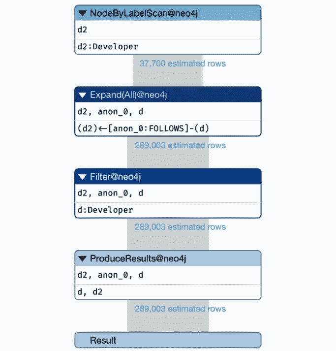

## 常见错误与调试

在本章中，我们将解决新晋图数据科学家或工程师（读完本书后您就是其中之一）会遇到的一些常见错误。重点将放在如何调试图问题上。这将引出在使用 *igraph* 时遇到常见问题及如何解决。接下来，我们将看看常见的 Neo4j 问题，因为本书大部分内容都是与 igraph、Python 和 Neo4j 打交道；因此，了解如何解决图数据库问题也很有用。我们还将讨论如何修改您的 *igraph* 和 Neo4j 脚本以获得最佳性能。

这些部分下有许多示例，说明了这些问题可能出现的场景和原因。因此，读完本章后，您将完全准备好调试并解决项目中的这些常见问题。在接下来的部分中，您将深入探讨在使用 igraph、Neo4j 和用于图数据建模的 Python 库时可能遇到的常见错误和问题。

总而言之，本章将涵盖以下主题：

- 调试图问题
- 常见的 igraph 问题
- 常见的 Neo4j 问题

### 技术要求

我们将使用 Jupyter notebooks 来运行编码练习，这需要 `python>=3.8.0`，以及以下包，这些包需要使用 `pip install` 命令安装到您的环境中：

- `neo4j==5.5.0`
- `igraph==0.9.8`


对于本章，你还需要安装 Neo4j Desktop。请参阅 *第 5 章，操作图数据库* 的技术要求部分，如果尚未安装 Neo4j，因为它将需要用于跟随本章中的教程。

所有包含编码练习的笔记本都可在以下 GitHub 链接获得：`https://github.com/PacktPublishing/Graph-Data-Modeling-in-Python/tree/main/CH09`。

### 调试图问题

随着图数据模型和分析在行业中得到更广泛的应用，以及图数据库解决方案和软件日益流行，你很可能会遇到可以用图形方式解决的数据问题。与此同时，图解决方案对许多企业来说仍然相当新颖，作为图数据从业者，你几乎肯定会遇到错误和问题。

在这里，我们将介绍在使用 *igraph* Python 库时你可能会遇到的最常见问题，以及在使用 Neo4j 时可能看到的一些标准错误和问题。每个问题都将通过简短示例来演示，以帮助你调试自己的问题。

每个错误或问题都将与一个可供你跟随并解决的真实示例一起展示。我们需要一些数据来演示在使用 Neo4j 和 Cypher 时可能遇到的一些问题。

对于本章，我们的示例将使用从 GitHub 收集的社交网络数据。这将包括 GitHub 开发者之间的关系数据。我们 edgelist `musae_git_edges.csv` 中的每条边代表两个相互关注的开发者。

我们还有开发者的名称，它们将是我们的节点，位于 `musae_git_target.csv` 中。我们的数据代表一个相当大的图，约有 38,000 个节点，近 290,000 条边。当然，你可能会遇到许多类型的图问题，就像我们在迄今为止处理过的所有示例数据一样，但在这里，为了演示 *igraph* 和 Neo4j 中关于错误和扩展问题的一些问题，将使用 GitHub 社交网络。

以下部分将介绍在使用 igraph 库时你将面临的常见问题。

#### 常见 igraph 问题

虽然 *igraph* 是图数据及其分析的强大库，但其大部分强大功能来自于 Python 充当其幕后 C 实现的接口。正因为如此，*igraph* 带有一些怪癖，在使用其功能时你需要牢记。在以下小节中，我们将带你了解在使用 Python 中的 *igraph* 时用户遇到的一些常见问题。

##### 图中没有节点

一些 Python 中的图和网络科学库可以直接从元组列表、edgelist 创建。在 *igraph* 中，由于 C 中节点索引的实现方式，节点必须在边连接它们之前添加到 Graph 对象中。在接下来的步骤中，我们将演示此问题以及由此产生的后续错误：

1. 我们可以首先使用内置的 csv 模块从 musae_git_edges.csv 读取边数据作为示例图加载到 *igraph* 中。此文件有标题，因此我们在列表推导式末尾使用列表切片，从 reader 对象构建列表，以将其删除：

```
import csv
with open('./data/musae_git_edges.csv', 'r') as c:
    reader = csv.reader(c)
    edges = [row for row in reader][1:]
```

2. 在这一点上，在许多库中，你可能会直接从 edges 列表创建图。但如果我们尝试这样做，我们将遇到错误：

```
import igraph
g = igraph.Graph()
g.add_edges(edges)
```

这会产生以下错误：

```
ValueError: no such vertex: '0'
```

3. 这里实际上有两件事发生。图中不存在名称为 0 的顶点，因为我们还没有添加任何节点。此外，我们正试图将字符串传递给 add_edges()，而 *igraph* 与之不兼容。我们可以首先通过 int() 和列表推导式将 edgelist 中的值转换为整数来修复此问题。然后，我们可以尝试再次添加边：

```
edges = [[int(edge[0]), int(edge[1])] for edge in edges]
g.add_edges(edges)
```

我们会看到这仍然不起作用，并得到一个新错误：

```
igraph.igraph.InternalError: Error at src/graph/type_indexed_edgelist.c:261: Out-of-range vertex IDs when adding edges. -- Invalid vertex ID
```

这就是我们在边列表中有一个尚未存在于图中的节点 ID 时遇到的错误。在 *igraph* 中，我们必须始终在添加边之前向图添加节点。

4. 正如我们在前几章中所示，我们可以使用双重列表推导式找到 edgelist 中两列中的所有节点 ID，包含在 edges 变量中，并取这些的集合。然后，我们只需计算此集合的长度：

```
nodes = set([node for edge in edges for node in edge])
print(len(nodes))
```

我们可以通过将其与数据集提供的 README.txt 文件进行比较来确认我们获得了正确的节点数。此集合的长度和 README 文件中显示的节点数应为 37,700。

请注意，此 edgelist 已经是 0 索引的，如果不是，则需要在此处采取额外的步骤来避免错误。我们需要为每个节点生成 ID，如果是这种情况，我们将在下一小节中介绍。

5. 现在我们知道应该添加多少个节点，让我们在添加边之前将节点添加到我们的 Graph 对象中：

```
g.add_vertices(len(nodes))
g.add_edges(edges)
```

6. 这次我们没有错误，边已成功添加到图中。让我们通过再次将其与 README 文件进行比较来检查边的数量是否正确。我们可以打印图 es 属性的长度以找到边的数量：

```
print(len(g.es))
```

我们的边计数是正确的，为 289,003。

##### igraph 中的节点 ID

在本书中，多次在我们的练习示例中，我们使用 igraph 将图加载到 Python 中。每次，我们都必须确保创建 igraph ID。

在 igraph 库中，图必须具有 0 索引的节点——没有例外。这是 igraph 能够快速加载数据并运行图算法的功能之一，利用其幕后的 C 实现。当我们有非 0 索引的数据时，我们需要首先将其转换以确保它是 0 索引的，并保留此转换的记录，例如在字典中。

以下是上述句子中提到的这些 0 索引标识符转换步骤的工作示例：

1. 首先，我们像往常一样初始化一个图（我们在前几章中已经多次这样做）：

```
g = igraph.Graph()
```

幸运的是，对于上一节，GitHub 开发者社交网络已经是 0 索引的。然而，许多数据集和 edgelist 并非如此，在使用 igraph 之前可能需要调整。在这种情况下，我们可以想象有额外的开发者被添加到网络中——没有理由他们都具有顺序的 ID 号，因此如果我们想将社交网络加载到图中以在 Python 中进行分析，我们必须处理这个问题。

2. 让我们看看在我们添加导入的 edgelist 的边到 igraph 时会发生什么。我们知道我们的图恰好有 37,700 个节点，使得最高有效节点 ID 为 37,699（因为 0 也是有效节点）。为了打破这种模式，我们可以将几条边添加到我们的 edges 列表的列表中，其中节点 ID 超出范围。我们将把这些添加到 new_edges 中：

```
new_edges = edges + [[40000, 0], [99999, 1], [40000, 99999]]
```

3. 因为 new_edges 中有新节点，我们将再次使用双重列表推导式和 set() 来找到新的唯一节点总数：

```
new_nodes = set([node for edge in new_edges for node in edge])
print(len(new_nodes))
```

我们添加了节点 40,000 和 99,999，因此我们新的唯一节点集合的长度应为 37,704。

4. 像往常一样，让我们现在向我们的 igraph.Graph 对象 g 添加与 new_nodes 长度等效的节点，并添加来自 new_edges 的边：

```
g.add_vertices(len(new_nodes))
g.add_edges(new_edges)
igraph.igraph.InternalError: Error at src/graph/type_indexed_edgelist.c:261: Out-of-range vertex IDs when adding edges. -- Invalid vertex ID
```

当我们尝试向图添加边时，我们会看到前面的错误。这是因为当调用 add_vertices() 时，igraph 已添加 ID 为 37,700 和 37,701 的节点，并且不知道 edgelist 中的节点名称不同。igraph 不知道如何处理 edgelist 中的 ID 40,000 和 99,999，因为没有等效的节点被添加，也没有办法让 igraph 将这些节点名称映射到节点 ID。igraph 图始终受限于节点上的 0 索引。

5. 为了解决这个问题，我们可以考虑将这些新节点映射到顺序且 0 索引的 igraph ID。让我们取我们之前通过查找 edgelist 中所有唯一节点而组装的 new_nodes 列表，并创建一个字典，将其 ID 映射到顺序的、0 索引的 igraph ID。我们使用 enumerate() 来实现这一点，它会遍历唯一 ID 并为每个 ID 创建一个顺序 ID，我们将其用作字典 igraph_ids 中每个原始 ID 键的值：

```
new_nodes = sorted(list(new_nodes))
igraph_ids = {node: igraph_id for igraph_id, node in enumerate(new_nodes)}
```


6. 我们可以通过访问新字典中的 igraph ID 值（指定键）来检查已分配给新节点的内容：

```python
print(igraph_ids[40000])
print(igraph_ids[99999])
print(igraph_ids[0])
```

我们的 print 语句显示，边列表中编号为 40,000 的节点已正确分配 igraph ID 37,000，编号为 99,999 的节点已分配 37,701。为了确保无误，我们还可以检查名称为 0 的节点是否仍被分配了 igraph ID 0，从而确认我们的 ID 映射字典已成功创建。

7. 利用新的字典映射，我们可以使用列表推导式重新创建边列表。这里，我们创建一个新的边列表 ig_edges，根据映射将每条边中的每个节点替换为其对应的 igraph ID。然后，我们可以使用 add_edges() 方法将这些新边添加到图中：

```python
ig_edges = [[igraph_ids[edge[0]], igraph_ids[edge[1]]] for edge in new_edges]
g.add_edges(ig_edges)
print(len(g.es))
```

通过访问图 g 的 es 属性的长度来打印边的数量，可以看到我们现在有 289,006 条边，比原始边列表多三条，这是正确的。

在接下来的部分中，我们将介绍添加节点属性的最佳实践或技巧。

### 添加属性

可以通过访问 igraph 图对象的 vs 和 es 属性来为节点和边添加属性。这可用于跟踪节点属性和度量，或简单地为图元素添加额外信息（如 ID）。

我们在前面的章节中已经展示过，节点和边属性可以按列表方式添加到图中，这比一次添加一个属性要高效得多。让我们通过向图中的节点添加 GitHub 开发者姓名来演示这一点。具体步骤如下：

1. 首先，与处理边列表时一样，我们使用 csv 模块将 `musae_git_target.csv` 中的数据导入 Python：

```python
with open('./data/musae_git_target.csv', 'r') as c:
    reader = csv.reader(c)
    node_attributes = [row for row in reader][1:]
```

2. 数据加载完成后，我们可以使用 `for` 循环直接遍历导入的 `node_attributes` 列表，通过访问 `g.vs` 中的不同节点，将开发者姓名作为节点属性依次添加到每个节点：

```python
for node_id, name in node_attributes:
    g.vs[int(node_id)]['developer_name'] = name
print(g.vs['developer_name'])
```

3. 这种方式虽然能按预期工作，但效率不高，因为每处理一个节点都需要反复访问图 `g`。相反，按列表方式添加节点属性要高效得多：先使用列表推导式从列表的第二个元素中提取 `developer_name` 属性，再将其添加到 `g.vs`：

```python
developer_names = [row[1] for row in node_attributes]
g.vs['developer_name'] = developer_names
print(g.vs[0]['developer_name'])
```

这里的结果完全相同，但所需的处理更少。然而，需要注意的是，当以列表方式向节点或边添加属性时，顺序极其重要。属性被添加到节点时，ID 为 0 的 *igraph* 节点会被分配列表中索引 0 处的属性值。添加到图中的属性列表顺序必须与 *igraph* 中节点 ID 的顺序一致。

4. 如果存在重复的节点属性信息，这可能尤其危险。我们可以通过在将姓名添加到图之前，向 `developer_names` 列表添加第一个元素的重复项来演示可能出现的错误：

```python
developer_names_dup = [developer_names[0]] + developer_names
g.vs['developer_name'] = developer_names_dup
```

5. 尽管列表长度比网络中的节点数多了一个元素，此操作仍会成功完成且不会抛出任何错误。本质上，这一行是静默出错的，因为它导致不仅是第一个节点，而是所有节点的开发者姓名都不正确，预期的名称都被偏移了一位。通过访问 ID 为 0 和 1 的节点的姓名，我们可以看出问题所在：

```python
print(g.vs[0]['developer_name'])
print(g.vs[1]['developer_name'])
```

6. 由于这种静默错误，使用 `assert` 语句来确保节点属性添加的预期行为是一种良好的实践。我们知道节点属性列表的长度应与图中的节点数相同，因此这是一个容易执行的测试：

```python
assert len(g.vs) == len(developer_names_dup)
```

这将会失败并抛出 `AssertionError`，警告我们数据预处理过程中出了问题。

至此，我们介绍了如何有效地向节点和边添加属性。在下一节中，我们将把注意力转向 select 方法。

### 使用 select 方法

在 igraph 中，正如我们在前面章节中探讨过的，可以使用 select() 方法分别对 Graph 对象的 vs 或 es 属性进行操作，从而从图中采样一系列节点或边。select() 方法可以按属性采样节点，也可以通过特殊的方法参数对节点和边进行即时计算，例如不同类型的中心性。

尽管这在分析中是很实用的功能，但在数据流水线中使用这种方式的 select() 方法可能会导致显著的效率问题。在计算计算上更复杂的节点或边度量时，这一点尤为明显。接下来的步骤演示了如何在 GitHub 开发者社交网络上使用它：

1. 首先，如果尚未创建，请使用本节开头的方法将 GitHub 边列表 CSV 作为 igraph 图 g 加载到 Python 中。现在，让我们使用 vs.select()（带有 `_degree_gt=2000` 参数，指定度数高于 2000 的节点）来查找图中高度数的节点：

```python
high_degree = g.vs.select(_degree_gt=2000)
```

2. 在这里，度数的计算是即时完成的，一旦选出高度数节点，计算结果就会被丢弃。对于一次性分析来说，这种 select() 方法的使用是可以接受的。然而，如果它被用作分析流水线的一部分，甚至在同一 Python 脚本中需要再次计算，那么计算整个图的度中心性并将其作为属性写入节点可能更有意义。这可以防止对同一度量进行重复计算。为此，我们只需使用 igraph 计算度数（或任何其他所需度量），结果将以列表形式返回。然后，通过访问 g 的 vs 属性并添加一个新的属性名，可以将该列表按列表方式添加到图中的节点：

```python
degree = g.degree()
g.vs['degree'] = degree
```

3. 既然每个节点的度数已作为节点属性添加，我们每次在代码中需要使用节点度数时，只需检索每个节点的 degree 属性即可。这意味着如果我们多次使用节点度数，就不必重复计算。请注意，这次我们的 select() 方法使用的是 `degree_gt` 参数，不带 `_` 前缀，表示我们要访问属性，而非 igraph 的 degree() 方法：

```python
high_degree = g.vs.select(degree_gt=2000)
print(list(high_degree))
```

请注意，对图进行的任何计算都需要一定的处理时间——测量每个节点的度数相当简单，但计算每个节点的介数中心性之类的度量则需要在图中找到所有节点对之间的最短路径，虽然这对某些分析目的很有参考价值，但效率要低得多。这需要大量的计算能力，并且与网络规模相关。当在图上计算计算特别复杂的度量时，这种 select() 的使用方式要优化得多。

在下一节中，我们将深入探讨链式语句及其与 select 的配合使用。这将展示避免这些方法出现问题的一些方式。

### 链式语句与 select

select() 方法可以与 vs 和 es 结合使用，通过索引、属性和即时计算的度量，以各种不同的方式访问节点和边。然而，如果要使用 select() 通过链式语句来采样节点或边，建议谨慎行事。以链式方式使用 select() 可能会产生意想不到的后果。

当使用 select() 时，它会根据用于查找节点还是边而生成 VertexSeq 或 EdgeSeq 对象。图的 vs 和 es 属性也分别具有 VertexSeq 和 EdgeSeq 类。因此，也可以对 select() 调用的结果再次使用 select()。

现在，我们将通过一个完整的示例来说明这一点：

1. 让我们使用 GitHub 开发者社交网络来演示这如何引发一些问题。我们可以通过在 select() 调用中使用一个可迭代对象作为第一个参数，来采样具有特定索引的节点。这里，我们选择 ID 为 0、1 和 2 的节点：

```python
sample = g.vs.select([0, 1, 2])
print(list(sample))
```

2. 正如我们之前所见，select() 也可以用于采样具有特定属性或度量的节点。这里，我们使用该方法（以 `_degree_eq` 作为特殊参数）查找度数恰好等于 100 的所有节点：

```python
degree_100 = g.vs.select(_degree_eq=100)
print(list(degree_100))
```

我们的 degree_100 变量现在包含一个 VertexSeq 对象，其中包含从原始图 g 中采样的节点。我们也可以对此使用 select 来进一步细化节点样本。然而，在使用 ID 来采样或检查特定节点是否存在时，我们应该保持警惕。

3. 想象这样一个场景：我们想通过检查某个节点是否存在，来测试使用 select 的采样方法是否正常工作。我们知道 ID 为 1075 的节点应该存在于这个 VertexSeq 中，因为它的度数恰好为 100。因此，我们可以使用 assert 语句来确保这一点：

```python
assert degree_100.select([1075])
```


也许令人惊讶的是，这个 assert 语句会引发一个错误，它告诉我们该节点超出了对象的范围。这将产生一条类似如下的错误消息：

```
ValueError: vertex index out of range
```

- 4. 尽管我们知道节点 1075 包含在 select() 的结果中，但使用 select() 会对返回的 VertexSeq 中的节点重新编号。节点 1075 已被重新编号为第 0 个元素，实际上可以这样访问：

  ```
  sample = degree_100.select([0])
  print(list(sample))
  ```

  运行 select() 时，我们并不一定能知道发生了怎样的重新编号，因此最好不要使用节点 ID 去搜索或进一步采样生成的 VertexSeq 对象，而是按节点属性进行采样，例如原始图中添加到每个节点的唯一标识符。重新编号不会影响按属性访问节点，因此链式调用 select() 会更安全。

在下一节中，我们将研究路径长度引发的问题，并处理一个可能发生这种情况的案例。

### 效率与路径长度

并非所有图算法都是同等的，每种算法都能计算或估计节点、边或整个网络的不同特征。它们在复杂度上也不相同，有些只需几毫秒即可运行，有些则需要数小时才能计算出结果。

在选择一种度量来了解图中节点的某些信息时，我们需要考虑用于度量某个特征的方法的计算复杂度。这通常与图的大小和连通性密切相关。

为了说明这一点，我们可以比较度中心性和介数中心性算法，这两种算法都试图计算图中节点的重要性，但方式不同。度中心性是一种简单的度量，统计每个节点的相连邻居数，其规模与图中的节点数成比例。

另一方面，介数中心性需要遍历图中所有节点对之间的路径，因此其规模不仅与节点数有关，还与边数有关。此外，由于它需要在节点之间查找短路径来估计节点重要性，其计算需求远高于计算度中心性。

虽然度中心性适合查找具有许多关联边的重要枢纽节点，但介数中心性可以向我们展示那些作为图中路径的重要通道的节点。这些概念相互关联，通常相关，但并不相同。然而，介数中心性在图上的计算时间总是比度中心性长几个数量级。它是

- 2. 转至 Neo4j 浏览器，并在浏览器中使用 `:server user add` 命令，就像我们在之前章节中多次做的那样。
- 3. 然后我们将添加一个新用户，并将该用户命名为 `admin`。我们还需要为该用户设置密码。这里我们将使用 `testpython`。你需要在 **Password** 和 **Confirm Password** 下输入两次此密码。
- 4. 完成此操作后，我们需要在 Neo4j 浏览器中应用 **admin** 和 **public** 角色。
- 5. 关于所有步骤的完整细节，我们在*第5章至第8章*中已经多次介绍过。
- 6. 我们还需要一些数据来演示在使用 Neo4j 和 Cypher 时可能遇到的某些问题，因此让我们将 `musae_git_edges.csv` 和 `musae_git_target.csv` 移动到我们数据库的 `Import` 文件夹中。
- 7. 我们可以从 Neo4j 浏览器主窗口访问此文件夹，点击 `Common Issues DB` 旁边的三个点，然后选择 **Open folder** 和 **Import**。为了让 Neo4j 能够访问我们的数据，请将数据文件拖入此文件夹。

现在我们已将所有数据放入 Neo4j 数据库，为流程中的下一步做好了准备。后续章节将演示你可能在使用 Neo4j 时遇到的常见问题。第一个问题是从文件向 Neo4j 写入速度慢的问题。在这里，我们将重点讨论如何*提升*对图数据库的写入速度。

### 从文件到 Neo4j 的慢速写入

在使用 Neo4j 和表格数据时，你经常会处理非常大的文件，例如 `.csv` 或 `.json` 格式的文件。我们通常使用 `LOAD CSV` 函数访问数据库 `import` 文件夹中的文件，并使用每一行的数据向 Neo4j 添加节点和边。然而，`LOAD CSV` 有许多不同的用法，并非所有用法都一样。

首先，让我们尝试使用以下 Cypher 脚本将节点和边从 `musae_git_edges.csv` 导入到 `Common Issues DB` 中。

在这里，我们只是调用 `LOAD CSV`，并加上 `WITH HEADERS`，因为我们的数据包含表头 `id_1` 和 `id_2`，并将每一行赋值给 `row` 变量。然后，我们可以使用取自 `row` 的 `githubId` 属性将每个 GitHub 开发者节点 `MERGE` 到图中，同时在带别名的节点 d1 和 d2 之间创建关系。在 Neo4j 浏览器中运行此代码，看看它的表现如何：

```
LOAD CSV WITH HEADERS FROM 'file:///musae_git_edges.csv' AS row
MERGE (d1:Developer {githubId:row.id_1})
MERGE (d2:Developer {githubId:row.id_2})
CREATE (d1)-[:FOLLOWS]->(d2)
```

你可能已经注意到，此查询运行得非常慢，具体取决于你机器的配置。但无论你的处理器性能如何或内存有多大，这个 Cypher 对它试图执行的数据导入来说都优化得极差。

在 Neo4j 中编写此查询时，你可能已经注意到查询出现下划线，鼠标悬停时会显示警告消息。该消息警告我们，查询使用了 EAGER 运算符，它会在查询运行时消耗大量内存。我们将在后面的小节中更详细地讨论 EAGER 运算符以及为什么要避免使用它。

让此查询更有效地运行的一个选项是使用子查询，将查询有效地拆分为多个较小规模的事务。这减少了 Neo4j 上的内存负载，因为它在写入节点和边时，每次只从 CSV 中加载固定数量的行。

这种类型的事务行为查询需要以 `:auto` 语句开头，后面跟上我们的 `LOAD CSV WITH HEADERS` 函数。接下来，我们使用 `CALL` 和花括号将向图中添加 GitHub 节点和边的逻辑括起来，以指定我们的子查询。唯一的改变是，我们需要使用 `WITH` 将 `row` 变量带入子查询。定义子查询后，我们可以使用 `IN TRANSACTIONS OF 1000 ROWS` 告诉 Neo4j 每次处理多少行 CSV。在 Neo4j 浏览器中运行此 Cypher 脚本，并将其运行时间与之前没有事务控制的查询进行比较：

```
:auto LOAD CSV WITH HEADERS FROM 'file:///musae_git_edges.csv' AS row
CALL {
  WITH row
  MERGE (d1:Developer {githubId:row.id_1})
  MERGE (d2:Developer {githubId:row.id_2})
  CREATE (d1)-[:FOLLOWS]->(d2)
} IN TRANSACTIONS OF 1000 ROWS
```

你应该会看到此查询比之前的查询快得多，因为 Neo4j 不再需要在查询运行时将整个 CSV 数据保留在内存中。这释放了内存，使其能够实际处理节点和边的写入，从而加速整个进程。

这当然是一个改进，但我们还可以做其他事情来加速大型数据集的加载，例如使用索引。

### 为查询性能建立索引

在 Neo4j 中，与其他数据库一样，我们可以创建索引来提高搜索性能。索引是针对特定的节点或边属性创建的，本质上会生成一份关于节点或关系属性的有序存储信息列表。当查询涉及搜索该属性时，会使用该索引，而这些属性列表的有序性极大地提高了查询性能在


占用一些存储空间，以及创建索引所需的一些初始时间。这将通过一系列步骤来完成：

- 1. 让我们通过比较上一节中写入查询在有索引和没有索引情况下的速度来演示这一点。首先，如果我们的图仍然包含数据，我们可以使用MATCH和DETACH DELETE将其删除：

```
MATCH (n) DETACH DELETE n
```

- 2. 现在，对于空图，让我们在Developer节点的githubId属性上创建索引。我们使用CREATE INDEX，指定名称githubId_index，然后用FOR标识它适用的节点类型，用ON标识要为其构建索引的节点属性：

```
CREATE INDEX githubId_index
FOR (d:Developer)
ON (d.githubId)
```

- 3. 现在，尝试重新运行上一节中用于向Neo4j数据库添加Developer节点的写入查询。你会注意到该查询的速度显著提升。当使用CSV数据创建节点时，会为githubId属性建立索引。然后，当使用MERGE语句借助索引添加新的Developer节点时，Neo4j可以更快地找到现有节点或确定它们不存在。

值得注意的是，索引不仅用于写入查询，而且用于涉及匹配特定属性的所有类型的查询。对于匹配许多包含Developer节点的路径并返回其信息的读取查询，在有索引的情况下运行速度远比没有索引时快。

索引的一个潜在缺点是，索引会占用大量存储空间，因此对很少查询的属性建立索引并不总是最优选择，尤其是在图非常大时。

如果需要删除很少查询属性上的索引，可以使用DROP INDEX，后跟之前调用CREATE INDEX时设置的索引名称：

```
DROP INDEX githubId
```

现在，让我们探讨一下在Neo4j中使用缓存查询可能遇到的问题，以及如何用一点Cypher来解决它们。

### 缓存结果

一个不太明显的查询性能提升来源是重复的相似或相同查询。Neo4j维护一个与先前运行查询输出相关的信息缓存。当在新数据库或最近重启的数据库上运行查询时，尚未缓存任何内容，但一旦查询开始遍历数据库中的节点和关系，后续查询性能就会受到缓存数据的影响。

让我们运行一个查询来演示这一点。以下查询将搜索我们的GitHub社交网络中关注至少10个其他开发者仓库的开发者。为此，我们匹配每个开发者（d）与其他开发者（d2）之间的所有关系。然后，我们使用collect()为每个节点形成所有被关注开发者的列表，并取其大小。这等于每个节点的出度，因此我们这样命名。我们将结果限制为出度至少为10的情况，并按此属性排序返回结果：

```
MATCH (d:Developer)-[:FOLLOWS]-(d2:Developer)
WITH size(collect(d2)) as degree, d
WHERE degree >= 10
RETURN d.githubId, degree ORDER BY degree DESC
```

这代表了跨节点的相当详尽的图遍历列表，因此每个节点和关系都会在初始MATCH语句中被考虑。尝试运行此查询一次，记下其速度，然后再运行几次。根据你机器的规格，你应该会注意到第一次执行之后的运行中查询速度有所提升。

这种在启动时运行查询的方法称为“预热缓存”。只要有足够的内存可用，Neo4j就会尽可能多地将查询期间遇到的节点和关系信息存储到内存中。当内存变得有限时，最旧的缓存数据将开始被替换。我们将在下一节中更详细地探讨这一点。

### 内存限制

当要求Neo4j执行某些高度复杂的查询时，你很可能会遇到可用内存问题。如果正在匹配特别大或复杂的模式，或者单个查询中发生大量读/写操作，Neo4j可能会耗尽内存来存储查询步骤之间的中间信息，导致查询处理速度急剧变慢。

在极端情况下，它可能完全耗尽可用内存，导致查询取消和Java错误消息，例如以下内容：

```
java.lang.OutOfMemoryError: Java heap space
```

运行更简单的查询来解决这个问题并不总是可行的，因此我们可以使用APOC库（https://neo4j.com/developer/neo4j-apoc/）来控制Neo4j处理中间结果的方式，特别是APOC.periodic中的函数。我们在第8章“完美投影”中处理非常大的图时首次遇到了这一点。要将APOC插件添加到我们的数据库，打开主Neo4j Desktop窗口，选择我们为本章设置的数据库Common Issues DB。窗口右侧会出现一个菜单，你应该从中选择Plugins选项卡。在此选项卡中，选择APOC，然后点击Install。

格式。初始数据质量较差会严重影响最终图的质量，因此Neo4j提供了一些技巧来防止低质量数据影响图的构建和分析。我们可以使用MERGE和CONSTRAINTS以几种方式处理Neo4j中的重复数据。在以下步骤中，我们将重点介绍使用MERGE函数处理重复数据：

- 1. 对于本小节，我们假设Neo4j数据库已填充了GitHub社交网络。如果没有，请先按照本节开头附近的步骤向Neo4j添加数据。
- 2. 在第5至8章中，我们使用了Neo4j中的MERGE函数，而不是CREATE函数，以防止在读取表格数据或从Python执行写入查询时创建额外节点。如前所述，MERGE函数首先运行一个匹配查询来查找指定的节点或模式，如果它已经存在，则不会向图写入额外节点。
- 3. 让我们使用MERGE运行一个基本查询，尝试向图写入一个已存在的节点：
- 4. 在Neo4j Browser中运行此查询时，结果输出将显示数据库没有发生任何更改。节点已匹配，因此没有执行写操作。为了说明这一点，让我们看看使用相同节点规范运行CREATE函数时的区别：
- 5. 输出将显示已添加一个节点。如果你愿意，可以使用相同命令运行MATCH查询，以直观显示现在数据库中存在的两个相同节点：
- 6. 虽然CREATE与MERGE的行为差异相当明显，但不太明显的是，MERGE的匹配部分是针对整个指定模式进行的。因此，如果你尝试将两个节点和一种关系合并到Neo4j中，而该模式中的所有节点、关系及其属性尚未匹配图中的整个模式，那么整个模式将被创建。
- 7. 让我们通过合并我们可能在边列表中找到的数据来演示这一点。这里，我们尝试合并图中已存在的Developer节点，以及它们之间尚不存在的FOLLOWS关系：

```
MERGE (d:Developer {githubId: '1'})
```

```
CREATE (d:Developer {githubId: '1'})
```

```
MATCH (d:Developer {githubId: '1'}) RETURN d
```

```
MERGE (d:Developer {githubId: '1'})-[:FOLLOWS]->(d2:Developer {githubId: '2'})
```

Neo4j输出显示图发生了一些更改。虽然本意是要找到githubId为1和2的节点并添加关系，但由于该关系尚不存在，现在已创建了两个带有边的重复节点。


- 3. 此外，如果我们尝试在图中有重复节点的情况下运行此 `CREATE CONSTRAINT` 查询，将会遇到错误，如下所示：

  ```
  Unable to create Constraint( name='githubId_constraint',
  type='UNIQUENESS', schema=(:Developer {githubId}) ):
  Both Node(2) and Node(3701) have the label `Developer` and
  property `githubId` = '1'
  ```

- 4. 此错误表明，如果约束已被 Neo4j 数据库中的当前数据失效，则无法创建约束。如果是这种情况，由于你已按照之前的示例操作，运行 `MATCH (n) DETACH DELETE n` 以清除所有数据，如我们之前所做。现在，在空白数据库或 Neo4j 中干净无重复数据的情况下，我们可以安全地使用 `CREATE CONSTRAINT` 查询创建约束。在 Neo4j Browser 控制台中运行 `SHOW INDEXES` 将显示已创建索引。如果数据库为空，请使用 *Common Neo4j issues* 部分开头的步骤将数据重新添加到数据库中。

- 5. 现在，让我们尝试使用 `MERGE` 添加一个关系，使用在 *Handling duplicates with MERGE* 小节中导致问题的节点和关系模式：

  ```
  MERGE (d:Developer {githubId: '1'})-[:FOLLOWS]->(d2:Developer
  {githubId: '2'})
  ```

- 6. 这次，正如预期，我们将遇到一个错误，由我们的数据库约束抛出：

  ```
  Node(2027) already exists with label `Developer` and property
  `githubId` = '1'
  ```

  整个 MERGE 模式都不存在，这意味着 Neo4j 尝试将两个节点和关系都添加到数据库中。但由于具有这些 githubId 的 Developer 节点已存在，因此写入操作不会执行。我们的约束按预期发挥作用，防止重复节点被添加到 Neo4j。

在这一节之后，我们将查看 `EXPLAIN` 和 `PROFILE` 函数以及 eager 操作符。

### EXPLAIN, PROFILE, and the eager operator

除了前面每个 Neo4j 问题小节中的提示之外，有时使用 Cypher 和 Neo4j 实现你所需目标的复杂性可能意味着组装冗长而复杂的查询。

在遇到棘手查询的执行缓慢或不正确的问题时，Neo4j 提供了两种工具来帮助你找出问题的根源。

`EXPLAIN` 和 `PROFILE` Cypher 函数是方便的工具，可以清楚地显示 Neo4j 将如何执行查询。使用它们，我们可以展示 Cypher 执行计划的流程，并定位低效之处。

`EXPLAIN` 在不实际执行查询的情况下显示查询的执行计划，并显示每个执行计划步骤中操作的估计行数，而 `PROFILE` 显示相同的计划但在数据库上运行查询，并显示处理的实际行数。

让我们使用 `EXPLAIN` 显示匹配连接的 GitHub 开发者的查询计划：

```cypher
EXPLAIN
MATCH (d:Developer)-[:FOLLOWS]->(d2:Developer)
RETURN d, d2
```

这将导致 Neo4j Browser 生成以下流程图：



Figure 9.1 – Neo4j EXPLAIN results

`EXPLAIN` 或 `PROFILE` 生成的流程图中的每个步骤都代表数据库正在执行的进程，并按操作符类型分类，例如 Expand 和 Filter。查询计划通常可以突出显示意外的执行行为——在这里，我们可以看到别名为 `d2` 的 Developer 节点，在我们查询的路径的右侧，实际上是首先定位的，然后再扩展到别名为 `d` 的节点。这对查询执行的速度没有影响，但其他查询计划模式和操作符可能影响更大。

```
MATCH (d2:Developer {githubId:row.id_2})
CREATE (d1)-[:FOLLOWS]->(d2)
```

查看这两个查询的 EXPLAIN 生成的执行计划，你会注意到 eager 操作符不再使用。这意味着 Neo4j 可以在不考虑写入冲突中数据完整性丢失的情况下处理每个查询，从而实现更快的执行。

在将非常大的数据集加载到 Neo4j 时，这通常比在单个 Cypher 查询中添加节点和边更高效、耗时更少。结合本节开头讨论的子查询和 TRANSACTIONS 技巧，这种加载数据的方法可以更有效地快速将数据导入 Neo4j。

本章到此结束，现在我们将总结你在本章中学到的内容，并结束本书。

### Summary

我们已经学习了很多作为有志于图实践者可能遇到的常见问题。这些问题基于多年处理这些问题的经验，它们在生产代码和系统中出现的频率比我们希望的要高。然而，随着时间的推移，这些问题往往会被 Python 代码中的有效错误处理和我们在 Cypher 脚本中可以建立的防御机制所覆盖。

我们主要研究的问题是如何在 igraph 和 Neo4j（图数据库）中调试错误。在 igraph 中，我们研究了如何正确创建图中的边的问题，其中我们研究了与节点索引相关的问题；我们将此节点索引问题扩展到分析 igraph 中的节点 ID 以及如何修复节点 ID 索引问题。然后我们研究了如何有效地添加属性，利用 igraph 的 vs 和 es 属性，深入了解 select() 方法的工作原理以了解如何使用它，有时使用该方法会存在不足，例如与 select() 结合使用链式语句以及这如何导致意外后果。最后，我们研究了如何通过查看路径长度和提高中心性算法性能的各种方法来使算法更高效。

关于 Neo4j，我们研究了从文件缓慢写入相关的问题以及如何克服或使用大型数据集加速写入。查询性能是下一个主题，我们研究了索引以及它对查询性能的影响；随后是 Neo4j 如何缓存结果以及对于大型数据集和路径遍历你可能希望避免这种情况。在查询性能部分，我们研究了如何使用 MERGE 语句处理 Cypher 查询中的重复项以及如何使用约束来处理重复项。调试是最后的重点。这里，我们研究了如何使用 Cypher EXPLAIN 和 PROFILE 命令为查询生成执行计划并调试可疑结果。此外，在调试部分，我们研究了 eager 操作符以及如何避免它，使 Neo4j 能够在不等待执行的情况下有效执行查询，同时仍然避免读写冲突问题。

这结束了本章，也确实结束了整本书。你拥有所有必要的知识，可以复制你在本书中学到的内容，去构建解决你数据问题的图解决方案。

在整本书中，我们专注于让你掌握图在现实世界中使用的基本原理；然后我们探讨了如何构建和处理图数据模型——本节的主要重点是让你熟悉图数据科学的 Python 库并构建一个基本推荐系统，用于根据用户的观看资料预测用户最喜欢的电视节目；随后是从关系数据库思维转向图数据库思维——这让我们接触到使用 MySQL 并构建类似的推荐引擎，但这次是预测用户可能感兴趣的视频游戏。知识图谱是下一个讨论主题，我们专注于数据摄取和清洗方法，然后构建知识图谱并在知识图谱之上应用社区检测；我们随后开始介绍图数据库的概念，并将 Neo4j 作为我们存储图连接和将 Neo4j 与 Python 和 igraph 接口的解决方案——我们使用的用例是，一旦所有数据都在图数据库中，就着手解决旅行优化方案。然后我们研究了构建生产管道。这专注于 Neo4j 和 Python 管道各个元素之间的交互组合。接下来，我们研究了如何为快速变化的模式做好准备以及在设计之初构建这些策略的方法。继续，我们研究了如何存储和利用图投影来进行分析和其它下游任务。最后，我们涵盖了最后一块拼图——研究在使用 igraph 和 Neo4j 时出现的一些常见问题和意外错误。

这真是一次过山车般的旅程，我们希望你喜欢沿途的每一个转折。这将你带过多年积累的知识，并将其提炼成这本书，这是一件令人愉快的事情。


