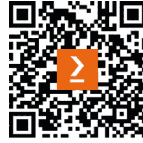

# 关于审阅者

**Yiqiao Yin** 是标普 500 公司 LabCorp 的高级数据科学家，为药物诊断和开发提供 AI 驱动的解决方案。他拥有罗切斯特大学的数学文学学士学位和金融理学学士学位。他曾是哥伦比亚大学的统计学博士生，研究兴趣广泛，涵盖表示学习：特征学习、深度学习、计算机视觉和自然语言处理。他曾担任 EURO STOXX 50 公司拜耳的企业级数据科学家、AQR 的量化研究员（致力于投资组合管理和因子交易的替代量化策略），以及华尔街 T3 Trading 的股票交易员。

**Nikita Dalvi** 是一位技术娴熟且经验丰富的专业人士，目前正在萨姆休斯顿州立大学攻读计算与数据科学硕士学位。凭借信息技术背景，她在过去五年中磨练了 Java 和 Python 等编程语言的技能，并曾在 Deloitte 和 Tech Mahindra 等知名组织任职。出于对编程的热情，她多年来自学了新的语言和技术，并始终紧跟最新的行业趋势和最佳实践。


# 其他你可能喜欢的书籍 294

本书还涵盖将 Detectron2 模型部署到生产环境以及为移动设备开发 Detectron2 应用的步骤。具体来说，它介绍了 Detectron2 支持的模型格式和平台，如 TorchScript 和 ONNX 格式。本书提供了使用跟踪（tracing）和脚本化（scripting）方法将 Detectron2 转换为这些格式模型的代码。此外，代码片段还演示了如何将 Detectron2 模型部署到 C++ 和浏览器环境中。最后，本书还讨论了 D2Go——一个用于训练、微调和量化计算机视觉模型的平台，使它们可以部署到计算资源需求较低的移动和边缘设备上。

通读本书，你会发现 Detectron2 对于任何想要构建强大计算机视觉应用的人来说都是一个有价值的框架。

## 本书读者对象

如果你是一名深度学习应用开发者、研究人员或软件开发者，且具备一些深度学习的基础知识，那么本书适合你入门并开发面向计算机视觉应用的深度学习模型。即使你已经是计算机视觉专家，对 Detectron2 的功能感到好奇，或者想学习一些前沿的深度学习设计模式，你也会发现本书很有帮助。如果你想使用 HTML、Android 和 C++ 等平台部署计算机视觉应用，具备一些相关的编程技能将会很有优势。

## 本书内容

第1章“Detectron2 与计算机视觉任务简介”介绍了 Detectron2、其架构以及 Detectron2 可以执行的计算机视觉任务。此外，本章还提供了使用 Detectron2 开发计算机视觉应用的环境搭建步骤。

第2章“使用现有 Detectron2 模型开发计算机视觉应用”指导你使用 Detectron2 Model Zoo 中的最先进模型为计算机视觉任务开发应用的步骤。因此，你无需训练自定义模型，即可快速开发实用的计算机视觉应用。

第3章“目标检测应用的数据准备”讨论了使用 Detectron2 训练模型的数据准备步骤。此外，当现有数据集采用不同格式时，本章还介绍了将标准标注格式转换为 Detectron2 所需数据格式的技术。

第4章“Detectron2 中目标检测模型的架构”深入探讨了 Detectron2 在目标检测任务中的架构。对于理解设计视觉系统深度神经网络时的常用术语，本章至关重要。

第5章“训练自定义目标检测模型”提供了准备数据、训练目标检测模型、选择最佳模型以及执行目标检测推理任务的步骤。此外，本章还详细介绍了通过扩展默认训练器并在训练过程中加入 hook 来开发自定义训练器的过程。

第6章“检查训练结果并微调 Detectron2 的 Solver”介绍了使用 TensorBoard 检查训练历史的步骤。它采用代码与可视化结合的方式，解释 Detectron2 求解器及其超参数背后的概念。相关概念包括梯度下降、随机梯度下降、动量以及可变学习率优化器。

第7章“微调目标检测模型”解释了 Detectron2 如何处理其输入，并提供了相关代码，用于分析训练数据集中的真实标注框，并找到合适的锚框尺寸和宽高比配置参数值。此外，本章还提供了以滚动方式从训练数据集中计算输入图像像素均值和标准差的代码。如果训练数据集很大且无法装入内存，这些超参数的滚动计算至关重要。

第8章“图像数据增强技术”介绍了 Detectron2 的图像增强系统，该系统包含三个主要组件：Transformation、Augmentation 和 AugInput。本章描述了这些组件中的类，以及它们在训练 Detectron2 模型时如何协同完成图像增强。

第9章“应用训练时和测试时图像增强”介绍了将这些现有类应用于训练的步骤。本章还解释了如何修改现有代码，以实现需要从不同输入加载数据的自定义技术。此外，本章还详细说明了在测试时应用图像增强以提高准确率的步骤。

第10章“训练实例分割模型”涵盖了以 Detectron2 支持的格式构建数据集并训练分割任务模型的步骤。本章还采用代码与可视化相结合的方式，解释使用 Detectron2 开发的实例分割应用的架构。

第11章“微调实例分割模型”介绍了 PointRend——Detectron2 内部的一个项目，有助于提高目标边界的清晰度。本章还介绍了使用现有 PointRend 模型以及使用 PointRend 训练自定义模型的步骤。

第12章“将 Detectron2 模型部署到服务器环境”引导你完成导出过程，将 Detectron2 模型转换为可部署的产物。然后，本章提供了将导出模型部署到服务器环境的步骤。

第13章“将 Detectron2 模型部署到浏览器和移动环境”介绍了 ONNX 框架。当需要将 Detectron2 模型部署到浏览器或移动环境时，它非常有帮助。本章还介绍了 D2Go，用于训练和量化轻量级模型，这些模型对于部署到移动设备或边缘设备极为有用。

## 如何充分利用本书

Detectron2、D2Go 和 PyTorch 都在积极开发中，因此 Detectron2 或 D2Go 可能与你所用的 PyTorch 版本或 Google Colab 默认提供的 PyTorch 版本不兼容。以下源代码已在 Google Colab 上使用下列版本进行了完整测试：

| 本书涵盖的软件/硬件 | 操作系统要求 |
|---|---|
| Python 3.8 和 3.9 | Google Colab |
| PyTorch 1.13 | |
| CUDA: cu116 | |
| Detectron2 (commit 3ed6698) | |
| D2Go (commit 1506551) | |

本书第1章还提供了安装说明和入门所需的信息。此外，本书还提供了 Code in Action 视频，你可以在其中查看所用全部包的 Python 版本和提交（commit）版本。

如果你使用的是本书的数字版本，建议你自己输入代码，或者从本书的 GitHub 仓库获取代码（链接见下一节）。这样做将帮助你避免因复制粘贴代码而可能产生的任何错误。

请注意，为了节省空间并保持版面清晰，书中省略了部分不太重要的代码。因此，直接从书中复制粘贴代码可能导致执行错误。建议使用本书 GitHub 仓库中的完整代码，详见下一节。

## 下载示例代码文件

你可以从 GitHub 下载本书的示例代码文件：https://github.com/PacktPublishing/Hands-On-Computer-Vision-with-Detectron2。如果代码有更新，会在 GitHub 仓库中更新。

我们还有来自丰富的图书和视频目录的其他代码包，可在 https://github.com/PacktPublishing/ 获取。欢迎查看！

## Code in Action

本书的 Code in Action 视频可在 http://bit.ly/40DJdpd 观看。


## 使用的约定

本书通篇使用了若干文本约定。

**正文中的代码：** 表示正文中出现的代码词、数据库表名、文件夹名、文件名、文件扩展名、路径名、示例 URL、用户输入和 Twitter 账号。示例为：“Mount the downloaded WebStorm-10*.dmg disk image file as another disk in your system.”

代码块的格式如下：

```css
html, body, #map {
  height: 100%;
  margin: 0;
  padding: 0
}
```

当我们希望引起您对代码块中某一部分的注意时，相关行或项目以粗体显示：

```text
[default]
exten => s,1,Dial(Zap/1|30)
exten => s,2,Voicemail(u100)
**exten => s,102,Voicemail(b100)**
exten => i,1,Voicemail(s0)
```

任何命令行输入或输出均按如下格式书写：

```shell
$ mkdir css
$ cd css
```

**粗体：** 表示新术语、重要词语或您在屏幕上看到的词语。例如，菜单或对话框中的词语以**粗体**显示。示例为：“Select **System info** from the **Administration** panel.”

> **提示或重要说明**
> 
> 显示如下。

## 联系我们

我们非常欢迎读者的反馈。

**一般反馈：** 如果您对本书的任何方面有疑问，请发送电子邮件至 `customercare@packtpub.com`，并在邮件主题中提及书名。

**勘误：** 尽管我们已尽力确保内容的准确性，但难免出现错误。如果您在本書中发现错误，我们将不胜感激您向我们报告。请访问 `www.packtpub.com/support/errata` 并填写表格。

**盗版：** 如果您在互联网上发现任何形式的非法复制品，我们将不胜感激您提供位置地址或网站名称。请发送链接至 `copyright@packt.com`。

**如果您有意成为作者：** 如果您在某个领域具有专业知识并有兴趣撰写或为书籍做出贡献，请访问 `authors.packtpub.com`。

## 分享您的想法

在您阅读完 *Hands-On Computer Vision with Detectron2* 后，我们很想听听您的想法！请点击此处直接前往本书在亚马逊的评论页面并分享您的反馈。

您的评论对我们和技术社区都非常重要，有助于确保我们提供优质内容。

## 下载本书的免费 PDF 副本

感谢您购买本书！

您喜欢随时阅读但又无法随身携带印刷书籍吗？

您的电子书购买不兼容您选择的设备吗？

不用担心，每本 Packt 书籍都附带一本免费的无 DRM PDF 版本。

随时随地在任何设备上阅读。直接从您喜爱的图书中搜索、复制和粘贴代码到您的应用程序中。

福利还不止于此，您还可以每天通过电子邮件获得独家折扣、新闻通讯和免费内容。

按照以下简单步骤获取福利：

- 1. 扫描二维码或访问下方链接



```
https://packt.link/free-ebook/9781800561625
```

- 2. 提交您的购买证明

- 3. 就这样！我们会直接将免费 PDF 和其他福利发送到您的电子邮件
