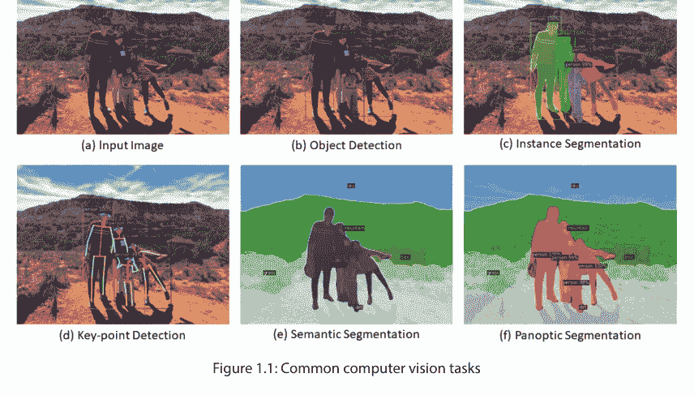
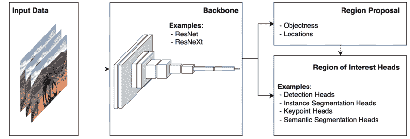
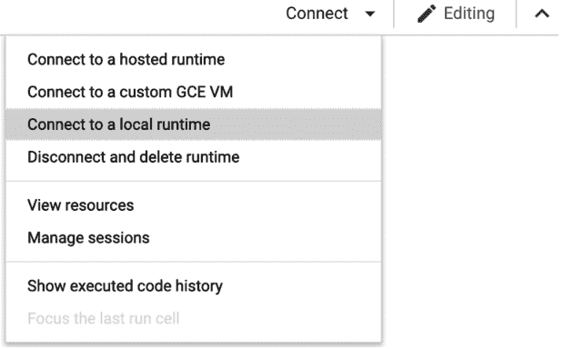
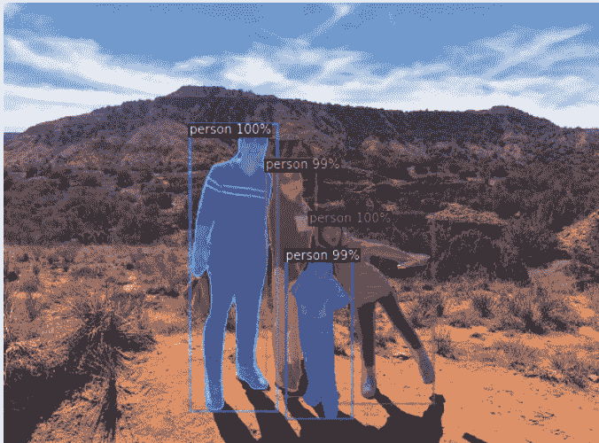

## Detectron2 和计算机视觉任务简介

本章介绍了 Detectron2、其架构以及 Detectron2 可执行的计算机视觉 (CV) 任务。换句话说，本章讨论了 Detectron2 可执行的 CV 任务以及我们为什么需要它们。此外，本章还提供了在本地或使用 Google Colab 在云端使用 Detectron2 开发 CV 应用的环境设置步骤。

到本章结束时，您将了解主要的 CV 任务（例如，目标检测、实例分割、关键点检测、语义分割和全景分割）；了解 Detectron2 的工作原理以及它如何帮助您使用深度学习解决 CV 任务；并能够为 Detectron2 应用设置本地和云环境。

具体而言，本章涵盖以下主题：

- 计算机视觉任务
- Detectron2 及其实架构简介
- Detectron2 开发环境

### 技术要求

Detectron2 CV 应用建立在 PyTorch 之上。因此，需要兼容版本的 PyTorch 才能运行本章中的代码示例。本章后面的部分将提供专门针对 Detectron2 的设置说明。所有代码、数据集和相应结果均可在本书的 GitHub 页面 https://github.com/PacktPublishing/Hands-On-Computer-Vision-with-Detectron2 上获取。强烈建议下载代码并跟随学习。

## 计算机视觉任务

深度学习在许多 CV 任务中取得了最先进的结果。最常见的 CV 任务是图像分类，其中深度学习模型为给定图像提供类别标签。然而，深度学习在最近的进步使计算机能够执行更高级的视觉任务。这些高级视觉任务有很多。

然而，本书专注于更常见和重要的任务，包括目标检测、实例分割、关键点检测、语义分割和全景分割。读者可能难以区分这些任务。图 1.1 描绘了它们之间的差异。本节概述了它们是什么以及何时使用它们，而本书的其余部分则侧重于如何使用 Detectron2 实现这些任务。让我们开始吧！



### 目标检测

目标检测通常包括目标定位和分类。具体而言，此任务的深度学习模型通过在图像中对感兴趣的目标应用边界框来预测目标所在的位置（定位）。此外，这些模型还会将检测到的目标分类为感兴趣的类型（分类）。

此任务的一个示例是在图片中指定人物并对检测到的人类应用边界框（仅定位），如图 1.1 (b) 所示。另一个示例是从记录的道路图像中检测道路损坏，通过为损坏提供边界框（定位）并进一步将损坏分类为纵向裂缝、横向裂缝、龟裂和坑洞等类型（分类）。

### 实例分割

实例分割与目标检测类似，也涉及目标定位和分类。然而，实例分割在定位检测到的感兴趣目标时更进一步。

具体而言，除了分类之外，此任务的模型还在像素级别上定位检测到的目标。换句话说，它识别每个检测到的目标的所有像素。实例分割在需要图像中检测到的目标的形状并需要跟踪每个单独目标的应用中是必需的。图 1.1 (c) 显示了对图 1.1 (a) 中输入图像的实例分割结果。具体而言，除了边界框之外，每个人的每个像素也被突出显示。

### 关键点检测

除了检测目标之外，关键点检测还指示检测到的目标的重要部位，称为关键点。这些关键点描述了检测到的目标的基本特征。该特征通常对图像旋转、缩小、平移或失真不变。例如，人类的关键点包括眼睛、鼻子、肩膀、手肘、手、膝盖和脚。关键点检测对于动作估计、姿态检测或人脸检测等应用很重要。图 1.1 (d) 显示了对图 1.1 (a) 中输入图像的关键点检测结果。具体而言，除了边界框之外，它还突出显示每个检测到的个体的所有关键点。

### 语义分割

语义分割任务并不检测对象的特定实例，而是将图像中的每个像素分类为感兴趣的某些类别。例如，在自动驾驶汽车应用中，此任务的模型将图像区域分类为行人、道路、汽车、树木、建筑物和天空。此任务在提供不同类别的对象组的更广阔视图时很重要（即对图像有更高层次的理解）。具体而言，如果一个区域中存在单个类别实例，它们会被归为一个掩码，而不是为每个单独实例提供不同的掩码。

语义分割应用的一个示例是将图像分割为前景对象和背景对象（例如，模糊背景并为肖像图像提供更艺术的外观）。图 1.1 (e) 显示了对图 1.1 (a) 中输入图像的语义分割结果。具体而言，输入图片被划分为被分类为事物（人或前景对象）和背景对象（如天空、山、泥土、草和树）的区域。


具体来说，它*更快*且更准确，因为在重新实现前沿算法时，Detectron2 有机会发现这些算法旧版本中的次优实现部分或过时特性并重新实现。它是*模块化*的，即将其实现划分为子部分。这些部分包括输入数据、主干网络、区域提议头和预测头（下一节将介绍更多关于这些组件的信息）。它是*可定制*的，意味着其组件具有内置实现，但可以通过调用新实现进行定制。最后，它构建在 PyTorch 之上，这意味着有大量开发者资源在线可供帮助使用 Detectron2 开发应用。

此外，Detectron2 提供了具有最先进检测结果的*预训练模型*用于 CV 任务。这些模型是在 Facebook 研究实验室使用大量图像和在其他机构可能无法获得的高计算资源训练的。

这些预训练模型发布在其 Model Zoo 中，可免费使用：https://github.com/facebookresearch/detectron2/blob/main/MODEL_ZOO.md。

这些预训练模型帮助开发者快速开发典型的 CV 应用，而无需收集、准备大量图像，或需要高计算资源来训练新模型。然而，假设需要针对特定领域和自定义数据集开发 CV 任务。在这种情况下，这些现有模型可以作为起始权重，并且整个 Detectron2 模型可以在自定义数据集上重新训练。

最后，我们可以将 Detectron2 模型转换为*可部署的产物*。具体来说，我们可以将 Detectron2 模型转换为标准深度学习框架的标准文件格式，如 `TorchScript`、`Caffe2 protobuf` 和 `ONNX`。这些文件随后可以部署到其对应的运行时，如 PyTorch、Caffe2 和 ONNX Runtime。此外，Facebook AI Research 还发布了 **Detectron2Go (D2Go)**，这是一个平台，开发者可以在此将 Detectron2 开发更进一步，创建针对移动设备优化的模型。

总之，Detectron2 实现了前沿检测算法，具有快速、准确、模块化以及构建在 PyTorch 之上的优势。Detectron2 还提供预训练模型，使用户可以快速入门并使用最先进的结果构建 CV 应用。它也是可定制的，因此用户可以更改其组件或在自定义业务领域上训练 CV 应用。此外，我们可以将 Detectron2 导出为标准深度学习框架运行时支持的脚本。此外，名为 Detectron2Go 的初始研究支持为边缘设备开发 Detectron2 应用。

在下一节中，我们将研究 Detectron2 架构，以了解其工作原理以及定制其各个组件的可能性。

## Detectron2 架构



图 1.2：Detectron2 的主要组件

Detectron2 具有模块化架构。图 1.2 描绘了标准 Detectron2 应用中的四个主要模块。第一个模块用于注册输入数据（Input Data）。

第二个模块是用于提取图像特征的主干（Backbone），随后是第三个模块，用于提出有无物体的区域以供下一个训练阶段使用（Region Proposal）。最后，最后一个模块使用适当的头（例如检测头、实例分割头、关键点头、语义分割头或全景分割头）来预测包含物体的区域并将检测到的物体分类为类别。第 3 章至第 5 章讨论了这些组件用于构建物体检测任务的 CV 应用，第 10 章和第 11 章详细介绍了这些组件用于分割任务。以下各节简要讨论这些组件的一般情况。

### 输入数据模块

输入数据模块旨在使用缓存和多 worker 等优化技术从硬盘以大批量加载数据。此外，相对容易将数据增强技术插入到此模块的数据加载器中。此外，它被设计为可定制，以便用户可以注册其自定义数据集。以下是使用此模块将自定义数据集分配给训练 Detectron2 模型的典型语法：

```
DatasetRegistry.register(
    'my_dataset',
    load_my_dataset
)
```

### 主干模块

主干模块从输入图像中提取特征。因此，此模块通常使用 ResNet 或 ResNeXt 等最先进的卷积神经网络。此模块可以定制以调用在感兴趣的图像分类任务中表现良好的任何标准卷积神经网络。值得注意的是，此模块对迁移学习有大量了解。具体来说，如果我们想使用在 ImageNet 等大型图像数据集上表现良好的最先进卷积神经网络，我们可以在此处使用这些预训练模型。否则，我们可以选择此模块的简单网络以提高性能（训练和预测时间），以准确性为代价。第 2 章将讨论为常见 CV 任务在 Detectron2 Model Zoo 上选择合适的预训练模型。

以下代码片段显示了使用此模块注册自定义主干网络以训练 Detectron2 模型的典型语法：

```
@BACKBONE_REGISTRY.register()
class CustomBackbone(Backbone):
    pass
```

### 区域提议模块

下一个模块是区域提议模块（Region Proposal）。此模块接受来自主干提取的特征并预测或提出图像区域（带位置规范）以及分数以指示区域是否包含物体（带物体性分数）。所提议区域的物体性分数可能为 0（表示没有物体或为背景）或 1（表示确信预测区域中存在感兴趣的物体）。值得注意的是，此物体分数不是属于感兴趣类别的概率，而是简单地表示区域是否包含物体（任何类别）或不（背景）。

此模块默认设置了区域提议网络（RPN）。然而，用自定义网络替换此网络相对容易。以下是使用此模块注册自定义 RPN 以训练 Detectron2 模型的典型语法：

```
@ROI_BOX_HEAD_REGISTRY.register()
class CustomBoxHead(nn.Module):
    pass
```

### 感兴趣区域模块

最后一个模块是感兴趣区域（RoI）头的位置。根据 CV 任务，我们可以为此模块选择适当的头，例如检测头、分割头、关键点头或语义分割头。例如，检测头接受区域提议和所提议区域的输入特征，并将它们通过全连接网络传递，具有用于预测和分类的两个独立头。具体来说，一个头用于预测物体的边界框，另一个用于将检测到的边界框分类为相应类别。

另一方面，语义分割头也使用卷积神经网络头将每个像素分类为感兴趣的类别之一。以下是使用此模块注册自定义感兴趣区域头以训练 Detectron2 模型的典型语法：

```
@ROI_HEAD_REGISTRY.register()
class CustomHeads(StandardROIHeads):
    pass
```

现在你已经了解了 Detectron2 及其架构，让我们为开发 Detectron2 应用准备开发环境。

## Detectron2 开发环境

现在，我们了解了高级 CV 任务以及 Detectron2 如何帮助为这些任务开发应用。是时候开始开发 Detectron2 应用了。本节提供在云端使用 Google Colab、本地环境或连接 Google Colab 到本地托管运行时的混合方法设置 Detectron2 开发环境的步骤。

### Detectron2 应用的云开发环境

Google Colab 或 Colaboratory（https://colab.research.google.com）是一个云平台，允许你从网络浏览器编写和执行 Python 代码。它使用户能够以零配置开始开发深度学习应用，因为大多数常见的机器学习和深度学习包，如 PyTorch 和 TensorFlow，已预先安装。此外，用户可免费使用 GPU。即使使用免费计划，用户也能获得相对优于标准个人电脑的计算资源。如果需要，用户可以支付少量费用升级为 Pro 或 Pro+ 以获得更高的计算资源。此外，正如其名称所示，Google Colab 相对容易协作，并且易于共享 Google Colab 文件和项目。

CV 任务的深度学习模型使用大量图像；因此，GPU 可显著加快训练和推理时间。然而，默认情况下，Google Colab 未启用 GPU 运行时。因此，用户应在安装 Detectron2 或训练 Detectron2 应用之前启用 GPU 硬件加速。此步骤是选择 GPU，如图 1.3 所示，从 Runtime | Change runtime type 下的 Hardware accelerator 下拉菜单中选择：


### 笔记本设置

硬件加速器
GPU

要充分利用 Colab，除非需要，否则避免使用 GPU。了解更多

后台执行

即使关闭浏览器，也想让笔记本继续运行？升级到 Colab Pro+

保存此笔记本时省略代码单元格输出

取消 保存

图 1.3：为硬件加速器选择 GPU

Detectron2 有一个关于如何在 Google Colab 上安装 Detectron2 的专门教程。不过，本节将讨论每个步骤并提供更多细节。首先，Detectron2 基于 PyTorch 构建，因此我们需要安装 PyTorch。默认情况下，Google Colab 运行时已经安装了 PyTorch。因此，你可以使用以下代码片段在 Google Colab 上安装 Detectron2：

```
!python -m pip install \
'git+https://github.com/facebookresearch/detectron2.git'
```

如果你收到如下错误信息，可以安全地忽略它并继续：

```
ERROR: pip's dependency resolver does not currently take into account all the packages that are installed. This behaviour is the source of the following dependency conflicts.
flask 1.1.4 requires click<8.0,>=5.1, but you have click 8.1.3 which is incompatible.
```

但是，如果你遇到诸如 Google Colab 上的 PyTorch 版本与 Detectron2 不兼容的问题，那么你可以针对特定版本的 PyTorch 和 CUDA 安装 Detectron2。你可以使用以下代码片段获取 PyTorch 和 CUDA 版本：

```
import torch
TORCH_VERSION = ".".join(torch.__version__.split(".")[:2])
CUDA_VERSION = torch.__version__.split("+")[-1]
print("torch: ", TORCH_VERSION, "; cuda: ", CUDA_VERSION)
```

在了解 PyTorch 和 CUDA 版本后，你可以使用以下代码片段安装 Detectron2。请记得将 TORCH_VERSION 和 CUDA_VERSION 替换为前一个代码片段中找到的值：

```
!python -m pip install detectron2 -f \
https://dl.fbaipublicfiles.com/detectron2/wheels/{TORCH_VERSION}/{CUDA_VERSION}/index.html
```

以下是针对 CUDA 11.3 和 PyTorch 1.10 版本的安装命令示例：

```
!python -m pip install detectron2 -f \
https://dl.fbaipublicfiles.com/detectron2/wheels/cu113/torch1.10/index.html
```

如果你遇到如下错误，这意味着没有与当前 PyTorch 和 CUDA 版本匹配的 Detectron2 发行版：

```
ERROR: Could not find a version that satisfies the requirement detectron2 (from versions: none)
ERROR: No matching distribution found for detectron2
```

在这种情况下，你可以访问 Detectron2 安装页面，查找与当前 PyTorch 和 CUDA 版本兼容的发行版。该页面位于 https://detectron2.readthedocs.io/en/latest/tutorials/install.html。

图 1.4 展示了当前 Detectron2 发行版及对应的 CUDA/CPU 和 PyTorch 版本：

### 安装预构建的 Detectron2（仅限 Linux）

从下表中选择以安装 v0.6（2021 年 10 月）：

| CUDA | torch 1.10 | torch 1.9 | torch 1.8 |
|------|------------|-----------|-----------|
| 11.3 | ▶ 安装 |  |  |
| 11.1 | ▶ 安装 | ▶ 安装 | ▶ 安装 |
| 10.2 | ▶ 安装 | ▶ 安装 | ▶ 安装 |
| 10.1 |  |  | ▶ 安装 |
| cpu | ▶ 安装 | ▶ 安装 | ▶ 安装 |

图 1.4：当前 Detectron2 发行版对应的 CUDA/CPU 和 PyTorch 版本

我们首先需要在本地计算机上安装 Jupyter。下一步是使用以下代码片段启用 `jupyter_http_over_ws` Jupyter 扩展：

```bash
$ pip install jupyter_http_over_ws
$ jupyter serverextension enable --py jupyter_http_over_ws
```

下一步是在本地机器上启动 Jupyter 服务器，并设置选项以信任 WebSocket 连接，从而使 Google Colab 笔记本能够连接到本地运行时。使用以下代码片段：

```bash
$ jupyter notebook \
--NotebookApp.allow_origin=\
'https://colab.research.google.com' \
--port=8888 \
--NotebookApp.port_retries=0
```

一旦本地 Jupyter 服务器运行，在终端中会有一个带有身份验证令牌的后端 URL，可用于从 Google Colab 访问此本地运行时。*图 1.6* 展示了将 Google Colab 笔记本连接到本地运行时的步骤：**连接 | 连接到本地运行时：**



图 1.6：将 Google Colab 笔记本连接到本地运行时

在下一个对话框中，输入本地 Jupyter 服务器生成的后端 URL，并点击**连接**按钮。恭喜！你现在可以使用 Google Colab 笔记本，通过本地内核编写 Python 应用程序。

## 总结

本章讨论了高级计算机视觉任务，包括目标检测、实例分割、关键点检测、语义分割和全景分割，以及何时使用它们。Detectron2 是一个框架，有助于为这些 CV 任务实现前沿算法，其优势在于速度更快、精度更高、模块化、可定制，并且基于 PyTorch 构建。其架构包含四个主要部分：输入数据、主干网络、区域提议和感兴趣区域头部。每个组件都可以替换为自定义实现。本章还提供了使用 Google Colab 设置云开发环境、本地开发环境，或在需要时将 Google Colab 连接到本地运行时的步骤。

你现在已经了解了 Detectron2 能够帮助开发的主要 CV 任务，并已设置好开发环境。下一章（*第 2 章*）将指导你使用 Detectron2 Model Zoo 中提供的前沿模型，为上述所有 CV 任务构建 CV 应用程序。

## 技术要求

你应该已经按照第 1 章中的说明设置好开发环境。如果你尚未完成，请在继续之前完成开发环境的设置。所有代码、数据集和相应结果均可在本书的 GitHub 页面（位于 Chapter02 文件夹下）获取：https://github.com/PacktPublishing/Hands-On-Computer-Vision-with-Detectron2。强烈建议你下载代码并跟着操作。

## Detectron2 Model Zoo 简介

在深度学习中，当开发大型模型并在大规模数据集上训练模型时，深度学习方法的开发者通常会提供预训练模型。其主要原因是这些模型的开发者通常是该领域的重要参与者（例如 Facebook、Google、Microsoft 或大学），他们拥有计算资源（例如 CPU 和 GPU），可以在大型数据集上训练此类模型。而普通开发者通常无法获得这些计算资源。

这些预训练模型通常在数据集上训练，用于模型预期使用的常见任务。因此，这类模型的另一个好处是，如果用户手头的任务与模型训练的目标相匹配，他们可以采用这些模型并将其用于具体场景。此外，这些模型还可以作为基线，最终用户可以在其特定场景下使用更小的数据集进行进一步的微调，而训练这些模型所需的计算资源也更少。

Detectron2 还提供了大量模型，这些模型在其 Model Zoo 中使用高计算资源的 Big Basin 服务器（8 块 NVIDIA V100 GPU 和 NVLink）训练而成。你可以从以下链接阅读更多信息并下载所有模型：https://github.com/facebookresearch/detectron2/blob/main/MODEL_ZOO.md。

对于新用户来说，要掌握具有不同规格的可用模型的信息可能会有些令人不知所措。因此，本节详细说明了用户应查找哪些信息，以使用 Detectron2 Model Zoo 中的这些前沿模型完成手头的特定计算机视觉任务。这些信息包括查找以下内容：

- 模型训练所用的数据集
- 该模型的架构
- 训练和推理时间
- 训练内存需求
- 模型准确率
- 训练模型（权重）的链接
- 其配置文件（.yaml）的链接


与任何预训练模型相关的下一个重要信息是预训练模型的架构。这通常通过模型在模型库（Model Zoo）中的名称来体现。例如，R50 和 R101 分别表示**微软亚洲研究院（MSRA）ResNet-50** 和 **ResNet-101**。类似地，X101 和 X152 分别表示 ResNeXt-101-32x8d 和 ResNeXt-152-32x8d。有些模型名称包含 FPN。这部分名称表示该模型使用了**特征金字塔网络（FPN）**技术。该技术意味着特征是在模型架构的不同层中提取的（而不是从最后一层获取输出特征并将其送入预测过程）。使用 FPN 主干网络有助于在时间权衡下提高准确率。此外，名称中包含 C4 表示该模型使用 conv4 主干网络。类似地，名称中包含 DC5 表示该模型使用在 conv5 中带有膨胀（dilation）的 conv5。

> **重要提示**
> 感兴趣的读者可以参阅 https://github.com/KaimingHe/deep-residual-networks 上关于 ResNet 架构的网页，以及 https://github.com/facebookresearch/ResNeXt 上关于 ResNeXt 架构的网页，以获取更多信息。

在了解了训练数据集和模型架构之后，下一步是检查训练和推理时间、训练内存以及模型准确率。这些信息有助于决定硬件需求以及速度与准确率之间的权衡。这些信息同样列在 Detectron2 模型库中的每个预训练模型下。

在根据速度与硬件需求之间的权衡决定要使用哪个模型之后，下一步是下载模型的配置文件。在模型库中，模型名称会链接到一个 .yaml 配置文件。**YAML**（**Yet Another Markup Language** 的缩写，或 **YAML ain't markup language**）是一种用于数据序列化的人类可读编程语言。它通常用于编写配置文件和支持自动化流程。最后，还有一个用于下载预训练模型权重的链接。

到目前为止，你应该已经能够阅读并理解 Detectron2 模型库中可用预训练模型的重要信息。下一步是使用一些预训练模型来执行重要的计算机视觉任务。使用 Detectron2 开发计算机视觉应用通常包括以下步骤：

- 选择配置文件
- 获取预测器
- 执行推理
- 可视化结果

以下各节将详细介绍开发目标检测应用的这些步骤。

## 选择模型
```
config_file = "COCO-Detection/faster_rcnn_X_101_32x8d_FPN_3x.yaml"
checkpoint_url = "COCO-Detection/faster_rcnn_X_101_32x8d_FPN_3x.yaml"
# Create a configuration file
cfg = get_cfg()
config_file = model_zoo.get_config_file(config_file)
cfg.merge_from_file(config_file)
# Download weights
cfg.MODEL.WEIGHTS = model_zoo.get_checkpoint_url(checkpoint_url)
score_thresh_test = 0.95
cfg.MODEL.ROI_HEADS.SCORE_THRESH_TEST = score_thresh_test
predictor = DefaultPredictor(cfg)
```

具体来说，get_cfg 方法有助于获取该模型的默认配置对象。类似地，model_zoo 有助于获取配置文件（.yaml 文件）并下载预训练权重。同时，需要 DefaultPredictor 来根据下载的配置文件和权重创建预测器。除了必需的导入之外，这段代码还抑制了几条可以安全忽略的用户警告。

值得注意的是，cfg.MODEL.ROI_HEADS.SCORE_THRESH_TEST 参数当前设置为 0.95。该参数在测试时用于过滤掉所有检测置信度低于此值的检测对象。将此参数设置为较高值（接近 1.0）意味着我们希望获得高精确率和低召回率。同样，将其设置为较低值（接近 0.0）意味着我们更倾向于低精确率和高召回率。一旦我们有了模型（或者可以互换地称之为预测器），就可以开始执行推理了。

## 执行推理

以下代码片段对输入图像执行目标检测。具体来说，我们首先导入 cv2 以从 input_url 读取图像。接下来，使用之前创建的预测器，即可相对轻松地对加载的图像执行目标检测（请将图像上传到 Google Colab 以执行推理）：

```
import cv2
input_url = "input.jpeg"
img = cv2.imread(input_url)
output = predictor(img)
```

下一个重要任务是理解 Detectron2 给出的输出格式以及每个输出组件的含义。此处的 print (output) 显示了输出变量及其提供的字段：

```
{'instances': Instances(num_instances = 4, image_height = 720, image_width = 960, fields = [pred_boxes: Boxes(tensor([[492.1558, 331.5353, 687.8397, 637.9542], [294.6652, 192.1288, 445.8517, 655.3390], [419.8898, 253.9013, 507.7427, 619.1491], [451.8833, 395.1392, 558.5139, 671.0604]], device = 'cuda:0')), scores: tensor([0.9991, 0.9986, 0.9945, 0.9889], device = 'cuda:0'), pred_classes: tensor([0, 0, 0, 0], device = 'cuda:0')]) }
```

可以观察到，除了图像信息之外，目标检测结果还包括检测到的实例（instances），以及相应的预测边界框（pred_boxes）、预测置信度分数（scores）和预测类别标签（pred_classes）。有了这些信息，我们就可以将检测到的对象及其对应的边界框可视化。

## 可视化结果

Detectron2 提供了一个 Visualizer 类，它可以帮助你轻松地将检测结果标注到输入图像上。因此，以下代码片段导入该类并使用其可视化方法将检测结果标注到输入图像上：

```
from google.colab.patches import cv2_imshow
from detectron2.utils.visualizer import Visualizer
from detectron2.data import MetadataCatalog
metadata = MetadataCatalog.get(cfg.DATASETS.TRAIN[0])
v = Visualizer(img[:, :, ::-1], metadata, scale=0.5)
instances = output["instances"].to("cpu")
annotated_img = v.draw_instance_predictions(instances)
cv2_imshow(annotated_img.get_image()[:, :, ::-1])
```

具体来说，第一条语句导入 cv2_imshow 方法（一个 Google Colab 补丁），用于在 Google Colab 输出中显示图像。下一条导入语句是 Visualizer 本身。第三条导入语句帮助获取有关训练数据集的信息。具体来说，这个 MetadataCatalog 对象为预测对象提供标签名称。在本例中，类别标签 0 对应的是 person（人），如输出中所示。

## 选择配置文件

与目标检测类似，Detectron2 也提供了一系列针对对象实例分割任务预训练的前沿模型。例如，图 2.5 展示了在 COCO 实例分割数据集上预训练的 Mask R-CNN 模型列表。

| 名称 | 学习率调度 | 训练时间（秒/迭代） | 推理时间（秒/图像） | 训练内存（GB） | 边界框 AP | 掩码 AP | 模型 ID | 下载 |
|---|---|---|---|---|---|---|---|---|
| R50-C4 | 1x | 0.584 | 0.110 | 5.2 | 36.8 | 32.2 | 137259246 | model | metrics |
| R50-DC5 | 1x | 0.471 | 0.076 | 6.5 | 38.3 | 34.2 | 137260150 | model | metrics |
| R50-FPN | 1x | 0.261 | 0.043 | 3.4 | 38.6 | 35.2 | 137260431 | model | metrics |
| R50-C4 | 3x | 0.575 | 0.111 | 5.2 | 39.8 | 34.4 | 137849525 | model | metrics |
| R50-DC5 | 3x | 0.470 | 0.076 | 6.5 | 40.0 | 35.9 | 137849551 | model | metrics |
| R50-FPN | 3x | 0.261 | 0.043 | 3.4 | 41.0 | 37.2 | 137849600 | model | metrics |
| R101-C4 | 3x | 0.652 | 0.145 | 6.3 | 42.6 | 36.7 | 138363239 | model | metrics |
| R101-DC5 | 3x | 0.545 | 0.092 | 7.6 | 41.9 | 37.3 | 138363294 | model | metrics |
| R101-FPN | 3x | 0.340 | 0.056 | 4.6 | 42.9 | 38.6 | 138205316 | model | metrics |
| X101-FPN | 3x | 0.690 | 0.103 | 7.2 | 44.3 | 39.5 | 139653917 | model | metrics |

图 2.5：基于 Mask R-CNN 的 COCO 实例分割基线

在检查了这些模型的规格后，本特定应用选择了 X101-FPN 模型。以下是该配置文件的相对路径（从模型名称链接的地址中提取并截取）：

```
COCO-InstanceSegmentation/mask_rcnn_X_101_32x8d_FPN_3x.yaml
```

## 获取预测器

用于获取此对象实例分割预测器的代码片段与之前开发的目标检测应用相同，除了以下两行。这两行指定了该特定预训练模型的不同配置文件：

```
# Select a model
config_file = "COCO-InstanceSegmentation/mask_rcnn_X_101_32x8d_FPN_3x.yaml"
checkpoint_url = "COCO-InstanceSegmentation/mask_rcnn_X_101_32x8d_FPN_3x.yaml"
```


这一简单的修改是 Detectron2 优秀设计的一个范例。只需简单地修改配置文件的链接，就可以相对容易地从一种应用类型切换到另一种应用类型。

## 执行推理

推理代码片段与上一节中开发的目标检测应用相同。然而，目标实例分割的输出有一些差异。具体来说，除了 `pred_boxes`、`scores` 和 `pred_classes`（分别对应边界框、预测置信度分数和相应的预测类别标签）之外，还有一个张量（`pred_masks`）用于指示输入图片中的每个像素是否属于某个检测到的实例（`True`/`False`）。以下是这个张量的示例（为了节省空间，输出的一部分被截断了），共有四个检测到的实例：

```
pred_masks: tensor([
  [[False, False, False, ..., False, False, False],
   ...,
   [False, False, False, ..., False, False, False]],

  [[False, False, False, ..., False, False, False],
   ...,
   [False, False, False, ..., False, False, False]],

  [[False, False, False, ..., False, False, False],
   ...,
   [False, False, False, ..., False, False, False]],

  [[False, False, False, ..., False, False, False],
   ...,
   [False, False, False, ..., False, False, False]],
  device='cuda:0')
```

## 可视化结果

得益于 Detectron2 的出色设计，可视化实例分割结果与可视化目标检测结果的方式相同。也就是说，代码片段保持一致。图 2.6 显示了带有实例分割结果注释的输入图像。具体来说，除了边界框和相应的预测置信度外，属于每个检测到的个体的像素也被高亮显示。



图 2.6：带有目标实例分割结果的推理输出

恭喜！你现在已经完成了一个使用 Detectron2 前沿模型的目标实例分割应用，与之前开发的目标检测应用相比，仅需少量修改。在下一节中，你将学习如何使用 Detectron2 开发关键点检测应用。

## 开发关键点检测应用

除了检测目标之外，关键点检测还会标出检测目标的重要部分，这些部分被称为**关键点**。这些关键点描述了被检测目标的基本特征。该特征通常对图像旋转、缩放、平移或变形保持不变。以下各节将详细介绍使用 Detectron2 预训练模型开发关键点检测应用的步骤。

```
[9, 9, 9, ..., 9, 9, 9],
[9, 9, 9, ..., 9, 9, 9],
[9, 9, 9, ..., 9, 9, 9]], device = 'cuda:0', dtype = torch.int32),
[{'id': 1, 'isthing': True, 'score': 0.9987247586250305, 'category_id': 0, 'instance_id': 0 },
{'id': 2, 'isthing': True, 'score': 0.997495174407959, 'category_id': 0, 'instance_id': 1 },
{'id': 3, 'isthing': True, 'score': 0.9887707233428955, 'category_id': 0, 'instance_id': 2 },
{'id': 4, 'isthing': True, 'score': 0.9777324199676514, 'category_id': 0, 'instance_id': 3 },
{'id': 5, 'isthing': False, 'category_id': 37, 'area': 15173 },
{'id': 6, 'isthing': False, 'category_id': 40, 'area': 163644 },
{'id': 7, 'isthing': False, 'category_id': 45, 'area': 192040 },
{'id': 8, 'isthing': False, 'category_id': 46, 'area': 62182 },
{'id': 9, 'isthing': False, 'category_id': 47, 'area': 164592 }])
```

具体来说，该字段是一个包含两个元素的元组。第一个元素是一个与输入图像尺寸相同的张量。该张量有助于为输入图像中的每个像素指示检测到的类别标签编号。该元组的第二个元素是一个项目列表，将相应的标签编号映射到已知类别。

## 可视化结果

全景分割的可视化代码片段与我们学过的其他视觉任务非常相似，不同之处在于我们需要从输出中提取 `panoptic_seg` 字段（前面已描述）的两个元素。接下来，这两个元素将被传递给 `Visualizer` 对象的 `draw_panoptic_seg_predictions` 方法以执行注释：

```
from google.colab.patches import cv2_imshow
from detectron2.utils.visualizer import Visualizer
from detectron2.data import MetadataCatalog
metadata = MetadataCatalog.get(cfg.DATASETS.TRAIN[0])
v = Visualizer(img[:, :, ::-1], metadata, scale=0.5)
```

## 选择配置文件和获取预测器

语义分割是全景分割的一个副产品。例如，如果检测到的目标位于同一区域，它会将属于相同类别的目标合并为一个，而不是为每个检测到的目标提供分割数据。因此，用于语义分割的模型与用于全景分割的模型相同。因此，配置文件、权重以及获取预测器的代码片段与之前全景分割应用中的相同。

## 执行推理

语义分割的推理代码片段也与全景分割相同。推理结果（与全景分割相同）也具有一个名为 `sem_seg` 的字段。该字段的形状为 类别数 × 图像高度 × 图像宽度。具体而言，在这种特定情况下为 54 × 720 × 960。尺寸 720 × 960 对应输入图像的所有像素。对于每个像素，有 54 个值，分别对应于该像素被分类为训练数据集中 54 个类别的概率。

## 可视化结果

语义分割结果的可视化略有不同。首先，提取 `sem_seg` 字段。接着，在 54 个概率中，使用 `argmax` 方法为每个像素选择预测概率最高的类别标签作为其标签。然后，将提取的数据传递给 `Visualizer` 对象的 `draw_sem_seg` 方法以进行可视化。以下是用于可视化语义分割结果的代码片段：

```
from google.colab.patches import cv2_imshow
from detectron2.utils.visualizer import Visualizer
from detectron2.data import MetadataCatalog
metadata = MetadataCatalog.get(cfg.DATASETS.TRAIN[0])
v = Visualizer(img[:, :, ::-1], metadata, scale=0.5)
sem_seg = output["sem_seg"].argmax(dim=0)
annotated_img = v.draw_sem_seg(sem_seg.to("cpu"))
cv2_imshow(annotated_img.get_image()[:, :, ::-1])
```

图 2.11 显示了在相应输入图像上可视化的语义分割结果。值得注意的是，与全景分割结果相比，检测到的人被分组为一个区域，并被归类为“物体”（things）。

```
from detectron2 import model_zoo
from detectron2.engine import DefaultPredictor
# We suppress some user warnings
import warnings
warnings.simplefilter(action='ignore',category=UserWarning)
# Create a configuration and a predictor
def get_predictor(config_file, checkpoint_url, score_thresh_test=1.0):
    # create a configuration object
    cfg = get_cfg()
    # get the configurations from the config_file
    config_file = model_zoo.get_config_file(config_file)
    cfg.merge_from_file(config_file)
    # get the pre-built weights of a trained model from the checkpoint
    cfg.MODEL.WEIGHTS = model_zoo.get_checkpoint_url(checkpoint_url)
    # set the threshold for recall vs. precision at test time
    cfg.MODEL.ROI_HEADS.SCORE_THRESH_TEST = score_thresh_test
    # create a predictor
    predictor = DefaultPredictor(cfg)
    return cfg, predictor
```

要获取模型，你只需选择配置文件和预训练权重的路径，并将它们传递给该方法。然后，该方法会返回一个预测器（`predictor`）以及该模型的配置（`cfg`）。获得预测器后，下一步是执行推理。

## 执行推理

所有计算机视觉任务的代码片段完全相同。因此，我们应该为此提供一个方法（`perform_inference`）。以下是给定任意预测器（`predictor`）和输入图像路径（`input_url`）时执行推理的代码片段：

```
import cv2
from google.colab.patches import cv2_imshow
def perform_inference(predictor, input_url):
    img = cv2.imread(input_url)
    output = predictor(img)
    return img, output
```


该方法（`perform_inference`）返回输入图像以及预测器对输入图像的预测输出。下一步是需要一种方法将此输出标注到输入图像上。

## 可视化结果

用于可视化目标检测、目标实例分割和关键点检测的代码片段是相同的。然而，如果任务是全景分割或语义分割，则会略有不同。因此，有常量来指示要执行的任务，可视化方法（称为 `visualize_output`）可以根据输入任务执行适当的视觉化。以下是结果可视化的代码片段：

```python
from detectron2.utils.visualizer import Visualizer
from detectron2.data import MetadataCatalog

# computer vision tasks
OBJECT_DETECTION = 0
INSTANCE_SEGMENTATION = 1
KEYPOINT_DETECTION = 2
SEMANTIC_SEGMENTATION = 3
PANOPTIC_SEGMENTATION = 4

def visualize_output(img, output, cfg, task=OBJECT_DETECTION, scale=1.0):
    v = Visualizer(img[:, :, ::-1], MetadataCatalog.get(cfg.DATASETS.TRAIN[0]), scale=scale)
    if task == PANOPTIC_SEGMENTATION:
        panoptic_seg, segments_info = output["panoptic_seg"]
        annotated_img = v.draw_panoptic_seg_predictions(panoptic_seg.to("cpu"), segments_info)
    elif task == SEMANTIC_SEGMENTATION:
        sem_seg = output["sem_seg"].argmax(dim=0)
        annotated_img = v.draw_sem_seg(sem_seg.to("cpu"))
    else:
        annotated_img = v.draw_instance_predictions(output["instances"].to("cpu"))
    cv2_imshow(annotated_img.get_image()[:, :, ::-1])
```

## 执行计算机视觉任务

在拥有获取预测器（`get_predictor`）、执行推理（`perform_inference`）和可视化输出（`visualize_output`）的相应方法后，我们就可以准备执行检测了。以下是使用这些方法执行目标检测任务的代码片段：

```python
config_file = "COCO-Detection/faster_rcnn_X_101_32x8d_FPN_3x.yaml"
checkpoint_url = "COCO-Detection/faster_rcnn_X_101_32x8d_FPN_3x.yaml"
score_thresh_test = 0.95
input_url = "input.jpeg"
task = OBJECT_DETECTION
scale = 0.5

# get a predictor
cfg, predictor = get_predictor(config_file, checkpoint_url, score_thresh_test)

# perform inference
img, output = perform_inference(predictor, input_url)

# visualization
visualize_output(img, output, cfg, task, scale)
```

其他计算机视觉任务也可以以相同的方式执行。此外，这些方法可以放入一个库（一个 `*.py` 文件）中，因此如果合适，你可以在任何计算机视觉应用中包含并使用它们。

## 总结

本章讨论了 Detectron2 Model Zoo 上可用的预训练模型。具体来说，它指出了在为计算机视觉任务选择预训练模型时需要关注的重要信息。然后它提供了开发目标检测应用、目标实例分割应用、关键点检测应用、全景分割应用和语义分割应用的代码片段。这些应用的代码片段是相似的。因此，代码片段被抽象为获取模型、执行推理和可视化输出的典型方法。然后这些方法可以被重用，以便快速使用 Detectron2 开发不同的计算机视觉应用。

Detectron2 上的前沿模型是使用大量图像和庞大的计算资源训练的。因此，这些模型具有很高的准确性。此外，它们也是在用于日常计算机视觉任务的数据集上训练的，具有类别标签。因此，它们有很大机会满足你的个人需求。然而，如果 Detectron2 没有满足你需求的模型，你可以使用 Detectron2 在自定义数据集上训练模型。本书的第 2 部分涵盖了为对象检测任务在自定义数据集上准备数据、训练和微调 Detectron2 模型的步骤。
