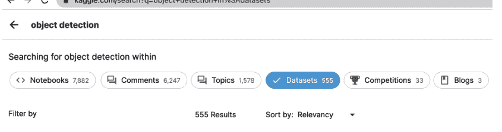
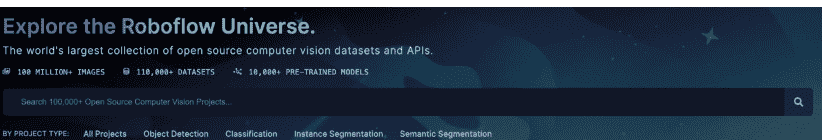
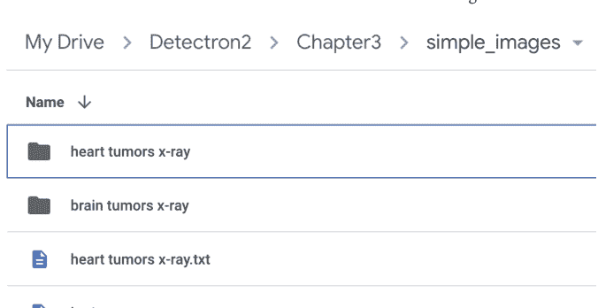
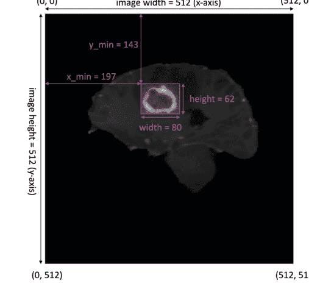
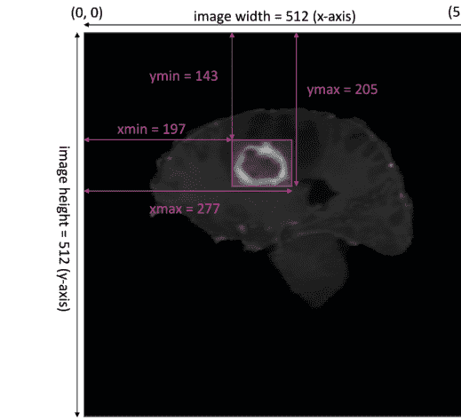

# 第 2 部分：开发自定义目标检测模型

第二部分是关于动手开发和微调自定义检测模型，涉及数据准备、训练和微调步骤。数据准备步骤介绍了常见的计算机视觉数据集以及下载可自由获取图像的代码。此外，它还讨论了用于标注数据的工具、常见的标注格式，以及将不同格式转换为 Detectron2 支持的格式的代码。然后它进一步详细介绍了使用可视化和代码的 Detectron2 应用的架构。训练模型后，本部分说明了在微调训练模型之前利用 TensorBoard 查找训练见解的步骤。对于微调，本节提供了深度学习优化器的入门介绍以及微调 Detectron2 求解器的步骤。对于专门优化检测模型，本部分包括计算为 Detectron2 模型生成锚框的合适尺寸和比例参数的代码。最后，本部分提供了增强技术以及 Detectron2 在训练和测试时执行增强的系统的概览。

第二部分涵盖以下章节：

- 第 3 章，目标检测应用的数据准备
- 第 4 章，Detectron2 中目标检测模型的架构
- 第 5 章，训练自定义目标检测模型
- 第 6 章，检查训练结果和微调 Detectron2 的求解器
- 第 7 章，微调目标检测模型
- 第 8 章，图像数据增强技术
- 第 9 章，应用训练时和测试时的图像增强

## 常见数据源

*第 2 章介绍了计算机视觉社区最常见的两个数据集。它们是 **ImageNet** 和微软 **COCO（Common Objects in Context）**。这些数据集还包含许多预训练模型，可以预测各种类别标签，可能满足你的日常需求。*

如果你的任务是检测不太常见的类别标签，探索 **Large Vocabulary Instance Segmentation（LVIS）** 数据集可能值得。它有超过 1,200 个类别和 164,000 张图像，包含许多罕见类别和约 200 万个高质量实例分割掩码。Detectron2 还提供了用于预测这 1,200 多个标签的预训练模型。因此，你可以按照 *第 2 章* 中描述的步骤创建一个满足你需求的计算机视觉应用。有关 LVIS 数据集的更多信息可在其网站 https://www.lvisdataset.org 上获得。

如果你有一个任务，没有现有的/预训练模型可以满足你的需求，那么是时候寻找现有的数据集并训练你的模型了。寻找数据集的常见位置之一是 **Kaggle**（https://www.kaggle.com）。Kaggle 是 Google 的子公司。它为数据科学家和机器学习从业者提供了一个在线平台，用于共享数据集、训练机器学习模型，并通过讨论分享训练好的模型及其想法。它还经常举办并允许用户主办数据科学和机器学习竞赛（当然也包括计算机视觉竞赛）。在撰写本文时，在 Kaggle 上搜索短语“object detection”会带来 555 个数据集，如 *图 3.1* 所示。



图 3.1：Kaggle 上用于目标检测任务的数据集

Kaggle 包含数据科学和机器学习一般的数据集，包括计算机视觉数据集。然而，如果你仍然找不到满足你自定义需求的数据集，你可能有兴趣探索位于 https://universe.roboflow.com 的 **Roboflow Universe**。它声称是世界上最广泛的开源计算机视觉数据集和 API 集合。在撰写本文时，Roboflow Universe 上有超过 1 亿张图像、110,000 个数据集和 10,000 个预训练模型，如 *图 3.2* 所示。常见的计算机视觉任务的数据集是可用的，例如目标检测、实例分割和语义分割。




图 3.2：Roboflow Universe 上的数据集

计算机视觉正在快速发展，该领域有着数量庞大的从业者。如果你在前两个资源中找不到满足需求的数据集，可以使用互联网（例如 Google）搜索你想要的数据集。然而，如果仍然找不到这样的数据集，那么就该自行收集并标注数据集了。接下来的章节将介绍为计算机视觉应用收集和标注数据集的标准工具与步骤。

## 获取图像

当你开始一个新项目时，你可能会有一批通过相机、智能手机、无人机或其他专用设备等图形设备收集的图像。如果你已经有一些照片，可以跳过此步骤，直接进入下一步——选择标注工具并开始标注。然而，如果你正要开始一个全新项目，甚至没有任何图像，你可以从本节关于从互联网收集图片的内容中获得一些思路。从互联网收集的图像可能涉及版权问题。因此，你应当检查版权，确认下载的图像是否可用于你的目的。

Google Images 包含海量照片，并且每天都在增长。因此，它是抓取图像以训练自定义模型的绝佳资源。Python 有一个 `simple_image_download` 包，提供了使用关键词或标签搜索并下载图像的脚本。首先，我们使用以下命令安装这个包：

```
!pip install simple_image_download
```

你可以在 Google Colab 的代码单元格中运行此命令来安装它，并将图像下载到正在运行的 Google Colab 实例中。然而，一旦实例停止，下载的照片就会丢失。因此，你应该将图像下载到映射的 Google Drive 文件夹或本地计算机上。你可以在本地托管的 Jupyter notebook 中运行相同的命令，或者移除开头的感叹号（!）并在终端中执行它以在本地安装该包。如果你在 Google Colab 上运行，以下代码片段有助于映射 Google Drive 并在 Google Drive 中创建一个文件夹：

```
import os
from google.colab import drive
drive.mount('/gdrive')
project_folder = "/gdrive/My Drive/Detectron2/Chapter3"
os.makedirs(project_folder, exist_ok=True)
```

下一个代码片段（在单独的 Google Colab 代码单元格中执行）将工作目录设置为之前创建的文件夹，这样即使 Google Colab 实例停止，下载结果也会保留在该文件夹中：

```
cd "/gdrive/My Drive/Detectron2/Chapter3"
```

始终建议在另一个代码单元格中运行 `pwd()` 命令并检查输出，以确保 Google Colab 当前正在该目录下工作。

进入指定文件夹后，以下代码片段有助于使用 `simple_image_download` 包从 Google Images 下载图像：

```
from tqdm import tqdm
from simple_image_download.simple_image_download import simple_image_download as Downloader
def _download(keyword, limit):
    downloader = Downloader()
    downloader.download(keywords=keyword, limit=limit)
    urls = downloader.urls(keywords=keyword, limit=limit)
    return urls

def download(keywords, limit):
    for keyword in tqdm(keywords):
        urls = _download(keyword=keyword, limit=limit)
        with open(f"simple_images/{keyword}.txt", "w") as f:
            f.writelines('\n'.join(urls))
```

具体来说，第一条 import 语句用于导入 `tqdm` 包，它可用来显示下载进度。这很重要，因为从互联网下载大量图像需要时间。因此，有一个进度条帮助我们了解当前正在工作以及完成任务大约需要多长时间会非常有用。下一条 import 语句导入 `simple_image_download` 对象，它有助于执行下载任务。接下来是 `_download` 辅助方法，用于使用关键词（由 `keyword` 参数指定）从 Google 下载指定数量（由 `limit` 参数指定）的图像。此外，对于对应的图片，该辅助方法还会返回一个 URL 数组，可将其存储起来，用于验证下载的图像并在需要时检查版权。

下一个方法名为 `download`。它使用前面的辅助函数下载图像，并将结果存储在名为 `simple_images` 的文件夹下。每个关键词的图像存储在以其关键词命名的子文件夹中。此外，该方法还会为每个关键词写入一个文本文件，其中包含所有对应下载图像的 URL，文件名与关键词相同，扩展名为 `.txt`。例如，以下代码片段为 `brain tumors x-ray` 和 `heart tumors x-ray` 关键词各下载 10 张图像：

```
download(keywords=["brain tumors x-ray", "heart tumors x-ray"], limit=10)
```

图 3.3 显示了 Google Drive 中生成的结果文件夹，其中包含下载的图像以及用于存储图像 URL 的文本文件。



图 3.3：生成的图像文件夹及其对应 URL 的文本文件

下载的图像可能并不完全符合你的需求。因此，你应该检查下载的图像，并删除那些不符合特定要求的图像。一旦你拥有了想要的图像，下一步就是选择一种工具，开始为训练和验证标注图像。

## 选择图像标注工具

计算机视觉应用正在快速发展。因此，有许多用于计算机视觉应用图像标注的工具。这些工具从免费开源到完全商业化，或提供免费试用的商业化（这意味着在可用功能方面存在一些限制）不等。标注工具可以是桌面应用程序（需要安装）、在线 Web 应用程序或本地托管的 Web 应用程序。在线应用程序甚至可能提供云存储、支持团队协作标注的工具，以及有助于加快标注速度的预训练模型（通常需要一定费用）。

其中一个流行的图像标注工具是 `labelImg`。它可在 `https://github.com/heartexlabs/labelImg/blob/master/README.rst` 获取。它是一个开源、轻量、快速、易于使用的基于 Python 的应用程序，学习曲线短。

它的局限性在于只支持创建矩形边界框。它目前是 **Label Studio**（一个功能多得多的更复杂工具）的一部分。然而，如果手头的任务只是进行目标检测和定位，它仍然是最佳选择。

另一个流行的工具是 `labelme`（`https://github.com/wkentaro/labelme`）。它在基于 Python 的应用程序、开源、快速且易于使用方面与 labelImg 类似。然而，除了矩形边界框之外，它还支持其他标注类型。具体来说，它可以标注多边形、矩形、圆形、线条和点。因此，它可用于为目标检测以及语义或实例分割任务标注训练图像。

labelImg 和 labelme 都是本地安装的应用程序。然而，如果你想使用本地托管的 Web 应用程序，可以参考 **VGG（Visual Geometry Group）图像标注器（VIA）**。VIA 是一个轻量、独立的基于浏览器的 Web 应用程序。它也支持标注多边形、圆形、线条和矩形边界框。

如果你想使用基于云的 Web 应用程序（支持云存储和 Web 上的标注），你可能会喜欢 `roboflow`，可在 `https://app.roboflow.com` 获取。这个在线 Web 应用程序支持多种标注模式。它提供了让团队协作标注图像的工具。它还支持使用预训练模型帮助加快图像标注。然而，它的若干高级功能仅在付费计划中可用。另一个用于此任务的流行 Web 平台是 `https://www.makesense.ai`。它是开源的，并在 GPLv3 许可下免费使用。它支持多种流行的标注格式，并使用 AI 来提高标注效率。

本章选择 `labelImg` 来为目标检测任务准备数据。*第 10 章* 使用 `labelme` 来为目标实例分割任务准备数据。选择标注工具后，下一步是了解该工具支持哪些标注格式、应选择哪一种，以及如何将其转换为 Detectron2 支持的格式。

## 标注格式

与标注工具类似，为计算机视觉应用标注图像时也有许多不同的标注格式可用。常见的标准包括 COCO JSON、Pascal VOC XML 和 YOLO PyTorch TXT。还有更多格式（例如 TensorFlow TFRecord、CreateML JSON 等）。然而，由于篇幅限制，本节仅涵盖前面列出的三种最常见的标注标准。此外，本节使用来自 Kaggle（`https://www.kaggle.com/datasets/davidroberts/brain-tumor-object-detection-datasets`）可获取的脑肿瘤目标检测数据集测试集中的两张图像和标签来说明这些数据格式并展示它们之间的差异，如图 *3.4* 所示。本节简要讨论每种标注格式的要点，感兴趣的读者可以参考本章的 GitHub 页面，以更详细地查看同一数据集的不同格式。


这里是信息部分：

```
"info": {
    "year": "2022",
    "version": "1",
    "description": "Brain tumor object detection",
    "contributor": "",
    "url": "<the URL to Kaggle dataset>",
    "date_created": "2022-10-07T13:54:09+00:00"
},
```

这是许可证部分：

```
"licenses": [
    {
        "id": 1,
        "url": "https://creativecommons.org/publicdomain/zero/1.0/",
        "name": "CC0 1.0"
    }
],
```

这是类别部分：

```
"categories": [
    {
        "id": 0,
        "name": "tumors",
        "supercategory": "none"
    },
    {
        "id": 1,
        "name": "negative",
        "supercategory": "tumors"
    },
    {
        "id": 2,
        "name": "positive",
        "supercategory": "tumors"
    }
],
```

这里是图像部分：

```
"images": [
    {
        "id": 0,
        "license": 1,
        "file_name": "00000_102.jpg",
        "height": 512,
        "width": 512,
        "date_captured": "2022-10-07T13:54:09+00:00"
    },
    {
        "id": 1,
        "license": 1,
        "file_name": "00003_154.jpg",
        "height": 512,
        "width": 512,
        "date_captured": "2022-10-07T13:54:09+00:00"
    }
],
```

这里是标注部分：

```
"annotations": [
    {
        "id": 0,
        "image_id": 0,
        "category_id": 2,
        "bbox": [170,226,49,51],
        "area": 2499,
        "segmentation": [],
        "iscrowd": 0
    },
    {
        "id": 1,
        "image_id": 1,
        "category_id": 1,
        "bbox": [197,143,80,62],
        "area": 4960,
        "segmentation": [],
        "iscrowd": 0
    }
]
```

值得注意的是，边界框以绝对像素位置指定。坐标系以高度为 y 轴，宽度为 x 轴，原点位于图片左上角。例如，对于第一张图片（00003_154.jpg 且 image_id = 1），边界框为 [197,143,80,62]，分别对应 [x_min, y_min, width, height] 的值，如图 3.5 所示。



图 3.5：COCO 风格边界框的坐标系和标注格式（[x_min, y_min, width, height]）

另一种流行的图像标注格式是 Pascal VOC（Pattern Analysis, Statistical Modeling, and Computational Learning, Visual Object Classes）格式。这种标注格式采用 XML（eXtensible Markup Language）文件格式，每张图像对应一个 XML 文件。

标注文件名与图像文件名相同，只是扩展名改为 .xml。每张图像单独存储一个 XML 文件，可以避免为大型图像数据集的所有标注维持一个巨大文件。以下是演示数据集中一张图像（00003_154.jpg）的标注文件（00003_154.xml）：

```
<annotation>
    <folder></folder>
    <filename>00003_154.jpg</filename>
    <path>00003_154.jpg</path>
    <source>
        <database>annotationdemo</database>
    </source>
    <size>
        <width>512</width>
        <height>512</height>
        <depth>3</depth>
    </size>
    <segmented>0</segmented>
    <object>
        <name>negative</name>
        <pose>Unspecified</pose>
        <truncated>0</truncated>
        <difficult>0</difficult>
        <occluded>0</occluded>
        <bndbox>
            <xmin>197</xmin>
            <xmax>277</xmax>
            <ymin>143</ymin>
            <ymax>205</ymax>
        </bndbox>
    </object>
</annotation>
```

显然，该标注文件包含图像信息和标注对象。如图 3.6 所示，图像坐标系与之前描述的 COCO 标注格式相同。它同样有四个边界框数值：xmin、xmax、ymin 和 ymax。换句话说，边界框使用左上角和右下角坐标的绝对像素值存储（而不是左上角坐标加宽高值）。



图 3.6：Pascal VOC 风格边界框的坐标系和标注格式（[xmin, xmax, ymin, ymax]）

由于 YOLO（You Only Look Once）近年来的发展，YOLO 数据标注成为另一种流行的数据格式。与 PASCAL VOC 标注风格类似，该数据集每张图像对应一个标注文件。不过，标注文件的扩展名是 .txt。

数据集组织为两个子文件夹，一个用于图像（images），一个用于标注（labels）。这些子文件夹可能进一步划分为 train（训练）、test（测试）和 val（验证）子文件夹。还有一个名为 classes.txt 的文本文件（也可能是 *.yaml 文件），用于声明该数据集的类别或标签，每行一个。以下是我们简单演示数据集的 classes.txt 文件内容，包含两个类别：

```
negative
positive
```

类似地，使用 YOLO 格式标注图像的步骤如下：

1. 创建一个名为 `classes.txt` 的文件，其中包含标签列表（每行一个标签）。
2. 按照之前的说明启动 `labelImg`。
3. 点击 **Open Dir** 菜单打开图像目录（如果在启动时没有指定图像目录）。
4. 如果当前格式不是 YOLO（当前可能是 CreateML 或 Pascal VOC），点击 **CreateML** 或 **Pascal VOC** 菜单，直到其切换为 **YOLO**。
5. 点击 **Change Save Dir** 菜单更改标注目录。

每张图像对应一个带有 YOLO 格式标注的 `.txt` 文件，保存到所选目录中，文件名与图像同名。名为 `classes.txt` 的文件也会保存在该文件夹中。

此外，以下快捷键有助于快速标注：

- *W 键*：创建边界框
- *D 键*：切换到下一张图像
- *A 键*：切换到上一张图像
- *Delete 键*：删除选中的边界框
- *方向键*：移动选中的边界框
- *Ctrl + Shift + D*：删除当前图像

从不同来源或数据标注工具获取的数据集，其标注格式可能与 Detectron2 支持的格式（COCO 数据格式）不同。因此，了解如何将不同格式的数据集转换为 COCO 格式至关重要。下一节将引导你完成这一数据集转换过程。

## 标注格式转换

Detectron2 的数据描述基于 COCO 标注格式构建。换句话说，它支持使用 COCO 数据标注格式注册数据集。然而，其他数据标注格式大量存在，你可能下载的数据集或使用的标注工具支持与 COCO 不同的数据格式。因此，本节将介绍用于将流行的 Pascal VOC 和 YOLO 格式转换为 COCO 风格的代码片段。

> **重要提示**
> 以感叹号（!）开头的语句表示需要在 Jupyter notebook（Google Colab）代码单元中执行的 Bash 命令。如果你想在终端中运行，可以安全地移除这个感叹号并执行该语句。

### 将 Pascal VOC 数据集转换为 COCO 数据集

Pascal VOC 标注格式是另一种流行的格式。因此，本节提供代码片段，用于在注册到 Detectron2 之前将数据转换为 COCO 标注格式。本节使用前面描述的简单数据集（annotationdemo）作为演示。首先，我们下载 Pascal VOC 格式的脑肿瘤数据集（voc.zip）并在 Google Colab 上解压：

```
# 下载数据集并解压
!wget url_to_voc.zip
!unzip voc.zip
```

数据集解压后，以下代码片段安装 tree 包并查看该数据集的结构：

```
!sudo apt-get install tree
!tree voc
```

以下是该数据集在 COCO 标注格式下的结构：

```
voc
└ test
    ├── 00000_102.jpg
    ├── 00000_102.xml
    ├── 00003_154.jpg
    └── 00003_154.xml
```

值得注意的是，Pascal VOC 数据格式为每个图像文件存放一个同名、扩展名为 .xml 的标注文件。

该数据集可以直接原地修改为 COCO 格式。不过，以下代码片段会将这些图像和标注复制到一个新目录（coco_dir）中用于 COCO 数据集，从而避免修改原始数据：

```
import os
import shutil
from glob import glob
from tqdm import tqdm

voc_dir = "voc/test"
coco_dir = 'coco/test'
os.makedirs(coco_dir, exist_ok=True)
```


```
xml_files = glob(os.path.join(voc_dir, "*.xml"))
img_files = glob(os.path.join(voc_dir, "*.jpg"))
# copy annotations
for f in tqdm(xml_files):
    shutil.copy(f, coco_dir)
# copy images
for f in tqdm(img_files):
    shutil.copy(f, coco_dir)
```

复制完成后，使用以下代码片段即可相对容易地将该数据集作为 pylabel 数据集加载：

```
from pylabel import importer
# load dataset
dataset = importer.ImportVOC(coco_dir, name="brain tumors")
```

同样地，也相对容易地将加载的数据集导出为 COCO 风格并将其存储在 _annotations.coco.json 文件中，使用以下代码片段：

```
# export
coco_file = os.path.join(coco_dir, "_annotations.coco.json")
# Detectron2 requires starting index from 1
dataset.export.ExportToCoco(coco_file, cat_id_index=1)
```

值得注意的是，Detectron2 要求标签索引（cat_id_index）从 1 开始。因此，ExportToCoco 方法将此值设置为 1。

转换完成后，可以安全地使用以下代码片段删除 COCO 数据集（coco_dir）中 Pascal VOC 标注文件（.xml 文件）：

```
# now delete voc annotations in the coco set
for f in xml_files:
    os.remove(f.replace(voc_dir, coco_dir))
```

可选地，你可以使用以下语句查看 resulting 数据集的结构：

```
!tree coco
```
