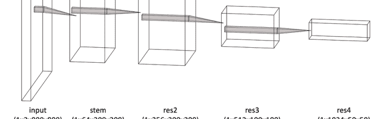
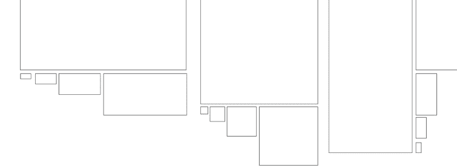
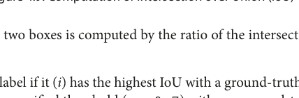
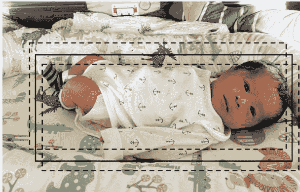
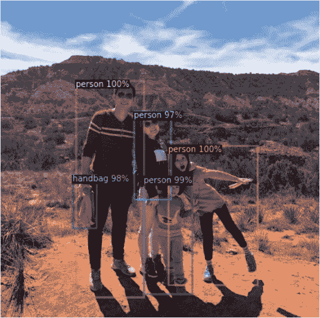
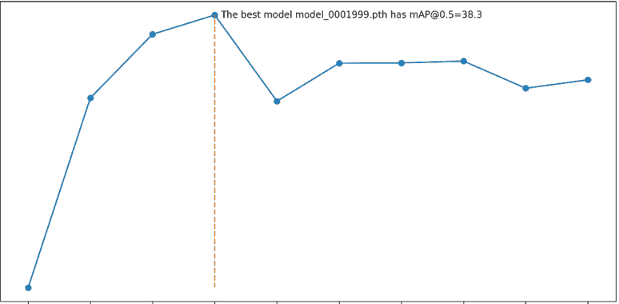
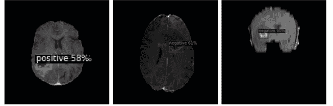
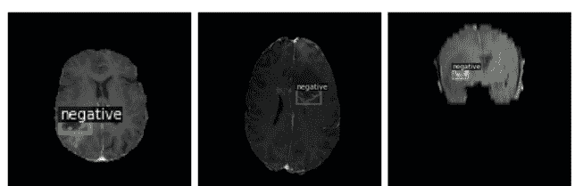

## Detectron2 中目标检测模型的架构

本章深入探讨 Detectron2 在目标检测任务中的架构。Detectron2 中的目标检测模型是 Faster R-CNN 的实现。具体而言，该架构包括主干网络、区域提议网络和感兴趣区域头部。本章对于理解为视觉系统设计深度神经网络时的通用术语至关重要。深入理解有助于在用自定义数据集训练时微调和定制模型以获得更好的准确率。

到本章结束时，你将详细了解 Detectron2 的典型架构。你也将知道在哪里定制你的 Detectron2 模型（设置哪些配置参数、如何设置它们，以及在哪里添加/移除层）以提高性能。具体而言，本章涵盖以下主题：

- 应用架构简介
- 主干网络
- 区域提议网络
- 感兴趣区域头部

### 技术要求

你应该已按照第 1 章提供的说明设置开发环境。因此，如果你尚未完成，请在继续之前完成开发环境的设置。此外，你应该阅读第 2 章以了解 Detectron2 的 Model Zoo 以及可用的主干网络。所有代码、数据集和结果都可在本书的 GitHub 页面上获得（在名为 Chapter04 的文件夹中），网址为 https://github.com/PacktPublishing/Hands-On-Computer-Vision-with-Detectron2。强烈建议你下载代码并跟随操作。

Detectron2 用于目标检测任务的架构是 Faster Region-based Convolutional Neural Network（Faster R-CNN）的实现。Faster R-CNN 的架构在图 4.2 中详细展示。框的样式表示其含义。具体而言，阴影框为数据（输入、中间结果和输出），虚线框为仅在训练期间执行的任务，双线框为神经网络。

以下各节讨论这些单独的项目，它们如何协同工作，以及如何使用 Detectron2 配置它们。这些部分使用第 2 章中用于目标检测任务的示例模型。所有以下任务都可以通过调用默认预测器的 predict 方法来执行。然而，本章通过输入、代码和中间结果逐步介绍每个步骤，以检查该模型的步骤和组件。通过代码检查各个组件有助于解释为什么每一步都很重要，每个步骤要更改哪些参数，以及在哪里定制模型。

首先，我们需要导入 torch 包并安装 Detectron2：

```
import torch
print(torch.__version__)
!python -m pip install \
'git+https://github.com/facebookresearch/detectron2.git'
```

接下来，我们将导入 Detectron2，获取配置和模型检查点文件，并创建预测器。具体而言，我们在此示例中使用 ResNet50（R50-C4），因为它简单易于说明，其配置文件为 COCO-Detection/faster_rcnn_R_50_C4_1x.yaml。然而，对于其他主干网络，思路是相同的：

```
import detectron2
from detectron2.config import get_cfg
from detectron2 import model_zoo
from detectron2.engine import DefaultPredictor
# Suppress some user warnings
import warnings
warnings.simplefilter(action='ignore', category=UserWarning)
# Select a model
config_file = "COCO-Detection/faster_rcnn_R_50_C4_1x.yaml"
checkpoint_url = "COCO-Detection/faster_rcnn_R_50_C4_1x.yaml"
# Create a configuration file
cfg = get_cfg()
config_file = model_zoo.get_config_file(config_file)
cfg.merge_from_file(config_file)
# Download weights
cfg.MODEL.WEIGHTS = model_zoo.get_checkpoint_url(checkpoint_url)
score_thresh_test = 0.95
cfg.MODEL.ROI_HEADS.SCORE_THRESH_TEST = score_thresh_test
predictor = DefaultPredictor(cfg)
```

一个大小为 800×800 的输入图像（这是默认输入大小，因此我们不需要对输出进行后处理重采样步骤）会经过该架构的不同部分，以检查每个组件的作用。以下片段有助于准备输入：

```
!wget https://raw.githubusercontent.com/phamvanvung/hcvd2/main/800x800/input.jpeg
import cv2
input_url = "input.jpeg"
img = cv2.imread(input_url)
height, width = img.shape[:2]
image = torch.as_tensor(img.astype("float32").transpose(2, 0, 1))
```

具体而言，此片段首先使用 cv2 加载输入图像并获取其大小（高度和宽度）。此外，它将加载的图像转换为 PyTorch 张量，采用通道优先格式。具体而言，cv2 以（高度，宽度，通道）形式或（H, W, C）格式加载图像，而 Detectron2 使用（通道，高度，宽度）或（C, H, W）。

一旦默认模型和输入准备就绪，就可以通过模型的不同组件传递准备好的输入并检查每个部分的作用。

### 主干网络

第 2 章讨论了 Detectron2 的典型主干网络。它们包括 ResNet50、ResNet101、ResNeXt101 及其变体。本节以 ResNet50 架构为例进行检查。然而，对于其他基础模型（主干网络），思路保持不变。图 4.3 总结了检查主干网络的步骤。具体而言，我们将单个图像的数据张量传递给主干网络，主干网络（本例中为 ResNet50）输出一个张量。该输出张量是输入图像提取的显著特征。

```
print(stem.shape)
print(res2.shape)
print(res3.shape)
print(res4.shape)
```

具体而言，此片段将输入张量转换为“cuda”以将该图像加载到 GPU，因为我们的模型当前在 GPU 上运行。unsqueeze 方法将图像输入转换为（N x C x H x W）格式，其中 N 为图像数量，本例中我们传递一张图像。换句话说，此步骤将大小为 1x3x800x800 的张量作为该主干的输入。该输入随后馈送到 ResNet50 的主要模块（stem、res2、res3 和 res4），整个代码块应具有以下输出：

```
torch.Size([1, 3, 800, 800])
torch.Size([1, 64, 200, 200])
torch.Size([1, 256, 200, 200])
torch.Size([1, 512, 100, 100])
torch.Size([1, 1024, 50, 50])
```

图 4.4 可视化了 ResNet50 主干中这些主要模块及其对应的输出大小。值得注意的是，随着模块的推进，深度增加，尺寸减小，以从图像中提取更抽象或更显著的特征。



图 4.4：ResNet50 主干中主要模块及其对应的输出特征大小


该主干网络的输出（提取的特征或特征图）是最后一个名为'res4'的块，大小为1x1024x50x50。从概念上讲，该特征图中的每个点都对应并负责预测和分类与原始图像中某个区域相关的边界框。换句话说，这些提取的特征对应于原始图像中的50x50（2,500）个区域。以下代码片段说明了这一思想。首先，我们准备一个方法，以原始尺寸显示图像：

```
```python
import numpy as np
import matplotlib.pyplot as plt


def imshow(image):
    dpi = plt.rcParams["figure.dpi"]
    height, width = image.shape[:2]
    figsize = width / float(dpi), height / float(dpi)
    fig = plt.figure(figsize=figsize)
    plt.imshow(image)
    plt.imshow(image)
    plt.axis("off")
    plt.show()
```
```

现在我们可以为与50x50提取特征对应的2,500个区域的中心绘制中心点：

```
```python
feature_h, feature_w = res4.shape[2:]
sub_sample = height/feature_h
new_img = img.copy()
# the feature map points and corresponding regions
rect_w = 4
rect_h = 4
for i in range(feature_h):
    for j in range(feature_w):
        center_x = sub_sample * j + sub_sample/2
        center_y = sub_sample * i + sub_sample/2
        start_x = int(center_x - rect_w/2)
        start_y = int(center_y - rect_h/2)
        end_x = int(center_x + rect_w/2)
        end_y = int(center_y + rect_h/2)
```
```

```
)
(anchor_generator): DefaultAnchorGenerator(
    (cell_anchors): BufferList()
)
)
```

可以看到，这个RPN有两个主要部分：标准的RPN头（rpn_head）和锚点生成器（anchor_generator）。此外，在训练期间，还有一个组件用于RPN计算该RPN网络的损失。最后，RPN头进行预测，为下一阶段提出区域。以下部分将深入探讨这些组件。

## 锚点生成器

锚点生成器在训练时用于生成所有原始锚点，每个特征像素对应一组锚点（例如15个锚点，或者根据配置不同数量的锚点，稍后详述）（本例中为50×50×15=37,500个锚点）。使用锚点是Faster R-CNN的一项重要技术，其他技术（如YOLO和SSD）也采用锚点来提高预测精度。具体来说，我们不必从“无”中预测边界框，而是给模型一组初始边界框（具有特定的大小和宽高比），并让模型预测相对于这些初始框的边界框（位置/边界框增量）。不同的大小和比例有助于处理不同尺度和形状的物体。

该锚点生成器以锚点的比例和大小作为输入。这两个参数可以使用配置变量为Detectron2设置。以下代码片段显示了当前设置的值：

```
print(cfg.MODEL.ANCHOR_GENERATOR.SIZES)
print(cfg.MODEL.ANCHOR_GENERATOR.ASPECT_RATIOS)
```

该代码片段应产生以下输出：

```
[[32, 64, 128, 256, 512]]
[[0.5, 1.0, 2.0]]
```

准确地说，这些大小对应于原始图像中初始锚点面积的平方根。此外，这些比例指定了这些初始锚点的高宽比。在这个具体案例中，这两组值的组合产生了15个锚点（5种大小乘以3种比例）。不同的大小和比例应对不同尺寸和宽高比的物体。与其他方法（如特征金字塔（在不同卷积层提取特征以应对不同尺寸）或使用不同的滤波器大小和比例（滑动窗口的大小））相比，这种方法（锚点金字塔）被认为更具成本效益。

这些锚点以一个像素为中心，因此有点难以区分。为了便于说明，图4.8将它们分成三组相同比例、五种不同大小的锚点。



图4.8：以1个特征像素为中心的15个锚点（3种比例和5种大小）

回到Detectron2的实现，以下代码片段有助于检查Detectron2如何生成这些锚点：

```
# generate anchors
anchors = rpn.anchor_generator([res4])
print(anchors[0].tensor.shape)
```

锚点生成器将提取的特征作为输入，计算sub_sample值（输入大小与特征大小之间的比率）并生成锚点。在本例中，有50×50×15=37,500个锚框。因此，该代码片段的输出如下：

```
torch.Size([37500, 4])
```

值得注意的是，这里有37,500个锚点，每个锚点有4个位置规格（x₀， y₀， x₁， y₁）。为确认这一点，以下代码片段获取图像中点的15个锚点，并将其显示到原始输入上（如前所述）：

```
new_img = img.copy()
# the feature
col_idx = 24
row_idx = 24
startBox = (row_idx*50 + col_idx)*15
for i in range(startBox, startBox + 15):
    anchors_np = anchors[0].tensor[i].to("cpu").numpy()
    x0, y0, x1, y1 = [int(v) for v in anchors_np]
```

此代码片段有以下输出：

```
torch.Size([1, 15, 50, 50])
torch.Size([1, 60, 50, 50])
```

具体来说，有1x15x50x50个锚点。因此，pred_objectness_logits中有1x15x50x50个值，用于指示每个锚点中是否有物体。类似地，每个特征点的15个锚点中每个都有4个坐标值（x0、y0、x1、y1），这就解释了pred_anchor_deltas输出的60（15x4）个值。在获得锚点和相关预测之后，训练阶段的下一步是计算RPN损失。

## RPN损失计算

该损失包括来自分类头的分类损失（预测锚点的objectness分数）和回归损失（预测锚点增量）。因此，每个生成的锚点都必须有一个标签。锚点要么是正样本（有物体，标签值为1），要么是负样本（没有物体，标签值为0），要么是其他情况（被忽略，标签值为-1）。标签分配任务利用锚点与真实边界框的重叠程度度量。为此常用的度量是交并比（IoU）。图4.9说明了IoU的计算。



图4.9：交并比（IoU）的计算

具体来说，两个框之间的IoU是通过它们之间的交集与并集之比来计算的。

如果锚点（i）与某个真实边界框具有最高的IoU，或（ii）与任何真实边界框的IoU值高于指定阈值（例如0.7），则该锚点具有正标签。第二个条件应该已经足够，但第一个条件有助于处理稀有边界框的情况。如果锚点与所有真实边界框的IoU值都小于某个阈值（例如0.3），则该锚点具有负标签。所有其他标签都被忽略（标签值为-1）。这两个IoU阈值可以使用Detectron2配置参数自定义。以下代码片段显示当前模型中的这两个值：

```
print(cfg.MODEL.RPN.IOU_THRESHOLDS)
```

```
gt_instance = detectron2.structures.instances.Instances(image_
size=(800, 800))
gt_instance.set('gt_boxes', boxes)
gt_instance.set('gt_classes', classes)
gt_instances = [gt_instance]
```

具体来说，此输入图像中有四个物体，且都是人（类别值为0）。在获得真实边界框之后，以下代码片段执行前面描述的采样策略：

```
gt_labels, gt_boxes = rpn.label_and_sample_anchors(anchors,
gt_instances)
print(gt_labels[0].shape)
print(gt_boxes[0].shape)
```

此代码片段应产生以下输出：

```
torch.Size([37500])
torch.Size([37500, 4])
```

变量gt_labels包含所有37,500个锚点的标签（正样本=1，负样本=0，忽略=-1）。变量gt_boxes包含锚点对应的真实框坐标。所有这些锚点都被映射到输入中的四个真实框之一。以下代码片段证明了这一点：

```
np_gt_boxes = gt_boxes[0].to("cpu").numpy()
print(np.unique(np_gt_boxes, axis=0))
```

具体来说，该代码片段将gt_boxes转换为NumPy，并获取该列表中的唯一边界框。此代码片段应产生以下输出：

```
[[190. 206. 352. 744.]
[330. 285. 423. 690.]
[375. 444. 479. 747.]
[419. 375. 633. 711.]]
```

这些正是之前指定的真实边界框的边界框。类似地，以下代码片段显示采样锚点的标签：

```
na = gt_labels[0].to("cpu").numpy()
print('positive', sum([x == 1 for x in na]))
```


```
print('negative', sum([x == 0 for x in na]))
print('ignore', sum([x == -1 for x in na]))
```

具体来说，这段代码片段获取标签并统计基于标签的正样本、负样本和被忽略的锚点数量。这段代码片段应显示以下输出：

```
positive 42
negative 214
ignore 37244
```

因此，在 37,500 个锚点中，有 42 个为正样本，214 个为负样本。这 256 个锚点会参与损失计算（训练），其余的则被忽略。接下来，RPN 损失计算是分类损失（基于采样锚点的负样本和正样本标签及其各自的预测）与回归损失（基于真实边界框位置及其各自预测的锚点偏移量）之间的加权贡献。在完成所有之前步骤后，RPN 的下一个任务是生成 proposals。以下章节将检查 RPN 提出区域的方式。

## Proposal predictions

提案预测步骤引入了一个新的概念，称为非极大值抑制（NMS）。具体来说，对于一个真实框可能会产生多个提案。这些提案可能在很大区域上重叠，并且具有不同的 objectness 分数。图 4.10 显示了为什么需要 NMS 的示例。具体来说，针对一个真实框（实线框）提出了两个提案（虚线框）。可以观察到，这两个提案有很大的重叠区域，删除其中一个并保留 objectness 分数更高（置信度更高）的另一个提案是明智的。



图 4.10：一个真实标签（实线框）和多个提案（虚线框）

具体来说，该阶段从主干网络提取特征并使用真实边界框（如果在训练）执行以下步骤：

- 1. 为提案标注并采样（如果在训练）。
- 2. 提取框特征。
- 3. 执行预测。
- 4. 计算损失（如果在训练）。
- 5. 执行推理（如果在推理）。

如果是在训练阶段，在 2,000 个提案（POST_NMS_TOPK_TRAIN）中，与正样本提案相比可能存在大量负样本提案（尤其是在训练早期阶段，RPN 尚未准确时）。与 RPN 阶段类似，此步骤也会基于真实标签进行标注并采样另一个包含一定比例正样本提案的 mini-batch 用于训练。只有这些采样的提案会参与损失计算。以下代码片段显示了 Detectron2 当前设置的这些配置参数，你也可以根据需要更改这些参数：

```
```python
print(cfg.MODEL.ROI_HEADS.IOU_THRESHOLDS)
print(cfg.MODEL.ROI_HEADS.BATCH_SIZE_PER_IMAGE)
print(cfg.MODEL.ROI_HEADS.POSITIVE_FRACTION)
```
```

这段代码片段应显示三个值 0.5、512 和 0.25。这些值意味着与所有真实框的 IoU 都小于 0.5 的提案被视为背景。每张图像采样 512 个提案用于训练，其中 25% 应为正样本提案。如果正样本提案不足，则添加其他负样本提案以使总数达到 512 个。

以下代码片段显示了感兴趣区域头（roi_head）的主要组件：

```
```python
roi_heads = predictor.model.roi_heads
print(roi_heads)
```
```

此代码片段的输出很长。因此，这里未显示。一般来说，该阶段有三个主要组件：pooler、res5 和 box_predictor。pooler 和 res5 组件有助于在 box_predictor 完成预测之前提取框特征；以下章节将研究这些组件。

## The pooler

提案具有不同的尺寸，而后续步骤中的神经网络需要相同尺寸的输入特征。因此，必须在输入预测步骤之前将提取的特征裁剪为相同尺寸。pooler 组件有助于执行此任务。以下代码片段显示了有关 pooler 的更多信息：

```
```python
print(roi_head.pooler)
```
```

此代码片段应显示以下输出：

```
```text
ROIPooler(
    (level_poolers): ModuleList(
        (0): ROIAlign(output_size=(14, 14), spatial_scale=0.0625,
        sampling_ratio=0, aligned=True)
    )
)
```
```

此 pooler 是 ROIPooler 类的一个实例，该类实现了 ROIAlign（Region of Interest Version 2）。通常，提案是在原始输入图像坐标中指定的（本例中为 800×800）。这些坐标首先被转换到提取特征的大小（宽度×高度 = 50×50）。因此，spatial scale 为 0.0625（spatial_scale = 50/800）。

此外，所有提案的输出尺寸均指定为 14×14。在 ROIAlignV2 中，将提案区域转换到特征图中的对应区域后，该映射区域被划分为 14×14 的网格。然后对每个网格单元进行插值（例如使用双线性插值方法）并使用四个点进行采样。aligned=True 选项意味着像素坐标会偏移 0.5 个像素。在原始图像中半个像素并不重要，但在小特征图分辨率下却很显著，有助于提高精度（尤其是在实例分割中，我们稍后会学习）。以下代码片段生成 pooler 数据：

```
```python
x = roi_heads.pooler([res4], [proposals[0].proposal_boxes])
print(x.shape)
```
```

此代码片段应显示一个大小为 (1000, 1024, 14, 14) 的张量，对应 1,000 个提案；每个提案有 1,024 个通道，分辨率为 14×14。

在为所有提案获得相同尺寸的特征后，这些提案会经过另一组卷积层（称为 res5）以提取更深层次的特征。以下代码片段执行此显著特征提取：

```
```python
box_features = roi_heads.res5(x)
print(box_features.shape)
```
```

此可视化代码片段与 *Chapter 2* 中介绍的内容类似。图 4.11 显示了此代码片段的输出。



图 4.12：目标检测过程的可视化

恭喜！到目前为止，你应该已经掌握了 Detectron2 实现的 Faster R-CNN 模型在目标检测任务中的典型架构。本章内容较为深入。然而，其设计和理念有助于你理解其他计算机视觉任务，甚至其他流行的计算机视觉技术，如 YOLO。

## Summary

本章深入探讨了 Detectron2 实现的 Faster R-CNN 在目标检测任务中的组件。该模型是一种两阶段技术：区域提议阶段和感兴趣区域提取阶段。这两个阶段都使用从主干网络提取的特征。该主干网络可以是任何最先进的卷积神经网络，用于从输入图像中提取显著特征。提取的特征和用于生成一组初始锚点的信息（尺寸和比例；*Chapter 7* 解释了如何自定义这些尺寸和比例）随后被传递给区域提议神经网络，以预测固定数量的提案及其 objectness 分数（如果提案中存在物体）和位置偏移量（预测提案与原始锚点之间的位置差异）。选定的提案随后被传递给第二阶段的感兴趣区域头，以预测最终的物体分类和定位。深入理解这些组件为你在下一章中对自定义数据集构建更好的模型进行模型定制和优化做好了充分准备。

恭喜！到目前为止，你应该对 Detectron2 的整体架构及其对 Faster R-CNN 目标检测模型的实现有了深刻的了解。在下一章中，你将使用 Detectron2 训练自定义目标检测模型。


**重要提示**

本章会在 Google Colab 实例上执行代码。你应该将 Google Drive 文件夹映射到实例中并把输出存储到映射的文件夹中，或者下载输出并保存以备将来使用。或者，如果你有本地实例，可以将这些 Google Colab 笔记本连接到本地实例，以便将结果保存在永久存储中并利用更好的计算资源。

## 数据处理

以下各节描述本章使用的数据集，并讨论在自定义数据集上训练 Detectron2 模型的典型步骤。这些步骤包括探索数据集、将数据集转换为 COCO 格式、向 Detectron2 注册数据集，最后展示一些示例图像及对应的脑肿瘤标签。

### 数据集

使用的数据集是 Kaggle（https://www.kaggle.com/datasets/davidroberts/brain-tumor-object-detection-datasets）上提供的脑肿瘤目标检测数据集，该数据集已下载到本书的 GitHub 仓库中以确保其可访问性。选择该数据集是因为医学图像处理是计算机视觉中的一个重要子领域。同时，该任务具有挑战性，且图像数量适合用于演示。

### 下载并执行初步探索

数据处理的第一步是下载并执行初步数据探索。以下代码片段下载该数据集并将其解压到当前工作目录中：

```
!wget https://github.com/PacktPublishing/Hands-On-Computer-Vision-with-Detectron2/blob/main/datasets/braintumors.zip?raw=true -O braintumors.zip
!unzip braintumors.zip -d braintumors
```

以下代码片段随后向我们展示该数据集中的文件夹：

```
import os
data_folder = "braintumors"
data_folder_yolo = data_folder + "_yolo"
data_folder_coco = data_folder + "_coco"
folders = os.listdir("braintumors")
print(folders)
```

具体来说，该数据集包含三个子文件夹：['coronal_t1wce_2_class', 'sagittal_t1wce_2_class', 'axial_t1wce_2_class']。下一步合理操作是使用 tree 命令打印数据集结构。因此，以下代码片段安装 tree 并显示该数据集的文件夹结构：

```
!sudo apt-get install tree
!tree braintumors/ -d
```

请注意，-d 选项仅显示目录，以避免因这些文件夹中文件数量众多而导致显示过长。具体来说，上述代码片段应显示以下文件夹结构：

```
braintumors/
├── axial_t1wce_2_class
│   ├── images
│   │   ├── test
│   │   └── train
│   └── labels
│       ├── test
│       └── train
├── coronal_t1wce_2_class
│   ├── images
│   │   ├── test
│   │   └── train
│   └── labels
│       ├── test
│       └── train
└── sagittal_t1wce_2_class
    ├── images
    │   ├── test
    │   └── train
    └── labels
        ├── test
        └── train
```

可以观察到，三个文件夹中的每一个都包含两个子文件夹，分别用于存放图像和标签。这些子文件夹中的每一个又有两个文件夹，分别用于训练数据和测试数据。需要注意的是，该数据集采用 YOLO 标注格式。

以下代码片段准备了一个辅助函数，用于统计采用 YOLO 标注格式的数据集中的图像和标签数量：

```
from glob import glob
def count_yolo_data(folder):
    for images_labels in ["images", "labels"]:
        for train_test in ["train", "test"]:
            file_ext = "*.jpg" if images_labels == "images" else "*.txt"
            p = os.path.join(folder, images_labels, train_test, file_ext)
            files = glob(p)
            print(train_test, images_labels, len(files))
```

然后，以下代码片段统计下载的脑肿瘤数据集中三个文件夹各自包含的图像和标签数量：

```
for folder in folders:
    print(" -"*8 + folder + "-"*8)
    folder = os.path.join(data_folder, folder)
    count_yolo_data(folder)
```

该代码片段应显示以下输出：

```
--------coronal_t1wce_2_class--------
train images 319
test images 78
train labels 318
test labels 78
--------sagittal_t1wce_2_class--------
train images 264
test images 70
train labels 264
test labels 70
--------axial_t1wce_2_class--------
train images 310
test images 75
train labels 296
test labels 75
```

值得注意的是，该数据集的图像数量相对较少，且有一些图像没有标签（图片中不存在脑肿瘤）。

一种方法是为每种图像类型（冠状面、矢状面或轴状面）分别训练一个模型。然而，由于图像数量较少，将这些文件夹中的图像合并到一个文件夹中可能更为合理。因此，以下代码片段准备了一个辅助方法，用于将 YOLO 文件从一个文件夹复制到另一个文件夹：

```python
import os
import shutil
from tqdm import tqdm

# move all into one folder
def copy_yolo_files(from_folder, to_folder, images_labels, train_test):
    from_path = os.path.join(from_folder, images_labels, train_test)
    to_path = os.path.join(to_folder, images_labels, train_test)
    os.makedirs(to_path, exist_ok=True)
    # get files
    file_ext = "*.jpg" if images_labels == "images" else "*.txt"
    files = glob(os.path.join(from_path, file_ext))
    # move files
    for file in tqdm(files):
        shutil.copy(file, to_path)
```

然后，以下代码片段将来自三个文件夹的图像合并到一个文件夹中：

```python
# copy
for from_folder in folders:
    from_folder = os.path.join(data_folder, from_folder)
    to_folder = data_folder_yolo
    for images_labels in ["images", "labels"]:
        for train_test in ["train", "test"]:
            copy_yolo_files(from_folder, to_folder, images_labels, train_test)
```

以下代码片段显示新合并数据集的结构：

```bash
# Now the folder should look like
!tree -d {data_folder_yolo}
```

现在，我们准备好使用第 3 章中介绍的代码片段将这些数据集转换为 COCO 格式。

### 数据格式转换

Detectron2 支持 COCO 数据格式，而当前数据集为 YOLO 格式。因此，以下代码片段执行数据格式转换。首先，运行以下代码片段安装 pylabel 包：

```
!pip install -q pylabel
```

接下来，以下片段创建一个辅助方法来执行数据转换（如第 3 章所述）：

```
from pylabel import importer

def yolo_to_coco(input_folder, output_folder, train_test):
    # Some codes are removed here (please refer to GitHub)
    # copy annotations
    for f in tqdm(txt_files):
        shutil.copy(f, coco_dir)
    # copy images
    for f in tqdm(img_files):
        shutil.copy(f, coco_dir)
    # get the classes
    with open(os.path.join(input_folder, "classes.txt"), "r") as f:
        classes = f.read().split("\n")
    # import
    dataset = importer.ImportYoloV5(path=coco_dir, cat_names=classes, name="brain tumors")
    # export
    coco_file = os.path.join(coco_dir, "_annotations.coco.json")
    # Detectron requires starting index from 1
    dataset.export.ExportToCoco(coco_file, cat_id_index=1)
    # now delete yolo annotations in coco set
    for f in txt_files:
        os.remove(f.replace(labels_path, coco_dir))
```

此时，如果所有这些数据处理步骤都是在 Google Colab 上执行的，那么最好将生成的 COCO 数据集下载到本地计算机，或者映射 Google Drive 文件夹并将生成的数据集保存到 Google Drive 文件夹中，以免在 Google Colab 实例关闭后丢失数据集。在本例中，转换后的 COCO 数据集已存储在本书的 GitHub 文件夹中，供后续章节使用。

现在数据集已准备好并正确注册，是时候训练模型并查看它们在使用 Detectron2 时的表现了。在自定义数据集上执行模型训练的最简单方法是使用 Detectron2 提供的默认训练器类。

### 使用默认训练器

Detectron2 提供了一个默认训练器类，可方便地在自定义数据集上训练 Detectron2 模型。首先，我们下载上一节中转换的数据集并解压：

```
!wget -q https://github.com/PacktPublishing/Hands-On-Computer-Vision-with-Detectron2/raw/main/datasets/braintumors_coco.zip
!unzip -q braintumors_coco.zip
```

接下来，安装 Detectron2，并使用上一节中给出的确切代码片段注册训练/测试数据集。此外，在训练之前，运行以下代码片段来准备一个记录器，Detectron2 将使用它来记录训练/推理信息：

```
from detectron2.utils.logger import setup_logger
logger = setup_logger()
```

注册好数据集并设置好记录器之后，下一步是获取训练配置。具体来说，我们设置输出目录（用于存储日志事件和训练后的模型）、用于保存配置文件的路径（该文件将用于未来的推理）、类别数为正负两类（nc = 2），以及将设备选项设置为 cuda（用于在 GPU 上训练）。最后，为了加快训练速度，我们还选择 ResNet50 FPN 作为要训练模型的骨干网络：

```
import os
from detectron2.config import get_cfg
from detectron2 import model_zoo
import pickle

output_dir = "output/object_detector"
os.makedirs(output_dir, exist_ok=True)
output_cfg_path = os.path.join(output_dir, "cfg.pickle")
nc = 2
```


```python
device = "cuda"

config_file_url = "COCO-Detection/faster_rcnn_R_50_FPN_3x.yaml"
checkpoint_url = "COCO-Detection/faster_rcnn_R_50_FPN_3x.yaml"
```

此外，下面的代码片段创建了一个训练配置：

```python
# Create a configuration file
cfg = get_cfg()
config_file = model_zoo.get_config_file(config_file_url)
cfg.merge_from_file(config_file)
cfg.MODEL.WEIGHTS = model_zoo.get_checkpoint_url(checkpoint_url)

# Download weights
cfg.MODEL.WEIGHTS = model_zoo.get_checkpoint_url(checkpoint_url)

# Set datasets
cfg.DATASETS.TRAIN = (name_ds_train,)
cfg.DATASETS.TEST = (name_ds_test,)
# Workers
cfg.DATALOADER.NUM_WORKERS = 2
# Images per batch
cfg.SOLVER.IMS_PER_BATCH = 8
# Learning rate
cfg.SOLVER.BASE_LR = 0.00025
# Iterations
cfg.SOLVER.MAX_ITER = 5000
cfg.SOLVER.CHECKPOINT_PERIOD = 500
# Classes
cfg.MODEL.ROI_HEADS.NUM_CLASSES = nc
cfg.MODEL.DEVICE = device
cfg.OUTPUT_DIR = output_dir
```

我们使用在 Detectron2 中注册的相应名称来设置训练和测试数据集。接下来，我们将数据加载器的工作进程数设置为 2，并将每批图像数设置为 8（你可以更改此数字以适应可用的 GPU）。此外，由于我们使用迁移学习（通过重用从 Detectron2 Model Zoo 训练得到的权重），我们设置了一个相对较小的学习率——在本例中为 0.00025。此外，我们将训练 5,000 次迭代，并且每 500 次迭代保存一次模型。

```
model_0004999.pth
model_final.pth
```

输出包括配置文件（cfg.pickle）、一个用于记录日志事件的文件、最后一个检查点（last_checkpoint）（以便模型可以在需要时恢复训练）、一个包含所有训练评估指标的文件（metrics.json），以及每 500（cfg.SOLVER.CHECKPOINT_PERIOD）次迭代保存的所有模型。值得注意的是，最后一次迭代（cfg.SOLVER.MAX_ITERATIONS）的模型被保存为 model_final.pth。

得到训练结果后，下一步是进行一些模型评估，并选择表现最佳的模型。

## 选择最佳模型

选择最佳模型需要评估指标。因此，在选择最佳模型之前，我们需要了解用于目标检测任务的常见评估术语和评估指标。此外，在获得最佳模型后，本节还提供了相关代码，用于采样并可视化一些预测结果，以定性评估所选模型。

## 目标检测模型的评估指标

目标检测任务使用两个主要的评估指标：mAP@0.5（或 AP50）和 F1-score（或 F1）。前者是交并比（IoU）阈值为 0.5 时平均精度（mAP）的均值，用于选择最佳模型。后者表示精确率和召回率的调和平均值，用于报告所选模型在特定数据集上的表现。这两个指标的定义都基于精确率（Precision）和召回率（Recall）的计算：

Precision = TP / (TP + FP)

Recall = TP / (TP + FN)

这里，TP（真正例，True Positive）表示被正确分类和定位（基于 IoU 阈值）的预测对象数量；FP（假正例，False Positive）表示被错误分类或定位的预测对象数量；FN（假负例，False Negative）表示未被正确预测的真实对象数量。然后可以使用以下公式计算 F1-score：

F1 = 2 × Precision × Recall / (Precision + Recall)

```
'model_0002999.pth',
'model_0003499.pth',
'model_0003999.pth',
'model_0004499.pth',
'model_final.pth']
```

这段代码列出了训练过程中每个检查点周期（cfg.SOLVER.CHECKPOINT_PERIOD）保存的所有模型。值得注意的是，训练完成后（在 cfg.SOLVER.MAX_ITER 迭代处）的模型被命名为 model_final.pth。此外，模型名称中的数字总是用零填充，以使其长度为 7。

下面的代码片段准备了一个评估器，用于评估这些模型中的每一个在测试集上的表现：

```
from detectron2.engine import DefaultPredictor
from detectron2.evaluation import COCOEvaluator
evaluator = COCOEvaluator(
    dataset_name = name_ds_test,
    tasks=("bbox",),
    distributed=False,
    output_dir = os.path.join(output_dir, 'test_results')
)
```

值得注意的是，选择 COCOEvaluator 是因为数据集采用 COCO 格式。此外，tasks 选项中的 "bbox" 输入告诉评估器执行目标检测任务的评估。测试结果存储在输出目录下的 'test_results' 文件夹中。获得评估器后，下面的代码片段对生成的每个模型执行评估：

```
# evaluate all folders
import logging
logger.setLevel(logging.CRITICAL)
model_eval_results = []
for model_name in model_names:
    # load weights
    cfg.MODEL.WEIGHTS = os.path.join(cfg.OUTPUT_DIR, model_name)
    cfg.MODEL.ROI_HEADS.SCORE_THRESH_TEST = 0.5
    # predictor
    predictor = DefaultPredictor(cfg)
    # evaluate
    x = trainer.test(cfg, predictor.model,
```

```python
best_model_name = model_names[best_model_idx]
best_ap = aps[best_model_idx]
anno_text = f'The best model {best_model_name} has\nmAP@0.5={round(best_ap, 2)}'

plt.figure(figsize=(12, 6))
x = [i for i in range(len(aps))]
Y = aps
plt.xticks(ticks=x, labels=model_names, rotation=45)
plt.plot(x, Y)
plt.scatter(x, Y)
plt.plot([best_model_idx, best_model_idx], [0, best_ap], '--')
plt.ylabel("mAP@0.5")
plt.text(best_model_idx+0.1, best_ap, anno_text, ha="left",\nva="center")
plt.show()
```

*图 5.4* 显示了这段代码的输出：



图 5.4：所有模型的平均精度均值（mAP@50）

```
plt.show()
# Similar code for predicted results (removed here)
```

值得注意的是，该方法的第一部分会采样少量输入，并可视化输入图像及其标注。第二部分（已移除）对采样输入执行预测，并可视化相应的预测标注。接下来，我们使用下面的代码片段为最佳模型创建预测器：

```
cfg.MODEL.ROI_HEADS.SCORE_THRESH_TEST = 0.5
cfg.MODEL.WEIGHTS = os.path.join(cfg.OUTPUT_DIR, best_model_name)
predictor = DefaultPredictor(cfg)
```

值得注意的是，这段代码将 SCORE_THRES_TEST 值设为 0.5（应使用前面提供的类似代码片段进行优化）以获得更好的结果。最后，我们可以运行下面的代码片段来随机采样图像，并可视化真实标签和预测结果：

```
plot_random_samples(name_ds_test, predictor = predictor)
```

这段代码应显示输出，如图 5.6 所示。值得注意的是，边界框的颜色由 Detectron2 可视化器生成，在这种情况下没有含义。





图 5.6：采样图像及其对应的真实标签和预测标签

总的来说，定位（边界框）相当不错，但仍然存在错误分类。这个结果是合理的，因为在图像中观察是否存在肿瘤相对容易，但要确认一个肿瘤是阳性还是阴性则更难。此外，该模型可能会将同一个肿瘤同时预测为阳性和阴性，因为目前 NMS 过程是按类别进行的（如前一章所述）。然而，在这种情况下，一个肿瘤要么是阳性，要么是阴性（不可能两者都是）。因此，有机会通过忽略类别标签来执行 NMS 过程以优化模型，我们将在下一章进行这项工作。

使用 Detectron2 默认训练器（`DefaultTrainer`）训练模型非常方便，可以满足大多数常见需求。然而，在某些情况下，我们可能需要开发自定义训练器，以方便训练并分析训练指标和结果。下一节将介绍训练器类的基本组件以及如何自定义它们。

## 开发自定义训练器

开发 Detectron2 自定义训练器有几个原因。例如，我们可能希望自定义数据集加载器以引入更多图像增强技术，或者添加评估器来评估训练后的模型在训练过程中的表现。下面的代码片段提供了为后者构建自定义训练器的源代码，而*第 8 章*则涵盖前者的代码：

```python
from detectron2.engine import DefaultTrainer
from detectron2.evaluation import COCOEvaluator
class BrainTumorTrainer(DefaultTrainer):
    @classmethod
    def build_evaluator(cls, cfg, dataset_name, output_
folder=None):
        if output_folder == None:
            output_folder = cfg.OUTPUT_DIR
        else:
            output_folder = os.path.join(cfg.OUTPUT_DIR,
                                         output_folder)
        os.makedirs(output_folder)
        return COCOEvaluator(dataset_name,
                             distributed = False,
                             output_dir = output_folder)
```


具体来说，这个自定义训练器重写了 `build_evaluator` 方法，返回一个 COCOEvaluator 对象，用于评估测试集。之所以选择 COCOEvaluator 类，是因为测试数据集采用 COCO 格式。在指定评估器后，以下代码片段指定了该评估器的执行频率：

```
cfg.TEST.EVAL_PERIOD = cfg.SOLVER.CHECKPOINT_PERIOD
```

这段代码将评估周期设置为与检查点周期相同，因此每次保存检查点时都会进行评估。接下来的代码片段创建了一个自定义训练器，并像默认训练器一样执行训练：

```
trainer = BrainTumorTrainer(cfg)
trainer.train()
```

你可能会好奇，为什么在训练过程中执行评估器比在训练完成后评估训练好的模型更有价值。这种用法有几个原因。其一，这种方法可以在训练期间监控 COCO 评估指标的结果，这些指标可用于选择最佳模型并执行早停（当连续多次迭代后不再看到改进时，提前停止训练）。

另一个例子是，评估指标与训练指标（如分类损失和边界框损失）一起存储，并提供了使用 TensorBoard 等工具在训练期间评估偏差与方差权衡的机会。下一节将介绍一个名为**钩子系统**的新概念，并结合本节提出的思路来演示第一种场景。*第 6 章*将利用 TensorBoard 来演示第二种场景。

## 利用钩子系统

钩子系统允许将类合并到训练事件中执行若干任务。自定义钩子基于继承 Detectron2 中名为 `detectron2.engine.HookBase` 的基类构建。钩子允许开发人员通过重写以下方法在四个事件上执行任务：

- `before_training()` 用于在第一次训练迭代之前执行任务
- `after_training()` 用于在训练完成后执行任务
- `before_step()` 用于在每次训练迭代之前执行任务
- `after_step()` 用于在每次训练迭代之后执行任务

以下代码片段创建了一个钩子，用于从先前构建的自定义训练器中读取 COCOEvaluator 生成的评估指标，跟踪具有最高 mAP@0.5 值的最佳模型，并将模型保存为 model_best.pth：

```
# 为节省篇幅，省略了一些导入语句
class BestModelHook(HookBase):
    def __init__(self, cfg,
                metric = "bbox/AP50",
                min_max = "max"):
        # 后续说明
    def _take_latest_metrics(self):
        # 后续说明
    def after_step(self):
        # 后续说明
```

该类重写了 __init__ 方法，以传入 metric 和另一个参数（min_max），用于指示如何监控指标值（最小或最大）：

```
self._period = cfg.TEST.EVAL_PERIOD
self.metric = metric
self.min_max = min_max
self.best_value = float("-inf") if min_max == "max" else float("inf")
logger = logging.getLogger("detectron2")
logger.setLevel(logging.DEBUG)
logger.propagate = False
self._logger = logger
```

这个 BestModelHook 类还创建了一个方法（_take_latest_metrics），用于获取训练过程中存储的所有评估指标：

```
with torch.no_grad():
    latest_metrics = self.trainer.storage.latest()
    return latest_metrics
```

然后，after_step 方法遍历所有评估指标，获取监控值，并在评估结果优于当前最佳值时保存训练模型：

```
next_iter = self.trainer.iter + 1
is_final = next_iter == self.trainer.max_iter
if is_final or (self._period > 0 and next_iter % self._period == 0):
    latest_metrics = self._take_latest_metrics()
    for (key, (value, iter)) in latest_metrics.items():
        if key == self.metric:
            if (self.min_max == "min" and value < self.best_value) or (self.min_max == "max" and value > self.best_value):
                self._logger.info("Updating best model at iteration {} with {} = {}".format(iter, self.metric, value))
                self.best_value = value
                self.trainer.checkpointer.save("model_best")
```

值得注意的是，该钩子是通过重写 after_step() 方法来构建的。然而，它只在每个 `cfg.TEST.EVAL_PERIOD` 迭代且 COCOEvaluator 产生结果时执行其任务。

以下代码片段利用自定义训练器和钩子在训练期间执行模型评估和选择：

```
trainer = BrainTumorTrainer(cfg)
bm_hook = BestModelHook(cfg, metric="bbox/AP50", min_max="max")
trainer.register_hooks(hooks=[bm_hook])
trainer.train()
```

显然，将钩子注册到训练器中相对简单。此外，latest_metrics 变量包含许多训练和评估指标，我们只提取测试集上的 mAP@0.5（bbox/AP50）。最后，训练过程与默认训练器保持一致。最终，除了默认训练器生成的模型之外，还会有一个名为 model_best.pth 的模型，它保存了在测试数据集上评估具有最高 mAP@0.5 的模型权重。

恭喜！到此为止，你应该已经掌握了在自定义数据集上执行数据处理和训练自定义模型的步骤。此外，你还应该了解如何在训练中融入更多自定义处理。

## 小结

本章讨论了使用 Detectron2 训练目标检测模型时，探索、处理和准备自定义数据集的步骤。处理数据集后，将训练、测试和评估数据（如果有）注册到 Detectron2 并开始使用默认训练器训练目标检测模型是相对容易的。训练过程可能会产生许多模型。因此，本章提供了标准的评估指标和选择最佳模型的方法。默认训练器可能满足最常见的训练需求。然而，在某些情况下，可能需要自定义训练器来在训练过程中加入更多自定义功能。本章提供了构建自定义训练器的代码片段，使训练过程中能够包含对测试集的评估。同时，还提供了一个自定义钩子的代码片段，用于提取评估指标并在训练期间保存最佳模型。

下一章，即第 6 章，将使用 TensorBoard 分析默认训练器和本章构建的自定义训练器生成的训练与评估指标。分析这些指标应能提供调整目标检测模型以实现更高性能的方法。
