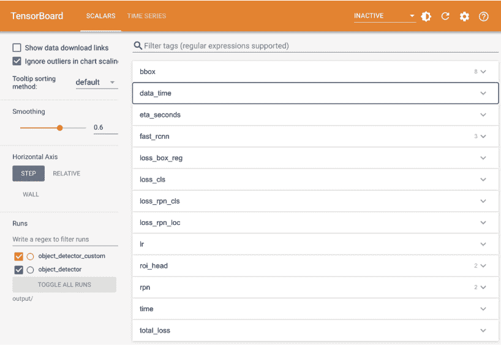
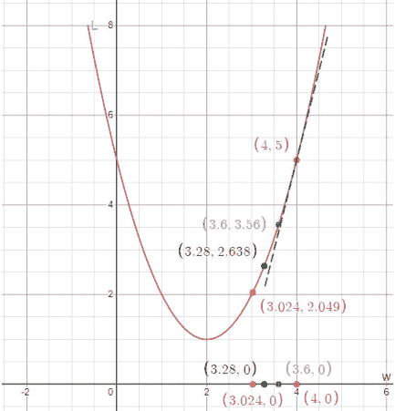
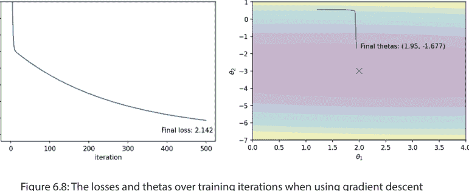
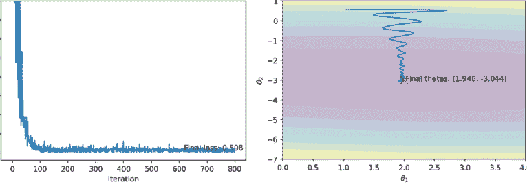
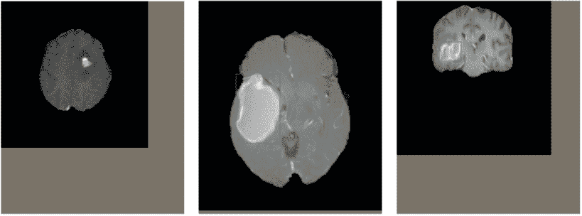

## 检查训练结果并微调 Detectron2 的求解器

本章介绍如何使用 TensorBoard 检查训练历史。它利用代码和可视化方法解释 Detectron2 求解器背后的概念及其超参数。相关概念包括梯度下降、随机梯度下降、动量和可变学习率优化器。本章还提供代码，帮助你找到 Detectron2 求解器的标准超参数。

学完本章后，你将能够使用 TensorBoard 分析训练结果并获得洞见。你还会深入理解 Detectron2 求解器的关键超参数。此外，你将能够使用代码为自定义数据集生成这些超参数的合适值。具体而言，本章涵盖以下主题：

- 使用 TensorBoard 检查训练历史
- 理解 Detectron2 的求解器
- 微调学习率和批大小

### 技术要求

你必须已完成*第 1 章*，才能拥有适合 Detectron2 的开发环境。所有代码、数据集和结果均可在本书的 GitHub 仓库中获取：`https://github.com/PacktPublishing/Hands-On-Computer-Vision-with-Detectron2`。强烈建议你下载代码并跟随操作。


## 使用 TensorBoard 检查训练历史

在微调模型之前，了解训练期间测量的评估指标至关重要，例如训练损失（例如，分类损失和定位损失）、学习率变化，以及在测试集上的验证测量（例如，mAP@0.5），这些指标会随时间变化。这些指标使我们能够理解训练过程，以便调试和微调模型。Detectron2 的记录器会自动以 TensorBoard 可用的格式记录训练和测试数据的评估指标。

TensorBoard（https://www.tensorflow.org/tensorboard）提供工具和可视化，以便我们探索机器学习实验中的训练和评估过程。以下代码片段下载我们在第 5 章中进行的两个实验的训练日志并解压它们：

```
# download and extract
!wget {url_to_object_detector.zip}
!wget {url_to_object_detector_hook.zip}
!unzip object_detector.zip
!unzip object_detector_hook.zip
```

获取训练和评估日志后，以下代码片段加载 TensorBoard，以便您可以查看训练结果：

```
output_dir = "output/"
%load_ext tensorboard
%tensorboard --logdir {output_dir} --host localhost
```

正如我们所见，此代码片段将输出目录设置为存储训练日志的 output 文件夹。然后它将 TensorBoard 加载为内部 Web 服务器并将其嵌入到 Google Colab 的输出单元格中。

> 重要提示
> 如果已加载 TensorBoard，请运行 %reload_ext tensorboard 而不是 %load_ext tensorboard，或在使用其进程 ID 终止当前服务器后再加载新实例。

图 6.1 显示了 Detectron2 目标检测模型的训练和评估日志在 SCALARS 选项卡中的日志：



图 6.1：TensorBoard 及训练和评估日志的 SCALARS 选项卡

日志记录步骤在训练期间每 20 次迭代执行一次（此数字可配置），默认情况下有 12 类标量：

- `data_time` 类别存储准备训练数据所需的时间。
- `eta_seconds` 类别存储训练完成前的估计秒数。
- `fast_rcnn` 类别存储 Fast R-CNN 评估指标。这些是分类准确率（`cls_accuracy`）、假阴性（`false_negative`）和前景（对象）分类准确率（`fg_cls_accuracy`）。
- `loss_box_reg` 类别存储边界框回归（或定位损失）的损失。
- `loss_cls` 类别存储分类损失。
- `loss_rpn_cls` 类别存储区域建议网络物体性分类损失。
- `loss_rpn_loc` 类别存储区域建议网络定位（边界框）损失。
- `lr` 类别存储学习率。学习率可能因具有预热期、在某些步骤降低的步骤，或使用其他参数而变化。

## 理解 Detectron2 的求解器

我们应该尝试两种明显的微调技术：更改骨干网络和增加批大小。如 Detectron2 Model Zoo（第 3 章介绍）所示，我们在第 5 章中选择的骨干是最简单的（ResNet50），在预训练数据集上的 mAP@0.5 较低。它轻量且训练和推理速度快，因此我们一直在使用免费的 Google Colab 计划进行实验。如果计算资源可用，选择 Detectron2 Model Zoo 中更强大的骨干，例如 X101FPN，将是有益的。然而，在本节中，我们将保留这个简单的骨干模型并尝试设置和优化器类型。这些是标准超参数，因为它们适用于深度学习总体。

了解可用的优化器及其相关超参数对于理解 Detectron2 为微调模型提供的配置参数至关重要。本节简要介绍深度学习中常见的优化器类型。

### 梯度下降

梯度下降是训练深度神经网络时最基本的概念之一。通常，在训练神经网络时，有一个成本（损失）函数（$L$），我们需要对其关于模型参数（$W$）进行优化（最小化）。我们使用微积分来执行此优化，通过获取损失函数对参数的导数，将其设为零并获得最优结果。然而，在复杂的深度神经网络中（通常如此），很难（甚至不可能）求解此方程。因此，使用数值近似更为合适。*图 6.4* 使用一个参数的简单损失函数说明了这一思想：



图 6.4：梯度下降步骤示例

具体来说，损失函数为 $L(w) = w^2 - 4w + 5$，其导数为 $\nabla L(w) = 2w - 4$。此情况下的梯度下降算法很简单：

```
Initialize w with a random value
for e in range(num_epochs):
    update  w = w - η ∇L(w)
```

这里，num_epochs 是执行训练的步数，学习率（$η$）决定了参数 $w$ 在每次训练步骤中根据损失函数的导数更新其值的幅度。这些是梯度下降算法的两个基本超参数。

例如，当前参数 $w$ 为 4，选择的学习率为 $η = 0.1$。该损失函数的切线（虚线）的斜率是导数 $∇L(4) = 4$。在这一点，$w$ 应该向左移动，即 $w = 3.6$。类似地，后续步骤应对应 $w = 3.28, 3.024$，等等。如果我们继续这样做，损失函数最终会收敛到最优点，前提是步长足够小。值得注意的是，当损失函数的导数幅度变小时，步长也会变小。

此时，问题是如何选择训练的 epoch 数和学习率。一般来说，选择较小的学习率会使学习过程变慢，模型收敛需要很长时间。另一方面，较大的学习率可能导致 $w$ 参数左右波动且不收敛等问题。

让我们采用一个简单的代码方法来演示这些思想。以下代码片段定义了损失函数（在训练数据上计算）及其对应的导数：

```
def L(w):
    return w**2 - 4*w + 5
def dL(w):
    return 2*w - 4
```

以下代码片段准备一个简单的函数来模拟训练过程，初始训练权重值（w0）、学习率（lr）和 epoch 数（num_epochs）：

```
def train(w0, lr, num_epochs):
    ws, Ls = [], [], w0
    for e in range(num_epochs):
        Ls.append(L(w))  # loss
        ws.append(w)  # weight
        dLw = dL(w)  # gradient
        w = w - lr*dLw  # update
    return ws, Ls
```

此函数返回随时间变化的权重列表及其对应的损失。以下代码片段然后接收这两个列表并可视化训练过程中的变化：

```
```python
# import statements for matplotlib and numpy
def visualize(ws, Ls):
    w_range = np.linspace(-0.5, 4.5, 100)
    L_range = [L(w) for w in w_range]
    plt.plot(w_range, L_range)
    plt.scatter(ws, Ls)
    plt.plot(ws, Ls)
    plt.scatter(ws,[0]*len(ws))
    ax = plt.gca()
    msg = f'lr={lr}\nnum_epochs={num_epochs}'
    plt.text(0.6, 0.95, msg,
        horizontalalignment='left',
        verticalalignment='top',
        transform = ax.transAxes)
    plt.show()
```
```

最后，以下代码片段为特定超参数集生成实验（假设 w0=4.0）：

```
```python
num_epochs = 20
lr = 0.1
ws, Ls = train(w0, lr, num_epochs)
visualize(ws, Ls)
```
```

*图 6.5* 显示了不同超参数集下训练时间中权重（X 轴）及其对应损失（Y 轴）的变化：


值得注意的是，我们选择的损失函数是均方误差（MSE）。下面的代码片段创建了一个名为GD（梯度下降）的优化器，用于在给定学习率和梯度的情况下执行参数更新：

```
class GD():
    def __init__(self, lr):
        self.lr = lr

    def backward(self, theta, gradients):
        theta = theta - self.lr*(gradients)
        return theta
```

接下来，我们必须创建一个函数，在给定X和Y数据（无论是批次还是整个轮次）的情况下执行一次训练步骤：

```
def train_step(X, Y, theta, optimizer):
    # forward
    Y_hat = forward(theta, X)
    loss = mse(Y_hat, Y)
    dLdTheta = gradient(X, Y, Y_hat)
    theta = optimizer.backward(theta, dLdTheta)
    return theta, loss, dLdTheta
```

现在我们已经知道了如何在每次迭代（批次或轮次）中执行训练，下面的代码片段可以帮助我们执行训练循环：

```
def train(X, Y, theta0, optimizer, num_epochs):
    losses = []
    thetas = []
    dLdThetas = []
    theta = theta0
    for epoch in range(num_epochs):
        theta, loss, dLdTheta=train_step(X, Y, theta,optimizer)
        thetas.append(theta)
        losses.append(loss)
        dLdThetas.append(dLdTheta)
    return losses, thetas, dLdThetas
```

此外，下面的代码片段创建了一个函数，帮助我们可视化损失在训练迭代中的变化情况：

```
```python
def plot_losses(losses):
    plt.plot(losses)
    plt.ylim([-1, 20])
    ax = plt.gca()
    msg = f'Final loss: {round(losses[-1], 3)}'
    plt.text(0.99, 0.1, msg,
        horizontalalignment='right',
        verticalalignment='top',
        transform = ax.transAxes)
    plt.xlabel("iteration")
    plt.ylabel("loss")
    plt.show()
```
```

进一步地，下面的代码片段还可视化了训练参数（theta）在训练迭代中的变化情况：

```
```python
def plot_thetas(thetas, losses):
    grid_size = 100
    thetas = np.array(thetas)
    theta1s = np.linspace(0, 4, grid_size)
    theta2s = np.linspace(1, -7, grid_size)
    Z = np.zeros((grid_size, grid_size))
    for i in range(grid_size):
        for j in range(grid_size):
            theta = np.array([[theta1s[i]], [theta2s[j]]])
            Y_hat = forward(theta, X)
            loss = mse(Y_hat, Y)
            Z[i,j] = loss
    # some simple plotting code lines are removed for space eff.
```
```

接下来，我们必须随机初始化训练参数的值，并设置一些训练超参数：

```
```python
theta0 = np.random.rand(2, 1)
num_epochs = 500
lr = 0.001
```
```

下面的代码片段使用梯度下降方法执行训练并可视化结果：

```
```python
optimizer = GD(lr = lr)
losses, thetas, dLdthetas = train(X, Y, theta0,
optimizer=optimizer, num_epochs=num_epochs)
plot_losses(losses)
plot_thetas(thetas, losses)
```
```

*图6.8* 显示了使用梯度下降方法时，训练迭代中的损失和theta值变化：



可以观察到，损失和theta值变化得逐渐且平滑，因为训练步骤是在整个数据集上执行的。然而，训练过程在500次迭代后没有收敛（X标记表示收敛点）。

另一方面，下面的代码片段准备了一种使用随机梯度下降方法执行训练过程的方法：

```
```python
def train_mini_batch(X, Y, theta0, optimizer, num_epochs,
batch_size):
    # some simple initialization code lines are removed here
    for e in range(num_epochs):
        # shuffle
        np.random.shuffle(indices)
        for i in range(batches):
            start = i*batch_size
            stop = start + batch_size
            indices_b = indices[start:stop]
```
```

## 动量

梯度下降仅基于损失函数当前导数的值来更新权重。另一方面，动量方法除了考虑当前梯度的影响外，还考虑过去梯度的累积。打个比方，我们可以将随机/梯度下降方法视为在路上推一个箱子。如果我们推它，它会移动；如果我们停止推，它由于高摩擦而不会移动。另一方面，我们可以将动量方法视为踩自行车。如果我们踩踏板，自行车就会移动。然而，当我们停止踩踏板时，由于之前踩踏板产生的动量，它还会继续移动一段距离。

让我们重写随机/梯度下降方法的权重更新公式，使其看起来像这样：

$$\theta_t = \theta_{t-1} - \eta g_t$$

这里，$\theta_t$ 和 $g_t$ 分别是时间 $t$ 时的训练参数和梯度，$\eta$ 是学习率。因此，如果没有梯度（$g_t = 0$），那么参数就不会更新。另一方面，动量方法分为两步。在每次迭代中，它记录一个变量 $v_t$（速度），然后使用它通过以下两个方程更新训练参数：

$$v_t = \mu v_{t-1} + \eta g_t$$

$$\theta_t = \theta_{t-1} - v_t$$

这里，$\mu$ 通常是一个小于且接近1.0的值，例如0.9、0.95或0.99。为 $\mu$ 选择这些值之一，使得当 $g_t = 0$ 时，经过几次迭代后，$v_t$ 也会变为零，并且不会更新权重。正如这些公式所示，通常，使用动量方法的主要优点是可以加快训练时间（收敛时间）。

动量有几种变体，前面列出的是Sutskever的实现。还有另一个来自Nesterov的流行实现，略有不同：

$$v_t = \mu v_{t-1} + g_t$$

$$\theta_t = \theta_{t-1} - \eta v_t$$

让我们继续使用前面章节中介绍的代码和可视化方法来阐述这些概念。下面的代码片段准备了一个动量优化器：

```
class Momentum():
    def __init__(self, lr, moment, nesterov=False):
        self.lr = lr
        self.moment = moment
        self.first_step = True
```

```
```python
self.nesterov = nesterov

def backward(self, theta, gradients):
    if self.first_step:
        self.v = np.zeros_like(theta)
        self.first_step = False

    if not self.nesterov:
        self.v = self.moment*self.v + self.lr * gradients
        theta = theta - self.v
    else:
        self.v = self.moment*self.v + gradients
        theta = theta - self.lr * self.v

    return theta
```
```

下面的代码片段随后使用动量执行训练并可视化结果：

```
```python
optimizer = Momentum(lr = lr, moment=0.9)
losses, thetas, dLdThetas = train_mini_batch(X, Y, theta0,
optimizer=optimizer, num_epochs=num_epochs-300, batch_size = 5)
plot_losses(losses)
plot_thetas(thetas, losses)
```
```

*图6.10* 显示了这段代码的输出。正如我们所见，由于动量的作用，损失和训练参数的变化更加平滑。此外，最终的损失和theta值表明，这种方法的表现甚至优于没有动量的随机梯度下降方法。Nesterov实现动量的方法也有类似的结果。因此，为了节省篇幅，我们在此没有包含代码和结果（你可以参考本书GitHub仓库中的代码文件）：



图6.10：使用动量时训练迭代中的损失和theta值变化

在许多情况下，当神经网络尚未训练好时，使用较高的学习率可能会导致梯度爆炸问题。同样，当接近最优点时，最好使用较小的学习率，这样变化不会在最优点左右来回波动。然而，这并不意味着我们应该始终选择较小的学习率，因为这样会让训练过程更长。因此，可变学习率方法可能会产生更好的结果。

## 可变学习率

可变学习率有多种实现方式。由于篇幅限制，本节只介绍Detectron2在其随机梯度下降实现中所使用的方法。具体来说，在训练开始时，可以选择执行预热步骤。该步骤使用一个名为 `warmup_iters` 的超参数。从训练开始，学习率逐渐线性增加（也可以使用正弦波方法），使其在该阶段结束时达到基础学习率。

此外，还有另一组超参数，称为 steps 和 gamma。这些是学习率按 gamma 因子变化的步骤。这些超参数有助于在训练过程接近结束时逐步降低学习率。下面的代码片段实现了具有可变学习率的随机梯度下降方法：

```
```python
class VariableLR():
    def __init__(self, lr, moment,
        nesterov =False,
        warmup_iters = 0,
        steps      = None,
        gamma      = 0.5):
        # codes removed: self.<inputs> = <inputs>
        self.iter = 0
```
```


```
```python
self.lrs = []
self.first_step = True
def backward(self, theta, gradients):
    # Explained next
```
```

该类有两个方法：`__init__` 和 `backward`。第一个方法只是接收输入并将它们赋值给类的对应成员。第二个方法使用输入的梯度（`gradients`）对现有参数（`theta`）执行实际的更新：

```
```python
if self.iter in self.steps:
    self.lr = self.lr*self.gamma
self.iter += 1
if self.warmup_iters!=0 and self.iter < self.warmup_iters:
    lr = (self.iter/self.warmup_iters)*self.lr
else:
    lr = self.lr
self.lrs.append(lr)
if self.first_step:
    self.v = np.zeros_like(theta)
    self.first_step = False
if not self.nesterov:
    self.v = self.moment*self.v + lr * gradients
    theta = theta - self.v
else:
    self.v = self.moment*self.v + gradients
    theta = theta - lr * self.v
return theta
```
```

下面的代码片段使用这种方法执行训练并可视化结果：

```
```python
optimizer = VariableLR(lr = lr, moment=0.9, nesterov=False,
warmup_iters=50, steps=(300, 500))
losses, thetas, dLdThetas = train_mini_batch(X, Y, theta0,
optimizer=optimizer, num_epochs=num_epochs-300, batch_size = 5)
plot_losses(losses)
plot_thetas(thetas, losses)
```
```

## 微调学习率和批大小

Detectron2 为其默认的随机梯度下降优化器（solver/optimizer）提供了多种配置。不过，主要的参数如下：

- `cfg.SOLVER.IMS_PER_BATCH` 超参数用于设置批大小，即每次训练迭代的图像数量。
- `cfg.SOLVER.BASE_LR` 超参数用于设置基础学习率。
- `cfg.SOLVER.MOMENTUM` 超参数用于存储动量值。
- `cfg.SOLVER.NESTROV` 超参数决定是否使用 Nesterov 动量实现。
- `cfg.SOLVER.WARMUP_ITERS` 超参数用于存储预热迭代次数。
- `cfg.SOLVER.STEPS` 超参数设置学习率按 `cfg.SOLVER.GAMMA`（另一个超参数）缩小的迭代点。
- `cfg.SOLVER.MAX_ITER` 超参数设置训练的最大迭代次数。该迭代次数不是按轮数（epoch）计数，而是按批次数计数。

下面的代码片段在我们使用 TensorBoard 分析先前训练结果之后，用这些值设置相关参数：

```
```python
cfg.SOLVER.IMS_PER_BATCH = 6
cfg.SOLVER.BASE_LR = 0.001
cfg.SOLVER.WARMUP_ITERS = 1000
cfg.SOLVER.MOMENTUM = 0.9
cfg.SOLVER.STEPS = (3000, 4000)
cfg.SOLVER.GAMMA = 0.5
cfg.SOLVER.NESTROV = False
cfg.SOLVER.MAX_ITER = 5000
```
```

TensorBoard 对之前训练损失的检查显示损失波动较大。因此，增加批大小有助于让变化更平滑。不过，由于 GPU 资源有限，我们将该值设为 6。我们还设置了更高的基础学习率，并设置了相应的步长（steps），以便在指定迭代点将学习率减半（GAMMA）。

恭喜！到此为止，你已经具备了必要的背景知识和代码，可以生成适用于你自己定制图像的像素均值集和标准差集。

## 本章小结

本章介绍了帮助您微调 Detectron2 优化器（solver）所需的背景知识和标准超参数。具体来说，它展示了如何使用 TensorBoard 分析训练结果并发现其中的规律。然后，我们利用代码和可视化方法来演示并找出适合 Detectron2 优化器的超参数。本章还提供了一组被认为适合 Detectron2 目标检测模型的超参数，该模型在脑肿瘤数据集上进行了训练。作为练习，请使用本章生成的所有配置，进行训练实验，将结果加载到 TensorBoard 中，并分析这些配置之间的差异以及它们如何提升准确率。

本章涵盖了一套标准的技术和超参数，因为它们通常可用于微调机器学习模型。接下来的三章将介绍用于微调目标检测模型的微调技巧。

下面的代码片段应输出以下内容：

```
MIN_SIZE_TRAIN (640, 672, 704, 736, 768, 800)
MAX_SIZE_TRAIN 1333
```

`ResizeShortestEdge` 方法使用这些超参数来调整输入图像的大小。具体来说，只要较长边小于 `MAX_SIZE_TRAIN`，它就会将较短边缩放到从 `MIN_SIZE_TRAIN` 中随机选择的某个值；否则，它会继续将较长边缩放到 `MAX_SIZE_TRAIN`。

调整大小时，图像的宽高比保持不变。下面的代码片段对一个训练批次进行采样，并显示采样/变换后图像的大小：

```
trainer._data_loader_iter = iter(trainer.data_loader)
data = next(trainer._data_loader_iter)
for i in data:
    print(i['image'].shape)
```

该代码片段的输出如下（不同运行中可能有所不同）：

```
torch.Size([3, 640, 640])
torch.Size([3, 914, 800])
torch.Size([3, 672, 672])
torch.Size([3, 805, 704])
torch.Size([3, 704, 704])
torch.Size([3, 640, 640])
```

可以观察到，所有较短的边都被缩放为 `MIN_SIZE_TRAIN` 中的某个值，且没有任何较长边超过 `MAX_SIZE_TRAIN`。请注意，这些缩放后的图像仍然具有不同的大小。因此，Detectron2 还会使用下面的代码片段执行一些额外的预处理：

```
images = trainer.model.preprocess_image(data)
print(images.tensor.shape)
```

该代码片段的输出应该给出一个图像大小（即最大图像大小四舍五入到最接近的 32 的倍数）。下面的代码片段显示了其中三张预处理后的图像：

```
# some import statements are removed for space efficiency
for i, item in enumerate(images.tensor[:3]):
    img = np.moveaxis(item.to("cpu").numpy(), 0, -1)
    pixel_mean = cfg.MODEL.PIXEL_MEAN
    pixel_std = cfg.MODEL.PIXEL_STD
    img = (img * pixel_std) + pixel_mean
```

```
```python
v = Visualizer(img, metadata={}, scale=0.5)
gt_boxes = data[i]['instances'].get('gt_boxes')
v = v.overlay_instances(boxes = gt_boxes)
dpi = 80
im_data = v.get_image()[:, :, ::-1]
height, width, depth = im_data.shape
figsize = width / float(dpi), height / float(dpi)
fig = plt.figure(figsize=figsize)
plt.imshow(im_data)
plt.imshow(im_data)
plt.axis("off")
plt.show()
```
```

*图 7.1* 给出了该代码片段输出的图像示例：



**图 7.1：** 输入主干网络（backbone）之前的预处理图像和标签示例

可以观察到，批次中较小的图像会在底部和右侧填充到最大尺寸，使所有图像具有相同大小。此外，边界框也会相应地缩放。

在了解了 Detectron2 如何预处理输入图像和真实边界框后，我们现在可以对多个迭代进行采样，从该数据集中获取真实边界框，并分析它们，从而得到适合训练的尺寸和比例。

```
ratios = torch.min(
    all_ratios, inverse_ratios
)
worst = ratios.min(-1).values
best = worst.max(-1).values
return best
```

该函数有助于量化单个真实边界框与一组锚框（anchor）之间的适应度，并返回适应度比值列表。然而，在给定一组锚框的情况下，我们需要一个数值来量化所有真实边界框整体的适应度。

### 量化适应度

一种方法是在给定一组锚框的情况下，将所有真实边界框的适应度得分取平均，作为整组真实边界框与锚框之间的一个适应度分数。然而，常见的做法是丢弃不良匹配，不让它们参与平均值计算。具体来说，我们使用一个阈值 EDGE_RATIO_THRESHOLD，并丢弃所有不良匹配。

默认阈值为 0.25，这意味着如果两个框任意边的比例相差超过四倍，它们就会被视为不良匹配：

```
def fitness(ac_wh, gt_wh, EDGE_RATIO_THRESHOLD = 0.25):
    ratio = best_ratio(ac_wh, gt_wh)
    ret = (ratio*(ratio>EDGE_RATIO_THRESHOLD).float()).mean()
    return ret
```

此外，我们可以使用以下函数，通过预定义的 EDGE_RATIO_THRESHOLD 来检查使用一组给定锚框召回所有真实边界框的可能性：

```
def best_recall(ac_wh, gt_wh, EDGE_RATIO_THRESHOLD = 0.25):
    ratio = best_ratio(ac_wh, gt_wh)
    best = (ratio > EDGE_RATIO_THRESHOLD).float().mean()
    return best
```

具体来说，如果某个真实边界框的各边长度不超过至少一个锚框对应边长的四倍，也不小于其四分之一，那么该真实边界框就可以被召回。

下面的代码片段让我们可以检查 Detectron2 提供的默认尺寸和比例集合是否能生成一组良好的锚框，以帮助召回所有真实边界框，以及这两个集合之间的适应度分数是多少：

```
print("recall", best_recall(ac_wh, gt_wh))
print("fitness", fitness(ac_wh, gt_wh))
```


该算法具有以下步骤：

- 1. 从聚类算法生成的初始尺寸和比例开始。
- 2. 根据给定的概率采样一些项目进行演化（例如，0.9 表示项目有 90% 的概率演化）。
- 3. 从具有给定均值和标准差的正态随机分布中采样一些随机的演化量。
- 4. 使用生成的随机量更改尺寸和比例。
- 5. 使用新的尺寸和比例集合计算适应度分数。
- 6. 如果适应度提高，则将初始尺寸和比例集合设置为这些当前集合并循环回到步骤 1。否则，继续执行步骤 2。

以下代码片段实现了该算法：

```
def evolve(sizes, ratios,
    gt_wh,
    iterations = 10000,
    probability = 0.9,
    muy = 1,
    sigma = 0.05,
    fit_fn = fitness,
    verbose = False):
# Step 1: Current anchors and their fitness
msg = f"Evolving ratios and sizes:"
pbar = tqdm(range(iterations), desc = msg)
for i, _ in enumerate(pbar):
# Step 2 and 3: sample evolving items and amounts
# Step 4 and 5: change sizes and ratios and new fitness

    if mutated_fit > best_fit:
        # Step 6: update sizes and ratios if better
return sizes, ratios
```

以下各节解释了每一步的代码。具体而言，步骤 1 的代码使用当前的尺寸和比例生成锚点并计算当前适应度分数：

```
anchors = generate_anchors(tuple(sizes), tuple(ratios))
ac_wh = boxes2wh(anchors)
anchor_shape = len(sizes) + len(ratios)
best_fit = fit_fn(ac_wh, gt_wh)
```

以下代码片段提供了步骤 2 和 3 的代码。这些步骤随机采样要变异的项目以及变异的量：

```
mutation = np.ones(anchor_shape)
mutate = np.random.random(anchor_shape) < probability
mutation = np.random.normal(muy,sigma,anchor_shape)*mutate
mutation = mutation.clip(0.3, 3.0)
```

步骤 4 和 5 在获取了要更改的内容和更改量的信息后对尺寸和比例进行更改。此外，它还在执行变异后计算新的适应度分数。这些步骤的源代码如下：

```
mutated_sizes = sizes.copy()*mutation[:len(sizes)]
mutated_ratios = ratios.copy()*mutation[-len(ratios):]
mutated_anchors = generate_anchors(
    tuple(mutated_sizes),
    tuple(mutated_ratios))
mutated_ac_wh = boxes2wh(mutated_anchors)
mutated_fit = fit_fn(mutated_ac_wh, gt_wh)
```

最后，如果新的适应度分数更好，则步骤 6 的代码会使用相应的当前值更新最佳分数、尺寸和比例：

```
sizes = mutated_sizes.copy()
ratios = mutated_ratios.copy()
best_fit = mutated_fit
msg=f"Evolving ratios and sizes, Fitness = {best_fit:.4f}"
pbar.desc = (msg)
```

我们可以通过运行以下代码行来开始优化过程：

```
e_sizes,e_ratios = evolve(sizes,ratios,gt_wh,verbose=False)
```

该算法应产生大约 0.8835 的适应度分数。这一结果略好于聚类算法生成的尺寸和比例。最后，我们应运行以下代码片段并保存这些尺寸和比例以供将来训练：

```
print("sizes", e_sizes)
print("ratios", e_ratios)
```

该代码片段应显示以下输出（或类似）：

```
sizes [ 68.33245953 112.91302277  89.55701886
144.71037342  47.77637482]
ratios [0.99819939 0.78726896 1.23598428]
```

因此，训练配置应使用以下超参数用于尺寸和比例：

```
cfg.MODEL.ANCHOR_GENERATOR.SIZES = [[68.33245953],
[112.91302277],  [89.55701886], [144.71037342],  [47.77637482]]
cfg.MODEL.ANCHOR_GENERATOR.ASPECT_RATIOS = [[0.99819939,
0.78726896, 1.23598428]]
```

恭喜！到目前为止，你应该对 Detectron2 如何处理其输入以及如何为生成锚点选择一组默认超参数有了更深入的理解。以下部分涵盖了设置另一组基本参数以微调 Detectron2 模型的步骤。它们是训练图像中像素值的均值和标准差。

## 设置像素均值和标准差

输入图像像素的均值和标准差在训练 Detectron2 模型中至关重要。具体而言，Detectron2 使用这些值来归一化输入图像。Detectron2 对此有两个配置参数。它们是 cfg.MODEL.PIXEL_MEAN 和 cfg.MODEL.PIXEL_STD。默认情况下，从 ImageNet 数据集生成的这两个超参数的常见值是 [103.53, 116.28, 123.675] 和 [57.375, 57.120, 58.395]。这些值适用于大多数彩色图像。然而，此特定案例具有灰度图像，其像素均值和标准差的值不同。因此，从训练数据集中生成这两组值将是有益的。此任务有两个主要阶段：（1）准备数据加载器以加载图像和（2）创建类以计算运行均值和标准差。

## 准备数据加载器

Detectron2 的数据加载器是可迭代的，可以使用随机输入生成无限数据批次。然而，我们希望分析每个输入图像一次。因此，创建自定义数据集并使用 Pytorch 的数据加载器加载输入图像更为方便。以下代码片段导入所需的包并设置初始配置：

```
# some import statements are removed for space efficiency
name_ds = "braintumors_coco"
af = "_annotations.coco.json"
img_dir = name_ds + "/train/"
json_file_train = name_ds + "/train/" + af
batch_size = 64
num_workers = 2
```

值得注意的是，我们不执行训练，因此使用了更高的批大小（本例中为 64），因为有更多可用的 GPU。以下代码片段为我们的自定义数据集准备 PyTorch 数据集类：

```
# some import statements are removed for space efficiency
class TumorDataset(Dataset):
    def __init__(self,
                data,
                img_dir="",
                transform = None):
        self.data = data
        self.img_dir = img_dir
        self.transform = transform
    def __len__(self):
        return len(self.data)

    def __getitem__(self, idx):
        file_name = os.path.join(self.img_dir,
                                self.data[idx]['file_name'])
        image = cv2.imread(file_name)
        if self.transform is not None:
            image = self.transform(image = image)['image']
        return image
```

输入图像具有不同的尺寸。因此，我们使用 albumentations 包将所有输入图像转换到相同的尺寸：

```
import albumentations as A
from albumentations.pytorch import ToTensorV2
image_size = 640
augs = A.Compose([
    A.Resize(height = image_size, width = image_size),
    ToTensorV2()])
```

值得注意的是，我们将所有输入图像调整为 640 x 640。以下代码片段读取 JSON 注释文件并创建 PyTorch 数据加载器：

```
import json
with open(json_file_train) as f:
    ds = json.load(f)['images']

tds = TumorDataset(ds, img_dir=img_dir, transform=augs)
image_loader = DataLoader(tds,
                          batch_size = batch_size,
                          shuffle    = False,
                          num_workers = num_workers,
                          pin_memory  = True)
```

此数据加载器以批次加载数据，因为输入数据集可能太大而无法一次性放入内存。因此，我们需要创建一个类以滚动/运行方式计算均值和标准差。

## 计算运行均值和标准差

如果可以访问整个值集，则计算一组 n 个值的均值（x̄）和标准差（std）的公式是直接的：

sum = Σᵢ₌₁ⁿ xᵢ
x̄ = sum / n

ssd = \sum_{i=1}^{n} (x_i - \bar{x})^2

std = \sqrt{\frac{ssd}{n - 1}}

然而，以运行方式计算这两个统计量的计算稍微复杂一些。因此，以下公式可能有点复杂，但主要是因为数学符号。具体而言，我们必须跟踪这些统计量，然后在读取每个数据批次后更新它们。令 \overline{x_c}, sum_c, ssd_c, 和 std_c 表示具有当前已见项目（n_c）的当前统计量。现在，当我们看到一个具有 n_b 个项目的新批次 b 时，可以在此批次上计算统计量（sum_b 和 ssd_b）。新数据集的均值（\overline{x_n}）应如下：

\overline{x_n} = \frac{1}{n_c + n_b} (sum_c + sum_b) = \frac{1}{n_c + n_b} (n_c \overline{x_c} + sum_b)

所有这些值都存储并可从批次数据计算。因此，新均值相应更新。类似地，此新数据集的平方差之和如下：

ssd_n = \sum_{i=1}^{n_c} (x_i - \overline{x_n})^2 + \sum_{j=1}^{n_b} (b_j - \overline{x_n})^2 = \sum_{i=1}^{n_c} (x_i - \overline{x_n})^2 + ssd_b

批次的平方差之和（ssd_b）可以从当前批次数据计算。然而，我们需要展开计算的另一部分，即当前数据项相对于新均值的平方差之和，如下：

ssd_{c_new_mean} = \sum_{i=1}^{n_c} (x_i - \overline{x_n})^2 = \sum_{i=1}^{n_c} (x_i)^2 - 2\overline{x_n}\sum_{i=1}^{n_c} x_i + n_c (\overline{x_n})^2 = \sum_{i=1}^{n_c} (x_i)^2 - 2\overline{x_n} sum_c + n_c (\overline{x_n})^2

类似地，我们可以有当前项目列表的平方差之和：

ssd_c = \sum_{i=1}^{n_c} (x_i - \overline{x_c})^2 = \sum_{i=1}^{n_c} (x_i)^2 - 2\overline{x_c}\sum_{i=1}^{n_c} x_i + n_c (\overline{x_c})^2 = \sum_{i=1}^{n_c} (x_i)^2 - 2\overline{x_c} sum_c + n_c (\overline{x_c})^2

然后，已见项目的平方和可以写成如下：

\sum_{i=1}^{n_c} (x_i)^2 = ssd_c + 2\overline{x_c} sum_c - n_c (\overline{x_c})^2

现在，我们可以计算当前项目相对于新均值的平方差之和如下：

ssd_{c_new_mean} = ssd_c + 2\overline{x_c} sum_c - n_c (\overline{x_c})^2 - 2\overline{x_n} sum_c + n_c (\overline{x_n})^2


这个方程现在包含了所有可计算的值。因此，我们可以计算新数据集（当前数据和新批次数据）的平方差之和，进而计算标准差。

下面的代码片段实现了这些计算。首先，我们需要一个辅助方法，将运行均值广播为与输入尺寸兼容的大小，以用于后续计算：

```python
def broad_cast(x, image_size, channel):
    y = torch.broadcast_to(x, (image_size**2, channel))
    z = y.reshape(image_size, image_size, 3)
    return torch.moveaxis(z, 2, 0)
```

下面的代码片段使用了这个辅助方法，并准备了一个类，以滚动/运行的方式从一批批输入中计算运行均值和标准差：

```python
class RunningStats:
    def __init__(self):
        # initialize: self.n = 0, self.mean = 0, self.ssd = 0
    def push(self, x):
        dims = [0, 2, 3]
        count = 1
        for dim in dims:
            count *= x.shape[dim]
        image_size = x.shape[-1]
        channel = x.shape[1]
        if self.n == 0: # start
            # Step 1: compute new_mean, new_ssd, new_count
        else: # otherwise
            # Step 2: store old statistics and compute new ones
        # release results
        self.mean = new_mean
        self.ssd = new_ssd
        self.n = new_count
        self.std = torch.sqrt(new_ssd/(new_count-1))
```

这段代码应该输出如下内容：

```
tensor([20.1962, 20.1962, 20.1962])
tensor([39.5985, 39.5985, 39.5985])
```

然后，我们可以将这些值用于训练配置，如下所示：

```
cfg.MODEL.PIXEL_MEAN = [20.1962, 20.1962, 20.1962]
cfg.MODEL.PIXEL_STD = [39.5985, 39.5985, 39.5985]
```

恭喜！到这一步，你应该已经掌握了相关的背景知识，并拥有了为自定义图像生成像素均值和标准差集合的代码。接下来，我们应该把上一章和本章推导出的所有配置整合起来，重新训练我们的脑肿瘤检测模型。

## 整合所有配置

用于训练自定义模型的代码与之前相同，包括评估功能以及保存最佳模型的钩子。然而，配置应该如下：

```
# 为了节省篇幅，省略了生成 cfg 对象的代码。
# Solver
cfg.SOLVER.IMS_PER_BATCH = 6
cfg.SOLVER.BASE_LR = 0.001
cfg.SOLVER.WARMUP_ITERS = 1000
cfg.SOLVER.MOMENTUM = 0.9
cfg.SOLVER.STEPS = (3000, 4000)
cfg.SOLVER.GAMMA = 0.5
cfg.SOLVER.NESTEROV = False
cfg.SOLVER.MAX_ITER = 5000
# checkpoint
cfg.SOLVER.CHECKPOINT_PERIOD = 500
# anchors
cfg.MODEL.ANCHOR_GENERATOR.SIZES = [[68.33245953,
112.91302277, 89.55701886, 144.71037342, 47.77637482]]
cfg.MODEL.ANCHOR_GENERATOR.ASPECT_RATIOS = [[0.99819939,
0.78726896, 1.23598428]]
# pixels
cfg.MODEL.PIXEL_MEAN = [20.1962, 20.1962, 20.1962]
```
