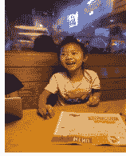
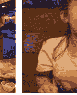
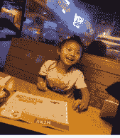
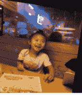
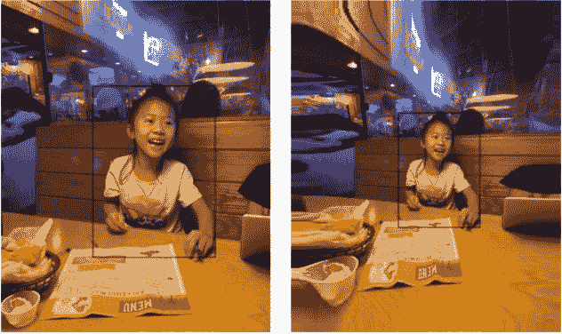
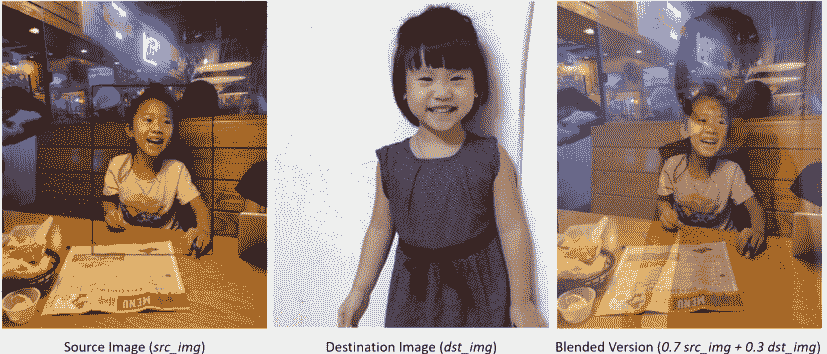
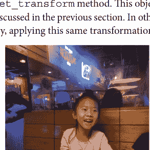
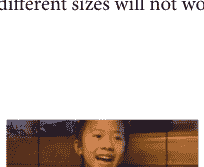
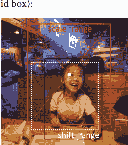
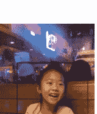

## 图像增强技术

图像增强技术极大地帮助提升了计算机视觉深度学习模型的鲁棒性和准确性。Detectron2 和许多其他现代计算机视觉架构都使用图像增强。因此，理解图像增强技术以及 Detectron2 如何使用它们至关重要。本节介绍图像增强**是什么**、**为什么**它们很重要，并介绍执行它们常用的方法（**如何做**）。接下来的两节将解释 Detectron2 在训练和推理过程中如何使用它们。

### 为什么需要图像增强？

权重数量较少的深度学习架构可能不够准确（**偏差问题**）。因此，现代架构往往复杂且拥有海量权重。训练这些模型通常需要多次遍历训练数据集；一个 epoch 意味着整个训练数据集被模型完整遍历一次。因此，海量权重可能意味着模型倾向于记忆训练数据集中的琐碎特征（**过拟合问题**），并且在未来未见过的数据上表现不佳（**方差问题**）。

一个常用来说明这种情况的典型例子是：一个经过训练的深度学习模型，用于区分金毛寻回犬和哈士奇。它在训练和评估集上表现出很高的准确率。然而在实际应用中，它的表现却很差。进一步检查模型后发现，它利用图像中下雪的背景来区分哈士奇和金毛，而不是它们真正的特征。因此，检测对象必须被置于不同的环境中。

一个直接的解决方案是拥有更多的训练数据。然而，在许多情况下，获取更多图像可能并不可行。例如，从患者那里收集医学图像可能会受到法律限制。即使可以收集更多图像，这些领域的人工标注成本也可能非常高昂，因为需要高技能的专业人员进行标注。因此，图像增强技术非常重要。

### 什么是图像增强？

图像增强技术会变换图像及其相关标注（例如，边界框、分割掩码和关键点），并生成略有不同的副本。相同输入的副本可以让模型获得具有不同上下文的更多训练数据，从而应对过拟合并提升鲁棒性。得益于图像增强，一些现代计算机视觉深度学习架构甚至可以生成在训练期间从未重复查看同一图像的模型。下面介绍最重要且最实用的图像增强技术。

- **饱和度：** 该技术改变输入图像颜色通道的鲜艳程度。它类似于向当前颜色中混入一定量的白色。例如，向蓝色中加入一些白色，会使蓝色变浅。
- **亮度：** 该技术改变输入图像的光照条件。它类似于向颜色中施加一定量的光线。如果没有光线，输入就会变成黑色。
- **曝光度：** 该技术类似于亮度。但曝光度偏向于提亮高光色调，而亮度对所有色调进行同等改变。
- **灰度化：** 该技术将输入图像转换为单通道图像。换句话说，像素值通常范围从 0 到 255，且只有一个通道；或者，如果保留三个通道，则每个像素位置的所有通道值相同。
- **模糊：** 该技术对图像进行平滑处理，使模型对相机对焦更鲁棒。例如，如果使用高斯模糊，某个像素取其周围像素的加权平均值（权重服从高斯分布）。
- **噪声：** 该技术向图像添加随机噪声（通常是椒盐噪声）并生成一个新版本。这种方法使训练模型对相机伪影更鲁棒，并有助于应对对抗性攻击。

现在，我们来看看几何畸变。

### 几何畸变

这一类别包括翻转、裁剪、旋转和错切等技术。图 8.2 展示了这些技术的示例：









图 8.2：几何畸变中增强技术的示例

让我们更详细地了解这些技术：

- **Cutout（随机遮挡）：** 该技术移除输入图像的一部分（用其他值替换，如黑色或数据集中图像的平均颜色）并生成一个新版本。这种技术有助于让训练模型对某些其他物体可能遮挡目标物体一部分的情况更鲁棒。该技术迫使模型从整体上学习物体的特征，而不仅仅是关注某个特定部分。根据剪切区域的不同，该技术可能会或可能不会改变输入图像的标注。
- **MixUp：** 该技术将两个输入图像及其相关标注按不同比例混合成一张图像，并创建新的训练数据项。它允许我们在成对输入图像及其标签的凸组合上训练模型。这些凸组合会对训练模型进行正则化，使其倾向于在训练样本之间表现出简单的线性行为。
- **CutMix：** 该技术根据定义的比例，将一个输入图像的区域替换为另一图像的一部分，从而生成新的版本。该技术可能会移除输入图像中的标注，并包含另一图像中的标注。这种方法结合了 Cutout 和 MixUp 方法的优点，效果良好。
- **Mosaic：** 该技术根据一些定义的比例组合四张图像（而 CutMix 是两张），从而生成新的版本。该技术利用了前面列出的其他图像遮挡技术的优点。此外，如果由于计算资源有限而导致 mini-batch 尺寸较小，这种技术也很有用，因为在这种情况下，一张图像相当于四张图像。

恭喜！到现在，你应该已经理解图像增强技术是什么、为什么重要，以及如何执行它们。下一节将介绍如何使用 Detectron2 应用图像增强技术。

### Detectron2 的图像增强系统

Detectron2 的图像增强系统包含三类主要的类：`Transformation`、`Augmentation` 和 `AugInput`。这些组件帮助增强图像及其相关标注（例如，边界框、分割掩码和关键点）。此外，该系统允许你应用一系列声明式的增强语句，并支持增强自定义数据类型和自定义操作。图 8.4 展示了 Detectron2 增强系统的简化类图：


以下代码片段创建了一些帮助程序，用于可视化 Transformation 和 Augmentation 类的输入和输出。以下是显示图像原始尺寸的帮助方法：

```python
# some import statements are removed for space efficiency
def imshow(image):
    dpi = plt.rcParams["figure.dpi"]
    im_data = image[:, :, ::-1]
    height, width, depth = im_data.shape
    figsize = width / float(dpi), height / float(dpi)
    fig = plt.figure(figsize=figsize)
    plt.imshow(im_data)
    plt.axis("off")
    plt.show()
```

以下方法（visualize_image_boxes）可在输入图像上可视化边界框：

```python
def visualize_image_boxes(img, boxes, colors=['k']):
    v = Visualizer(img, metadata={})
    v = v.overlay_instances(
        boxes           = boxes,
        assigned_colors = colors*len(boxes)
    )
    im_data = v.get_image()
    imshow(im_data)
```

最后，以下方法（visualize_sample）将字典（sample）作为输入，加载图像和边界框，并利用之前构建的方法对它们进行可视化：

```python
def visualize_sample(sample):
    img = sample['image'].to("cpu").numpy()
    img = np.moveaxis(img, 0, -1)
    boxes = sample['instances'].get('gt_boxes')
    visualize_image_boxes(img, boxes)
```

这些方法有助于以图像的实际尺寸可视化 Detectron2 数据集中提取的数据样本及其对应的边界框。

- **NoOpTransform 类**也是 `Transform` 类的子类。它的实例用于诸如在光度失真类别的变换类中返回 `inverse()` 方法等场景。它什么也不做。具体而言，`apply_image` 和 `apply_coords` 抽象方法的实现返回其对应的输入，而 `inverse` 方法的实现返回此类自身的当前对象（`self`）。

- **ResizeTransform 类**是最常用的变换之一，因为其他变换和深度学习模型通常要求图像大小相同。相比之下，输入图像可能具有不同的尺寸。此变换接受原始图像高度和宽度（`h`、`w`）、期望高度和宽度（`new_h`、`new_w`）以及插值方法（`interp`），并据此执行缩放。

- **ExtentTransform 类**：此类接收输入图像的一个子区域（`src_rect`，采用 `XYXY_ABS` 格式）、期望输出尺寸（`h`、`w`）以及插值方法（`interp`），并使用给定的插值方法将提取的区域调整为期望尺寸。此外，如果任何输入子区域尺寸大于输入图像，则使用填充颜色（`fill` 输入参数）进行填充。以下代码片段说明了此类的用法：

```python
# data
img = cv2.imread("Chapter08/1.jpg")
boxes = [[150, 140, 350, 420]]
visualize_image_boxes(img, boxes = boxes, colors=['k'])
# transform
e_tfm = T.ExtentTransform(
        src_rect = (100, 100, 400, 470),
        output_size = img.shape[:2]
    )
et_img = e_tfm.apply_image(img)
et_boxes = e_tfm.apply_box(boxes)
visualize_image_boxes(et_img, boxes = et_boxes)
```

此片段加载一个带有真实框的示例图像。然后，它创建一个 ExtentTransform 对象并调用 `apply_image` 和 `apply_box` 来相应地转换输入图像和真实框。*图 8.5* 显示了此代码片段的输出：

```python
Y_range = np.array(Y_range)
X, Y = np.meshgrid(X_range, Y_range)
grid = np.expand_dims(np.stack([X, Y], axis=2), axis=0)
grid = grid.astype('float32')
super().__init__(grid=grid, interp="nearest")
self.X_range = X_range
self.Y_range = Y_range
```

此方法（__init__）为从 pi 到 0 等距分布的角度生成余弦值范围，宽度为 441 点，高度为 543 点。然后将它们用于创建网格并初始化其超类的对象（GridSampleTransform）。此外，请注意，范围为 [np.pi, 0] 的余弦波返回 [-1, 1] 的范围，这正是 GridSampleTransform 类输入参数所期望的。

GridSampleTransform 有助于转换输入图像。然而，它不支持 apply_coords 方法。因此，我们需要编写 apply_box 方法来执行框变换。此 apply_box 方法利用 _apply_1_box 对其所有输入框执行变换。_apply_1_box 方法是一个内部帮助方法，用于对单个边界框执行变换。它包含以下代码：

```python
gs_box = np.array(box)
img_width = self.img_w
img_height = self.img_h
X_range = self.X_range
Y_range = self.Y_range
x0x1 = 2*gs_box[[0, 2]]/img_width - 1
y0y1 = 2*gs_box[[1, 3]]/img_height - 1
x0x1 = [X_range.searchsorted(x0x1[0]),
        X_range.searchsorted(x0x1[1])]
y0y1 = [Y_range.searchsorted(y0y1[0]),
        Y_range.searchsorted(y0y1[1])]
gs_box = [min(x0x1), min(y0y1), max(x0x1), max(y0y1)]
return gs_box
```

此方法（`_apply_1_box`）找到左上角（x0, y0）和右下角（x1, y1）的 X 和 Y 坐标，并按图像的宽度和高度进行归一化，坐标中心位于图像中心。归一化确保图像的左上角具有 [-1, -1] 坐标，图像的右下角具有 [1, 1] 坐标，并且原点 [0, 0] 位于图像中心。此归一化反映了图像坐标值在转换为余弦值后的情况。最后，它使用 searchsorted 方法根据余弦坐标找到像素坐标。

现在，我们可以像迄今为止学到的其他类一样使用此类：

```python
fc_tfm = PincushionTransform(*img.shape[:2])
fc_img = fc_tfm.apply_image(img)
fc_boxes = fc_tfm.apply_box(boxes)
visualize_image_boxes(fc_img, boxes = fc_boxes)
```

*图 8.8* 显示了此失真方法（右）的输出与其原始输入（左）的对比：



原始图像和真实框

枕形图像和真实框

图 8.8：原始图像和真实框及其枕形版本



图 8.9：源图像、目标图像及其混合版本

- **PadTransform 类**用 `pad_value`（默认为 0.0）和 `seg_pad_value`（默认为 0）分别在输入图像和分割掩码（如果有）的左侧、顶部、右侧和底部填充 x0、y0、x1 和 y1 像素。此外，如果你想使此变换可逆，可以指定原始宽度和高度（`orig_w` 和 `orig_h`）。

- **TransformList 类**扩展了 `Transform` 类，因此具有执行变换操作的类似方法。它接受输入参数作为变换列表（`transforms`）并将其作为属性维护。其方法按顺序将此列表中的所有变换应用于输入。例如，`TransformList` 对象的 `transforms` 属性中有一个 `CropTransform` 对象和一个 `PadTransform` 对象。调用此对象的 `apply_image` 方法首先裁剪图像，然后填充它。此场景有助于训练鲁棒模型以检测超出其特定内容的物体。例如，从哈士奇身上裁剪出雪景背景，迫使模型从哈士奇本身学习特征，而不是其背景上下文。

以下代码片段说明了如何使用 `CropTransform`、`PadTransform` 和 `TransformList` 类：

```python
x0, y0, w, h = (130, 130, 250, 310)
y1, x1 = img.shape[:2] - np.array([y0+h, x0+w])
cr_tfm = T.CropTransform(x0, y0, w, h)
pd_tfm = T.PadTransform(x0, y0, x1, y1)
lst_tfm = T.TransformList([cr_tfm, pd_tfm])
lst_img = lst_tfm.apply_image(img)
lst_boxes = lst_tfm.apply_box(boxes)
visualize_image_boxes(lst_img, boxes = lst_boxes)
```


Augmentation 类是供所有增强类扩展的基类。有两个需要注意的重要方法：`get_transform(self, *args)` 和 `__call__(self, aug_input)`。其所有子类都会重写 `get_transform` 方法，以接受一组命名输入参数并生成一个变换对象。这组参数的名称应能被 `AugInput` 接受（我们将在下一节了解）。`__call__` 方法使其子类能够直接与 `AugInput` 配合使用（下一节将详细介绍）。

FixedSizeCrop 类将 `crop_size` 作为元组 `(height, width)` 传入，从原始输入中随机裁剪该尺寸的区域。如果该尺寸大于原始图像，它会检查 `pad` 选项是否为 `True`。如果为 `True`，则会分别使用 `pad_value` 和 `seg_pad_value` 在右侧和底部填充输入图像和分割掩码（原始图像始终位于左上角）。该类有助于生成相同大小的输入，而深度学习模型通常需要这样的输入。以下代码片段说明了此增强类的用法：

```
fsc_aug = T.FixedSizeCrop(crop_size = (300, 300), pad=True,
 pad_value=128)
fsc_tfm = fsc_aug.get_transform(img)
fsc_img = fsc_tfm.apply_image(img)
fsc_boxes = fsc_tfm.apply_box(boxes)
visualize_image_boxes(fsc_img, fsc_boxes)
```

首先，该代码片段初始化裁剪大小并设置填充选项，然后通过 `get_transform` 方法获取一个变换对象。如前一节所讨论，这个对象随后可以用作确定性变换对象。换句话说，它会从不同输入中裁剪出相同的区域。此外，将相同的变换应用于不同大小的输入将无法正常工作：



原始图像与真实边界框



裁剪后的版本

图 8.11：原始图像、真实边界框及其裁剪后的版本

## RandomApply 类

它接受的输入参数包括一个 `Transform` 或 `Augmentation` 类的实例（`tfm_or_aug`）和一个概率（`prob`，默认值为 0.5），该概率决定是否执行这种变换或增强。以下代码片段说明了此类的用法：

```
ra_aug = T.RandomApply(fsc_tfm, prob = 0.3)
ra_fsc_tfm = ra_aug.get_transform()
ra_fsc_img = ra_fsc_tfm.apply_image(img)
ra_fsc_boxes = ra_fsc_tfm.apply_box(boxes)
visualize_image_boxes(ra_fsc_img, ra_fsc_boxes)
```

如果我们多次运行整段代码（在其他次运行中会得到不同的 `Transform` 对象），那么其中一些结果可能会被裁剪（如图 8.11 右侧所示），而另一些可能不会被裁剪（输入保持与图 8.11 左侧相同）。

## RandomCrop 类

`RandomCrop` 类将 `crop_type` 和 `crop_size` 作为输入参数。我们来看一下不同的 `crop_type` 值及其工作方式：

- `"relative"`：`crop_size` 必须在 `(0, 1]` 范围内（按图像大小 HxW 归一化）。然后，它会在图像中裁剪一个随机区域，其大小为 H*crop_size[0]、W*crop_size[1]。
- `"relative_range"`：从 `[crop_size[0], 1]` 中均匀随机采样一个值赋给 `crop_size[0]`；对 `crop_size[1]` 执行相同操作。然后，新的 `crop_size` 按 `crop_type = "relative"` 的方式使用。
- `"absolute"`：`crop_size` 必须小于输入图像的大小。它会在图像中裁剪一个随机区域，其大小为 `crop_size[0]`、`crop_size[1]`。
- `"absolute_range"`：从当前值和图像高度（`[crop_size[0], H]`）之间均匀随机采样一个值赋给 `crop_size[0]`；对 `crop_size[1]` 执行相同操作。然后，新的 `crop_size` 按 `crop_type = "absolute"` 的方式使用。

以下代码片段说明了此类的用法：

```
rc_aug = T.RandomCrop(
    crop_type="relative",
    crop_size=(0.5, 0.5))
rc_tfm = rc_aug.get_transform(img)
rc_img = rc_tfm.apply_image(img)
rc_boxes = rc_tfm.apply_box(boxes)
visualize_image_boxes(rc_img, rc_boxes)
```

## RandomExtent 类

它将 `scale_range` 和 `shift_range` 这两个大小为 2 的元组作为输入参数。前者用于决定裁剪子区域的大小，后者用于决定提取子区域的位置。具体来说，`scale_range` 元组指定了一个具有低值（l）和高值（h）的范围；从该范围中均匀随机采样一个值（r）；然后，输出图像的尺寸为 r*H 和 r*W（其中 H 和 W 分别是输入图像的高度和宽度）。第二个参数 `shift_range` 是另一个大小为 2 的元组 `(x, y)`。从 `[-x, x]` 和 `[-y, y]` 范围中分别均匀随机采样两个值 `x_shift` 和 `y_shift`；然后，裁剪区域还会围绕输入图像中心偏移 `x_shift*W/2` 和 `y_shift*H/2`。以下代码片段说明了此类的使用模式：

```
re_aug = T.RandomExtent(
    scale_range=(0.5, 0.9),
    shift_range=(0.3, 0.3))
re_tfm = re_aug.get_transform(img)
re_img = re_tfm.apply_image(img)
re_boxes = re_tfm.apply_box(boxes)
visualize_image_boxes(re_img, re_boxes)
```

图 8.12 展示了该代码片段的一些示例输出（右侧）和原始输入（左侧）。可以看到，在原始输入（左侧）中，输入图像中心放置了一个虚线框。`shift_range` 参数决定该虚线框的大小。系统会在此框内随机选择一个点，作为裁剪区域的中心。`scale_range` 参数决定裁剪区域（实线框）的大小：





图 8.12：原始图像、真实边界框及其 RandomExtent 版本

## RandomFlip 类

`RandomFlip` 类接受一个概率（`prob`）和两个布尔值（`horizontal` 和 `vertical`）。`prob` 参数用于决定是否执行翻转；如果结果为执行翻转，另外两个参数分别决定是否水平翻转和垂直翻转。以下代码片段说明了此类的用法：

```
rf_aug = T.RandomFlip(prob        = 0.5,
                    horizontal = True,
                    vertical   = False)
rf_tfm = rf_aug.get_transform(img)
rf_img = rf_tfm.apply_image(img)
rf_boxes = rf_tfm.apply_box(boxes)
visualize_image_boxes(rf_img, rf_boxes)
```

当多次整体运行此代码片段时，大约有 50% 的情况下输入会水平翻转，并且永远不会垂直翻转。

## RandomRotation 类

`RandomRotation` 类将 `angle`、`expand`、`center`、`sample_style` 和 `interp` 作为输入参数。`expand` 参数决定是否应扩展输出大小，以适配旋转后的图像尺寸。`sample_style` 参数可以是 `"range"` 或 `"choice"`。

如果为 `"range"`（默认），则会发生以下情况：

- `angle` 参数是一个度数范围 `[min, max]`，用于均匀采样一个旋转角度值。
- `center` 参数是一个相对区间 `[[minx, miny], [maxx, maxy]]`，用于从中采样旋转中心；其中 `[0, 0]` 表示图像左上角，`[1, 1]` 表示图像右下角。

如果为 `"choice"`，则会发生以下情况：

- `angle` 参数是一个可供选择的旋转角度值列表。
- `center` 参数为 `None`，表示旋转中心是输入图像的中心。

以下代码片段说明了此类的使用模式：

```
rr_aug = T.RandomRotation(
        angle        = [-30, 30],
        sample_style = "range",
        center       = [[0.4, 0.6], [0.4, 0.6]],
        expand       = False
        )
rr_tfm = rr_aug.get_transform(img)
```

```
```python
rr_img = rr_tfm.apply_image(img)
rr_boxes = rr_tfm.apply_box(boxes)
visualize_image_boxes(rr_img, rr_boxes)
```
```

该代码片段会随机采样一个介于 -30 到 30 度之间的角度值，并在中心附近采样另一个值，以旋转输入数据。

## Resize 类

该类非常简单。它将目标尺寸（`shape=(height, width)`）和插值方法（`interp`）作为输入参数。其 `get_transform(image)` 方法返回一个 `ResizeTransform` 对象，用于将输入图像和相关标注调整为目标尺寸。以下代码片段说明了此类的用法：

```
```python
rs_aug = T.Resize(
        shape=(640, 640)
)
rs_tfm = rs_aug.get_transform(img)
rs_img = rs_tfm.apply_image(img)
rs_boxes = rs_tfm.apply_box(boxes)
visualize_image_boxes(rs_img, rs_boxes)
```
```

此代码片段将输入图像调整为固定的目标尺寸。这是常用的图像预处理步骤，因为神经网络通常需要相同大小的输入。然而，如果目标尺寸具有不同的宽高比，该技术不会保留输入图像的宽高比。

## RandomResize 类

`RandomResize` 类将 `shape_list` 和 `interp` 作为输入参数。它会使用给定的插值方法（`interp`），将输入调整为从 `shape_list` 中采样得到的某个尺寸 `(h, w)`。以下代码片段说明了此类的使用模式：

```
```python
rrs_aug = T.RandomResize(
        shape_list=[(320, 320), (640, 640)]
)
rrs_tfm = rrs_aug.get_transform(img)
rrs_img = rrs_tfm.apply_image(img)
rrs_boxes = rrs_tfm.apply_box(boxes)
visualize_image_boxes(rrs_img, rrs_boxes)
```
```


这段代码片段从指定的长度列表中随机选取一个值，然后将输入的较短边调整为该采样长度。如果输出的较长边大于1,333，它会继续调整图像尺寸（同时保持宽高比），以确保不超过该数值。

`RandomCrop` 和 `CategoryAreaConstraint` 类接受 `crop_type`、`crop_size`、`single_category_max_area` 和 `ignored_category` 作为输入参数。前两个参数与 `RandomCrop` 类中的参数类似。然而，该类的特别之处在于，它会寻找一个裁剪区域，在该区域中，对于语义分割而言，没有任何单个类别占据的比例大于 `single_category_max_area` 中指定的值。该值以0到1的比例形式指定（设置为1.0可禁用此功能）。最后一个参数设置类别的id，该类别不必遵循此约束。请注意，此函数采用尽力而为的策略，最多只会尝试10次来满足指定条件。以下代码片段演示了该类的使用方式：

```python
cac_aug = T.RandomCrop_CategoryAreaConstraint(
    crop_type                = "relative",
    crop_size                = (0.5, 0.5),
    single_category_max_area = 0.5,
    ignored_category         = None
)
sem_seg = np.zeros(img.shape[:2])
cac_tfm = cac_aug.get_transform(img, sem_seg=sem_seg)
cac_img = cac_tfm.apply_image(img)
cac_boxes = cac_tfm.apply_box(boxes)
visualize_image_boxes(cac_img, cac_boxes)
```

请注意，除了输入图像之外，`get_transform` 方法还需要提供 `sem_seg` 参数，因为该类别用于语义分割。因此，这段代码示例创建了一个仅包含全零的虚拟语义分割掩码，以便进行说明。

`MinIoURandomCrop` 类接受 `min_ious`、`boxes`、`min_crop_size`、`mode_trials` 和 `crop_trials` 作为输入参数。该增强操作尝试执行随机裁剪，并确保输出满足输入图像（由 `min_crop_size` 控制）和边界框（由 `min_ious` 控制）的 IoU 要求。`min_crop_size` 参数以输入高度和宽度 (H, W) 的比例表示（范围从 0 到 1）。该类最多按以下方式执行 `mode_trials` 次，其中裁剪区域表示为 `(top, left, new_h, new_w)`：

- I. 从 [0, *min_ious, 1] 中采样一个 `min_iou` 值。
- II. 最多执行 `crop_trials` 次，执行以下操作：
  - i. 从 `(min_crop_size*W, W)` 和 `(min_crop_size*H, H)` 中采样两个值以生成 `new_h` 和 `new_w`。如果裁剪尺寸比例超出 `[0.5, 2.0]` 范围，或裁剪区域退化为一条线或一个点，导致输入过度变形，则会持续重新采样。
  - ii. 一旦有了新尺寸，就从 `[H - new_h]` 和 `[W - new_w]` 中采样 `top` 和 `left` 值。如果裁剪区域与任何真实边界框的 IoU 小于 `min_iou`，则继续执行第 II 步。

以下代码片段演示了该类的使用方式：

```python
iou_aug = T.MinIoURandomCrop(
    min_ious     = [0.5, 0.6, 0.7],
    min_crop_size = 0.5,
    mode_trials   = 1000,
    crop_trials   = 50
)
iou_tfm = iou_aug.get_transform(img, boxes=boxes)
iou_img = iou_tfm.apply_image(img)
iou_boxes = iou_tfm.apply_box(boxes)
visualize_image_boxes(iou_img, iou_boxes)
```

请注意，除了输入图像之外，`get_transform` 方法还需要真实边界框，因为该增强作用于边界框。此增强非常重要，因为它能在保留真实边界框的同时，尝试去除部分外部上下文。这种技术能够让模型专注于从物体本身而非其上下文中学习特征。

请注意，我们可能需要对输入图像进行归一化，或为 `scale` 选择一个较高的值。默认的特征向量和特征值是针对 RGB 图像的，而此代码片段处理的是 BGR 图像。因此，该代码片段会反复反转颜色通道。

**AugmentationList 类**接受一个变换或增强（augs）列表作为输入参数。此类帮助将变更（augs）按顺序应用到输入上。此类不实现 `get_transform()` 方法；相反，它利用 `__call__` 方法将增强或变换应用到包装在 `AugInput` 内部的输入上。

以下部分将进一步介绍 `AugInput` 及其使用方式。

## AugInput 类

这个特殊的类封装了用于增强对象输入的数据。具体来说，该类的实例包括输入图像（`image`）和相关信息标注的属性，包括边界框（`boxes`）和语义分割（`sem_seg`）。此类有一个名为 `transform(tfm: Transform)` 的方法，它接受一个 Transform 对象（`tfm`）作为输入参数，并对其所有属性（`image`、`boxes` 和 `sem_seg`）原地执行相应的变换。如果需要，用户可以定义一个类似的类，通过提供属性访问（`getattr`）和相应的变换方法，来包含需要被变换的额外属性，从而对这些属性原地执行额外的变换，并返回一个 Transform 对象。

尽管该类拥有可以单独使用的 `transform` 方法，但它主要的使用模式是作为 `Augmentation` 对象 `__call__` 方法的输入。在这种情况下，`Augmentation` 类的 `transform` 操作会原地修改输入，并返回一个 `Transform` 类的对象，以便在必要时对其他输入执行增强。该方法利用 `aug_input`（一个 `AugInput` 类的对象）中的属性名称，将相应的属性值传递给 `get_transform` 方法，生成一个变换对象，然后对 `aug_input` 对象中的数据执行相应的变换。`AugInput` 类的一个使用示例可以在以下代码片段中看到：

```python
# AugmentationList
rse_aug = T.ResizeShortestEdge(
    short_edge_length = (640, 672, 704, 736, 768, 800),
    max_size        = 800,
    sample_style    = 'choice')
rf_aug = T.RandomFlip(
    prob       = 0.5,
    horizontal = True,
    vertical   = False)
augs = [rse_aug, rf_aug]
augmentation = T.AugmentationList(augs)
```

```python
# AugInput
input = T.AugInput(img, boxes=boxes)
# Transformation
tfms = augmentation(input)
tfm_img = input.image
tfm_boxes = input.boxes
visualize_image_boxes(tfm_img, tfm_boxes)
```

此代码片段展示了 Detectron2 中最常用的增强操作。它创建了一个包含两个增强操作的列表，用于调整输入大小并随机水平翻转。在这种情况下，增强操作会原地应用到输入上。因此，`input.image` 和 `input.boxes` 会返回这些属性的变换后版本。此外，返回的对象（`tfms`）是增强对象中 `Transform` 对象的一个实例，可用于修改其他输入。此代码片段展示了 Detectron2 中使用的确切默认增强操作。然而，它有助于说明，使用声明式方法可以相对容易地接入现有的图像增强和变换。如果您需要创建自定义图像增强技术，请继续阅读——下一章将展示如何创建自定义图像增强，以及如何在测试时应用图像增强。

恭喜！至此，您应该已经掌握了重要的图像增强技术，并对 Detectron2 提供的变换和增强有了深入的了解。

## 总结

本章介绍了图像增强以及为什么在计算机视觉中进行图像增强至关重要。然后，我们介绍了常见且最先进的图像增强技术。在理解理论基础之后，我们研究了 Detectron2 的图像增强系统，该系统包含三个主要组件及其相关类：`Transform`、`Augmentation` 和 `AugInput`。Detectron2 提供了一种声明式方法，可以方便地应用现有的增强操作。

现有系统支持对单个输入进行增强，而一些现代图像增强技术需要来自不同输入的数据。因此，下一章将向您展示如何修改 Detectron2 的几个数据加载器组件，以便应用现代图像增强技术。下一章还将介绍如何在测试时应用增强。


