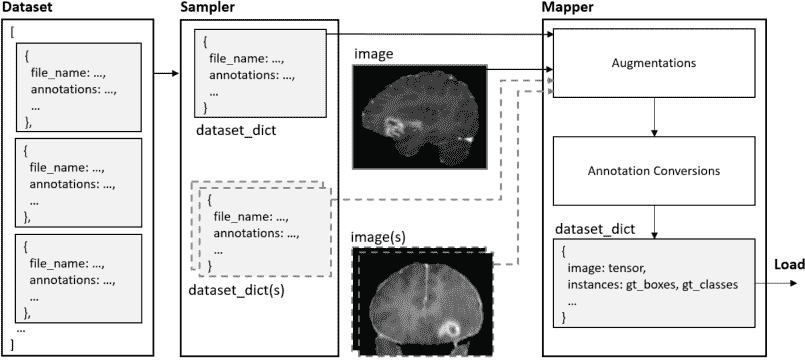
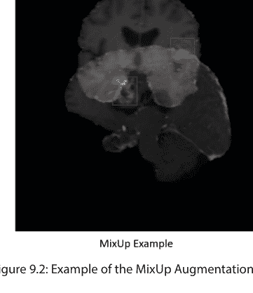
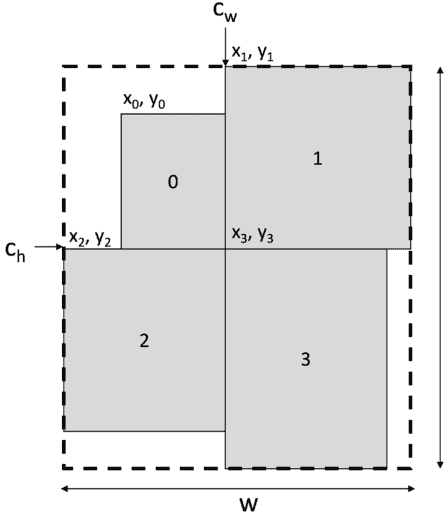
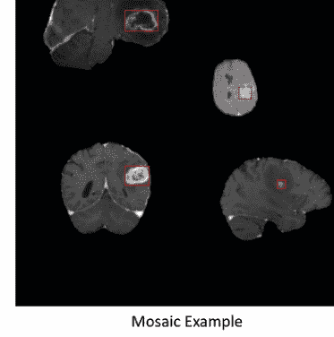

## Detectron2 数据加载器

在 Detectron2 中应用数据增强既简单又复杂。使用声明式方法并应用 Detectron2 提供的现有变换和增强相对容易，这应该能满足最常见需求。然而，添加需要多个数据样本的自定义增强（例如 MixUp 和 Mosaic）则有点复杂。本节描述 Detectron2 如何加载数据，以及如何将现有和自定义数据增强整合到 Detectron2 模型训练中。图 9.1 展示了 Detectron2 数据加载系统的步骤和主要组件。



存在 `Dataset`、`Sampler`、`Mapper` 和 `Loader` 这些类。`Dataset` 组件通常以 JSON 格式存储数据项列表。`Sampler` 组件帮助从数据集中随机选择一个数据项（`dataset_dict`）。选中的数据项包含图像文件名和标注信息。然后，Mapper 加载实际图像。之后，标注和加载的图像经历增强和数据转换，转换为图像张量和标注的实例。Mapper 产生一个数据项，Loader 帮助将这些数据打包成批次并送入训练。一些增强技术可能希望除了当前输入外还加载额外的样本（`dataset_dict(s)` 和 `image(s)`），这些项目在图 9.1 中用虚线表示。一旦你理解了 Detectron2 如何加载数据，将现有的数据增强整合到 Detectron2 训练中就会相对容易。

使用的第二种增强类型是 ResizeShortestEdge，以下代码片段创建并附加该增强：

```
min_size = cfg.INPUT.MIN_SIZE_TRAIN
max_size = cfg.INPUT.MAX_SIZE_TRAIN
sample_style = cfg.INPUT.MIN_SIZE_TRAIN_SAMPLING
augs.append(
    T.ResizeShortestEdge(
        min_size,
        max_size,
        sample_style)
)
```

最后，以下代码片段向此自定义训练器使用的增强列表中添加了一个 RandomFlipping 增强：

```
if cfg.INPUT.RANDOM_FLIP != "none":
    augs.append(
        T.RandomFlip(
            horizontal=cfg.INPUT.RANDOM_FLIP == "horizontal",
            vertical=cfg.INPUT.RANDOM_FLIP == "vertical",
        )
    )
```

使用这种声明式方法，并利用 Detectron2 提供的类来整合不同的增强/变换相对容易，如 MyTrainer 类所示。这些现有的类仅适用于一个数据项（一张图像及其相关标注）。然而，一些有用的图像增强技术可能需要来自多个样本的数据。例如，MixUp 从两个数据样本加载输入，而 Mosaic 从四个数据样本加载输入。在这些情况下，有必要重写 Detectron2 数据加载系统的几个组件，以便将来自不同样本的标注合并为一个。下一节将说明这些场景。

### 开发自定义图像增强技术

假设自定义增强需要从一个数据样本（`dataset_dict`）加载标注。在这种情况下，实现自定义增强或变换并使用上一节描述的声明式方法将其整合起来相对简单。本节重点介绍需要加载并组合多个样本输入的更复杂的增强类型。在这些情况下，我们需要重写 Detectron2 数据加载系统的几个部分。因此，本节描述了 Detectron2 数据加载系统的修改，并开发了两种自定义图像增强（MixUp 和 Mosaic）作为示例。

以下是 `_convert_to_annotations` 方法的代码片段：

```
annos = []
for i, annotation in enumerate(dataset_dict.pop("annotations")):
    bbox = boxes[i]
    annotation["bbox"] = bbox
    annotation["bbox_mode"] = BoxMode.XYXY_ABS
    annos.append(annotation)
instances = utils.annotations_to_instances(
    annos, image_shape,
    mask_format=self.instance_mask_format
)
if self.recompute_boxes:
    gt_boxes = instances.gt_masks.get_bounding_boxes()
    instances.gt_boxes = gt_boxes
    ft_instances = utils.filter_empty_instances(instances)
    dataset_dict["instances"] = ft_instances
```

该方法将数据集字典（`dataset_dict`）作为输入，并使用 Detectron2 工具函数（`annotations_to_instances`）将 `dataset_dict` 中的标注转换为实例格式。此方法类似于 `DatasetMapper` 类中的 `_transform_annotations` 方法。但是，我们需要重写此方法，以便在将标注转换为实例之前，使用变换后的边界框，而不是原始 `dataset_dict` 中的边界框。

我们需要在其扩展版本中重写 `DatasetMapper` 类的 `__call__` 方法，因为我们需要修改当前的 `dataset_dict` 以合并从其他采样输入加载的更多标注。此方法有三个主要步骤，详述如下：

**步骤 1：** 此步骤使用输入 `dataset_dict` 中指定的信息，将图像和相关标注数据读取到 `dataset_dict` 中。此步骤与其原始版本中的完全相同：

```
dataset_dict = copy.deepcopy(dataset_dict)
image = utils.read_image(dataset_dict["file_name"],
                         format=self.image_format)
utils.check_image_size(dataset_dict, image)
if "sem_seg_file_name" in dataset_dict:
    sem_seg_gt = utils.read_image(
        dataset_dict.pop("sem_seg_file_name"), "L"
    ).squeeze(2)
else:
    sem_seg_gt = None

boxes = np.array([
    BoxMode.convert(
        obj["bbox"],
        obj["bbox_mode"], BoxMode.XYXY_ABS)
    for obj in dataset_dict['annotations']])
```

**步骤 2：** 此步骤创建一个 `ExtendedAugInput` 对象，将 `dataset_dict` 作为输入参数包含在内，因为我们需要修改此 `dataset_dict` 以添加来自其他采样输入的额外边界框。除了对 `dataset_dict` 的额外修改外，所有其他步骤与 `DatasetMapper` 类的原始版本保持一致：

```
aug_input = ExtendedAugInput(image,
                            sem_seg      = sem_seg_gt,
                            dataset_dict = dataset_dict,
                            boxes = boxes)

transforms   = self.augmentations(aug_input)
image        = aug_input.image
sem_seg_gt   = aug_input.sem_seg
dataset_dict = aug_input.dataset_dict
boxes        = aug_input.boxes

image_shape = image.shape[:2]
dataset_dict["image"] = torch.as_tensor(
    np.ascontiguousarray(image.transpose(2, 0, 1)))
```

**步骤 3：** 最后一步利用前面描述的 `_convert_to_annotations` 方法，将 `dataset_dict` 中列出的变换/增强数据转换为可被 Detectron2 处理的实例：

```
if "annotations" in dataset_dict:
    self._convert_to_annotations(dataset_dict,
                                 boxes,
                                 image_shape)
```

以下代码片段创建了一个 `Sampler` 组件，该组件有助于在执行 MixUp 和 Mosaic 等增强时采样额外输入：

```
from detectron2.data import DatasetCatalog

class DataDictSampler():
    def __init__(self, name_ds):
        ds = DatasetCatalog.get(name_ds)
        self.ds = ds
    def get_items(self, n=3):
        indices = np.random.randint(
            low  = 0,
            high = len(self.ds)-1,
            size = n)
        return [copy.deepcopy(self.ds[_]) for _ in indices]
```

此代码片段接受一个已在 Detectron2 中注册的数据集名称，并加载其数据（JSON 格式）。然后，它构建一个方法（`get_items`）来随机采样一些输入以执行增强。对数据项进行深拷贝是必要的，因为增强可能会改变原始数据。

恭喜！拥有了这些扩展类之后，我们就可以编写自定义增强类，将不同输入的标注组合在一起。

### 开发 MixUp 图像增强技术

MixUp 是一种有用且现代的图像增强技术，在前一章中已有介绍。Detectron2 没有为这种图像增强技术提供内置类。因此，本节提供了开发此图像增强技术的步骤。以下代码片段创建了 MixUp 增强类：

```
class MixUpAug(T.Augmentation):
    def __init__(self, cfg, src_weight=0.5, dst_weight=0.5):
        self.cfg = cfg
        self.sampler = DataDictSampler(cfg.DATASETS.TRAIN[0])
        self.src_weight = src_weight
        self.dst_weight = dst_weight
    def get_transform(self, image, dataset_dict):
        cfg = self.cfg
        # Step 1: get one more random input
        # Step 2: append annotations and get mix-up boxes
```


```
mu_boxes  = mu_boxes,
src_weight  = self.src_weight,
dst_weight  = self.dst_weight)
```

以下代码片段创建了 MixUpTransform 类：

```
class MixUpTransform(T.Transform):
    def __init__(self, image, mu_image, mu_boxes,
                 src_weight = 0.5,
                 dst_weight = 0.5):
        # Step 1: resize the mu_image and mu_boxes
        # Step 2: pad mu_image
        # Step 3: save values
    def apply_image(self, image):
        bl_tfm = T.BlendTransform(src_image  =self.mu_image,
                                 src_weight  =self.src_weight,
                                 dst_weight  =self.dst_weight)
        return bl_tfm.apply_image(image)
    def apply_coords(self, coords):
        return coords
    def apply_box(self, boxes):
        boxes = np.vstack([boxes, self.mu_boxes])
        return boxes
```

该变换类有三个主要方法。`__init__` 方法使用 ResizeShortestEdge 类和填充（使用 NumPy）将额外图像及其相关标注调整为当前输入大小。它的 `apply_image` 方法利用 BlendTransform 类并混合两张图像。它的 `apply_coords` 方法仅返回其输入（不执行任何操作），而它的 `apply_box` 方法合并来自两个样本的边界框。

`__init__` 方法有以下三个步骤：

- **Step 1:** 此步骤使用 ResizeShortestEdge 类将额外图像（mixup 图像）调整大小以适应当前输入图像：

    ```
    image_size = image.shape[:2]
    rse = T.ResizeShortestEdge([min(image_size)],
                               min(image_size),
                               "choice")
    aug_i = T.AugInput(image=mu_image, boxes = mu_boxes)
    rse(aug_i)
    mu_image, mu_boxes = aug_i.image, aug_i.boxes
    ```

- **Step 2:** 此步骤创建一个与输入图像相同大小的图像并将 mu_image 放置其中。换句话说，此步骤类似于对 mu_image 进行零填充以使其与当前输入图像大小相同：

    ```
    img = np.zeros_like(image).astype('float32')
    img[:mu_image.shape[0], :mu_image.shape[1], :] = mu_image
    ```

- **Step 3:** 此最后一步获取调整大小后的图像和边界框并将其存储以供将来使用：

    ```
    self.mu_image   = img
    self.mu_boxes   = mu_boxes
    self.src_weight = src_weight
    self.dst_weight = dst_weight
    ```

图 9.2 显示了 MixUp Augmentation 类结合来自两个输入的图像和边界框的示例：



图 9.2：MixUp Augmentation 类的示例

此增强类随后可以以与 Detectron2 中其他现有增强类类似的方式使用，采用声明式方法。

可以使用类似的步骤创建 MosaicAugmentation 类。这些步骤将在下一节中详细说明。

## 开发 Mosaic 图像增强技术

Mosaic 图像增强技术需要将当前输入再结合三个额外输入并创建增强版本（上一章提供了进一步的细节）。对于该技术有两个类，一个用于 Augmentation 类，一个用于 Transformation 类。以下代码片段创建了 MosaicAugmentation 类：

```
class MosaicAug(T.Augmentation):
    def __init__(self, cfg):
        self.cfg = cfg
        self.sampler = DataDictSampler(cfg.DATASETS.TRAIN[0])
    def get_transform(self, image, dataset_dict):
        cfg = self.cfg
        mo_items  = self.sampler.get_items()
        mo_images  = []
        mo_boxes   = []
        # extract mo_images, mo_boxes and update dataset_dict
        mt = MosaicTransform(mo_images, mo_boxes)
        return mt
    def __repr__(self):
        return "MosaicAug(4)"
```

该类利用之前构建的数据采样器并采样三个额外输入。然后它从这些额外输入中提取图像和边界框。它还将额外输入的标注添加到当前 dataset_dict 的标注列表中，以便下一步可以利用它们以 Detectron2 支持的格式生成标注实例。具体来说，`__init__` 方法创建一个数据采样器对象（sampler）以采样三个额外输入用于执行 Mosaic 任务。`__repr__` 方法用于为此对象提供字符串表示以用于消息/日志记录。

该类的核心方法是 `get_transform` 方法。它首先使用数据采样器采样三个额外图像。然后它遍历采样图像，提取其图像和边界框，并分别存储到 mo_images 和 mo_boxes 中。此外，它提取这些额外图像的标注并将其添加到当前 dataset_dict 中，以便它们可以分别转换为 Detectron2 标注实例。最后，它将提取的数据作为输入传递以生成 MosaicTransform 类的对象来执行变换：

```
for ds_dict in mo_items:
    # mo_images
    mo_image = utils.read_image(ds_dict["file_name"],
                                format=cfg.INPUT.FORMAT)
    utils.check_image_size(ds_dict, mo_image)
    mo_images.append(mo_image)
    annotations = ds_dict["annotations"]
    # mo_boxes
    mo_boxes.append(np.array([
        BoxMode.convert(
            obj["bbox"],
            obj["bbox_mode"],
            BoxMode.XYXY_ABS)
        for obj in annotations]))
    # add annotations
    dataset_dict["annotations"] += annotations
```

对于 Mosaic 图像增强技术来说，结合图像和标注有点复杂，有很多不同的结合方式。*图 9.3* 说明了本节采用的方法：



`get_loc_info` 方法实现了图 9.3 中描述的步骤，以获取四个输入的相应起始位置、中心线、宽度和高度，如下所示：

```
images = [image] + self.mo_images
heights = [i.shape[0] for i in images]
widths = [i.shape[1] for i in images]
ch = max(heights[0], heights[1])
cw = max(widths[0], widths[2])
h = (max(heights[0], heights[1]) +
    max(heights[2], heights[3]))
w = (max(widths[0], widths[2]) +
    max(widths[1], widths[3]))
# pad or start coordinates
y0, x0 = ch-heights[0], cw - widths[0]
y1, x1 = ch-heights[1], cw
y2, x2 = ch, cw - widths[2]
y3, x3 = ch, cw
x_pads = [x0, x1, x2, x3]
y_pads = [y0, y1, y2, y3]
```

`apply_image` 方法创建一个输出图像并将四个输入图像放置到由 `get_loc_info` 方法生成的相应位置中：

```
# get the loc info
self.loc_info = self.get_loc_info(image)
h, w, ch, cw, widths, heights, x_pads, y_pads=self.loc_info
output = np.zeros((h, w, 3)).astype('float32')
images = [image] + self.mo_images
for i, img in enumerate(images):
    output[y_pads[i]: y_pads[i] + heights[i],
           x_pads[i]: x_pads[i] + widths[i],:] = img
```

`apply_box` 方法合并来自当前输入和三个额外输入的边界框。然后它根据每个输入图像的新位置移动/填充这些边界框：

```
# combine boxes
boxes = [boxes] + self.mo_boxes
# now update location values
_, _, _, _, _, _, x_pads, y_pads = self.loc_info
for i, bbox in enumerate(boxes):
    bbox += np.array(
        [x_pads[i], y_pads[i], x_pads[i], y_pads[i]]
    )
# flatten it
boxes = np.vstack(boxes)
```

MosaicAugmentation 类随后可以像其他现有 Detectron2 增强类一样使用。图 9.4 显示了将 Mosaic 增强应用于脑肿瘤数据集的输出示例：



图 9.4：Mosaic 增强的示例

此版本的输入有四张图像及其对应的标注。当批量大小较小时，此增强技术很有帮助，我们希望利用该技术来增加批量大小。此外，它可能有助于提高预测较小边界框大小标注的准确性。

恭喜！到目前为止，你应该能够应用现有的 Detectron2 增强或创建自定义增强来训练 Detectron2 模型。作为练习，你可以创建一个利用这些类的训练器并训练用于检测脑肿瘤的模型。由于篇幅限制，本节未列出利用这些增强的训练器的源代码。请参考本章提供的 Jupyter 笔记本以获取源代码。


本节介绍了在训练过程中应用图像增强的步骤。在许多情况下，可以在测试时使用类似的技术来提高准确性，下一节将介绍这些技术，并向你展示如何应用测试时增强。

## 应用测试时图像增强技术

**测试时增强（TTA）** 通过提供输入图像的不同版本进行预测，并对预测结果执行**非极大值抑制（NMS）**，从而提高预测性能。Detectron2 提供了两个类来实现这一点：`DatasetMapperTTA` 和 `GeneralizedRCNNWithTTA`。`DatasetMapperTTA` 类有助于将数据集字典（JSON 格式的数据项）映射为 Detectron2 模型期望的格式，同时提供执行增强的机会。默认使用的增强是 `ResizeShortestEdge` 和 `RandomFlip`。`GeneralizedRCNNWithTTA` 类以原始模型和 `Mapper` 对象作为输入。它对增强后的数据进行预测，并预处理生成的输出。

让我们用代码的方式来解释这两个类。按照惯例，我们首先安装 Detectron2，加载脑肿瘤数据集，并注册测试数据集。接下来，以下代码片段获取一个预训练模型：

```
```python
output_path = "output/object_detector_hook/"
!wget --quiet <url_to/Chapter08/object_detector_hook.zip>
!unzip --q object_detector_hook.zip
!unzip -q {output_path}/model_best.pth.zip
```
```

以下代码片段加载预训练模型配置：

```
```python
# get a configuration
with open(output_path + "cfg.pickle", "rb") as f:
    cfg = pickle.load(f)
```
```

以下 TTA 配置参数可用（并且可以设置）：

```
```python
# current TTA settings
print("min_sizes", cfg.TEST.AUG.MIN_SIZES)
print("max_size", cfg.TEST.AUG.MAX_SIZE)
print("flip", cfg.TEST.AUG.FLIP)
```
```

此代码片段应显示以下默认值：

```
```text
min_sizes (400, 500, 600, 700, 800, 900, 1000, 1100, 1200)
max_size 4000
flip True
```
```

可以看出，对于每个输入图像，还有十个其他增强版本（九个用于缩放，一个用于翻转）。

接下来的代码片段获取测试数据集，并使用上述增强创建一个 `DatasetMapperTTA` 对象：

```
```python
# device
device = "cuda" if torch.cuda.is_available() else "cpu"
cfg.MODEL.DEVICE = device
# get the dataset
ds = DatasetCatalog.get(name_ds_test)
cfg.MODEL.ROI_HEADS.SCORE_THRESH_TEST = 0.7
cfg.MODEL.WEIGHTS = os.path.join(output_path,
                                 "model_best.pth")

model = DefaultPredictor(cfg).model
```
```

获得模型后，以下代码片段创建一个 `GeneralizedRCNNWithTTA` 对象，并使用增强进行预测：

```
```python
# use default DatasetMapperTTA
min_sizes   = cfg.TEST.AUG.MIN_SIZES
max_size    = cfg.TEST.AUG.MAX_SIZE
flip        = cfg.TEST.AUG.FLIP
tta_mapper  = DatasetMapperTTA(min_sizes, max_size, flip)
# the tta model
tta_model   = GeneralizedRCNNWithTTA(
    cfg, model,
    tta_mapper = tta_mapper,
    batch_size = cfg.SOLVER.IMS_PER_BATCH)
with torch.no_grad():
    ret = tta_model(ds)
```
```

接下来的代码片段准备了一个辅助方法，可以按原始尺寸显示输入图像：

```
def imshow(image):
    dpi = plt.rcParams["figure.dpi"]
    im_data = image[:, :, :-1]
    height, width, depth = im_data.shape
    figsize = width / float(dpi), height / float(dpi)
    fig = plt.figure(figsize=figsize)
    plt.imshow(im_data)
    plt.imshow(im_data)
    plt.axis("off")
    plt.show()
```

然后，这个 imshow 方法可以在 visualize_output 方法中使用，以可视化预测输出，帮助定性评估结果：

```
def visualize_output(img, output, cfg, scale=1.0):
    v = Visualizer(img[:, :, :-1],
                   MetadataCatalog.get(cfg.DATASETS.TEST[0]),
                   scale=scale)
    annotated_img = v.draw_instance_predictions(
        output["instances"].to("cpu"))
    imshow(annotated_img.get_image())
```

最后，以下代码片段可视化了一些预测结果：

```
import numpy as np
for idx in np.random.randint(0, len(ds), 3):
    img = cv2.imread(ds[idx]['file_name'])
    output = ret[idx]
    visualize_output(img, output, cfg)
```

在许多情况下，TTA 可以提高预测准确性。然而，TTA 显著增加了推理时间（在这种特定情况下大约增加 10 倍）。此外，为了定量评估测试时增强是否有助于提高预测质量，最好改用 F1 分数进行评估。

恭喜！到这时，你应该已经掌握了重要的图像增强技术，对 Detectron2 的图像增强系统有了深入的了解，并且知道如何应用训练时和测试时增强。
