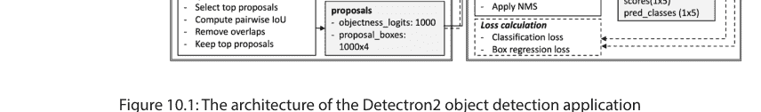
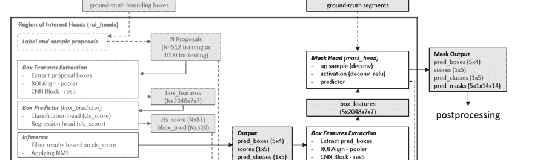
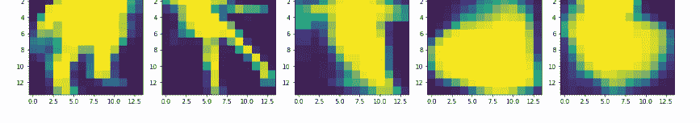
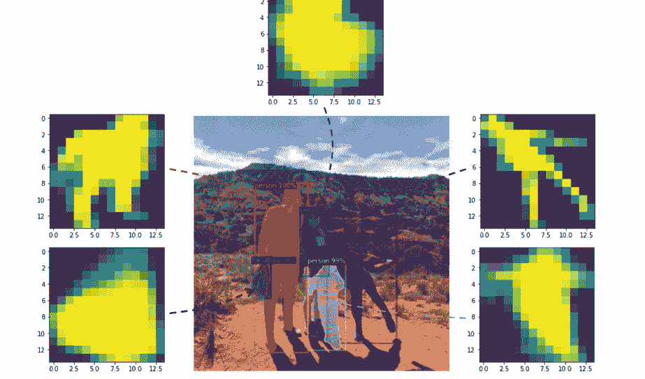
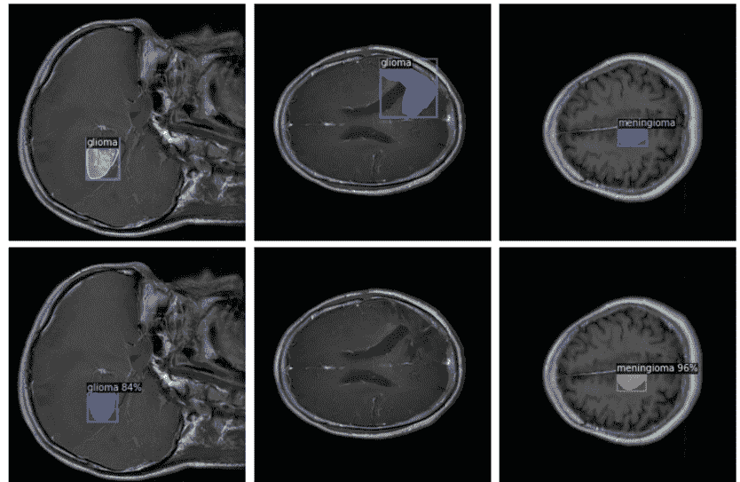

## 10

## 训练实例分割模型

本章为你提供了用于目标实例分割任务中收集和标注图像的常用工具。此外，它还介绍了从不同来源提取数据并重建为 Detectron2 支持格式的数据集的步骤。在训练目标分割模型之前，本章还采用代码和可视化的方法，解释使用 Detectron2 开发的目标分割应用的架构。

到本章结束时，你将理解用于训练目标实例分割任务模型的不同数据收集和标注技术。你将获得通过从非标准格式提取数据并将其重建为 Detectron2 支持的目标检测格式来构建自定义数据集的实践经验。此外，你还将深入了解在自定义数据集上训练 Detectron2 目标实例分割应用的架构，并获得相应的实践经验。具体来说，本章涵盖以下主题：

- 准备用于训练分割模型的数据
- 分割模型的架构
- 训练自定义分割模型

### 技术要求

你应该已完成第 1 章，以便为 Detectron2 准备合适的开发环境。

所有代码、数据集和结果均可在本书的 GitHub 仓库中获取：https://github.com/PacktPublishing/Hands-On-Computer-Vision-with-Detectron2。

## 准备用于训练分割模型的数据

本节介绍了几种在你的案例中可能用到的数据准备步骤场景。具体来说，本节首先介绍准备数据集的常见任务，包括获取图像、标注图像和转换标注。此外，在实践中，数据可能以各种非标准格式出现，在这种情况下，我们可能需要从头开始执行数据准备步骤。因此，本节还介绍了使用 Detectron2 准备脑肿瘤数据集以训练自定义分割模型的步骤。

## 获取图像、标注图像和转换标注

如果你没有数据集，第 3 章介绍了一般的计算机视觉应用中获取数据的常见来源。对于目标实例分割数据，你也可以去这些来源获取。此外，你可以使用第 3 章介绍的同一个 Python 脚本（Detectron2_Chapter03_Download_Images.ipynb）从互联网下载图像并进行标注。

第 3 章还介绍了几种支持实例分割标注（多边形标注）的在线和离线数据标注工具。与通常用于边界框标注（目标检测任务）的 labelImg 类似，labelme（https://github.com/wkentaro/labelme）是一个流行的免费软件包，用于为分割任务标注图像。它提供了标记各种基本形状的工具：多边形、矩形、圆形、直线和点。你可以在终端中运行以下命令，使用 pip 安装 labelme：

```
pip install labelme
```

这个工具的用法与第 3 章介绍的 labelImg 类似。你可以在终端中执行以下任一命令开始标注：

```
labelme image_folder/
labelme image_folder/ --labels labels.txt
```

第一条命令指定了 image_folder，即所有待标注图像存储的位置。如果你愿意，第二条命令允许在文本文件（labels.txt）中指定标签列表（要标注的目标类别）。标注过程随后就变得简单明了。

标注完成后，每个图像都有一个输出文本文件。输出文件与图像同名，但扩展名为 .txt。将这些标注文件转换为 Detectron2 支持的 COCO 格式相对容易。例如，我们可以使用 labelme2coco 包（https://github.com/fcakyon/labelme2coco）来完成此任务。以下命令是此包的基本用法：

```
labelme2coco dataset_path
```


`dataset_path` 参数是使用 labelme 标注的图像和注释的路径。该软件包的另一个有用使用模式如下：

```
labelme2coco dataset_path --train_split_rate 0.8
```

第二个参数（--train_split_rate）允许我们按指定的比例将数据拆分为训练集和测试集（本例中为 0.8）。

本节中描述的数据源和工具提供了常见的数据格式。然而，实际上，一些数据集以不同的存储标准存储，我们可能需要从头开始构建 Detectron2 支持格式的数据集。下一节介绍这样一个数据集以及准备该数据集的步骤。

## 脑肿瘤分割数据集简介

本章使用另一个脑肿瘤数据集，但用于分割任务。该数据集最初来自 Jun Cheng 的 2017 年脑肿瘤数据集：https://doi.org/10.6084/m9.figshare.1512427.v5。它有 3,064 张图像，包含 3 种脑肿瘤：胶质瘤（1,426 张图像）、脑膜瘤（708 张图像）和垂体（930 张图像）肿瘤。以下部分提取数据，将提取的数据以 COCO 格式存储，并执行训练/测试划分。

## 数据提取

该数据集采用 MATLAB 数据格式（.mat 文件）。这就是为什么它是一个很好的示例来演示从各种形式提取数据并从头开始构建 Detectron2 接受的标准数据集的步骤。具体来说，每个 .mat 文件具有以下字段：

- label: 1 表示脑膜瘤，2 表示胶质瘤，3 表示垂体瘤
- PID: 患者识别码
- image: 图像数据
- tumorBorder: 肿瘤边界的多边形坐标

以下代码片段下载数据集并解压：

```
!wget --quiet https://figshare.com/ndownloader/articles/1512427/versions/5 -O segbraintumors.zip
data_folder = "segbraintumors"
!unzip -q segbraintumors.zip -d {data_folder}

sets = ["1-766", "767-1532", "1533-2298", "2299-3064"]
sets = ["brainTumorDataPublic_"+_ for _ in sets]

!unzip -q {data_folder}/{sets[0]}.zip -d {data_folder}
!unzip -q {data_folder}/{sets[1]}.zip -d {data_folder}
!unzip -q {data_folder}/{sets[2]}.zip -d {data_folder}
!unzip -q {data_folder}/{sets[3]}.zip -d {data_folder}
```

可以看出，该数据集中有四个子文件夹对应四个 zip 文件。

如 *第 3 章* 中所述，Detectron2 支持 COCO 注释格式。COCO 注释文件具有 `info`、`licenses`、`categories`、`images` 和 `annotations` 字段。以下代码片段创建一个辅助方法，该方法创建包含前三个字段的数据的 JSON 对象，并为最后两个字段创建空列表：

```python
def create_headers():
    data_json = {
        "info": {
            "description": "Desc"
        },
        "licenses": [{
            "id": 1,
            "url": "https://creativecommons.org/licenses/by/4.0/",
            "name": "CC BY 4.0"
        }],
        "categories": [
            {"id": 0, "name": "tumors", "supercategory": "none"},
            {"id": 1, "name": "meningioma", "supercategory": "tumors"},
            {"id": 2, "name": "glioma", "supercategory": "tumors"},
            {"id": 3, "name": "pituitary", "supercategory": "tumors"}
        ],
        "images": [],
        "annotations": []
    }
    return data_json
```

对于注释，除了分割掩码（segmentation）之外，还有边界框（bbox）和面积（area）。因此，以下代码片段创建两个辅助方法，从分割坐标计算这些字段：

```python
def segmentation2bbox(segmentation):
    segmentation = np.array(segmentation)
    segmentation = segmentation.reshape((-1, 2))
    x_min = segmentation[:, 0].min()
    y_min = segmentation[:, 1].min()
    x_max = segmentation[:, 0].max()
    y_max = segmentation[:, 1].max()
    width = x_max - x_min
    height = y_max - y_min
    bbox = [x_min, y_min, width, height]
    return bbox

def bbox2area(bbox):
    return bbox[2]*bbox[3]
```

此外，以下代码片段创建一个辅助方法来生成图像的 JSON 对象：

```python
def create_image_obj(id, file_name, height, width):
    return {
        "id": id,
        "license": 1,
        "file_name": file_name,
        "height": height,
        "width": width
    }
```

类似地，下一个创建一个辅助方法来生成注释的 JSON 对象：

```python
def create_annotation_obj(id,
                          image_id,
                          category_id,
                          segmentation,
                          bbox):
    iscrowd = 0
    area = bbox2area(bbox)
    return {
        "id": id,
        "image_id": image_id,
        "category_id": int(category_id),
        "segmentation": [segmentation.tolist()],
        "bbox": bbox,
        "iscrowd": iscrowd,
        "area": area
    }
```

以下代码片段创建一个 JSON 对象（data_json）来存储注释，然后遍历 .mat 文件并对每个文件执行以下任务：

1. 提取肿瘤图像数据并将图像写入文件
2. 为图像创建 JSON 对象并将其附加到 data_json
3. 提取平面坐标（边界）和标签并为注释创建 JSON 对象，并将其附加到 data_json：

```python
data_json = create_headers()
for i in tqdm(range(1, 3064+1)):
    with h5py.File(f'{data_folder}/{i}.mat', 'r') as f:
        obj = f['cjdata']
        # Step 1: extract image and write it to file
        # Step 2: create JSON object for image and append it
        # Step 3: extract boundaries + labels then append them
```

步骤 1：此步骤提取图像数据并将其写入文件。值得注意的是，其数据类型为 float64 以保持图像质量：

```python
image = obj['image'][:, :].astype('float64')
image = (image/image.max())*255.0
file_name = f"{i}.jpg"
cv2.imwrite(os.path.join(output_folder, file_name), image)
```

步骤 2：此步骤创建图像 JSON 对象并将其附加到 data_json：

```python
height, width = image.shape[:2]
data_json["images"].append(
    create_image_obj(
        id          = i,
        file_name   = file_name,
        height      = height,
        width       = width
    )
)
```

步骤 3：此步骤提取当前 .mat 文件中脑肿瘤的标签及其对应的平面坐标。然后创建相应的注释对象并将其附加到 data_json：

```python
label = obj['label'][:, :]
tumorBorder = obj['tumorBorder'][:, :]
for j, lbl in enumerate(label):
    segmentation = tumorBorder[j].reshape((-1, 2))[:, [1, 0]].reshape((-1))
    bbox = segmentation2bbox(segmentation)
    data_json["annotations"].append(
        create_annotation_obj(
            id          = i,
            image_id    = i,
            category_id = lbl[0],
            bbox        = bbox,
            segmentation = segmentation
        )
    )
```

以下代码片段随后将提取的注释（data_json）写入 JSON COCO 注释文件：

```python
af = "_annotations.coco.json"
with open(os.path.join(output_folder, af), "w") as f:
    json.dump(data_json, f)
```

数据集现在已采用 COCO 格式。然而，它包含所有图像和标签在一个集合中。因此，以下部分将该数据集拆分为训练集和测试集。

## 训练/测试划分

以下代码片段创建一个辅助方法，根据 COCO 注释格式的字段（info、licenses、categories、images 和 annotations）写入 JSON 文件：

```python
def create_json(info,
                licenses,
                categories,
                images,
                annotations,
                file_name):
    obj = {
        "info"         : info,
        "licenses"     : licenses,
        "categories"   : categories,
        "images"       : images,
        "annotations"  : annotations
    }
    with open(file_name, "w") as f:
        json.dump(obj, f)
    print(f"Saved {file_name}")
```

接下来，我们提取整个数据集的 COCO 注释文件并获取其字段的数据：

```python
name_ds = output_folder
af = "_annotations.coco.json"
with open(os.path.join(name_ds, af), "r") as f:
    annotations_json = json.load(f)

info        = annotations_json["info"]
licenses    = annotations_json["licenses"]
categories  = annotations_json["categories"]
images      = annotations_json["images"]
annotations = annotations_json["annotations"]
```

前三个字段（info、licenses 和 categories）对训练集和测试集相同。因此，我们只需要对最后两个（images 和 annotations）进行划分。在这种情况下，一张图像有一个注释，并且按相同顺序存储。因此，执行划分相对容易：

```python
from sklearn.model_selection import train_test_split
stratify = [i['category_id'] for i in annotations]
test_size = 0.1
images_train, images_test, annotations_train, annotations_test = train_test_split(
    images,
    annotations,
    test_size     = test_size,
    stratify      = stratify,
    random_state  = 42
)
```


我们使用肿瘤类型（category_id）作为分层字段，将肿瘤类型在训练集和测试集之间进行划分。以下代码片段有助于创建训练和测试目录、移动图像并创建相应的标注文件。

首先，我们为训练和测试数据集创建相应的文件夹：

```
train_path = os.path.join(name_ds, "train")
test_path = os.path.join(name_ds, "test")
train_af = os.path.join(train_path, af)
test_af = os.path.join(test_path, af)
os.makedirs(train_path, exist_ok=True)
os.makedirs(test_path, exist_ok=True)
```

接下来，我们将图像移动到相应的训练和测试文件夹中：

```
for img in tqdm(images_train):
    frm = os.path.join(name_ds, img["file_name"])
    to = train_path
    shutil.move(frm, to)
for img in tqdm(images_test):
    frm = os.path.join(name_ds, img["file_name"])
    to = test_path
    shutil.move(frm, to)
```

最后，我们将标注写入相应的训练和测试文件夹：

```
create_json(info,
            licenses,
            categories,
            images_train,
            annotations_train,
            file_name = train_af)
create_json(info,
            licenses,
            categories,
            images_test,
            annotations_test,
            file_name = test_af)
```

可选地，你可能希望运行以下代码片段以删除整个数据集的当前标注文件：

```
!rm {name_ds}/{af}
```

如果你在 Google Colab 上运行此笔记本，现在是使用以下片段压缩此数据集以便下载的时候了：

```
!zip -q -r {name_ds}.zip {name_ds}
```

最后，以下代码片段将此数据集下载到本地计算机以供将来使用：

```
from google.colab import files
files.download(f"{name_ds}.zip")
```

恭喜！到此时，你应该已经掌握了 COCO 标注格式的组成部分以及如何从各种来源提取数据并从头开始形成此标注格式的数据集。我们已准备好在 Detectron2 中训练自定义分割应用。然而，在训练之前，我们应先了解此类应用的架构。

## 分割模型的架构

第 4 章深入探讨了 Detectron2 中实现的 Faster R-CNN 在计算机视觉中目标检测任务的架构。Detectron2 为目标分割任务实现了 Mask R-CNN。它具有与 Faster R-CNN 架构相同的组件，并为分割任务增加了一个额外的头。图 10.1 显示了第 4 章中列出的 Faster R-CNN 架构。



图 10.1：Detectron2 目标检测应用的架构

探索 Detectron2 对目标分割任务实现的架构的代码与目标检测任务的代码保持相同。因此，本节仅涵盖两者之间的一些差异。第一个不同之处在于，我们必须选择一个针对目标分割任务而非检测任务的预训练模型配置。因此，我们按如下方式更改配置和模型权重的相应路径：

```
config_file = "<url_to/mask_rcnn_R_50_C4_1x.yaml>"
checkpoint_url = "<url_to/mask_rcnn_R_50_C4_1x.yaml>"
```

再次，如 *第 2 章* 中所讨论的，其他模型是可用的，并且在选择一个与选择其他模型之间存在权衡。此选择选择此模型（Res50C4）是由于其简单性。主干网络和区域建议网络保持相同，并在目标检测任务中类似工作。感兴趣区域头（`roi_heads`）有一个额外的头称为掩码头（`mask_head`）。因此，以下代码片段的输出反映了差异：

```
roi_heads = predictor.model.roi_heads
print(roi_heads)
```

此片段除了池化器、res5 和 box_predictor 如 *第 4 章* 中所述外，还显示了掩码头如下：

```
(mask_head): MaskRCNNConvUpsampleHead(
(deconv): ConvTranspose2d(2048, 256, kernel_size=(2, 2),
stride=(2, 2))
(deconv_relu): ReLU()
(predictor): Conv2d(256, 80, kernel_size=(1, 1), stride=(1, 1))
)
```

此掩码头是 MaskRCNNUpsampleHead 的一个实例（对于此特定情况）。它相对简单，由一个带 ReLU 激活的 ConvTranspose2d 层和一个 Conv2d 层组成。此掩码头可通过配置文件中的 name 参数进行配置（`cfg.MODEL.ROI_MASK_HEAD.NAME`）。

图 10.2 显示了针对目标分割任务的扩展感兴趣区域头，其中包含 mask_head。



图 10.2：为分割任务扩展的感兴趣区域头，其中包含掩码头

具体来说，所有输入/输出和中间处理与目标检测任务的架构相同（它们已淡出）。扩展部分（未淡出）利用检测任务预测的边界框作为其建议。它然后利用另一个与边界框预测部分相同工作的框特征提取组件。唯一的区别是它使用上一步预测的框作为建议，而不是来自区域建议网络的原始建议。除此之外，此组件的工作方式相同。以下代码片段显示了此组件的工作方式：

```
# extract features from the predicted boxes
pred_boxes = [
    instance.pred_boxes
    for instance
    in pred_instances
]
x = roi_heads.pooler([res4], pred_boxes)
x = roi_heads.res5(x)
print(x.shape)
```

第 4 章提供了关于池化器和 res5 组件的详细信息。此代码片段应显示提取的特征为大小为 torch.Size([5, 2048, 7, 7]) 的张量。在此情况下，第一个值（5）表示上一步（检测任务）预测的框的数量。接下来，提取的特征连同预测的实例（上一步的输出）一起通过掩码头传递：

```
output = mask_head(x, pred_instances)
```

除了目标检测任务预测的实例中的字段（pred_boxes、pred_classes 和 scores）之外，此输出还有一个用于预测掩码（pred_masks）的字段，每个预测框一个。此外，如果处于训练阶段，此掩码头会采用真实分割并通过添加掩码损失（mask_loss）来更新整体损失，如图 10.2 所示。以下代码片段显示了预测掩码的大小：

```
print(output[0].pred_masks.shape)
```

每个预测框对应一个预测掩码。因此，此代码片段应显示张量大小为 torch.Size([5, 1, 14, 14])。再次，第一个数字（5）是预测边界框的数量。掩码分辨率可通过以下参数配置：

```
cfg.MODEL.ROI_MASK_HEAD.POOLER_RESOLUTION
```

此值当前为 14（作为输出掩码分辨率）。以下代码片段可视化这些预测掩码：

```
import matplotlib.pyplot as plt
fig, axes = plt.subplots(1, 5, figsize=(15, 3))
for i in range(5):
    mask = output[0].pred_masks[i][0]
    mask = mask.detach().to("cpu")
    axes[i].imshow(mask)
plt.tight_layout()
plt.show()
```

此代码片段提取预测掩码、分离它们并可视化它们。图 10.3 显示了此代码片段的输出。



图 10.3：五个预测实例的掩码（14x14 分辨率）

这些掩码具有检测实例的失真形状，因为它们具有正方形分辨率（本例中为 14x14），而预测实例可能具有不同的比例，如 pred_boxes 中所示。因此，需要额外步骤将这些掩码缩放到相应的预测边界框大小。后处理步骤执行此缩放：

```
from detectron2.modeling.postprocessing import detector_postprocess
post_output = detector_postprocess(
    results      = output[0],
    output_height = 800,
    output_width  = 800,
)
```

此代码片段采用输出实例和原始输入图像大小（800 x 800 像素）并将所有预测结果缩放到与图像大小对应的大小。此外，预测掩码被缩放到其相应的边界框大小。最后，以下代码片段可视化预测结果：

```
metadata = MetadataCatalog.get(cfg.DATASETS.TRAIN[0])
v = Visualizer(img[:, :, ::-1], metadata, scale=0.5)
instances = post_output.to("cpu")
annotated_img = v.draw_instance_predictions(instances)
imshow(annotated_img.get_image())
```


这个可视化的代码片段与目标检测任务的相同，它应显示如图10.4中间所示的输出。



图10.4：对象分割应用程序的示例输出

最终输出中的检测掩膜会按比例缩放到最终输出中对应的检测边界框。

恭喜！至此，你应该已经对Detectron2实例分割应用的架构有了深入的了解。其主要架构与目标检测应用相同，并做了一些扩展，使用预测的检测结果作为输入来预测掩膜。数据准备就绪，并且对应用架构有了深刻理解后，你可以在下一节中使用Detectron2训练一个对象分割模型。

### 训练自定义分割模型

上一节描述了扩展目标检测应用的对象分割应用的架构。因此，这两个应用的训练步骤和配置是相似的。本节使用前一章节中“整合所有内容”部分提供的源代码。理想情况下，我们应该执行该章节中的所有步骤，以便为这个特定数据集获得一组更好的超参数。但为了简单起见，本节按原样复用所有源代码，并重点介绍训练对象分割应用的差异。以下代码片段下载了在先前步骤中准备好的带有训练集和测试集的数据集：

```bash
!wget -q <url_to>/segbraintumors_coco.zip
!unzip -q segbraintumors_coco.zip
```

数据集解压后，用于Detectron2安装、注册数据集、获取训练配置、使用COCO评估器和自定义钩子构建自定义训练器以存储最佳模型、训练以及结果可视化的源代码都是相同的，除了以下几点：

配置应设置用于对象实例分割的预训练模型配置和权重，而不是目标检测的：

```python
config_file_url = "<url_to>/mask_rcnn_R_50_FPN_3x.yaml"
checkpoint_url = "<url_to>/mask_rcnn_R_50_FPN_3x.yaml"
```

BestModelHook类应使用分割评估指标（segm/AP50）来选择最佳模型，而不是目标检测评估指标（bbox/AP50）：

```python
class BestModelHook(HookBase):
    def __init__(self, cfg,
        metric = "segm/AP50",
        min_max ="max"):
        # other lines remain the same
```

上述代码片段更改了默认评估指标，下面的代码片段在创建新的钩子实例时更改它：

```python
bm_hook = BestModelHook(cfg,
        metric = "segm/AP50",
        min_max = "max")
```

随后的训练应以相同的方式进行。然而，除了目标检测任务的损失——分类损失（`loss_cls`）、边界框回归损失（`loss_box_reg`）、区域提议分类损失（`loss_rpn_cls`）和区域提议位置损失（`loss_rpn_loc`）——对于实例分割任务，还有一个针对掩膜的损失指标（`loss_mask`）：

```text
total_loss: 1.325  loss_cls: 0.1895  loss_box_reg: 0.1189  loss_mask: 0.5053  loss_rpn_cls: 0.3287  loss_rpn_loc: 0.1724
```

上述列表是对象实例分割模型训练过程中损失的一个示例。此外，在每次评估迭代中，除了边界框（bbox）的评估指标外，还有一组类似的分割（segm）指标，用于选择最佳模型：

segm的评估结果：

|       | AP     | AP50   | AP75   | APs    | APm    | APl    |
|:------|:-------|:-------|:-------|:-------|:-------|:-------|
|       | 25.786 | 41.874 | 27.180 | 4.064  | 26.409 | 34.991 |

以下代码片段将置信度阈值设置为0.7，并加载最佳模型：

```python
cfg.MODEL.ROI_HEADS.SCORE_THRESH_TEST = 0.7
cfg.MODEL.WEIGHTS = os.path.join(cfg.OUTPUT_DIR,
                                 "model_best.pth")

predictor = DefaultPredictor(cfg)
```

下面的代码片段创建了一些辅助方法，用于随机预测和可视化三个数据样本，并显示真实掩膜与预测掩膜，以进行定性评估。具体来说，下面的代码片段创建了一个方法（`plot_samples`），该方法将样本作为数据字典和预测器输入，然后根据`is_gt`输入可视化真实结果或预测结果：

```python
def plot_samples(samples,
                met        = {},
                is_gt      = True,
                predictor  = None):
    n = len(samples)
    nrows, ncols = int(np.ceil(n / 3)), 3
    fig, axs = plt.subplots(nrows, ncols, figsize = (21, 7))
    for i, s in enumerate(samples):
        row, col = i//ncols, i%ncols
        ax = axs[row][col] if len(axs.shape)==2 else axs[i]
        img = cv2.imread(s["file_name"])
        v = Visualizer(img[:, :, ::-1], metadata=met, scale=0.5)
        if is_gt:  # ground-truth
            v = v.draw_dataset_dict(s)
        else:  # predictions
            instances = predictor(img)["instances"].to("cpu")
            v = v.draw_instance_predictions(instances)
        ax.imshow(v.get_image())
        ax.axis("off")
    plt.tight_layout()
    plt.show()
```

下一个方法（`plot_random_samples`）从已注册的数据集（`name_ds`）中随机采样一些输入，并绘制真实结果和预测结果，用于定性评估：

```python
def plot_random_samples(name_ds, n=3, predictor=None):
    ds = DatasetCatalog.get(name_ds)
    met = MetadataCatalog.get(name_ds)
    samples = random.sample(ds, n)
    # plot samples with ground-truths
    plot_samples(samples, met)
    # plot predictions
    plot_samples(samples,
                met        = met,
                predictor  = predictor,
                is_gt      = False)
```

总而言之，这两个代码片段创建了两个辅助方法。第一个方法用于可视化真实数据字典，或根据数据字典和模型预测输出并可视化结果。第二个方法随机采样指定数量（n）的样本，并将它们传递给第一个方法进行可视化。下面的代码片段利用所创建的方法可视化一些结果以进行定性评估：

```python
plot_random_samples(name_ds_test, predictor = predictor)
```

图10.5显示了真实掩膜（顶部一行）和预测结果（底部一行）的示例输出。



图10.5：来自对象实例分割模型的示例预测结果

即使仍然漏掉了一个预测，使用简单的模型和配置，预测结果也是不错的。进一步训练、更好的优化以及更复杂的架构应该有助于改善结果。

恭喜！你现在已经掌握了使用Detectron2在自定义数据集上训练对象实例分割应用的步骤。

### 总结

本章介绍了获取对象实例分割任务数据的常见来源，以及从非标准注释格式中提取数据并创建Detectron2支持的格式的自定义数据集的步骤。此外，本章采用代码和可视化的方式，说明了在Detectron2中实现的对象实例分割应用架构，它是目标检测应用架构的扩展。最后，本章提供了训练用于对象实例分割任务的自定义模型以及可视化预测结果以进行定性评估的步骤。

下一章介绍使用Detectron2微调对象实例分割应用并提高分割质量的技术。
