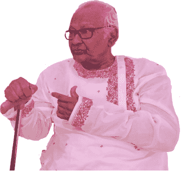

# Python图像处理实用指南：以专业知识分析、转换和解释数字图像的高级方法

谨以深切怀念献给我挚爱的父亲，他是我最大的灵感源泉、我的力量，也是最初鼓励我写作本书的指路明灯。

没有一天我不感受到你留下的寂静空缺，但在每一个怀疑的时刻和前进的每一步中，我仍能感受到你的存在——坚定、令人安心、永恒。你的爱塑造了今天的我，你对我的信任给了我勇气，你的力量成为我继续前行旅程的基石。

我所取得的一切，以及我继续为之奋斗的一切，都带着你的一部分。你不仅是我的灵感来源，更是这些书页背后无声的力量——这部作品存在的理由。虽然你已不在人世，但你的精神永存于我的思想、我的努力以及本书的每一行文字中。这本书，永远为你而作。

怀着最深切的爱与感激，我也将这部作品献给我挚爱的母亲，她无条件的爱、力量与祝福一直是我坚定的支持和人生的基石。

— Sandipan Dey

## 贡献者

### 关于作者

Sandipan Dey 是一位数据科学家，在机器学习、计算机视觉、图像处理和深度学习等相关领域拥有广泛兴趣。过去几年，他一直在应用机器学习的多个领域工作。Sandipan 在 UMBC 获得计算机科学理学硕士学位，并在 JU 获得计算机科学工学学士学位。他曾在多个国际数据挖掘会议和期刊上发表论文，并撰写了多本关于使用 Python 进行图像处理的书籍。他还通过大规模开放在线课程（MOOC）完成了机器学习、图像处理、人工智能及相关领域的在线专项课程。

### 关于审稿人

Rahul Raja 是 LinkedIn 的 Staff 软件工程师，在构建可扩展软件系统和开源技术方面拥有丰富经验。作为开源社区的积极贡献者，他开发并维护了许多库和项目，其中几个在 GitHub 上获得了数百颗星。Rahul 于 2014 年被选为 Google Summer of Code 学生，这是 Google 旗舰级开源项目，他在其中为有影响力的社区驱动软件项目做出了贡献。他还通过博客分享技术见解，并在其 Google Scholar 个人资料中展示了已发表的研究成果。

Muralikrishna Veeramosu 是一位移动开发者和架构师，在构建和扩展企业级应用程序方面拥有丰富经验。他专注于 iOS 生态系统和设备端 AI，曾领导金融科技、医疗保健和零售领域的全球组织发起高影响力项目。作为技术社区的忠实贡献者，他通过 AI/ML 辅导、技术写作、简历评审和面试准备积极支持新兴工程师和组织。他还担任黑客马拉松评委以及技术书籍和实际项目的技术审阅人，专注于弥合复杂技术概念与生产级软件架构之间的差距。

## 第一部分：数字图像处理基础 1

### 第1章：数字图像处理入门 3

- 技术要求 4
- 可复现性与版本兼容性 4
- 问题导向的学习方法 5
  - 什么是图像？数学与数字表示 5
  - 什么是数字图像处理？ 6
  - 图像处理、计算机视觉及相关领域 7
  - 图像处理的应用 7
  - 图像处理任务与流程 7
  - 图像处理与计算机视觉的主要 Python 库 8
- 使用 Python 进行图像输入/输出与显示 8
  - 使用 PIL 读取、保存和显示图像 9
  - 使用 Matplotlib 读取、保存和显示图像 10
    - 使用 matplotlib.image 读取图像 10
    - 使用 matplotlib.pylab 显示图像 12
    - 子图 14
  - 使用 scikit-image 读取、保存和显示图像 14
    - 使用 Python 装饰器模式 16
    - 使用 scikit-image 的图像数据集 16
    - 一次读取并显示多张图像 17
    - 图像上的分块视图 18
  - 使用 OpenCV-Python 读取、保存和显示图像 19
  - 使用 Imageio 读取和保存图像 21
    - 从动画 GIF 中提取帧 21
  - Python 中的图像文件格式与转换 22
    - 转换文件格式 23

### 第2章：图像操作 51

- 技术要求 52
- 使用 NumPy 进行更多图像操作 52
  - 模拟色彩突出效果 52
  - 校正鱼眼失真图像 54
- 使用 scikit-image 进行图像操作 55
  - 反转图像 55
  - 更改图像亮度和对比度 57
  - 使用 warp() 函数进行逆扭曲和几何变换 57
    - 对图像应用平移 58
    - 图像的平移 59
    - 平移的变换矩阵 59
    - 逆变换 59
    - 使用 warp() 对图像应用旋转 61
      - 使用变换函数 61
      - 使用变换矩阵 62
    - 对图像应用相似变换 63
    - 对图像应用仿射变换 64
    - 应用漩涡变换 66
    - 应用分段仿射变换 67
  - 向图像添加随机高斯噪声 69
  - 计算图像的累积分布函数 71
  - 调整图像大小/缩放图像 73
  - 裁剪图像 74
- 使用 PIL 进行图像操作 75
  - 裁剪图像 76
  - 调整图像大小 76
    - 放大图像 76
    - 缩小图像 78
  - 像素化图像 80
    - 人脸匿名化 80
  - 应用点变换 81
    - 对数变换 82
    - 幂律变换 82
    - 多通道图像上的点变换 83
  - 反转/取反图像 84
  - 中途曝光/色调分离图像 85

#### 若干几何变换 • 86

反射图像 • 86

旋转图像 • 86

应用仿射变换 • 87

应用透视变换 • 89

#### 更改图像像素值 • 91

向图像添加盐和胡椒噪声 • 91

使用 ImageDraw 在图像上绘制 • 91

绘制椭圆 • 92

绘制边界框 • 92

绘制文字 • 93

将图像粘贴到另一张图像之上 • 93

计算图像的基本统计信息 • 94

绘制像素值的直方图 • 94

#### 分离图像的 RGB 通道 • 95

#### 合并图像的多个通道 • 95

Alpha (α) 通道和图像混合 • 96

将 JPG 转换为透明 PNG 图像 • 96

α-混合两张图像 • 97

α-合成两张图像 • 98

向图像添加水印 • 99

使用蒙版混合两张图像 • 100

使用 soft_light、hard_light 和 overlay 算法叠加两张图像 • 101

获取两张图像中较暗/较亮的部分 • 105

总结 ........................................................................................ 105

### 第 3 章：更多图像处理 107

技术要求 ........................................................................................ 107

使用 PIL 进行更多图像处理 ........................................................................................ 108

- 使用 opencv-python • 114
- 模拟镜头模糊效果 • 114
- 互换图像色彩调色板 • 115
- 调整图像的温度 • 117
- 使用 RGB 缩放调整温度 • 117
- 使用颜色变换矩阵调整温度 • 118
- 实现晕影/洛莫效果 • 120
- 实际应用 • 121
- 使用 PIL 生成图像 ......................................................... 122
- 使用 opencv-python 进行图像处理 ................................................. 124
- 旋转 • 124
- 旋转图像时避免裁剪 • 125
- 翻转 • 126
- 何时使用 opencv-python 而非 PIL • 126
- 实现交叉阴影滤镜 • 126
- 实现单应性 • 128
- 使用 opencv-python • 129
- 使用 scikit-image.transform.warp() • 130
- 使用 scikit-image.transform.ProjectiveTransform • 130
- 去除鱼眼畸变 • 133
- 使用 Knew 控制视场 • 134
- cv2.remap() 中的插值方法 • 135
- 使用 scipy.ndimage 进行图像处理 ................................................. 137
- 应用仿射变换 • 137
- 放大 • 137
- 应用插值 • 139
- 应用波形畸变 • 139
- 使用 Wand 进行图像处理 ........................................................... 140
- 创建视觉效果 • 140
- 应用素描、太阳化 和 fx_filter • 142
- 扭曲和去扭曲图像 • 143
- 通过去扭曲校正畸变 • 144
- 使用 Matplotlib 进行图像处理 .................................................... 145
- 向图像添加注释 • 145
- 为图像绘制轮廓线 • 146

#### 使用 Pilgram 进行图像操作 ........................................................ 148

使用 pilgram.css 模块 • 150

实际用例亮点 • 151

#### 总结 ........................................................ 151

### 第 4 章：采样和傅里叶变换 153

#### 技术要求 ........................................................ 153

#### 图像形成 – 采样和量化 ........................................................ 153

上采样 • 154

使用 Scipy 进行上采样和插值 • 156

下采样 • 162

采样定理（奈奎斯特-香农定理） • 162

下采样和混叠 • 163

使用 NumPy 进行下采样 • 164

使用 PIL 进行基于卷积的重采样（重采样） • 165

使用 scikit-image 进行下采样和抗混叠 • 166

量化图像 • 167

均匀量化 • 168

非均匀量化 • 169

量化彩色图像 • 169

量化误差和图像质量 • 169

图像压缩中的量化 • 169

使用 PIL 量化 P 模式彩色图像 • 170

#### 离散傅里叶变换 ........................................................ 171

DFT 的重要性 • 172

快速傅里叶变换算法 • 172

使用 scipy.fftpack 模块进行 FFT • 172

绘制频谱 • 173

### 第 6 章：频域滤波 239

技术要求 ......................................................... 240

频域中的滤波 ......................................................... 240

什么是滤波器？ • 240

频域滤波器类型 • 240

低通滤波器（LPF） • 241

理想、巴特沃斯和高斯 LPF • 242

使用 fourier_gaussian 进行 LPF • 245

使用 scipy.fftpack 进行 LPF • 246

截止频率变化时的 SNR • 248

使用 LPF 进行图像去噪 • 249

高通滤波器（HPFs） • 250

理想、巴特沃斯和高斯 HPF • 251

使用 scipy.fftpack 进行 HPF • 252

截止频率变化时的 SNR • 254

使用 skimage.filters 进行巴特沃斯滤波 • 255

带通滤波器（BPFs） • 256

带阻/带阻滤波器（陷波滤波器）（BSF/BRF） • 257

去除周期性噪声 • 257

高斯带阻滤波器 • 259

傅里叶特征网络 ......................................................... 261

训练网络 • 262

使用 JAX 的实现 • 262

总结 ......................................................... 269

## 第二部分：图像增强和恢复技术 271

### 第 7 章：图像增强 273

技术要求 ......................................................... 274

逐点强度变换 ......................................................... 274

对数变换 • 275

幂律变换 • 276

亮度调整 • 277

使用 PIL • 278

使用 OpenCV-Python • 279

- *傅里叶域解* • 406
- *超越恒等先验* • 406
- Wiener 滤波和 Tikhonov 正则化的贝叶斯解释 • 408
- 使用 CLEAN 算法进行去卷积 • 409
- *Högbom CLEAN* • 410
- **使用稀疏表示的图像恢复** • 414
- 为什么是零均值补丁？ • 415
- **使用深度学习的图像恢复** • 419
- 使用 NAFNet 进行图像去噪 • 419
- *NAFNet 架构* • 419
- 使用 InstructIR 进行引导图像恢复 • 422
- **使用 DeepFill 的基于 Stable Diffusion 的修复** • 427
- 使用 Stable Diffusion 进行修复的概念性工作原理 • 428
- 使用 LaMa 进行修复 • 431
- *数学表述* • 432
- *LaMa 的工作原理* • 432
- 修复和图像编辑 • 435
- *使用扩散模型进行图像编辑* • 435
- *使用扩散模型进行图像修复* • 437
- 润饰和外推 • 440
- *润饰* • 440
- *外推* • 441
- **总结** • 444

## 第三部分：计算机视觉和生成式 AI 447

### 第 10 章：图像分割：从经典方法到深度学习 449

- **技术要求** • 450
- **经典图像分割** • 450
- 基于阈值的分割 • 450
- *从二值 Otsu 到多 Otsu 阈值分割* • 450
- 边缘、区域和地形分割 • 453
- *分水岭分割* • 453
- *使用分割和形态学计数硬币* • 456
- 基于超像素的分割 • 460
- *SLIC vs MaskSLIC* • 460
- *分割 vs 超像素化* • 463

文本引导的语义分割与视觉-语言模型 • 521

CLIPSeg：实用的文本到掩码分割 • 521

用于交互式文本引导分割的 Gradio 应用 • 522

#### 从单张图像进行深度估计和 3D 场景理解 ........................................ 524

从图像到深度：单目深度估计 • 524

密集预测 Transformer • 524

深度估计流程 • 525

点云生成和 3D 重建 • 526

相机投影几何 • 526

语义 3D 融合 • 528

#### 图像分割的实际应用 ........................................................... 530

使用 MediaPipe + DeepLabV3（TFLite）进行背景模糊 • 531

Detectron2 • 532

#### 训练自定义分割模型 ............................................................... 534

使用 Keras Functional API 训练 U-Net • 534

使用 segmentation_models_pytorch 使用 ResNet18 主干的 U-Net • 539

#### 使用 segmentation_models 训练 UNet 以分割脑肿瘤 MRI 图像 ................... 542

#### 使用 Swin-UNETR 对肝脏 CT 图像进行 3D 分割 ................................................ 545

使用 Vedo 进行 3D 可视化 • 548

使用 VTK 进行体绘制 • 549

Swin-UNETR 表现良好的原因 • 550

3D 器官分割的应用 • 550

#### 遥感：使用混合注意力 U-Net 进行多源卫星图像分割 ...... 550

遥感中的语义分割 • 551

卫星图像分割的挑战 • 551

数据准备和训练策略 • 552

应用 • 559

#### 分割评估指标 ................................................................... 559

### 第12章：图像分类与目标检测

- 技术要求 .......................................................... 566
- 使用t-SNE可视化高维图像特征 ............................. 566
  - 使用t-SNE的MNIST嵌入 · 566
  - 可视化VGG16的深层特征 · 568
  - CNN脑部查看器仪表板 · 570
    - *使用Gradio进行交互式探索* · 571
- 图像分类 .............................................................. 572
- 用于图像分类的迁移学习 ........................................ 573
  - 使用VGG16（TensorFlow/Keras）进行迁移学习 · 573
    - *方法1：使用预训练的VGG16网络* · 574
    - *方法2：使用VGG16进行迁移学习* · 575
  - 使用VGG16（PyTorch）进行迁移学习 · 579
- 基于注意力网络的图像分类 ...................................... 580
  - 具有通道和空间注意力的CNN · 580
  - 基于视觉Transformer（ViT）的图像分类 · 583
    - *使用ViT进行花卉分类* · 584
  - 基于Swin Transformer的图像分类 · 585
- 少样本学习 ................................................................. 586
  - 使用CLIP进行零样本学习 · 586
  - 使用DINOv2进行少样本学习 · 587
  - 使用深度人脸嵌入（Siamese网络）进行少样本人脸识别 · 589
    - *使用Siamese微调改进识别* · 591
    - *使用FaceNet进行人脸识别* · 592
- 用于图像分类的贝叶斯神经网络 .................................. 593
  - MC dropout：一种实用的贝叶斯近似 · 595
- 基于半监督学习的图像分类 ................................ 597
- 掩码自编码器（MAE）：通过重建缺失图像块进行自监督学习 .................................................................... 600
- 用于分布式图像分类的联邦学习（隐私保护深度学习） ... 605
- 针对图像分类神经网络的对抗攻击 ..................... 610
  - 快速梯度符号法（FGSM） · 611
- 使用EfficientNet特征构建图像搜索引擎 .................... 615
- 目标检测 ................................................................. 618
- 使用RetinaNet进行目标检测 .................................................... 619
- 使用Mask R-CNN进行目标检测和实例分割 .......................... 621
- 光学字符识别（OCR）和视觉-语言文本提取流水线 ............ 622
  - 使用Tesseract的基线OCR • 623
  - 深度学习OCR：PPOCR（PaddleOCR） • 624
  - ALPR（自动车牌识别）：通过检测+识别进行端到端OCR • 625
  - 使用EasyOCR进行场景文本识别 • 628
  - 基于Transformer的OCR：TrOCR • 629
- 使用MediaPipe的增强现实滤镜和基于关键点的人脸-手部分析 ............ 629
  - 人脸关键点检测和Snapchat风格滤镜 • 630
- 手部关键点检测和手势可视化 ................................................ 631
- 使用一阶运动模型生成Deepfake ................................................ 633
- 使用YOLOv8分割进行车辆损伤检测和严重性评估 ........................ 634
- 总结 ........................................................................ 637

### 第13章：生成式AI在图像处理与计算机视觉中的应用 639

- 技术要求 ........................................................................................................ 640
- 使用条件生成对抗网络（cGANs）进行类别条件图像生成 ............ 640
- 使用条件变分自编码器（CVAE）进行条件图像生成 .................. 648
- Pix2Pix和CycleGAN用于图像到图像的转换 .................................................... 653
- 基于StyleGAN的高保真人脸合成与语义操作 .............................. 657
  - StyleGAN3：无别名生成建模 • 657
  - StyleGANEX：高保真反转与身份编辑 • 661
- GFPGAN：使用生成式人脸先验进行盲人脸恢复 ........................................ 664
- 去噪扩散概率模型（DDPMs） ...................................................... 666
  - 前向扩散过程 • 666
  - 反向扩散过程 • 668
  - 潜在扩散模型 • 669
  - 潜在空间插值 • 670
  - 理解潜在扩散 • 671
- 使用Stable Diffusion进行文本到图像生成 ............................................................ 672
- 使用InstructPix2Pix进行图像编辑 ....................................................................... 674
- 使用ControlNet进行结构引导的图像生成 ...................................................... 676
- Stable Diffusion和SDXL的实际应用 ...................................................... 677
  - SDXL-Turbo文本到图像生成 • 678
  - 字体设计生成 • 679
  - 提示敏感性 • 679
  - 速度-质量权衡 • 680
  - 种子探索 • 680
  - 使用SDXL-Turbo进行图像到图像的细化 • 681
  - 人脸修复 • 682
  - 渲染风格转换 • 682
  - 基于扩散的超分辨率 • 683
  - 图像修复 • 684
  - 艺术风格生成 • 684
- IP-Adapter和ControlNet用于保持身份的姿态引导生成 ................................ 685
- 使用DALL·E 2和DALL·E 3 API进行图像生成 ........................................................ 687
- GPT图像API：生成、编辑、修复和视觉 ................................................ 691
  - 使用GPT视觉进行图像理解 • 692
  - 使用GPT图像进行图像编辑 • 693
  - 边缘引导编辑 • 693
  - 图像修复 • 694
  - AI风格迁移 • 695
  - 人脸修复 • 696
  - 多图像合成 • 697
  - 电子商务产品增强 • 698
  - 视觉问答（VQA） • 699
  - 自动化工业检查（检测制造缺陷） • 699
  - 图像上色 • 701
  - 草图到照片级真实感合成 • 702
  - 绘画到照片级真实感转换 • 702
  - 局部对象编辑 • 703
  - 对象移除 • 703
  - 背景替换 • 704
  - 场景转换 • 704
  - 遥感变化检测 • 706
  - 医学图像解读 • 707
  - 生成式AI用于化学 • 708
- 总结 ........................................................................ 710

### 第14章：解锁您的专属权益 711

## 其他您可能喜欢的书籍 716

## 索引 719
