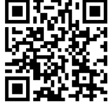

## 前言

图像处理和计算机视觉已成为现代人工智能的基础技术，使机器不仅能够增强和分析图像，还能解释、理解并生成视觉内容。如今，这些技术广泛应用于医疗保健、自主系统、机器人技术、遥感、科学成像、制造业和创意媒体等领域。

本书以实践和数学为基础，带领读者从数字图像处理的基础知识，一路深入到计算机视觉和生成式AI的最新进展，并全程使用Python。从图像表示、采样、量化、傅里叶分析、卷积以及空间域和频域滤波等核心概念开始。在这些基础上，探讨了图像增强、基于导数的处理，以及用于解决实际成像问题的经典图像复原技术。

随后，本书转向现代计算机视觉范式，包括图像分割、图像分类和目标检测，涵盖了经典方法和基于深度学习的方法。读者将获得广泛使用的架构和框架的实践经验，以及医学成像、遥感、工业检测和场景理解等领域的应用。

最后一章介绍了正在重新定义计算机视觉的前沿生成式AI方法。主题包括GAN、VAE、扩散模型、Stable Diffusion、ControlNet、DALL·E、基于GPT的图像系统以及多模态视觉-语言模型。这些方法展示了视觉系统从被动感知到主动生成、编辑、修复以及基于视觉数据进行推理的演变。

本书的核心哲学是从第一性原理出发进行学习。每个主题都通过严谨的数学基础进行阐述，并辅以直观的解释和实用的Python实现。这种理论、直觉和动手编码的整合，旨在帮助读者不仅理解这些方法如何工作，还理解它们为何有效。

在第二版中，内容经过广泛修订和扩展，以反映深度学习、多模态AI和生成建模的快速发展。新内容包含了最新的最先进方法，同时保持了对数学严谨性和实际实现的高度重视。


Python 库发展迅速，函数、类或 API 可能在不同版本中被弃用、重命名或移除。此外，由于许多库由不同团队独立开发，一个包的变化可能与其他包产生不兼容，并破坏依赖链。因此，版本不匹配可能需要固定包版本、更新依赖或进行少量代码修改，以确保本章示例的顺利执行。

建议读者查阅随附的 GitHub 仓库，获取最新的代码更新和补充材料。

无论您是学生、研究人员、工程师还是从业者，本书都提供了一条从经典图像处理到现代计算机视觉和最新生成式 AI 系统的全面路径。关注 https://youtube.com/@sandipanumbc 获取更多关于这些主题的视频和教程。

### 本书面向的读者

本书面向计算机视觉、机器学习和深度学习领域的学生、研究人员、工程师和从业者，他们希望打下坚实的图像处理基础，并进阶到现代视觉系统，包括图像分类、目标检测、分割、生成式 AI 和最先进（SOTA）的深度学习模型。本书面向那些希望超越黑盒使用，并使用 NumPy、OpenCV、PyTorch 和 TensorFlow 等工具理解底层数学原理、算法和实现的 Python 开发者和应用科学家。假定读者具备基本的 Python、线性代数和概率知识，而事先接触过机器学习或图像处理虽有帮助但并非必需。

### 本书涵盖的内容

第 1 章，数字图像处理入门，介绍了数字图像表示、采样、量化和使用 Python 进行图像 I/O 的基础知识，以及使用 PIL、OpenCV 和 scikit-image 等核心库进行图像读取、写入和显示。

第 2 章，图像处理操作，涉及使用 NumPy、PIL 和 scikit-image 进行高级图像处理，包括几何变换、强度操作、混合、合成、alpha 蒙版、直方图分析、绘制基元和多通道图像处理。

第 3 章，更多图像处理操作，展示了如何使用 OpenCV、SciPy、PIL 和 scikit-image 等多个库执行高级图像处理，涵盖基于 LUT 的变换、颜色效果、几何扭曲、单应性、鱼眼校正、插值和基于图像的特效。

第 4 章，采样与傅里叶变换，通过采样和量化探索图像形成，包括上采样、下采样、混叠、插值，并使用 DFT、FFT、DCT 和 Walsh-Hadamard 变换及其数学性质对频域分析进行严格介绍。

第 5 章，卷积与空间/频率域滤波，解释了空间域和频率域中的卷积理论，包括相关性、模板匹配、高斯滤波、卷积定理，以及使用 SciPy、OpenCV 和 PyTorch 的实际实现，还包括 2D 和 3D 卷积概念。

第 6 章，频率域滤波，详细介绍了频率域滤波技术，包括使用理想、巴特沃斯和高斯形式实现的低通、高通、带通和陷波滤波器，以及它们在去噪、周期性噪声去除和傅里叶特征表示中的应用。

第 7 章，图像增强，涵盖了逐点强度变换、直方图处理、对比度增强、抖动、基于模糊逻辑的增强、颜色校正、去噪技术、小波方法，以及现代基于深度学习的增强模型，包括 Zero-DCE、BM3D 和 EDSR。

第 8 章，基于导数的图像增强，解释了基于导数的图像处理，包括梯度、拉普拉斯算子、边缘检测（Sobel、Canny、LoG、DoG、罗盘滤波器）、各向异性扩散、结构和脊线检测、多尺度金字塔，以及基于深度学习的边缘检测方法。

第 9 章，图像复原：成像中的逆问题，对图像复原进行了严格论述，包括去卷积、维纳滤波、Tikhonov 正则化、贝叶斯公式、CLEAN 算法、稀疏表示，以及现代基于深度学习的复原和修复方法，如 NAFNet、LaMa 和扩散模型。

第 10 章，图像分割：从经典方法到深度学习，解释了从阈值分割、分水岭、超像素和变分方法到深度学习方法的各类分割技术，包括 FCN、DeepLab、Mask R-CNN、基于 YOLO 的分割，以及基于 Transformer 的模型，如 SegFormer、Mask2Former 和 DETR。

第 11 章，图像分割的更多深度学习方法，探索了可提示和多模态分割模型，如 SAM 和基于 CLIP 的方法、视觉-语言集成、单目深度估计、3D 重建、医学和遥感分割，以及 IoU、Dice 和 mAP 等评估指标。

第 12 章，图像分类与目标检测，详细介绍了使用 CNN、迁移学习、Vision Transformer、少样本和零样本学习、自监督学习、对抗鲁棒性、OCR 流水线、人脸识别进行的图像分类和检测，以及现实世界应用，包括 AR 滤镜、深度伪造和工业检测系统。

第 13 章，图像处理和计算机视觉中的生成式 AI，探索了从 GAN 和 VAE 到扩散模型和大规模基础模型的生成建模，包括 Stable Diffusion、ControlNet、DALL·E 和基于 GPT 的图像系统，以及它们在图像合成、编辑、修复、复原、多模态推理以及科学、医学和工业领域的特定生成应用。

### 充分利用本书

读者应具备 Python 编程的基础知识、机器学习和深度学习的基本概念，以及对大型语言模型的基本了解。熟悉计算机视觉工作流程和 AI 模型 API 会有所帮助。线性代数、微积分和优化的基础知识将大大有助于理解理论和数学部分。本书假定读者对 AI 开发环境有一定经验，并且能够熟练使用 API。

要运行示例，需要访问 Python 环境。本书中的大部分代码是在 Windows 11 x64 平台、Python 3.12+ 环境下开发和测试的。对于需要加速的深度学习和生成式 AI 实验，主要在 Google Colab（T4 GPU）或使用 NVIDIA GeForce RTX 3050 GPU（6 GB VRAM）的本地环境中执行。建议使用具有 8 GB VRAM 的 GPU，以便许多 GenAI 模型平稳运行。

Kaggle 账户对于下载各章节使用的数据集很有用，Hugging Face 账户/API 令牌建议用于访问预训练模型和基于 Transformer 的流水线。对于生成式 AI 章节，需要带有额度的 OpenAI API 密钥，用于 DALL·E、GPT-image 和多模态视觉-语言 API 示例。

### 本书涵盖的软件/硬件 | 操作系统要求

| 要求 | 操作系统 |
|---|---|
| Python 3.12+ | Windows 11 x64（主要）、macOS、Linux |
| Google Colab（推荐使用 GPU） | 基于 Web |
| Kaggle 账户 | Windows、macOS、Linux |
| Hugging Face 账户/API 令牌 | Windows、macOS、Linux |
| OpenAI API 密钥（含额度） | Windows、macOS、Linux |
| GPU（实验中使用的 Google Colab T4 GPU / NVIDIA RTX 3050 6GB VRAM） | Windows/Linux |

需要基于 Python 的开发环境（Jupyter Notebook、VS Code 或 Colab）。虽然大多数示例可以在标准 CPU 环境下运行，但强烈建议在深度学习和生成式 AI 工作负载中使用 GPU 加速。

如果您使用的是本书的数字版本，我们建议您自己输入代码，或从本书的 GitHub 仓库获取代码（下一节中有链接）。这样做可以帮助您避免与复制和粘贴代码相关的潜在错误。

### 下载示例代码文件

本书的代码包托管在 GitHub 的 `https://github.com/PacktPublishing/Hands-On-Image-Processing-and-Computer-Vision-with-Python-Second-Edition`。我们还有来自丰富书籍和视频目录的其他代码包，可在 `https://github.com/PacktPublishing` 获取。去看看吧！

### 关于图像的免责声明

本书中的一些图像仅用于上下文目的，图形的可读性对讨论并不关键。请参考我们的免费图形包下载这些图像。


### 下载彩色图像

我们还提供了一份包含本书中使用的屏幕截图/图表彩色图像的 PDF 文件。你可以在此处下载：https://packt.link/gbp/9781837636235。

### 使用的约定

整本书中使用了多种文本约定。

CodeInText：表示文本中的代码词、数据库表名、文件夹名、文件名、文件扩展名、路径名、示例 URL、用户输入和 Twitter 账号。例如：“以下章节演示了使用 PIL、scikit-image 和 scipy.ndimage 库函数实现若干非线性滤波器的过程。”

代码块设置如下：

```
def histogram_sliding(image, shift_value=30):
    slid = np.clip(image + shift_value, 0, 255)
    return slid.astype(np.uint8)

image = cv2.imread('images/mandrill.jpg')
image = cv2.cvtColor(image, cv2.COLOR_BGR2LAB)
stretched_image = image.copy()
shrunk_image = image.copy()
```

任何命令行输入或输出写成如下形式：

```
! python -m streamlit run app.py
```

Bold：表示新术语、重要词语或你在屏幕上看到的词语。例如，菜单或对话框中的词语在文本中以这种方式出现。例如：“这使得滤波器能够在均匀区域中降低噪声，同时保留清晰边缘，使其在需要保留结构和细节的自然图像中特别有效。”

警告或重要说明如下所示。

提示和技巧如下所示。

### 联系我们

我们非常欢迎读者的反馈。

**一般反馈：** 如果您对本书的任何方面有疑问或有任何一般性反馈，请发送电子邮件至 customercare@packt.com，并在邮件主题中提及书名。

**勘误：** 尽管我们已尽一切努力确保内容的准确性，但难免会出错。如果您在本書中发现错误，我们将非常感激您向我们报告。请访问 http://www.packt.com/submit-errata，点击 **Submit Errata**，并填写表单。

**盗版：** 如果您在互联网上发现我们作品的任何形式的非法拷贝，我们将非常感激您提供位置地址或网站名称。请发送邮件至 copyright@packt.com 并附上材料链接。

**如果您有兴趣成为作者：** 如果您在某个领域具有专业知识，并且有兴趣撰写或为一本书做出贡献，请访问 http://authors.packt.com/。

### 分享您的想法

在您阅读完 *Hands-On Image Processing and Computer Vision with Python* 后，我们很想听听您的想法！请点击此处直接前往本书在 Amazon 的评论页面并分享您的反馈。

您的评论对我们和技术社区都很重要，并将帮助我们确保提供优质内容。

### 如何解锁

扫描二维码（或访问 packtpub.com/unlock）。按书名搜索此书，确认版本，然后按照页面上的步骤操作。




*Note: Keep your invoice handy. Purchases made directly from Packt don’t require one*

### 加入我们的 Discord 和 Reddit 社区

您并不是唯一一个在应对碎片化工具、不断更新和不明确的最佳实践的人。加入一个不断增长的专业人士社区，交流那些不会出现在文档中的见解。

| 在 https://packt.link/I1tSU 加入我们的 Discord 或扫描下方二维码：[QR code] | 在 https://packt.link/0rExL 在 Reddit 上关注我们或扫描下方二维码：[QR code] |
