### Getting Started with Digital Image Processing

数字图像处理被定义为对图像在离散数字形式下的获取、表示、变换、分析和解释应用计算算法。数字图像被建模为有限维数值数组，处理操作被表述为对这些数组的映射，用于增强、恢复、特征提取和解释等任务。因此，它构成了从视觉数据中提取有意义信息的计算基础。

数字图像处理在电视系统、摄影、机器人、遥感、医学成像和工业检测等领域有广泛应用。包括 Facebook 和 Instagram 在内的现代大规模平台也采用图像处理技术进行压缩、增强、滤波和自动内容分析。

本书采用 Python 库进行经典和基于深度学习的图像处理。经典方法涵盖图像获取、变换、预处理、增强、恢复、表示、分割、分类、检测和识别。此外还介绍了深度学习框架，以实现数据驱动的高级图像处理任务，反映了该领域的最新发展。

本章介绍像素、颜色空间和图像表示等基本概念，以及标准的图像处理流程。它进一步涵盖图像输入/输出、可视化、基于数组的数据结构、图像类型、文件格式和基本操作技术，重点关注现代系统中使用计算表示。

到本章结束时，读者将理解数字图像处理的核心原理，能够使用基于 Python 的库进行图像 I/O 和操作，并解释常见的图像表示和格式。

本章组织如下：

- Image processing and applications
- Image input/output and visualization in Python
- Image types, file formats, and data representations
- Color spaces and transformations
- Basic image manipulation techniques


#### Technical requirements

本章旨在使用 **Jupyter Notebook** 交互式跟进。本章对应的笔记本和代码可在 GitHub 仓库中获取：https://github.com/PacktPublishing/Hands-on-Image-Processing-and-Computer-Vision-with-Python-Second-Edition。读者可以克隆仓库，导航到 Chapter01 文件夹，打开笔记本并执行单元以重现结果。

介绍性章节和笔记本讨论了所需软件设置，包括 Python 安装、库依赖项和环境配置，这些对于后续章节是必要的。所有所需的输入图像、辅助文件和预训练模型均在仓库中提供，通常位于章节特定的 images 和 models 子文件夹中。

本书强调培养对图像处理和计算机视觉算法的深刻概念理解和直觉，而不仅仅关注高度优化的实现。探索解决同一问题的多种方法，以说明不同方法和算法的演变、优势和局限性。

#### Reproducibility and version compatibility

本书提供了使用 NumPy、OpenCV 和 scikit-image 等库进行图像处理和计算机视觉的经过测试的动手 Python 实现。所有示例均使用本书和随附 GitHub 仓库中列出的特定库和 Python 版本进行验证，以确保可重复性。

由于 Python 生态系统发展迅速，较新的库版本可能会引入 API 更改、弃用或破坏性修改，从而影响代码执行。为了最大限度地减少兼容性问题，建议读者：

- 使用书中指定的推荐 Python 和库版本。
- 使用 `venv`、`conda` 或 `requirements.txt` 等工具创建隔离环境，以实现可重复的设置。
- 使用 `pip freeze` 等实用工具复制工作环境。


该章节还强调了培养**问题解决和调试思维**的重要性。尽管底层图像处理概念仍然有效，但随着时间的推移，可能需要进行一些小的代码调整——例如更新导入、重命名函数或修改参数。适应不断发展的工具和库被视为现实世界软件开发中自然且有价值的一部分。

> **注意**
> 
> 为了保证可复现性，`requirements.txt` 文件已添加到本书的 GitHub 仓库中。要安装所有具有兼容版本所需的包，请运行以下命令：`pip install -r requirements.txt`。这可确保所有依赖项与本书代码示例中使用的版本相匹配。

#### 问题导向的学习方法

本书采用**问题导向、实践性**的方法来学习使用 Python 进行图像处理和**计算机视觉**。由于大多数问题都可以使用多种技术解决，本书介绍一种或多种代表性方法，同时鼓励读者探索替代的、更高效的解决方案。重点放在改进关键性能指标上，包括**代码长度**（*Kolmogorov 复杂度*）、**执行时间**（*时间复杂度*）和**内存使用**（*空间复杂度*）。在实现之外，本书提倡实验、批判性内容）到 BytesIO 对象中，并使用 `Image.open()` 打开它。在 Jupyter Notebook 中，只需评估一个图像变量即可触发图像对象的 `__repr__()` dunder 方法（特殊双下划线方法，定义对象的官方字符串表示），然后通过 IPython 的显示系统自动内联渲染图像。

```
```python
import requests
from io import BytesIO

response = requests.get( \
    "https://cdn.pixabay.com/photo/2014/11/30/14/11/cat-551554_640.jpg")
if response.status_code == 200:
    img = Image.open(BytesIO(response.content))
    img.show()
else: print(f"Failed to get image. Status code: {response.status_code}")
img # run from jupyter notebook cell
```
```

如果运行上述代码片段，您应该会得到如下图所示的图像：

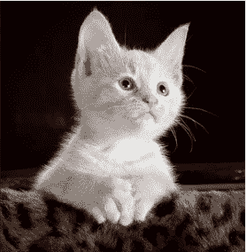

*图 1.3 – 在 Jupyter Notebook 中显示 PIL 图像*

#### 使用 Matplotlib 读取、保存和显示图像

Matplotlib 主要是一个 Python 绘图库，但它也提供了一些用于读取、保存和显示图像的函数。让我们通过几个示例来演示。

##### 使用 matplotlib.image 读取图像

下面的代码块演示了如何使用 `matplotlib.image` 中的 `imread()` 函数将图像读取为浮点 NumPy ndarray 数据结构。像素值将表示为 0 到 1 之间的实数值：

```
```python
import matplotlib.image as mpimg
im = mpimg.imread("images/hill.png") # read image from disk as ndarray
print(im.shape, im.dtype, im.max(), type(im))
# (960, 1280, 3) float32 1.0 <class 'numpy.ndarray'>
```
```


或者，你也可以使用 `matplotlib.pylab` 模块中的 `imread()` 函数，如下所示：

```python
import matplotlib.pylab as plt
im = plt.imread("images/hill.png")  # read image from disk as numpy ndarray
print(im.shape, im.dtype, im.max(), type(im))
# (960, 1280, 3) float32 1.0 <class 'numpy.ndarray'>
```

下一个代码片段演示了如何使用 NumPy 阈值处理和 Matplotlib 图像 I/O 实现简单的图像变暗。首先将图像归一化到 [0,1] 范围，使用 `copy()` 复制，然后通过布尔索引将所有低于阈值 0.5 的像素值设为 0：`im_dark[im_dark < 0.5] = 0`。阈值越低，被变暗的像素越多。随后使用 `mpimg.imsave()` 保存变暗后的图像，再用 `mpimg.imread()` 重新加载，并通过 `np.hstack()` 和 `plt.imshow()` 将其与原始图像并排显示。`[..., :3]` 运算符确保在存在 alpha 通道时仅保留 RGB 三个通道。

```python
im = im / im.max()  # 0-1 normalize
im_dark = im.copy()
im_dark[im_dark < 0.5] = 0      # make the image look darker
mpimg.imsave("images/hill_dark.png", im_dark)  # save the dark image
im_dark = mpimg.imread("images/hill_dark.png")[..., :3]  # 1st 3 color channels
plt.imshow(np.hstack((im, im_dark)), plt.axes('off'))
plt.title('original and the darkened image', size=20)
```

如果运行上述代码片段，你应该会得到类似下面这样的图：

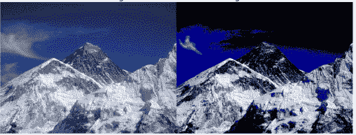

*图1.4 – 使用 PIL 将图像变暗*

你可以使用 `matplotlib.pylab` 中的 `savefig()` 函数将图像保存到磁盘，但在此之前必须先使用 `imshow()` 函数将其绘制出来。

> **注意**
> 
> 本例中 0.5 这个阈值是任意选取的，目的是演示如何通过操作图像中的像素值使其看起来更暗。不过，该阈值并非固定不变，建议你尝试 [0, 1] 范围内的其他值。

##### 使用 matplotlib.pylab 显示图像

matplotlib.pylab 的 imshow() 函数被广泛用于显示以 NumPy ndarray 对象表示的图像。它支持可选参数，例如 cmap 用于颜色映射表，interpolation 用于控制像素插值，aspect 用于调整图像宽高比。axis('off') 命令会移除坐标轴刻度和标签，使可视化更清晰。

插值方法决定了当图像像素与显示像素无法完全对齐时如何估算像素值，这对于小图像或调整大小后的图像尤为重要。常见的插值方法包括 'nearest'、'bilinear'、'bicubic'、'gaussian' 和 'lanczos'（你将在第 2 章和第 3 章进一步了解它们）。下一个代码片段使用 imshow()、plt.subplots() 和 plt.tight_layout() 以多种插值选项显示同一幅图像，演示不同插值方法的效果。

```
im = mpimg.imread("images/monalisa.jpg") # read image as numpy ndarray
methods = [None, 'none', 'nearest', 'bilinear', 'bicubic', 'spline16', \
    'spline36', 'hanning', 'hamming', 'hermite', 'kaiser', 'quadric',\
    'catrom', 'gaussian', 'bessel', 'mitchell', 'sinc', 'lanczos']
fig, axes = plt.subplots(nrows=3, ncols=6, figsize=(12, 7), \
    subplot_kw={'xticks': [], 'yticks': []})
fig.subplots_adjust(hspace=0.05, wspace=0.05)
for ax, interp_method in zip(axes.flat, methods):
    ax.imshow(im, interpolation=interp_method)
    ax.set_title(str(interp_method))
plt.tight_layout(); plt.show()
```

如果运行上述代码，你应该会得到类似下面这样的图：

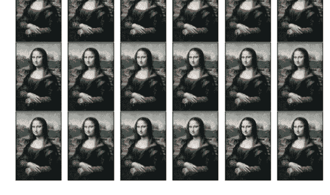

图1.5 – 使用不同插值方法显示图像

###### 颜色映射表

颜色映射表（cmap）定义了从标量数据值到颜色的映射，使图像中的强度变化可视化，特别适用于灰度或单通道图像，此时像素值以颜色表示。实际应用中，先将三通道图像转换为二维灰度表示（例如使用 np.mean(..., axis=-1) 对各通道取平均），然后应用不同的颜色映射表来可视化强度分布，通常还会配有颜色条（plt.colorbar()）来指示颜色值与像素强度之间的映射关系。

```
im = plt.imread('images/cameraman.jpg')
im_gray = np.mean(im, axis=-1)
i = 1
for cmap in ['viridis', 'inferno', 'coolwarm', 'Spectral', 'jet', \
    'nipy_spectral', 'hot', 'Blues']:
    plt.subplot(1,8,i), plt.imshow(im_gray, cmap=cmap, aspect='auto')
    plt.axis('off')
    i += 1
plt.colorbar(label='Intensity')
plt.tight_layout(); plt.show()
```

如果运行上述代码片段，你应该会得到类似下面这样的图：

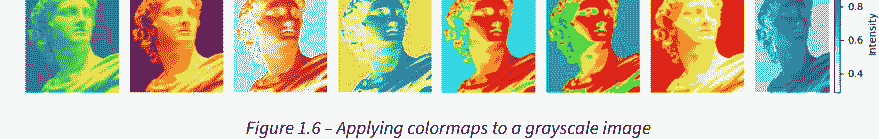

图1.6 – 将颜色映射表应用于灰度图像

### 注意

要将 RGB 图像转换为灰度图像，前面的代码使用了所有颜色通道的线性组合，且各通道权重相等，公式如下：

G = (R + G + B) / 3

使用国家电视系统委员会（NTSC）公式 G = 0.299R + 0.587G + 0.114B 进行感知加权计算得到的亮度值，能更准确地表示人类对红、绿、蓝光亮度相对感知。你可以使用下面这行代码来实现：

G = (R + G + B) / 3

```
im_gray_ntsc = np.dot(im[..., :3], [0.299, 0.587, 0.114])
```

现在，分别使用均值加权与感知加权绘制灰度图像：

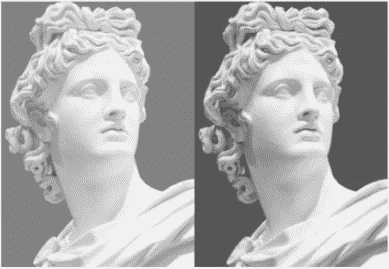

*图1.7 – 分别使用均值加权与感知加权对颜色通道加权生成的灰度图像*

###### 子图

`matplotlib.pylab` 提供了使用 `subplot()` 函数创建子图的便捷接口。子图允许你在同一幅图中按网格形式显示多个图形。`subplot()` 函数接受三个参数：行数、列数，以及要创建的子图索引，正如你在前面的代码片段中可能已经注意到的那样。

#### 使用 scikit-image 读取、保存和显示图像

scikit-image 库是一个图像处理算法的集合。虽然它主要专注于图像处理任务而非 I/O 操作，但你可以将 Imageio 或 Matplotlib 等其他库与 scikit-image 结合使用，以完成图像的读取、保存和显示。以下是示例代码块：

```python
from skimage.io import imread, imread_collection, imshow_collection
from skimage import color


def min_max_normalize(im, low=0, high=255):
    """Normalizes the pixel values of the image im to the specified
    [low, high] range using min-max scaling"""
    return ((high-low)*(im-im.min())/(im.max()-im.min())).astype(np.uint8)

im = imread("images/parrot.png")  # read image, provide the correct path
print(im.shape, im.dtype, type(im), im.max(), im.min())
# (362, 486, 3) uint8 <class 'numpy.ndarray'>
im_gray = imread("images/parrot.png", as_gray=True)  # read grayscale image
im_gray = min_max_normalize(im_gray)
im_gray = color.gray2rgb(im_gray)
```

```
hsv = color.rgb2hsv(im) # from RGB to HSV color space
hsv[:, :, 1] = 0.5 # change the saturation
im_hsv = min_max_normalize(color.hsv2rgb(hsv)) # from HSV back to RGB
print(im_hsv.dtype)
# uint8
imsave('images/parrot_hsv.png', im_hsv)
im_hsv = imread("images/parrot_hsv.png")
plt.imshow(np.hstack((im, im_gray, im_hsv))); plt.axis('off'); plt.show()
```

在上述代码中，skimage.io 的 imread() 函数将图像读取为 NumPy ndarray 对象。在默认的 as_gray=False 情况下，图像以 uint8 数组加载，像素值范围为 [0,255]；而 as_gray=True 会将灰度图像加载为 float64 数组，数值范围为 [0,1]。自定义的 min_max_normalize() 函数执行最小-最大归一化，将图像强度缩放到指定范围（通常为 [0,255]）。

灰度图像通过 gray2rgb() 转换为三通道图像，并使用 skimage.color.rgb2hsv() 进行 RGB 到 HSV 的颜色转换。

接下来，在保持色调和明度不变的情况下修改饱和度通道，演示饱和度如何控制色彩的鲜艳程度：高饱和度产生浓郁的色彩，低饱和度产生柔和的色彩，零饱和度则得到灰度图像。修改后的 HSV 图像通过 hsv2rgb() 转换回 RGB，使用 skimage.io.imsave() 保存，并通过 np.hstack() 和 plt.imshow() 并排显示。下图展示了该代码片段的输出：输入图像、灰度图像以及改变饱和度后的新图像并排显示。

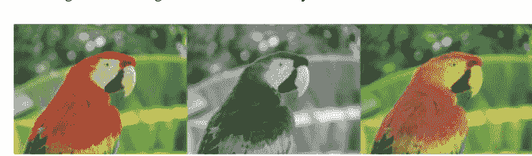

图1.8 – 使用 skimage 显示 RGB、灰度和 HSV 颜色空间中的图像

注意：skimage.color.rgb2hsv() 与 OpenCV 的 cv2.cvtColor(..., cv2.COLOR_RGB2HSV) 在 HSV 通道表示上的主要区别在于缩放约定：在 scikit-image 中，色调（Hue）、饱和度（Saturation）和明度（Value）这三个通道均以 [0.0, 1.0] 范围内的归一化浮点值表示；而 OpenCV 使用基于整数的缩放，其中色调映射到 [0, 179]（对应 0–360°，但在 8 位表示中按一半分辨率存储），饱和度和明度均存储在 [0, 255] 范围内。因此，scikit-image 采用单位区间上的连续表示，而 OpenCV 采用 8 位整数表示，且不同通道的缩放因子不同。


下图显示了代码片段的输出：

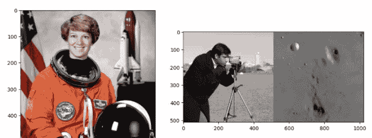

图1.9 – 来自 scikit-image 数据的宇航员和摄影师图像

##### 一次读取并显示多张图像

我们可以使用 skimage.io 模块的 `imread_collection()` 函数加载文件夹中文件名符合特定模式的所有图像，并使用 `imshow_collection()` 函数同时显示它们。以下代码块展示了读取并显示图像集合的示例：

```
images = imread_collection('images/image_dir/*.jpg')
print(len(images)) # print no. of jpg images in the folder, there are 4
# 4
imshow_collection(images); plt.show()
```

下图显示了上述代码块的输出：

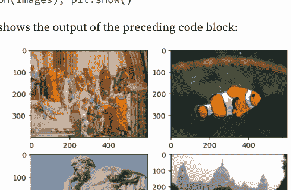

图1.10 – 使用 scikit-image 读取并显示图像集合

##### 图像的块视图

使用 skimage.util.view_as_blocks() 的块视图将图像分割成不重叠的块，以实现池化等局部操作。给定一幅灰度图像，将其划分为 m × n 个块（可选填充以确保可整除性），每个块被缩减为单个值以形成下采样图像：均值池化计算平均强度，最大池化选择最大强度，中值池化选择每个块内的中值强度。

下一个代码块定义了几个用于可视化的辅助函数：plot_image() 显示单张图像并带有标题且关闭坐标轴，而 plot_images() 使用 matplotlib 将多张图像排列在 1×n 的网格中，应用灰度颜色映射，设置各个子图标题，并添加具有可调整图形和字体大小的全局总标题。

```
def plot_image(im, title='', fontsize=20):
    plt.imshow(im), plt.axis('off'),
    plt.title(title, size=fontsize)

def plot_images(images, titles, suptitle='', fontsize=20, \
                supfontsize=22, figsize=(15,7)):
    n = len(images)
    plt.figure(figsize=figsize)
    plt.gray()
    for i in range(n):
        plt.subplot(1,n,i+1), plot_image(images[i], titles[i], fontsize)
    plt.suptitle(suptitle, size=supfontsize)
    plt.tight_layout()
    plt.show()
```

下一个代码片段使用不同的池化方法对输入图像实现块视图：

```
from skimage.util import view_as_blocks
im = color.rgb2gray(imread('images/sculpture.png')[..., :3])
block_shape = (8, 8) # Ensure image dimensions are divisible by block size
pad_height = (block_shape[0] - im.shape[0] % block_shape[0]) % block_shape[0]
pad_width = (block_shape[1] - im.shape[1] % block_shape[1]) % block_shape[1]
if pad_height != 0 or pad_width != 0:
    # optional: pad the image to make it divisible by block size
    im = np.pad(im, ((0, pad_height), (0, pad_width)), mode='reflect')
view = view_as_blocks(im, block_shape)
flatten_view = view.reshape(view.shape[0], view.shape[1], -1)
mean_view = np.mean(flatten_view, axis=2)
max_view = np.max(flatten_view, axis=2)
median_view = np.median(flatten_view, axis=2)
plot_images([im, mean_view, max_view, median_view], ['original', \
    'local mean pooling', 'local max pooling', 'local median pooling'])
```

如果运行上述代码，你应该会得到如下图所示的结果：

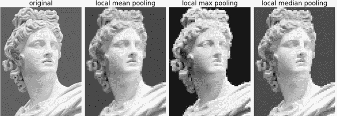

图1.11 – 使用不同局部池化方法的图像块视图

上述代码首先加载 RGB 图像，丢弃任何 alpha 通道，并将其转换为灰度以进行单通道处理。然后，它使用 view_as_blocks() 将图像划分为不重叠的 8 × 8 块，如有必要，对图像进行填充，使其尺寸可被块大小整除。

块表示将图像从 (H, W) 重塑为 (H/8, W/8, 64)，其中每个块被展平为包含 64 个像素的一维数组。然后在每个块上应用局部池化操作：np.mean() 计算平均强度（均值池化），np.max() 保留最强响应（最大池化），np.median() 在保留结构的同时降噪（中值池化）。

最后，plot_image() 和 plot_images() 辅助函数使用 Matplotlib 可视化带标题的单张或多张图像，而 plt.tight_layout() 则整齐地排列子图。

#### 使用 OpenCV-Python 读取、保存和显示图像

使用 OpenCV-Python，读取灰度图像和彩色图像都很简单。cv2.imread() 函数用于读取图像，你可以使用可选标志指定颜色模式。下面介绍如何读取彩色图像并在 notebook 中内联显示。你需要将图像文件路径提供给 cv2.imread() 函数，如下一个代码片段所示。检查图像是否成功加载（图像不为 None）：

```
import cv2
image = cv2.imread('images/model.png')
cv2.imshow('Model', image)
cv2.waitKey(0)
cv2.destroyAllWindows()
print(image.dtype)
# uint8
```

> **注意**
> cv2.imshow() 会打开一个 GUI 窗口，在 Jupyter Notebook 中无法可靠工作——它应该作为独立的 Python 脚本运行（例如，通过终端或 .py 文件）。

下面演示如何使用标志 cv2.IMREAD_GRAYSCALE（等于 0）读取灰度图像：

```
image_gray = cv2.imread('images/model.png', cv2.IMREAD_GRAYSCALE)
cv2.imshow('Model Gray', image_gray)
cv2.waitKey(0)
```

OpenCV 默认以蓝色、绿色、红色（BGR）颜色格式读取彩色图像。如果你想使用 Matplotlib 显示图像（Matplotlib 期望 RGB 格式的图像），则应使用 cv2.cvtColor() 函数并将输入标志设置为 cv2.BGR2RGB 来转换颜色通道，以正确显示颜色，如下一个代码片段所示：

```
image_rgb = cv2.cvtColor(image, cv2.COLOR_BGR2RGB)
plt.imshow(np.hstack(([image, image_rgb,
    np.repeat(image_gray[..., np.newaxis], 3, axis=-1)]))
```

如果运行上述代码片段，你应该会得到如下图所示的结果：

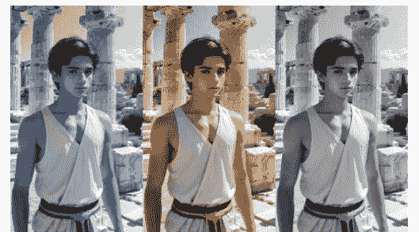

图1.12 – 使用 OpenCV-Python 加载图像的 BGR 到 RGB 转换

要使用 OpenCV-Python 写入图像，可以使用 cv2.imwrite() 函数。该函数的第一个参数是存储路径，第二个参数是作为 NumPy 数组的图像。下面是一个示例，它将输入图像从 RGB 转换为 YUV 颜色空间，并在颜色空间转换后保存图像：

```
cv2.imwrite('images/model_yuv.png', cv2.cvtColor(image_rgb,
    cv2.COLOR_RGB2YUV))
# True # => image is successfully written (saved) to disk without error
```

如上述代码片段所示，cv2.imwrite() 函数将文件路径和图像数据作为输入，并将图像保存到指定位置。确保路径根据所需的图像格式包含正确的文件扩展名（例如 .jpg 或 .png）。格式由文件扩展名决定。如果文件路径不存在，OpenCV 将尝试创建它。请记住，OpenCV 支持各种图像格式，如 JPEG、PNG、BMP 等。格式根据文件路径中提供的文件扩展名确定。

#### 使用 ImageIO 读取和保存图像

ImageIO 是一个用于图像 I/O 的简单 Python 库，提供 `imageio.imread()` 和 `imageio.imwrite()` 等函数，用于读取和保存多种格式的图像，包括通过读取帧来支持动画 GIF，以及从图像序列生成 GIF。动画 GIF 由多个帧按顺序循环播放以产生运动，通常使用有限的调色板（≤ 256 种颜色），支持透明度，并依赖无损压缩，使其在保持文件大小紧凑的同时，跨平台广泛兼容。

###### 从动画 GIF 中提取帧

在 ImageIO 中，可以使用 `imageio.get_reader()` 从动画 GIF 中提取帧，该函数创建一个读取器对象，允许按顺序迭代 GIF 的帧，每帧表示为一个 NumPy 数组；然后可以处理或选择性采样这些帧（例如，使用 `np.random.rand()` 随机选择帧的子集），从而能够检查或操作单个动画组件。

```python
import imageio
gif_path = 'images/leaves.gif'
np.random.seed(3)
images = []
with imageio.get_reader(gif_path) as reader:
    for i, frame in enumerate(reader):
        if len(images) < 5:
            if np.random.rand() > 0.75:
                images.append(frame)
                print(f"Frame {i + 1} shape: {frame.shape}")
plt.imshow(np.hstack(images)), plt.axis('off')
plt.title('frames selected from the animated GIF', size=12); plt.show()
# Frame 5 shape: (512, 512, 4)
# Frame 6 shape: (512, 512, 4)
# Frame 26 shape: (512, 512, 4)
# Frame 30 shape: (512, 512, 4)
# Frame 31 shape: (512, 512, 4)
```

这是运行上述代码片段后你将获得的输出：

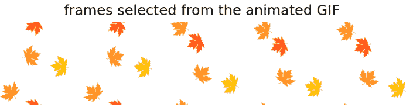

*图1.13 – 从动画 GIF 中选择的五帧*


使用 ImageIO 可以创建动画 GIF：首先将一系列图像（例如通过 glob.glob() 和 imageio.imread() 从文件夹中读取的 PNG 文件）加载到帧列表中，然后用 imageio.get_writer() 初始化一个 GIF 写入器，其中 duration 参数控制每帧显示时间，最后遍历帧列表，使用 writer.append_data() 构建动画，生成如 world.gif 的输出文件。

现在，请参考以下代码片段：

```
from glob import glob
# read frames for the animation
frames = [imageio.imread(f) for f in glob('images/world/*.png')]
# Save frames as an animated GIF
with imageio.get_writer('images/world.gif', duration=0.1) as writer:
    for frame in frames:
        writer.append_data(frame)
```

#### Python 中的图像文件格式与转换

图像可以以多种文件格式存储，每种格式具有不同的压缩策略、颜色支持和使用场景。常见格式包括 BMP（未压缩的光栅图像，体积大，支持 8/24/32 位颜色深度，可选 alpha 通道）、PNG（无损压缩，支持透明度，适合网络图形和锐利边缘）、JPEG（有损压缩，针对具有平滑渐变的照片进行了优化，但不支持透明度）、GIF（限于 256 种颜色，支持无损压缩和动画）、PPM/PNM（简单的未压缩格式，文件体积非常大，很少使用）以及 TIFF（高质量、灵活的格式，支持无损压缩、图层和元数据，广泛用于专业成像）。

下表说明了位深度如何影响 2 x 2 图像的像素表示：

| 位深度 | 像素值（十进制/二进制） | 图像 |
|---|---|---|
| 8 位 | [[0, 85], [170, 255]]<br>二进制：[[00000000, 01010101], [10101010, 11111111]] | [2x2 灰度图像] |
| 16 位（显示时缩放至 8 位） | [[0, 21845], [43690, 65535]]<br>二进制：[[0000000000000000, 0101010101010101], [1010101010101010, 1111111111111111]] | [2x2 灰度图像] |

表 1.1：位深度与像素表示

## 转换文件格式

尽管格式不同，Python 图像库会抽象掉元数据，并允许直接访问图像数组以及大小、模式和数据类型等属性。可以使用 PIL 通过以新扩展名保存图像（例如，从 PNG 转换为 JPG）来执行格式转换，如下一个代码片段所示：

```
im = Image.open("images/parrot.png")
print(im.mode)
# RGB
im.save("images/parrot.jpg")
```

RGBA 模式的 PNG 图像必须先转换为 RGB，然后才能保存为 JPEG，因为 JPEG 不支持 alpha 通道，如下一个代码片段所示。

```
im = Image.open("images/hill_alpha.png")
print(im.mode)
# RGBA
im.convert('RGB').save("images/hill.jpg") # first convert to RGB mode
```

## 图像类型（模式）

图像可以根据表示每个像素所使用的通道数进行分类。

- 单通道图像：每个像素由一个值表示：
  - 二值（单色）图像：每个像素使用一个位（0 或 1）存储。
  - 灰度图像：每个像素通常使用 8 位，强度值范围为 [0,255]。
- 多通道图像：每个像素由一个值元组表示，例如：
  - RGB / HSV 图像：像素分别以 (R, G, B) 表示红、绿、蓝强度，以 (H, S, V) 表示色调、饱和度（色彩丰富度）和明度（亮度），其中 HSV 提供了更符合感知的颜色模型。
  - RGBA 图像：四通道图像，表示为 (r, g, b, α)，其中 α 表示透明度。
  - 索引颜色（调色板）图像：像素存储的是颜色调色板中的索引，而不是直接的 RGB 值。这样可以减少存储空间，常用于 GIF 图像。

## 使用 PIL 转换图像模式

PIL/Pillow 支持多种图像模式，包括：

- 1：1 位像素，黑白，每个像素存储为一个字节
- L：8 位像素，黑白
- P：8 位像素，通过调色板映射到任何其他模式
- RGB：3 x 8 位像素，真彩色
- RGBA：4 x 8 位像素，带透明度的真彩色
- CMYK：4 x 8 位像素，分色
- F：32 位浮点像素

## 从 RGB 转换为二值模式

我们可以使用 PIL.Image 中的 convert() 方法，通过下面这行代码将 RGB 图像转换为二值图像（模式为 '1'）：

```
Image.open('images/parrot.png').convert('1', dither=Image.FLOYDSTEINBERG)
```

如果你运行上面这行代码，应该会得到类似下面这样的图像：

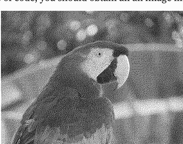

图 1.14 – 使用 Floyd-Steinberg 抖动生成的二值图像

## 注意

上面的二值图像仅使用两种不同的像素值（即黑色和白色；如果转换为 NumPy ndarray，会产生一个 bool 数组），但它看起来仍然接近原始图像，并且没有太多信息损失，因为它使用了抖动算法（这里为 FLOYD-STEINBERG），我们将在第 6 章（图像增强章节）中详细讨论：

```
np.unique(np.array(Image.open('images/parrot.png').convert('1')))
# array([False, True], dtype=bool)
```

## 从 RGB 转换为调色板模式，再转换回来

在调色板（"P"）模式下，像素存储的是映射到查找表中 RGB 颜色的索引。每个像素的值并不是直接的颜色，而是一个对独立调色板列表的引用（例如，一个 0–255 的整数索引），该列表包含实际的 RGB 值。当颜色总数较少时，这种映射有助于压缩图像大小，这也是 GIF 等格式使用该技术的原因。下表直观地说明了调色板模式如何作用于一张 2 x 2（RGB）彩色图像，以及图像中的每个像素如何持有一个映射到调色板中实际颜色的索引值：

## 注意

前面的代码可以使用 NumPy 进行向量化，从而消除 for 循环，这样会获得更好的性能和更简洁的语法：

```
palette_array = np.array(palette, dtype=np.uint8)
modified_palette = (palette_array + 19) % 256
image_palette.putpalette(modified_palette.tolist())
```

你可以分别使用 getdata() 和 putdata() 方法获取原始和修改后的像素数据；尝试将它们作为练习。

## 向 PNG 图像添加 alpha 通道（RGB 到 RGBA）

alpha 通道表示透明度。在下一个代码片段中，putalpha() 方法将灰度蒙版用作透明度。图像 parrot.png 被加载并转换为 RGBA。图像 Ishihara.png（常用于检测色盲）被加载并转换为灰度（L 模式），使用 ImageOps.invert() 进行反相，调整大小，然后用作 alpha 蒙版。随后 putalpha() 应用透明度蒙版，结果保存为 parrot_alpha.png。蒙版中较亮的区域变得更不透明，而较暗的区域变得更透明。

```
from PIL import ImageOps
im = Image.open('images/parrot.png').convert('RGBA')
im_alpha = ImageOps.invert(Image.open("images/Ishihara.png").convert('L'))
im.putalpha(im_alpha.resize((im.width, im.height)))
im.save('images/parrot_alpha.png')
im # run in jupyter notebook
# RGB <ImagingCore object at 0x0000015375A334F0>
```

如果你运行上面的代码片段，应该会得到类似下面这样的图：

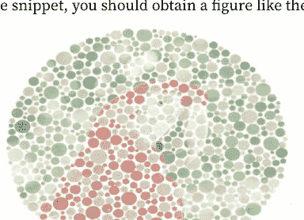

图 1.16 – 使用 PIL 将 Ishihara 图像强度作为 alpha 通道值添加到 parrot 图像

## 使用 scikit-image 转换模式

使用 `skimage.io.read(..., as_gray=True)` 可以直接将图像读取为二维灰度图像：

```python
im = imread("images/parrot.png", as_gray=True)
```

`color.rgb2gray()` 函数也可以将 RGB 图像转换为灰度图像：

```python
im = imread("images/Ishihara.jpeg")
im_g = color.rgb2gray(im)
# Plot color and grayscale Ishihara image (im, im_g) here side-by-side
```

然而，灰度转换可能会丢失重要的颜色信息。例如，在石原氏色盲测试图中，RGB 图像中可见的数字在灰度转换后可能几乎不可见，如下图所示。

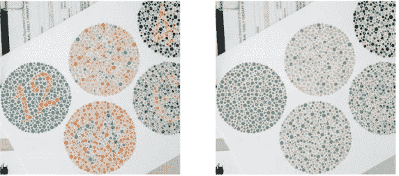

*图 1.17 – 用于色盲测试的图像，使用 skimage.color 转换为灰度*

## 图像数据类型与转换

在 Python 图像处理中，图像以数组形式存储，其**数据类型**决定了像素值范围、数值精度、内存占用和算术行为。下表总结了常见的图像（NumPy）数据类型：

| 数据类型 | 描述 | 值范围 | 使用示例 |
|---|---|---|---|
| `uint8` | 8 位无符号整数 | 0 到 255 | 标准彩色图像 |
| `float32` | 32 位浮点数 | 0.0 到 1.0（归一化） | 归一化处理 |
| `bool` | 布尔型 | True 或 False | 二值掩码 |

表 1.3：常见图像数据类型

## 检查图像的数据类型

下面是一个示例代码：

```python
im = imread('images/parrot.png')  # automatically returns uint8
print("Image dtype:", im.dtype, "range", im.min(), "to", im.max())
# Image dtype: uint8, range: 0 to 255
```


# 数据类型之间的转换

```
im_float = im.astype(np.float32) / 255.0 # Normalize float [0, 1]
print("Float dtype:", im_float.dtype)
print("New range:", im_float.min(), "to", im_float.max())
# Float dtype: float32
# New range: 0.0 to 1.0
```

## 注意：溢出与裁剪

当对 uint8 图像进行操作时，进行算术运算需要格外小心：

```
bright = im + 100 # Wrong: causes overflow if dtype is uint8
```

这会因溢出而发生回绕（例如，250 + 100 = 94）。

以下是正确的做法：

```
bright = np.clip(image.astype(np.int16) + 100, 0, 255).astype(np.uint8)
```

下面这种做法甚至更好：

```
im_float = im.astype(np.float32) / 255.0
bright_float = np.clip(im_float + 0.4, 0.0, 1.0)
```

## 使用布尔图像生成二值掩码

在图像分割或阈值化处理中，你通常需要生成布尔掩码，如下一个代码片段所示：

```
gray = rgb2gray(image)  # Returns float image [0, 1]
mask = gray > 0.5        # Boolean mask
print("Mask dtype:", mask.dtype)  # Output: bool
# Mask dtype: bool
```

## 专业提示

使用 `skimage.img_as_float` 和 `skimage.img_as_ubyte` 来进行安全转换：

```
from skimage import img_as_float, img_as_ubyte
im_float = img_as_float(im)  # converts safely to float [0,1]
im_uint8 = img_as_ubyte(im_float)  # converts safely back to uint8
```

请记住，OpenCV-Python 在图像处理中主要使用 NumPy 数组。以下是一些常见的 OpenCV 数据类型与其对应的 NumPy 数据类型之间的映射关系：

- cv2.CV_8U（8位无符号整数）：numpy.uint8
- cv2.CV_32F（32位浮点数）：numpy.float32
- cv2.CV_64F（64位浮点数）：numpy.float64

# 颜色空间

颜色空间是利用坐标系对颜色进行数学表示的一种方式，它能够实现高效的图像表示、操作和分析。不同的颜色空间是为不同的图像处理任务而设计的，因为没有任何单一的表示方法对所有应用都是最优的。

常用的颜色空间包括以下几种：

- **RGB（红、绿、蓝）**：电子显示器和一般图像处理中使用的标准加色模型。
- **HSV（色相、饱和度、明度）**：将颜色、色彩饱和度和亮度分离，适用于颜色过滤、分割和颜色操作。
- **CMYK（青、品红、黄、黑）**：主要用于印刷和出版领域的减色模型。
- **Lab（CIELAB）**：使用亮度（L*）和对立色通道（a、b）来表示颜色。它在感知上是均匀的，广泛用于颜色校正和比较。
- **YUV**：分离亮度和色度分量，能够实现高效的视频压缩和广播。
- **YCbCr**：将亮度（Y）与色度（Cb、Cr）分离，广泛用于JPEG、MPEG和数字视频压缩中。
- **YIQ**：NTSC标准中使用的一种电视广播颜色模型，将亮度和色度信息分离。

不同的颜色空间会强调不同的图像特性，例如亮度、色度、感知均匀性或压缩效率。例如，RGB 直观且对硬件友好，HSV 简化了基于颜色的阈值处理，Lab 与人类颜色感知紧密对齐，YUV/YCbCr 提高了压缩效率，而灰度则降低了 OCR 和边缘检测等任务的计算复杂度。

选择合适的颜色空间取决于应用需求、计算需求以及与图像处理任务相关的感知特性。

我们可以使用仿射映射在颜色空间之间进行转换。下面的矩阵表示从 RGB 到 YIQ 颜色空间的线性映射：

RGB 到 YIQ
[ Y ]   [ 0.299   0.587   0.114 ] [ R ]
[ I ] = [ 0.596  -0.274  -0.322 ] [ G ]
[ Q ]   [ 0.211  -0.523   0.312 ] [ B ]

YIQ 到 RGB
[ R ]   [ 1   0.956   0.621 ] [ Y ]
[ G ] = [ 1  -0.272  -0.647 ] [ I ]
[ B ]   [ 1  -1.106   1.703 ] [ Q ]

Figure 1.18 – 颜色空间变换矩阵

# 颜色色域

颜色色域是指设备或系统能够重现或显示的颜色范围，通常表示为颜色空间中由原色定义的可见光谱的一个子集。更宽的色域能够实现更丰富、更准确的颜色再现，这在摄影、成像和显示技术等应用中非常重要。了解颜色色域有助于在不同设备和媒体之间保持一致且忠实的颜色表示。

**colour-science** Python 库可用于通过 `plot_chromaticity_diagram_CIE1931()` 函数，借助 **CIE 1931 色度图** 可视化颜色色域。使用 `pip install colour-science` 安装该包后，该函数会生成一个二维色度图，使用 x 和 y 色度坐标表示可感知的颜色。该图在颜色科学、显示技术、照明和图像处理应用中被广泛使用。

```python
# pip install colour-science
from colour.plotting import plot_chromaticity_diagram_CIE1931
plot_chromaticity_diagram_CIE1931(); plt.show()
```

如果你运行前面的代码，它将会生成如下所示的一幅输出图像：

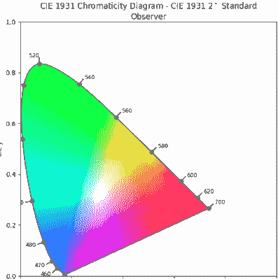

*Figure 1.19 – CIE 1931 色度图*

# 色度图的应用

CIE 色度图在颜色科学和技术领域有着广泛的实际应用，包括以下几种：

- **颜色显示校准：** 该图通过将设备（例如显示器）的色域与人类感知进行比较，帮助校准设备。
- **照明体与光源比较：** 该图可以显示不同照明体或光源的色度坐标。
- **颜色研究：** 有助于研究颜色如何被感知，以及不同光照条件如何影响颜色外观。

# 在颜色空间之间进行转换

我们可以使用库函数在颜色空间之间进行转换。例如，下一小节中的代码使用 `color.rgb2hsv()` 函数，将 RGB 颜色空间转换为 HSV 颜色空间图像。

## RGB 转 HSV

HSV 颜色空间通常更适合用于颜色过滤或对象跟踪等任务，因为这样可以更轻松地分离颜色属性。下图对 RGB 和 HSV 颜色空间进行了比较。RGB 立方体（左）将颜色表示为红、绿、蓝强度的组合，形成一个立方体，每个轴对应一个颜色通道。HSV 圆柱体（右）则更符合人类感知的方式对颜色进行建模，其中 *Hue*（色调）为角度，*Saturation*（饱和度）为半径，*Value*（明度）为高度，如下图所示：

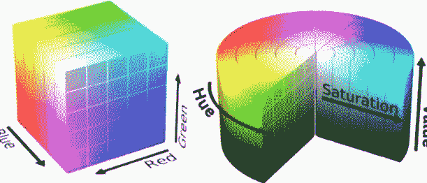

*Figure 1.20 – RGB 与 HSV 颜色空间对比*

我们可以使用下一个代码片段中的 `color.rgb2hsv()` 函数，将 RGB 图像转换为 HSV 颜色空间。下图显示了通过运行以下代码片段创建的鹦鹉 HSV 图像：

```
im = imread("images/parrot.png")
im_hsv = color.rgb2hsv(im)
# plot 3 channels of im_hsv here (e.g., im_hsv[...,0]) side-by-side here
```

如果你运行上述代码片段，你应该会得到类似下图的结果：

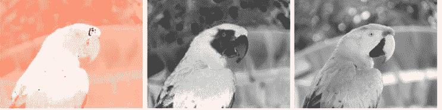

*Figure 1.21 – 显示 HSV 颜色空间中的色相、饱和度和明度通道*

## RGB 转 YUV

类似地，我们可以使用下面的代码，借助 color.rgb2yuv() 函数将 RGB 颜色空间转换为 YUV 颜色空间：

```
im_yuv = color.rgb2yuv(im)
imsave('images/parrot_yuv.png', (255*im_yuv).astype(np.uint8))
```

下图显示了使用上述代码创建的鹦鹉 YUV 图像，以及来自 RGB 颜色空间的原始红、绿、蓝通道：

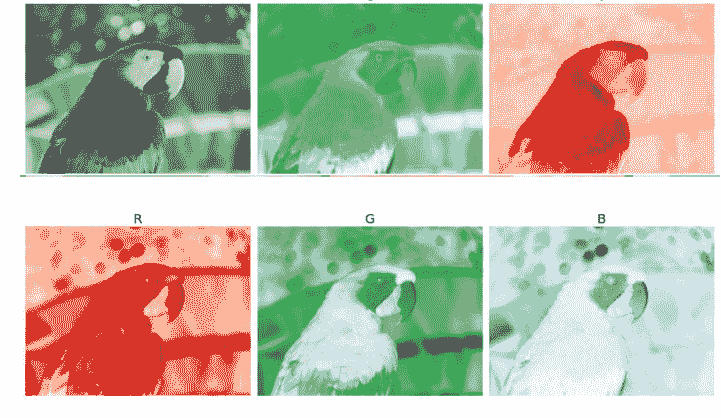

Figure 1.22 – 显示 YUV 与 RGB 通道的对比

## RGB 转 CMYK

与 RGB（加色颜色空间）相反，CMYK 是一种减色光谱。这意味着这些油墨会在较浅的背景下（如白纸）遮蔽颜色。CMYK 油墨从白光中减去红、绿、蓝，留下青、品红和黄。黑色是颜色的缺失。RGB 颜色在屏幕上可能看起来很棒，但在将你的美术文件提供给打印机之前，需要将它们转换为 CMYK 颜色空间。

下图显示了从 RGB 转换为 CMYK 的公式：

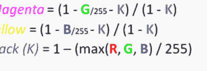

Figure 1.23 – 从 RGB 到 CMYK 颜色空间的转换公式


让我们使用 `rgb2cmyk()` 函数将图像从 RGB 转换为 CMYK，如以下代码片段所示。首先从输入图像中提取 R、G 和 B 通道。将 rgb `[0,255]` 转换为 cmy `[0,1]`。提取黑色分量 k。最后，将 CMYK 值转换为所需的 `[0, CMYK_SCALE]` 范围以便存储或处理。

```
```python
RGB_SCALE, CMYK_SCALE = 255, 100

def rgb2cmyk(x):
    r, g, b = x[...,0], x[...,1], x[...,2]
    c, m, y = 1 - r / RGB_SCALE, 1 - g / RGB_SCALE, 1 - b / RGB_SCALE
    min_cmy = np.minimum(np.minimum(c, m), y)
    c, m, y, k = (c - min_cmy) / (1 - min_cmy), \
                  (m - min_cmy) / (1 - min_cmy), \
                  (y - min_cmy) / (1 - min_cmy), min_cmy
    return np.dstack((c * CMYK_SCALE, m * CMYK_SCALE, y * CMYK_SCALE, \
                      k * CMYK_SCALE))

im = plt.imread('images/rgb_cmyk_t.png')
im_cmyk = rgb2cmyk(im)
```
```

下图显示了使用原始输入图像的 RGB 和 CMYK 图像的输出通道；输出结果符合预期且不言自明。将绘图作为练习留给读者（参考 github）。

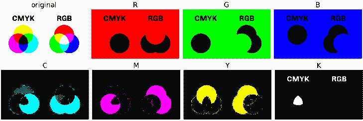

*图 1.24 – CMYK 与 RGB 色彩空间*

下图显示了鹦鹉 RGB 图像的 CMYK 通道。

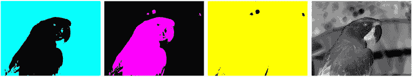

*图 1.25 – 在 CMYK 色彩空间中显示鹦鹉图像的四个通道*

## HSV 色彩空间中的色彩增强

现在让我们在图像的 HSV 色彩空间表示中更改色相、饱和度和明度通道（例如，使用 `multiply_channel_hsv()` 函数将相应通道值乘以一个因子，并使用以下代码片段将大于 1 的值裁剪至 1）。观察当分别增加饱和度和明度通道时图像颜色如何得到增强。我们需要将 RGB 图像转换为 HSV，修改其中一个通道，然后转换回 RGB：

```
def multiply_channel_hsv(im, i, f):
    im_hsv = color.rgb2hsv(im)
    im_hsv[...,i] = np.minimum(f*im_hsv[...,i], 1)
    return color.hsv2rgb(im_hsv)

im = imread('images/parrot.png')
plot_images([im, multiply_channel_hsv(im, 0, 3), \
                multiply_channel_hsv(im, 1, 2.5), \
                multiply_channel_hsv(im, 2, 2)], \
    ['original', 'hue changed', 'saturation enhanced', 'value enhanced'])
```

如果运行上述代码片段，你应该会得到如下图所示的结果：

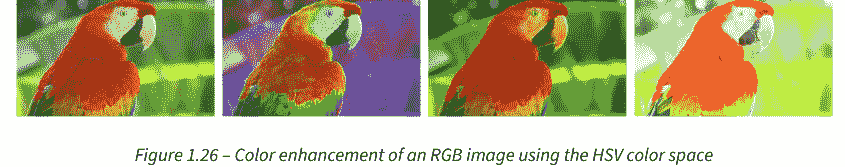

图 1.26 – 使用 HSV 色彩空间增强 RGB 图像的色彩

## HSV 色彩空间中灰度图像的着色

给图像着色是指对整个图像应用色彩偏色或色相，从而改变其整体颜色。着色通常是通过在原始图像上叠加一层半透明的颜色层来实现的，从而改变整个场景的外观。人工给灰度图像着上某种颜色在突出图像特定区域或只是让灰度图像更生动时非常有用。在本节中，我们将通过缩放 RGB 值并在 HSV 色彩空间中调整颜色来演示图像着色。

## 显示色相渐变

首先，让我们使用以下代码片段显示色相渐变，使用来自 skimage.color 模块的 `hsv2rgb()` 函数。注意图像范围被设置为使色相从 0 到 1，并且图像具有良好的宽高比：

```
hue_gradient = np.linspace(0, 1)
hsv = np.ones(shape=(1, len(hue_gradient), 3), dtype=float)
```

```
hsv[:, :, 0] = hue_gradient
all_hues = color.hsv2rgb(hsv)
fig, ax = plt.subplots(figsize=(5, 2))
ax.imshow(all_hues, extent=(0 - 0.5 / len(hue_gradient), \
    1 + 0.5 / len(hue_gradient), 0, 0.2))
```

如果运行上述代码片段，你应该会得到如下图所示的结果：


图 1.27 – 色相渐变

## 使用复古风格给灰度图像上色

让我们定义 `colorize()` 函数，它将给定色相的颜色添加到灰度图像中。默认情况下，饱和度设置为 1，以便颜色更突出。通过降低饱和度（例如 0.3）并使用 `np.linspace()` 色相渐变获得的不同色相值，可以赋予其复古风格：

```
def colorize(im, hue, saturation=1):
    hsv = color.rgb2hsv(im)
    hsv[:, :, 1], hsv[:, :, 0] = saturation, hue
    return color.hsv2rgb(hsv)

im = gray2rgb(imread('images/man.png', as_gray=True))
hue_rotations = np.linspace(0, 1, 6)
fig, axes = plt.subplots(nrows=1, ncols=7, sharex=True, sharey=True)
axes[0].imshow(im); axes[0].set_title('grayscale')
for ax, hue in zip(axes.flat[1:], hue_rotations):
    tinted_im = colorize(im, hue, saturation=0.3)
    ax.imshow(tinted_im, vmin=0, vmax=1); ax.set_axis_off()
```

上述代码将输入图像作为灰度图像读取，使用 `gray2rgb()` 函数将图像转换为 RGB 图像，然后使用 HSV 色彩空间应用基于不同色相的着色。

如果运行上述代码片段，你应该会得到如下图所示的结果：

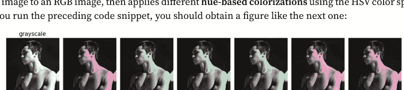

图 1.28 – 将灰度图像着色为复古风格

## 使用 HSV 操作创建色彩突出效果

色彩突出效果通过将图像的大部分转换为灰度，同时保留选定的颜色，从而营造出戏剧性的外观。这种技术在 HSV 色彩空间中很容易实现，其中将饱和度通道降低到零即可产生灰度区域。

下面的代码片段将 RGB 图像转换为 HSV，根据色相值过滤像素，并将除选定颜色外的所有区域的饱和度通道设置为零。由于橙色类颜色通常具有较低的色相值，保留色相 ≤ 0.09 的像素可保留人脸肤色，同时将剩余区域转换为灰度。修改后的 HSV 图像随后转换回 RGB 以获得最终的色彩突出效果。

```
im = imread('images/me.jpg')
im = im / im.max()  # normalize
im_hsv = color.rgb2hsv(im)
im_gray = im_hsv.copy()
im_gray[...,1] = 0  # set saturation of the pixels to 0
im_gray = color.hsv2rgb(im_gray) # creates grayscale image
im_hsv[im_hsv[...,0] > 0.09,1] = 0 #set all but skin pixel saturation to 0
im_out = color.hsv2rgb(im_hsv) # creates RGB image with all but
# skin pixels grayed out (popping the skin pixels out)
plt.imshow(np.hstack((im,im_gray,im_out)))
```

如果运行上述代码片段，你应该会得到如下图所示的结果：

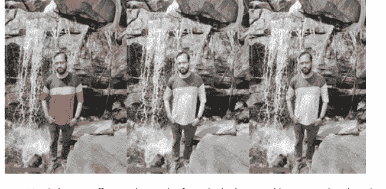

图 1.29 – 色彩突出效果，仅显示人脸肤色，其余为灰度

## RGB 色彩空间中的色彩增强

在 RGB 色彩空间中增强色彩对比度的一种方法是增加主导和较弱颜色通道之间的分离，使颜色看起来更鲜艳、更易区分。

在本节中，让我们对 RGB 图像使用变换 c′ = (c/m)^f m 来增强色彩，其中 c ∈ {r, g, b}，m = max(r, g, b)，f 控制增强强度。当通道已具有最大强度（c = m）时，它保持不变，而对于 f > 1，较低值的通道会被进一步抑制，从而增加通道间对比度。

下面的代码片段演示了色彩增强，使用 `enhance_rgb()` 函数提取 RGB 通道，使用 `np.maximum()` 计算每个像素的最大值，并应用非线性增强 (c/m)^f m，然后将增强后的值分配回图像通道。参数 f=4 控制增强水平。演示加载了使用 `imread()` 的 RGB 伊希哈拉图像，使用 `enhance_rgb()` 应用增强，使用 `color.rgb2gray()` 将原始图像和增强图像都转换为灰度，并使用 `plot_images()` 可视化它们。增强后的灰度图像揭示了在原始图像灰度版本中几乎不可见的数字。

```
def enhance_rgb(im, f=4):
    r, g, b = im[...,0], im[...,1], im[...,2]
    m = np.maximum(np.maximum(r, g), b)
    im[...,0], im[...,1], im[...,2] = (r/m)**f*m, (g/m)**f*m, \
                                    (b/m)**f*m
    return im

im = imread('images/Ishihara.png')
im_en = enhance_rgb(im)
plot_images([im, color.rgb2gray(im), im_en, color.rgb2gray(im_en)], \
            ['original', 'grayscale from original', 'enhanced image', \
             'grayscale from enhanced'])
```

如果运行上述代码片段，你应该会得到如下图所示的结果：

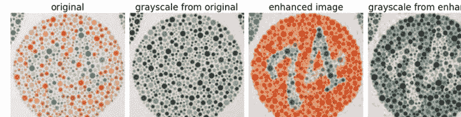

图 1.30 – 增强 RGB 到灰度的转换

## Lab 色彩空间中的色彩偏移

现在，让我们在图像的 Lab 色彩空间表示中更改亮度 L 和颜色 a、b 通道（例如，使用 `add_channel_lab()` 函数通过给定的偏移值 x 增加相应通道值）使用以下代码片段。观察当 a 通道值增加 10 时图像颜色如何偏移（导致红调图像），以及当 b 通道值减少 25 时图像颜色如何偏移（导致冷调图像）。当 L 通道值增加时，图像的亮度也会增加，如下图所示。我们需要转换


将 RGB 图像转换为 Lab，修改其中一个通道，再将其转换回 RGB：

```python
def add_channel_lab(im, i, x):
    im_lab = color.rgb2lab(im)
    im_lab[...,i] = x + im_lab[...,i]
    return color.lab2rgb(im_lab)

im = imread('images/scene.jpg')
plot_images([im, add_channel_lab(im, 0, 50), \
             add_channel_lab(im, 1, 10), \
             add_channel_lab(im, 2, -25)], \
            ['original', 'luminosity changed', 'red tinted', 'cooled'])
```

如果运行上述代码片段，您应该会得到类似下图的结果：

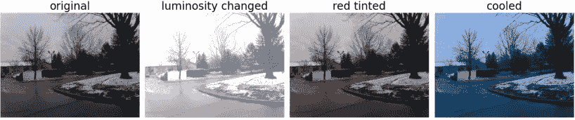

*图 1.31 – Lab 颜色空间中的颜色偏移*

## 使用 HSV 和 YCbCr 颜色空间进行肤色检测

肤色检测识别不同颜色空间中位于预定义肤色范围内的像素。以下实现同时使用 HSV 和 YCbCr 颜色空间以提高鲁棒性。输入 BGR 图像通过 `cv2.cvtColor()` 进行转换，并使用 `cv2.inRange()` 根据预定义的上下阈值生成二值肤色掩码：

$$HSV_{lower}, HSV_{upper},\quad YCbCr_{lower}, YCbCr_{upper}$$

处于指定范围内的像素被标记为肤色（1），而其他像素被抑制（0）。形态学开运算（`cv2.morphologyEx()`）去除小的噪声区域，`cv2.medianBlur()` 则对最终掩码进行平滑。使用 `np.bitwise_and()` 组合这两个掩码，以获得更可靠的全局肤色掩码。

函数 `detect_skin_color()` 接受一个 BGR 图像（`np.ndarray`），并返回原始 RGB 图像以及基于 HSV、基于 YCbCr 和组合的肤色检测输出。类型提示提高了可读性，并有助于编辑器辅助的错误检查，尽管它们在 Python 中是可选的。

最终的可视化使用 Matplotlib 将原始图像与来自 HSV、YCbCr 以及组合掩码的检测结果并排显示。

```python
# Constants for HSV and YCrCb skin detection thresholds
HSV_LOWER, HSV_UPPER = (0, 15, 0), (17, 170, 255)

YCrCb_LOWER, YCrCb_UPPER = (0, 135, 85), (255, 180, 135)

def detect_skin_color(img: np.ndarray) -> tuple[np.ndarray, np.ndarray, np.ndarray, np.ndarray]:
    img_HSV = cv2.cvtColor(img, cv2.COLOR_BGR2HSV)
    HSV_mask = cv2.inRange(img_HSV, HSV_LOWER, HSV_UPPER)
    HSV_mask = cv2.morphologyEx(HSV_mask, cv2.MORPH_OPEN, np.ones((3,3), np.uint8))
    img_YCrCb = cv2.cvtColor(img, cv2.COLOR_BGR2YCrCb)
    YCrCb_mask = cv2.inRange(img_YCrCb, YCrCb_LOWER, YCrCb_UPPER)
    YCrCb_mask = cv2.morphologyEx(YCrCb_mask, cv2.MORPH_OPEN, np.ones((3,3), np.uint8))
    global_mask = np.bitwise_and(YCrCb_mask,HSV_mask)
    global_mask = cv2.medianBlur(global_mask,3)
    global_mask = cv2.morphologyEx(global_mask, cv2.MORPH_OPEN, np.ones((4,4), np.uint8))
    img_RGB = cv2.cvtColor(img, cv2.COLOR_BGR2RGB)
    out_HSV = cv2.cvtColor(img & cv2.merge([HSV_mask]*3), cv2.COLOR_BGR2RGB)
    out_YCrCb = cv2.cvtColor(img & cv2.merge([YCrCb_mask]*3), cv2.COLOR_BGR2RGB)
    out_global = cv2.cvtColor(img & cv2.merge([global_mask]*3), cv2.COLOR_BGR2RGB)
    return img_RGB, out_HSV, out_YCrCb, out_global

img = cv2.imread("images/cycling.png")
img_RGB, out_HSV, out_YCrCb, out_global = detect_skin_color(img)
plt.imshow(np.hstack((img_RGB, out_HSV, out_YCrCb, out_global)))
```

如果运行上述代码片段，您将得到如下图所示的输出：

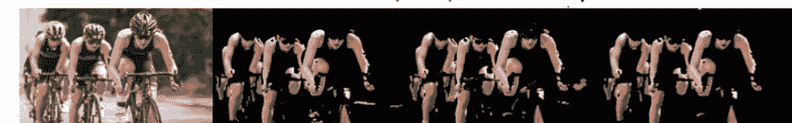

*图 1.32 – 使用不同颜色空间进行肤色检测*

> **注意**
>
> 该函数明确使用了**类型提示**（例如，`img: np.ndarray` 和 `tuple[np.ndarray, ...]` 返回类型）。类型提示（Python 3.5 引入）提高了代码可读性，支持在现代编辑器（如 VS Code 或 PyCharm）中进行更好的错误检查和自动补全，并使函数的输入输出预期更加清晰，尤其在协作或大型项目中。然而，由于 Python 本质上是一种动态类型语言（即类型在运行时解析），类型提示是可选的，不会影响代码在运行时的功能。

正如我们已经讨论过的，PIL 使用 Image 对象来存储图像，而 scikit-image 使用 NumPy ndarray 数据结构来存储图像数据。下一节将介绍如何在这两种数据结构之间进行转换。

## 转换图像数据结构

以下代码块展示了如何从 PIL Image 对象转换为 NumPy ndarray（供 scikit-image 使用）：

```python
im = Image.open('images/flowers.jpg')  # read image into Image object (PIL)
im = np.array(im)  # create a numpy ndarray from the Image object
```

以下代码块展示了如何从 NumPy ndarray 转换为 PIL Image 对象。运行后，代码显示的输出与前述图形相同：

```python
im = imread('images/flowers.png')  # read image into numpy ndarray
im = Image.fromarray(im)  # create a PIL Image object from the numpy ndarray
#im.show() # display the image with PIL Image.show() method
```

现在我们已经了解了如何将图像加载到内存中，接下来介绍一些基本的图像处理方法。

## 图像数组坐标与绘图坐标

在 Python 中处理图像时，重要的是要理解**数组索引**和**绘图坐标**在表示空间数据时并不总是一致的。这种差异在可视化或处理图像时可能会引起混淆，尤其是在像素操作、绘图或叠加图形等任务中。

### 图像数组坐标（NumPy 风格）

在 NumPy 中，图像被视为多维数组。这意味着：

- 第一个索引对应于行（Y 轴），方向为从上到下；第二个索引对应于列（X 轴），方向为从左到右；原点 `(0,0)` 位于图像的左上角像素；Y（行）向下增大；X（列）向右增大。

### 绘图坐标（Matplotlib 风格）

Matplotlib 的常规绘图函数（例如 `plt.plot()` 和 `plt.scatter()`）使用标准笛卡尔坐标：原点 `(0,0)` 默认位于左下角，X 向右增大，Y 向上增大。然而，使用 `plt.imshow()` 显示图像时，图像仍按从上到下的方式显示（原点在左上角），除非另行指定。下表总结了坐标系之间的差异：

| 特性 | NumPy 数组 | Matplotlib 绘图 |
|---|---|---|
| 索引格式 | (row, col) = (y, x) | (x, y) |
| 原点（默认） | 左上 | 左下 |
| Y 轴方向 | 从上到下 | 从下到上（除非 origin='upper'） |
| 用途 | 处理与过滤 | 显示与叠加 |

表 1.4：numpy 二维数组与 matplotlib 绘图的坐标系

## 基本图像处理

不同的 Python 库可用于基本图像处理。几乎所有库都将图像存储在 NumPy ndarray 中（例如，灰度图像为二维数组，RGB 图像为三维数组）。如前所述，下图显示了彩色蒙娜丽莎图像的正 x 和 y 方向（原点位于图像二维数组的左上角）：

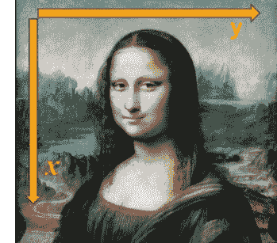

*图 1.33 – 图像与 NumPy 二维数组坐标的对比*

### 常见的图像处理操作

数字图像处理涉及对图像进行修改以增强外观、改变构图或创建视觉效果。常见操作包括裁剪、缩放、旋转、颜色调整、锐化、模糊、变形以及应用滤镜效果（如棕褐色或灰度）。更高级的操作包括添加文本、移除对象、克隆图像区域以及将多张图像合成为合成场景。本书将使用不同的 Python 图像处理库来实现这些技术中的许多内容。

### 使用 NumPy 进行图像处理

NumPy 是 Python 中用于数值和数组运算的强大库，凭借其数组处理能力，也可用于图像处理。以下小节将介绍一些使用 NumPy 的基本图像处理任务。

#### 使用数组切片进行裁剪

NumPy 数组切片是指提取数组的一部分或创建包含其部分元素的原始数组视图的过程。下面的代码片段展示了如何使用 NumPy 数组的切片和掩码操作，先从输入的蒙娜丽莎图像中裁剪出面部区域，然后通过应用圆形掩码隐藏图像的一部分：

```python
mona = plt.imread("images/monalisa.jpg") # read from disk as numpy ndarray
lx, ly = mona.shape[:2]
cropped_mona = mona[120:210, 160:220, :]  # crop a region
X, Y = np.ogrid[0:lx, 0:ly]
mask = (X - lx / 2) ** 2 + (Y - ly / 2) ** 2 > lx * ly / 4
masked_mona = mona.copy()
masked_mona[np.where(mask)] = 0 # masks
# plot mona, cropped_mona and masked_mona side-by-side here
```

如果运行上述代码片段，您应该会得到类似下图的结果：

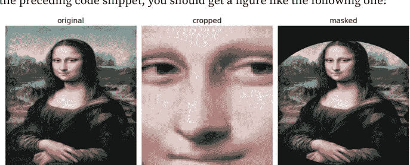

*图 1.34 – 使用 NumPy 数组切片裁剪蒙娜丽莎图像*

#### 调整彩色图像的亮度和对比度

对比度和亮度调整是帮助增强图像或修正曝光不足的重要操作。对比度调整放大亮部与暗部之间的差异，而亮度调整则改变图像的整体亮度。亮度和对比度的调整通常在 Lab 颜色空间中进行，该空间将亮度与颜色信息分离。RGB 图像使用 `rgb2lab()` 转换为 Lab，通过亮度通道（L）进行修改，再使用 `lab2rgb()` 转换回 RGB。


**调整亮度：** 亮度调整会统一移动亮度值：

$L'(x,y)=\operatorname{clip}(L(x,y)+\beta,0,255)$

其中*移位参数* $\beta>0$ 使图像变亮，而 $<0$ 则使其变暗。`adjust_brightness()` 函数通过向 Lab 颜色空间中的 L 通道（`im_lab[...,0]`）添加移位值，并使用 `np.clip()` 约束结果来实现这一点，如下面的代码片段所示：

```
```python
from skimage.color import rgb2lab, lab2rgb


def adjust_brightness(im, shift):
    im_lab = rgb2lab(im)
    im_lab[...,0] = np.clip(im_lab[...,0] + shift, 0, 255)
    im_out = lab2rgb(im_lab)
    return (255*im_out/im_out.max()).astype(np.uint8)
```
```

**调整对比度：** 对比度是指图像中亮部和暗部之间的强度差异。对比度调整按比例缩放亮度差异：

$L'(x,y)=\operatorname{clip}(\alpha L(x,y),0,255)$

其中 $\alpha>1$ 增加对比度，$0<\alpha<1$ 降低对比度。`adjust_contrast()` 函数在转换回 RGB 之前，将 *L通道* 乘以缩放因子。

```
```python
def adjust_contrast(im, scale):
    im_lab = rgb2lab(im)
    im_lab[...,0] = np.clip(im_lab[...,0] * scale, 0, 255)
    im_out = lab2rgb(im_lab)
    return (255*im_out/im_out.max()).astype(np.uint8)
```
```

下一个代码片段使用 `skimage.io.imread()` 加载图像，使用上述函数生成变亮、变暗、高对比度和低对比度的输出，并使用 `plt.imshow()` 和 `np.hstack()` 并排显示结果。

```
```python
im = imread('images/rabbit.png')[...,:3]
im_brightened, im_darkened = adjust_brightness(im, 50), \
                              adjust_brightness(im, -25)
im_high_contrast, im_low_contrast = adjust_contrast(im, 2), \
                                     adjust_contrast(mona, 0.25)
plt.imshow(np.hstack((im, im_brightened, im_darkened)))
plt.imshow(np.hstack((im, im_high_contrast, im_low_contrast)))
```
```

如果运行上述代码片段，你应该会得到类似下面的图形：

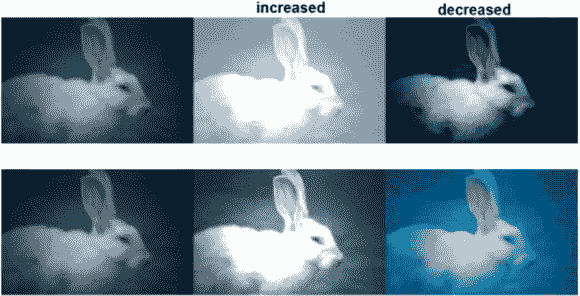

## 水平翻转和垂直翻转

使用 `np.flipud()` 和 `np.fliplr()` 函数对输入图像进行垂直和水平翻转，如下一个代码片段所示：

```
```python
v_flipped_mona = np.flipud(mona)  # Vertical flip
h_flipped_mona = np.fliplr(mona)  # horizontal flip
vh_flipped_mona = np.fliplr(v_flipped_mona) # both Vert. & horiz. flip
# Plot images side-by-side with np.hstack() here
```
```

如果运行上述代码片段，你应该会得到类似下面的图形：

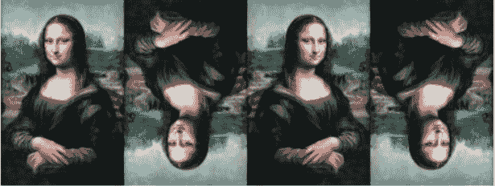

## 使用交叉溶解的简单图像变形

一种基本的图像变形形式可以通过 α 混合来实现，其中两张对齐的图像通过线性插值进行组合。给定两张图像 I₁ 和 I₂，中间变形图像计算如下：

$$I_{\alpha}=(1-\alpha)I_1+\alpha I_2,\qquad \alpha\in[0,1].$$

下一个代码片段演示了人脸变形，通过使用 np.linspace() 将 α 从 0 到 1 进行迭代变化，逐渐将年轻的面部图像（im1）转换为年老的（im2）。每一步都使用 plt.imshow() 可视化混合后的图像。

```
im1 = mpimg.imread("images/me_young.jpg")
im2 = mpimg.imread("images/me_now.jpg")
i = 1
for alpha in np.linspace(0,1,18):
    plt.subplot(3,6,i), plt.imshow((1-alpha)*im1 + alpha*im2)
    i += 1
```

下图显示了使用上述代码通过将一张面部图像交叉溶解为另一张而创建的 α 混合图像序列。从中间图像序列可以看出，使用简单混合的人脸变形并不是很平滑。在接下来的章节中，我们将看到更高级的图像变形技术。

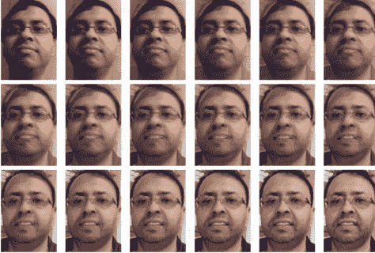

图 1.37 – 使用 α 混合的简单图像变形

## 使用图像除法去除光照模式

将一张图像除以另一张图像可用于增强图像的某些特征。考虑下面使用 np.divide() 的示例；你也可以使用 OpenCV-Python 中的 cv2.divide() 函数（自己尝试一下）。如下一个代码片段所示，除法运算可从输入图像中去除光照模式。

```
img1 = cv2.imread('images/board_illum_pat.png', 0)
img2 = cv2.imread('images/pattern.png', 0)
out = np.divide(img1.astype(float), img2.astype(float)+0.001) #no div by 0
out = out / (out.max() + epsilon) # 0-1 normalization
out = (255*out).astype('uint8')  # for visualization: scale in [0,255]
plt.imshow(np.hstack((img1, img2, out))), plt.axis('off')
```

如果运行上述代码片段，你应该会得到类似下面的图形：

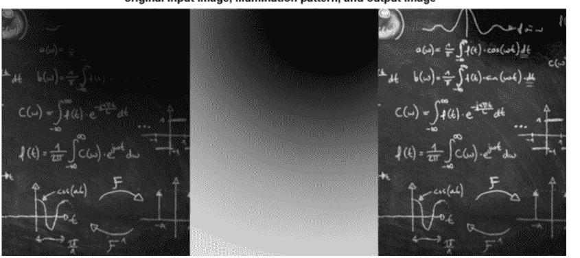

图 1.38 – 去除图像中（已知的）光照模式

## 应用棕褐色滤镜

棕褐色滤镜为图像应用一种暖棕色-黄色调，产生类似于早期照片的复古外观。该效果通过使用棕褐色变换矩阵变换 RGB 通道来实现。下一个代码片段演示了棕褐色滤镜，它定义了一个函数 sepia_filter()，该函数接受归一化的 RGB 图像 I(x, y) ∈ [0,1]，并使用 np.dot() 应用变换：

I_sepia = I · S^T

其中 S 是 3 × 3 棕褐色矩阵：

S = [[0.393 0.769 0.189], [0.349 0.686 0.168], [0.272 0.534 0.131]]

这里，np.dot(im, sepia_matrix.T) 在每个 RGB 像素向量与棕褐色矩阵之间执行矩阵乘法，将原始颜色转换为棕褐色调。由于该变换可能生成超出有效 RGB 范围的值，np.clip(...,0,1) 将强度限制在 [0,1] 内。接下来的代码首先读取并归一化输入图像，应用棕褐色变换，并并排绘制原始图像和棕褐色过滤后的图像。

```
def sepia_filter(im):
    return np.clip(np.dot(im, np.array([[0.393, 0.769, 0.189], \
                                         [0.349, 0.686, 0.168], \
                                         [0.272, 0.534, 0.131]]).T), 0, 1)

im = imread('images/sea_beach.jpg')
im_out = sepia_filter(im / im.max())
plt.imshow(np.hstack((im, im_out))), plt.axis('off')
```

如果运行上述代码片段，你应该会得到类似下面的图形：

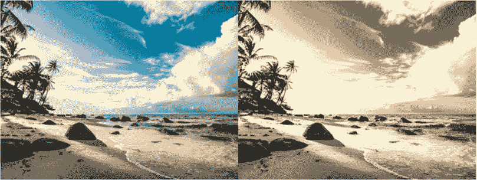

*图 1.39 – 将棕褐色滤镜应用于图像（使用 NumPy dot）*

作为额外练习，读者可以使用基于 PIL 的逐像素处理和基于 NumPy 的向量化矩阵运算来实现棕褐色滤镜，并使用 `time()` 比较它们的执行时间。完整的实现和基准测试代码可在本书的 GitHub 仓库中找到，可以观察到由于向量化，NumPy 方法的执行速度明显更快。

## 使用 Gradio 构建交互式棕褐色滤镜应用程序

Gradio 提供了一种为 Python 函数和深度学习模型构建交互式网页演示的简单方式。其高级 Interface 类封装了一个函数（例如 sepia()），指定输入和输出组件（例如输入图像和输出图像），并使用 launch() 启动本地 Web 服务器。设置 share=True 会生成一个用于浏览器访问的公共 URL。下一个代码片段演示了使用 Gradio 的交互式棕褐色滤镜应用程序。

```
```python
# !pip install gradio -q
import gradio as gr


def sepia(input_img):
    sepia_filter = np.array([[0.393, 0.769, 0.189],
                             [0.349, 0.686, 0.168],
                             [0.272, 0.534, 0.131]])
    sepia_img = input_img.dot(sepia_filter.T)
    sepia_img /= sepia_img.max()
    return sepia_img


gr.Interface(sepia, gr.Image(), "image").launch()
```
```

如果运行上述代码片段并选择输入图像，你应该会看到一个弹出窗口，如下一幅图所示：


*图 1.40 – 将棕褐色滤镜应用于图像（使用 Gradio 界面）*

从前面的图可以看出，Gradio 界面便于快速演示图像处理任务的实现。

## 总结

在本章中，我们介绍了数字图像处理的基本概念以及计算机视觉等相关领域，还介绍了主要的图像处理任务和工作流程。我们讨论了本书中使用的主要 Python 库，包括 NumPy、PIL、scikit-image、OpenCV-Python、Imageio、Matplotlib 和 SciPy，以及安装、导入模块和调用库函数。

我们还探讨了图像表示、图像类型、文件格式、颜色空间和用于存储图像数据结构，接下来是用多个 Python 框架进行图像 I/O 和可视化。最后，我们演示了基本的图像操作，如裁剪、缩放、混合、亮度和对比度调整、颜色过滤和几何变换，以及包括肤色检测和色彩弹出效果在内的实际应用。

在下一章中，我们将继续使用 PIL、OpenCV-Python 和 Wand 探索图像操作。


## 获取本书的 PDF 版本和更多内容

扫描二维码（或访问 packtpub.com/unlock）。按书名搜索此书，确认版本，然后按照页面上的步骤操作。


注意：请保留您的发票。直接从 Packt 购买无需发票。
