### 2 图像处理

正如我们在上一章讨论的那样，图像处理是图像处理和计算机视觉的基础主题，使从艺术效果到科学分析的广泛应用成为可能。在本章中，我们将继续探索流行的 Python 库，如 NumPy、Pillow（和 PIL）以及 scikit-image，并演示如何利用它们来实现各种有趣的图像处理方法。这些库提供了用于轻松修改、增强和转换图像的广泛工具包。

我们将探索基于 NumPy 的技术，例如色彩突出效果和鱼眼畸变校正，然后是 scikit-image 操作，例如反转图像、调整亮度和对比度、逆向扭曲以及添加高斯噪声。使用 PIL，我们将介绍裁剪、调整大小、像素化、点变换、几何变换以及在图像上绘图。此外，我们还将研究带 Alpha 通道的混合、加法和减法等算术运算，以及处理多个图像通道。这些技术为艺术增强、数据分析和计算机视觉应用提供了实用的工具。

将要涵盖的关键主题包括以下内容：

- 使用 NumPy 进行更多图像处理
- 使用 scikit-image 进行图像处理
- 使用 PIL 进行图像处理

到本章结束时，您将对图像处理技术有坚实的基础，使您具备将图像转换为各种实际应用的知识和工具。让我们深入探索 Python 的迷人图像处理世界！

### 技术要求

在阅读本章的不同部分时，请跟随 Jupyter 笔记本并运行必要的代码片段。以下是本书 GitHub 仓库的链接：https://github.com/PacktPublishing/Hands-On-Image-Processing-and-Computer-Vision-with-Python-Second-Edition。

在运行代码之前，必须安装正确版本的库，以便代码顺利运行。如果版本不匹配，代码可能需要根据库中某些功能/函数是否被移除/弃用进行少量调整。

### 使用 NumPy 进行更多图像处理

在上一章中，我们讨论了一些使用 NumPy 的图像处理方法。现在让我们在这里讨论另外几种图像处理技术。

#### 模拟色彩突出效果

色彩突出效果，也称为选择性色彩或色彩飞溅，是一种摄影或平面设计技术，其中图像的特定部分通过保留其原始色彩而被突出显示，而图像的其余部分则转换为灰度或去饱和。这通过在黑白或柔和的背景下突出彩色元素来产生强烈的视觉冲击。

色彩突出效果是指使图像中的某些颜色更加鲜艳，同时使图像其余部分去饱和。以下 apply_color_pop() 函数突出红色，因此只有公交车的颜色被保留。在 scikit-image 创建的 Hue, Saturation, Value（HSV）色彩空间中，色调值 h ∈ [0,1]，因此 0 ≤ h ≤ 10/180 或 170/180 ≤ h ≤ 1。使用这些色调区间，可以创建掩码以保留红色区域（例如图像中的公交车），同时将剩余像素转换为灰度。

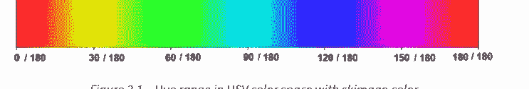

图 2.1 – 使用 skimage.color 的 HSV 色彩空间中的色调范围

apply_color_pop() 函数通过将图像的大部分转换为灰度，同时保留来自原始 RGB 图像的特定颜色，通常是红色调，从而产生选择性色彩增强效果。首先，rgb2gray(im) 将 RGB 图像转换为表示亮度强度的单通道灰度图像。由于输出必须与 RGB 显示兼容，因此 np.stack((gray,)*3, axis=-1) 将灰度通道复制三次以创建 3 通道灰度 RGB 图像。接下来，color.rgb2hsv(im) 将图像从 RGB 转换为 HSV 色彩空间，其中色调通道（H）独立于亮度和饱和度表示颜色。表达式 hsv[...,0] 提取色调分量，其归一化值位于 [0,1]。然后使用 H ≤ 5/180 或 H ≥ 175/180 创建布尔掩码，该掩码选择色调位于 HSV 色轮红色区域附近的像素。语句 `gray[mask_cond] = im[mask_cond]` 仅对所选像素恢复原始 RGB 值，同时保持其余像素为灰度。最后，处理后的图像被返回，产生引人注目的“色彩突出”效果，其中所选颜色在单色背景下突出显示。

```python
def apply_color_pop(im):
    gray = rgb2gray(im)
    gray = np.stack((gray,)*3, axis=-1)
    hsv = color.rgb2hsv(im)
    mask_cond = (hsv[...,0] <= 5/180) | ((hsv[...,0] >= 175/180))
    gray[mask_cond] = im[mask_cond]
    return gray

im = imread('images/bus.jpg')
im = im/im.max()
out_im = apply_color_pop(im)

plt.figure(figsize=(20,7))
plt.imshow(np.hstack((im, out_im)))
plt.axis('off')
plt.show()
```

如果运行上述代码片段，您应该会得到如下图所示的图像：

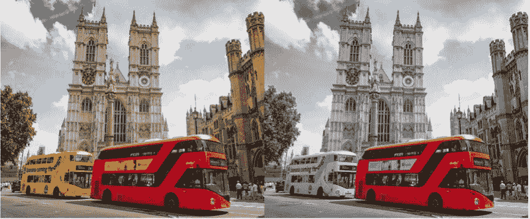

*图 2.2 – 使用 HSV 色彩空间的掩码进行色彩突出效果*

#### 校正鱼眼畸变图像

鱼眼畸变，也称为桶形畸变，是一种几何畸变，发生在用鱼眼镜头拍摄的图像中。鱼眼镜头是超广角镜头，与普通镜头相比可捕捉显著更宽的视野。这种宽视野是通过使用特殊的光学设计实现的，该设计允许光线以非常宽的角度进入相机。

鱼眼镜头的畸变特性是场景中的直线，尤其是图像边缘附近的直线，看起来是弯曲的。在桶形畸变中，本应笔直的直线在图像中反而向外弯曲，形成桶状或鱼缸效果。这种畸变在图像边缘附近更为明显，而在中心附近则不那么明显。

鱼眼畸变有不同类型，包括等距、立体投影和正交投影，每种都会产生不同的视觉效果。虽然在某些情况下鱼眼畸变可能是不可取的，但在其他情况下则是有意使用的，以在摄影和摄像中创造艺术或独特的视角。

在图像处理中，我们旨在校正或最小化鱼眼畸变。此过程称为鱼眼校正或校正，其中应用算法来校正几何畸变并恢复图像中直线的笔直度。鱼眼校正通常用于全景摄影、计算机视觉和虚拟现实等应用，以确保场景的准确表示。

下一个代码片段实现了一个 undistort() 函数，该函数实现了鱼眼畸变校正过程（参考：https://tannerhelland.com/2013/02/11/simple-algorithm-correcting-lens-distortion.html）。使用简单的双线性重采样会使输出略微模糊。

该算法在没有缩放参数的情况下也能正常工作。缩放参数是在一些实验后添加的；具体来说，它在两种情况下很有用：

- 在只有轻微镜头畸变的图像上，缩小可减少校正图像边缘的拉伸伪影
- 在具有严重畸变的图像上，例如真正的鱼眼照片，缩小可保留更多源材料

现在，请参考以下代码片段：

```python
def undistort(im, zoom = 1):
    w, h = im.shape[:2]

    im_new = np.zeros_like(im)
    hw, hh = w / 2, h / 2
    strength = 5 # 0.00001
    correction_radius = np.sqrt(w ** 2 + h ** 2) / strength
    for x in range(w):
        for y in range(h):
            new_x, new_y = x - hw, y - hh
            distance = np.sqrt(new_x**2 + new_y**2)
```


```python
r = distance / correction_radius
theta = 1 if r == 0 else np.arctan(r) / r
source_x, source_y = hw + theta * new_x * zoom, \
                     hh + theta * new_y * zoom
# set color of pixel (x, y) to color of source image pixel
# at (source_x, source_y)
# also, check if the coordinates are within bounds
if 0 <= source_x < w and 0 <= source_y < h:
    im_new[x, y] = im[round(source_x), round(source_y)]
return im_new

distorted_image = imread('images/distorted2.jpg')
undistorted_image = undistort(image)

# TODO: plot the images here
```

如果运行前面的代码片段并绘制图像，你应该会得到类似可以在 https://upload.wikimedia.org/wikipedia/commons/b/b4/Fisheye_photo.jpg 找到的图形。

正如该图所示，`undistort()` 函数在很大程度上去除了输入图像的鱼眼畸变。

> **注意**
>
> 在这里，`undistort()` 函数应用了一种简化的极坐标变换来模拟径向畸变校正。虽然这种方法直观且有效，可用于演示几何畸变效应，但它不使用实际的相机校准参数或镜头畸变模型，例如 `cv2.undistort()` 函数所使用的模型，后者对于使用内在相机矩阵和畸变系数进行准确的现实世界校正至关重要。如果你有兴趣了解更多，请参考此 OpenCV 教程：https://docs.opencv.org/4.x/dc/dbb/tutorial_py_calibration.html。

## 使用 scikit-image 进行图像操作

scikit-image 是一个建立在 NumPy、SciPy 和 Matplotlib 之上的图像处理和计算机视觉算法集合。它提供了多种用于图像操作、滤波和分析的函数。以下是一些可以使用 scikit-image 执行的常见图像操作任务。

### 反转图像

图像反转意味着**翻转每个像素的强度值**。如果图像的像素强度范围从 0（黑色）到 \(L - 1\)（白色），则反转公式如下：

$$I_{neg}(x,y) = L - 1 - I(x,y)$$

这里，\(L\) 是不同强度值的数量，如以下示例所示：

- \(L = 256\) 对于 8 位灰度图像（像素值在 \([0,255]\)）
- \(L = 2\) 对于归一化到 \([0,1]\) 的浮点图像

> **注意**
>
> 如果图像像素值尚未按适当比例缩放，则在应用反转公式之前应执行归一化步骤（例如映射到 \([0,1]\) 或 \([0,255]\)），以避免得到错误结果。

一般来说，**传输函数**定义了输入图像的像素值如何转换为输出像素值。它是一个将每个输入强度 \(I_{in}\) 映射到输出强度 \(I_{out}\) 的函数：

$$I_{out}=T(I_{in})$$

这里，\(T\) 是传输函数，它决定像素强度如何被修改。**反转**的传输函数如下：

$$I_{out}=T(I_{in})=L-1-I_{in}$$

我们只需使用 `skimage.util` 模块中的 `invert()` 函数即可得到图像的负片，如以下代码所示：

```python
from skimage.util import invert
im = im / im.max()  # normalize in the range [0,1]
np.allclose(1 - im, invert(im))
# True
```

下图显示了运行前述代码生成的负图像：

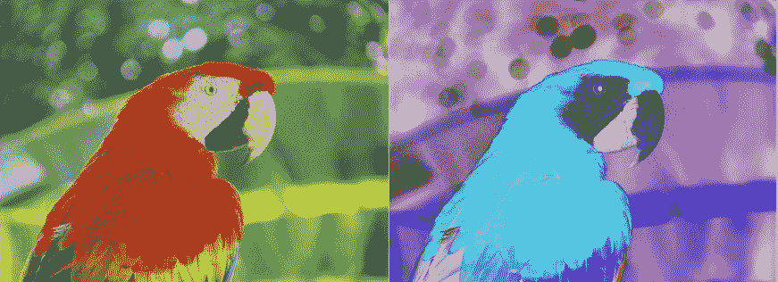

*Figure 2.3 – Original vs. the inverted image*

### 改变图像亮度和对比度

伽马校正是对图像像素值应用的非线性调整（我们将在下一章详细介绍）。它可用于调整图像的亮度。伽马值大于 1 会使图像变亮，而伽马值小于 1 会使图像变暗。以下代码片段演示了如何使用 `skimage.exposure.adjust_gamma()` 函数对输入图像应用伽马校正。在此情况下，`gamma=1.5` 表示提亮效果。

对比度拉伸是一种线性操作，可扩展图像中像素值的范围，从而有效提高对比度。`skimage.exposure.rescale_intensity()` 函数用于对比度拉伸。在下一个代码片段中，该函数的 `in_range()` 参数定义了将被拉伸的输入数据的下限和上限百分位。在此情况下，原数据 20% 到 80% 范围内的像素值将被拉伸以填满整个动态范围（0 到 1）：

```python
from skimage import exposure
im = imread('images/parrot.jpg')
im = im / im.max() # normalize to have values in range [0,1]
brightened_image = exposure.adjust_gamma(im, gamma=1.5)
contrast_stretched_image = exposure.rescale_intensity(im, \
                                in_range=(0.2, 0.8))
plot_images([im, brightened_image, contrast_stretched_image], \
            ['original', 'brightened', 'contrast stretched'])
```

如果运行前面的代码片段，你应该会得到如下图所示的图形：

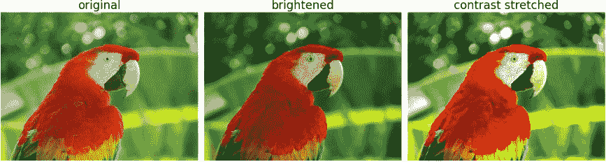

*Figure 2.4 – Stretching the contrast and brightness of the parrot image*

### 使用 warp() 函数进行逆向扭曲和几何变换

几何图像变换修改图像像素的空间排列，以执行诸如平移、旋转、缩放、剪切、仿射和投影变换等操作。这些操作广泛应用于图像配准、对齐、校正、透视校正、目标跟踪和全景拼接。在 scikit-image 中，`skimage.transform.warp()` 函数通过使用变换矩阵或变换函数将输出像素映射回输入图像中的对应位置来执行逆向扭曲。

`warp()` 函数接受几个重要参数：`image` 指定输入图像；`inverse_map` 将变换定义为可调用函数、变换对象（如 AffineTransform）或 3×3 齐次变换矩阵；`map_args` 将额外参数传递给变换函数；`output_shape` 控制变换后图像的大小；`order` 决定插值质量（例如最近邻、双线性或双三次插值）。

几何变换通常使用齐次坐标和变换矩阵表示。下表总结了主要的 2D 几何变换及其属性。

| Transform | #Params | Translation? | Rotation? | Scale? | Shear? | Preserve angles? | Preserve parallel? | Applications |
|---|---|---|---|---|---|---|---|---|
| Rigid | 3 | ☑ | ☑ | ✗ | ✗ | ☑ | ☑ | Object tracking, medical image registration |
| Similarity | 4 | ☑ | ☑ | ☑ (uniform) | ✗ | ☑ | ☑ | Face alignment and recognition, image stitching |
| Affine | 6 | ☑ | ☑ | ☑ (non-uniform) | ☑ | ✗ | ☑ | Image rectification, planar recognition |
| Projective | 8 | ☑ | ☑ | ☑ | ☑ | ✗ | ✗ | Panorama stitching, perspective correction |

Table 2.1: Geometric transformations at a glance

#### 对图像应用平移

scikit-image 库中的 `skimage.transform.warp()` 函数是一个多功能函数，可应用各种几何变换。该函数通过使用变换矩阵或函数将输入坐标映射到输出坐标来对图像执行变换。`warp()` 的基本操作可以表示为 \(I'(p') = I(T^{-1}(p'))\)。这里，\(I(p)\) 是坐标 \(p = (x, y)\) 处的原始图像，\(I'(p')\) 是新坐标 \(p' = (x', y')\) 处的变换后图像。

\(T^{-1}(p')\) 是所应用变换的逆，意味着对于输出图像中位置 \(p'\) 的每个像素，该函数通过应用逆变换 \(T^{-1}\) 计算原始图像中的对应坐标 \(p\)。

#### 图像平移

平移将图像中的每个像素沿 `x` 和 `y` 方向按恒定位移移动。数学上，平移可使用变换矩阵表示。

##### 平移的变换矩阵

平移操作由一个简单的 3x3 变换矩阵表示：

$$T = \begin{bmatrix}1 & 0 & t_x \\ 0 & 1 & t_y \\ 0 & 0 & 1\end{bmatrix}$$

这里，\(t_x\) 是水平平移（沿 \(x\) 轴的位移），\(t_y\) 是垂直平移（沿 \(y\) 轴的位移）。

对于原始图像中的点 \(p = (x, y)\)，平移后其新位置 \(p' = (x', y')\) 由下式给出：

$$\begin{bmatrix}x'\\y'\\1\end{bmatrix}=\begin{bmatrix}1 & 0 & t_x\\0 & 1 & t_y\\0 & 0 & 1\end{bmatrix}\begin{bmatrix}x\\y\\1\end{bmatrix}$$

这简化为 \(x' = x + t_x\)，\(y' = y + t_y\)。

因此，原始图像中 \((x, y)\) 处的每个像素移动到平移后图像中的 \((x + t_x,\ y + t_y)\)。

##### 逆变换

`warp()` 函数使用逆变换来计算输出图像中每个像素的原始坐标。它通过将每个输出像素映射回输入图像中的位置来工作，确保没有间隙或重叠——这一过程称为逆映射或后向扭曲。这种方法对于平移、旋转、缩放等几何变换至关重要，可实现无数据丢失的准确重建。

具体来说，逆映射确保对于每个输出像素 \((x, y)\)，该函数使用所应用变换矩阵的逆计算对应的输入像素 \((x', y') = (x - t_x,\ y - t_y)\)。

如果使用前向映射（直接变换）代替，输出像素可能无法正确填充（导致空洞），并且多个输入像素可能映射到同一个输出像素（导致重叠），从而需要复杂的插值和重采样。相比之下，逆映射确保每个输出像素都通过从输入图像中采样正确位置来分配值，通常使用插值（例如双线性或双三次）来处理非整数映射。下图解释了为什么使用后向（或逆向）扭曲来变换图像。


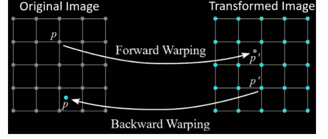

Figure 2.5 – Forward versus backward (inverse) warping

对于平移，如前所述，逆变换矩阵 T⁻¹ 如下：

```
T⁻¹ = [[1, 0, -tₓ], [0, 1, -tᵧ], [0, 0, 1]]
```

对于平移输出图像中所有可能的像素 (x, y)，对应的输入图像中的点 (u, v) 可以通过以下方程找到：

```
u = x - tₓ
v = y - tᵧ
```

这里，tₓ 和 tᵧ 分别表示沿 x 轴和 y 轴的平移（且 x(u, v) = x, y(u, v) = y）。请参考下一幅图中显示的原始坐标轴和变换后的坐标轴：

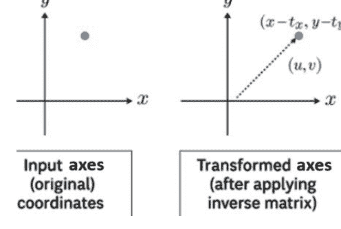

Figure 2.6 – Translation with inverse warping using warp()

下面的代码片段演示了自定义 translate() 函数如何将像素坐标修改为 x' = x - tₓ 和 y' = y - tᵧ，并且 warp() 使用 map_args={'t_x': -100, 't_y': 50} 将此映射应用于图像，从而导致图像向左移动 100 像素并向下移动 50 像素。参数 order=1 使用双线性

插值来平衡视觉质量和计算效率。沿 x 轴的正向平移使图像向右移动，而沿 y 轴的正向平移使其向下移动。

```
from skimage.transform import warp

def translate(xy, t_x, t_y):
    xy = xy.copy() # avoid modifying input in place
    xy[:, 0] -= t_x
    xy[:, 1] -= t_y
    return xy

im = imread('images/monalisa.jpg')
# create a dictionary for translation parameters (map_args)
im_trans = warp(im, translate, map_args={'t_x':-100, 't_y':50}, \
                    order=1)
```

## Applying rotation to an image with warp()

如果图像按角度 θ 逆时针旋转，对于旋转后输出图像中所有可能的像素 (x, y)，对应的输入图像中的点 (u, v) 可以通过以下方程找到：

u = x.cosθ − y.sinθ

v = x.sinθ + y.cosθ

正交几何变换是一种其矩阵 Q 的列（或行）为正交单位长度向量的变换，满足 QᵀQ = I，这意味着它保持距离、长度和角度不变；示例包括旋转（检查 R(θ)ᵀR(θ) = I）和反射变换，例如，关于 x−轴的反射由矩阵 R = [1 0; 0 −1] 表示。

### With the transformation function

以下代码块展示了如何使用 warp() 函数旋转图像，使用 rotate() 变换函数。使用 warp() 进行旋转是相对于输入图像的原点（左上角）进行的：

```
def rotate(xy, theta):
    theta = np.deg2rad(theta) # np.pi/180*theta # degree to radian
    x_new = xy[:, 0]*np.cos(theta) - xy[:,1]*np.sin(theta)
    y_new = xy[:, 0]*np.sin(theta) + xy[:,1]*np.cos(theta)
    xy[:, 0], xy[:, 1] = x_new, y_new
    return xy
# create a dictionary for rotation parameters, with angle theta in degrees
im_rot = warp(im, rotate, map_args={'theta':10})
```

**Note**

此示例围绕左上角（原点）旋转图像，这可能导致裁剪。为了避免这种情况，可以填充图像或通过调整坐标进行中心旋转（如下面的代码中 `rotate_centered()` 函数所示）。或者，你也可以使用 `skimage.transform.rotate()` 函数，该函数在内部处理中心旋转（关于图像中心旋转）和填充，以更好地保留图像内容：

```
```python
def rotate_centered(xy, theta, center):
    cx, cy = center
    theta = np.deg2rad(theta)
    # translate to origin
    xy[:, 0] -= cx
    xy[:, 1] -= cy
    # apply rotation
    x_new = xy[:, 0]*np.cos(theta) - xy[:,1]*np.sin(theta)
    y_new = xy[:, 0]*np.sin(theta) + xy[:,1]*np.cos(theta)
    xy[:, 0], xy[:, 1] = x_new, y_new
    # translate back
    xy[:, 0], xy[:, 1] = x_new + cx, y_new + cy
    return xy
# create a dictionary for rotation parameters
h, w = im.shape[:2]
cx, cy = w / 2, h / 2  # center coordinates
im_rot = warp(im, rotate_center, map_args={'theta': 10,
    'center': (cx, cy)})
```
```

### With the transformation matrix

现在，让我们使用齐次坐标中的对应变换矩阵，通过 `warp()` 函数应用相同的几何变换（旋转），使用以下代码片段。旋转在齐次坐标中可以用以下方程表示：

$$
\begin{bmatrix}u\\v\\1\end{bmatrix}=
\begin{bmatrix}
\cos\theta & -\sin\theta & 0\\
\sin\theta & \cos\theta & 0\\
0 & 0 & 1
\end{bmatrix}
\begin{bmatrix}x\\y\\1\end{bmatrix}
$$

这里，$(x, y)$ 是像素的输入坐标，$(u, v)$ 是变换后的坐标。现在，让我们使用旋转矩阵作为参数应用旋转到 `warp()` 函数，使用以下代码片段：

```
```python
θ = np.deg2rad(10) # np.pi * 10 / 180 # 10 degrees rotation in radian
# matrix in homogeneous coordinates
```
```

```
#rotation=np.deg2rad(45) \
    translation=(t_x, t_y)
im_sim = warp(im, tform.inverse)
plt.imsave('images/monalisa_sim.png', im_sim) # save the transformed image

# Get the transformation matrix
matrix_sim = tform.params
print(matrix_sim)
# [[  0.6363961  -0.6363961  164.      ]
#  [  0.6363961   0.6363961 -100.      ]
#  [  0.          0.          1.      ]]
```

从前面的变换矩阵可以看出，平移参数为 $t_x = 164$ 和 $t_y = -100$，而 $s.\cos\theta = 0.9 \times \cos\frac{\pi}{4} = 0.6363961.$

## Applying an affine transformation to an image

仿射变换是一种更一般的变换，包括缩放、旋转、平移、剪切和反射。它允许非均匀缩放、剪切和反射，以及相似变换的组成部分。仿射变换可以分解为四个基本变换：缩放、旋转、剪切和平移，因此它有六个参数：沿 $x$ 和 $y$ 轴的缩放因子、旋转角度、沿 $x$ 和 $y$ 轴的平移、以及剪切因子。相似变换是具有均匀缩放的仿射变换。

每个变换都可以表示为一个独立的矩阵：

- **Scaling matrix:**
  
  $S = \begin{bmatrix} s_x & 0 & 0 \\ 0 & s_y & 0 \\ 0 & 0 & 1 \end{bmatrix}$
  
  这里，$s_x$ 和 $s_y$ 分别控制沿 $x$ 和 $y$ 轴的缩放/拉伸。

- **Rotation matrix:**
  
  $R = \begin{bmatrix} \cos\theta & -\sin\theta & 0 \\ \sin\theta & \cos\theta & 0 \\ 0 & 0 & 1 \end{bmatrix}$
  
  这里，$\theta$ 是旋转角度（逆时针）。

- **Shear matrix:**
  
  $H = \begin{bmatrix} 1 & sh_x & 0 \\ sh_y & 1 & 0 \\ 0 & 0 & 1 \end{bmatrix}$

这里，$sh_x$ 和 $sh_y$ 引入剪切（水平和垂直倾斜）。

- **Translation matrix:**

```
$$T = \begin{bmatrix}1 & 0 & t_x \\ 0 & 1 & t_y \\ 0 & 0 & 1\end{bmatrix}$$
```

这里，$t_x$ 和 $t_y$ 将图像水平和垂直移动。

最终的变换是缩放、旋转、剪切和平移的组合：

```
$$T_A = T \cdot H \cdot R \cdot S$$
```

让我们展开它：

```
$$T_A = \begin{bmatrix}s_x \cos\theta + sh_y \sin\theta & -s_y \sin\theta + sh_x \cos\theta & t_x \\ s_x \sin\theta + sh_y \cos\theta & s_y \cos\theta + sh_y \sin\theta & t_y \\ 0 & 0 & 1\end{bmatrix} = \begin{bmatrix}a & b & t_x \\ c & d & t_y \\ 0 & 0 & 1\end{bmatrix}$$
```

这里，$a, b, c,$ 和 $d$ 表示参数（例如 $a = s_x \cos\theta + sh_x \sin\theta$）用于 $x$ 方向的缩放/旋转、$x$ 方向的剪切、$y$ 方向的剪切和 $y$ 方向的缩放/旋转。

现在让我们对上次应用相似变换得到的图像应用逆变换。注意，这次，我们将应用仿射变换（通过实例化 skimage.transform.AffineTransform 类的对象），使用先前变换矩阵的逆（使用 np.linalg.inv() 函数计算），使用接下来的几行代码：

```
im_tformed = imread('images/monalisa_sim.png')
tform = AffineTransform(np.linalg.inv(matrix_sim))
im_recon_affine = warp(im_tformed, tform.inverse)
matrix_affine = tform.params

print(matrix_affine)
# [[  0.7856742   0.7856742 -50.28314888]
#  [ -0.7856742   0.7856742 207.41798915]
#  [  0.          0.          1.        ]]
```

# Note

通常，在处理任意变换矩阵时，使用 np.linalg.pinv() 来处理潜在的奇异性会更安全。然而，由于 SimilarityTransform 在典型使用中保证有效的仿射矩阵，我们在这里直接使用 np.linalg.inv()。


现在让我们绘制原始图像、应用 `SimilarityTransform` 后得到的图像，以及使用逆变换矩阵应用 `AffineTransform` 后得到的图像。从下图中可以看出，除了裁剪区域（边界外部）之外，原始图像被重建，正如预期的那样：

```python
plot_images([im, im_tformed, im_recon_affine],\
            ['original', 'transformed with SimilarityTransform',\
             'reconstructed with AffineTransform'],\
            'Applying geometric transformations to an image',\
            fontsize=15, figsize=(15,5))
```

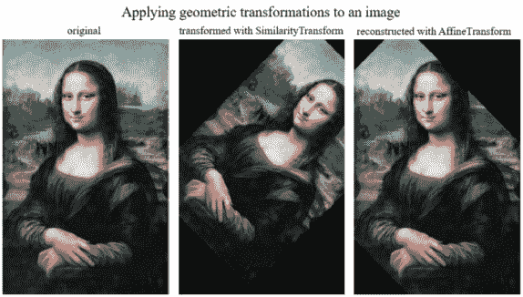

*图2.7 – 使用 scikit-image 通过仿射变换重建图像*

## 应用漩涡变换

漩涡变换是一种非线性图像变换，会给图像带来旋转或扭曲的效果。这种变换的特点是围绕指定中心旋转像素，从而产生类似漩涡的图案。漩涡的程度取决于旋转中心和扭曲强度等参数。这种非线性变换由文档定义如下：

考虑输出图像中的坐标 $(x, y)$。漩涡变换的反向映射首先相对于中心 $(x_0, y_0)$ 计算其极坐标 $\rho, \theta$，然后根据以下公式进行变换：

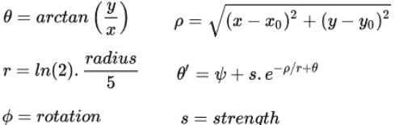

*图2.8 – 漩涡变换的公式*

此处，*强度* 是表示漩涡程度的参数，*半径* 表示漩涡的像素范围，*旋转* 增加一个旋转角度。将 *半径* 变换为 *r* 是为了确保变换在指定半径内衰减到约 1/1000<sup>th</sup>。这里，我们将使用 `skimage.transform` 模块中的 `swirl()` 函数。

```python
from skimage.transform import swirl

im_swirled = swirl(im, rotation=0, strength=5, radius=300)

plot_images([im_trans, im_rot, im_rot_center, im_sim, im_swirled], 
    ['translation', 'rotation', 'rotation (centered)', 'similarity transform', 'swirl transform'],
    'geometric transformation with warp()', figsize=(15,5))
```

运行上述代码片段应得到如下图所示的输出：

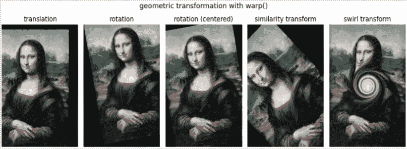

*图2.9 – 使用 scikit-image 的 warp() 进行几何变换*

## 应用分段仿射变换

分段仿射变换将图像划分为较小的区域，并对每个区域应用独立的仿射变换，从而实现灵活的局部扭曲。使用 `skimage.transform` 中的 `PiecewiseAffineTransform` 和 `warp()`，可以从在规则网格上使用 `np.linspace()` 生成的相应源控制点和目标控制点来估计变换，`np.linspace()` 在图像的行和列上创建均匀分布的坐标值。在示例中，通过使用余弦函数修改行坐标来引入正弦波失真，产生波浪状变形，同时保持列坐标不变。使用 `tform.estimate(src, dst)` 估计变换，并使用 `warp(im, tform, output_shape=...)` 应用变换以生成扭曲后的图像。

```python
rows, cols = im.shape[0], im.shape[1]

src_cols = np.linspace(0, cols, 20)
src_rows = np.linspace(0, rows, 10)
src_rows, src_cols = np.meshgrid(src_rows, src_cols)
src = np.dstack([src_cols.flat, src_rows.flat])[0]
```

```
# add sinusoidal oscillation to row coordinates
dst_rows = src[:,1] - np.cos(np.linspace(0, 3*np.pi, src.shape[0]))*50
dst_cols = src[:, 0]
dst_rows *= 1.5
dst_rows -= 1.5 * 50
dst = np.vstack([dst_cols, dst_rows]).T
# assert src.shape == dst.shape, "Source and destination points must have the same shape"
# assert src.shape[0] >= 3, "At least 3 control points are required to estimate the transform"

# Estimate the transformation using PiecewiseAffineTransform
tform = PiecewiseAffineTransform()
ret_val = tform.estimate(src, dst)
# if not ret_val:
# raise ValueError("Estimation failed. Ensure points are valid")

out_rows = im.shape[0] - 1.5 * 50
out_cols = cols

# Apply the transformation to warp the image
out = warp(im, tform, output_shape=(out_rows, out_cols))

plt.imshow(out), plt.axis('off'), plt.title('warped', size=15)
```

运行上述代码片段应得到如下图所示的输出：

扭曲后

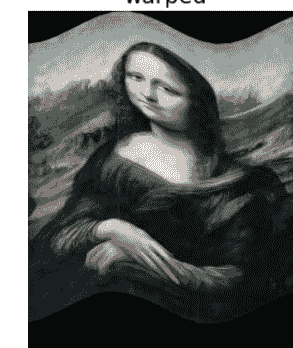

图2.10 – 使用 scikit-image 应用分段仿射变换

## 向图像添加随机高斯噪声

随机高斯噪声是一种遵循正态（高斯）分布的统计噪声，通常添加到图像中以模拟真实世界的噪声。

它的特征由**概率密度函数（PDF）** *f* 给出，如下所示：

$$f(x)=\frac{1}{\sigma\sqrt{2\pi}}e^{-\frac{(x-\mu)^2}{2\sigma^2}}$$

这里，我们有以下内容：

- $x$ 是噪声值
- $\mu$（均值）控制平均亮度偏移
- $\sigma$（标准差）控制噪声的分布范围；$\sigma^2$ 是方差

对于在位置 $(x,y)$ 处像素值为 $I(x,y)$ 的图像，高斯噪声 $N(x,y)\in\mathbb{R}$ 按如下方式添加：

$$I_{noisy}(x,y)=I(x,y)+N(x,y),$$

其中 $I_{noisy}(x,y)$ 是添加噪声后的像素强度，$N(x,y)\sim\mathcal{N}(\mu,\sigma^2)$ 是为每个像素独立采样的高斯噪声。

以下是高斯噪声的影响：

- 低 $\sigma$：噪声微弱，几乎不可见
- 高 $\sigma$：噪声强烈，降低图像质量
- 均值 $\mu\ne 0$：引入图像亮度偏移

我们可以使用 `skimage.util` 模块中的 `random_noise()` 函数向图像添加不同类型的噪声（由 `mode` 输入参数指定）。对于 `mode='gaussian'`（默认模式），均值参数指定均值（$\mu$，默认 0），`var` 指定用于生成噪声的高斯分布的方差（$\sigma^2$）。噪声从 $\mathcal{N}(0,\sigma^2)$ 中抽取，如下所示：

- `var=0.01` $\Rightarrow$ $\sigma=0.1$

> **读者注意**
> 
> 在图像扭曲任务中使用像 `estimate()` 和 `PiecewiseAffineTransform` 这样的变换函数时，有一些重要的注意事项需要了解：
> 
> - `estimate()` 函数不会对无效输入（例如点数组不匹配或控制点少于三个）抛出错误。相反，它会静默失败并返回 `False`，这可能导致 `warp()` 产生意外或未改变的输出。始终检查 `estimate()` 的返回值，并确保提供至少三对非共线点，这是有效局部仿射变换所必需的。
> - 虽然正弦波失真凸显了 `PiecewiseAffineTransform` 的灵活性，但它可能会在三角形边界处引入可见的伪影。这些伪影是由于相邻三角形中局部估计的仿射变换之间的不连续性造成的，并且是这种分段近似方法的一个已知局限性。

- var=0.25 ⇒ σ = 0.5
- 默认情况：var=0.01（即 σ = 0.1）

接下来的代码片段展示了如何向图像添加具有不同方差的（默认）高斯噪声：

```python
from skimage.util import random_noise
from skimage import img_as_float

im = img_as_float(imread("images/parrot.png"))
sigmas = [0.1, 0.25, 0.5, 1]
images, titles = [], []
for i in range(4):
    noisy = random_noise(im, var=sigmas[i]**2)
    images.append(noisy)
    titles.append('Gaussian noise with sigma=' + str(sigmas[i]))
plot_images(images, titles, fontsize=12, figsize=(15,10))
```

运行上述代码片段应得到如下图所示的输出：

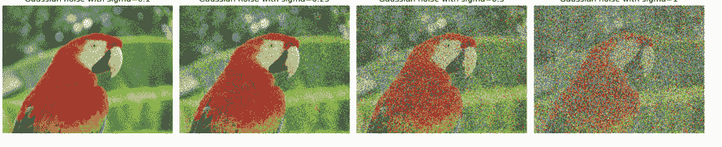

图2.11 – 向图像添加不同级别的随机正态噪声

## 注意

random_noise() 函数期望输入为 2D 灰度图像（H×W）或 3D 彩色图像（H×W×3）。如果灰度图像被错误地表示为 (H, W, 3)，噪声将独立应用于每个通道，这可能与预期行为不符。

random_noise() 中的 mode 参数指定要添加到输入图像的噪声类型。它决定了所使用的噪声模型。以下是几种可用模式的简要概述（gaussian 是默认模式）：

| 模式 | 描述 |
|------|-------------|
| 'gaussian' | 添加具有零均值和指定方差（var）的高斯噪声 |
| 'poisson' | 根据图像值添加泊松噪声，适用于基于计数的数据 |


| 模式 | 描述 |
|---|---|
| `'s&p'` | 添加椒盐噪声——随机像素设为 0 或 1 |
| `'speckle'` | 添加乘性高斯噪声：输出 = 图像 + 图像 * 噪声 |

如果修改 `mode` 参数以向图像添加其他类型的噪声，并显示带噪图像以及噪声直方图（通过计算 `noisy-im` 提取所添加的噪声），你应当得到如下所示的图形。现在，你可以直观地比较不同噪声模型对图像的影响（留作练习）。这一次，使用灰度 π-day 图像来添加随机噪声，并在使用 `skimage.io.imread()` 读取图像时使用 `as_gray=True` 参数。

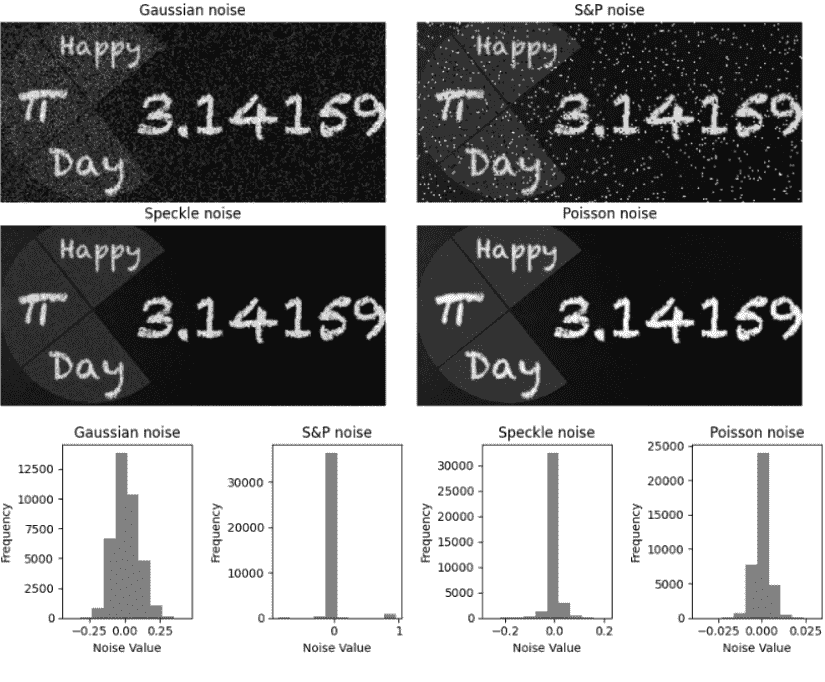

## 计算图像的累积分布函数

对于随机变量 $X$，**累积分布函数（CDF）** $F_X(x)$ 定义如下：

$$F_X(x) = P(X \leq x)$$

这里，我们有如下内容：

- P 表示概率
- X 是随机变量
- x 是 X 可以取的具体值

以下是 CDF 的性质：

- **非递减：** CDF 始终是非递减的。当 x 向更高值移动时，X 小于或等于 x 的概率不会降低。
- **右连续：** CDF 是右连续的，即对于任何 x 值，函数从右侧趋近于 F_X(x)。
- **极限：** 当 x → −∞ 时，F_X(x) → 0；当 x → ∞ 时，F_X(x) → 1。
- **范围：** CDF 的取值范围为 0 到 1。
- CDF 用于多种用途，包括概率计算、分位数确定和分布特征描述。
- CDF 在**直方图均衡化**中起着关键作用（我们将在后续的图像增强章节中探讨），其中 CDF 用于重新映射图像强度，以获得更均匀的直方图并增强图像的对比度。

对于给定的 RGB 图像，我们可以使用 skimage.exposure 模块中的 cumulative_distribution() 函数分别计算每个颜色通道的 CDF，如下面的代码所示。

这段代码绘制了 R、G、B 三个通道各自的累积分布。它使用 LaTeX 来获得更美观的文本渲染（matplotlib.rcParams['text.usetex'] = True），并清晰标注了 CDF 曲线。label 参数为每条绘图曲线指定名称，legend() 则将这些标签显示在图上以标识曲线：

```
import matplotlib
im = imread("images/parrot.png")
cdf_r = exposure.cumulative_distribution(im[:,:,0]) # cdf for red channel
cdf_g = exposure.cumulative_distribution(im[:,:,1]) # cdf for green channel
cdf_b = exposure.cumulative_distribution(im[:,:,2]) # cdf for blue channel
matplotlib.rcParams['text.usetex'] = True
plt.figure(figsize=(6,5))
plt.plot(cdf_r[1], cdf_r[0], 'r.-', label= 'red')
plt.plot(cdf_g[1], cdf_g[0], 'g.-', label= 'green')
plt.plot(cdf_b[1], cdf_b[0], 'b.-', label= 'blue')
plt.xlabel('pixel value (x)', size=15)
plt.ylabel(r'cumulate probability P(X $\le$ x)', size=15)
plt.grid()
plt.legend()
plt.show()
```

运行上述代码片段，应得到如下图所示的输出：

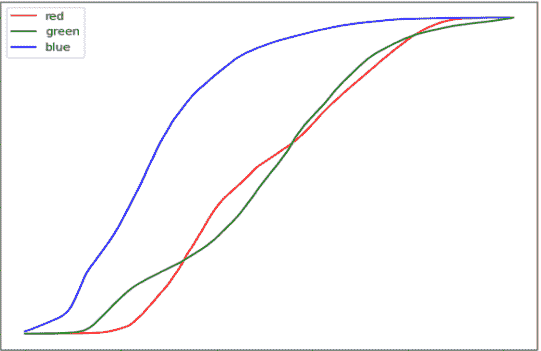

*图 2.13 – 计算鹦鹉图像的 RGB 颜色通道的 CDF*

## 调整图像大小/缩放图像

在 `skimage.transform` 中，图像的调整大小和缩放通过 `resize()` 和 `rescale()` 函数实现，它们使用插值（默认双三次）来估计变换后图像中的像素值。`rescale()` 使用缩放因子改变图像大小，而 `resize()` 直接指定输出尺寸。在下采样过程中，启用 `anti_aliasing=True` 会应用高斯平滑，以减少由高频细节采样不足引起的混叠伪影，如锯齿边缘和莫尔条纹。`downscale_local_mean()` 函数通过对非重叠块进行局部平均来实现下采样，生成更平滑的低分辨率图像，并最大程度地减少混叠效应，如下一个代码片段所示。

```python
from skimage.transform import rescale, resize, downscale_local_mean

image = color.rgb2gray(imread('images/model.png')[...,:3])
image = image / image.max()

image_rescaled = rescale(image, 0.25, anti_aliasing=True)
image_resized = resize(image, \
                       (image.shape[0] // 4, image.shape[1] // 4), \
                       anti_aliasing=True)
# assumption: image dimensions are divisible by blocksize (4,3) for
# downscale_local_mean() without padding
image_downscaled = downscale_local_mean(image, (4, 3))

print(image.shape, image_rescaled.shape, image_resized.shape, \
image_downscaled.shape)
# (320, 180, 4) (80, 45, 4) (80, 45, 4) (80, 60, 4)
plt.imshow(np.hstack((image_rescaled, image_resized, image_downscaled)))
plt.title('rescaled (aliasing), resized (no aliasing), and'
          'downscaled images', size=20)
```

运行上述代码片段，应得到如下图所示的输出：

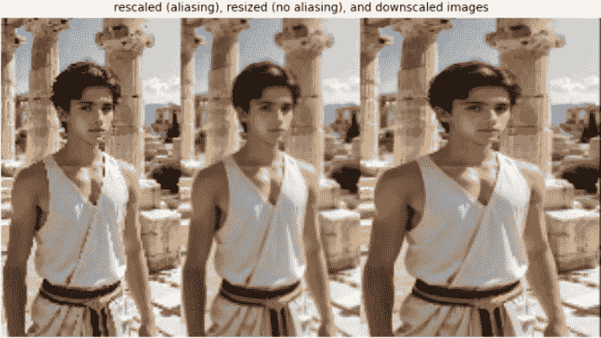

*图 2.14 -- 有/无抗混叠的下采样/调整图像大小*

### 注意

块大小 `(4, 3)` 假定输入图像的尺寸分别可被 4 和 3 整除。

如果该条件不满足，`downscale_local_mean()` 会对图像进行填充（使用 `cval=0`，即默认零值），这会引入黑色边框。如果需要更广泛的兼容性，你可以手动填充图像或相应地调整块大小。

## 裁剪图像

正如我们之前看到的，裁剪图像是指从图像中移除不需要的部分或区域、仅保留所需部分的过程。具体做法是在原始图像中选择一个特定的矩形或非矩形区域，并丢弃其余部分。

`skimage.util.crop()` 函数允许沿不同维度进行选择性裁剪，而 `copy=False` 参数确保裁剪区域是原始图像的一个视图，而不会创建副本，如下一个代码片段所示。

函数的第一个参数是输入图像（此处为 RGB 彩色蒙娜丽莎图像）。

裁剪由第二个参数 `((50,100),(50,50),(0,0))` 定义，它表示每个维度的裁剪参数。`crop_width`（应为整数元组序列）表示从每个轴边缘移除的像素数量。`((before_1, after_1), ... (before_N, after_N))` 指定每个轴起始和结束处的唯一裁剪宽度。`((before, after), ...)` 指定每个轴的固定起始和结束裁剪。注意，颜色通道不应被裁剪，这就是为什么图像数组中最后一个轴的裁剪宽度是 `(0,0)`。

在此示例中，裁剪坐标被特意选为蒙娜丽莎的眼睛区域，用以说明定向裁剪如何从图像中提取感兴趣区域：

```
from skimage.util import crop

im = imread('images/monalisa.jpg')
im_cropped = crop(im, ((250, 975), (280, 350), (0,0)), copy=False)
print(im.shape, im_cropped.shape)
# (1280, 846, 3) (30, 171, 3)
plot_images([im, im_cropped], ['original', 'cropped'], figsize=(6,5))
```

如果运行上述代码片段，你应该会得到如下图所示的图形：

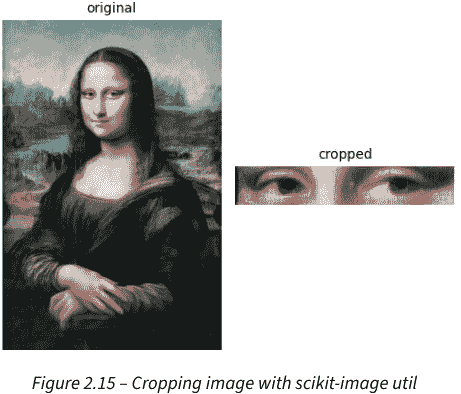

*图 2.15 – 使用 scikit-image 工具裁剪图像*

## 使用 PIL 进行图像处理

**Python 图像库（PIL）** 是 Python 中用于图像处理的原始库；**Pillow** 是 PIL 的一个分支，旨在为更新的 Python 版本维护和扩展其功能。Pillow 保留了 PIL 的核心功能，同时增加了兼容性改进、错误修复和性能增强，使其成为当今 Python 图像处理的首选。在本书中，我们将该库称为 PIL，尽管实际上由于兼容性和支持，底层运行的是 Pillow。

PIL 提供了不少图像处理函数，例如使用点变换来更改像素值，或对图像应用几何变换。接下来的几节将介绍如何使用 PIL 执行不同类型的图像处理。


## 裁剪图像

裁剪图像是指在原始图像内定义一块较小的矩形区域，并从该区域提取像素值以创建新图像。裁剪后的图像，\(I_{crop}\ (W_c \times H_c)\)，可以通过从原始图像 \(I_{W\times H}\) 中选取从左上角 \((x_1,y_1)\) 到右下角 \((x_2,y_2)\) 的像素来创建，其数学定义如下：

$$I_{crop}(i,j)=I(x_1+i,y_1+j),\ \forall(0\leq i\leq W_c\land 0\leq j\leq H_c)$$

其中 \(W_c=x_2-x_1\) 且 \(H_c=y_2-y_1\)

我们可以使用 `crop()` 方法，将所需的矩形坐标 *(left, top, right, bottom)* 作为参数传递给函数，从而提取由矩形坐标定义的所需区域作为新的图像对象，如下列代码所示：

```python
im = Image.open("images/parrot.png")
im_c = im.crop((175,75,320,200))
im_c.save("images/parrot_cropped.jpg")
im_c.show()
```

下图显示了使用上述代码保存为 JPG 格式的图像：

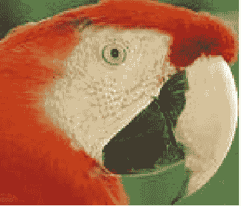

*图 2.16 – 使用 PIL 进行裁剪*

## 调整图像大小

为了增加或减少图像的尺寸，我们可以使用 `resize()` 函数，该函数内部会分别对图像进行上采样或下采样。

### 将图像放大

当将图像放大到更大的尺寸时，插值对于估算原始像素之间的像素值至关重要，以避免出现块状、像素化的外观。如果没有插值，每个原始像素都会被简单地复制，从而产生图像质量差且带有明显像素化的效果。

考虑以下示例，如下一张图所示，一个 2 × 2 的输入图像将被放大为 3 × 3 的输出图像。请注意，目标图像中有五个像素是未知的，需要使用插值方法（例如，最近邻算法）来计算。

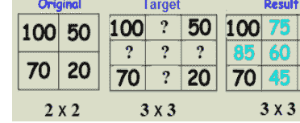

*图 2.17 – 通过上采样/插值放大图像*

下一个代码片段演示了如何使用 `resize()` 函数将一张小的砖块图像（大小为 150 × 100）的宽度和高度都放大 5 倍，从而得到输出图像的尺寸是输入图像的 25 倍，这里使用的是双线性插值（一种上采样技术）。

`Image.BILINEAR` 参数被用作 `resize()` 函数的重采样滤波器。它通过平均相邻像素来为放大图像提供更平滑的结果。其工作原理的细节将在第 3 章中描述。一个新的空白 RGB 图像 `im_concat` 被创建，其宽度为放大后图像宽度的两倍，高度与放大后图像相同。原始图像 `im` 被粘贴在 (0,0) 位置，放大后的图像 `im_large` 被放置在其旁边，位于 (im_large.width, 0) 位置。最后，拼接后的图像使用默认查看器显示：

```python
im = Image.open("images/bricks_small.jpeg")
print(im.width, im.height)
# 150 100
im.resize((im.width*5, im.height*5), Image.BILINEAR) \
    .save('images/bricks_large.jpeg')

im_large = Image.open("images/bricks_large.jpeg")
print(im_large.width, im_large.height)
# 750 500
im_concat = Image.new('RGB', (2*im_large.width, im_large.height))
im_concat.paste(im, (0,0))
im_concat.paste(im_large, (im_large.width,0))
im_concat.show()
```

如果你运行上述代码片段，你应会得到类似下图的输出，其中小的输入图像和大的调整大小后的图像并排放置：

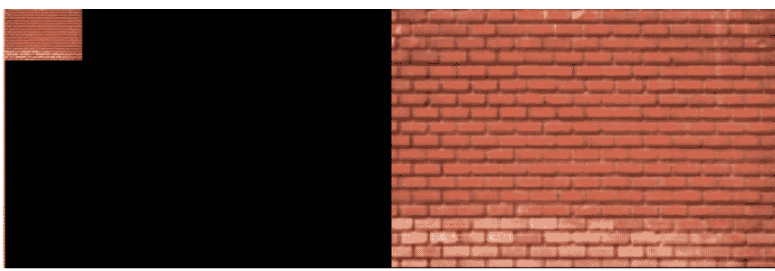

*图 2.18 – 使用 PIL 进行上采样（放大图像）*

### 将图像缩小

下采样通过减少像素数量来减小图像的尺寸，在更小的空间内表示视觉信息。它通常用于节省存储空间、减少带宽以及创建缩略图。这个过程会将多个像素合并为一个像素，这可能导致锯齿边缘、摩尔纹和细节丢失——这被称为混叠。抗锯齿是一种用于在缩小图像尺寸时防止失真或混叠的技术。

现在，让我们执行上一个示例中的反向操作——即，从一张维多利亚纪念堂的大图像（尺寸为 720 × 540）开始，创建一张较小的图像。

下一个代码片段展示了如何使用 `resize()` 函数将高度和宽度都缩小 5 倍，使其尺寸变为输入图像的 1/25 倍，这里使用 `Image.Resampling.LANCZOS` 滤波器实现抗锯齿。（请注意，用于抗锯齿的 `Image.ANTIALIAS` 滤波器已从 PIL 10.0.0 版本开始移除。）其工作原理的细节将在第 3 章中描述：

```python
im = Image.open("images/victoria_memorial.png")
im.resize((im.width//5, im.height//5), \
    Image.Resampling.LANCZOS).save('images/victoria_memorial_small.png')
im_small = Image.open("images/victoria_memorial_small.png")
im_concat = Image.new('RGB', (2*im.width, im.height))
im_concat.paste(im, (0,0))
im_concat.paste(im_small, (im.width,0))
im_concat.show()
```

如果你运行上述代码片段，你应会得到类似下图的输出，其中大的输入图像和小的调整大小后的图像并排放置：

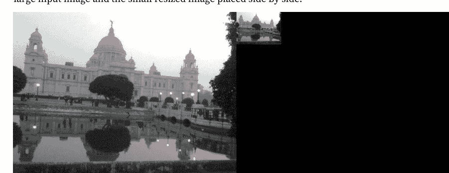

*图 2.19 – 使用 PIL 进行下采样（缩小）图像*

### 注意事项

在调整图像大小时，如果你希望避免图像变形，保持纵横比（宽高比）非常重要。你可以通过只指定一个维度（例如宽度或高度）并相应地计算另一个维度来保持纵横比。虽然按相同因子缩放两个维度不存在此问题，但最好提醒你注意一般情况。

为了在调整大小过程中自动保持纵横比，一种常见的方法是对应的计算第二个维度，就像 `resize_preserve_aspect_ratio()` 函数所做的那样：

```python
def resize_preserve_aspect_ratio(im, target_width, resample=Image.BILINEAR):
    """
    resize an image to a given width while preserving the aspect ratio.
    """
    aspect_ratio = im.height / im.width
    target_height = int(target_width * aspect_ratio)
    return im.resize((target_width, target_height), resample)

# usage:
im_resized = resize_preserve_aspect_ratio(im, target_width=300)
```

## 像素化图像

像素化的过程是：首先选择要像素化的图像区域，然后将其划分为固定大小的像素块，将每个块中的所有像素替换为一个代表性值（通常是平均颜色），最后重建图像，使精细的细节被粗糙的块状结构所取代。我们可以降低图像的分辨率，然后将其缩放回原始大小以创建像素化效果；这在下一个代码片段中通过 `pixelate()` 函数实现。其工作方式如下：

- 下采样：使用双线性插值（`Image.BILINEAR`）将图像调整为较小的版本，在保持一定平滑度的同时减少细节。
- 上采样：使用最近邻插值（`Image.NEAREST`）将小图像缩放回原始大小，这会放大每个像素块，从而产生块状、像素化的外观。

参见下一个代码片段：

```python
def pixelate(im, factor):
    # Resize down smoothly
    im_small = im.resize((im.width//factor, im.height//factor), \
                          resample=Image.BILINEAR)
    # Scale back up using NEAREST to original size
    return im_small.resize(im.size, Image.NEAREST)

im = Image.open("images/parrot.png")
plt.figure(figsize=(15,6))
plt.imshow(np.hstack([np.array(im)] + \
                    [np.array(pixelate(im, factor)) for factor in [16,32]]))
```

如果你运行上述代码片段，你应会得到类似下图的结果：

通过将下采样因子设为 16 和 32 进行像素化

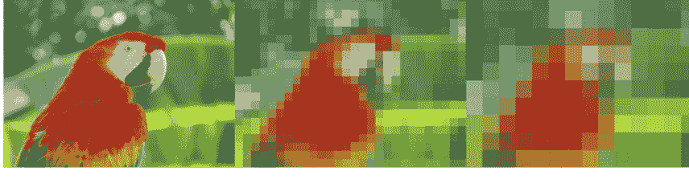

*图 2.20 – 使用 PIL 实现像素化效果*

## 面部匿名化处理

现在，让我们将像素化应用于图像的一部分，例如，输入的蒙娜丽莎图像中我们想要隐藏细节的面部区域。像素化效果可以使用 NumPy 切片应用于感兴趣区域（ROI）。


下一段 Python 代码通过将蒙娜丽莎图像的指定矩形区域替换为来自像素化版本（使用 `pixelate()` 函数获得）的对应区域，从而对该区域进行像素化处理，同时保留图像的其余部分。这对于**隐私保护**（例如模糊人脸或敏感信息）、媒体中的**匿名化**、艺术编辑中的**焦点效果**以及计算机视觉任务（如人脸识别混淆）的**数据预处理**非常有用：

```
im = Image.open("images/monalisa.jpg")
im_p = pixelate(im, 12)
x, y, h, w = 120, 120, 90, 115 #105, 105, 55, 45  # specify rect region
out = np.array(im)
out[x:x+h, y:y+w] = np.array(im_p)[y:y+h, x:x+w]
plt.imshow(np.hstack((np.array(im), out))), plt.axis('off')
```

如果你运行上述代码片段，应该得到如下图所示。

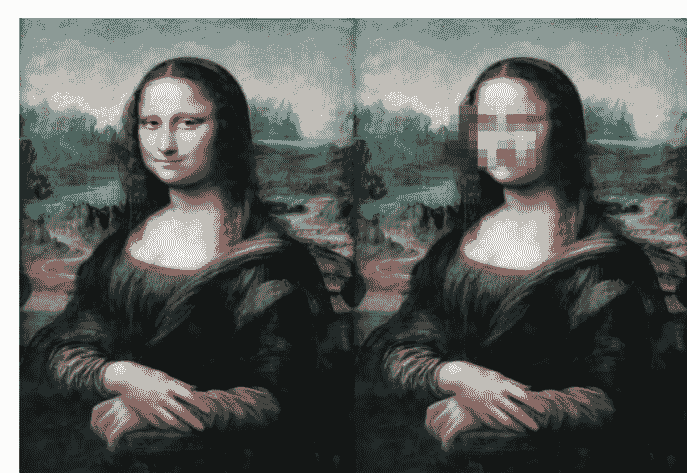

图 2.21 – 通过像素化对人脸进行匿名化

## 应用点变换

如前所述，图像处理中的点变换指的是对每个像素的强度（或颜色）进行单独修改的操作，而不考虑该像素的邻域。该变换由一个数学函数定义，应用于输入图像的每个像素值，以生成输出图像中的新值。点变换的一般形式可写成：

$I_{output}(x,y) = T\left(I_{input}(x,y)\right)$ 或者简写为 $s = T(r)$

这里：

- $r(x, y) = I_{input}(x, y)$ 是输入图像中位置 $(x, y)$ 处像素的强度
- $T(.)$ 是应用于像素的变换（传递）函数
- $s(x, y) = I_{output}(x, y)$ 是输出图像中位置 $(x, y)$ 处像素的最终强度

在这里，我们使用 `Image.point()` 方法探索几种变换，这些变换将传递函数应用于输入图像中的每个像素值，以获得输出图像的对应像素值。每个像素的值介于 0 到 255 之间（含端点）。

### 对数变换

对数变换是一种非线性点运算，用于压缩图像的动态范围，同时增强较暗区域的细节。其定义如下：

$I_{output}(x, y) = c \cdot \log\left(1 + I_{input}(x, y)\right)$

其中，c 是缩放常数。

下一行代码使用 `point()` 方法将一个 lambda 变换独立地应用于每个像素强度 x。像素值首先使用 x/255 归一化到 [0,1] 范围，并通过 log(1 + x/255) 进行变换以避免未定义的 log(0)，最后重新缩放到 0-255 范围。此操作会使暗像素变亮、压缩高亮度，并降低图像的整体强度范围。

```
im_g.point(lambda x: 255*np.log(1+x/255)).show()
```

### 幂律变换

图像的幂律变换在数学上可以描述如下：

$s = c \cdot r^{\gamma}$

这里：

- $r$ 是输入像素强度（归一化到 0 和 1 之间）
- $s$ 是变换后的输出像素强度
- $c$ 是一个常量，通常用于归一化结果，常设为 1（为简单起见）或 255（如果图像是 8 位深度）

让我们看一下解释：

- $\gamma$ 是伽马值，控制变换的程度
- 如果 $\gamma < 1$，变换会增强图像较暗区域的对比度（使图像变亮）
- 如果 $\gamma > 1$，变换会降低图像较暗区域的对比度（使图像变暗）
- 如果 $\gamma = 1$，图像保持不变

`point()` 方法将此变换独立地应用于每个像素强度，如下一行代码所示，其中 γ = 0.6：

```
im_g.point(lambda x: 255*(x/255)**0.6).show()
```

下图显示了通过运行上述代码行，从灰度图像生成的对数变换和幂律变换输出图像（使用 `matplotlib.subplot()` 将它们放在一起）：

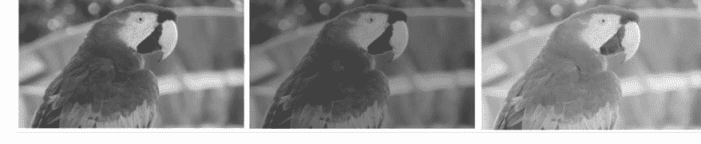

图 2.22 – 使用 PIL 点变换应用灰度级传递函数

### 多通道图像上的点变换

对于彩色图像，点变换函数需要分别且独立地应用于每个颜色通道。我们也可以使用 `point()` 函数对 RGB 图像的每个像素（在所有波段中）应用任意变换，如下一个代码片段所示。让我们深入理解这段代码：

- `point()` 方法的第一次应用将非线性变换 s = r·tan(r) 应用于图像中的每个像素值 r。它会在所有 RGB 通道中产生高度失真的强度值，导致不自然且混乱的颜色偏移。
- 第二次应用将二值阈值函数分别应用于每个通道。它将 RGB 输入图像转换为色调分离的高对比度版本，其中每个颜色通道要么全开（255），要么全关（0），根据指定阈值创建原始颜色的鲜明表现。
- 对于下一个变换，首先使用 `convert('L')` 将图像转换为灰度图。然后，使用 `np.roll()` 将 [0, 1, 2, ..., 255] 数组的值向右移动 115 个位置，生成一个查找表（LUT）。接着，将 `.point()` 方法应用于此 LUT 以重新映射灰度值。这会创建一个循环移位的灰度图像。像素强度被移位，使得较暗区域可能变亮，较亮区域可能变暗。就好像强度值被“回绕”一样，改变了视觉外观。
- 最后一个点变换使用 `ImagingCore.point_transform()` 方法，该方法对输入图像中的每个像素 r 应用线性变换，其形式可表示为 s = a × r + b，以获得输出像素 s，其中参数 scale a 和 offset b 分别为缩放比例和偏移量。这里，首先使用 `copy()` 方法复制图像，并使用 `.convert('F')` 方法将其模式更改为浮点模式。然后应用 `point_transform()` 方法，将像素值按因子 3 线性缩放，再偏移 -100。这导致图像显著变亮，因为每个像素都被放大并偏移了常量值。

现在，请参考下面的代码片段：

```
from PIL import Image
import numpy as np
import matplotlib.pyplot as plt

im = Image.open('images/parrot.jpg')
im1 = im.point(lambda x: x*np.tan(x))
im2 = im.point(lambda x: 255 if x > 128 else 0)
im3 = im.convert('L').point(np.roll(np.arange(256), 115))
im4 = im.copy()
im4.im = im4.convert('F').getdata().point_transform(3,-100)
im4 = im4.convert('L').convert('RGB')

plt.imshow(np.hstack((im1, im2, im3.convert('RGB'), im4)), plt.axis('off')
plt.title('point transforms with PIL Image and ImagingCore', size=15)
```

如果你运行上述代码片段，应得到如下图所示的输出：

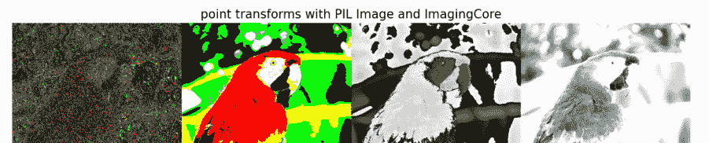

图 2.23 – 使用 PIL 对彩色图像进行点变换

### 反转/取反图像

反转或取反图像涉及颠倒像素的颜色——将亮区域变暗，反之亦然。反转通常通过从最大强度值（例如 255）中减去像素值来执行。

对于任意灰度图像 I，其像素值范围在 [0, L] 内（其中 L 是最大强度值，对于 8 位图像通常为 256），反转后的图像定义为：

I_inverted(x, y) = (L − 1) − I(x, y), ∀ 像素位置 (x, y)

要反转彩色图像，需要分别独立地反转每个颜色通道。让我们在下一个代码片段中演示如何使用 `Image.point()` 函数实现反转操作：

```
im = Image.open("images/pepper.webp")
im_t = im.point(lambda x: 255 - x)
#im_t.show()
```


The above code additionally uses the method invert() from PIL.ImageOps to invert the input image, and the method Image.effect_spread() to randomly spread pixels in the input image. The function effect_spread() accepts a distance parameter, which is the distance to spread pixels.

If you run the preceding code snippet, you should obtain a figure like the next one:

The original, inverted, solarized, posterized, and effect_spread images with PIL

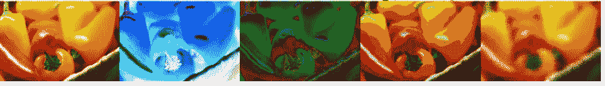

Figure 2.24 – Applying visual effects on an image with PIL

## A few geometric transformations

Let’s now implement a few geometric transformations (change the geometric orientation of an image) with PIL.

### Reflecting an image

We can use the transpose() function to reflect an image with respect to the horizontal or the vertical axis (you can use the mirror() function from the PIL.ImageOps module, too):

```
im.transpose(Image.FLIP_LEFT_RIGHT).show() # reflect about the vertical axis
```

### Rotating an image

We can use the rotate() function to rotate an image by an angle (in degrees):

```
im_45 = im.rotate(45) # rotate the image by 45 degrees
im_45.show() # show the rotated image
```

The next figure shows the rotated output images produced by applying reflection and rotation by running the preceding lines of code:

input
reflected
rotated

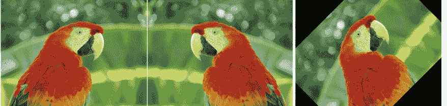

Figure 2.25 – Geometric transformation with PIL

## Applying affine transformation

The following figure shows the 2D affine transformation matrix T to be applied on each pixel of an image (in homogeneous coordinates) to undergo an affine transformation. Different values of the constants in T change the transformation to rotation, translation, scaling, shearing, and so on affine transformations or a combination of some/all of them.

### Image transformations

A 2D affine transformation

```
T = [ a b c ; d e f ; 0 0 1 ]    T [ x ; y ; 1 ] = [ a b c ; d e f ; 0 0 1 ] [ x ; y ; 1 ] = [ ax + by + c ; dx + ey + f ; 1 ]
```

### Translation

### Scale

### Rotation

```
[ 1 0 s ; 0 1 t ; 0 0 1 ]   [ s 0 0 ; 0 s 0 ; 0 0 1 ]   [ cosθ -sinθ 0 ; sinθ cosθ 0 ; 0 0 1 ]
```

Figure 2.26 – Matrices for geometric transformations

If interested, refer to Recursive Graphics, Bi/Tri-linear Interpolation, Anti-aliasing and Image Transformation in Python (https://sandipanweb.wordpress.com/2018/01/21/recursive-graphics-bilinear-interpolation-and-image-transformation-in-python) to understand how these transformations can be implemented (from scratch).

For example, in order to rotate an image properly with respect to the center of the image, the image matrix must be multiplied by a series of matrices, as shown here:

### Correct rotation T₂ R T₁

- 1. Translate center to origin
- 2. Rotate
- 3. Translate back to center

```
T₁ = [ 1 0 -w/2 ; 0 1 -h/2 ; 0 0 1 ]   R = [ cosθ -sinθ 0 ; sinθ cosθ 0 ; 0 0 1 ]   T₂ = [ 1 0 w/2 ; 0 1 h/2 ; 0 0 1 ]
```

Figure 2.27 – Composite geometric transformation: rotation with respect to the center of an image

An affine transformation sends each pixel f(x, y) from the input image to its corresponding location (x′, y′) = T(x, y) in the output image. But what if a transformed pixel’s coordinates lie between two pixels in the output image? This problem is often tackled with inverse mapping (warping). For each pixel at location (x′, y′) in the output image, the value is obtained from the pixel value in the input image at its corresponding location, (x, y) = T⁻¹(x′, y′). If the pixel in the input image comes from “between” two pixels, the pixel value is computed using interpolated (e.g., with bilinear interpolation) pixel values from the neighbors. The next figure describes the concept:

### Forward warping

### Inverse warping

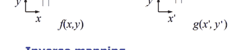

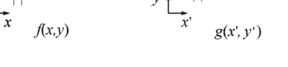

### Inverse mapping

- 1. Create an output image
- 2. For each pixel in the output image, find the corresponding pixel in the input image
- 3. Give that output pixel the same color
  - Requires that we invert the mapping

Figure 2.28 – Forward versus inverse warping for geometric transformation

The Image.transform() method in PIL applies geometric transformations to an image by mapping output pixel coordinates to corresponding positions in the input image. The size parameter specifies the output image dimensions as (width, height), while the method parameter defines the transformation type, such as Image.AFFINE for affine transforms, Image.EXTENT for crop-and-scale operations, Image.PERSPECTIVE for projective (homography) transforms, Image.QUAD for mapping a quadrilateral to a rectangle, and Image.MESH for arbitrary piecewise mappings.

For affine transformations, the data parameter contains the six coefficients (a, b, c, d, e, f) of the affine transformation matrix, where a and e control horizontal and vertical scaling, b and d represent shearing, and c and f specify translations along the x – axes and y – axes. Each output pixel (x, y) is mapped to the input coordinate:

(x′, y′) = (ax + by + c ; dx + ey + f)

with coordinates rounded to the nearest pixel. The default transformation corresponds to the identity mapping. The method supports common geometric operations including scaling, translation, rotation, and shearing.

The resample parameter determines the interpolation filter used during transformation, with options such as Image.NEAREST, Image.BILINEAR, Image.BICUBIC, Image.HAMMING, Image.BOX, and Image.LANCZOS, while the fill parameter specifies the background color for undefined regions after transformation. To rotate an image about its center rather than the origin, the image is first translated so that the center moves to the origin, then rotated, and finally translated back using the inverse translation transformation.

```
im = Image.open("images/parrot.png")
w, h = im.size
θ = np.pi/4

# rotation about origin (θ,θ)
```

```
```python
rot_mat = np.array([[np.cos(θ), -np.sin(θ), 0],
                   [np.sin(θ), np.cos(θ), 0],
                   [0, 0, 1]])
im_rot_origin = im.transform((im.width, im.height), Image.AFFINE, \
                             data = rot_mat[:2,:].flatten())

# rotation about center of image
tr_mat = np.array([[1,0,-w/2],[0,1,-h/2],[0,0,1]])
mat = np.linalg.inv(tr_mat)@rot_mat@tr_mat
im_rot_center = im.transform((im.width, im.height), Image.AFFINE, \
                             data=mat[:2,:].flatten())

plt.imshow(np.hstack((im_rot_origin, im_rot_center))), plt.axis('off')
```
```

If you run the preceding code snippet, you should obtain a figure like the next one:

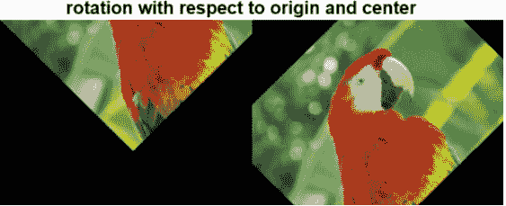

*Figure 2.29 – Rotating an image with respect to the origin and center of the image with PIL*

The following line of code demonstrates how an input image can be transformed with a shear transform matrix:

```
```python
im = Image.open("images/parrot.png")
im.transform((int(1.4*im.width), im.height), Image.AFFINE, \
             data=(1,-0.5,0,0,1,0)).show() # shear
```
```

## Applying projective transformation

A projective transformation, also known as projective mapping or homography, is a geometric transformation that preserves straight lines. A projective transformation in a 2D space is often represented by a 3 × 3 matrix called a homography matrix (H). It has eight degrees of freedom since it is defined up to a scale factor (the ninth parameter):

$$\begin{bmatrix} a & b & c \\ d & e & f \\ g & h & i \end{bmatrix}$$

This transformation can include operations such as rotation, translation, scaling, and shearing, as well as more complex transformations.

## Changing pixel values of an image

We can use the `putpixel()` function to change a pixel value in an image. Next, let us discuss a popular application for adding noise to an image using the function.

### Adding salt and pepper noise to an image

Salt-and-pepper noise is added by randomly selecting image pixels and setting them to either black (“pepper”) or white (“salt”). In the implementation, `np.random.randint()` generates random pixel coordinates within the image dimensions, while `np.random.rand() < 0.5` randomly chooses between black (0,0,0) and white (255,255,255) values. The `putpixel()` method then modifies the selected pixel locations, producing impulsive noise distributed across the image.

Now, refer to the following code snippet:

```
```python
# choose 5000 random locations inside image
im1 = im.copy() # keep the original image, create a copy
n = 5000
x, y = np.random.randint(0, im.width, n), np.random.randint(0, im.height, n)
for (x,y) in zip(x,y):
    im1.putpixel((x, y), ((0,0,0) if np.random.rand() < 0.5 \
                          else (255,255,255))) # salt-and-pepper noise
im1.show()
```
```

The following figure shows the output noisy image generated by running the preceding code snippet:

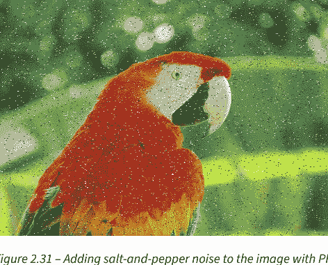

### Drawing on an image with ImageDraw

The `ImageDraw.Draw()` method can be used to create an object, to allow drawing on an input image opened with `PIL.Image`. This object can be used to draw shapes on the image.


## 绘制椭圆

我们可以在图像上绘制线条或其他几何形状（例如，使用 PIL.ImageDraw 模块中的 ellipse() 函数绘制椭圆），如下面的 Python 代码片段所示：

```
im = Image.open("images/parrot.png")
draw = ImageDraw.Draw(im)
draw.ellipse((125, 125, 200, 250), fill=(255,255,255,128))
del draw
im.show()
```

## 绘制边界框

Image.getbbox() 方法计算包含二进制图像中所有非零（或非黑色）像素的最小边界框。边界框以 4 元组形式返回：(left, upper, right, lower)。下面的代码加载了一张灰度马图像并使用 getbbox() 来定位对象区域，然后使用 ImageDraw.Draw() 和 draw.rectangle() 在检测到的边界框周围叠加一条宽度为 3 的红色矩形轮廓。del draw 在绘制操作完成后删除绘图上下文对象以释放资源和内存。现在，请参考下面的代码块：

```
from PIL import ImageDraw
im = Image.open('images/horse.png').convert('L')
im = im.convert('RGB')
draw = ImageDraw.Draw(im)
draw.rectangle(im.getbbox(), fill = None, outline ="red", width = 3)
del draw
im
```

如果运行上述代码片段，你应该会得到如下图所示的图像：

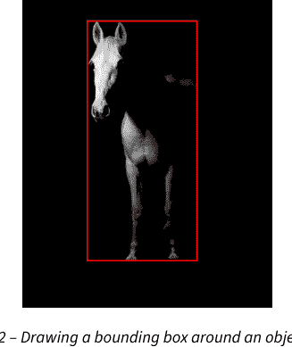

Figure 2.32 – Drawing a bounding box around an object with PIL

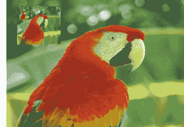

Figure 2.34 – Iteratively pasting shrunk images with PIL

## 计算图像的基础统计信息

我们可以使用 stat 模块来计算图像的基础统计信息（不同通道像素值的均值、中位数、标准差等），如下面的代码片段所示：

```
s = stat.Stat(im)
print(s.extrema) # maximum and minimum pixel values for each channel R, G, B
print(s.count, s.mean, s.median, s.stddev)
```

## 绘制像素值的直方图

histogram() 函数可用于计算每个通道像素的直方图（像素值与频率的表格）并返回拼接后的输出（例如，对于 RGB 图像，输出包含 3 x 256 = 768 个值）。下图显示了通过运行代码片段绘制的 RGB 颜色直方图：

```
pl = im.histogram()
plt.bar(range(256), pl[:256], color='r', alpha=0.5)
plt.bar(range(256), pl[256:2*256], color='g', alpha=0.4)
plt.bar(range(256), pl[2*256:], color='b', alpha=0.3)
```

如果运行上述代码片段，你应该会得到如下图所示的图像：

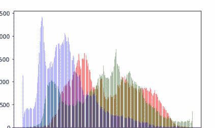

Figure 2.35 – Histogram of the RGB color channels of the parrot image

## 分离图像的 RGB 通道

我们可以使用 `split()` 函数来分离多通道图像的通道，如下为 RGB 图像的代码所示：

```
```python
ch_r, ch_g, ch_b = im.split() # split RGB image into 3 channels: R, G and B
plt.figure(figsize=(18,6))
plt.subplot(1,3,1); plt.imshow(ch_r, cmap=plt.cm.Reds); plt.axis('off')
plt.subplot(1,3,2); plt.imshow(ch_g, cmap=plt.cm.Greens); plt.axis('off')
plt.subplot(1,3,3); plt.imshow(ch_b, cmap=plt.cm.Blues); plt.axis('off')
# show the R, G, B channels separately
```
```

如果运行上述代码片段，你应该会得到如下图所示的图像：

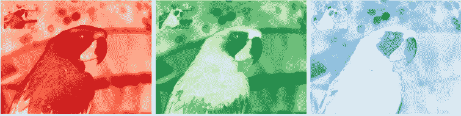

*Figure 2.36 – Extracting the red, green, and blue channels of the parrot image with PIL*

上图显示了通过运行前述代码片段为每个 RGB 通道创建的三个输出图像。

## 合并图像的多个通道

我们可以使用 `merge()` 函数来合并多通道图像的通道，如下代码所示，其中在交换红色和蓝色通道后，将通过拆分鹦鹉 RGB 图像获得的颜色通道合并：

```
```python
im = Image.merge('RGB', (ch_b, ch_g, ch_r)) # swap the red and blue channels
im.show()
```
```

下图显示了通过运行前述代码片段合并通道后创建的 RGB 输出图像：

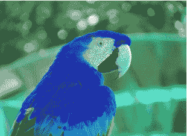

*Figure 2.37 – Color-channel swapping with PIL*

## Alpha (α) 通道和图像混合

图像中的 alpha 通道是一个额外的通道，表示每个像素的透明度或不透明度。它常用于具有不同透明度级别的图像中，可实现图像与其背景或其他图像之间的平滑混合。

Alpha 通道是 RGBA 颜色模型不可分割的一部分，其中每个像素由四个分量表示：红色、绿色、蓝色和 alpha。PNG 图像格式支持 alpha 通道，使其成为需要透明度的图像的热门选择。另一方面，JPEG 不支持 alpha 通道。

Alpha 通道允许图像具有像素级透明度，从而可以在图像和背景之间创建平滑过渡。

Alpha 值为 0 表示完全透明，意味着该像素完全不可见。Alpha 值为 255（或浮点图像的 1.0）表示完全不透明，使像素完全可见。

## 将 JPG 转换为透明 PNG 图像

可以通过添加 alpha 通道使用 `convert("RGBA")`、从原始图像生成灰度遮罩并使用 `putalpha()` 分配透明度值，将 JPG 图像转换为透明 PNG。在示例中，`ImageChops.invert()` 反转灰度遮罩，使较暗区域变为透明而较亮区域保持可见，之后将图像保存为支持透明度的 PNG 文件。下面的代码片段读取一张黑白鸟的 JPG 图像并将其保存为透明 PNG 图像：

```
```python
from PIL import Image, ImageChops

img_trans = Image.new('RGBA', img.size)
alpha = Image.open('images/birds.jpg').convert('L')
img_trans.putalpha(ImageChops.invert(alpha))
img_trans.save('images/bird.png')
img_trans
```
```

下图显示了通过运行前述代码片段创建的输出图像：

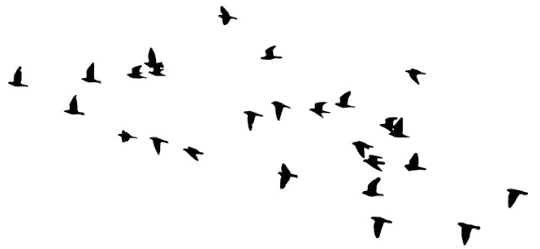

*Figure 2.38 – Creating a transparent PNG image with PIL*

下面的代码片段读取鹦鹉 RGB 彩色 JPG 图像，提取对应于红色羽毛的区域并将其保存为透明 PNG，如下图所示：

```
img = Image.open('images/parrot.jpg') # n x m x 3
imga = img.convert("RGBA")  # n x m x 4

imga = np.asarray(imga)
r, g, b, a = np.rollaxis(imga, axis=-1) # split into 4 n x m arrays
r_m = r > 100 # binary mask for red channel, True for read feathers
g_m = g < 100 # binary mask for green channel, True for read feathers
b_m = b < 200 # binary mask for blue channel, True for read feathers

# combine the three masks using the binary "or" operation
# multiply the combined binary mask with the alpha channel
a = a * ((r_m == 1) & (g_m == 1) & (b_m == 1))

# stack the img back together
imga = Image.fromarray(np.dstack([r, g, b, a]), 'RGBA')
imga.save('images/parrot_transparent.png')

print(img.mode, imga.mode)
# RGB RGBA
```

如果运行上述代码片段，你应该会得到如下图所示的图像：

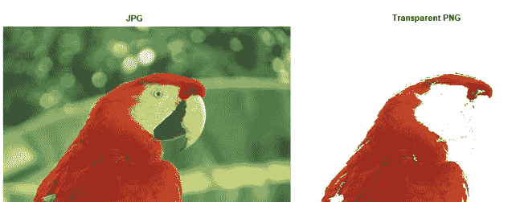

Figure 2.39 – Creating transparent PNG image from a JPG image

## α-混合两幅图像

blend() 函数可用于通过使用常数 α 在两幅给定图像（大小相同）之间进行插值来创建新图像。两幅图像必须具有相同的大小和模式。输出图像由下式给出：

out = image₁.(1.0 − α) + image₂.α

如果 α 为 0.0，则返回第一幅图像的副本。如果 α 为 1.0，则返回第二幅图像的副本。

下面的代码片段显示了一个示例：

```
im1 = Image.open("images/parrot.png")
im2 = Image.open("images/hill.jpg")
# if two images have different modes, must be converted to the same mode
im2 = im2.resize((im1.width, im1.height), Image.BILINEAR)
# if two images have different sizes, must be converted to the same size
im = Image.blend(im1, im2, alpha=0.5).show()
```

下图显示了通过运行前述代码片段混合前两幅图像生成的输出图像：

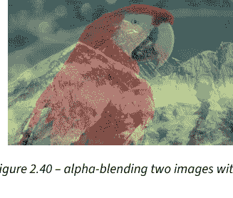

Figure 2.40 – alpha-blending two images with PIL

## α-合成两幅图像

α-合成使用两幅图像的 alpha（透明度）值来混合两幅图像，决定每幅图像对最终像素颜色的贡献程度。给定一幅前景图像 F 和一幅背景图像 B，每幅图像均具有 RGBA 值，结果图像 C 使用 alpha 混合计算得出。以下是计算步骤的说明：

- 1. Alpha 归一化：首先，将前景 α_F 和背景 α_B 的 alpha 值归一化到 0 到 1 之间：α_F' = α_F / 255 和 α_B' = α_B / 255
- 2. 合成 alpha 计算：结果 alpha α_C（最终图像的透明度）计算为：α_C = α_F' + α_B'(1 − α_F')。
- 3. 混合颜色计算：对于每个颜色通道（R、G 和 B），最终合成颜色 C 计算如下：
- C = (F · α_F' + B · α_B'(1 − α_F')) / α_C

这确保前景根据透明度与背景混合。下面的 Python 代码片段通过使用 PIL.Image 中的方法，使用不同的透明度（alpha）值对两幅图像（鱼和海）进行 α-合成。以下是关键步骤：

- 1. 设置透明度：putalpha(100) 使鱼更透明，而 putalpha(200) 使海更不透明。


+   2. **复合图像：** Image.alpha_composite(sea, fish) 基于它们的 alpha 值将 fish 叠加到 sea 上。

这会创建平滑的混合效果，其中 fish 在 sea 上方呈现半透明，展示了 alpha 混合：

```
fish = Image.open('images/fish.jpg')
sea = Image.open('images/water.jpg')
fish.putalpha(100); sea.putalpha(200)
alpha_comp = Image.alpha_composite(sea, fish)
plt.imshow(np.hstack((np.array(fish), np.array(sea), np.array(alpha_comp))))
plt.title('alpha composite of the fish and sea images', size=15)
```

如果运行前面的代码片段，你应该会得到如下图所示的图形：

# alpha composite of the fish and sea images

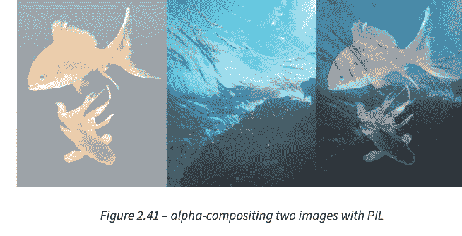

图 2.41 - 使用 PIL 对两幅图像进行 alpha 复合

## 为图像添加水印

水印是叠加到另一幅图像上的可识别图像或图案，通常用于品牌或版权目的。水印通常是半透明的，并放置在图像的角落或中心，以防止未经授权的使用或标识图像的创建者。

下面的代码片段将 Packt 标志图像添加到鹦鹉封面图像中，使用以下步骤：

+   1. 首先，将原始输入（封面）和水印图像都转换为 RGBA 模式。
+   2. 水印图像被调整大小并粘贴到空白图像上，随后添加一个半透明的 alpha 层（α = 128）。
+   3. 最后，使用 alpha_composite() 函数合并原始图像和水印图像的 alpha 通道。生成的带水印输出显示在下图中。

现在，参考以下代码片段：

```
cover_image = Image.open('images/parrot.jpg').convert('RGBA')
watermark = Image.open('images/packt.png')\
    .resize((100, 50))\
.convert('RGBA')
layer = Image.new('RGBA', cover_image.size, (0, 0, 0, 0))
layer.paste(watermark, (325, 225))

# Create a copy of the layer
layer2 = layer.copy()
# Put alpha on the copy
layer2.putalpha(128)
# merge layers with mask
layer.paste(layer2, layer)

watermarked_image = Image.alpha_composite(cover_image, layer)
watermarked_image.convert('RGB')
```

如果运行前面的代码片段，你应该会得到如下所示的带水印图像：

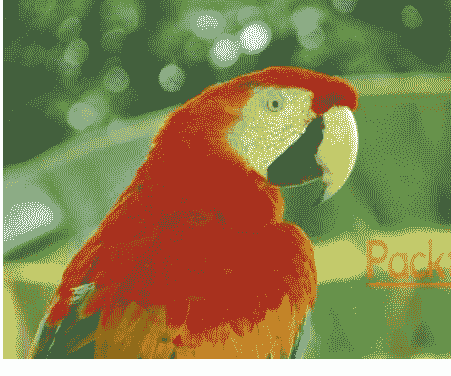

图 2.42 – 向图像添加水印（标志）

## 使用蒙版混合两幅图像

下面的代码片段使用 Image.composite() 方法，通过（水平）强度梯度透明度蒙版（grad_mask）将蝴蝶图像（im）与其自身反转版本（im_inv）混合。以下是关键步骤。

首先，使用 np.linspace() 创建一个 1D 梯度数组（grad_mask），并使用 np.tile(grad_mask, (h, 1)) 函数将 1D 梯度数组沿行重复以创建 2D 水平强度梯度蒙版，其中像素值范围从 0（完全透明）到 255（完全不透明）。

Image.composite(im, im_inv, grad_mask) 方法根据透明度蒙版 grad_mask 混合 im 和 im_inv，使一侧更像原始图像，另一侧更像反转版本。

**Hard Light** 混合模式对较暗的像素应用 **Multiply** 混合模式，对较亮的像素应用 **Screen** 混合模式。混合方程如下：

```
$$C_{out}=\begin{cases}2C_{base}C_{blend}, & C_{blend}\le 0.5\\1-2(1-C_{base})(1-C_{blend}), & C_{blend}>0.5\end{cases}$$
```

如果混合像素较暗（$C_{blend}\le 0.5$），则应用 **Multiply** 模式，导致色调变暗。否则，应用 **Screen** 模式，导致色调变亮。其效果是增加对比度——亮区变得更强烈，暗区加深。

**Soft Light** 混合模式提供微妙的方向性光照效果，使暗区变暗、亮区变亮，但过渡更平滑。混合方程如下：

```
$$C_{out}=\begin{cases}C_{base}-(1-C_{base})C_{base}(1-2C_{blend}), & C_{blend}\le 0.5\\C_{base}+D(C_{base})(2C_{blend}-1), & C_{blend}>0.5\end{cases}$$
```

其中

```
$$D(C_{base})=\begin{cases}\frac{16C_{base}^{2}+3C_{base}}{19}, & C_{base}\le 0.25\\\sqrt{C_{base}}, & C_{base}>0.25\end{cases}$$
```

如果混合像素较暗（$C_{blend}\le 0.5$），它会烧蚀阴影，使其变暗。否则，它会减淡高光，使其变亮。其效果类似于 **Hard Light**，但过渡更平滑、强度更低。

**Overlay** 混合模式类似于 **Hard Light**，但不同之处在于混合图像决定效果，而基底图像控制它。混合方程如下：

```
$$C_{out}=\begin{cases}2C_{base}C_{blend}, & C_{base}\le 0.5\\1-2(1-C_{base})(1-C_{blend}), & C_{base}>0.5\end{cases}$$
```

如果基底像素较暗（$C_{blend}\le 0.5$），它会使用 **Multiply** 混合使图像变暗。否则，它会使用 **Screen** 混合使图像变亮。其效果是对比度增加，但基底图像控制效果强度。下图总结了算法之间的差异：

| Blend Mode | Dark Pixels Behavior | Light Pixels Behavior | Contrast Effect |
|---|---|---|---|
| Hard Light | Darker (Multiply) | Lighter (Screen) | High contrast |
| Soft Light | Subtly darker | Subtly lighter | Soft transitions |
| Overlay | Darker (Multiply) | Lighter (Screen) | Strong contrast, but base-driven |

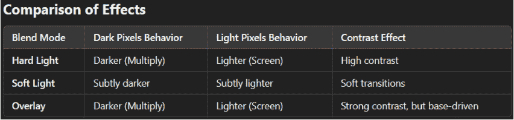

*图 2.44 – 比较混合模式算法*

这些混合技术通常用于照片编辑，以进行动态光照调整和艺术效果。

## 使用 PIL

下面的代码片段使用不同的混合模式叠加两幅图像以创建不同的光照效果，如前所述，使用 ImageChops 中的以下方法：

- hard_light 通过应用 Multiply 和 Screen 混合的混合来增强对比度——亮区变亮，暗区变暗
- soft_light 是 hard_light 的更微妙版本，通过根据前景减淡或烧蚀像素来模拟柔和的方向性光照
- overlay 类似于 hard_light，但强度由背景驱动——亮区变得更亮而暗区加深

现在，参考下面的代码片段：

```
im1 = Image.open("images/scene.jpg")
im2 = Image.open("images/turtle.jpeg").convert('RGB') \
    .resize((im1.width, im1.height))

im_hard = hard_light(im1, im2)
im_soft = soft_light(im1, im2)
im_overlay = overlay(im1, im2)
plt.imshow(np.hstack((im_hard, im_soft, im_overlay))), plt.axis('off')
```

如果运行前面的代码片段，你应该会得到如下图所示的图形：

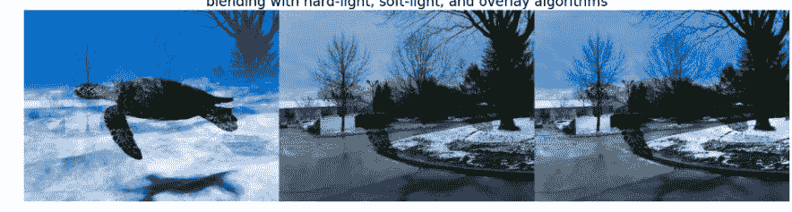

图 2.45 - 使用 PIL 使用不同算法混合图像

## 使用 blend_modes

下面的代码片段演示了使用 blend_modes 库以不同不透明度使用 soft_light 算法混合两幅图像。imgviz 库用于为图像添加 alpha 通道。blend_modes.soft_light() 方法应用软光混合，由不透明度（α）参数控制。对于每个像素，soft_light 混合公式如下应用：

C_out = (1 − α) · C_base + α · F_soft−light(C_base, C_blend)

这里，$F_{soft-light}$ 是 soft_light 混合函数。前景图像（im2）以增加的不透明度柔和地混合到背景（im1）上，创建微妙的光照效果。较高的不透明度意味着前景对最终混合的贡献更大，而较低的不透明度使其更透明：

```
import blend_modes, imgviz
i = 1
plt.figure(figsize=(15,5))
for opacity in [0.3, 0.5, 0.8]:
    blended_img_float = blend_modes.soft_light(
        imgviz.rgb2rgba(np.array(im1)).astype(float),
        imgviz.rgb2rgba(np.array(im2)).astype(float),
        opacity)
    plt.subplot(1,3,i), plt.imshow(np.uint8(blended_img_float))
    plt.axis('off'), plt.title(f'opacity={opacity}', size=20)
    i += 1
plt.suptitle('Blending with soft-light algorithm with blend_modes', \
    size=25)
```

如果运行前面的代码片段，你应该会得到如下图所示的图形：

Blending with soft-light algorithm with blend_modes

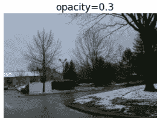

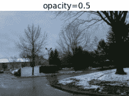

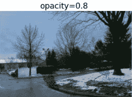

图 2.46 – 使用 blend_modes 库混合（使用 soft_light 算法）

使用 hard_light 算法（使用 blend_modes.hard_light() 函数）的类似代码会产生以下输出图：

Blending with hard-light algorithm with blend_modes

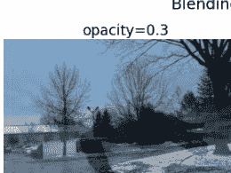

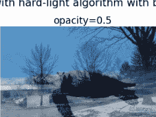

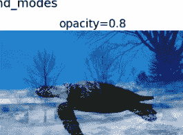

图 2.47 – 使用 blend_modes 库混合（使用 hard_light 算法）


# 获取两张图像中较暗/较亮的一张

下面的代码片段通过比较像素值，使用 `ImageChops.lighter(im1, im2)` 方法计算两张图像的**较亮**结果。该方法对 `im1` 和 `im2` 两张图像进行逐像素比较，并在每个 RGB 通道上保留最大值，从而有效地选择每个位置上更亮的**像素**：

```
im1 = Image.open("images/parrot.png")
im2 = Image.open("images/hill.png").convert('RGB') \
                         .resize((im1.width, im1.height))
lighter(im1, im2).show()
```

下图显示了运行上述代码片段后，使用输入图像 parrot 和 hill 生成的输出图像：

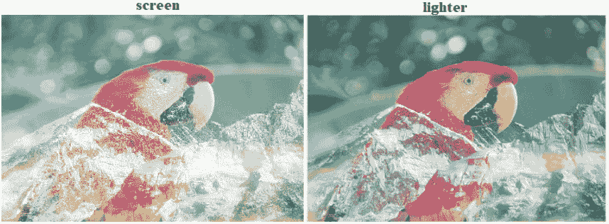

*图 2.48 —— 使用 PIL 叠加图像：screen 模式与 lighter 模式*

# 总结

本章探讨了使用 NumPy、scikit-image 和 Pillow (PIL) 进行高级图像处理的技术。我们涵盖了各种操作，包括颜色增强、几何变换、亮度和对比度调整以及噪声添加。此外，我们还研究了图像混合、通道分离和算术运算，以创造性地修改和组合图像。这些技术能够为艺术、分析和计算机视觉应用实现高效的图像处理，为数字图像处理的进一步探索奠定了坚实的基础。通过详细的示例和代码片段，本章提供了在 Python 中掌握图像处理的实践方法。

在下一章中，我们将继续使用更多库来研究图像处理，包括 scipy.ndimage、opencv-python、wand 和 matplotlib。

### 3
