### 更多图像处理

在本章中，我们将更深入地研究使用各种 Python 库进行图像变换和增强的高级技术。在基础概念的基础上，我们探索一系列操作，从调整分辨率和色彩分级到模拟复杂的视觉效果，如镜头模糊、暗角效果和鱼眼失真。

我们将利用 PIL、opencv-python、SciPy、Wand、Matplotlib 和 Pilgram 等流行的库来进行变换，修改图像的结构、颜色和视觉吸引力。您将学习如何插值图像、应用基于查找表 (LUT) 的颜色校正、实现单应性变换，甚至重现类似 Instagram 的滤镜。

我们将涵盖以下关键主题：

- 使用 PIL 进行更多图像处理
- 使用 opencv-python 进行图像处理
- 使用 `scipy.ndimage` 进行图像处理
- 使用 Wand 进行图像处理
- 使用 Matplotlib 进行图像处理
- 使用 Pilgram 进行图像处理

在本章结束时，您将获得各种图像处理技术的实践经验，掌握以编程方式增强和变换图像的技能。让我们开始吧！

## 技术要求

在阅读本章不同部分时，请跟随 Jupyter notebook 进行操作（并运行必要的代码片段）。GitHub 链接如下：https://github.com/PacktPublishing/Hands-on-Image-Processing-and-Computer-Vision-with-Python-Second-Edition。为了确保代码顺利运行，必须在运行代码之前安装正确版本的库。如果版本不匹配，代码可能需要在某些地方进行少量调整，具体取决于库中的某些特性/函数是否被移除/弃用。

# 使用 PIL 进行更多图像处理

从上章结束的地方继续，让我们探索更多使用 PIL 进行图像处理的应用。

# 更改 JPEG 图像的质量/分辨率

以下代码演示了 `Image.save()` 方法的 quality 参数如何控制 JPEG 压缩质量和文件大小。JPEG 使用有损压缩来减少存储空间，方法是丢弃人眼不太容易察觉的图像细节。在内部，Pillow 将图像从 RGB 转换为 YCbCr 颜色空间，应用色度子采样（例如 4:2:0），将图像划分为 8 × 8 的块，并应用离散余弦变换 (DCT)。直观地说，DCT 将图像块转换为频率分量，将大部分视觉信息集中在低频系数中，而精细细节对应于高频。较低的质量设置会更积极地量化这些高频分量，从而产生更小的文件，但也会引入诸如块状效应、模糊和振铃之类的伪影。我们将在第 4 章中详细重新讨论 DCT 及其数学原理。

以下代码将图像以质量值 95、20、5 和 1 保存，展示了视觉保真度与压缩比之间的权衡。较高的质量保留了细节，而较低的质量增加了压缩并导致明显的退化。使用 `os.path.getsize()` 计算文件大小和压缩比，以定量比较存储效率。

```
im = Image.open('images/parrot.jpg')
qualities = [95, 20, 5, 1]
for quality in qualities:
    im.save(f"images/parrot_{quality}.jpg", quality=quality)
plt.imshow(np.hstack([imread(f"images/parrot_{quality}.jpg") \
    for quality in qualities]))
```

如果运行上述代码片段，您应该会得到类似下面的图像：

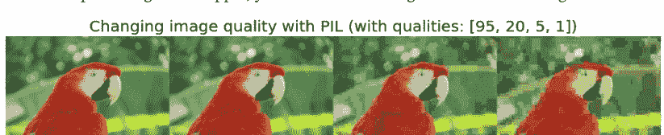

图 3.1 —— 使用 PIL 更改 JPEG 图像质量

如果从每个压缩图像 `im` 中提取一个小块（例如，使用 NumPy 切片 `im[100:200, 200:300]`）并进行放大可视化，您可以观察到压缩伪影，如块状效应、模糊和振铃，尤其是在较低质量级别下，如下图所示。

# 使用 PIL 提取的图像小块（质量：[95, 20, 5, 1]）

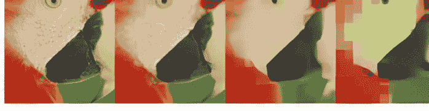

图 3.2 —— 使用 PIL 在较低质量 JPEG 图像中引入的伪影

降低 JPEG 质量会利用更激进的熵编码和高频 DCT 分量的量化，通过丢弃人眼不太容易察觉的精细图像细节来减小文件大小。

您可以使用以下代码片段比较压缩后的文件大小（以 KB 为单位）或压缩比（原始文件大小与压缩文件大小的比值），以演示 JPEG 质量与压缩之间的权衡，这将帮助您定量理解压缩取舍。

```
original_size = os.path.getsize("images/parrot.jpg")
for quality in qualities:
    compressed_size = \
        os.path.getsize(f"images/parrot_{quality}.jpg")
    print(f"Quality {quality}: Compression Ratio = "
          "{original_size / compressed_size:.2f}")
# Quality 95: Compression Ratio = 0.55
# Quality 20: Compression Ratio = 2.94
# Quality 5: Compression Ratio = 5.32
# Quality 1: Compression Ratio = 6.12
```

较高的压缩比表明空间效率更好，因为这意味着用更少的内存或磁盘空间存储了更多的数据。您也可以选择性地加入 PSNR 作为图像质量指标，但仅比较文件大小就能提供有价值的见解，说明较低的质量如何显著降低存储需求——尽管这是以视觉保真度为代价的。

# 为什么以质量 95 重新保存 JPEG 时压缩比 < 1？

原始 JPEG 可能已经被高度压缩。大多数从网络下载或由手机/相机拍摄的图像已经以质量和大小之间的最佳权衡保存——通常质量设置在 75-85 左右，甚至更低。

当使用 `Image.save()` 保存 PNG 图像时，quality 参数将被忽略，因为 PNG 使用无损压缩。要控制 PNG 文件大小，请使用 compress_level 参数（0-9）而不是 quality 参数，其中较高的值应用更强的压缩。

# 变形图像

下面的代码片段对图像应用类似波的几何（正弦网格）变形，产生类似波纹的涟漪扭曲效果。它使用 `ImageOps.deform()` 和一个自定义的 `WaveDeformer` 类。`transform()` 方法使用正弦函数修改像素坐标，产生水平波纹扭曲。`transform_rectangle()` 方法将此映射应用于矩形图像补丁的四个角，而 `getmesh()` 将图像划分为矩形网格（gridspace=20），计算其变形后的位置，并返回 `ImageOps.deform()` 所需的网格映射。应用变形会产生平滑、有机的扭曲效果，类似于涟漪、水波或热失真：

```
```python
class WaveDeformer:

    def transform(self, x, y):
        y = y + 20*np.sin(x/15)
        return x, y

    def transform_rectangle(self, x0, y0, x1, y1):
        return (*self.transform(x0, y0),
                *self.transform(x0, y1),
                *self.transform(x1, y1),
                *self.transform(x1, y0),
                )

    def getmesh(self, img):
        self.w, self.h = img.size
        gridspace = 20
        target_grid = []
        for x in range(0, self.w, gridspace):
            for y in range(0, self.h, gridspace):
                target_grid.append((x, y, x + gridspace, \
                                    y + gridspace))
        source_grid = [self.transform_rectangle(*rect) \
                       for rect in target_grid]
        return [(t for t in zip(target_grid, source_grid))]

im = Image.open('images/monalisa.jpg')
im_deformed = ImageOps.deform(im, WaveDeformer())
plt.imshow(
    np.hstack((np.array(im), np.array(im_deformed)))
)
plt.axis('off')
```
```


### 原始图像与变形图像

如果你运行上述代码片段，你应该会得到类似下图的图形。它会产生一种有机的扭曲效果，使图像看起来弯曲或起伏。

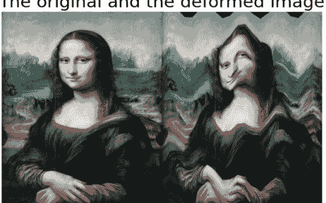

图 3.3 – 原始图像与变形图像

## 给灰度图像着色

下一个代码片段通过将像素强度映射到指定的颜色渐变来为灰度图像着色。`ImageOps.colorize()` 方法将黑色像素映射为红色 (255,0,0)，将白色像素映射为黄色 (255,255,127)，为中间色调创建平滑过渡。这有效地模拟了假彩色映射，增强了灰度图像的视觉效果，以便更好地解释：

```python
im = Image.open('images/sculpture.png').convert('L')
im_colorized = ImageOps.colorize(im, black=(255,0,0), \
    white=(255,255,127))
plt.imshow(np.hstack((color.gray2rgb(np.array(im)), \
    np.array(im_colorized))))
plt.axis('off')
plt.title('The original and the colorized image', size=20)
```

如果你运行上述代码片段，你应该会得到类似下图的图形。

### 原始图像与着色图像

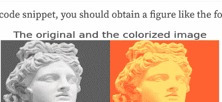

图 3.4 – 原始图像与着色图像

**注意：** `ImageOps.colorize()` 期望输入一幅像素值覆盖完整 [0, 255] 范围的灰度图像。如果输入图像已归一化或对比度较低，则生成的着色结果可能显得平淡或缺乏活力。要获得视觉上丰富的着色效果，请考虑在使用 `ImageOps.colorize()` 之前应用对比度拉伸或重新缩放强度值。

## 通过 LUT 文件更改图像颜色

LUT 是一种预定义的映射，它将输入颜色转换为新的输出颜色，用于色彩分级和图像增强。下一个代码片段使用 LUT 文件对图像应用色彩分级以更改其颜色。.cube 文件包含预定义的颜色变换（RGB 到 RGB 映射），将输入颜色映射到输出颜色（用于色彩分级）。加载原始图像，并将 LUT 滤镜应用于图像，根据预定义的映射更改其颜色。

该技术广泛应用于照片编辑和电影制作中，以应用特定的色调，例如电影感外观或情绪增强：

```python
lut = load_cube_file("images/Bourbon 64.cube")  # NightFromDay.CUBE
im = Image.open("images/sea_beach.jpeg")
im_in = np.array(im)
im_out = np.array(im.filter(lut))
plt.imshow(np.hstack((im_in[:, :im_in.shape[1]//2], \
    im_out[:, :im_out.shape[1]//2])))
plt.axis('off')
```

如果你运行上述代码片段，你应该会得到类似下图的图形：

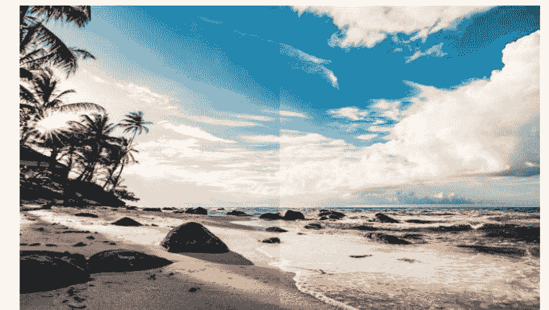

图 3.5 – 使用 LUT 文件更改图像颜色

## 使用 LUT 应用伽马（γ）校正

伽马校正是一种非线性强度变换，用于调整图像亮度，尤其适用于增强暗图像。查找表（LUT）通过预计算输入和输出像素值之间的映射，避免了逐像素计算，从而提供了一种高效的实现方式。

### 使用 PIL

使用 PIL 时，`ImageFilter.Color3DLUT.generate()` 通过一个回调函数创建 3D 颜色 LUT（例如 11 × 11 × 11），该回调函数将伽马变换独立应用于 RGB 通道。然后使用 `Image.filter()` 将生成的 LUT 应用于图像，无需显式像素迭代即可实现快速颜色校正：

```python
γ = 0.4
img = Image.open('images/roma.jpg')
LUT = ImageFilter.Color3DLUT.generate((11,11,11), \
    lambda r, g, \
    b: tuple(min(max(c ** γ, 0), 1) for c in (r, g, b))
)
img_out = img.filter(LUT)
plt.imshow(np.hstack((np.array(img), np.array(img_out))))
plt.axis('off')
plt.title('original and γ-corrected image', size=20)
```

如果你运行上述代码片段并并排绘制输入/输出图像，你应该会得到类似下图的图形：

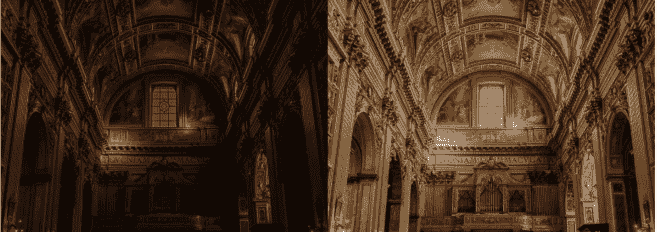

*图 3.6 – 使用 PIL 通过 LUT 进行伽马校正*

### 使用 opencv-python

使用 OpenCV-Python 时，可以通过 `cv2.LUT()` 实现相同的操作。下面代码中的 `γ_correct()` 函数首先创建一个包含伽马校正强度值的 256 项查找表，然后将其应用于图像：

```python
def γ_correct(img, γ):
    table = [((i / 255) ** γ) * 255 for i in range(256)]
    table = np.array(table, np.uint8)
    return cv2.LUT(img, table)

img = np.array(img)
plt.imshow(np.hstack((img, γ_correct(img, γ))))
plt.axis('off')
```

如果你运行上述代码片段，你应该会得到下图：

原始图像与 γ 校正图像

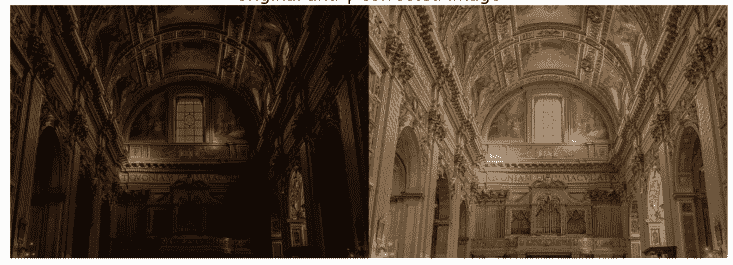

图 3.7 – 使用 opencv-python 通过 LUT 进行伽马校正

比较 opencv-python 与 PIL 的实现，并改变伽马参数以观察其对输出图像的影响。

## 模拟镜头模糊效果

镜头模糊模拟真实相机的景深效果，使失焦区域显得平滑，同时保持所选区域清晰。该实现首先使用 `image.point()` 结合传递函数 `I' = I^p`（例如 `p = 0.5`）进行伽马校正，以在模糊前增强对比度。然后使用 `ImageFilter.GaussianBlur(radius=5)` 生成模糊效果，该效果近似于失焦镜头行为。模糊强度通过掩码和 `Image.composite()` 在空间上进行控制，`Image.composite()` 将原始图像和模糊图像混合，在需要的地方保留清晰区域。最后，应用逆伽马校正以恢复亮度，并且可以组合多个模糊层以产生更自然的景深效果。

现在，请参考以下代码片段：

```python
from PIL import ImageFilter
from PIL.ImageChops import lighter

image = Image.open('images/me8.jpg').convert('RGB')
mask = Image.open('images/mask.png').convert('L')
p = 0.5
r = 5

gammaCorrectedImage = image.point(lambda x: x ** p)
bokeh = gammaCorrectedImage.filter( \
                         ImageFilter.GaussianBlur(radius=r))
bokeh = bokeh.point(lambda x: x ** (1/p)) # To get back the
                                          # original gamma.

bokeh = Image.composite(image, bokeh, mask)
blurImage = image.filter(ImageFilter.GaussianBlur(radius=r))
blurImage = Image.composite(image, blurImage, mask)
finalImage = lighter(bokeh, blurImage)
finalImage.show()
```

如果你运行上述代码片段，你应该会得到类似下图的图形：

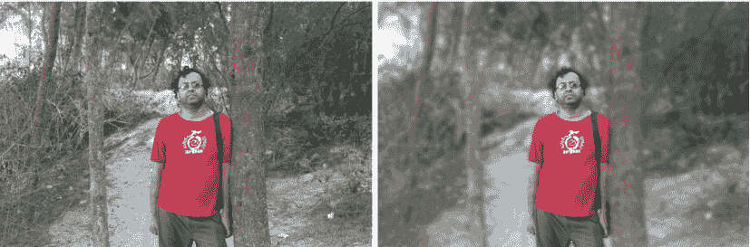

*图 3.8 – 使用 PIL 模拟镜头模糊效果*

在模糊之前使用 $x^p$（$0 < p < 1$）可以提亮阴影区域并改善模糊质量，而之后应用逆变换 $x^{\frac{1}{p}}$ 则可近似恢复原始亮度和对比度。

## 交换图像颜色调色板

基于调色板的图像（**P 模式**）将像素值存储为**颜色查找表（CLUT）**的索引，而不是完整的 RGB 值，从而减少内存和文件大小。下一个代码片段交换两幅图像的 16 色自适应调色板，在保持图像结构的同时重新映射它们的颜色。

首先，使用函数 `convert("P", palette=Image.ADAPTIVE, colors=16)` 将图像转换为 16 色**自适应调色板**，该函数在保持视觉外观的同时执行自适应颜色量化。使用 `getpalette()` 提取相应的调色板，辅助函数 `plot_palette()` 通过将扁平的 RGB 调色板列表重塑为 `(num_colors,3)` 数组并将其显示为色板来可视化这些调色板。然后使用 `putpalette()` 交换调色板，之后使用新调色板保存图像。尽管像素索引和图像结构保持不变，但颜色会根据交换后的调色板重新映射，从而产生视觉冲击力强且富有艺术效果的结果。

请参考以下代码片段：

```python
def plot_palette(palette, num_colors=16, title='Palette'):
    plt.imshow([np.array(palette[:num_colors*3]).reshape(\
                (num_colors, 3)) / 255], aspect='auto')
    plt.show()

img1, img2 = Image.open('images/parrot.jpg'), Image.open('images/lena.jpg')
img1_p = img1.convert("P", palette=Image.ADAPTIVE, colors=16)
img1_p.save('images/parrot_adaptive16_orig.png')
img2_p = img2.convert("P", palette=Image.ADAPTIVE, colors=16)
img2_p.save('images/lena_adaptive16_orig.png')
print(os.stat('images/parrot.jpg').st_size,
      os.stat('images/parrot_adaptive16_orig.png').st_size)
data = list(img1_p.getdata())
print(data[50:70])
clrs = img1_p.getcolors()
print(len(clrs))

# show up colors and palette
pal1 = img1_p.getpalette()
pal2 = img2_p.getpalette()
plot_palette(pal1, title='Palette of Image 1 before swap')
plot_palette(pal2, title='Palette of Image 2 before swap')
```

使用上述代码片段显示调色板。你应该会得到类似下图的图形：

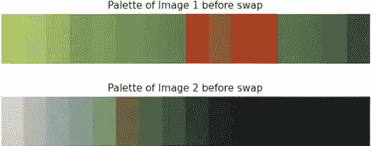

*图 3.9 – 交换前图像的调色板*

现在，使用以下代码片段交换调色板：

```python
img1_p.putpalette(pal2); img2_p.putpalette(pal1)
```


如果你运行上述代码片段，应该会得到类似下图的结果：

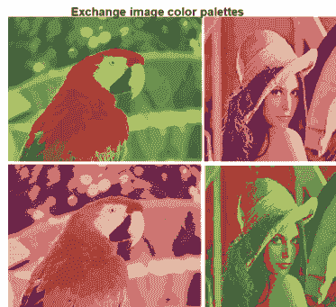

图3.10 – 使用PIL交换图像的调色板

注意：
使用 `putpalette()` 时，请确保调色板长度不超过768个值（256种颜色 × 3个通道）。分配更长的调色板可能会引发错误。在处理动态生成或无界调色板时，这一点尤其重要。

## 调整图像的色温

图像的色温指的是图像整体的色调，单位为开尔文（K）。它表示图像的暖度（偏红/偏黄的色调）或冷度（偏蓝的色调）：

- 较低色温（1,000K – 4,000K）：偏暖、偏红，例如烛光、日出
- 中性色温（5,500K）：自然日光
- 较高色温（6,000K – 10,000K）：偏冷、偏蓝，例如阴天、阴影

例如，烛焰（1900K）是暖色（橙色/黄色），而蓝天（8000K）是冷色。

色温调整是通过基于目标色温偏移的变换来缩放 RGB 通道完成的。

## 使用 RGB 缩放调整色温

改变图像色温的一种简单方法是根据目标色温缩放红、绿、蓝通道。

对于输入图像 I(x, y) = (R, G, B)，我们使用以下方式调整：

```
R' = R × α_R, G' = G × α_G, B' = B × α_B
```

其中 α_R、α_G 和 α_B 是基于开尔文色温的缩放因子。

以下是一个示例：

- **暖色偏移（增加红色，减少蓝色）**：α_R > 1, α_G ≈ 1, α_B < 1
- **冷色偏移（增加蓝色，减少红色）**：α_R < 1, α_G ≈ 1, α_B > 1

## 使用颜色变换矩阵调整色温

一种更精确的调整色温的方法是使用颜色变换矩阵：

```
M = [[α_R, 0, 0, 0], [0, α_G, 0, 0], [0, 0, α_B, 0]]
```

对图像应用矩阵变换后，我们得到：I' = M · I。

这将基于开尔文色温校正因子变换每个 (R, G, B) 像素。

对于 3,000K（暖色偏移），红色保持不变（缩放因子为1.0），绿色降至原始值的70.5%，蓝色降至42%，使图像呈现更暖的效果。

对于 8,000K（冷色偏移），红色降低（0.89）以使图像偏冷，绿色略微调整（0.95），蓝色增强（1.1）以产生更冷的效果。

某色温对应的 RGB 值可以在这里找到：http://www.vendian.org/mncharity/dir3/blackbody/。

现在，让我们使用基于开尔文色温的 RGB 变换来改变图像的色温，参考下面的代码片段。步骤如下：

- 代码使用预定义的 `kelvin_table`，其中包含 RGB 值。
- 它构造一个颜色变换矩阵。
- 它使用 PIL 的 `Image.convert()` 方法应用矩阵。

下图可视化了以下代码片段中 `kelvin_table` 提供的不同色温下的 RGB 色调变化：

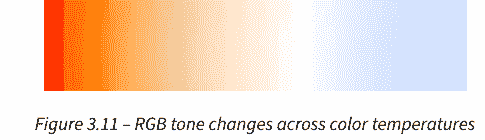

图3.11 – 不同色温下的 RGB 色调变化

PIL 中的 `convert(mode, matrix)` 方法允许使用变换矩阵 M 进行线性颜色变换。它对每个像素的 RGB 值应用线性变换。给定一个输入像素 (R, G, B)，它将其变换为新的输出像素 (R', G', B')，如下所示：

```
[R']   [α_R 0 0 0] [R]
[G'] = [0 α_G 0 0]·[G]
[B']   [0 0 α_B 0] [B]
                     [1]
```

这个变换独立地应用于图像中的每个像素。它可以用来模拟不同的光照条件（例如烛光、日光或冷荧光灯），因此对于照片颜色校正和艺术效果非常有用。

现在，请参考以下代码片段：

```
from PIL import Image

kelvin_table = {
    1000: (255,56,0),
    1500: (255,109,0),
    2000: (255,137,18),
    2500: (255,161,72),
    3000: (255,180,107),
    3500: (255,196,137),
    4000: (255,209,163),
    4500: (255,219,186),
    5000: (255,228,206),
    5500: (255,236,224),
    6000: (255,243,239),
    6500: (255,249,253),
    7000: (245,243,255),
    7500: (235,238,255),
    8000: (227,233,255),
    8500: (220,229,255),
    9000: (214,225,255),
    9500: (208,222,255),
    10000: (204,219,255)}

def convert_temp(image, temp):
    r, g, b = kelvin_table[temp]
    matrix = ( r / 255.0, 0.0, 0.0, 0.0,
               0.0, g / 255.0, 0.0, 0.0,
               0.0, 0.0, b / 255.0, 0.0 )
    return image.convert('RGB', matrix)

im = Image.open('images/boy.jpg').convert('RGB')
#print(im.mode)
plt.figure(figsize=(12,4))
plt.subplot(141), plt.imshow(im), plt.title('original', size=15)
for i, k in enumerate([1000, 5000, 10000]):
    plt.subplot(1,4,i+2), plt.imshow(convert_temp(im, k))
    plt.title(f'{k}K', size=15), plt.axis('off')
```

如果你运行上述代码片段，应该会得到类似下图的结果：

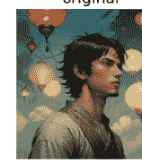

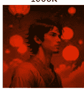

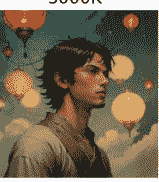

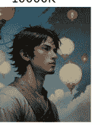

图3.12 – 使用PIL改变图像的色温

## 实现暗角/Lomography效果

暗角是一种图像边缘变暗的视觉效果，会在中心形成自然的聚光效果；而 Lomography 效果则是一种复古、高对比度、高饱和度的外观，常与老式胶片相机联系在一起。

接下来的 Python 演示通过组合暗角、增强饱和度和增强对比度来创建 Lomography 风格的效果。

`apply_vignette()` 函数利用每个像素到图像中心的距离生成径向遮罩：`vignette = clip(1 − αd^p, 0, 1)`，其中 alpha 控制暗角强度，p 控制衰减速率。

该遮罩与每个 RGB 通道相乘，使图像边缘变暗，同时保留中心区域。`lomography_effect()` 函数使用 `cv2.imread()` 加载图像，通过 `cv2.cvtColor()` 将其转换为 RGB，应用暗角效果，然后使用 `ImageEnhance.Color().enhance(1.3)` 增强色彩强度（饱和度增加30%），并使用 `ImageEnhance.Contrast().enhance(1.5)` 增强对比度（对比度增加50%）。最终图像呈现出典型的 Lomography 外观：边缘更暗、色彩更丰富、对比度更强，从而将注意力吸引到中心主体上。

```
from PIL import ImageEnhance

def apply_vignette(img, alpha=0.7, p=2.5):
    rows, cols = img.shape[:2]
    x, y = np.meshgrid(np.linspace(-1, 1, cols), \
                       np.linspace(-1, 1, rows))
    d = np.sqrt(x**2 + y**2)
    vignette = 1 - alpha * (d ** p)
    vignette = np.clip(vignette, 0, 1).astype(np.float32)

    for i in range(3):  # Apply to R, G, B channels
        img[:, :, i] = img[:, :, i] * vignette
    return img
```

```
def lomography_effect(img_path):
    img = cv2.imread(img_path)
    img = cv2.cvtColor(img, cv2.COLOR_BGR2RGB)  # Convert to RGB

    # Vignette Effect
    img = apply_vignette(img)

    # Increase Saturation
    pil_img = Image.fromarray(img)
    enhancer = ImageEnhance.Color(pil_img)
    img = np.array(enhancer.enhance(1.3))  # 30% saturation incr

    # Increase Contrast
    enhancer = ImageEnhance.Contrast(Image.fromarray(img))
    img = np.array(enhancer.enhance(1.5))  # 50% contrast incr

    return Image.fromarray(img)

# Apply effect and display
lomo_img = lomography_effect("images/pyramid.png")
lomo_img
```

如果你运行上述代码片段，应该会得到类似下图的结果：

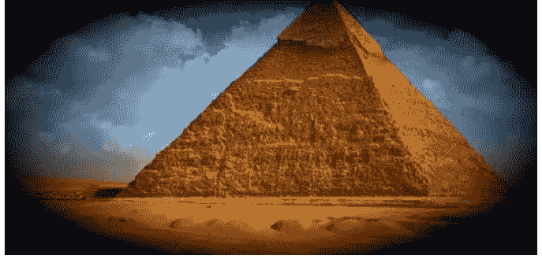

图3.13 – 使用PIL应用Lomography效果

## 实际应用

暗角和 Lomography 风格效果广泛用于手机摄影应用、复古滤镜以及 Instagram 等社交媒体平台，以增强视觉叙事能力。这些效果能够吸引观看者对主体的注意力，并营造怀旧或戏剧性的氛围。


在机器学习管道中，尤其是在图像分类或对比学习中，此类变换可以作为数据增强技术发挥作用。暗角效果可以引入类似遮挡的变化，提高模型对中心与周边特征重要性的鲁棒性。然而，过度应用可能会妨碍模型，如果它遮挡了关键信息。请根据任务谨慎使用此效果。

> **注意：**
>
> 反复在 PIL 和 NumPy 之间转换可能会引入内存和处理开销，尤其是在处理大图像时。为了获得更好的性能，请考虑批处理或以链式方式使用 PIL 原生操作，以避免不必要的转换。

## 使用 PIL 生成图像

PIL 可用于生成以下类型的图像：

- **曼德博集合：** `effect_mandelbrot()` 函数通过将指定的像素网格映射到复平面上的区域来生成曼德博分形图像。该区域由 extent 参数定义，它决定了要可视化的复平面区域。该函数接受的参数如下：
  - `size`: 请求的像素大小，2 元组：(width, height)
  - `extent`: 要覆盖的范围，4 元组：(x0, y0, x1, y1)
  - `quality`: 图像质量
- **以 (128 x 128) 为中心的大小为 (256 x 256) 的高斯噪声：** 使用 `effect_noise()` 函数。它接受的参数如下：
  - `size`: 请求的像素大小，2 元组：(width, height)
  - `sigma`: 噪声的标准差
- **256x256 从上到下从黑到白的线性渐变：** 使用 `linear_gradient()` 函数，接受参数 mode（输入模式）。
- **256x256 从中心到边缘从黑到白的径向渐变：** 使用 `radial_gradient()` 函数，同样接受 mode 参数（输入模式）。

> **提示：**
>
> 使用 `linear_gradient` 实现诸如淡入淡出、阴影和 UI 过渡等效果，而 `radial_gradient` 非常适合聚光灯效果、暗角或图像合成和光照模拟中的圆形蒙版。

以下代码片段演示了图像的生成：

```python
from PIL.Image import effect_mandelbrot, effect_noise, \
                  linear_gradient, radial_gradient

sz = (256, 256)
plt.figure(figsize=(20,8))
plt.imshow(np.hstack((
    effect_mandelbrot(size=sz, \
                      extent=(-2, 1.5, 1, 1.5), quality=100),
    effect_noise(size=sz, sigma=5),
    linear_gradient(mode='L'),
    radial_gradient(mode='L'))))
```

如果运行前面的代码片段，您应该获得类似于以下图示的结果。

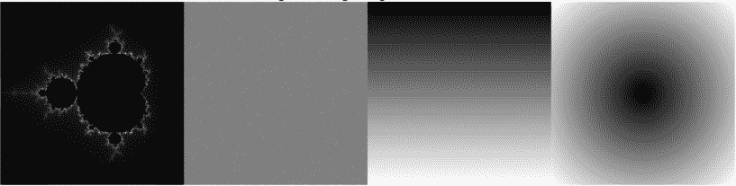

*Figure 3.14 – Generating images with PIL*

前述效果不仅可用于视觉实验，而且在程序化纹理生成（例如游戏开发、计算机图形学和模拟）、合成数据集（例如机器学习或计算机视觉）以及测试图像处理管道（例如由于已知的数学特性而对算法进行基准测试）中也有实际应用，在这些场景中受控的模式是有益的。

> **洞察：**
>
> **曼德博**集合被定义为复数集合，对于该集合，迭代 *sequence*，其中 *c*，不会发散到无穷大（即即使在 *n* 时也保持有界）。
>
> 这个 Stackoverflow 问题 https://stackoverflow.com/questions/78030547/how-to-make-faster-mandelbrot-set-plot 回答了如何从头用 Python 生成该集合。它不仅因其无限复杂性和自相似性而在视觉上令人着迷，而且还是分形几何中的基本构造，常用于说明混沌理论和复数动力学。

在探索了 Python PIL 库的图像处理多样化功能之后——从转换图像质量到应用艺术效果——我们解锁了广泛的创造可能性。但旅程还未结束！在下一节中，我们将深入 opencv-python 的图像处理世界，在那里有一套新的工具和技术等待着将我们的想象力推向更远。

## 使用 opencv-python 进行图像处理

如前所述，opencv-python 是 Python 编程语言中用于图像处理和计算机视觉任务的强大且广泛使用的库。以其简洁性和效率而闻名，opencv-python 使开发人员能够执行各种图像处理操作，从基本变换到高级计算机视觉应用。在本节中，您将学习如何使用库函数实现一些图像处理任务。

## 旋转

OpenCV 提供了通过仿射变换高效执行图像旋转的功能。在以下 Python 演示中，输入图像围绕其中心逆时针和顺时针旋转 45°。图像首先使用 cv2.imread() 加载，并使用 cv2.cvtColor() 从 OpenCV 默认的 BGR 颜色格式转换为 RGB 以便正确可视化。

旋转矩阵使用 cv2.getRotationMatrix2D(center, angle, scale) 计算，其中 center 指定枢轴点 x,y，angle 是旋转角度，单位为度（正值为逆时针旋转，负值为顺时针旋转），scale 控制图像缩放（设为 1 表示不缩放）。内部，该函数返回 2 × 3 仿射变换矩阵：

$$M = \begin{bmatrix} \alpha & \beta & (1-\alpha)c_x - \beta c_y \\ -\beta & \alpha & \beta c_x + (1-\alpha)c_y \end{bmatrix}$$

其中 $c_x, c_y$ 是旋转中心的坐标，$\alpha = \cos\theta$，$\beta = \sin\theta$，$s$ 是缩放因子，$\theta$ 是旋转角度。

然后使用 cv2.warpAffine(src, M, dsize) 应用变换，其中 src 是输入图像，M 是 2 × 3 仿射变换矩阵，dsize=(width, height) 指定输出图像尺寸。附加可选参数包括插值标志（例如 INTER_NEAREST、INTER_LINEAR、INTER_CUBIC）、用于处理图像边界外像素的 borderMode（例如 BORDER_CONSTANT、BORDER_REPLICATE、BORDER_REFLECT）以及在常数边框时指定填充颜色的 borderValue。生成的图像展示了使用仿射扭曲围绕图像中心进行顺时针和逆时针旋转。

```python
image = cv2.cvtColor(cv2.imread('images/fruits.png'), cv2.COLOR_BGR2RGB)
rotation_angle = 45
rows, cols = image.shape[:2]
rotation_matrix = cv2.getRotationMatrix2D((cols / 2, rows / 2), \
    rotation_angle, 1)
rotated_image_anticlockwise = cv2.warpAffine(image, \
    rotation_matrix, (cols, rows))
```

```python
rotation_matrix = cv2.getRotationMatrix2D((cols / 2, rows / 2), \
    -rotation_angle, 1)
rotated_image_clockwise = cv2.warpAffine(image, rotation_matrix, \
    (cols, rows))
plot_images([image, rotated_image_anticlockwise, \
            rotated_image_clockwise], \
    ['original', 'rotated counterclockwise', 'rotated clockwise'])
```

如果运行前面的代码片段，您应该获得类似于以下内容的结果：

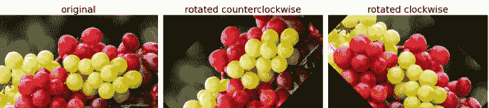

Figure 3.15 – Rotating an image with opencv-python

## 避免旋转图像时裁剪

在使用 cv2.getRotationMatrix2D() 和 cv2.warpAffine() 旋转图像时，默认输出画布大小通常保持与原始图像相同。这可能导致旋转图像的部分被裁剪，尤其是在较大旋转角度时。

为了防止裁剪，请考虑以下最佳实践：

- 计算新的画布大小，使其完全包含整个旋转后的图像，同时考虑旋转引起的宽度和高度变化
- 调整旋转矩阵的平移分量，使图像在放大的画布中居中
- 在调用 cv2.warpAffine() 时使用更新后的旋转矩阵和新的画布大小

这种方法可保留旋转后图像的所有内容，避免不必要的裁剪。如果您并排可视化有裁剪和无裁剪的旋转图像以及原始图像，您应该获得类似于以下内容的结果。

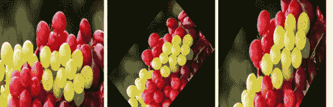

Figure 3.16 – Rotating an image with or without crop using opencv-python


## 翻转

图像翻转是一种几何变换，它使用 `cv2.flip()` 沿某个轴反转像素位置。该函数接受输入图像和一个 `flipCode` 参数，该参数指定翻转方向：`flipCode=0` 垂直翻转图像（上 ↔ 下），`flipCode=1` 水平翻转图像（左 ↔ 右），`flipCode=-1` 同时应用两种翻转，等效于 180° 旋转。下面的示例演示了全部三种翻转操作，并与原始图像进行比较：

```
im = cv2.cvtColor(cv2.imread('images/parrot.png'),
                  cv2.COLOR_BGR2RGB)
plt.imshow(np.hstack((im,
                      cv2.flip(im, flipCode=0), # Flip Image Vertically
                      cv2.flip(im, flipCode=1), # Flip Image Horizontally
                      # Flip Image Vertically and Horizontally
                      cv2.flip(im, flipCode=-1))))
```

如果你运行上面的代码片段，应该会得到类似下图的结果：

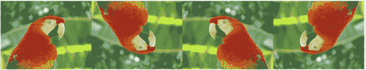

*图 3.17 – 使用 opencv-python 翻转图像*

### 何时使用 opencv-python 而不是 PIL

PIL（Pillow）非常适合简单的图像处理任务，如过滤、绘图、格式转换和快速原型设计，因为它易于使用且 API 可读性强。OpenCV 采用 C/C++ 实现并优化，通常更适合计算密集型的图像处理、实时视频应用和计算机视觉任务，在高分辨率图像或实时视频流上的缩放、扭曲和过滤等操作中性能明显更快。

### 实现交叉排线滤镜

交叉排线滤镜是一种图像处理技术，通过应用一个类似于交叉线的核来增强对角边缘，模仿绘画中传统的排线技法。该滤镜通过与结构化的核进行卷积来强调图像中的对角特征。下面的代码片段使用 opencv-python 实现了一个交叉排线滤镜。我们先来分解代码：

- 它使用 opencv-python 的 `imread()` 函数加载图像（注意：该函数将 RGB 图像加载为 BGR）。
- 核的创建过程如下：
  - `np.eye(length, dtype=np.float32)`：创建一个大小为 24 × 24 的单位矩阵。单位矩阵在主对角线上为 1，其余位置为 0：
  - `kern[:, ::-1]`：水平翻转单位矩阵，创建一个次对角线上的 1：

    ```text
    [1  0  ...  0  0]
    [0  1  ...  0  0]
    [... ... ... ... ...]
    [0  0  ...  1  0]
    [0  0  ...  0  1]
    ```

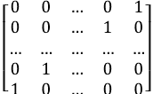

- `np.maximum(kern, kern[:,::-1])`：取单位矩阵与其翻转版本的元素级最大值，产生交叉排线模式：

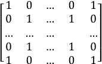

- `kern / (2 * length)`：通过除以 2 * length = 48 来对核进行归一化，以确保卷积不会显著改变亮度。

`cv.filter2D(im, -1, kern)` 函数将交叉排线卷积应用于图像。它增强了对角边缘，产生了类似交叉排线的风格化效果。现在，请参考以下代码片段：

```python
im = cv2.imread('images/tram.png')

length = 24 #24
kern = np.eye(length, dtype=np.float32)
kern = np.maximum(kern, kern[:,::-1]) / (2 * length)
#print(kern)
res = cv2.filter2D(im, -1, kern)
im, res = cv2.cvtColor(im, cv2.COLOR_RGB2BGR), \
            cv2.cvtColor(res, cv2.COLOR_RGB2BGR)

plt.figure(figsize=(10,5))
plt.imshow(np.hstack((im,res))), plt.axis('off')
plt.title('original vs. crosshatched images', size=15)
plt.tight_layout()
plt.show()
```

如果你运行上面的代码片段，应该会得到类似下图的结果：

# 原始图像与交叉排线图像对比

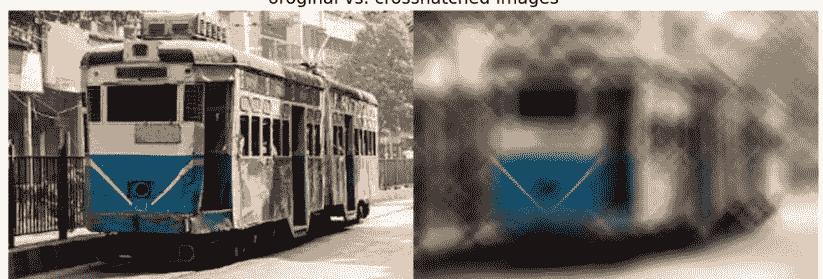

图 3.18 – 使用 opencv-python 实现交叉排线滤镜

### 注意：

交叉排线滤镜通常用于非真实感渲染（NPR）应用。常见领域包括：

- 漫画和图像小说渲染，其中滤镜模仿传统的墨色阴影技术
- 手机摄影应用中的艺术或风格化视觉效果
- 游戏和动画流程中的纹理风格化
- 图像处理工作流中用于边缘感知抽象和素描生成的预处理

## 实现单应变换

单应性是指将平面中的点映射到另一平面中对应点的数学变换。在计算机视觉和图像处理中，单应性常用于描述从不同视点或不同角度拍摄的同一场景的两幅图像之间的变换。

单应矩阵（H）是一个 3 × 3 矩阵，表示射影几何中两个平面之间的线性变换。它可以用于将一个图像中的点的坐标映射到另一个图像中的对应坐标。

现在，让我们学习如何使用 opencv-python 和 skimage.transform 模块函数实现单应变换（透视图像变换），并比较它们的性能。

### 使用 opencv-python

`cv2.getPerspectiveTransform()` 函数可用于计算透视变换矩阵。这个矩阵可用于对图像执行透视变换。以下是使用它实现单应变换的方法：

- 首先，你需要有源坐标空间和目标坐标空间中的四对对应点。每对应为 (x, y) 坐标的元组，如下面的代码片段所示：

```
im_src = (imread('images/books.jpg'))
height, width, dim = im_src.shape
src = np.array([[267., 364.],
                [312., 683.],
                [555., 598.],
                [561., 284.]], dtype='float32')
dst = np.array([[  0.,   0.],
                [0, height-1],
                [width-1, height-1],
                [width-1, 0.]], dtype='float32')

def plot_images(src, dst):
    plt.figure(figsize=(7,7))
    plt.subplot(121), plt.imshow(src), plt.axis('off')
    plt.title('Source image', size=15)
    plt.subplot(122), plt.imshow(dst), plt.axis('off')
    plt.title('Destination image', size=15)
    plt.tight_layout()
    plt.show()
```

- 使用 `cv2.getPerspectiveTransform()` 根据对应点计算透视变换矩阵。numpy 的 ndarray `perspective_matrix` 表示对应透视变换的 3x3 矩阵。

- 一旦你有了透视变换矩阵，就可以使用 `cv2.warpPerspective()` 函数来变换坐标或扭曲图像：

```
%timeit M = cv2.getPerspectiveTransform(src, dst)
%timeit im_dst = cv2.warpPerspective(im_src, M, (width, height), flags=cv2.INTER_LINEAR)
# plot_images(im_src, im_dst)
# 4.22 µs±160 ns per loop (mean ± std. dev. of 7 runs, 100000 loops each)
# 7.21 ms±385 µs per loop (mean ± std. dev. of 7 runs, 100 loops each)
```

> **注意：**
> 
> `src` 和 `dst` 中的点必须按顺序一一对应。例如，如果 `src[0]` 指向原始区域的左上角，那么 `dst[0]` 必须指向目标区域的左上角。错配的点对可能导致错误的扭曲。

### 使用 `scikit-image.transform.warp()`

`skimage.transform.warp()` 函数可用于对图像应用几何变换。这是一个通用函数，允许你指定一个变换函数或一个预先计算的变换矩阵。`skimage.transform.warp()` 函数执行后向变换，而前面演示的 `cv2.warpPerspective()` 执行前向变换。

该函数接受输入（源）图像以及一个逆坐标映射参数 `inverse_map`，该参数将输出图像中的坐标变换为输入图像中的对应坐标（可以通过对变换矩阵 M 求逆得到）。

你可以通过设置 order 参数来指定变换过程中使用的插值方法，默认插值方法为 `'nearest'`：

```python
%timeit im_dst = warp(im_src, np.linalg.inv(M), clip=False)
# plot_images(im_src, im_dst)
# 136 ms ± 17.1 ms per loop (mean ± std. dev. of 7 runs,
# 10 loops each)
```

### 使用 `scikit-image.transform.ProjectiveTransform`

在 `scikit-image` 中，`ProjectiveTransform` 是一个表示二维射影变换的类，可用于对图像执行旋转、缩放、平移和倾斜等几何变换。你可以通过提供一个变换矩阵来创建 `ProjectiveTransform` 实例：

- 还可以使用 `ProjectiveTransform` 的 `estimate()` 方法估计变换矩阵（3x3）。它根据一组对应点（来自源图像和目标图像）估计变换矩阵 *M*。参数通过整体最小二乘法确定。源坐标和目标坐标的数量必须匹配。另请注意，坐标必须先重新排列为 (y, x) 格式。最后，使用 `inverse()` 方法返回表示逆变换的变换对象。
- 下一个代码片段中的 `warp_perspective()` 函数（使用**类型注解**定义）再次实现了单应变换。它使用 `ProjectiveTransform` 将源图像像素映射到由目标点定义的新透视视角，步骤如下：
  - 首先，从来自源图像和目标图像的匹配点集 `src_pts` 和 `dst_pts` 中估计射影变换（`inverse_map`）。
  - 然后，使用逆变换获取目标图像中每个点对应的源坐标。它使用逆变换将目标坐标的网格扭曲回源（同时裁剪坐标）。


+   - 最后，目标图像像素是通过从源图像中复制有效像素值（例如，对应于落在图像尺寸边界内的坐标的像素）获得的，使用获得的源索引。有效地，它实现了 `warp()` 函数。

为什么在估计 `ProjectiveTransform` 之前要将 `src_pts` 和 `dst_pts` 重新排列为 `(x, y) → (y, x)`？

+   - 在数学/几何术语中（例如，在平面中定义点时），坐标通常表示为 `(x, y)`，其中适用以下条件：
+     - `x` 是水平轴（列索引）
+     - `y` 是垂直轴（行索引）
+   - 然而，在 NumPy 和图像数组中，像素是使用行优先顺序访问的。
+   - 因此，在处理图像变换时，例如在使用 `skimage.transform.ProjectiveTransform` 类的 `estimate()` 方法时，它期望点采用 (行, 列) 格式（即 `(y, x)`）。因此，有必要重新排列输入坐标。

下面的代码片段演示了该函数的工作原理，其中以下图表示输入图像被扭曲以产生所示输出：

```
def warp_projective(src_pts: np.ndarray, dst_pts: np.ndarray, \
                   im_src: np.ndarray
) -> np.ndarray:
    # Rearrange coordinates from (x, y) to (y, x) format
    # for processing
    src, dst = src_pts[:, [1, 0]], dst_pts[:, [1, 0]]
    # Create a ProjectiveTransform object, estimate transform from
    # src to dst
    pt = ProjectiveTransform()
    pt.estimate(src, dst)
    # Generate a meshgrid of pixel coordinates in dst image
    x, y = np.mgrid[:height, :width]
    dst_indices = np.hstack((x.reshape(-1, 1), y.reshape(-1,1)))
    # Apply inverse transform to get corresponding src coords
    src_indices = np.round(pt.inverse(dst_indices), 0) \
                    .astype(int)

    # Filter out indices that fall outside the valid image bounds
    valid_idx = np.where((src_indices[:,0] < height) & \
                         (src_indices[:,1] < width) & \
                         (src_indices[:,0] >= 0) & \
                         (src_indices[:,1] >= 0))
    # Keep only valid destination and corresponding source
    # coordinates
    dst_indices_valid = dst_indices[valid_idx]
```

```
src_indices_valid = src_indices[valid_idx]
# Initialize destination image with zeros
im_dst = np.zeros_like(im_src)
# Map pixel values from source image to destination image
# using valid indices
im_dst[dst_indices_valid[:,0], dst_indices_valid[:,1]] = \
    im_src[src_indices_valid[:,0],src_indices_valid[:,1]]
# Return the final warped image as an unsigned 8-bit
# integer array
return im_dst.astype(np.uint8)

%timeit im_dst = warp_projective(src, dst, im_src)
plot_images(im_src, im_dst)
# 149 ms ± 25.5 ms per loop (mean ± std. dev. of 7 runs,
# 10 loops each)
```

如果运行前面的代码片段，您应该得到类似以下内容的结果。

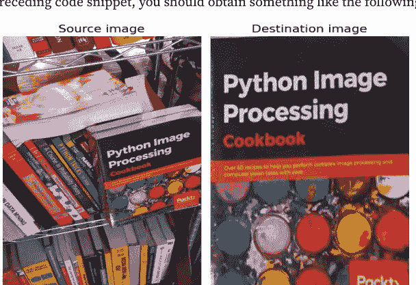

图 3.19 – 使用 scikit-image 进行透视变换

下表总结了前面三种基于执行速度、易用性和灵活性实现的单应性方法：

| Method | Execution Speed | Ease of Use | Flexibility |
|---|---|---|---|
| cv2.getPerspectiveTransform() + cv2.warpPerspective() | Fastest (~7.2 ms) | Very easy – two lines | Moderate – supports four-point homography only |

| Method | Execution Speed | Ease of Use | Flexibility |
|---|---|---|---|
| `skimage.transform.warp()` with inverse map | Moderate (~136 ms) | Easy – functional API | High – supports interpolation, inverse maps |
| `ProjectiveTransform` + custom warping | Slowest (~149 ms) | Moderate – more verbose | Highest – full control over mapping and indexing |

*Table 3.1 – Implementing homography with opencv-python and scikit-image*

## Removing fisheye distortion

鱼眼畸变校正使用相机校准参数将畸变像素重新映射到其未畸变位置。为了更好地理解畸变校正，让我们将校正应用于下图所示的桶形畸变棋盘图案。这里，清晰的直线在畸变图像中明显弯曲，并在校正后变直，使校正效果更易于解释。

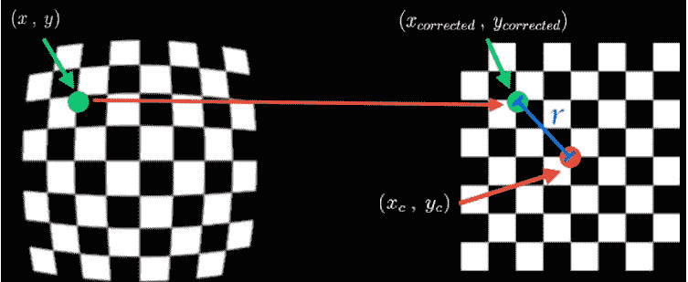

*Figure 3.20 – Removing fisheye distortion with opencv-python*

下面的代码片段演示了使用 opencv-python 从图像中去除鱼眼畸变的过程。相机内参矩阵 K 存储焦距和主点坐标，而畸变系数 D 模拟径向和切向鱼眼畸变。函数 `cv2.fisheye.initUndistortRectifyMap()` 计算去畸变映射（`map1`, `map2`），而 `cv2.remap()` 应用这些映射以生成校正后的图像。关键的 `cv2.remap()` 参数包括输入图像（`src`）、坐标映射（`map1`, `map2`）、插值方法（例如 `cv2.INTER_LINEAR`）和边界处理（`borderMode`）。

请参考以下代码片段：

```
```python
# Camera intrinsic matrix (K), representing focal lengths and principal point coordinates. These parameters can be computed during camera calibration
K = np.array(
```

```
[[338.37324094,0,319.5], # fx, cx
[0,339.059099,239.5],  # fy, cy
[0,0,1]], dtype=np.float64

# Distortion coefficients (D), representing radial and tangential distortion. # These values define the fisheye distortion parameters
D = np.array([ [ 0.01794191], [-0.12190366],[ 0.14111533],[-0.09602948]],
    dtype=np.float64)
# Desired size of the output undistorted image
new_size = (640, 480)
# Copy the intrinsic matrix to retain original values
Knew = K.copy()
# Generate undistortion and rectification maps for fisheye correction.
# Mapping pixels from distorted to undistorted coordinates
unfishmap1, unfishmap2 = cv2.fisheye.initUndistortRectifyMap(
    K, D, np.eye(3),
    Knew, new_size, cv2.CV_32F
)
# Load the distorted image
img = plt.imread('images/chess_distorted.png')
# Apply the remapping function to correct the distortion
img_undistorted = cv2.remap(img, unfishmap1, unfishmap2,
    interpolation=cv2.INTER_LINEAR,
    borderMode=cv2.BORDER_CONSTANT
)
# Display the original distorted image
plt.subplot(121), plt.imshow(img, aspect='auto'), plt.axis('off')plt.
title('distorted', size=20)
# Display the corrected (undistorted) image
plt.subplot(122), plt.imshow(img_undistorted,aspect='auto'), plt.axis('off')
# Adjust layout for better visualization
plt.title('undistorted', size=20)
plt.tight_layout()
```

## Controlling the field of view with Knew

可以修改 Knew 矩阵来控制未畸变图像的视场（FOV）：

+   - 缩小 Knew 会导致更宽的 FOV，但会引入黑色边框（填充）
+   - 放大 Knew 会缩小 FOV，但提供中心区域的更紧密裁剪

这在为不同的显示目标调整时很有用（例如，全帧与裁剪输出）。

如果运行上一节中的代码片段，您应该得到类似以下图的图像：

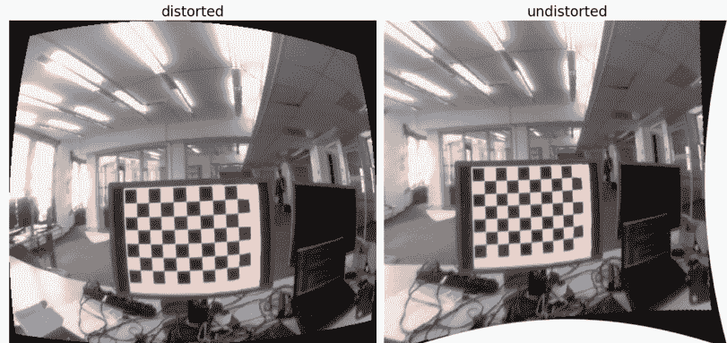

图 3.21 – 使用 opencv-python 去除鱼眼畸变

## Interpolation methods in cv2.remap()

`cv2.remap()` 中的插值参数控制对非整数映射坐标的像素值如何计算。您可以根据速度和输出质量之间的权衡进行选择：

| Method | Speed | Quality | Use When... |
|---|---|---|---|
| cv2.INTER_NEAREST | Fastest | Low | Speed is critical, or for discrete masks |
| cv2.INTER_LINEAR | Balanced | Good | General-purpose image remapping |
| cv2.INTER_CUBIC | Slow | High | Image quality is a top priority |

对于鱼眼校正，`cv2.INTER_LINEAR` 提供了一个良好的平衡，但如果边缘平滑很重要（例如，用于出版质量的视觉效果），请使用 `cv2.INTER_CUBIC`。

## With defisheye

defisheye 库为校正鱼眼畸变提供了一个简单的高级接口，而无需显式相机校准参数。下面的代码使用输入图像、鱼眼校正类型（dtype）、图像格式、视场（fov）和首选输出视场（pfov）创建一个 Defisheye 对象。`convert()` 方法随后根据所选投影模型执行畸变校正。演示了三种校正方法：linear、equalarea 和 stereographic，每种方法都对场景产生不同的几何映射。校正后的图像被收集并与原始畸变图像一起显示，以便直观比较不同鱼眼校正模型的效果。


请参考以下代码片段：

```
from defisheye import Defisheye

dtype = 'linear'
format = 'fullframe'
fov = 180
pfov = 120

img = "images/fishy.jpeg"

dtypes = ['linear', 'equalarea', 'stereographic']
cor_imgs = []
for dtype in dtypes:
    obj = Defisheye(img, dtype=dtype, format=format, \
                    fov=fov, pfov=pfov)
    # To save image locally
    # obj.convert(outfile=img_out)
    cor_img = obj.convert()
    # print(cor_img.shape)
    cor_imgs.append(cv2.cvtColor(cor_img, cv2.COLOR_BGR2RGB))

plt.imshow(np.hstack((plt.imread(img), cor_imgs[0], \
                    cor_imgs[1], cor_imgs[2])), plt.axis('off')
plt.title('Fish eye correction with defisheye', size=20)
```

如果运行上述代码片段，你应该得到如下图所示的结果。

## Fish eye correction with defisheye

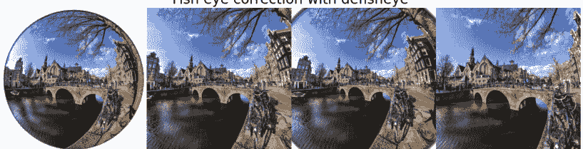

Figure 3.22 – Applying fisheye correction with defisheye

在掌握了使用 opencv-python 进行几何变换和创意效果后，你已准备好深入像素级操作。在下一节中，我们将探索使用 scipy.ndimage 进行图像操作，其中精确的滤波器和数学变换为图像处理开辟了新的可能性。

## Image manipulation with scipy.ndimage

scipy.ndimage 模块提供了各种图像操作函数。它是 SciPy 库的一部分，并构建在 NumPy 之上。以下是一些可以使用 scipy.ndimage 执行的常见图像操作任务。

### Applying affine transformation

我们可以使用 affine_transform() 函数并提供 3x3 变换矩阵（齐次坐标）和偏移量来进行变换，如以下代码块所示：

```
from scipy.ndimage import affine_transform
im = imread("images/parrot.png")
transformed = affine_transform(im,
    [[np.cos(np.pi/4),np.sin(np.pi/4), 0],
     [-np.sin(np.pi/4),np.cos(np.pi/4), 0],
     [0,0,1]],
    offset = [-im.shape[0]/2+75,
              im.shape[1]/2-50, 0],
    output_shape=im.shape)
plt.imshow(transformed), plt.axis('off')
```

运行上述代码片段应产生以下图所示的输出：

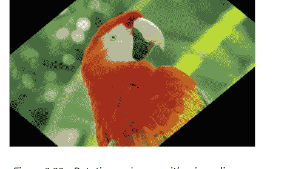

Figure 3.23 – Rotating an image with scipy.ndimage

### Zooming

在图像处理中，放大和缩小是指改变图像表观大小的操作。这些操作涉及调整图像的空间分辨率，使其在显示器上显得更大或更小：

- Zooming in: 也称为放大或放大，这涉及使图像在显示器上显得更大，通过增加其空间分辨率。图像中的细节变得更加可见，图像占据屏幕或画布的更大部分。放大通常用于仔细检查图像的精细细节或专注于感兴趣的特定区域。
- **Zooming out:** 也称为缩小，这涉及使图像在显示器上显得更小，通过降低其空间分辨率。整个图像在屏幕上可见，但细节可能变得难以区分。图像占据屏幕或画布的更小部分。缩小在你想要获得整个图像的概览或处理大型数据集时很有用，其中缩减的表示就足够了。

以下代码块演示了如何使用 `scipy.ndimage` 模块中的 `zoom()` 函数放大图像，然后使用 NumPy ndarray 切片裁剪图像的一部分。

请注意，`zoom_in_factor` 设置为 2，表示我们希望在两个维度上将图像大小加倍。

还请注意，颜色通道没有缩放。`zoom=(2,2,1)` 意味着沿颜色通道的 zoom_factor 值为 1。此外，以下代码片段中使用的 **spline interpolation** 的阶数为 1。

用户可以使用小于 1 的 zoom 值进行缩小（通过下采样）。

现在，请参考以下代码片段：

```
```python
import scipy.ndimage as ndimage
im = imread('images/parrot.jpg') / 255
zoomed_im = ndimage.zoom(im, zoom=(2,2,1), mode='nearest', \
                          order=1)
print(im.shape, zoomed_im.shape)
# (340, 453, 3) (680, 906, 3)
plt.subplot(121), plt.imshow(im, aspect='auto')
plt.title('Original Image', size=20)
plt.subplot(122), plt.imshow(zoomed_im[150:400,350:650,:], \
                             aspect='auto') # crop the enlarged image
plt.title('Zoomed and Cropped Image', size=20)
```
```

运行上述代码片段应产生以下图所示的输出：

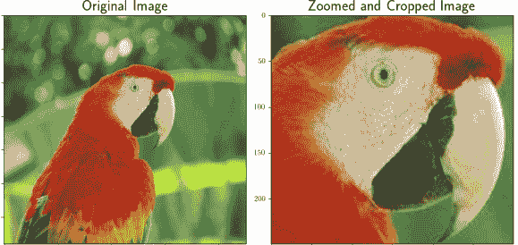

*Figure 3.24 – Zooming/cropping an image with scipy.ndimage*

### Applying interpolation

现在，你将看到如何使用相同的函数 ndimage.zoom()，以不同的样条插值阶数将砖块图像放大两倍：

```
im = imread('images/ bricks_small.jpeg')
n = 2
interp_images = []
for k in range(1,5):
    # no zoom on color channel, spline interpolation order = k
    zoomed_im = ndimage.zoom(im, (n,n,1), mode='nearest', \
                             order=k)
    interp_images.append(zoomed_im)
    interp_images.append(interp_images[-1]-interp_images[0])
plt.imshow(np.hstack(interp_images)), plt.axis('off')
```

如果运行上述代码片段，你应该得到如下图所示的结果。它表明，使用样条插值阶数得到的输出图像是对重采样图像的更好近似（更清晰，因此包含更多细节），而不是使用阶数 1 得到的结果。

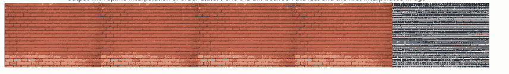

Figure 3.25 – Spline interpolation to zoom into an image

### Applying wave distortion

以下代码片段使用 scipy.ndimage.map_coordinates() 函数对蒙娜丽莎图像应用正弦失真，通过基于 x 坐标的正弦函数修改图像像素的 y 坐标，创造出视觉上有趣的效果。以下是关键步骤：

- np.meshgrid() 函数用于创建表示原始图像中像素位置的坐标网格。
- 坐标通过基于坐标的正弦失真进行修改。
- scipy.ndimage 中的 map_coordinates() 函数用于将像素值从原始图像映射到失真坐标。它用于从失真坐标插值像素值，从而得到最终的失真图像。

现在请参考以下代码片段：

```
im = imread('images/monalisa.jpg', True)
x,y = np.meshgrid(np.float32(np.arange(im.shape[1])), \
    np.float32(np.arange(im.shape[0])))
```

```
```python
y = y + 20*np.sin(x/15)
distorted = ndimage.map_coordinates(im, [y.ravel(),x.ravel()])
plt.imshow(distorted.reshape(im.shape)), plt.axis('off')
```
```

如果运行上述代码，你应该得到如下类似的结果。

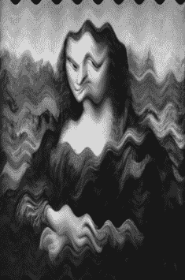

*Figure 3.26 – Applying wave distortion to an image*

## Image manipulation with Wand

Wand 是 ImageMagick 的 Python 绑定，ImageMagick 是一个用于创建、编辑、合成或转换图像的软件套件。我们应该在你的计算机上安装 ImageMagick（从这里下载：https://imagemagick.org/script/download.php）并正确配置环境变量 `MAGICK_HOME`（指向安装位置）。使用以下代码检查已安装的 python 版本并验证 ImageMagick 是否正确安装，在 jupyter notebook 中执行以下命令（或在控制台运行），你应该得到如下输出：

```
```python
!python -VV
# Python 3.8.16 (default, Jan 17 2023, 22:25:28)
# [MSC v.1916 64 bit (AMD64)]
import os
os.environ['MAGICK_HOME']
# 'C:\\Program Files\\ImageMagick-7.1.1-Q16-HDRI'
```
```

### Creating visual effects

Wand 库提供了一系列内置的艺术和摄影效果，由以下代码片段演示。辅助函数 `call_func()` 使用 `getattr()` 动态地将效果应用于克隆的图像，防止修改原始图像。名为 `functions` 的字典存储效果名称及其参数，允许自动应用多个效果。


The demonstrated effects include `blue_shift()` (moonlight-like blue tint), `charcoal()` (sketch effect), `colorize()` and `tint()` (color blending), `vignette()` (darkened borders), `sepia_tone()` (vintage appearance), `implode()` (pulls pixels toward the center), `polaroid()` (adds a Polaroid-style frame and shadow), `swirl()`, `wave()`, `shade()` (3D shading effect), `white_balance()`, `cycle_color_map()`, and `spread()`. The code loads an image with `wand.image.Image`, applies each effect with its corresponding parameters, and displays the original and transformed results in a Matplotlib grid, illustrating the variety of visual effects available through Wand and ImageMagick.

Now, refer to the following code snippet:

```python
from wand.image import Image as ImageW
from wand.color import Color


def call_func(img, func_name):
    img = img.clone()
    func = getattr(img, func_name)
    arg_dict = functions[func_name]
    func(**arg_dict)
    return img

functions = {
    'spread': {'radius':16.0},
    'blue_shift': {'factor':2},
    'charcoal': {'radius':2, 'sigma':1},
    'colorize': {'color': 'magenta', 'alpha':"rgb(10%, 50%, 20%)"},
    'tint': {'color': 'magenta', 'alpha': 'rgb(50%, 70%, 80%)'},
    'vignette': {'sigma':3, 'x':15, 'y':15},
    'sepia_tone': {'threshold': 0.9}, 'implode': {'amount':0.5},
    'polaroid': {}, 'swirl': {'degree': -120},
                 'wave': {'amplitude':10, 'wave_length':50},
    'shade': {'gray':True, 'azimuth':100.0, 'elevation':45.0},
    'white_balance': {},
    'cycle_color_map': {'offset': 50}
}

with ImageW(filename="images/parrot.png") as img:
    plt.subplot(3,5,1), plt.imshow(np.array(img))
    plt.axis('off'), plt.title('original', size=20)
    i = 2
    for func_name in functions:
        out_img = call_func(img, func_name)
        plt.subplot(3,5,i), plt.imshow(np.array(out_img))
```

```python
with ImageW(filename="images/parrot.png") as img:
    filtered_img = img.fx(fx_filter)
```

If you run the preceding code snippet, you should obtain something similar to the following.

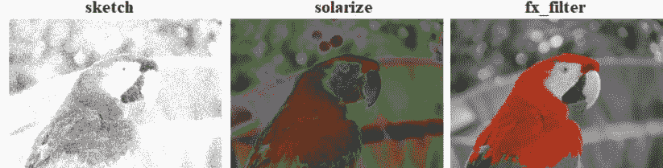

*Figure 3.28 – Applying sketch, solarize, and fx_filter with Wand*

## Distorting and undistorting images

Image distortion commonly arises from lens effects, with radial distortion causing straight lines to appear curved. Distortion can be modeled mathematically (e.g., with the Brown–Conrady model) using radial and tangential distortion coefficients. Distortion is applied by mapping original pixel coordinates to distorted coordinates, while undistortion reverses this process using known distortion parameters, typically obtained through camera calibration (e.g., using checkerboard images). Libraries such as OpenCV and Wand provide tools for distortion correction.

The next code snippet uses Wand's `Image.distort()` method to simulate several geometric distortions:

- `distort('barrel', ...)`: Applies radial barrel distortion, causing straight lines to bulge outward.
- `distort('polar', ...)`: Transforms the image between Cartesian and polar coordinate systems, producing a radial warping effect.
- `distort('arc', (ArcAngle, RotateAngle))`: Bends the image along a curved arc.
- `distort('shepards', ...)`: Applies Shepard's (Inverse Distance Weighting) distortion, where pixel positions are warped using distance-based interpolation weights.

Additional settings such as `virtual_pixel='transparent'`, `artifacts['distort:viewport']`, and `artifacts['shepards:power']` control boundary handling and distortion behavior. The resulting images demonstrate various geometric warping effects, including bulging, radial, arched, and spatially interpolated deformations.

```python
with ImageW(filename='images/house.png') as im:
    w, h = im.size
    im.virtual_pixel = 'transparent'  # 'black'
    im_out_barrel = im.clone()
    im_out_barrel.distort('barrel', (0.2, 0.0, 0.0, 1.0))
    im_out_barrel.save(filename='images/house_distorted.png')
```

If you run the preceding code snippet, you should obtain something similar to the following figure:

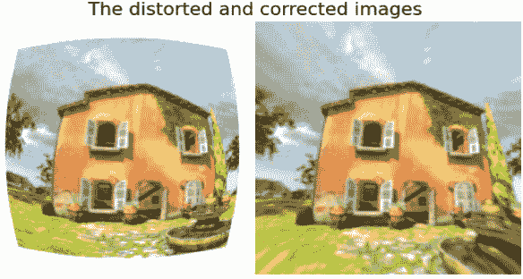

*Figure 3.30 – Undistorting an image with Wand*

Now that you’ve explored how to craft compelling visual effects and perform advanced image transformations using Wand, it’s time to switch gears. In the next section, we’ll dive into image manipulation with Matplotlib, where data visualization meets creative image processing.

## Image manipulation with Matplotlib

### Adding annotations to an image

You can add annotations such as text and arrows (with the `text()` and `arrow()` functions from the `matplotlib.pylab` module) to enhance the visualization of an image, as shown in the following example:

- `plt.text()` places the text Packt at the specified coordinates (310,310) in red and with a font size of 40.
- `plt.arrow()` adds an arrow starting from the point (300, 225) with a specified length and angle. It is blue and has a width of 5, and the arrowhead has a width of 15.

Now, refer to the following code snippet:

```python
im = plt.imread('images/parrot.jpg')
plt.imshow(im)
plt.text(310, 310, 'Packt', color='red', fontsize=40, alpha=0.5)
plt.arrow(300, 225, 25, 25, color='blue', width=5, \
                              head_width=15)
```

If you run the preceding code snippet, you should obtain something similar to the following:

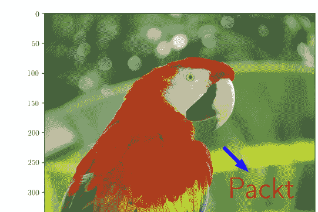

*Figure 3.31 – Annotating an image with text*

### Drawing contour lines for an image

A contour line for an image is a curve connecting all the pixels where they have the same particular (constant) value. If we represent the image as a function, f(x, y), where x and y are the spatial coordinates, a contour line corresponds to a set of points (x, y) such that f(x, y) = constant.

The following code snippet shows how to draw the contour lines for a gray-scale image of Einstein, using the `contour()` function from the `matplotlib.pylab` module.

The constant levels are specified using the `np.linspace()` function, which creates an array with 15 values, evenly spaced between 0 and 255 (inclusive), to be used as levels (constants) for the contour plot.

Contour lines can be styled and colored using various parameters, such as `colors`, `cmap` (colormap; here `plt.cm.hot` is used), and `linewidths`. You can fill the regions between contours using `plt.contourf()`.

You can add labels to the contours using the `plt.clabel()` function. This adds labels to the contours at specified locations (as can be seen from the following figures, the 18.2, 36.4, and 91.1 levels are added as labels. These values were generated previously using `np.linspace()`).

Now, refer to the following code snippet:

```python
im = imread("images/einstein.jpg")  # read image as
                                    # a numpy ndarray

plt.subplot(131), plt.imshow(im, cmap='gray', aspect='auto')
plt.axis('off'), plt.title('Original Image', size=20)
plt.subplot(132)
cs = plt.contour(np.flipud(im), levels=np.linspace(0,255,15), \
                 cmap=plt.cm.hot)
plt.clabel(cs, fontsize=15, inline=True)
```

```python
plt.gray()
plt.subplot(131), plt.imshow(im_ctr, aspect='auto')  # PIL
plt.subplot(132), plt.imshow(im_gray, aspect='auto')  # cv2
plt.subplot(133), plt.imshow(im, aspect='auto', alpha=0.25)
# skimage
for contour in contours:
    plt.plot(contour[:, 1], contour[:, 0], linewidth=2)
```

If you run the preceding code snippet, you should obtain something similar to the following:

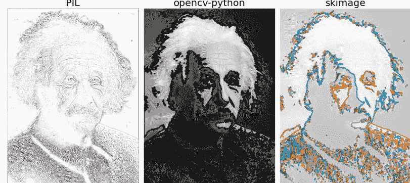

*Figure 3.33 – Drawing contour lines on an image with PIL, scikit-image, and opencv-python*

Compare the contour plots obtained with three different libraries in the preceding figure.

## Image manipulations with Pilgram

Pilgram filters work by adjusting colors, contrast, brightness, and other properties. They work by manipulating pixel values using mathematical transformations, such as convolution, color mapping, and blending.

Mathematically, a filter can be expressed as a function, F, applied to an image matrix, I' = F(I), where we have the following:

- I is the original image represented as a matrix of pixel values
- F is the transformation function (filter effect)
- I' is the resulting filtered image


如我们之前所见，滤镜使用数学变换修改像素值，例如颜色映射、伽马校正和卷积。滤镜通常涉及以下内容：

- **颜色变换：** 使用变换矩阵调整 RGB 值：

$$
\begin{bmatrix}R'\\G'\\B'\end{bmatrix}=M\times\begin{bmatrix}R\\G\\B\end{bmatrix}+B
$$

这里，$M$ 是变换矩阵，$B$ 是偏置向量。

- **伽马校正：** 使用 $I' = I^\gamma$ 调整亮度，其中 $\gamma$ 控制亮度。

- **卷积滤镜：** 应用核 $K$ 来增强特征：

$$
I'(x,y)=\sum_{i=-k}^{k}\sum_{j=-k}^{k}I(x-i,y-j)K(i,j)
$$

这里，$K$ 是滤波器核，例如高斯模糊或锐化。

以下 Python 代码片段将 Pilgram 库中的多个 Instagram 风格滤镜应用于图像并以网格形式显示。以下是关键步骤：

1. `getmembers(pilgram, isfunction)` 函数检索 Pilgram 库中可用的所有滤镜函数。
2. 莫奈丽莎图像从磁盘加载，然后每个滤镜函数都应用于此（原始）图像 im，并将生成的图像存储在名为 effects 的字典中，以滤镜名称作为键。
3. 原始图像以及经过滤波的图像（以及作为标题的已应用滤镜名称）通过遍历 effects 字典，使用 Matplotlib 以网格形式显示。

现在，参考以下代码片段：

```
# !pip install pilgram
import pilgram
# dir(pilgram)
from PIL import Image
from inspect import getmembers, isfunction
import matplotlib.pyplot as plt

im = Image.open('images/monalisa.jpg')
effects = {'original': im}
for f in getmembers(pilgram, isfunction):
```

```
```python
effects[f[0]] = f[-1](im)

i = 1
for e, im in effects.items():
    # print(e)
    plt.subplot(5,6,i), plt.imshow(im), plt.title(e, size=15)
    i += 1
```
```

如果运行上述代码片段，您应该得到类似以下图示的结果：

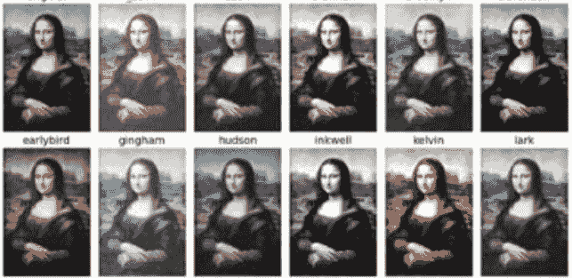

*图 3.34 – 使用 Pilgram 的 Instagram 风格滤镜*

## 使用 pilgram.css 模块

Pilgram 库使用 Python 重现 Instagram 滤镜，遵循与 CSS 滤镜相同的图像处理技术。虽然 CSS 滤镜在 Web 浏览器中应用，但 Pilgram 使用 PIL（Pillow）在 Python 中以编程方式应用它们。

下一个代码片段将五个 CSS 风格滤镜（contrast、grayscale、hue_rotate、saturate 和 sepia）从 pilgram.css 应用于图像，并使用 Matplotlib 并排显示：

```
```python
import pilgram.css
im = Image.open('images/me.png')

i = 1
for f in ['contrast', 'grayscale', 'hue_rotate', \
          'saturate', 'sepia']:
    func = getattr(pilgram.css, f)
    plt.subplot(1,5,i), plt.imshow(func(im))
    plt.title(f, size=12)
    i += 1
```
```

如果运行上述代码片段，您应该得到类似以下结果：

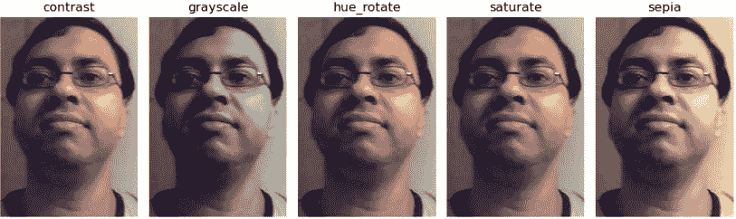

*图 3.35 – 使用 Pilgram 的 CSS 风格滤镜*

## 实际应用案例亮点

本章讨论的技术虽然强调视觉效果和创意操控，但也在各个行业中发挥着实际作用。例如，伽马校正和基于 LUT 的色彩分级是电影后期制作工作流程的标准；晕影和色温调整用于移动照片编辑应用；鱼眼和去畸变技术对于 AR 和 VR 应用至关重要，因为相机校准至关重要；波浪失真或素描效果可以增强视频游戏视觉效果或动画内容。将这些效果纳入生产流程不仅增强了美学质量，还提高了实时应用（如滤镜、交互式媒体和增强体验）中的用户参与度。

## 总结

在本章中，我们使用 PIL、opencv-python、SciPy、Wand、Matplotlib 和 Pilgram 等各种 Python 库探索了高级图像处理技术。我们涵盖了使用 LUT 文件进行的基础变换，例如调整大小、旋转、翻转和颜色调整。此外，我们还应用了伽马校正、镜头模糊、径向模糊、晕影和洛莫效果来增强图像美感。

我们还尝试了单应性、鱼眼模拟、波浪失真和仿射变换进行几何修改。此外，我们还实现了 Instagram 风格滤镜、轮廓映射和注释技术来美化图像。通过掌握这些技术，您可以以编程方式操纵和增强图像，为计算机视觉和数字图像处理中的创意和实际应用开辟可能性。

下一章，我们将深入探讨数字信号处理的基础主题，即采样和傅里叶变换。

## 获取本书的 PDF 版本和更多内容

扫描二维码（或访问 packtpub.com/unlock）。按名称搜索本书，确认版本，然后按照页面上的步骤操作。


注意：请保留您的发票。直接从 Packt 购买无需发票。

### 4
