### 采样和傅里叶变换

在本章中，图像被研究为空间域和频率域中的 2D 信号。本章从 **空间采样和量化** 开始，包括图像调整大小、混叠和奈奎斯特-香农采样准则，以及使用 Python 库的实际实现。还讨论了强度量化及其对图像质量和存储的影响。

本章介绍了用于将图像从空间域转换到频率域的 **离散傅里叶变换（DFT）**。您将学习如何使用 numpy 和 scipy 提供的 **快速傅里叶变换（FFT）** 算法高效计算 DFT 和逆 DFT，分析图像频率谱，并研究重要的 DFT 属性，如线性、可分离性和帕塞瓦尔能量守恒定理。还介绍了相关的变换，包括 **离散余弦变换（DCT）** 和 **沃尔什-哈达玛变换（WHT）**。

我们将涵盖以下关键主题：

- 图像形成 – 采样和量化
- 离散傅里叶变换

## 技术要求

以下是本书配套 GitHub 仓库中本章 Jupyter 笔记本的链接：https://github.com/PacktPublishing/Hands-On-Image-Processing-and-Computer-Vision-with-Python-Second-Edition。 在阅读本章的不同部分时，请跟随此笔记本（并运行必要的代码片段）。在运行代码之前，必须安装正确版本的库才能无缝运行。如果版本不匹配，代码可能需要根据库中某些功能/函数是否被移除/弃用进行少量调整。

## 图像形成 — 采样和量化

图像形成从根本上涉及 **采样** 和 **量化**。采样是空间操作，选择图像像素以改变图像分辨率，而量化则减少用于表示图像的强度或颜色级别的数量。这些操作构成了图像调整大小、压缩和数字图像表示的基础。采样可用于增加或减少图像大小，分别对应上采样和下采样。

## 上采样

图像可被视为连续 2D 强度函数 f(x, y) 的离散采样。上采样通过在强度值未知的地点生成额外像素来增加图像分辨率（大小）。由于这些值在原始图像中不可用，因此必须使用均值等聚合统计或基于邻近像素的插值技术来估计。插值试图重建底层图像信号的连续近似，同时保持视觉平滑性和结构连续性。给定采样图像点 f(x_i, y_i)，插值估计任意空间位置 (x, y) 处的强度值。常见的插值技术包括最近邻、双线性、双三次和样条插值。

## 最近邻插值

最近邻插值是最简单的上采样技术。重采样图像中的未知像素值被赋予原始图像中最接近像素的值：

I'(x', y') = I(x, y)

其中 (x, y) 是原始图像中对应于重采样坐标 (x', y') 的最近像素位置。坐标映射使用缩放因子 s_x 和 s_y 执行：

x = round( x' / s_x ),    y = round( y' / s_y )

其中 round() 选择最近的整数坐标。例如，双倍图像尺寸会复制相邻的行和列。下图显示了使用最近邻方法上采样的示例，其中图像高度和宽度加倍（S_x = S_y = 2），因此我们有 I'(x, y) = I( [x/2], [y/2] )：

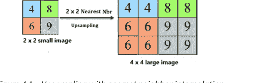

图 4.1 – 使用最近邻插值的上采样

尽管计算高效，但最近邻插值通常会产生块状和锯齿状伪影，因为没有生成新的强度值。

## 双线性插值

双线性插值通过使用目标位置周围的四个最近邻像素来改善平滑度。它沿 x 和 y 方向依次执行线性插值。


插值强度计算为邻近像素的加权平均值，权重与目标点之间的相对距离成比例。

对于被邻近像素 $Q_{11}, Q_{12}, Q_{21}, Q_{22}$ 包围的目标点 $(x, y)$，插值值为：

```
$f(x,y) = \frac{Q_{11}(x_2 - x)(y_2 - y) + Q_{21}(x - x_1)(y_2 - y) + Q_{12}(x_2 - x)(y - y_1) + Q_{22}(x - x_1)(y - y_1)}{(x_2 - x_1)(y_2 - y_1)}$
```

其中 $(x_1, y_1)$ 和 $(x_2, y_2)$ 定义了包围的整数网格坐标。权重之和为一，确保强度归一化。双线性插值比最近邻插值产生更平滑的过渡，尽管在大倍放大时可能会出现轻微模糊。

## 双三次插值

双三次插值将三次插值扩展到二维，通常比双线性插值产生更平滑的结果。不同于四个邻近像素，双三次插值考虑 $4 \times 4$ 邻域（16 个像素）并使用三次多项式估计强度。对于 1D 插值，三次多项式表示为：

```
$p(x) = ax^3 + bx^2 + cx + d$
```

在 2D 中，双三次插值沿两个空间方向应用三次插值：

```
$f(x, y) = \sum_{i=0}^{3} \sum_{j=0}^{3} a_{ij} x^i y^j$
```

其中 $a_{ij}$ 是由周围 16 个像素计算得到的系数。双三次插值生成更平滑、更自然的视觉图像，特别是在大上采样因子下，尽管计算成本更高且在尖锐边缘附近可能引入振铃伪影。

## 注释

在实践中，双三次插值可以使用各种计算插值权重的方法来实现，包括以下内容：**拉格朗日多项式**：提供通过数据点的精确多项式拟合。然而，它们在大区间上可能变得数值不稳定，在高性能应用中很少使用。

- **三次样条**：使用 *分段三次多项式*，保证函数及其一阶和二阶导数的连续性。当像素边界处平滑过渡至关重要时，它们是首选。

- **三次卷积核**：在实践中被广泛使用（例如在 OpenCV 和 SciPy 中），因为它们在计算效率和视觉质量之间取得了良好的平衡。一个常见的例子是 *Keys 三次卷积核*，用于 `cv2.INTER_CUBIC`。

## 样条插值

样条插值使用分段多项式函数计算新的像素值，在图像上产生平滑过渡。与最近邻或双线性插值不同，样条保持斜率和曲率的连续性，使其适用于高精度图像重建和几何变换。在 1D 中，三次样条插值在连续数据点之间拟合三次多项式：

$S_i(x) = a_i + b_i(x - x_i) + c_i(x - x_i)^2 + d_i(x - x_i)^3$

其中 $a_i$、$b_i$、$c_i$ 和 $d_i$ 是区间 $[x_i, x_{i+1}]$ 的系数。这些系数通过强制连续性约束来确定，使得样条通过所有数据点，并且其一阶和二阶导数在区间边界处保持连续，确保强度和曲率的平滑变化。边界条件，例如自然样条（$S''(x) = 0$）在端点处，进一步约束解并稳定图像边界附近的插值。在 2D 图像插值中，样条函数沿 $x$ 和 $y$ 两个方向扩展，以在图像网格上生成平滑的插值曲面。

不同的插值方法在计算复杂度、平滑度和重建质量之间存在权衡。**最近邻插值** 计算速度最快，实现最简单，但通常会产生块状和锯齿状伪影，使其适用于实时渲染、分段掩码和离散标签。**双线性插值** 在中等计算成本下提供更平滑的强度过渡，尽管在高放大时可能出现明显的模糊。**双三次插值** 生成更平滑、更自然的图像，广泛用于高质量图像缩放和照片编辑，但计算速度较慢且在尖锐边缘附近可能引入振铃伪影。**样条插值** 产生具有连续导数的高度平滑重建，特别适用于医学成像、科学可视化和几何变换，尽管计算复杂度显著更高。现在，让我们演示用于增大图像尺寸的上采样中插值方法的影响。

## 使用 Scipy 的上采样和插值

scipy.interpolate 模块可以从稀疏采样的像素中重建近似图像，使用插值。在以下实现中，函数 create_interpolated_image() 从 image 中随机选择 nsamples 个像素位置，提取其强度值，并使用 scipy.interpolate.griddata() 通过线性插值估计完整图像网格 (Y, X) 上的剩余像素值：

```
def create_interpolated_image(nsamples):
    ix = np.random.randint(im.shape[1], size=nsamples)
    iy = np.random.randint(im.shape[0], size=nsamples)
    samples = im[iy,ix]
    int_im = interpolate.griddata((iy, ix), samples, (Y, X))
    return int_im
```

> **重要**
> 
> scipy.interpolate.griddata() 对采样点凸包之外的网格点返回 NaN，当样本密度较低时可能产生空白区域。

NearestNDInterpolator 通过分配最近有效像素的值来执行最近邻插值。LinearNDInterpolator 通过使用 Qhull 凸包算法对输入样本进行三角剖分并在每个三角形内应用重心插值来执行分段线性插值。RBFInterpolator 使用径向基函数（RBF）重建缺失值。RBF 是标量值函数 φ(x, c)，仅取决于与参考点（中心 c）的距离，即 RBF 在 x 处的值为 φ(|| x − c ||)。流行的 RBF 是高斯函数：

```
φ(r) = e^(-r² / (2σ²))
```

其中 r = || x − c || 表示与中心点 c 的欧几里得距离，σ 控制基函数的扩散或平滑度。

RBFInterpolator 中的默认核是薄板样条核：

```
φ(r) = r² log(r)
```

RBF 插值器表示为以已知数据点为中心的径向基函数的加权和（线性组合）加上多项式项：

```
f(x) = Σᵢ₌₁ᴺ wᵢ φ(|| x − yᵢ ||) + P(x)
```

其中 yᵢ 是已知的样本位置，wᵢ 是插值权重，P(x) 是指定次数的低次多项式，用于稳定性和平滑性，如下图所示。等价地，插值器可以写成矩阵形式：

```
f(x) = K(x, y) a + P(x) b
```

其中 K(x, y) 是条目为 φ(|| x − yᵢ ||) 的矩阵，P(x) 是多项式基函数（单项式）的矩阵，系数向量 a 和 b 通过求解线性方程组获得。

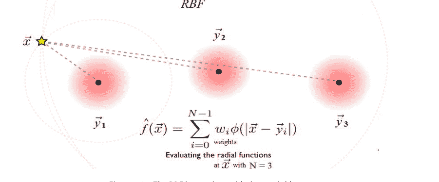

图 4.3 – 具有三个邻居的 RBF 插值器

损坏的图像和插值数据使用以下代码片段生成：

```
im = imread('images/lady.png', as_gray=True)
h, w = im.shape
x, y = np.arange(h), np.arange(w)
np.random.seed(11)
mask = np.random.random(im.shape) > 0.6 # corrupt some values
im[mask] = np.nan
np.sum(mask) / np.prod(mask.shape) # prop corrupted
valid_mask = ~np.isnan(im)
coords, values = np.array(np.nonzero(valid_mask)).T, im[valid_mask]
```

这里，`mask` 随机选择损坏的像素，`valid_mask` 标识未损坏的像素，`coords` 存储有效像素的坐标，`values` 包含其强度值。这些已知样本随后用于插值。以下辅助函数通过在每个像素位置评估插值器来重建图像：

```
def get_inpainted(coords, values, im_shape, interpolator):
    return interpolator(list(np.ndindex(im_shape))).reshape(im_shape)

im_inpainted_lin = get_inpainted(coords, values, im.shape, \
    interpolate.LinearNDInterpolator(coords, values, fill_value=0))
im_inpainted_nn = get_inpainted(coords, values, im.shape, \
    interpolate.NearestNDInterpolator(coords, values))
im_inpainted_rbf = get_inpainted(coords, values, im.shape, \
    interpolate.RBFInterpolator(coords, values, neighbors=50))
```

这里，LinearNDInterpolator 使用局部线性关系估计缺失像素，NearestNDInterpolator 复制最近的有效强度值，RBFInterpolator 从加权径向基函数重建像素。由于 RBF 插值需要求解大型线性系统，其内存和计算成本大约随已知像素数量呈二次增长，因此在大图像上的插值可能变得昂贵。neighbors=50 参数将插值限制在局部邻域，显著降低大图像的内存使用和计算复杂度。

原始图像与修复（重建）图像之间的均方误差（MSE）使用 get_MSE() 函数计算，以量化重建精度并比较算法：

```
def get_MSE(im_orig, im_inpainted):
    return np.linalg.norm(im_orig - im_inpainted)**2 / np.prod(im_orig.shape)
```

如果运行前面的代码片段并并排绘制原始退化图像（im_orig）和三个修复版本（im_painted、im_painted_nn 和 im_painted_rbf），以及每种方法的重建 MSE，你应该会得到如下图所示的结果。该结果展示了不同的插值技术如何填充缺失的图像数据，其中 RBF 通常提供更平滑的结果。


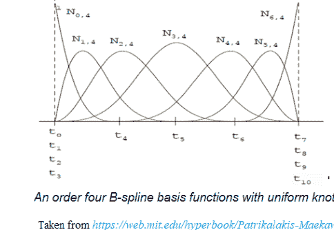

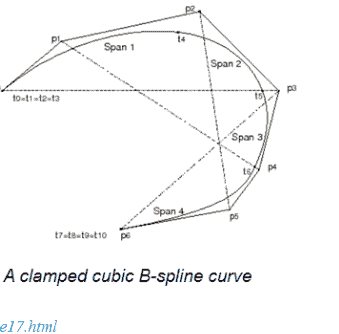

*Figure 4.5 – B-spline curves of order 4*

Taken from https://web.mit.edu/hyperbook/Patrikalakis-Maekawa-Cho/node17.html

下一段代码通过随机将大约 15% 的像素设为白色 (1) 来为图像添加盐噪声，然后使用阶数为 3 的三次样条滤波器对噪声图像进行平滑。

```
from scipy.ndimage import spline_filter
im_orig = imread('images/lady.png', True)
im = im_orig.copy()
h, w = im.shape
x, y = np.arange(h), np.arange(w)
# Corrupt few pixel values
np.random.seed(11)
mask = np.random.random(im.shape) > 0.85
im[mask] = 1
sp_filter = spline_filter(im, order=3, mode='nearest')
f, ax = plt.subplots(1, 3, sharex=True, figsize=(15,7))
for ind, data in enumerate([[im_orig, "original image"],
                            [im, "noisy image (salt)"],
                            [sp_filter, "denoised (spline filter)"]]):
    ax[ind].imshow(data[0], cmap='gray'), ax[ind].set_title(data[1])
```

这里，`np.random.random(im.shape)` 生成 [0,1] 范围内均匀分布的随机值，而条件 `> 0.85` 选择大约 15% 的像素进行破坏。

`order=3` 指定了三次 B 样条滤波器，而 `mode='nearest'` 通过在滤波期间复制最近的边缘像素来处理图像边界。最后，原图、噪声图和去噪后的图像将被显示：

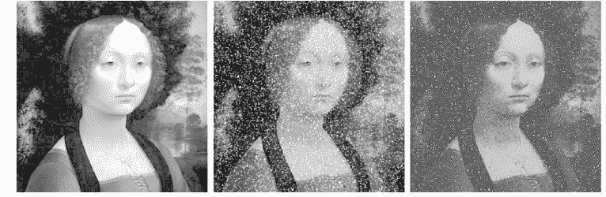

*Figure 4.6 – Image denoising with splines using SciPy*

**Note:** 样条滤波有效地减少了平滑噪声，但也可能模糊尖锐边缘和精细纹理，导致高度细节区域过度平滑。在此示例中，*salt noise* 引入了随机出现的白色像素（高强度值），通常由传输错误或传感器故障引起，而 *Gaussian noise* 则在大多数像素中引入正态分布的强度变化，产生均匀的颗粒状外观；这些可分别使用 `mode='salt'` 和 `mode='gaussian'`，使用函数 `skimage.util.random_noise()` 生成。

在探索了用于上采样的插值后，我们现在研究 **downsampling**，即在最小化细节损失和混叠伪影的同时降低图像分辨率。

## Downsampling

下采样通过减少像素数量来降低图像分辨率。较小的图像可以通过系统地丢弃像素（例如移除交替的行和列）生成，也可以通过将每个输出像素计算为原始图像中多个相邻像素的聚合来生成。

如果 $I(x, y)$ 表示原始图像，则因子为 $k$ 的简单下采样操作为：

$$I_d(x, y) = I(kx, ky)$$

其中 $I_d(x, y)$ 是下采样后的图像。这通过在每个空间方向上保留每 $k$ 个像素中的一个像素来降低分辨率。

## The sampling theorem (Nyquist-Shannon theorem)

奈奎斯特-香农采样定理指出，如果采样频率至少为信号中最高频率的两倍，则可以完美重建连续带限信号：$f_s \ge 2f_{\max}$，其中 $f_s$ 为采样频率，$f_{\max}$ 为最大信号频率。在包含高频纹理或边缘的图像中，不足的采样会导致信息丢失和重建错误。

## Downsampling and aliasing

不当的下采样会引入混叠伪影，因为高频图像分量在采样后会被错误表示为较低频率。这通常会产生锯齿状边缘、失真的纹理或 *Moiré patterns*。在频域中，混叠发生在高于奈奎斯特频率的高频折叠回（被解释为）较低频率时：

$$f_{\mathrm{alias}} = |f - kf_s|$$

其中 $k$ 是采样频率的整数倍。

## Anti-aliasing and Low-pass filtering

抗混叠技术通过在下采样前衰减高频分量来减少这些伪影。常见的方法使用高斯低通滤波，其核为：

$$G(x,y)=\frac{1}{2\pi\sigma^2}e^{-\frac{x^2+y^2}{2\sigma^2}}$$

其中 $\sigma$ 控制平滑的程度。低通滤波抑制了在重采样期间否则会导致混叠的精细纹理和边缘。

## Interpolation and Resampling with the Lanczos kernel

插值方法如最近邻、双线性和双三次插值在重采样期间估计像素值。其中，**Lanczos interpolation** 通过使用窗口化的 *sinc* 核提供更清晰的结果并减少混叠，其在 1D 中表示如下：

$$L(x)=\begin{cases}\operatorname{sinc}(x)\operatorname{sinc}\left(\frac{x}{a}\right), & |x|<a\\0, & \text{otherwise}\end{cases}$$

其中 $a$ 确定窗口大小（通常 $a=2$ 或 $3$）。较大的值保留更多高频细节但增加计算成本。插值像素值被计算为使用 Lanczos 核对相邻像素的加权和。下图显示了不同缩放参数值下核的形状，该参数决定了窗口的宽度：

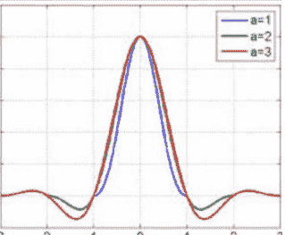

*Figure 4.7 – Lanczos kernel for different values of **a***

## Downsampling with NumPy

下一段代码片段演示了下采样伪影，其中从尺寸为 419 × 600 的衬衫图像中裁剪出一个 70 × 70 的高频区域，包含窄垂直条纹。所选裁剪区域使用 `cv2.rectangle()` 在原始图像上显示，该函数从左上角到右下角裁剪坐标绘制红色矩形。这里，`constrained_layout=True` 自动调整子图间距以防止重叠（确保最佳布局），而 `aspect='auto'` 允许 Matplotlib 将图像缩放以适应子图尺寸。

裁剪后的高频区域使用 NumPy 数组切片提取。这里，裁剪通过将图像数组索引为：

$$I_c(x, y) = I(x + x_0, y + y_0)$$

其中 $(x_0, y_0)$ 表示左上角裁剪坐标。由于所选区域包含紧密间隔的垂直条纹（高频内容），下采样会产生可见的 Moiré 模式（由混叠引起的伪影），当采样频率不足以表示高频图像内容时（违反奈奎斯特准则）。此示例说明了在降低图像分辨率之前进行低通滤波为何至关重要。

```
im = Image.open("images/shirt.jpg")
crop_coords = (0, 200, 70, 270)
plt.figure(figsize=(10,5), constrained_layout=True)
plt.subplot(121), plt.imshow(cv2.rectangle(np.array(im).copy(), \
    crop_coords[:2], crop_coords[-2:], (255,0,0), 2), aspect='auto')
plt.title(f'original image ({im.height} x {im.width})')
plt.subplot(122), plt.imshow(np.array(im)[crop_coords[1]:crop_coords[3], \
    crop_coords[0]:crop_coords[2]], aspect='auto')
```

如果运行上述代码片段，您应获得如下图所示：

original image (419 x 600)

portion to be resized (70x70)

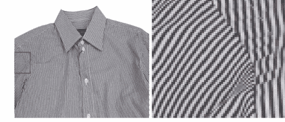

*Figure 4.8 – The square region from the shirt to be cropped and resized*

**Note:** 所选区域包含紧密间隔的垂直条纹，使其富含高频内容。下采样时，此类纹理容易产生混叠，其中精细细节超过采样率并导致失真图案（*Moiré effects*）出现。这是因为高频细节在较低分辨率下被错误表示。

## Convolution-based resizing (resampling) with PIL

最合适的图像缩放方式是 **convolution-based resampling**（我们稍后将讨论 *convolution*）。它通过使用插值核进行卷积来重建图像，从而在缩放期间保持图像质量：

$$g(x,y)=f(x,y)*h(x,y)$$

其中 $f(x,y)$ 是输入图像，$h(x,y)$ 是重建滤波器（核），* 表示卷积。理想重建使用 **sinc** 核，而 **Lanczos** 核提供了具有良好细节保留和降低混叠的实用近似。

如下一段代码片段所示，输入图像使用 `PIL.Image.resize()` 以最近邻插值重复下采样到更小的分辨率。参数 `resample=Image.NEAREST` 选择最近的输入像素而不考虑相邻像素，而 `box=crop_coords` 指定在调整大小前裁剪的矩形 ROI。这在您只对图像的一部分（例如高频区域）进行下采样而无需先裁剪它时很有用。

```
for factor in range(4,20,4):
    im_rsz = im.resize((int(im.width/factor), int(im.height/factor)), \
                       resample=Image.NEAREST, box=crop_coords)
    plt.imshow(im_rsz), plt.axis('off')
```

如果运行上述代码片段，您应获得如下图所示。随着采样率降至 *Nyquist* 限制以下，高频条纹图案被错误重建，产生 *checkerboard* 和 *Moiré* 混叠伪影。

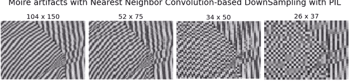

*Figure 4.9 – Downsampling with Moiré artifacts (aliasing) with PIL*


为了减少混叠，图像使用 Lanczos 重采样分别进行缩放，使用下面的代码片段。与最近邻插值不同，`resample=Image.LANCZOS` 使用基于截断 sinc 的 Lanczos 滤波器，结合邻近像素以在抑制导致混叠的高频分量的同时保留图像细节。

```python
factor, crop_coords = 6, (0, 200, 70, 270)
im_rsz = im.resize((int(im.width/factor), int(im.height/factor)),
    resample=Image.NEAREST, box=crop_coords)
im_rsz_antialiased = im.resize((int(im.width/factor),
    int(im.height/factor)), resample=Image.LANCZOS, box=crop_coords)
# plot im, im_rsz and im_rsz_antialiased here
```

如果运行前面的代码片段，你应该得到如下图所示的图像：

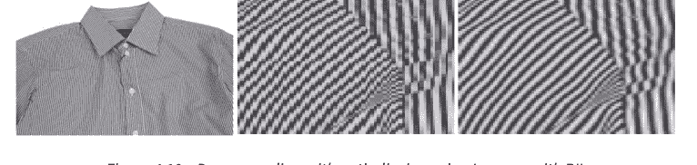

*Figure 4.10 – Downsampling with anti-aliasing using Lanczos with PIL*

从前面的输出可以看出，Lanczos 重采样方法几乎消除了伪影，而最近邻引入了摩尔纹伪影。

## Downsampling and anti-aliasing with scikit-image

直接下采样通常会产生混叠伪影，因为高频图像细节超过了奈奎斯特极限，并在较低分辨率下被错误表示。例如，将图像两个维度都缩小 6 倍会导致一个输出像素代表 6 × 6 = 36 个输入像素，使得简单的像素采样不足以进行准确重建。

可以通过提高采样频率或在采样前使用低通滤波抑制高频分量来减少混叠。抗混叠执行此平滑操作，通常通过在下采样前将图像与高斯低通滤波器卷积来实现。下面的代码使用 `skimage.transform.rescale()` 函数来演示此效果：它有无抗混叠地重缩放输入图像 UMBC，并比较结果以观察哪一个克服了混叠问题。

```python
im = imread('images/umbc.png')
scale, anti_aliasing = 0.3, False # True
im_down = rescale(im, scale=scale, channel_axis=-1,
                  anti_aliasing=anti_aliasing)
```

如果使用 `scale` 和 `anti_aliasing` 参数的不同值运行上述代码片段，你应该得到如下图所示的图像：

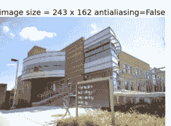
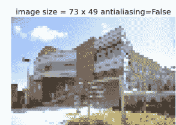
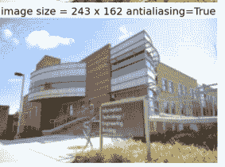
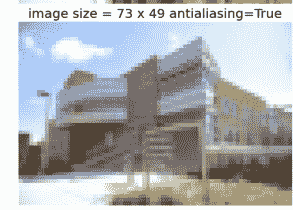

*Figure 4.11 – Rescaling with and without anti-aliasing using skimage*

这里，`scale=0.3` 将图像尺寸减小到原始尺寸的 30%，`channel_axis=-1` 保留颜色通道，而 `anti_aliasing=False` 禁用预平滑，产生更强的混叠伪影。设置 `anti_aliasing=True` 会在重缩放前应用低通滤波，显著改善视觉质量并减少下采样图像中的失真。要了解更多关于插值和抗混叠的信息，请访问我的博客：https://sandipanweb.wordpress.com/2018/01/21/recursivegraphics-bilinear-interpolation-and-image-transformation-in-Python/。

现在我们已经了解了如何调整图像大小（在图像函数域中的缩放），让我们继续进行图像的量化（即在函数值域中的缩放）。

## Quantizing an image

量化将大范围或连续的强度或颜色值减少为较小的离散集合，因此与每个像素使用的位数相关。对于数字图像 $I(x, y)$，量化可以表示为映射函数：

$$Q: I(x, y) \to I_q(x, y)$$

其中 $I_q(x, y)$ 表示量化后的图像。

### Uniform quantization

在均匀量化中，强度范围 [$I_{\min}, I_{\max}$] 被划分为 $K$ 个相等区间。量化步长为 $\Delta = \frac{I_{\max}-I_{\min}}{K}$，量化强度值计算为：

$$I_q(x,y)=\left\lfloor\frac{I(x,y)-I_{\min}}{\Delta}\right\rfloor\Delta+\frac{\Delta}{2}$$

其中 $\lfloor\cdot\rfloor$ 表示向下取整算子。每个像素被映射到其量化区间的代表值（通常是中点）。下面的代码片段演示了使用函数 `quantize_image()` 对灰度图像进行均匀量化：

```python
def quantize_image(img, levels):
    img_min, img_max = img.min(), img.max()
    step = (img_max - img_min) / levels
    quantized = np.floor((img - img_min) / step)*step + step/2
    return np.clip(quantized, 0, 1)

image = img_as_float(rgb2gray(data.astronaut())) # grayscale float in [0,1]
quant_8bit = quantize_image(image, 16) # Quantize to 4-bit (16 levels)
quant_4bit = quantize_image(image, 4) # Quantize to 2-bit (4 levels)
```

如果运行前面的代码片段并可视化量化后的图像以及原始图像，你应该得到如下图所示的图像：

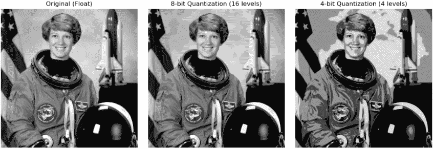

*Figure 4.12 – Original astronaut image and the 4-bit and 2-bit quantized images*

这里，`step` 表示量化区间宽度，`levels` 指定量化电平数，`np.floor()` 将像素分配到离散区间，而 `np.clip(...,0,1)` 将强度约束到有效的归一化范围。宇航员图像使用 `img_as_float()` 转换为灰度并归一化到 [0,1]。

然后执行量化到较低位深度的操作为 `quantize_image()`，其中 16 个电平模拟 4 位量化，4 个电平模拟 2 位量化。随着量化电平数减少，平滑渐变和精细图像细节逐渐丢失，说明了压缩与视觉保真度之间的权衡。

### Non-uniform quantization

在非均匀量化中，区间不等距分布，以便为感知上重要的强度范围（如阴影或高光）分配更多量化电平。诸如 **Lloyd–Max quantization** 等方法使用图像直方图优化区间边界。

### Quantizing color images

对于具有通道 $R$、$G$ 和 $B$ 的 RGB 图像，逐通道量化独立量化每个通道：

$$R_q = Q_R(R),\quad G_q = Q_G(G)\quad\text{and}\quad B_q = Q_B(B)$$

其中 $Q_R$、$Q_G$ 和 $Q_B$ 是相应的量化函数。量化也可以在感知均匀的颜色空间如 **Lab** 中执行。

### Quantization error and image quality

量化引入了近似误差，因为原始强度被离散值取代。

量化误差为 $e(x,y)=I(x,y)-I_q(x,y)$。

对于均匀量化，最大误差受 $|e(x,y)|\leq \frac{\Delta}{2}$ 限制。

图像质量退化通常使用均方误差 MSE 来衡量：

$$\mathrm{MSE}=\frac{1}{MN}\sum_{x=0}^{M-1}\sum_{y=0}^{N-1}\left(I(x,y)-I_q(x,y)\right)^2$$

其中 $M\times N$ 为图像尺寸。减少位数会增加量化误差，并经常引入轮廓、人工边界和像素化伪影。

### Quantization in image compression

量化是有损压缩方法如 JPEG 的基本组成部分。在使用离散余弦变换 DCT 将图像转换到频域之后，变换系数被量化：

$$C_q(u,v)=\operatorname{round}\left(\frac{C(u,v)}{Q(u,v)}\right)$$

其中 $C(u,v)$ 为 DCT 系数，$Q(u,v)$ 为量化矩阵。通常对高频系数应用较大的量化值，因为它们在感知上不那么重要，从而能够在有限视觉退化下实现更高压缩。

### Quantizing a P mode color image with PIL

颜色量化通过将原始颜色映射到较小的调色板来减少图像中的不同颜色数量，从而在尝试保留视觉质量的同时减少存储需求。在此示例中，使用 PIL 的 `convert()` 和 `quantize()` 方法生成具有 progressively 更少颜色的索引色（P 模式）图像版本。图像质量使用峰值信噪比 PSNR 评估，而压缩存储大小使用 `os.path.getsize()` 测量。

量化电平数生成为：`num_colors_list = [1 << n for n in range(8,0,-1)]`。这里，`1 << n` 表示 `2^n`，产生序列 `[256, 128, 64, 32, 16, 8, 4, 2]`。图像首先使用自适应调色板转换为 8 位索引色模式。`convert('P')` 将图像转换为调色板模式，而 `Image.ADAPTIVE` 根据图像内容选择优化的调色板。然后将图像量化为 progressively 更小的调色板，如下面的代码片段所示：

```python
for num_colors in num_colors_list[1:]:
    im_quant = im.quantize(colors=num_colors)
    # plot im, im_quant side-by-side here
```

这里，`im.quantize(colors=num_colors)` 将图像减少到 `num_colors` 个不同颜色。你可以使用 `psnr()` 计算原始图像与量化图像之间的峰值信噪比，其中较大的 PSNR 值表示更好的重建质量，并使用 `os.path.getsize()` 测量相应的存储大小（以千字节为单位）。随着颜色数量减少，图像存储大小减小，但量化伪影和视觉细节损失变得越来越明显。如果并排绘制量化图像，你应该得到以下图像：

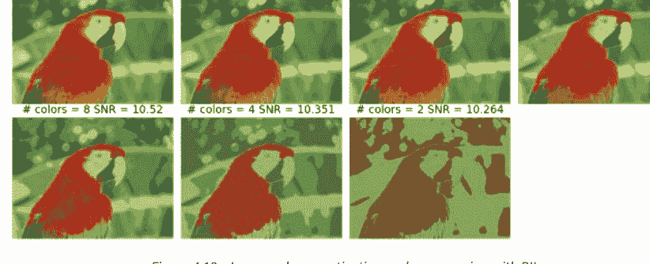

*Figure 4.13 – Image color quantization and compression with PIL*

如果你想了解颜色量化对图像 SNR 的影响（SNR 通常是图像质量的度量——SNR 越高，质量越好），绘制 SNR 与 #colors 的关系图，并绘制磁盘上图像大小与图像中使用的 #colors 的关系图（以了解由于颜色量化而实现的压缩），你应该得到以下图像：


原始图像使用 **逆 FFT** 重建：

```
im_rec = fp.ifft2(freq).real
im_rec = im_rec / im_rec.max()
```

.real 操作去除了计算过程中引入的微小虚数数值误差。重建误差使用 **Frobenius 范数** 衡量：

‖ f − f_rec ‖_F = √[ Σ_{x,y} ( f(x,y) − f_rec(x,y) )² ]

可实现为：np.linalg.norm(im - im_rec)。

图像质量进一步使用 peak_signal_noise_ratio()（PSNR）验证，其中较大的值表示重建质量更好，而 np.allclose(im, im_rec) 确认重建图像在数值上接近原始图像。由于保留了所有傅里叶系数，**FFT** 后接 **IFFT** 可在信息损失可忽略的情况下重建图像。

```
from skimage.metrics import peak_signal_noise_ratio as psnr
print(f'PSNR for the reconstructed image = {psnr(im, im_rec)}')
# PSNR for the reconstructed image = 2.0237227738013224    assert(np.
allclose(im, im_rec)) # original and recons images should be close
```

使用 matplotlib.pylab 并排显示原始图像和重建图像：

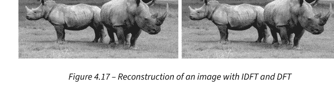

图 4.17 – 使用 IDFT 和 DFT 重建图像

## 绘制频谱

由于傅里叶系数为复数值，频谱通常使用其幅值 |F(u, v)| 可视化。系数 F(0,0)，称为直流分量，表示平均图像强度，通常主导频谱 为了提高傅里叶频谱中较弱频率分量的可见性，通常使用对数缩放，采用：

D₁(u, v) = 20 log₁₀ (0.01 + |F(u, v)|)

这压缩了 DFT 幅值的较大动态范围并避免了 log(0) 的数值不稳定； alternatively，可使用线性映射，D₂(u, v) = min(|F(u, v)| + 100,255)，通过强度偏移和裁剪来增强可见性。

使用可分性定理，大小为 a × b 且以原点为中心的二维矩形的傅里叶变换是两个（归一化）sinc 函数的乘积：

```
F(u, v) = absinc(au)sinc(bv)
```

其中 sinc(x) = sin(πx)/(πx)。因此，包含白色正方形的图像的 DFT 产生 sinc 类似的频谱，这也可以使用连续傅里叶变换的定义结合可分性定理在数学上推导，如下图所示。

```
F(u, v) = absinc(au)sinc(bv)
```

```
F(u, v) = ∫_{-∞}^{∞} ∫_{-∞}^{∞} f(x, y) e^{-j2π(ux+vy)} dx dy
```

## 可分性定理

```
f(x, y) = f(x)g(y) \xrightarrow{\mathcal{F}} F(u, v) = F(u)G(v)
```

图 4.20 – 傅里叶变换的可分性定理

绘制以原点为中心的白色正方形图像的频谱（3D），可得到如下图所示的图形（代码请参考 github notebook）：

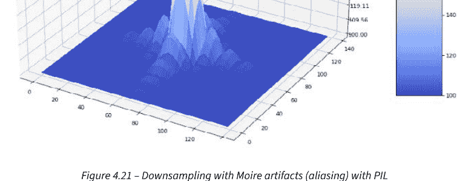

图 4.21 – 使用 PIL 进行下采样时的 Moire 伪影（混叠）

下图显示，人造的细长规则图案在图像中往往在频谱中显著出现，而自然场景中的重复通常不太明显，在其谱表示中与人工结构相比也较不明显：

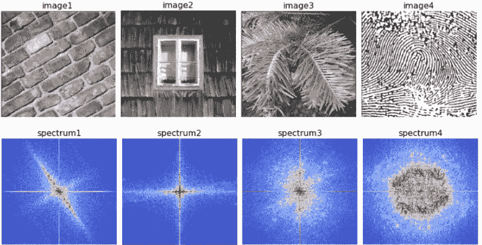

## 使用 numpy.fft 模块的 FFT

使用 numpy.fft 模块，图像的二维 DFT 也可以使用 fft2() 计算，而 ifft2() 从其傅里叶系数重建图像，如下代码所示。幅值谱，|F(u, v)|，通常集中在低频，而相位，∠F(u, v)，编码重要的结构和空间信息。傅里叶系数为复数值，可表示为：

$$F(u,v)=|F(u,v)|e^{j\angle F(u,v)},$$

允许使用 IDFT 分别从幅值和相位重建。

```
```python
im1 = rgb2gray(imread('images/house.png'))
im2 = rgb2gray(imread('images/house2.png'))
freq1, freq2 = np.fft.fft2(im1), np.fft.fft2(im2)
im1_hat, im2_hat = np.fft.ifft2(freq1).real, np.fft.ifft2(freq2).real
# plot original, reconstructed images e.g., im1, im1_hat and
# spectrum magnitude e.g., np.abs(np.fft.fftshift(freq1)) and
# phase              e.g., np.angle(np.fft.fftshift(freq1))
```
```

如果运行上述代码片段，应得到如下图所示的图形：

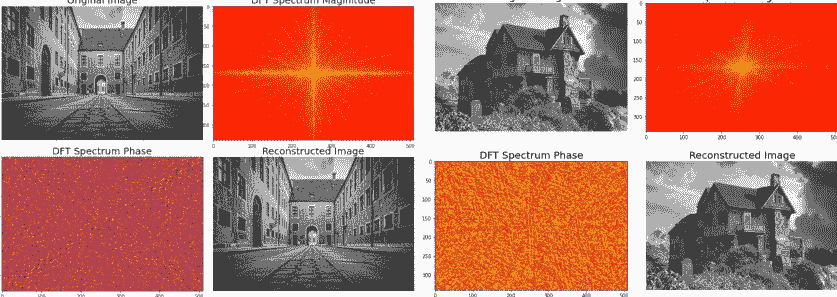

*图 4.23 – 使用 DFT 进行图像重建*

从上图可以看出，尽管图像的 *相位* 看起来信息较少（相当随机），但它包含关于图像的非常重要的信息。下述代码演示了用另一幅图像的相位或随机相位替换原始相位会严重扭曲重建，而保留相位并改变幅值仍能保留可识别的图像结构，表明相位携带关键的空间信息。随机相位纹理使用分数布朗场（FBF）模型生成，使用 PyAFBF 库，其中 Hurst 参数 $H \in (0,1)$ 控制纹理粗糙度（$H \approx 0$：噪声纹理，$H \approx 1$：平滑纹理）。实验进一步表明，幅值和相位对准确的图像重建都很重要，尽管相位对感知图像结构贡献更大。

下述代码片段使用 PyAFBF 库生成 *分数布朗场（FBF）*，这是一种常用的随机纹理模型，用于模拟云、terrain 和粗糙表面等自然模式。函数 `tbfield('fbf')` 初始化 FBF 模型，而 Hurst 指数 $H \in (0,1)$ 控制纹理平滑度：H=0 产生高度随机的噪声状纹理，而 H=1 生成平滑的相关纹理；此处 H=0.2 创建中等粗糙的模式。参数使用 `Z.hurst.ChangeParameters()` 设置，并使用 `Z.NormalizeModel()` 归一化生成场的统计特性。模拟的随机纹理通过 `Z.Simulate()` 获得并重塑为输入形状：

```
```python
#!pip install PyAFBF==0.1.7  image==0.2.6
from afbf import tbfield
N, H = 256, 0.2  # image size and Hurst index in (0, 1).
Z = tbfield('fbf') # define the field and change param of Hurst function
Z.hurst.ChangeParameters(np.array([[H]])); Z.NormalizeModel()
Z = Z.Simulate() # simulate the field
random_image = Z.values.reshape(512, 512) # reshape image
plt.imshow(random_image, cmap='gray'), plt.axis('off')
```
```

如果运行上述代码片段，应得到如下图所示的图形：

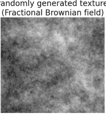

*图 4.24 – 使用分数布朗场随机生成的纹理*

生成的随机纹理随后用于研究图像重建中 DFT 相位信息的重要性。下述代码演示了使用一幅图像的 *幅值* 谱和另一幅图像的 *相位* 重建图像会产生高度失真的输出，而使用 *正确相位* 与 *随机幅值* 仍能保留大部分图像结构。

```
```python
im1_hat = np.fft.ifft2(np.abs(freq1)*np.exp(1j*np.angle(freq2))).real
im2_hat = np.fft.ifft2(np.abs(freq2)*np.exp(1j*np.angle(freq1))).real
freq_random = np.fft.fft2(resize(random_image, im2.shape))
im2_hat_rand_mag = np.fft.ifft2(\
        np.abs(freq_random)*np.exp(1j*np.angle(freq2))).real
im2_hat_rand_phase = np.fft.ifft2(\
        np.abs(freq2)*np.exp(1j*np.angle(freq_random))).real
# plot images im1_hat, im2_hat, im2_hat_rand_mag,im2_hat_rand_phase
```
```

如果运行上述代码片段，应得到如下图所示的图形：

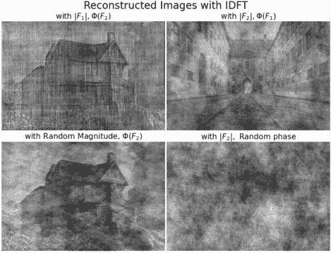

*图 4.25 – 使用随机幅值 vs. 随机相位的图像重建*

同样，使用 *零相位* 或 *随机相位* 的重建无法恢复有意义的空间信息，如下图所示。

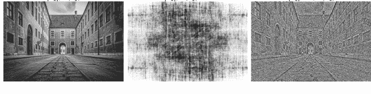

*图 4.26 – 使用 DFT/IDFT 进行零幅值 vs. 零相位的图像重建*

这些结果表明，尽管幅值谱表示频率强度，但 DFT 相位包含重建图像所必需的关键结构和空间信息。

## 使用 scipy.fft 模块的 FFT

`scipy.fft`（在 SciPy 1.4.0 中引入）是推荐的 FFT 库，因为它与 `numpy.fft` 和旧的 `scipy.fftpack` 相比提供了更一致的 API、更好的性能和向后兼容性。为了比较不同二维 FFT 实现的执行速度，使用 `cameraman.jpg` 图像对 `np.fft.fft2()`、`scipy.fftpack.fft2()` 和 `scipy.fft.fft2()` 进行了基准测试实验。执行时间分布使用小提琴图可视化，如 *图 4.27* 所示，展示了实现之间的效率差异。为简洁起见，基准测试代码提供在 GitHub 仓库中。既然我们已经看到 NumPy 和 SciPy 如何使用 FFT 算法高效计算 DFT，现在我们将通过使用正交基向量的矩阵乘法更深入地理解 DFT。

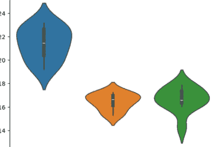

*图 4.27 – NumPy 与 SciPy fft2 执行速度比较*

正如我们已经看到 DFT 可以使用 NumPy 和 SciPy 的 FFT 算法的高效实现非常容易计算，现在让我们尝试通过使用正交基向量的矩阵乘法从头实现它，以更深入地理解 DFT。


# 基于矩阵乘法的DFT

尽管在实际中常用的FFT库如`numpy.fft`和`scipy.fft`，但二维DFT也可以用傅里叶基矩阵通过矩阵乘法优雅地表达，如下图所示。

对于方阵图像 X ∈ ℂ^{N×N}，DFT计算为 F = W f W，IDFT计算为 f̂ = W^H F W^H，其中 W 是由复数单位根生成的傅里叶矩阵，W^H 是 Hermitian 伴随矩阵。

## 二维DFT的可分离性
F(k,ℓ) = 1/√N Σ_{n=0}^{N-1} [ 1/√M Σ_{m=0}^{M-1} f(m,n) e^{-j2π (k m / M)} ] e^{-j2π (ℓ n / N)}

矩阵表示
2D DFT 正变换    F = (W_M f) W_N
M x M   N x N

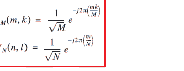

f(m,n) = 1/√N Σ_{ℓ=0}^{N-1} [ 1/√M Σ_{k=0}^{M-1} F̂(k,ℓ) e^{j2π (k m / M)} ] e^{j2π (ℓ n / N)}

W_M(m,k) = 1/√M e^{-j2π (m k / M)}
W_N(n,l) = 1/√N e^{-j2π (n l / N)}

矩阵表示
2D DFT 逆变换    f = (W_M^* f) W_N^*
M x M   N x N

图4.28 – 使用矩阵乘法计算DFT

这种矩阵表达形式可以自然地推广到其他正交图像变换，如DCT和Walsh–Hadamard变换。下面的代码片段使用傅里叶矩阵乘法对方阵图像（M = N）实现二维DFT和IDFT。`DFT_matrix()` 函数构造对称的傅里叶矩阵 W，使用`np.fft.fft2()`所用的标准归一化或对称的 1/√N 归一化，并在 `inverse=True` 时返回经过适当归一化的逆矩阵。W^H F W^H 采用平方根归一化时，傅里叶矩阵变为酉矩阵，满足：

W W^H = I ⇒ W^{-1} = W^H

这表明傅里叶基向量是标准正交的。

代码首先加载并归一化一幅灰度图像，使用 `np.fft.fft2()` 计算参考DFT，然后使用傅里叶矩阵 W 计算变换（即 F = W @ X @ W）。重建过程类似地使用逆傅里叶矩阵 W_I 完成（即 X_hat = W_I @ F @ W_I）。与NumPy的 `fft2()` 和 `ifft2()` 的对比结果显示数值误差极小，证实了实现的正确性。

```
def DFT_matrix(N, norm=None, inverse=False):
    i, j = np.meshgrid(np.arange(N), np.arange(N))
```

```
ω = np.exp((-1)**(~inverse) * 1j * 2 * np.pi / N)
Z = np.sqrt(N) if norm == 'sqrt' else (N if inverse else 1)
return np.power(ω, i * j) / Z # W

X = imread('images/saturn.png', True) # 读取灰度图像到矩阵 X
X = X / X.max()
F_ref = np.fft.fft2(X)
assert X.shape[0] == X.shape[1] # 假设：X 是方阵图像，即 M=N
N = X.shape[0] # 297
# 使用傅里叶矩阵 W 进行 DFT
W, W_I = DFT_matrix(N), DFT_matrix(N, inverse=True)
F = W @ X @ W
print(np.linalg.norm(F_ref - F)) # 4.5761763868995734e-08
# 使用逆傅里叶矩阵 W_I 进行重建
X_hat = W_I @ F @ W_I
print(np.linalg.norm(X_hat - np.fft.ifft2(F_ref))) # 3.001642644304349e-10
```

最后，将空间域图像、频谱以及重建图像并排显示，你应该获得如下所示的图形：

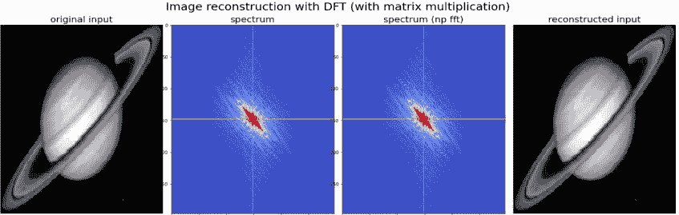

从前面的输出可以看出，NumPy 的实现非常接近所选择的正确归一化因子（即 IDFT 的 1/N 和 DFT 的 1）。接下来的代码行演示了上述内容：

```
W = DFT_matrix(N, norm='sqrt')
print(np.allclose(W, W.T)) # True
np.allclose(np.real(W@np.conjugate(W).T), np.eye(N)), \
np.allclose(np.imag(W@np.conjugate(W).T), np.zeros(N)) # (True, True)
```

更一般地，我们可以将图像变换表示为下图所示的形式，其中 f 是 N × N 图像，N × N 矩阵 G 由与变换对应的基图像构成：

## 图像变换

### 正变换

T(u, v) = Σ_{x=0}^{N-1} Σ_{y=0}^{N-1} f(x, y) g(x, y, u, v) 正变换核

g(x, y, u, v) = g1(x, u) g2(y, v) 可分离 = g1(x, u) g1(y, v) 对称形式

### 逆变换

f(x, y) = Σ_{u=0}^{N-1} Σ_{v=0}^{N-1} T(u, v) h(x, y, u, v) 逆变换核

T(u, v) = Σ_{x=0}^{N-1} Σ_{y=0}^{N-1} g1(x, u) f(x, y) g2(y, v)

基于矩阵的变换 对于标准正交基向量

T = G f G^T
f = G^*T G 适用于复数向量
f = G^T T G 适用于实数向量

g1(x, u) g1(y, v)
DFT 1/√N e^{-j 2π/N u x} 1/√N e^{-j 2π/N v y}

图4.30 – 基于矩阵乘法的DFT和IDFT实现

现在让我们转向另外两种具有标准正交基向量的重要离散变换，即离散余弦变换和Walsh-Hadamard变换。

## 离散余弦变换和离散Walsh-Hadamard变换

DCT和Walsh-Hadamard变换是可分离的正交变换，它们使用不同的基函数推广了DFT。现在让我们了解如何为这两种变换实现基于矩阵的计算。

### 离散余弦变换（DCT）

2D DCT广泛应用于图像压缩，因为它将大部分图像能量集中到少数低频系数中。正DCT和逆DCT在如下图中定义。与DFT不同，DCT假设信号具有偶对称扩展，从而使其周期为2N。

g(x, y, u, v) = α(u) α(v) cos[(2x + 1)uπ / 2N] cos[(2y + 1)vπ / 2N]

α(u) = 1/√N，当 u = 0 时 = √(2/N) 对 u = 1, 2, ... N - 1

DCT
C(u, v) = α(u) α(v) Σ_{x=0}^{N-1} Σ_{y=0}^{N-1} f(x, y) cos[(2x + 1)uπ / 2N] cos[(2y + 1)vπ / 2N]

逆DCT
f(x, y) = Σ_{u=0}^{N-1} Σ_{v=0}^{N-1} α(u) α(v) C(u, v) cos[(2x + 1)uπ / 2N] cos[(2y + 1)vπ / 2N]

图4.31 – DCT和IDCT

下面的代码片段演示了使用 `scipy.fftpack.dct()` 进行基于矩阵的DCT计算。DCT矩阵 D 由单位矩阵以 `norm='ortho'` 生成，产生标准正交的余弦基向量。对于图像 f，正变换计算为 C = DfD^T，逆重建为 f_c = D^T C D。

```
f = imread('images/lena.jpg', True) # 假设：N x N 方阵图像
D = fp.dct(np.eye(f.shape[0]), norm='ortho', axis=0)
C = D@f@D.T
f_c = D.T@C@D
# 并排绘制 f、D、C 和 f_c
```

如果你运行上述代码片段，应该获得如下所示的图形。图中显示了矩阵、DCT频谱和重建图像。从图中可以看出，系数的能量主要集中在靠近原点的小区域中：

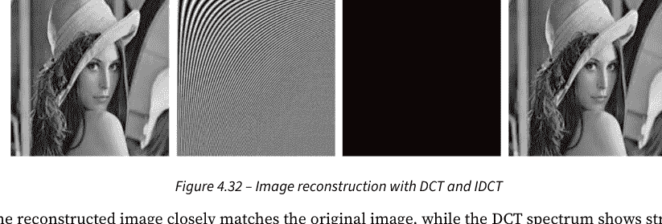

图4.32 – 使用DCT和IDCT重建图像

重建图像与原始图像非常接近，而DCT频谱显示出能量强烈集中在低频原点附近，这解释了为什么DCT对于JPEG等图像压缩方法非常有效。

## Walsh-Hadamard变换（WHT）

Walsh–Hadamard变换（WHT）是一种基于Hadamard矩阵的正交变换，该矩阵按递归方式定义，如下图所示：

Hadamard矩阵
H = [1 1; 1 -1] 当 N = 2 时，且 H_2N = [H_N H_N; H_N -H_N]

图4.33 – Hadamard矩阵

我们可以使用 `scipy.linalg.hadamard()` 函数获得Hadamard矩阵 H。让我们看看8 x 8的Hadamard矩阵是什么样子：

```
H = hadamard(8)
print(H)
# [[ 1  1  1  1  1  1  1  1]
#  [ 1 -1  1 -1  1 -1  1 -1]
#  [ 1  1 -1 -1  1  1 -1 -1]
#  [ 1 -1 -1  1  1 -1 -1  1]
#  [ 1  1  1  1 -1 -1 -1 -1]
#  [ 1 -1  1 -1 -1  1 -1  1]
#  [ 1  1 -1 -1 -1 -1  1  1]
#  [ 1 -1 -1  1 -1  1  1 -1]]
```

H的行和列仅包含+1和−1，这使得变换的计算效率很高，因为只需要加法和减法。观察H的各列。第一列没有符号变化，第二列有七个符号变化，第三列有三个符号变化。为了获得 **Walsh–Hadamard矩阵 W**，我们使用基于格雷码的序列排序对列进行重排，该排序根据符号变化次数的递增顺序排列基函数。`get_gray_codes()` 用于生成格雷码，而 `get_sequency_ordering()` 执行位反转排序以构造 W。

```
def get_gray_codes(nbits):
    gray_code = []
    li = [0 for i in range(nbits)]
    gray_code.append(''.join(map(str,li)))
    for term in range(2, (1<<nbits)+1):
        if term % 2:
            for i in range(-1,-(nbits),-1):
                if li[i]==1:
                    li[i-1]=li[i-1]^1
                    break
        if term % 2 == 0: li[-1]=li[-1]^1
        gray_code.append(''.join(map(str,li)))
    return gray_code

def get_sequency_ordering(H):
    length = len(H)
    bitlength = int(np.log2(length))
    gray_codes = get_gray_codes(bitlength)
    bitreverse = [int(gray_codes[i][::-1],2) for i in range(length)]
    return H[:,bitreverse] # W

print(get_sequency_ordering(H))
```


```python
# [[ 1  1  1  1  1  1  1  1]
#  [ 1  1  1  1 -1 -1 -1 -1]
#  [ 1  1 -1 -1  1  1 -1 -1]
#  [ 1  1 -1 -1 -1 -1  1  1]
#  [ 1 -1  1 -1  1 -1  1 -1]
#  [ 1 -1 -1  1  1 -1 -1  1]
#  [ 1 -1  1 -1 -1  1 -1  1]
#  [ 1 -1 -1  1 -1  1  1 -1]]
```

现在，我们已经准备好对Lena图像应用沃尔什-哈达玛变换。为完整起见，请参考下图，该图展示了正向变换和逆变换：

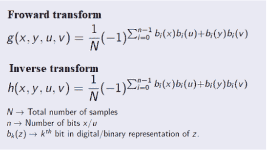

图4.34 – 正向和逆哈达玛变换

接下来，我们使用`scipy.linalg`模块中的`hadamard()`函数获取与输入图像形状相同的哈达玛矩阵H，如下一个代码片段所示，然后按列率排序得到矩阵W，再应用变换获得频谱，并使用以下代码从频谱重建图像。请注意，正向和逆向沃尔什-哈达玛变换再次由以下公式给出：

$F = WfW^T$ 和 $f = W^TFW$

其中$f$是输入图像，$F$是变换频谱。

```python
f = resize(imread('images/lena.jpg', True), (256,256))
H = hadamard(f.shape[0])
W = get_sequency_ordering(H)
F = W@f@W.T
f_w = W.T@F@W
```

绘制原始图像(f)、列率排序(w)、沃尔什-哈达玛频谱（使用`plot_spectrum()`）以及重建图像(f_w)。您应该获得如下图所示的图形：

## 基于WHT的图像重建

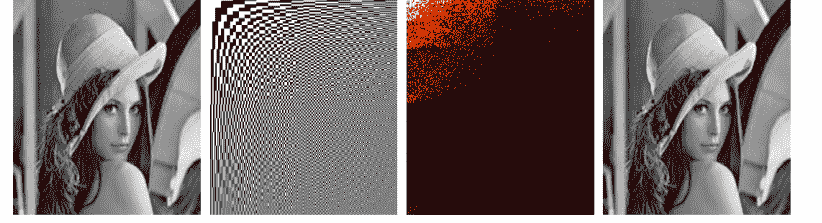

图4.35 – 使用沃尔什-哈达玛变换进行图像重建

使用Matplotlib以三维形式绘制DFT、DCT和DWHT的变换输出（使用plot_surface()函数）。您应该获得如下所示的图形。注意，对于DCT，只有(0,0)附近的少数系数是非零的，这表明它将比其他变换实现高得多的压缩率。

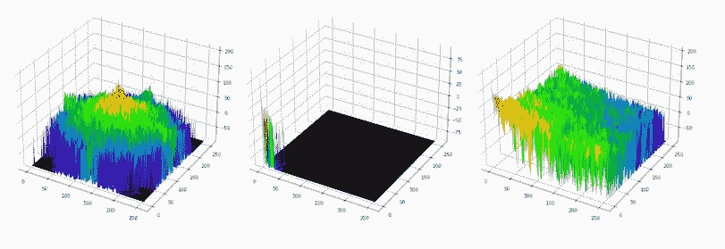

图4.36 – 图像的DFT、DCT和DWHT系数

接下来，我们尝试理解DCT和沃尔什变换的基向量（基图像）。

## DCT和沃尔什变换的基图像

现在让我们将之前学过的所有变换，即DFT、DCT、沃尔什和哈达玛变换，进行推广。下图以通用形式展示了这些变换及其计算方法。

| 变换 | g1(x,u) | g1(y,v) | 正变换 g(x,y,u,v) | 逆变换 h(x,y,u,v) |
|---|---|---|---|---|
| DFT | 1/√N e^{-j 2π/N ux} | 1/√N e^{-j 2π/N vy} | 1/N e^{-j 2π/N (ux+vy)} | 1/N e^{j 2π/N (ux+vy)} |
| DCT | α(u) cos[(2x+1)uπ/2N] | α(v) cos[(2y+1)vπ/2N] | α(u)α(v) cos[(2x+1)uπ/2N] cos[(2y+1)vπ/2N] | α(u)α(v) cos[(2x+1)uπ/2N] cos[(2y+1)vπ/2N] |
| Walsh | 1/N ∏_{i=0}^{n-1} (-1)^{b_i(x)b_{n-1-i}(u)} | 1/N ∏_{i=0}^{n-1} (-1)^{b_i(y)b_{n-1-i}(v)} | 1/N ∏_{i=0}^{n-1} (-1)^{b_i(x)b_{n-1-i}(u)+b_i(y)b_{n-1-i}(v)} | 1/N ∏_{i=0}^{n-1} (-1)^{b_i(x)b_{n-1-i}(u)+b_i(y)b_{n-1-i}(v)} |
| Hadamard | 1/N ∏_{i=0}^{n-1} (-1)^{b_i(x)b_i(u)} | 1/N ∏_{i=0}^{n-1} (-1)^{b_i(y)b_i(v)} | 1/N ∏_{i=0}^{n-1} (-1)^{b_i(x)b_i(u)+b_i(y)b_i(v)} | 1/N ∏_{i=0}^{n-1} (-1)^{b_i(x)b_i(u)+b_i(y)b_i(v)} |

图4.37 – 离散傅里叶、余弦、沃尔什和哈达玛变换公式

利用上表，我们计算DCT和沃尔什变换的基图像（您可以按相同方式尝试其他类似变换）。如下一个代码片段所示，dct()和walsh()函数分别计算DCT和沃尔什变换的g(x,y,u,v)（正向）基函数：

```
def dct(x, y, u, v, N):
    def alpha(a): # Normalization
        return np.sqrt(1/N) if a==0 else np.sqrt(2/N)
    return alpha(u)*alpha(v)*np.cos(((2*x+1)*(u*np.pi))/(2*N))* \
           np.cos(((2*y+1)*(v*np.pi))/(2*N))

def walsh(x, y, u, v, N):
    def b(i, x):
        return (x >> i) & 1
    n = int(np.log2(N))
    return (-1)**np.sum([(b(i,x)*b(n-1-i,u)+b(i,y)*b(n-1-i,v)) \
                        for i in range(n)]) / N
```

get_basis_image()函数根据正变换核g(x,y,u,v)指定的变换，为给定的频率索引u、v和图像尺寸N计算第(u,v)个基图像（基向量）。

```
def get_basis_image(u, v, g, N):
    basis_image = np.zeros((N,N))
    for x in range(N):
        for y in range(N):
            basis_image[x,y] = g(x, y, u, v, N)
    return basis_image
```

get_all_basis_images()函数计算该特定变换的所有基函数。基向量可用于快速计算正变换，方法是将输入图像划分为N×N块，并对每个块与N×N的预计算基向量进行卷积（留作练习）：

```
def get_all_basis_images(g, tname, N):
    images = []
    for u in range(N):
        for v in range(N):
            images.append(get_basis_image(u, v, g, N))
    return images
```

随后，使用plot_basis_images()绘制各变换的基图像，定义如下代码片段所示：

```
def plot_basis_images(images, tname, N):
    for i in range(N*N):
        plt.subplot(N,N,i+1), plt.imshow(images[i].reshape(N,N))
        plt.xticks([]), plt.yticks([])
        plt.suptitle(f'{N}x{N} {tname} basis functions'); plt.show()
# g, tname, N = dct, 'DCT', 4
# plot_basis_images(get_all_basis_images(g, tname, N), tname, N)
# g, tname = walsh, 'Walsh'
# plot_basis_images(get_all_basis_images(g, tname, N), tname, N)
```

如果您取消注释并运行上述代码片段，您应该得到下图：

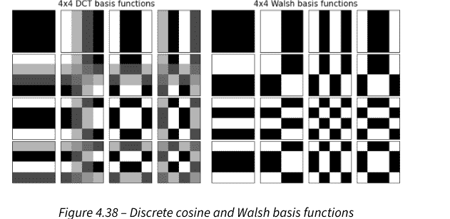

图4.38 – 离散余弦和沃尔什基函数

接下来，让我们探索DFT的一些非常有用的性质。

## DFT的性质

理解DFT的性质有助于更高效地计算，并深入理解频率信息在一维信号和二维图像中的表示方式。

### 可分离性

二维DFT是一种可分离且对称的酉变换。下图展示了如何通过沿行和列依次应用两次一维DFT来计算二维DFT，其中输入f是尺寸为M×N的二维信号，输出F是DFT结果：

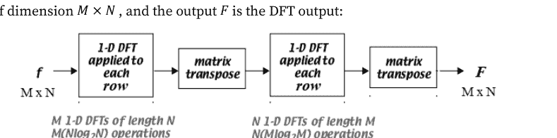

图4.39 – 二维DFT的可分离性

利用可分离性，二维DFT可以重写为：

$$F(u, v) = \sum_{x=0}^{M-1} \left[ \sum_{y=0}^{N-1} f(x,y) e^{-j2\pi v y / N} \right] e^{-j2\pi u x / M}$$

这表明该变换可以先沿一个轴计算，再沿另一个轴计算。使用Cooley–Tukey FFT算法，长度为N的一维FFT只需$O(N\log N)$次运算，而不是朴素的$O(N^2)$次。

因此，尺寸为$M \times N$的二维FFT总复杂度变为$O(MN\log M + MN\log N)$。对于尺寸为$N \times N$的方形图像，这简化为$O(N^2\log N)$，远快于需要$O(N^4)$次运算的朴素直接二维DFT实现。

接下来的代码演示了可分离性，其中fft2_sep()函数通过使用np.fft.fft()的两次连续一维FFT调用来实现，并将结果与使用np.fft.fft2()得到的结果进行比较。几乎相同的执行时间和零误差证实了可分离FFT实现的正确性和高效性。

```
def fft2_sep(f):
    return np.fft.fft(np.fft.fft(f).T).T

f = imread('images/lena.jpg', True)
%timeit F_sep = fft2_sep(f)
%timeit F = np.fft.fft2(f)
print(np.linalg.norm(F_sep - F))
# 0.0
plot_spectrum(np.hstack((np.fft.fftshift(F_sep), np.fft.fftshift(F))))
```

如果您运行上述代码片段，您应该得到如下图所示的图形：

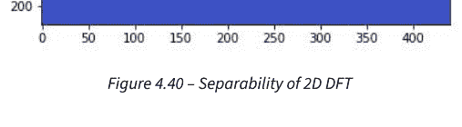

图4.40 – 二维DFT的可分离性

### 周期性与加窗

DFT本质上假设信号在空间域和频率域均周期性重复。对于二维信号，DFT及其逆变换具有如下周期性：

F(u, v) = F(u + N, v) = F(u, v + N) = F(u + N, v + N)

傅里叶变换还表现出共轭对称性，因为$F(u,v) = F^*(-u,-v)$，或者更有趣的是$|F(u,v)| = |F(-u,-v)|$。

让我们通过一个例子来理解这个性质。我们使用下面这个书架上一组书籍（裁剪后）的输入图像，计算DFT，并使用以下代码片段可视化频谱（包括未移位和移位版本）：

```
def plot_spectrum(F, cmap='coolwarm'):
    plt.imshow(np.minimum(np.abs(F).astype(int) + 100, 255), cmap=cmap)

f = imread('images/books.png', True)
F = np.fft.fft2(f)
# plot image f, spectrum F (with plot_spectrum()) and
# plot shifted spectrum F (with np.fft.fftshift(F))
```

您可能期望频谱中出现与书籍方向垂直的几个频率对应的系数。但如果您运行上述代码片段，您将得到以下输出，显示多个方向（如下图所示）。您能猜到这里发生了什么吗？

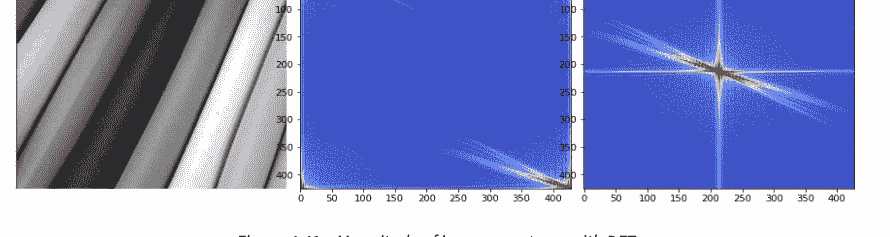

图4.41 – 使用DFT得到的图像频谱幅度

这是隐式周期性的典型示例，它会导致边缘效应。DFT看到的（而不是输入图像）是如下所示的图像：


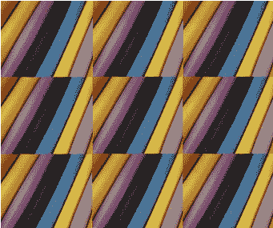

*图 4.42 – 重复图像*

DFT 假设图像在水平和垂直方向上都周期性地重复。因此，图像边界处的剧烈强度变化会产生不连续性，从而引入不希望的高频伪影，这些伪影通常表现为平移后频谱中强烈的垂直和水平线条。为了减少这些影响，**窗口化** 通过将图像与一个平滑的锥形函数 *w(x, y)* 相乘来应用，该函数在中心处接近 1，并逐渐减小到边缘处的 0。这种平滑过渡最小化了边界不连续性，并在计算 DFT 之前抑制了频谱伪影。

`skimage.filters` 模块的 `window()` 函数提供了许多窗口函数，该函数接受窗口函数名称及其相关参数（如果有）。让我们在输入图像上应用 parzen 窗口函数（你也可以尝试其他函数）并计算 DFT。注意，这一次我们得到了期望的输出：

```python
f_windowed = f * window('parzen', f.shape)
F_windowed = np.fft.fft2(f_windowed)
# 绘制图像 f_windowed，频谱 F_windowed（使用 plot_spectrum()）
# 绘制平移后的频谱（使用 np.fft.fftshift(F_windowed)）
```

如果你运行上述代码片段并绘制图像，你应该得到一个类似下图的图形，显示频域中有一个唯一的方向（更具体地说，垂直于空间域图像中书边缘的方向），符合预期。

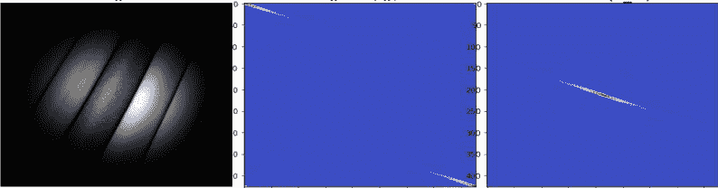

*图 4.43 – 通过窗口化（Parzen 窗口）去除不需要的频率*

## 振铃伪影

**振铃伪影** 是数字图像处理中常见的视觉失真，尤其是在处理图像中的尖锐过渡或边缘时。这些伪影表现为物体边缘附近的振荡或波纹，是图像分析中使用傅里叶变换的直接结果。在为科学或实际应用处理图像时，理解这些伪影如何产生以及如何减轻它们至关重要。

为了说明这一概念，考虑一个简单的二值图像，其中心有一个白色圆形，背景为黑色。这种二值图像在黑白区域之间具有尖锐的过渡——正是容易出现振铃伪影的那种边缘。

### 生成带圆形的二值图像

首先，使用以下代码片段生成一个大小为 256 × 256 的二维二值图像 f₁，其中心有一个半径为 r = 20 像素的圆。以 (x₀, y₀) 为中心的圆由方程 (x − x₀)² + (y − y₀)² = r² 定义，其中 r 是半径。在这种情况下，圆心位于 (128, 128)，即图像网格的中间位置：

```python
N, r = 256, 20
f1 = np.zeros((N, N))
x, y = np.meshgrid(np.arange(N), np.arange(N))
f1[(x - N/2)**2 + (y - N/2)**2 <= r**2] = 1
```

该图像将作为我们 DFT 的输入。当我们计算这个形状鲜明的图像的 DFT 时，振铃伪影就变得明显了。

### 应用 DFT

下一步是计算该图像的 DFT（使用下一行代码）并可视化其频率频谱。DFT 让我们了解不同频率分量如何对图像做出贡献。在具有尖锐过渡的区域（例如二值圆的边缘），高频分量占主导地位，这导致了振铃伪影：

```python
F1 = np.fft.fft2(f1)
```

### 可视化 DFT

现在，如果你将原始图像 (f1) 与 DFT 频谱的幅度 (np.fft.fftshift(F1)) 一起可视化，你应该得到类似下图的结果（使用 cmap='nipy_spectral'）。二值图像在圆的边界处包含从黑到白的尖锐过渡。相应的频率频谱揭示了由于圆的尖锐边缘而导致的高频内容。当图像被变换回空间域时，这种高频信息会导致边缘附近的振荡或振铃，如下图所示，这是你运行上述代码片段后得到的输出。这些振铃伪影是由圆的尖锐截止引起的。

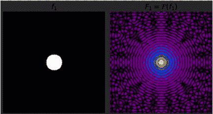

*图 4.44 – DFT 产生的振铃伪影*

这些振铃伪影的出现是因为**吉布斯现象**——这是傅里叶域中高频分量被截断的结果。当图像包含尖锐过渡时，傅里叶级数难以准确表示这些边缘，导致过冲和振荡。

## 平滑图像以避免振铃伪影

减少振铃伪影的一种方法是平滑图像中的尖锐边缘。这可以通过对图像应用高斯滤波器来实现，该滤波器模糊了尖锐过渡，从而减少了高频内容。

### 应用高斯滤波器

高斯滤波器是一种低通滤波器，通过减少高频分量来平滑图像。这里使用 `skimage.filters` 模块中的 `gaussian()` 函数，并带有标准差来平滑二值圆图像，如以下代码片段所示：

```python
f2 = gaussian(f1, 10)
F2 = np.fft.fft2(f2)
```

### 应用高斯滤波器后的观察

现在，可视化中心模糊的新图像 (f2) 及其 DFT 频谱的幅度（使用 `plot_spectrum(np.fft.fftshift(F2))`）。从下图可以看出，图像现在由于高斯滤波而具有模糊的边缘。黑白像素之间的尖锐过渡被柔化了。

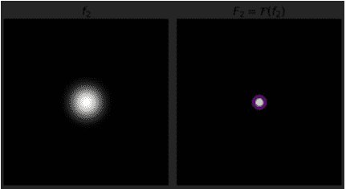

*图 4.45 – 使用高斯低通滤波器去除振铃伪影*

平滑图像 F2 的傅里叶频谱显示高频分量更少。因此，F1 中存在的振铃伪影在 F2 中不再可见，如下图所示，该图可视化了新图像的频谱。由于圆的截止是平缓的，因此不会发生振铃。

### 振铃的数学解释

当信号中出现尖锐的不连续时（在我们的例子中是圆的边缘），就会发生吉布斯现象。这种信号的傅里叶级数表示在不连续点附近的任何地方都收敛到正确的函数值，但在不连续点附近它会过冲并振荡，从而导致振铃伪影。

当我们应用高斯滤波器时，平滑降低了边缘的锐度，减少了傅里叶变换中的高频内容，这有助于减轻振铃。

## 线性与可分配性

**线性** 意味着组合图像的 DFT 与各个图像 DFT 之和相同，而**可分配性** 意味着你可以分别对图像的各个部分应用 DFT，然后组合结果，得到相同的最终结果。让我们首先理解并演示线性性质（即两个信号之和的 DFT 等于各个信号 DFT 之和），如下图所示——这一性质对于从图像中去除加性噪声非常有用。

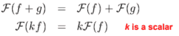

*图 4.46 – DFT 的线性*

以下代码片段演示了线性性质：

```python
f1 = imread('images/cat1.png', True)
f2 = imread('images/cat2.png', True)
F1, F2 = np.fft.fft2(f1), np.fft.fft2(f2)
F = F1 + F2
f_hat = np.fft.ifft2(F)
# 绘制图像 (f1, f2)，频谱 (F1, F2, F)，重建图像 f_hat
```

让我们逐步理解代码的工作原理：从一对输入图像 f1 和 f2 开始，对各个图像取 DFT 得到 F1 和 F2，将 F1 和 F2 相加得到 F，然后取逆 DFT 得到 f_hat。你应该通过在空间域和频率域中可视化图像来获得结果，如代码片段后给出的图所示。如果你运行上述代码片段，你应该得到类似下面的图：


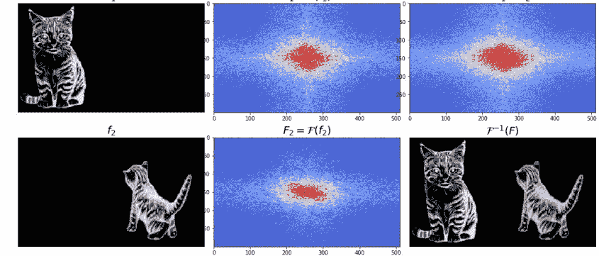

图4.47 – 展示DFT线性性质的图像重建

## 旋转

将输入图像旋转一个角度，意味着频谱也会旋转相同的角度，如下图所示：

f(r, θ) ↔ F(ω, φ)
f(r, θ + α) ↔ F(ω, φ + α)
以角度α旋转

图4.48 – DFT的旋转性质

下面的代码片段演示了这一性质：

```python
from scipy.ndimage import rotate
im = imread('images/box.png', True)
F = np.fft.fftshift(np.fft.fft2(im))
im_rot = rotate(im, 45)
F_rot = np.fft.fftshift(np.fft.fft2(im_rot)) # rotated spectrum
# plot original & rotated images (im, im_rot) and spectrums (F, F_rot)
```

如果运行前面的代码片段并绘制图像，你应该会得到类似下图的输出：

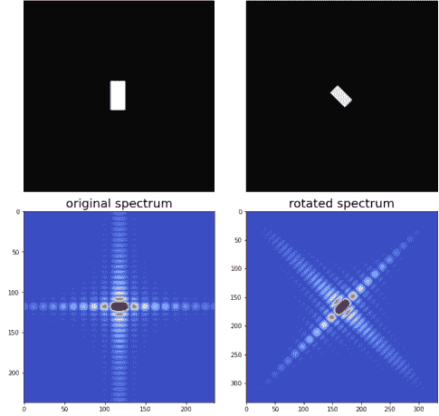

图4.49 – 图像旋转对DFT频谱的影响

## 相似性/缩放

拉伸图像会导致频谱收缩（反之亦然），如下图所示：

f(x, y) ↔ F(u, v).

f(αx, βy) ↔ 1/|αβ| F(u/α, v/β)

图4.50 – DFT的缩放性质

下面的代码片段使用拉伸的矩形来演示这一性质：

```python
f_small = imread('images/box.png', True)
F_small = np.fft.fftshift(np.fft.fft2(f_small))
f_large = imread('images/box_stretched.png', True) # stretched image
F_large = np.fft.fftshift(np.fft.fft2(f_large)) # stretched spectrum
# plot images (f_small, f_large) and spectrums (F_small, F_large) here
```

如果运行上述代码并绘制图像，你应该会得到类似下图的输出：

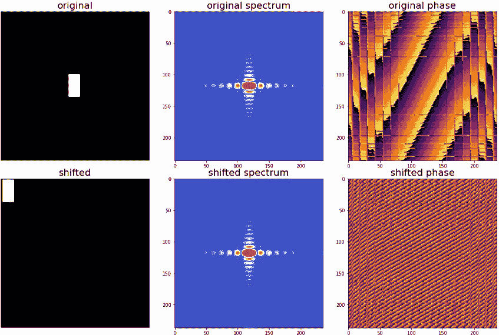

图4.53 – 空间域中的平移对DFT频谱的影响

## 能量守恒：帕塞瓦尔/瑞利定理

帕塞瓦尔/瑞利定理表明了空间域和频率域之间的能量守恒，对于一个二维信号（图像），其表述如下：

下面的代码片段演示了该定理对lena图像成立：

```python
f = imread('images/lena.jpg', True)
F = np.fft.fft2(f)
f_energy, F_energy = np.sum(np.abs(F)**2) / np.prod(f.shape), np.sum(f**2)
f_energy, F_energy, np.isclose(f_energy, F_energy)
# (11918.093481563103, 11918.0934815631, True)
```

从上面的输出可以看出，在空间域和频率域中计算得到的能量非常接近，从而证实了能量在不同域间的守恒。

## 小结

在本章中，我们讨论了一些主要与二维DFT及其在图像处理中的相关应用有关的重要概念，例如频域滤波，并使用scikit-image、numpy.fft、scipy.fftpack、scipy.signal和scipy.ndimage等模块完成了不少示例。

希望你现在已经清楚采样和量化——这两种重要的图像形成技术。我们已经了解了二维DFT、FFT算法的Python实现，以及DFT在图像处理中的应用，如图像去噪与恢复、相关和卷积。你还了解了在滤波器设计中使用适当核进行卷积的应用，以及相关在模板匹配中的应用。现在你应该能够编写Python代码，使用PIL/SciPy/scikit-image库进行采样和量化，并使用FFT算法在Python中执行二维FFT/IFFT。我们还看到，使用一些核对图像进行基本二维卷积是多么容易。

在下一章中，我们将介绍卷积——图像处理/计算机视觉中另一个基本操作——并探讨其广泛的应用范围。我们还将学习频域滤波以及各种频域滤波器。

## 获取本书PDF版本及更多内容

扫描二维码（或访问 packtpub.com/unlock）。按名称搜索本书，确认版本，然后按照页面上的步骤操作。


注意：请随身携带发票。直接从Packt购买的书籍不需要发票。
