### 5 卷积与空间/频域滤波

在本章中，我们将探讨图像处理中最基本的操作之一：卷积。二维卷积在从边缘检测到图像平滑和特征提取的广泛应用中发挥着核心作用。我们将首先建立对卷积的直观和数学理解，并解释为什么它在处理视觉数据时如此关键。然后，我们将区分空间域卷积和频域卷积，强调后者如何利用卷积定理显著加速计算。通过详细的比较、可视化以及使用scipy.signal、scipy.ndimage、opencv-python和numpy.fft等库的Python实现，我们将看到这些技术在实际中如何应用。

在此过程中，我们还将澄清相关（correlation）和卷积之间常被混淆的区别，并演示如何使用相关进行模板匹配——这是计算机视觉中的一项重要任务。我们将实现互相关（cross-correlation）和归一化互相关（NCC）来定位图像中的模式，并比较不同方法的性能。最后，本章将以二维与三维卷积的讨论作为结尾，深入探讨这些概念如何扩展到体积数据。无论你是在空间域还是频域工作，到本章结束时，你都将对卷积及其在现代图像处理中的强大作用有一个实用的、动手实践的理解。本章将涵盖以下主题：

- 卷积定理及其应用
- 频域滤波（使用scipy.ndimage模块和scikit-image）
- 相关与卷积
- 使用归一化互相关（NCC）进行模板匹配
- 二维与三维卷积

## 技术要求

以下是本书随附的GitHub仓库中与本章对应的Jupyter笔记本链接：https://github.com/PacktPublishing/Hands-On-Image-Processing-and-Computer-Vision-with-Python-Second-Edition。在阅读本章各个部分时，请跟随此笔记本（并运行必要的代码片段）。为了确保代码按预期运行，并且不受未来弃用或向后不兼容更改的影响，仓库的同一文件夹中提供了一个requirements.txt文件——使用pip install -r requirements.txt安装它。

## 理解卷积

（二维）卷积是一种作用于两幅图像的操作，其中一幅是输入图像，另一幅是掩膜（也称为核，kernel），作为输入图像上的滤波器，产生一幅输出图像。卷积滤波用于修改图像的空间频率特性。它的工作原理是，通过将中心像素的所有相邻像素的加权值相加来确定中心像素的值，从而计算输出图像中该像素的新值。输出图像中的像素值是通过让核窗口遍历输入图像来计算的，如下面的截图所示（针对使用valid模式的卷积；我们将在本章后面看到卷积模式）：

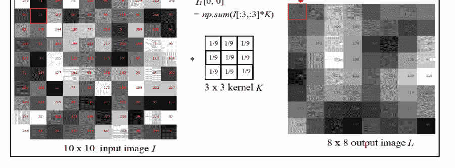

图5.1 – 使用valid模式将图像与核进行卷积

如你所见，核窗口在输入图像中用箭头标出，它遍历图像，并在卷积后获得映射到输出图像上的值。

## 为什么对图像进行卷积？

卷积是图像处理中的一项基本操作，用于多种目的，例如滤波、特征检测和平滑。当我们用核（也称为滤波器）对图像进行卷积时，核被应用于图像中的每个像素及其相邻像素，以在输出图像中为该像素生成一个新值。


以下是进行图像卷积的原因以及其在图像处理中至关重要的原因：

- **数学基础：** 卷积在数学上将输入图像与核结合，以提取或抑制某些特征
- **计算效率：** 大多数图像处理算法，尤其是在计算机视觉中，由于其简单性和效率而严重依赖卷积
- **通用性：** 卷积是一种通用操作，只需更改核即可适应各种任务，从而可以在图像上实现各种效果和变换

它在图像处理和深度学习中广泛用于特征提取和滤波。在本节中，我们将使用卷积对图像应用通用滤波器效果。这是为了通过适当的核在图像上实现各种效果，例如平滑、锐化和浮雕，以及诸如边缘检测之类的操作。然而，根据卷积是在空间域还是频率域执行，计算效率可能会显著变化。

## 空间域卷积

2D 空间卷积的核心是滑动一个 **kernel**（或滤波器）覆盖图像，以计算每个位置周围像素强度的 **weighted sum**。在数学上，对于大小为 M × N 的图像和大小为 k × k 的 **filter**（核）K，像素位置处的卷积计算如下：

O(x, y) = Σₘ Σₙ K(m, n) · I(x − m, y − n)

虽然很直接，但对于大图像或大核尺寸，这种方法在计算上变得昂贵，因为操作次数随核尺寸呈二次增长。

**时间复杂度（空间域）：** 空间域卷积的时间复杂度为 O(k²MN)，其中 k 是核尺寸，M × N 是图像尺寸。对于小核尺寸（例如 3x3 或 5x5），这是可以管理的，但对于大核，成本变得难以承受。

## 频率域卷积

在频率域中，利用 **convolution theorem** 可以更有效地执行卷积，该定理指出空间域中的卷积等价于频率域中的逐元素乘法。步骤如下：

- 使用 **Fast Fourier Transform (FFT)** 将图像 I 和核 K 变换到频率域。
- 逐元素相乘傅里叶变换后的图像和核。
- 反转 FFT 将结果转换回空间域。

在数学上，如果 F 表示傅里叶变换，则卷积计算如下：

F(I * K) = F(I) · F(K)

主要优势在于 FFT 可以更有效地计算卷积，尤其对于大核，因为 FFT 将卷积的时间复杂度从二次降低到接近线性。

## 时间复杂度

傅里叶基图像处理步骤的总体计算复杂度可分解如下：

- 大小为 $M \times N$ 的图像的 **FFT** 可以在 $O(MN \log(MN))$ 中计算
- 傅里叶变换的逐元素乘法的时空复杂度为 $O(MN)$
- **Inverse FFT (IFFT)** 也需要 $O(MN \log(MN))$

因此，频率域中的总体时间复杂度为：$O(MN \log(MN))$。这比空间域中二次时间 $O(k^2 MN)$ 更有效，尤其对于大图像和大核。

## 比较 — 空间与频率域

为了决定何时使用空间或频率域滤波，有助于根据核尺寸和计算效率比较其性能特征。以下要点总结了主要差异：

- 对于小核，空间域卷积通常更快，因为执行 FFT 的开销超过了逐元素乘法的益处。这就是为什么直接卷积用于典型图像滤波器中的 $3 \times 3$ 或 $5 \times 5$ 等核。
- 对于大核，频率域方法更有效。$O(MN \log(MN))$ 的复杂度比 $O(k^2 MN)$ 增长更慢，尤其当 $k$ 变大时。

> **Note**
> 虽然基于 FFT 的卷积对于大核是高效的，但对于非常大的图像可能会变得内存密集。在这种情况下，可以使用诸如 *tiled FFT*、*overlap-save* 或 *overlap-add* 等高级策略，以小块处理图像，而不会超出内存限制。

## 实际应用

空间域和频率域卷积之间的选择取决于效率和任务。使用 Sobel 和 Prewitt 等小核算子的边缘检测通常在空间域中执行，以实现实时性能。使用大核的模糊和平滑，例如高斯模糊，通常在频率域中实现以降低计算成本。用于天文图像恢复和生物医学显微镜等应用的去卷积也通常依赖于频率域技术（例如 Wiener 和 **Richardson–Lucy deconvolution**）来从模糊观测中高效恢复图像细节。

## 在空间域中应用卷积

现在，让我们演示如何使用来自不同库的以下函数将 2D 卷积应用于图像。

### With `scipy.signal`

`scipy` 库的 signal 模块的 `convolve2d()` 函数可用于对图像应用 2D 卷积。让我们使用此函数对图像（首先是灰度图像，然后是 RGB 彩色图像）与核（也称为滤波器，或有时称为点扩散函数 – PSF）应用卷积。

### Convolution on grayscale Images (SciPy)

让我们现在演示图像处理中的两个基本操作：使用盒式模糊滤波器 **blurring** 图像（此处使用灰度 cameraman 图像作为输入图像）以及使用 Laplace 核 **detecting edges**，使用以下代码片段通过 2D 卷积实现。以下是您将在下面找到的代码相关部分的详细解释：

1. **Defining the box blur kernel**
    - 创建一个盒式模糊核，即 3x3 的全 1 矩阵。除以 9 **normalizes** 核，使核中所有值的总和为 1。这确保卷积不会放大图像的亮度。
    - 应用于图像时，此核会平均 3x3 邻域内的像素值，从而产生平滑或模糊效果。

2. **Defining the Laplace edge detection kernel**
    - **Laplace kernel** 用于执行 **edge detection**。它通过计算图像的二阶导数来检测强度变化。核突出显示强度显著变化的区域，这通常对应于边缘。
    - 在此核中，中心像素的权重为 -4，而其四个方向相邻像素的权重为 +1。这种排列强调像素强度快速变化（即边缘）。

3. **Applying convolution to the image:**
    - `signal.convolve2d()` 将灰度图像 `im` 与核进行卷积。卷积将核在整个图像上滑动，用邻居的加权平均值替换每个像素，从而计算卷积图像。
    - `blur_box_kernel` 对输入图像应用平滑/模糊处理，结果存储在 `im_blurred` 中。
    - `edge_laplace_kernel` 计算像素与其邻居之间的像素强度差异，突出显示强度急剧变化的区域（即边缘）。

现在，参考以下代码片段：

```python
%matplotlib inline
from PIL import Image
from skimage.io import imread, imshow, show
import scipy.fftpack as fp
import numpy.fft as nfp
from scipy import ndimage, misc, signal
from skimage import data, color, restoration, img_as_float
from skimage.color import rgb2gray
from skimage.transform import rescale
from skimage.metrics import peak_signal_noise_ratio as psnr
import matplotlib.pylab as plt
from matplotlib.colors import LogNorm
import numpy as np
import numpy.fft
import timeit
import warnings
warnings.filterwarnings('ignore')
im = rgb2gray(imread('images/cameraman.jpg'))
print(np.max(im))
# 0.9921568627450981
print(im.shape)
# (256, 256)
blur_box_kernel = np.ones((3,3)) / 9 # normalize the kernel
edge_laplace_kernel = np.array([[0,1,0],[1,-4,1],[0,1,0]])
im_blurred = signal.convolve2d(im, blur_box_kernel)
im_edges = np.clip(signal.convolve2d(im, edge_laplace_kernel), \
                                  0, 1)
```

如果运行前面的代码片段并绘制使用 scipy.signal 模块的 convolve2d() 函数获得的卷积图像以及原始图像，您应该得到如下图所示：

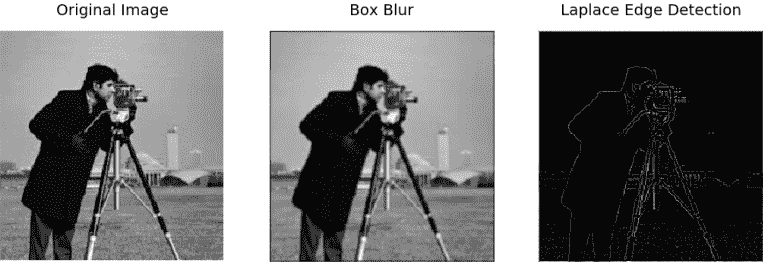

*Figure 5.2 – Application of box blur and Laplace filter on cameraman image*

执行卷积操作，例如对图像应用滤波器时，正确处理输入图像的边界（边缘像素）非常重要，并定义处理过程中图像的填充方式。有多种模式、填充值和边界条件会影响输出。这些可以通过向 scipy.signal convolve2d() 函数传递 mode、boundary 和 fillvalue 参数来指定。


让我们探索这些概念：

- 首先，让我们理解 `mode` 参数及其可能的值，对于 *M × N* 输入图像与 *m × n* 核的卷积：
  - `mode='full'`: 这是默认模式，输出是输入的完整离散线性卷积。它返回完整的 2D 卷积，包括所有边界效应。
    - 输出形状：*(M + m − 1, N + n − 1)*。
  - `mode='valid'`: 这会忽略边缘像素，仅对具有所有邻居的像素进行计算（不需要零填充的像素）。输出图像尺寸小于输入图像尺寸（除 1 × 1 核外）。它仅返回未使用零填充计算的卷积部分。输出大小：*(M − m + 1, N − n + 1)*，假设 *M ≥ m* 且 *N ≥ n*。
  - `mode='same'`: 输出图像与输入图像具有相同的大小；它相对于 `'full'` 输出居中。它返回与第一个输入大小相同的卷积中心部分。输出形状：*(M, N)*。

下图说明了使用 5×5 输入图像和 3×3 核的不同 2D 卷积 *mode* 之间的差异：

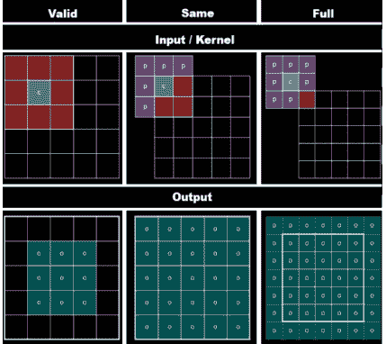

*Figure 5.3 – 2D convolution with modes valid, same, and full*

- `boundary` 参数是一个标志，指示如何处理图像边界。该参数控制卷积期间图像在边界处的扩展方式。可能的值如下：
  - `fill`: 用 `fillvalue`（默认 0）填充输入数组。当不需要原始图像之外的边缘信息时使用。
  - `wrap`: 循环边界条件，左侧的值 *wrap* 到右侧，顶部和底部亦然，反之亦然。当处理周期性或循环数据时使用（例如平铺的纹理）。你希望在边界处保持连续性，例如某些基于傅里叶的应用。
  - `symm`: 对称边界条件 – 通过在边缘处对称反射数据来填充图像。它能够在边界处以镜像对称的方式平滑扩展。使用它以保持边缘连续性并避免在图像边界处创建边缘。它通常是通用图像处理的 safest 和最自然的选择。

下表总结了边界条件：

| boundary | Description | When to Use |
|---|---|---|
| `'fill'` | Constant padding (default 0) | When simulating zero outside or ignoring edges |
| `'wrap'` | Periodic wrapping | For cyclic or tiling images |
| `'symm'` | Symmetric reflection | To avoid edge artifacts; best for general cases |

`fillvalue` 参数是用于填充填充输入数组的可选值；默认值是 0。

## Warning

> 当使用 `scipy.signal.convolve2d` 时，尤其是在边缘检测等任务中，不当选择 `mode` 和 `boundary` 参数可能会导致边缘效应——图像边界附近的人工失真。为了保持图像尺寸并减少伪影，请使用 `mode='same'` 并结合适当的边界策略，例如 `'symm'`（对称反射）或 `'wrap'`（周期性扩展）。除非明确需要零填充，否则应避免默认的 `'fill'` 且 `fillvalue=0`，因为它可能会引入虚假边缘。

## To color an (RGB) image

使用 `scipy.signal.convolve2d()`，我们也可以使用适当的滤波器（核）来锐化 RGB 图像。我们必须对每个颜色通道分别应用卷积。让我们使用泰姬陵图像，使用浮雕核和 Scharr 边缘检测复核，并借助以下代码片段：

```python
im = imread('images/tajmahal.jpg')
im = im / im.max()
print(np.max(im)) # pixels scaled to have values in [0,1]
# 1.0
emboss_kernel = np.array([[-2,-1,0],[-1,1,1],[0,1,2]])
edge_schar_kernel = np.array([[-3-3j, 0-10j, +3-3j],\
    [-10+0j, 0+0j, +10+0j],\
    [ -3+3j, 0+10j, +3+3j]])
im_embossed = np.ones(im.shape)
im_edges = np.ones(im.shape)
# apply filters across each color channel separately
for i in range(3):
    im_embossed[...,i] = np.clip(signal.convolve2d(im[...,i], \
        emboss_kernel, mode='same', boundary="symm"), 0, 1)
for i in range(3):
    im_edges[:,:,i] = np.clip(np.real(signal.convolve2d(im[...,i],
                            edge_schar_kernel, mode='same', boundary='symm')), 0, 1)
# plot image im, im_embossed and im_edges here
```

> **Note**
> 
> 与常见的边缘检测核（例如 *Sobel* 算子）不同，*Sobel* 算子使用两个单独的核来计算水平（`G_x`）和垂直（`G_y`）梯度（我们将在 *第 7 章* 中讨论更多关于使用导数进行图像增强的内容），*Scharr* 算子可以组合成一个 *单一复核*：
> 
> `G_x = [[−3, 0, +3], [−10, 0, +10], [−3, 0, +3]]`
> 
> `G_y = [[−3, −10, −3], [0, 0, 0], [+3, +10, +3]]`
> 
> 复核 `K = G_x + iG_y` 能够在 *一次卷积* 中检测水平（实部）和垂直（虚部）边缘。输出编码边缘强度（通过幅度）和方向（通过相位），使这种方法既紧凑又高效。

如果运行前面的代码片段，你应该会得到如下图所示的图形，其中原始图像和滤波后的图像并排显示：

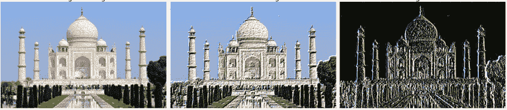

*Figure 5.4 – Application of Embossing/Scharr filter on Taj Mahal image with convolve2d*

## With scipy.ndimage

使用 `scipy.ndimage.convolve()`，我们可以直接锐化 RGB 图像（我们不必对每个图像通道分别应用卷积）。使用 `victoria_memorial` 图像以及以下代码片段中定义的 3 × 3 锐化、**emboss** 和 **lighten** 核，该片段将这三个不同的卷积核应用于图像并使用 matplotlib 可视化结果。以下三个核 – `sharpen_kernel`、`emboss_kernel` 和 `lighten_kernel` – 分别用于计算锐化、浮雕和提亮图像，如下所述：

- 锐化图像增强边缘和细节
- 浮雕图像使图像具有 3D 效果
- 提亮图像增加图像的亮度

这些滤波器通常用于图像处理中以增强视觉特征或应用艺术效果。以下是说明该过程的代码片段：

```python
im = imread('images/victoria_memorial.png') # read as float
im = im / im.max()
sharpen_kernel = np.array([[0, -1, 0], [-1, 5, -1], [0, -1, 0]]) \
    .reshape((3, 3, 1))
emboss_kernel = np.array([[-2,-1,0],[-1,1,1],[0,1,2]]) \
    .reshape((3, 3, 1))
lighten_kernel = (np.array([[0,0,0], [0,12,0], [0,0,0]]) / 9) \
    .reshape((3, 3, 1))

im_sharp = np.clip(ndimage.convolve(im, sharpen_kernel,
    mode='nearest'), 0, 1)
im_emboss = np.clip(ndimage.convolve(im, emboss_kernel,
    mode='nearest'), 0, 1)
im_light = np.clip(ndimage.convolve(im, lighten_kernel,
    mode='nearest'), 0, 1)
# plot im_sharp, im_emboss and im_light here
```

让我们详细讲解前述代码片段的每个部分：

- 定义卷积核：这里定义了三个核。每个都是 3 × 3 矩阵：
  - Sharpen kernel: 该核通过突出边缘来锐化图像。中心像素值增加（5），周围像素被减去以增强对比度。
  - Emboss kernel: 该核使图像具有浮雕效果，看起来具有深度。核强调对角相邻像素以创建类似 3D 的效果。
  - Lighten kernel: 该核通过在小区域上分布更高的值来增加中心像素的亮度。除以 9 通过平均中心值来平滑效果。
- 使用卷积应用核：
  - `ndimage.convolve(im, kernel, mode='nearest')`: 这将在图像和指定核（锐化、浮雕或提亮）之间应用卷积。卷积通过将核在图像上滑动并计算核与底层像素的乘积之和来工作。
  - `mode='nearest'`: 这确保图像边界通过复制最近的像素值来处理，以避免边缘处的伪影。
  - `np.clip(..., 0, 1)`: 卷积后，像素值可能会超出 [0,1] 范围。`np.clip()` 函数确保所有像素值被限制（限制）在 0 到 1 之间。这保持像素值有效以显示为灰度图像（0 = 黑色，1 = 白色）。


如果运行前面的代码片段，你应该会得到如下图所示的图像。


*Figure 5.6 – Applying the sharpening filter with opencv-python*

## Performance benchmarking

比较 `scipy.signal.convolve2d()`、`scipy.ndimage.convolve()` 和 `cv2.filter2D()` 的完整基准测试代码可在 GitHub 仓库中获得。基准测试评估了不同图像尺寸下的运行时间，并显示由于其优化的实现，`cv2.filter2D()` 通常提供最佳性能；请参考下图：

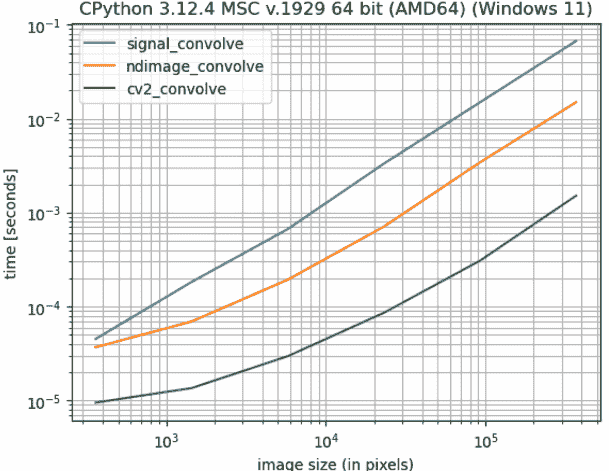

*Figure 5.7 – Benchmarking runtime of 2D convolution (scipy signal/ndimage vs opencv-python)*

Note
此处显示的基准测试结果基于 CPU 执行，具体数值会因硬件而有显著差异，尤其是在使用这些库的 GPU 加速版本时（例如使用 CUDA 的 OpenCV）。为了公平比较，请确保硬件设置一致。

虽然在选择实现时性能至关重要，但同样重要的是要理解底层数学运算，特别是相关与卷积之间的区别，二者经常被混淆但行为不同。让我们在下一节中探讨这一点。

## Correlation versus convolution

相关和卷积都会将核在图像上滑动以计算加权和，但卷积会在应用前翻转核。虽然在实践中它们通常相似，但在特定滤波任务中这种区别很重要。归一化互相关用于模式匹配，可调整亮度和对比度变化，确保在光照条件不同的图像中进行一致的特征检测。以下方程描述了图像 f 上相关与卷积之间的差异：

- Correlation: g(x, y) = f ⋆ K = Σ_{u=-h}^{h} Σ_{v=-h}^{h} f(x + u, y + v) K(u, v)
- Convolution: g(x, y) = f ∗ K = Σ_{u=-h}^{h} Σ_{v=-h}^{h} f(x − u, y − v) K(u, v)

Example: 请参考下一张图，了解一个逐步的数值示例，展示如何使用上述公式计算相关和卷积的输出，从一个 4×4 输入图像、一个 2×2 核开始，并使用 mode='valid'。我们可以直接将核在输入图像上滑动并计算逐元素乘法和求和，如下所示：

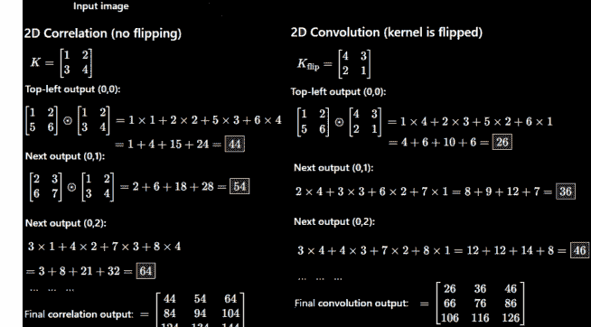

Figure 5.8 – Compute correlation and convolution in 2D – a numeric example

因此，相关和卷积的区别在于应用前是否翻转核。下图总结了这对输出的影响：

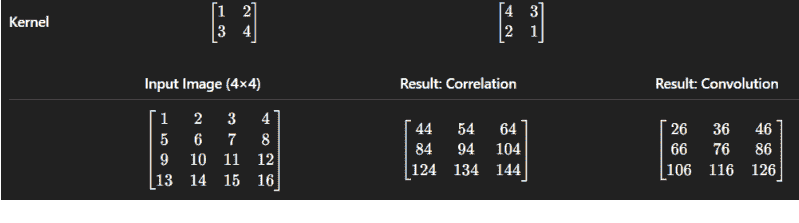

Figure 5.9 – 2D correlation versus convolution – a numeric example

scipy.signal 模块的 correlate2d() 函数可用于相关。以下代码可用于验证之前的手动计算，通过使用 seaborn 库以带注释的热力图直观展示相关和卷积输出之间的差异：

```
from scipy.signal import convolve2d, correlate2d
import seaborn as sns
k = np.reshape(range(1,5), (2,2))
I = np.reshape(range(1,17), (4,4))
conv_out = convolve2d(I, k, mode='valid')
corr_out = correlate2d(I, k, mode='valid')
sns.heatmap(conv_out, annot=True, fmt='d', linewidths=.5, cbar=False)
sns.heatmap(k, annot=True, fmt='valid', linewidths=.5, cbar=False)
```

如果你运行前面的代码，应该会得到如下图所示的图。

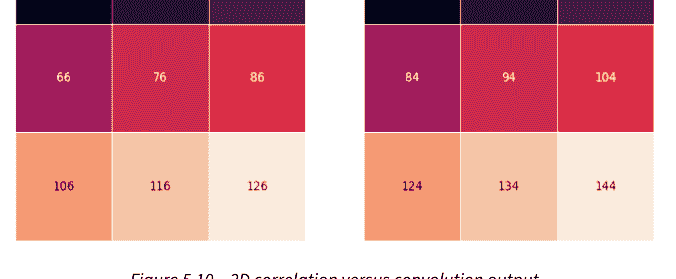

Figure 5.10 – 2D correlation versus convolution output

当核是对称时，相关与卷积相同。但如果核不是对称的（例如不对称的 3 × 3 波纹核 [0,-1,√2], [1,0,-1], [-√2,1,0]），要使 `correlation2d()` 和 `convolution2d()` 得到相同的结果，则在对图像应用相关之前必须先垂直和水平翻转核。让我们继续看看相关的有趣应用。

## Template matching

模板匹配是图像处理和计算机视觉中用于在较大图像 *I* 中查找小型模板图像 *T* 的技术。它常用于目标检测、模式识别和特征定位。

### Using cross-correlation

对于给定的图像 *I(x, y)* 和大小为 *M × N* 的模板 *T(i, j)*，在位置 *(x, y)* 处的互相关计算如下：

$$C(x,y)=\sum_{i=0}^{M-1}\sum_{j=0}^{N-1} I(x+i,y+j)\cdot T(i,j)$$

其中 *I(x + i, y + j)* 是位置 *(x + i, y + j)* 处的图像像素，*T(i, j)* 是对应的模板像素。对模板中的所有像素求和。该公式衡量模板与图像对应区域之间的相似度。*C(x, y)* 值越高，表示匹配越强。

### With scipy.signal

下面的代码演示了使用 **scipy.signal.correlate2d()** 进行 **零均值互相关** 的 **模板匹配**，以在灰度浣熊图像中定位右眼。首先将人脸图像和眼部模板转换为 *零均值*，通过减去其平均强度，提高匹配鲁棒性。然后添加高斯噪声以模拟真实世界条件。互相关使用 `signal.correlate2d(face_image, template_image, boundary='symm', mode='same')` 计算，其中 `boundary='symm'` 应用对称填充，`mode='same'` 保持图像大小。最佳匹配位置通过 `np.argmax()` 和 `np.unravel_index()` 获得，它们识别最大相关值的坐标，并通过在图像上标记来可视化检测到的模板位置。

以下是代码片段：

```
face_image = misc.face(gray=True) - misc.face(gray=True).mean()
template_image = np.copy(face_image[300:365, 670:750]) #righteye
template_image -= template_image.mean()
# add random noise
face_image = face_image + \
                         np.random.randn(*face_image.shape) * 50
cc = signal.correlate2d(face_image, template_image, \
                         boundary='symm', mode='same')
# find the match
```

```
```python
y, x = np.unravel_index(np.argmax(cc), cc.shape)
# plot face_image, template_image, cc (use cmap='afmhot')
# mark the location (x,y) with a red dot in the image
```
```

如果你运行前面的代码并绘制图像，应该会得到如下图所示的图像：

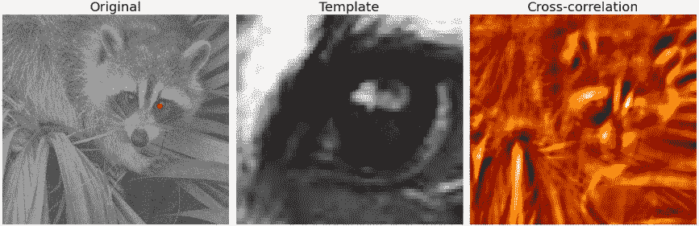

*Figure 5.11 – Detecting the right eye of the raccoon using correlation*

正如前图所示，输入图像中浣熊的右眼与眼部模板图像的互相关最高。

> **Note**
> 
> 模板匹配在现实世界应用中被广泛使用，例如人脸标志点检测，其中眼睛或嘴角等部位使用小型模板定位，以及工业质量检验，其中通过与预定义模式比较来识别组件或缺陷。这些实际用途凸显了模板匹配在消费和工业计算机视觉系统中的重要性。

## Using normalized cross-correlation (NCC)

互相关衡量图像 *I* 与模板 *T* 之间的相似度，但对光照和对比度变化敏感。**归一化互相关 (NCC)** 通过归一化图像和模板来克服此问题，确保相关值保持在 [−1,1] 之间，使其具有尺度和光照不变性。

**NCC 的数学定义：** 在位置 $(x,y)$ 处的归一化互相关由下式给出：

$$NCC(x,y)=\frac{\sum_{i,j}(I(x+i,y+j)-\mu_I)(T(i,j)-\mu_T)}{\sqrt{\sum_{i,j}(I(x+i,y+j)-\mu_I)^2\sum_{i,j}(T(i,j)-\mu_T)^2}}$$

其中 $\mu_I$ 和 $\mu_T$ 分别是图像块和模板的均值。分子计算零均值互相关。分母通过标准差进行归一化，确保尺度不变性。


## 使用 scipy.signal

`normalized_cross_correlation()` 函数，在以下代码块中，通过计算模板和对应图像块的均值和标准差，对模板进行零均值化，并使用 `signal.correlate2d()` 评估相似度，来实现模板匹配的归一化互相关 NCC。分子由图像与零均值模板之间的互相关得到，而分母则使用模板和局部图像标准差的乘积对结果进行归一化。这种归一化使得 NCC 在很大程度上对强度缩放和对比度变化不敏感。 resulting NCC 相关图在与模板最佳匹配的位置包含接近 1 的值，从而比标准互相关实现更稳健的匹配。

```
def normalized_cross_correlation(image, template):
    # Compute means
    template_mean = np.mean(template)
    image_mean = signal.correlate2d(image, \
        np.ones(template.shape), mode='valid') / template.size
    # Compute zero-mean template
    template_zero_mean = template - template_mean
    # Compute numerator: cross-correlation of zero-mean
    #               template with image
    numerator = signal.correlate2d(image, template_zero_mean, \
                    mode='valid')
    # Compute denominator: standard deviations
    image_std = np.sqrt(signal.correlate2d(image**2,
        np.ones(template.shape), mode='valid')
        / template.size - image_mean**2)
    template_std = np.std(template)
    # Avoid division by zero
    denominator = image_std * template_std
    denominator[denominator == 0] = 1e-10  # prevent NaN
    # Compute NCC
    ncc = numerator / denominator
    return ncc

ncc = normalized_cross_correlation(face_image, template_image)
# plot cc and ncc images side-by-side
```

运行前面的代码片段并并排绘制/比较 `cc` 与 `ncc` 图像。

## 使用 opencv-python

本节中的代码片段使用 opencv-python 的 `cv2.matchTemplate()` 函数进行模板匹配，使用 NCC 并可视化结果。以下是后续代码的分解：

- 将灰度图像转换为 uint8（0-255 范围），因为 `cv2.matchTemplate()` 期望此数据类型
- 应用模板匹配
  - 使用零均值 NCC（`cv2.TM_CCOEFF_NORMED`）在 `face_image` 中匹配 `template_image`。
  - 输出相关图，其中值范围从 -1 到 1。值越高表示匹配越强。
- 可视化相关图：使用热图（`cmap='afmhot'`）显示 NCC 结果，其中更亮的区域表示模板匹配更好。

以下是下一个代码片段：

```
import cv2
ncc2 = cv2.matchTemplate(face_image.astype(np.uint8), \
                        template_image.astype(np.uint8), \
                        method=cv2.TM_CCOEFF_NORMED)
# Plot the NCC result
plt.imshow(ncc2, cmap='afmhot'), plt.axis('off');
```

如果运行前面的代码片段，您应该会得到如下图所示的结果。

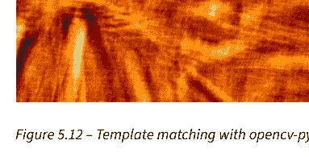

现在我们已经阐明了相关与卷积在概念和实践上的差异，是时候探索如何通过切换到频域来更高效地执行卷积，特别是在处理大图像或大核时。让我们看看这种强大方法在实践中是如何工作的。

## 在频域中应用卷积

在本节中，我们将使用 Python 模块如 `scipy.signal` 和 `scipy.ndimage` 看到更多使用图像的卷积应用。让我们从著名的卷积定理开始，看看根据该定理，卷积操作在频域中变得多么容易且计算效率更高。

### 卷积定理

卷积定理指出，图像空间域中的卷积等价于频域中的简单乘法，反之亦然：

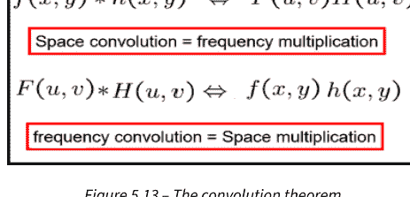

图 5.13 - 卷积定理

下图展示了频域滤波器如何使用离散傅里叶变换 DFT。这非常有用，因为 DFT 的 FFT 实现对于 N × N 图像而言速度很快，为 O(N² log N)，因为频域中的乘法通常比空间域中的滑动求和更快。

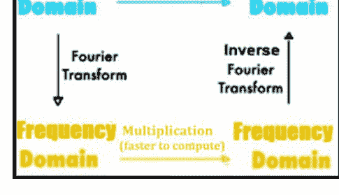

图 5.14 - 空间域和频域中的滤波

下一个图示展示了频域滤波的基本步骤。我们有原始图像 `f` 和一个核 `h`（掩模或退化/增强函数）作为输入。

首先，两项输入都需要通过 DFT 转换到频域，然后应用卷积，根据卷积定理，这只是（逐元素）乘法。

这输出频域中的卷积图像，我们需要在其上应用 IDFT 以获得重建图像（对原始图像进行某种退化或增强），如下图所示：

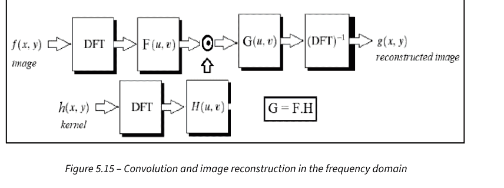

图 5.15 – 频域中的卷积和图像重建

### 使用高斯模糊核进行卷积

如前所述，图像与高斯模糊核卷积以平滑/去除图像中的噪声。它通常会从图像中去除高频分量（例如噪声），因此充当低通滤波器 LPF。

这种行为由高斯函数控制：G(x) = 1/√(2πσ²) e^(-x²/(2σ²)) 对于 1D，并扩展到 2D 为 G(x,y) = 1/(2πσ²) e^(-(x²+y²)/(2σ²))。2D 高斯是可分离的，意味着它可以高效地计算为两个 1D 核的外积 G(x,y) = G(x) · G(y)。这降低了计算成本，并在实践中被广泛使用。

让我们开始可视化高斯核的频率谱幅度。

#### 可视化频率谱

在本节中，我们将看到高斯核在频域中在 2D 和 3D 图中的样子。

#### 使用 2D 图

下一个代码可视化高斯低通滤波器的频率响应。使用 `signal.windows.gaussian()` 和 `np.outer()` 创建 2D 高斯核，然后使用 `fp.fft2()` 转换到频域。频谱使用 `fp.fftshift()` 进行中心化，并使用 `20·log10()` 以分贝 dB 显示以增强低幅度频率分量的可见性。 resulting 热图显示高斯滤波器在中心（低频）具有最高响应，并逐渐向外区域（高频）衰减，说明了其平滑行为以及作为噪声降低的低通滤波器的有效性。现在，参考以下代码片段：

```
im = rgb2gray(imread('images/lena.jpg'))
gauss_kernel = np.outer(signal.windows.gaussian(im.shape[0], 1),
                        signal.windows.gaussian(im.shape[1], 1))
freq = fp.fft2(im)
freq_kernel = fp.fft2(fp.ifftshift(gauss_kernel))
plt.imshow((np.abs(20*np.log10(0.01 + \
                fp.fftshift(freq_kernel)))).astype(int),
           cmap='coolwarm') # 0.01 is added to keep the
                       # arg to log function always positive
plt.colorbar()
```

下图显示了前面代码的输出，带有颜色条。此可视化有助于理解滤波器如何衰减某些频率，可用于去除高频噪声（即平滑）。它是一个低通滤波器。其频率谱对中心频率的值更高（允许更多低频值），并随着远离中心向更高频率值移动而逐渐减小：

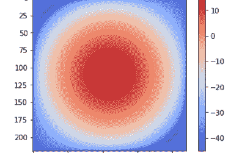

图 5.16 - 高斯模糊核的频率谱

#### 注

使用 `scipy.signal.windows.gaussian(M, std)` 时，我们需要手动指定核大小（`M`）和标准差（`std`）。这提供了对滤波器形状的精细控制和透明度。核通常会被归一化并通过卷积应用。相比之下，`scipy.ndimage.gaussian_filter(input, sigma)` 会根据给定的标准差 `sigma` 在内部自动生成高斯核，为您确定合适的核大小，并将其应用于给定的图像 `input` 数组。此函数使用更简单，对多维数据更高效，但对核本身的可见性较少。


## 使用3D绘图

接下来的代码使用 Matplotlib 的 plot_surface() 在3D空间中可视化频谱，其中水平轴表示2D频率平面 (u,v)，垂直轴表示由 np.abs() 计算的频谱幅度 (|F(u,v)|)。辅助函数 plot_spectrum_3d() 使用 meshgrid() 创建的坐标网格、颜色映射以及自定义坐标轴格式，为原始频谱和滤波后的频谱生成3D曲面图。生成的图像提供了频率分布的直观视图，并清楚地表明高斯核的傅里叶变换本身也是高斯的，强化了其在频域中作为平滑低通滤波器的作用。现在，请参考以下代码片段：

```
from matplotlib.ticker import LinearLocator, FormatStrFormatter

def plot_spectrum_3d(F, ax, cmap='jet', title=''):
    h, w = F.shape[0], F.shape[1]
    X, Y = range(-h//2, h-h//2), range(-w//2, w-w//2)
    Y, X = np.meshgrid(X, Y)
    surf = ax.plot_surface(X, Y, F, cmap=cmap, linewidth=0, \
            antialiased=False, rstride=5, cstride=5, alpha=0.8)
    ax.set_xlim(-h//2, h//2), ax.set_ylim(-w//2, w//2)
    ax.xaxis.set_major_locator(LinearLocator(5))
    ax.xaxis.set_major_formatter(FormatStrFormatter('%.01f'))
    ax.set_title(title, size=20)
    ax.set_xlabel('u', size=15)
    ax.set_ylabel('v', size=15)
    ax.set_zlabel('F(u,v)', size=15)

fig, axes = plt.subplots(subplot_kw={"projection": "3d"},
                        nrows=2, ncols=2)

axes = axes.ravel()
plot_spectrum_3d( \
    np.abs(fp.fftshift(freq_kernel)), axes[0], title='H(u,v)')
plot_spectrum_3d( \
    np.abs(20*np.log10(0.01+fp.fftshift(freq_kernel))),axes[1])
plot_spectrum_3d( \
    np.abs(20*np.log10(0.01+fp.fftshift(freq))), axes[2])
plot_spectrum_3d( \
    np.abs(20*np.log10(0.01+fp.fftshift(convolved))), axes[3])
```

如果运行上述代码片段，您应该会得到类似下图的图像：

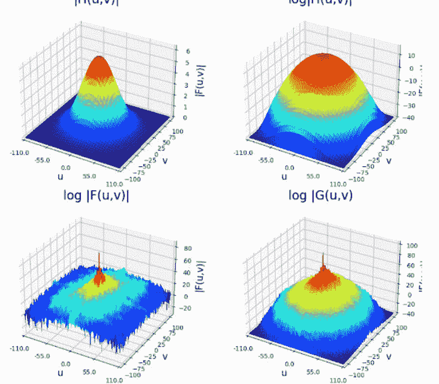

图5.17 – 高斯模糊核在3D中的频谱

## 注意

为什么平移网格？

这会将低频分量居中到中间（正如FFT可视化所预期的那样）。在FFT之前应用 ifftshift 的目的是将低频分量从频谱中心移回角落，这与标准FFT的假设一致，即零频率位于数组原点（左上角）。这种重新定位确保了频域中的乘法正确对应空间域中的卷积，保持了正确的空间对齐，并避免了因频率分量错位而导致的伪影。如果没有这种平移，生成的卷积可能会错误居中或发生环绕，导致错误的滤波结果。

## 应用高斯模糊

现在，我们继续演示高效的频域滤波（其实现得益于卷积定理）。更具体地说，您将看到如何使用几个 Python 库函数，在频域中为几张图像应用高斯模糊滤波。

### 使用 numpy.fft

下面的代码块展示了如何使用卷积定理和 numpy.fft 在频域中应用高斯滤波（因为在频域中它只是简单的乘法）：

```python
def plot_spectrum(F, method=None, cmap='coolwarm'):
    F_disp = (20*np.log10(0.01 + np.abs(F))).astype(int) \\
             if method == 'log' \\
             else np.minimum(np.abs(F).astype(int)+100, 255)
    plt.imshow(F_disp, cmap=cmap, aspect='auto')

im = np.mean(imread('images/lena.jpg'), axis=2)
gauss_kernel = np.outer(signal.windows.gaussian(im.shape[0], 5),
                        signal.windows.gaussian(im.shape[1], 5))
freq = fp.fft2(im)
assert(freq.shape == gauss_kernel.shape)
freq_kernel = fp.fft2(fp.ifftshift(gauss_kernel))
convolved = freq*freq_kernel # by the convolution theorem,
                             # simply multiply in the frequency domain
im_rec = fp.ifft2(convolved).real # imaginary part is artifact
# plot im, im_rec, gauss_kernel;
#      spectrums freq, freq_kernel, convolved
```

> **注意**
> 
> 在应用逆FFT后，我们只取结果的实部，因为虚部通常来自FFT计算过程中的浮点精度误差。理论上，如果所有运算都精确，那么实值图像的逆FFT也应完全是实数。

下图展示了上述代码的输出结果，包括原始*Lena*图像、卷积核以及卷积后得到的输出（同时显示空间域和频域）：

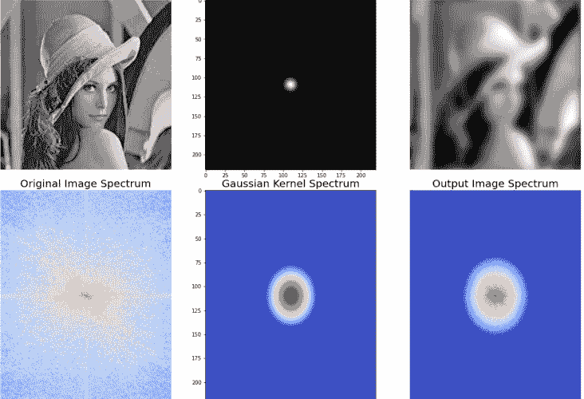

*图5.18 – 使用 numpy.fft 在频域中对Lena图像应用高斯模糊*

> **注意**
> 
> FFT，尤其是*Cooley-Tukey算法*，在输入大小为*2的幂*时运行效率最高。这是因为Cooley-Tukey算法将FFT递归拆分为更小的FFT，而2的幂可以实现最大程度的递归拆分。

当输入大小不是2的幂时，像NumPy或OpenCV这样的库通常会在内部对数据进行零填充，将其补到下一个最优长度，以便高效地计算FFT。虽然这提高了速度，但可能会略微影响频率内容和边界行为。

为了获得准确且可重复的结果，尤其是在科学应用中，最好了解并显式控制任何填充行为。如果你在非2的幂大小的图像上运行 `np.fft.fft2()`，并与2的幂版本进行计时比较，你会看到明显的速度差异。

> **提示：**
> 
> 频域滤波假设**周期性边界条件**，这可能在图像边缘产生**环绕伪影**。在FFT之前应用**窗函数**（例如Hann窗或Tukey窗）有助于减少这些伪影。

### 使用 scipy.signal.fftconvolve()

下面的代码块展示了如何使用 scipy.signal 模块的 fftconvolve() 函数在频域中执行卷积（内部仅使用乘法和卷积定理）：

```
im = np.mean(plt.imread('images/mandrill.jpg'), axis=2)
# 2D Gaussian kernel of size 11x11 with σ = 3
gauss_kernel = np.outer(signal.windows.gaussian(11, 3), \
                    signal.windows.gaussian(11, 3))
im_blurred = signal.fftconvolve(im, gauss_kernel, mode='same')
# plot original/blurred image (im, im_blurred) &
# kernel (gauss_kernel)
```

下图展示了运行上述代码块中的图像绘制后得到的输出：

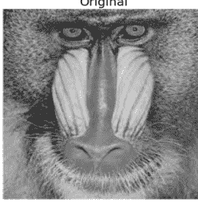

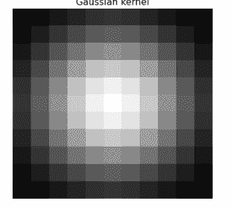

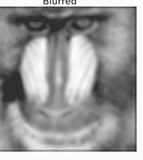

图5.19 – 使用 scipy.signal.fftconvolve 在频域中对山魈图像应用高斯模糊

## 注意：

scipy.signal.fftconvolve() 函数会根据输入大小自动决定是使用直接卷积还是基于FFT的卷积，以选择最快的方法。对于小输入，直接卷积通常更快；对于较大输入，FFT更高效。你可以通过将 method 参数显式设置为 'direct' 或 'fft' 来覆盖此行为。

以下代码片段展示了如何在卷积后绘制原始图像和模糊图像的频谱：

```
F1 = fp.fft2((im).astype(float))
F2 = fp.fftshift( F1 )
# plot the original image spectrum
F1 = fp.fft2((im_blurred).astype(float))
F2 = fp.fftshift(F1)
# plot the blurred image spectrum
```

运行上述代码并绘制图像，你将得到类似下图的输出。

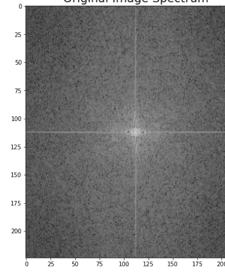

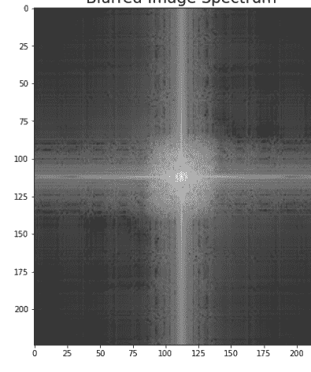

图5.20 – 原始图像和模糊图像的频谱

可以用与前一个示例相同的代码块来计算维多利亚纪念堂图像的模糊版本，但这次调用 fftconvolve() 函数时使用的是更大的（50 × 50）高斯核，σ=10。下图展示了同一代码在重度模糊图像和修改后的核上产生的输出：

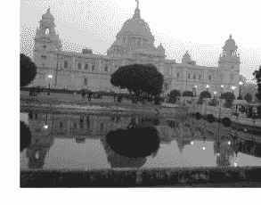

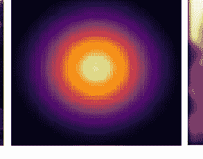

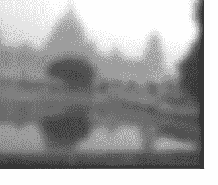

图5.21 – 在频域中对维多利亚纪念堂图像应用高斯模糊


# 比较运行时间

本部分中的代码块使用两种不同的卷积方法对图像应用**高斯模糊**：

- `signal.convolve2d()`（空间域卷积）
- `signal.fftconvolve()`（频域卷积，使用 FFT）

然后，它使用一个包装函数和 `timeit.repeat()` 测量并比较这些方法的执行时间。由于频域卷积只涉及一次矩阵乘法，而不是一系列滑动窗口算术运算，因此预计会快得多。

定义了一个名为 `wrapper_convolve()` 的包装函数，其功能如下：

- 接收一个卷积函数（func）作为输入
- 返回另一个函数（`wrapped_convolve`），调用该函数时将卷积应用于图像

## 为什么要使用包装函数？

`timeit.repeat()` 函数要求传入无参数的可调用函数。

包装函数确保卷积函数可以无需显式提供参数地传递给 `timeit`。

以下是代码片段：

```
im = np.mean(plt.imread('images/mandrill.jpg'), axis=2)
# 2D Gaussian kernel of size 11x11 with σ = 3
gauss_kernel = np.outer(signal.windows.gaussian(11, 3), \
                    signal.windows.gaussian(11, 3))
im_blurred1 = signal.convolve2d(im, gauss_kernel, mode="same")
im_blurred2 = signal.fftconvolve(im, gauss_kernel, mode='same')

def wrapper_convolve(func):
    def wrapped_convolve():
        return func(im, gauss_kernel, mode="same")
    return wrapped_convolve

wrapped_convolve = wrapper_convolve(signal.convolve)
wrapped_fftconvolve = wrapper_convolve(signal.fftconvolve)
times1 = timeit.repeat(wrapped_convolve, number=1, repeat=100)
times2 = timeit.repeat(wrapped_fftconvolve, number=1, \
                    repeat=100)
# plot im, im_blurred1, im_blurred2
```

如果你运行上述代码片段并绘制图像，将得到下图。正如预期，`convolve()` 和 `fftconvolve()` 函数都产生相同的模糊输出图像：

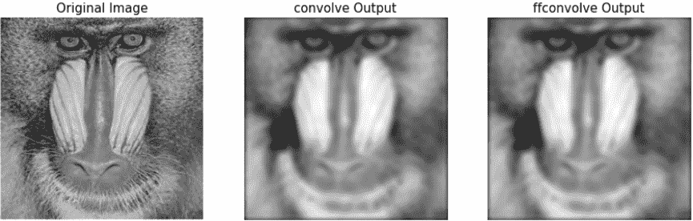

*图 5.22 – 使用空间/频域实现对山魈图像进行高斯模糊*

既然我们已经了解了如何在频域中高效地应用卷积，那么理解卷积在不同维度上的行为就很重要。在下一节中，我们将比较 2D 和 3D 卷积，并探讨它们在各种图像处理任务中的作用。

# 使用 PyTorch 进行 2D 和 3D 卷积

如前所述，卷积是深度学习和图像处理中最基本的操作之一，使我们能够检测和过滤边缘、纹理及其他模式等特征。2D 与 3D 卷积的主要区别在于它们的维度以及与图像数据的交互方式。在本节中，我们旨在深入理解底层概念，以及它们的数学公式和实际代码示例。首先看下面的表格，它总结了 2D 和 3D 卷积：

| 特征 | 2D 卷积 | 3D 卷积 |
|---|---|---|
| 维度 | 作用于高度 × 宽度 | 作用于高度 × 宽度 × 深度 |
| 通道 | 通道独立处理 | 通道联合处理 |
| 示例用例 | 边缘检测、纹理分析 | 视频帧过滤、MRI/CT 体积分析 |
| 计算成本 | 较低 | 较高 |
| 捕获特征 | 空间特征 | 空间 + 深度/时间特征 |

下图显示了 2D 和 3D 卷积操作之间差异的示意图：

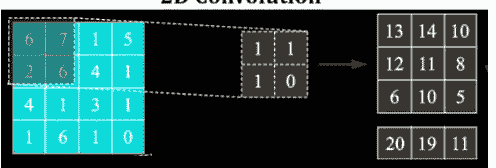

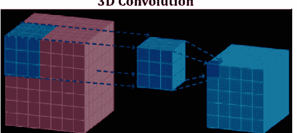

图 5.23 – 2D 与 3D 卷积对比

## 2D 卷积

在 2D 卷积中，核（滤波器）在图像上滑动以计算特征响应，输出由下式给出：

$$Y(i, j) = \sum_{m=0}^{M-1} \sum_{n=0}^{N-1} X(i + m, j + n) \cdot K(m, n)$$

其中

- X 是输入图像
- K 是卷积核（或滤波器）
- M、N 是核的维度

在接下来的 Python 演示中，PyTorch 的 `torch.nn.functional.conv2d()` 将垂直（VK）和水平（HK）类 Sobel 核应用于灰度图像，以检测垂直和水平边缘。图像被重塑为 PyTorch 所需的 NCHW 格式，分别与每个滤波器进行卷积，并将输出并排显示，突出显示不同方向的边缘。

> 注意：
> PyTorch 期望输入图像的格式为 [batch_size, channels, height, width]。这就是为什么图像张量使用 `.reshape(1, 1, H, W)` 进行重塑，或者对于 RGB 图像使用 `.permute(2, 0, 1)` 进行维度变换。

现在，请参考以下代码片段：

```
```python
import torch
import torch.nn.functional as F
im = torch.from_numpy(np.mean( \
                plt.imread('images/mandrill.jpg'), \
                axis=2)).float()
# creating the kernels
# vertical kernel
VK = torch.Tensor([[ [1,0,-1],
                     [1,0,-1],
                     [1,0,-1] ]).view(1, 1, 3, 3) # kernel has
                                                   # to have a specific format: # horizontal kernel
HK = torch.Tensor([ [ 1, 1, 1],
                    [ 0, 0, 0],
                    [-1,-1,-1] ]).view(1, 1, 3, 3)
C1 = F.conv2d(im.reshape(1,1,im.shape[0], im.shape[1]),VK)
C2 = F.conv2d(im.reshape(1,1,im.shape[0], im.shape[1]),HK)
C1, C2 = np.clip(C1.squeeze().numpy(),0,1), \
         np.clip(C2.squeeze().numpy(),0,1)

plt.gray()
plt.imshow(np.hstack((C1, C2)), plt.axis('off');
```
```

如果你运行上述代码片段，应该会得到类似下图的输出：

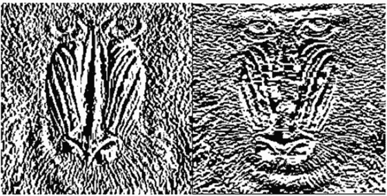

*图 5.24 – 使用垂直/水平 Sobel 核对山魈图像进行 2D 卷积（PyTorch）*

下一个代码演示了使用 PyTorch 的 `F.conv2d()` 和 3×3 浮雕（锐化）核对 RGB 图像执行 2D 卷积。图像被归一化、转换为张量，并从 (H, W, C) 重塑为 PyTorch 所需的 (N, C, H, W) 格式。浮雕核在三个颜色通道上复制，形成 3 通道滤波器，从而可以同时将卷积应用于...

以下是代码片段：

```
```python
import torch
im = plt.imread('images/mandrill.jpg')
im = im / im.max()
im = torch.from_numpy(im).float()
im = im.permute(2,0,1)[None,None,...]

K = torch.hstack((torch.Tensor([[1,0,-1],
                                 [1,0,-1],
                                 [1,0,-1]]), \
                  torch.Tensor([[1,1,1],
                                 [0,0,0],
                                 [-1,-1,-1]]), \
                  torch.ones(3,3)/9)).view(1,3,3,3)
C = F.conv3d(im, K[None,...], padding = "same")
C = C.squeeze()

plt.imshow(np.hstack(((C[0,...].numpy()),
                      C[1,...].numpy(),
                      C[2,...].numpy())))
```
```

如果你运行上述代码片段，应该会得到类似下图的输出：

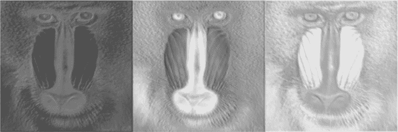

*图 5.27 – 使用 Prewitt 核和 box 核对山魈 RGB 图像进行 3D 卷积的输出（PyTorch）*

# 2D 与 3D 卷积对比

2D 卷积独立处理每个图像通道，对于边缘检测和滤波等任务计算效率高；而 3D 卷积同时跨空间维度和通道/深度维度操作，捕获通道间或时空关系，适用于 RGB 特征学习、视频分析和医学成像等应用，但代价是计算量更高。

转置卷积广泛用于特征图上采样，支持图像超分辨率、图像放大、语义分割（将特征图恢复到原始图像大小以进行逐像素预测）、GAN 等生成模型（用于高分辨率图像合成），以及自编码器解码器（用于从紧凑的潜在表示重建图像）等应用。

**上采样** 使用固定的插值或值插入来增大图像尺寸，使其简单、快速且计算效率高，但无法从数据中学习。相比之下，转置卷积使用可学习的滤波器进行上采样，使其能够适应数据并重建更精细的细节，但计算复杂度更高。因此，当速度和简单性很重要时，优先选择上采样；而转置卷积更适合需要高质量图像重建和学习型特征生成的应用。

接下来的 Python 演示比较了两种使用 3×3 高斯**平滑核**的 PyTorch *上采样*方法。加载灰度图像，归一化并重塑为 [**batch, channels, height, width**] 格式。第一种方法中，`ConvTranspose2d` 使用 *步长为 2* 同时进行上采样和滤波，通过一个可学习（此处固定）的核生成更大的平滑图像，产生输出 `im_uc1`。第二种方法中，`Upsample(scale_factor=2)` 首先通过插值放大图像，然后用 `Conv2d` 应用高斯平滑，产生 `im_uc2`。

虽然 `Upsample + Conv2d` 将插值和滤波分离，计算速度更快，但 `ConvTranspose2d` 将两个操作整合到单个基于卷积的上采样步骤中，提供了更大的灵活性和可训练性。`torch.no_grad()` 用于在推理期间禁用梯度计算以提升性能。以下是代码片段：

```
import torch
from torchvision.io import read_image, ImageReadMode
import torch.nn as nn

def show(img):
    img = img.squeeze().squeeze().numpy()
    img = (255*img).astype(np.uint8)
    return(Image.fromarray(img))

im = read_image('images/pepper.png', \
                mode=ImageReadMode.GRAY).to(torch.float32)
im = im[None, :3, ...]
im = im / im.max()
with torch.no_grad():
    kernel = torch.tensor([[1, 2, 1], [2, 4, 2], [1, 2, 1]], \
                        dtype=torch.float32)
    kernel = kernel.unsqueeze(0).unsqueeze(0)
```


```python
upsample_conv = nn.ConvTranspose2d(1, 1, 3, stride=2, \
    padding=0, bias=False)
upsample_conv.weight = nn.Parameter(kernel)
upsample = nn.Upsample(scale_factor=2)
im_uc1 = upsample_conv(im)
conv = nn.Conv2d(1, 1, 3, stride=1, padding='same', \
    bias=False)
conv.weight = nn.Parameter(kernel)
im_uc2 = conv(upsample(im))
print(im.shape, im_uc1.shape, im_u.shape, im_uc2.shape)
# torch.Size([1, 1, 512, 512]) torch.Size([1, 1, 1025, 1025])
# torch.Size([1, 1, 500, 668]) torch.Size([1, 1, 1024, 1024])
```

运行上述代码片段，并绘制输出结果（`im_uc1` 和 `im_uc2`）。PyTorch 中的 `squeeze()` 函数用于移除不必要的维度（例如批次或通道维度），而 PIL 中的 `Image.fromarray(img)` 方法可以将 NumPy 数组转换回可使用 PIL 显示的图像。你应该会得到类似下图的输出：

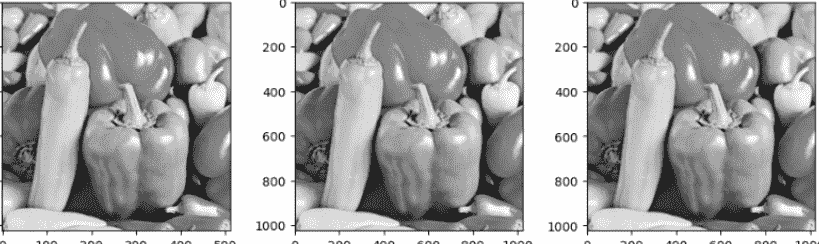

*图 5.29 – 上采样与转置卷积（使用 PyTorch）*

> **提示：棋盘格伪影**
>
> 转置卷积在上采样过程中可能因卷积核重叠不均匀而产生棋盘格图案。为减少这些伪影，请使用可将卷积核大小整除的步幅，或用 `Upsample + Conv2d` 替换 `ConvTranspose2d`，后者通常能产生更平滑的结果。

空间域滤波器直接作用于像素值，并且对于局部操作直观易懂，但某些滤波任务在**频域**中处理会更高效、更具洞察力。现在让我们把注意力转向**频域滤波器**，理解它们的工作原理。

## 小结

在本章中，我们探讨了卷积作为图像处理中的基本操作，考察了空间域和频域两种方法。我们使用了 scikit-image、OpenCV-Python、`numpy.fft`、`scipy.fftpack`、`scipy.signal` 和 `scipy.ndimage` 等库实现了滤波，并看到了卷积定理如何在频域中实现更快的计算。我们还讨论了卷积与相关运算之间的关键区别，以及诸如使用互相关和归一化互相关进行模板匹配等实际应用。最后，我们比较了 2D 和 3D 卷积技术，为后续章节中更高级的主题奠定了基础。

完成本章学习后，你应该能够编写 Python 代码来执行 2D 卷积/滤波，并且也应该能够编写 Python 代码来实现带或不带卷积的空间域/频域滤波器。

在下一章中，我们将深入探讨频域滤波，实现各种低通、高通、带通和带阻滤波器，并探索它们的应用。

## 获取本书 PDF 版本及更多内容

扫描二维码（或访问 packtpub.com/unlock）。按书名搜索本书，确认版本，然后按照页面上的步骤操作。


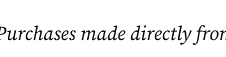

注意：请保管好您的发票。直接从 Packt 购买的订单无需发票。
