### 6 频域滤波

在本章中，我们将探讨如何在**频域**中对图像进行滤波，这是空间滤波的一种强大替代方案，对于某些任务通常能获得更快、更灵活的结果。我们不会直接在空间域中执行卷积，而是使用傅里叶变换将图像转换到频域，应用滤波器，然后将结果转换回来。我们将在频域中探讨一些滤波技术（这些技术也可使用卷积核（如盒式卷积核或高斯卷积核）通过卷积实现），例如**高通**、**低通**、**带通**和**带阻**滤波器，并通过实际示例展示如何使用 Python 库实现它们。

从基本问题——什么是滤波器？——开始，我们将研究不同类型的频域滤波器及其行为如何影响图像的噪声、边缘和精细纹理等成分。我们将介绍理想滤波器以及更实用的滤波器，如**巴特沃斯**滤波器和高斯滤波器。你还将学习如何使用 `scipy.fftpack`、`scikit-image` 和 `fourier_gaussian` 等工具执行这些操作。此外，我们将研究**信噪比（SNR）**如何随截止频率等滤波器参数而变化，并将基于频率的滤波器用于**图像去噪**和**周期性噪声去除**等任务。

在本章的后半部分，我们将转向现代深度学习应用，探索**傅里叶特征网络（FFNs）**——一类利用频率信息来克服平滑性偏差并改进函数逼近的神经网络。我们将讨论其动机、架构和实现，包括**基于傅里叶的位置编码**如何帮助编码高频信号。本章最后将使用 JAX 进行 FFN 的动手实现。

本章将涵盖的主题如下：

- **低通、高通和带通滤波器** – 使用 Python 实现常用的频域滤波器
- **傅里叶特征网络** – 使用 TensorFlow 实现的、具有傅里叶特征的图像重建深度学习模型

### 技术要求

以下是本书随附 GitHub 仓库中与本章对应的 Jupyter notebook 链接：`https://github.com/PacktPublishing/Hands-On-Image-Processing-and-Computer-Vision-with-Python-Second-Edition/tree/main/Chapter06`。在阅读本章不同部分时，请跟着该 notebook 操作（并运行必要的代码片段）。为确保代码按预期运行并免受未来弃用或向后不兼容更改的影响，仓库的同一文件夹中提供了 `requirements.txt` 文件——请使用 `pip install -r requirements.txt` 安装。

### 频域滤波

如果还记得 *第 1 章* 中描述的图像处理流程，图像采集之后紧接着就是图像预处理。图像常常因强度和照明的随机变化而受损，或对比度较差，因此不能直接使用，需要增强。这正是滤波器的用武之地。

#### 什么是滤波器？

滤波是指变换像素强度值，以揭示某些图像特征，例如：

- **增强：** 这种图像特征提高对比度
- **平滑：** 这种图像特征去除噪声
- **模板匹配：** 这种图像特征检测已知图案

滤波后的图像由离散卷积描述，滤波器由 *n × n* 离散卷积掩码描述。

频域滤波是图像处理中的一项基础技术，它通过操控图像的频率分量来实现平滑、锐化和降噪等各种效果。与直接操作像素值的空间域滤波不同，频域滤波利用傅里叶变换将图像转换到频域。这样，我们可以根据预期结果选择性地增强或抑制某些频率分量。

在本节中，我们将探讨不同的频域滤波器，包括**理想滤波器、巴特沃斯滤波器和高斯滤波器**及其应用。这些滤波器有助于控制图像细节、增强特征和抑制不需要的噪声。我们将使用 `scipy` 和 `scipy.ndimage` 等库实现这些滤波器，并展示它们在真实图像上的效果。

### 频域滤波器的类型

从频域的角度来看，滤波器可以是以下四种类型之一：

- **低通滤波器**（用于模糊和降噪）
- **高通滤波器**（用于边缘增强和锐化）
- **带通滤波器**（提取特定频率范围以进行特征分析）
- **带阻（陷波）滤波器**（去除特定频率噪声，例如周期性干扰）


对于每种类型，实现将使用 **理想**、**巴特沃斯** 和 **高斯** 滤波方法。现在，让我们了解每种类型的滤波器，并演示它们在图像处理中的用途。

## 低通滤波器 (LPF)

该滤波器仅允许从图像的频率域表示（使用 DFT 获得）的低频通过，并阻挡截止值之外的所有高频。图像通过逆 DFT (IDFT) 重建，由于高频分量对应于边缘、细节、噪声等，因此 LPF 倾向于去除这些。下面的表格总结了常见的 LPF 及其数学公式、特性、优点和局限性。

| Filter Type | Mathematical Expression | Characteristics | Pros | Cons |
|---|---|---|---|---|
| **Ideal LPF (ILPF)** | $H(u,v)=\begin{cases}1,&D(u,v)\leq D_0\\0,&D(u,v)>D_0\end{cases}$ | Sharp transition, removes all high frequencies above $D_0$ | Strong smoothing effect, simple to implement | Causes blurring artifacts due to sudden cutoff |
| **Butterworth LPF (BLPF)** | $H(u,v)=\frac{1}{1+(D(u,v)/D_0)^{2n}}$ | Smooth transition controlled by order $n$ | Less blurring compared to Ideal LPF, adjustable smoothness | Higher computational cost compared to Ideal LPF |
| **Gaussian LPF (GLPF)** | $H(u,v)=e^{-D^2(u,v)/(2D_0^2)}$ | Very smooth transition, no ringing artifacts | No ringing artifacts, best for natural image smoothing | Weaker attenuation of high frequencies compared to ILPF and BLPF |

其中我们有 $D(u,v)=\sqrt{(u-u_0)^2+(v-v_0)^2}$ 是频率域中相对于原点 $(u_0,v_0)$ 的欧几里得距离。

- $D_0$ 是截止频率
- $n$ 是巴特沃斯滤波器的阶数。

首先，让我们开始实现前述表格中描述的一些滤波器。

### 理想、巴特沃斯和高斯 LPF

以下代码在 **频率域** 中实现前述 LPF，并逐一将它们应用于带噪声的输入图像，通过去除添加到输入图像的 **随机噪声** 并通过去除高频分量 (**噪声**) 实现平滑 (**去噪**) 效果：

```python
def ideal(sz, D0):
    h, w = sz
    u, v = get_grid(w, h)
    return dist(u,v) < D0


def gaussian(sz, D0):
    h, w = sz
    u, v = get_grid(w, h)
    return np.exp(-(dist(u,v)**2/(2*D0**2)))


def butterworth(sz, D0, n=2):
    h, w = sz
    u, v = get_grid(w, h)
    return 1 / (1 + (dist(u,v)/D0)**(2*n))

def apply_filter(f, func, arg_dict):
    F = fp.fftshift(fp.fft2(f))
    H = func(**arg_dict)
    G   =  H * F
    g   =  np.abs(fp.ifft2(G))
    g = g / g.max()
    return F, H, G, g
```

让我们逐步分解。以下是前述代码的作用：

- `ideal()` 函数实现了 ILPF，截止频率为 D0：半径 D0 内的频率被保留，其他频率设为零。这会产生硬截止，可能导致振铃伪影（**吉布斯现象**）。
- `gaussian()` 函数实现了 GLPF。频率衰减遵循平滑的指数衰减。这避免了理想 LPF 中出现的振铃伪影。
- `butterworth()` 函数实现了 BLPF。它的过渡比理想 LPF 更平缓，但比高斯更尖锐。n 参数控制滤波器阶数：n 越高，过渡越尖锐。
- `apply_filter()` 函数在频率域中对图像应用滤波函数（使用卷积定理，G(u, v) = F(u, v)H(u, v)）。该函数灵活且支持不同滤波器类型，使用 kwargs (arg_dict) 并动态将所需参数传递给相应的滤波函数。下表描述了传递给该函数的输入参数：

| Parameter | Type | Description |
|---|---|---|
| f | numpy.ndarray | Input image (grayscale, stored as a 2D array). |
| func | function | A filtering function (e.g., ideal, gaussian, or butterworth). |
| arg_dict | dict | Keyword arguments (kwargs) passed to the filter function. |

Figure 6.2 – Input arguments to the apply_filter function

- 它首先使用 FFT 转换图像，应用滤波器掩码，然后转换回来。下表显示了 `apply_filter()` 函数的返回值：

| Output | Description |
|---|---|
| F | Original frequency spectrum of the image (before filtering). |
| H | The applied filter in the frequency domain. |
| G | Filtered frequency spectrum (after applying H). |
| g | Final processed image after inverse FFT (low-pass filtered image). |

Figure 6.3 – Output returned by the apply_filter function

- `dist()` 函数计算相对于中心 (h/2, w/2) 的欧几里得距离。
- `get_grid(w, h)` 函数使用 `np.meshgrid()` 函数生成以 (h/2, w/2) 为中心的频率网格。它对于傅里叶空间中的基于频率的图像滤波至关重要。

```python
def dist(u, v):
    return np.sqrt(u**2 + v**2)

def get_grid(w, h):
    return np.meshgrid(
        range(-int(np.floor(w/2)), int(np.ceil(w/2))), \
        range(-int(np.floor(h/2)), int(np.ceil(h/2))))
```

- 下一段代码首先从 `skimage.data` 加载标准的 **“camera”** 图像，然后添加方差为 0.1 的 **高斯噪声**，最后应用截止频率为 `D0 = 20` 的 **理想低通滤波器 (ILPF)**：

```python
from skimage import data
from skimage.util import random_noise

f = data.camera()
f = random_noise(f, var=0.1)

F, H, G, g = apply_filter(f, ideal, {'sz':f.shape, 'D0':20})

# plot original noisy image (f) and the output (g)
# obtained with ILPF here
```

- 如果你绘制输入和滤波器以及通过运行前述代码片段获得的输出的图像和频谱，你应该得到如下图所示的结果：

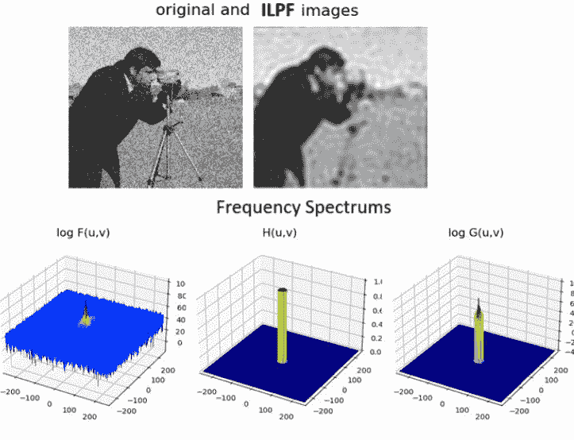

*Figure 6.4 – Applying the ILPF to the cameraman image*

- 下一段代码片段在频率域中对图像应用 **巴特沃斯低通滤波器 (BLPF)**。它去除高频细节，产生平滑的去噪（模糊）输出图像：

```python
F, H, G, g = apply_filter(f, butterworth, \
                         {'sz':f.shape, 'D0':20, 'n':2})
# plot original noisy image (f) and the output (g) obtained
# with BLPF here
```

再次绘制输出，你应该得到如下图所示的结果：

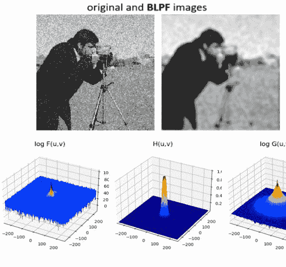

*Figure 6.5 – Applying the BLPF to the cameraman image*

`scipy.ndimage` 和 `skimage.filters` 模块提供了许多在频率域中对图像应用 LPF 的函数。下一节演示了其中一个滤波器（由 `fourier_gaussian()` 函数实现）的示例。

### 使用 fourier_gaussian 的 LPF

该函数来自 `scipy.ndimage` 模块，实现多维高斯傅里叶滤波器。频率数组乘以给定大小的高斯核的傅里叶变换，使用 `ndimage.fourier_gaussian()` 函数。以下代码块演示了如何使用 LPF（加权平均滤波器）模糊 *Lena* 图像：

```python
im = np.mean(imread('images/lena.jpg'), axis=2) # convert image to
# grayscale
freq = np.fft.fft2(im)

im_rec = fp.ifft2(fp.ifftshift(freq)).real
print(psnr(im, im_rec))
# 2.389151856495427
# plot original image im and reconstructed image im_rec,
# along with the frequency spectrums
```

下图显示了前述代码片段的输出，通过在输入犀牛图像上应用 LPF 获得的粗略输出图像，没有更精细的细节。现在在对数域中绘制图像的频谱，在阻断高频后；换句话说，只允许低频通过：

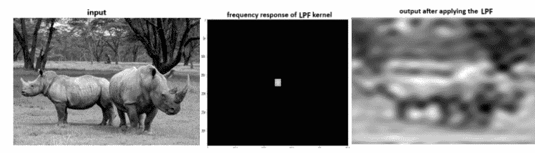

Figure 6.7 – Low-pass filtered rhinos image

以下代码块显示了对摄像机灰度图像应用 LPF，使用不同的频率截止值 F。

```python
im = np.array(Image.open('images/cameraman.jpg').convert('L'))
freq = fp.fft2(im)
(h, w) = freq.shape
half_w, half_h = int(w/2), int(h/2)
snrs_lp = []
ubs = list(range(1,30,3))

for u in ubs:
    freq = fp.fftshift(np.copy(freq))
    freq_low = np.copy(freq)
    freq_low[half_h-u:half_h+u+1,half_w-u:half_w+u+1] = 0
    freq -= freq_low # select only first 20x20 (low) frequencies
    im_rec = fp.ifft2(fp.ifftshift(freq)).real # reconstruction
    snrs_lp.append(psnr(im, im_rec)) # append SNR for cutoff u
    plt.subplot(2, 5, u//3+1), plt.imshow(im, cmap='gray')
    plt.axis('off'), plt.title('F = ' + str(u), size=15)
```


以下图表展示了随着截止频率 *F* 增加，LPF 如何在图像中检测到越来越多的细节：

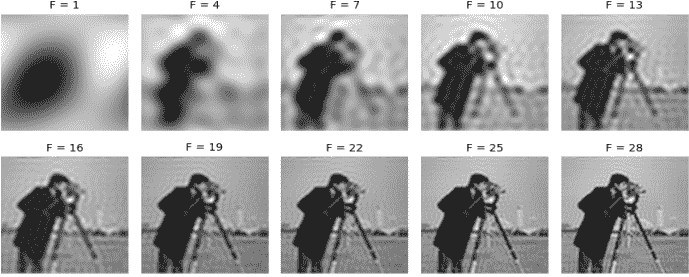

*Figure 6.8 – Low-pass filtered cameraman image at different cut-off frequencies*

## SNR changes with cut-off frequency

以下代码片段展示了如何绘制 LPF 的 **峰值信噪比 (PSNR)** 随截止频率 (*F*) 变化的曲线：

```python
plt.plot(ubs, snrs_lp, 'b.-')
plt.xlabel('Cutoff Frequency for LPF'), plt.ylabel('PSNR')
```

以下图表展示了随着 LPF 截止频率的增加，输出图像的 SNR 如何增加（表示重建效果更好）。

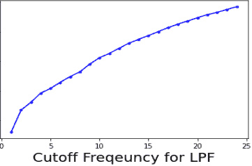

*Figure 6.9 – LPF Cut-off frequency versus PSNR of the reconstructed image*

## Image denoising with LPF

图像去噪是图像处理和计算机视觉中的一项基本任务，旨在从其噪声版本中恢复干净的图像。噪声会因传感器误差、低光条件或传输错误等因素而降低图像质量。去噪的目标是重建原始信号，使其可用于下游任务，如目标检测、医学成像或图像增强。

下面的示例演示了如何对带噪声的 *moonlanding* 图像进行去噪，首先使用 FFT 通过 LPF 阻断傅里叶高频分量。

```python
im = plt.imread('images/moonlanding.png').astype(float)
im_fft = fp.fft2(im)
```

**Filtering in the frequency domain:** 下面的代码块展示了如何拒绝一组高频并实现 LPF 以从图像中衰减噪声（对应于高频分量）。

```python
# Copy the original spectrum and truncate coefficients.
# Define the fraction of coefficients (in each direction)
keep_fraction = 0.1
im_fft_filtered = im_fft.copy()
# Set r and c to the number of rows and columns of the array.
r, c = im_fft.shape
# Set rows with indices between
# r*keep_fraction and r*(1-keep_fraction) to 0
im_fft_filtered[int(r*keep_fraction):int(r*(1-keep_fraction))]=0
# Similarly with the columns
im_fft_filtered[:, \
                int(c*keep_fraction):int(c*(1-keep_fraction))]=0
```

**Reconstructing the final image:** 下面的代码片段展示了如何从滤波后的傅里叶系数中通过 IFFT 重建图像。

```python
# Reconstruct image from filtered spectrum,
# keep only real part for display.
im_denoised = fp.ifft2(im_fft_filtered).real
# plot im, im_denoised and the spectrums im_fft, im_fft_filtered
```

如果绘制原始带噪声图像、去噪后图像以及相应的频率谱，你应该会得到类似以下图表的结果：

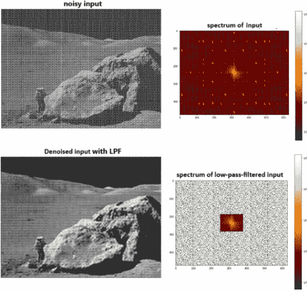

*Figure 6.10 – Denoised input image with LPF*

正如前述图所示，通过在频域中进行滤波，可以获得比原始带噪声图像更干净的输出图像。

虽然低通滤波器对于平滑图像和去除高频噪声很有用，但在某些情况下我们希望做相反的事情——通过抑制低频内容来突出精细细节和边缘。这就是高通滤波器发挥作用的地方，我们接下来将探讨它。

## High-pass filters (HPFs)

该滤波器仅允许图像频率域表示（使用 DFT 获得）中的高频通过，并阻断截止值之外的所有低频。图像通过逆 DFT 重建，由于高频分量对应于边缘、细节、噪声等，因此 HPF 倾向于提取或增强它们。下面的表格总结了常见的 HPF 及其数学公式、特性、优点和局限性。

| Filter Type | Mathematical Expression | Characteristics | Pros | Cons |
|---|---|---|---|---|
| Ideal HPF (IHPF) | $H(u,v)=\begin{cases}0, & D(u,v)\leq D_0\\1, & D(u,v)> D_0\end{cases}$ | Sharp transition, removes all low frequencies below $D_0$ | Strong filtering effect, simple to implement | Causes ringing artifacts (Gibbs effect) due to the sudden cutoff |
| Butterworth HPF (BHPF) | $H(u,v)=\frac{1}{1+\left(\frac{D_0}{D(u,v)}\right)^{2n}}$ | Smooth transition controlled by order $n$ | Less ringing compared to Ideal HPF, adjustable sharpness | Higher computational cost compared to Ideal HPF |
| Gaussian HPF (GHPF) | $H(u,v)=1-e^{-\frac{D^2(u,v)}{2D_0^2}}$ | Very smooth transition, no ringing artifacts | No ringing artifacts, best for natural image processing | Weaker attenuation of low frequencies compared to IHPF and BHPF |

让我们开始实现前述表格中描述的 GHPF。

### Ideal, Butterworth, and Gaussian HPFs

下面的代码片段在 **频域** 中实现了 **高斯高通滤波器 (GHPF)**（IHPF 和 BHPF 的实现类似，留作练习），并将其应用于砖块输入图像。它移除了低频内容，保留了尖锐边缘和精细细节，并用于图像锐化和边缘增强：

```python
def gaussian(sz, D0):
    h, w = sz
    u, v = get_grid(w, h)
    return 1 - np.exp(-dist(u,v)**2/(2*D0**2))
```

函数 `gaussian()` 实现了 GHPF，移除了低 **频率**，并保留了高 **频率**（锐化）。这避免了与理想 HPF 相比的振铃伪影。让我们逐步分解。

下面的代码片段首先从 `skimage.data` 加载标准的 **“brick”** 图像，然后使用截止频率 $D_0 = 20$ 应用 **高斯高通滤波器 (GHPF)**。

```python
from skimage import data
f = data.brick()
F, H, G, g = apply_filter(f, gaussian, {'sz':f.shape, 'D0':20})
# plot original noisy image (f) and the output (g) obtained # with GHPF here
```

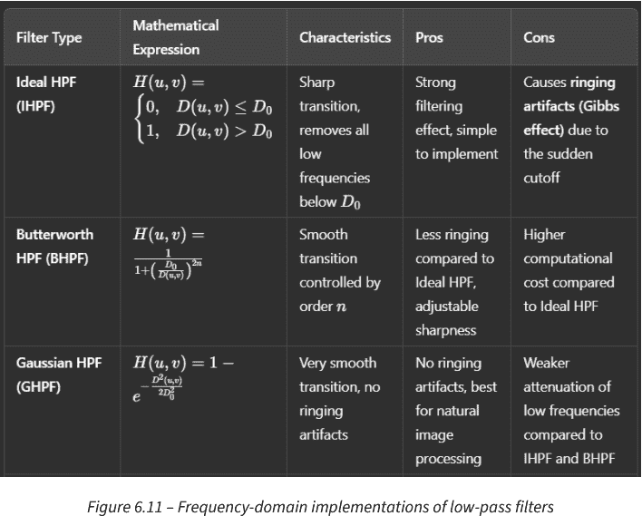

如果绘制输入和滤波器的图像和谱以及通过运行前述代码片段获得的输出，你应该会得到类似以下图表的结果：

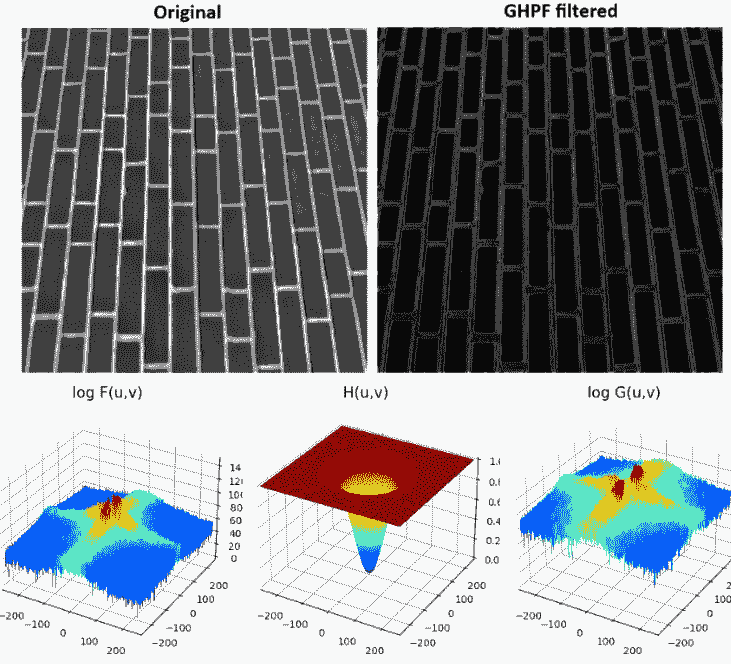

*Figure 6.12 – Applying the Gaussian high-pass filter to the brick image*

## HPF with scipy.fftpack

可以使用 `scipy.fftpack.fft2()` 实现一个简单的 HPF，通过计算图像的 2D FFT，使用 `fftshift()` 抑制移位谱中心附近的低频分量，然后使用 `ifft2()` 和 `ifftshift()` 重建图像。由于高频分量主要代表边缘和精细细节，去除低频会抑制平滑的强度变化并强调输出图像中的边缘状结构。以下是代码片段：

```python
im = np.array(Image.open('images/rhino.jpg').convert('L'))
freq = fp.fft2(im)
(h, w) = freq.shape
half_w, half_h = int(w/2), int(h/2)
freq_out = fp.fftshift(np.copy(freq))
```

如果运行前述代码片段，你应该会得到类似以下图表的结果：

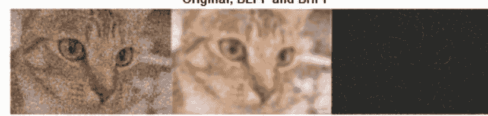

*Figure 6.17 – Butterworth low-pass and high-pass filters with skimage.filters*

虽然高通滤波器通过去除低频分量来保留精细细节非常有效，但有时我们希望仅隔离并保留特定范围的频率。这就引出了带通滤波器，它针对定义频带内的频率——让我们更仔细地了解一下。

## Band-pass filters (BPFs)

带通滤波器允许特定范围内的频率通过，同时阻断该范围之外的频率，增强或抑制某些图像细节（用于特征提取）。理想 BPF (IBPF) 由以下公式给出：

\[
H_{\text{BPF}}(u,v) = 
\begin{cases}
1, & \text{if } D_1 \le D(u,v) \le D_2\\
0, & \text{otherwise}
\end{cases}
\]

同样，我们可以定义巴特沃斯和高斯 BPF（留作练习）。

### With a DoG kernel

高斯差分 (DoG) 核可以用作 BPF，以允许特定频带内的频率并丢弃所有其他频率。下面的代码块展示了如何使用 `fftconvolve()` 将 DoG 核用于实现 BPF：

```python
im = img_as_float(plt.imread('images/tigers.jpeg'))
x = np.linspace(-10, 10, 15)
kernel_1d = np.exp(-0.005*x**2)
kernel_1d /= np.trapz(kernel_1d) # normalize the sum to 1
gauss_kernel1 = kernel_1d[:, np.newaxis] * \
                kernel_1d[np.newaxis, :]
kernel_1d = np.exp(-5*x**2)
kernel_1d /= np.trapz(kernel_1d) # normalize the sum to 1
gauss_kernel2 = kernel_1d[:, np.newaxis] * \
                kernel_1d[np.newaxis, :]
DoGKernel = gauss_kernel1[:, :, np.newaxis] - \
            gauss_kernel2[:, :, np.newaxis]
im_out = signal.fftconvolve(im, DoGKernel, mode='same')
# plot the images im, im_out here
```


下一张图展示了前一个代码块的输出，即通过带通滤波器得到的输出图像：

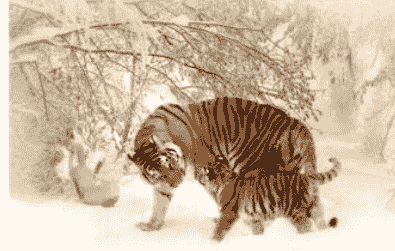

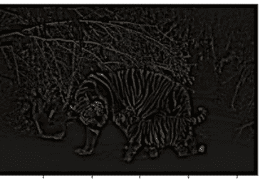

图6.18 - 对图像应用带通滤波器

带通滤波器允许特定范围的频率通过，而相反的方法——阻止某个选定的频带——在许多应用中也同样重要。这就引出了带阻滤波器，我们接下来将探讨它。

## 带阻/带拒（陷波）滤波器（BSF/BRF）

这种滤波器会阻止/拒绝图像频域表示（通过DFT获得）中的少数选定频率，因此得名。它特别适用于去除图像中的周期性噪声。理想BRF如下所示：

H_BSF(u, v) = { 0, if D1 ≤ D(u, v) ≤ D2
1, otherwise }

类似地，我们可以定义巴特沃斯和高斯BRF（留作练习）。

## 去除周期性噪声

在本例中，我们首先向鹦鹉图像添加一些周期性（正弦）噪声，以生成一幅带噪的鹦鹉图像（这可能是由于某些电信号的干扰造成的），然后使用以下代码片段观察噪声在图像频域中的效果：

```
im = np.mean(imread("images/parrot.jpg"), axis=2)
im = im / im.max()
F1 = fp.fft2((im).astype(float))
F2 = fp.fftshift(F1)
# plot original image im and spectrum F2 here
# add periodic noise to the image
for n in range(im.shape[1]):
    im[:, n] += np.cos(0.1*np.pi*n)
F1 = fp.fft2((im).astype(float)) # noisy spectrum
F2 = fp.fftshift(F1)
# plot noisy image im and spectrum F2 here
```

下图展示了运行上述代码块并绘制图像所得到的输出。可以看到，水平线上的周期性噪声在频谱中变得更加突出：

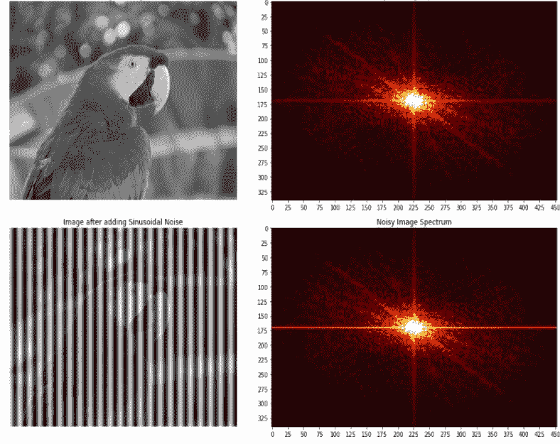

图6.19 – 应用带阻滤波器去除图像中的正弦噪声

现在，让我们设计一个带阻/带拒（陷波）滤波器，通过将相应的频率分量设为零来消除导致噪声的频率，代码如下：

```
F2[170:176,:220] = F2[170:176,230:] = 0 # eliminate the
# frequencies most likely responsible for noise
# (keep some low frequency components)
im_denoised = fp.ifft2(fp.ifftshift(F2)).real
```

下图展示了上述代码块的输出，即应用陷波滤波器后恢复的图像：

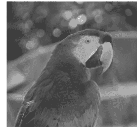

图6.20 – 应用陷波滤波器后的输出图像

可以看到，原始图像看起来比恢复后的图像更清晰，因为原始图像中的一些真实频率也随噪声一起被BRF抑制了。

## 高斯带阻滤波器

高斯带阻滤波器（GBSF）可以定义如下：

```
H_BS(u, v) = e^(-D²(u,v)/(2D_L²)) ( 1 - e^(-D²(u,v)/(2D_H²)) )
```

下面是对该公式的分解：

+   1. 低通分量：

```
H_LP(u, v) = e^(-D²(u,v)/(2D_L²))
```

+   - 让低频通过
+   - 衰减高频

+   2. 高通分量：

```
H_HP(u, v) = 1 - e^(-D²(u,v)/(2D_H²))
```

+   - 去除极低频
+   - 允许中频范围通过

## 效果

它们按如下方式选择性地允许和抑制频率：

+   - 允许中频范围（频带频率）通过
+   - 阻断极低频（去除缓慢变化）
+   - 阻断极高频率（去除噪声）

以下是实现GBSF的步骤，如下表所示：

| 步骤 | 操作 | 效果 |
|---|---|---|
| 1 | 计算FFT | 将图像转换为频域 |
| 2 | 定义频率网格 | 创建频率坐标系 |
| 3 | 计算距离D² | 测量每个频率离中心有多远 |
| 4 | 创建高斯带通滤波器 | 允许中频范围通过，去除极低和极高频率 |
| 5 | 应用滤波器 | 将滤波器与傅里叶变换后的图像相乘 |
| 6 | 计算逆FFT | 将滤波后的图像转换回空间域 |
| 7 | 提取实部 | 去除复数值 |

图6.21 – 计算高斯带阻滤波器的步骤

以下代码片段实现了上述步骤：

```
def gaussian_bandpass_filter(image):
    # Assumes input is a 2D grayscale image
    image_freq = np.fft.fftshift(np.fft.fft2(image))
    m, n = np.shape(image_freq)
    u0, v0 = int(n/2), int(m/2) # Find the center
    u, v = np.meshgrid(range(n), range(m))
    DL, DH = 5, 9
    D2 = (u-u0)**2+(v-v0)**2 # Squared Euclidean distance from
                            # the center
    gaussian_filter = np.exp(-0.5*D2/DL**2) * \
                      (1 - np.exp(-0.5*D2/DH**2))
    # Apply the filter
    fourier_transform = image_freq * gaussian_filter
    rec_image = np.fft.ifft2(np.fft.ifftshift(\
                              fourier_transform))
    return rec_image

im = imread('images/heart.png', as_gray=True)
# im = im / im.max()
im_rec, F, G = gaussian_bandpass_filter(im)
im_rec = im_rec.real
# plot original noisy (im) and reconstructed images (im_rec)
# plot spectrum of the noisy image and the gaussian BRF
```

如果你运行上述代码片段并将得到的图像/频谱并排绘制，你应该会得到类似下图的输出：

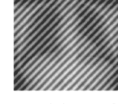

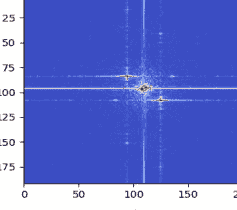

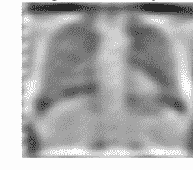

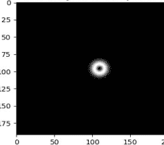

图6.22 – 使用带阻滤波器去除图像中的周期性噪声

虽然诸如带阻滤波器之类的传统频域滤波器在抑制不需要的频率方面很有用，但机器学习的最新进展已经以更强大的方式利用了频率表示。其中一项创新是傅里叶特征网络，它使用基于频率的编码来增强神经网络的学习。接下来，让我们深入了解其工作原理。

## 傅里叶特征网络

傅里叶特征网络（FFNs）通过结合基于傅里叶的位置编码来增强神经网络，从而更好地表示图像和3D场景等信号中的高频细节。传统的MLP倾向于学习低频平滑模式，往往产生模糊的输出，并且无法捕捉锐利的边缘或纹理。FFN通过使用正弦映射将输入坐标x ∈ ℝ^d转换为更高维的富含频率的表示来解决这一局限：

γ(x) = [sin(2πBx), cos(2πBx)]

其中B通常是一个随机采样的高斯频率矩阵，跨越多个频率尺度。更一般地，

γ(x) = [sin(B₁x), cos(B₁x), ..., sin(Bₙx), cos(Bₙx)]

该模型不是直接将x输入网络，而是学习：I(x)~MLP(γ(x))，从而使网络能够有效地模拟粗粒度和细粒度结构。正弦编码迫使网络关注多个空间频率，克服了标准神经网络固有的低频偏置。这一想法受到傅里叶分析的启发，在傅里叶分析中，信号被分解为正弦频率分量。

FFN被广泛应用于神经辐射场（NeRF）等应用中，其中傅里叶特征有助于重建具有清晰纹理和边缘的照片级逼真3D场景；在图像超分辨率中，它们也改善了精细空间细节的恢复。其主要优势包括改进的高频表示、跨2D和3D任务的灵活性，以及增强的神经场建模。然而，傅里叶编码增加了计算复杂度，而且频率矩阵（B）的选择会显著影响性能，这也是一个活跃的研究领域。

在了解以上FFN的背景后，现在让我们进入实现部分。让我们实现一个FFN模型，它可被视为一种基于坐标的多层感知机。对于每个输入图像坐标(x, y)，模型预测关联的像素颜色(r, g, b)，如下图所示：

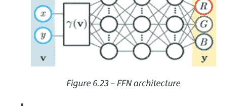

## 训练网络

现在，让我们了解如何训练具有不同输入映射的网络。我们将比较以下映射γ(v)：

+   - 无映射：γ(v) = v
+   - 基本映射：γ(v) = [cos(2πv), sin(2πv)]ᵀ
+   - 高斯傅里叶特征映射：

γ(v) = [cos(2πBv), sin(2πBv)]ᵀ

其中B ∈ R^{m×d}中的每个条目均从N(0, σ²)中采样

## 使用JAX实现

下面的Python代码片段演示了如何使用JAX在输入图像上训练FFN，以实现高效的自动微分和优化计算。该网络使用傅里叶特征映射来提高神经网络学习高频细节的能力，从而基于学习到的特征实现更精确的图像重建（为避免训练缓慢，代码应在Google Colab的GPU/TPU上运行）。以下是关键组件的详细逐步说明：

+   - 初始设置

通过安装必要的库并导入它们来设置环境。安装jax以及其他依赖项（如用于图像处理的imageio-ffmpeg）。

```
#!pip install jax, imageio-ffmpeg
#!git clone https://github.com/tancik/fourier-feature-networks
import jax.numpy as np
```


from jax import jit, grad, random
from jax.example_libraries import stax, optimizers
from tqdm.notebook import tqdm
import os, imageio.v2 as imageio
rand_key = random.PRNGKey(0)

- **加载并预处理图像**
  
  使用 `imageio` 加载图像文件（例如猫.jpg），并且仅使用前三个颜色通道（RGB）。在 `FourierFeatNet` 类中对图像数据进行归一化处理，确保数值位于 0 到 1 之间，以便高效训练。

- **类定义（FourierFeatNet）：**
  
  `FourierFeatNet` 类封装了构建和训练 FFN 的整个过程。它执行以下任务：

- **初始化（`__init__()`）：**
  - **输入归一化：** 将图像 `img` 的像素值除以图像中的最大值来进行归一化。
  - **傅里叶特征（B）：** 傅里叶特征映射矩阵 `B` 作为参数提供。它可以根据傅里叶映射的选择（例如高斯特征）而变化。
  - **训练/测试分割：** 使用 `train_test_split()` 将数据分割为低分辨率训练集和全分辨率测试集。这使得网络可以在下采样数据上训练，并在全分辨率图像上进行测试。

- **傅里叶特征映射（`map_input()`）：**
  - 输入坐标通过傅里叶特征映射进行变换。如果没有提供映射矩阵（B），则直接使用像素坐标。如果提供了 B，则将输入坐标 x 投影到更高维空间：2πx·Bᵀ。
  - 将这些投影的正弦和余弦值拼接起来，形成最终的映射输入。这种傅里叶特征映射使网络能够更好地捕获图像中的高频信息，这对于重建精细图像至关重要。

- **网络架构（`build_network()`）：** 使用 JAX 中的 `stax` 模块构建神经网络架构。该网络包含以下部分：
  - 多个带有 ReLU 激活函数的全连接层（全连接神经网络中的标准层）
  - 最后一个带有 Sigmoid 激活函数的全连接层，输出 3 个通道（RGB），取值范围为 [0, 1]，表示重建图像的像素值

- **训练网络（`train_model()`）：** 主要的训练过程发生在 `train_model()` 函数中。它执行以下步骤：
  - 模型预测和损失计算

- **模型预测**（`model_pred()`）：通过将网络学习到的参数应用于傅里叶映射后的输入坐标，计算预测输出（重建图像）。
- **损失函数**（`model_loss()`）：损失定义为预测像素值与真实像素值之间的**均方误差**（MSE）：$loss = \frac{1}{2} mean((prediction - ground\ truth)^2)$
- **PSNR 计算**（`model_psnr()`）：PSNR 是图像重建质量的标准指标。现在你应该对它很熟悉了。PSNR 值越高表示重建质量越好。它使用公式计算：$(PSNR = -10 \cdot log_{10}(2 \cdot loss))$。
- **优化**：使用 Adam 优化器更新网络参数。通过 `grad`(`model_loss`) 计算损失函数的梯度，优化器根据梯度信息调整参数。训练过程共迭代 `iters` 次（本例中为 2000 次）。
- **训练循环**
  - 每次迭代，模型使用 Adam 优化器更新参数。
  - 每 25 次迭代，记录训练 PSNR、测试 PSNR 和预测图像。这些值用于监控网络在训练期间的性能。
  - 该函数返回一个字典，包含：
    1. `state`：网络的最终学习参数。
    2. `train_psnrs`：训练期间各迭代步的训练 PSNR 值列表。
    3. `test_psnrs`：测试 PSNR 值列表。
    4. `pred_imgs`：训练过程中不同时刻的预测图像。
    5. `xs`：记录 PSNR 值时的迭代步。

以下是完整的代码片段：

```
class FourierFeatNet:
    def __init__(self, img, B, num_layers, num_channels):
        self.I = img / img.max()
        self.B, self.L, self.C = B, num_layers, num_channels
        self.train_test_split()
        self.build_network()
    def train_test_split(self):
        # Create input pixel coordinates in the unit
        # square
        coords = np.linspace(0, 1, self.I.shape[0], \
                            endpoint=False)
        x_test = np.stack(np.meshgrid(coords, coords), -1)
```

```
self.test_data = [x_test, self.I]
self.train_data = [x_test[::2, ::2], self.I[::2, ::2]]

# Fourier feature mapping
def map_input(self, x):
    if self.B is None:
        return x
    else:
        x_proj = (2.*np.pi*x) @ self.B.T
        return np.concatenate([np.sin(x_proj), \
                               np.cos(x_proj)], \
                               axis=-1)

# JAX network definition
def build_network(self):
    layers = []
    for i in range(self.L-1):
        layers.append(stax.Dense(self.C))
        layers.append(stax.Relu)
        layers.append(stax.Dense(3))
        layers.append(stax.Sigmoid)
    self.FFN = stax.serial(*layers)

# Train model with given hyperparameters and data
def train_model(self, learning_rate, iters):
    init_fn, apply_fn = self.FFN[0], self.FFN[1]
    model_pred = jit(lambda params, x: apply_fn(params,\
                    self.map_input(x)))
    model_loss = jit(lambda params, x, y: .5 * np.mean(\
        (model_pred(params, x) - y) ** 2))
    model_psnr = jit(lambda params, x, y: \
        -10 * np.log10(2.*model_loss(params, x, y)))
    model_grad_loss = jit(lambda params, x, y: \
        grad(model_loss)( params, x, y))
    opt_init, opt_update, get_params = \
        optimizers.adam(learning_rate)
    opt_update = jit(opt_update)
    _, params = init_fn(rand_key, (-1, \
        self.map_input(self.train_data[0]).shape[-1]))
    opt_state = opt_init(params)
```

```
```python
train_psnrs = []
test_psnrs = []
pred_imgs = []
xs = []
for i in tqdm(range(iters), desc='train iter', leave=False):
    opt_state = opt_update(i, \
        model_grad_loss(get_params(opt_state), \
        *self.train_data), opt_state)
    if i % 25 == 0:
        train_psnrs.append(model_psnr(\
            get_params(opt_state), *self.train_data))
        test_psnrs.append(model_psnr(\
            get_params(opt_state),\
            *self.test_data))
        pred_imgs.append(model_pred(\
            get_params(opt_state), \
            self.test_data[0]))
    xs.append(i)
return {
    'state': get_params(opt_state),
    'train_psnrs': train_psnrs,
    'test_psnrs': test_psnrs,
    'pred_imgs': np.stack(pred_imgs),
    'xs': xs,
}
```
```

下一个代码比较存储在 `B_dict` 中的不同傅里叶特征映射，以研究它们对图像重建的影响。`B_dict['none'] = None` 仅使用原始像素坐标，不进行傅里叶编码；而 `B_dict['basic'] = np.eye(2)` 应用简单的恒等映射，保留原始坐标。三个高斯傅里叶特征映射 `B_dict['gauss_{scale}']` 使用随机高斯矩阵 `B_gauss` 按因子 1、10 和 100 缩放创建，使网络能够捕获不同频率范围的图像结构。输入图像被归一化，对于 `B_dict` 中的每个映射，训练一个具有 4 层和 256 个通道的 `FourierFeatNet` 模型，使用学习率 10⁻⁴ 迭代 2000 次。所有映射的输出都被存储，以便后续比较重建质量和频率表示能力。

```
```python
num_layers, num_channels = 4, 256
learning_rate = 1e-4
iters = 2000
mapping_size = 256

B_dict = {}
```

```
# Standard network - no mapping
B_dict['none'] = None
# Basic mapping
B_dict['basic'] = np.eye(2)
# Three different scales of Gaussian Fourier
# feature mappings
B_gauss = random.normal(rand_key, (mapping_size, 2))

for scale in [1., 10., 100.]:
    B_dict[f'gauss_{scale}'] = B_gauss * scale

img = imageio.imread('cat.jpg')[..., :3]
img = img / img.max() # input images must be normalized
# between [0, 1] # for proper training when passed into the # Fourier Feature
Network, otherwise, PSNR values will be
# misleading.

# This will take about 2-3 minutes on GPU
outputs = {}
for k in tqdm(B_dict):
    outputs[k] = FourierFeatNet(img, B_dict[k], num_layers,\
        num_channels).train_model(learning_rate, iters)
```

绘制结果：训练完成后，`plot_output()`（参见 GitHub）将不同映射的重建图像与真实图像一起可视化，并绘制训练和测试 PSNR 随迭代次数的变化曲线，如下图所示，使读者能够比较各模型的重建质量、收敛行为和泛化性能。

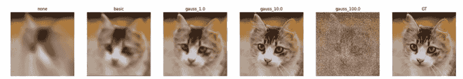

图 6.24 – 使用不同傅里叶映射的 FFN 进行图像重建


下图显示了使用 FFN 重建的图像的 PSNR 随训练 epoch 的增加情况，训练集和测试集均有体现：

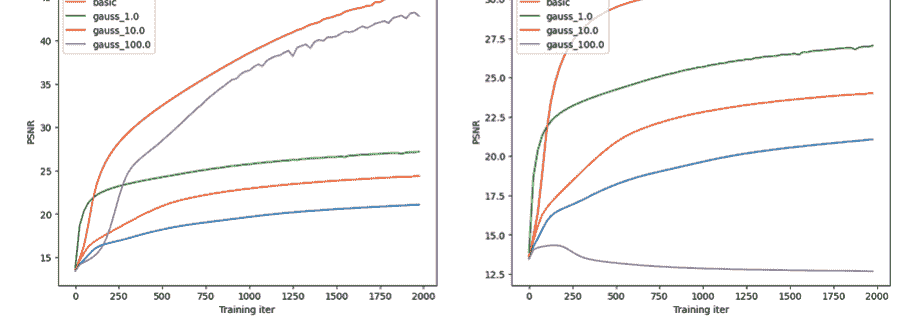

图 6.25 – 使用 FFN 重建后训练和测试误差（以 PSNR 衡量）

这种方法突出了傅里叶特征映射如何增强神经网络捕捉图像中高频细节的能力，从而比仅使用原始像素坐标获得更好的重建质量。

## Note

如果训练 PSNR 持续改善而测试 PSNR 停滞或开始下降，则这是 FFN 出现过拟合的强有力指标。为缓解过拟合，请考虑诸如早停、正则化（例如增加 dropout）等技术。Dropout 在训练期间随机禁用神经元，有助于提高泛化能力；如果观察到过拟合，请尝试适度提高 dropout 率。此外，请注意，在推理期间（例如图像重建），模型使用全分辨率测试数据，且不应用 dropout。

## Summary

在本章中，我们探讨了如何在频域中有效执行滤波操作，为许多图像处理任务提供了速度和灵活性的优势。我们涵盖了各种类型的滤波器，包括低通、高通、带通和带阻，并使用 Python 库如 scipy.fftpack、scikit-image 和 fourier_gaussian 实现了理想、巴特沃斯和高斯变体。我们还分析了滤波如何影响图像质量和 SNR，特别是在去噪和噪声去除应用中。最后，我们介绍了傅里叶特征网络（FFNs），解释了其动机、结构以及使用 JAX 的实际实现，展示了基于频率的表示如何增强神经网络在高频任务中的性能。

完成本章后，你应该能够编写 Python 代码来实现 LPF/HPF/BPF/BSF 频域滤波器。

在下一章中，我们将开始基于最近几章介绍的概念的图像增强技术。

## Get this book’s PDF version and more

扫描二维码（或访问 packtpub.com/unlock）。按书名搜索此书，确认版本，然后按照页面上的步骤操作。


UNLOCK NOW

Note: Keep your invoice handy. Purchases made directly from Packt don’t require an invoice.
