### 7

### Image Enhancement

在本章中，我们将探讨从经典的基于像素的变换到现代深度学习模型的一系列图像增强技术，旨在提高视觉质量并强调重要特征。与图像恢复不同，增强方法不依赖于明确的退化模型，而是专注于细化对比度、降低噪声和增强细节。

我们首先介绍逐点强度变换、基于直方图的对比度调整和抖动算法，然后是高斯、中值、双边和非局部均值滤波等线性和非线性平滑技术。本章还涵盖了基于模糊逻辑的对比度增强和基于小波域的图像融合。为了让概念更具实践性，一个交互式 Streamlit 应用演示了这些增强技术在用户提供图像上的应用。最后，我们演示了先进的基于深度学习的增强方法，包括低光校正、去噪、去雾和超分辨率，使用预训练模型。

本章将涵盖的关键主题如下：

- Point-wise intensity transformations
- Tone and perceptual enhancement
- Image enhancement with histogram processing
- Fuzzy logic-based image enhancement
- Linear noise-smoothing
- Non-linear noise smoothing
- Wavelet-based image fusion and enhancement
- Image enhancement with deep learning models

## Technical requirements

以下是本书配套 GitHub 仓库中对应本章的 Jupyter notebook 的链接：https://github.com/PacktPublishing/Hands-On-Image-Processing-and-Computer-Vision-with-Python-Second-Edition。在阅读本章不同章节时，请跟随此 notebook（并运行必要的代码片段）。为确保代码按预期运行并不受未来弃用或不向后兼容的更改影响，仓库同一文件夹中提供了 requirements.txt 文件。使用以下命令安装：

```
```bash
pip install -r requirements.txt.
```
```

## Point-wise intensity transformations

逐点强度变换将传输函数 *T* 应用于图像中每个像素 *f(x, y)*，生成 *g(x, y) = T(f(x, y))* 或 *s = T(r)*，其中 *r* 和 *s* 分别是输入和输出灰度级。这是一个无记忆操作。每个输出像素仅取决于其对应的输入值。虽然它既不增加也不恢复信息，但它增强了视觉外观或突出了特征，使其成为图像增强中常见的预处理步骤。

下图显示了点处理，以及掩模/核处理（对于空间滤波器，变换时也考虑邻域像素，如我们之前所见）：

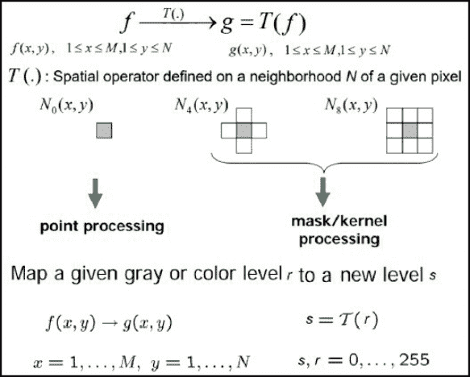

*Figure 7.1 – Point-wise pixel intensity transformation*

一些流行的强度变换是图像负片、色彩空间变换、对数/幂律变换、对比度拉伸、标量量化和小波阈值。我们已在 *Chapter 1* 中讨论了一些。我们将从使用 PIL 对彩色 RGB 图像进行对数变换开始，然后讨论一些尚未涵盖的变换。

## Log transform

当我们需要压缩或拉伸图像中某一范围的灰度级时，对数变换非常有用；例如，为了显示傅里叶频谱（其中直流分量值远高于其他分量，因此如果没有对数变换，其他频率分量几乎总是无法看到）。对数变换的点变换函数具有以下一般形式：

$s = T(r) = c\log(1+r)$

其中 c 为常数。请参阅 GitHub notebook 中 `plot_hist()` 函数的实现，以绘制输入图像颜色通道的直方图。现在让我们使用 PIL 图像模块的 `point()` 函数应用对数变换，并观察变换对给定 RGB 图像不同颜色通道直方图的影响，使用以下代码行：

```
```python
im = im.point(lambda i: 255*np.log(1+i/255))
im_r, im_g, im_b = im.split()
```
```

在对数内部加上 1 可确保输入始终 ≥ 1（因为像素值可以为 0），从而避免 log(0) 并使变换在数学上有效。

如果你绘制 RGB 颜色通道在应用对数变换前后的输入/输出图像的直方图，并将 i/o 图像并排绘制，你应该会得到如下图所示的结果：

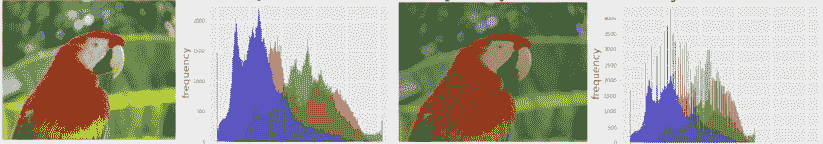

*Figure 7.2 – Image and histogram of color channels before and after application of the logarithm transform*

让我们现在探索另一个非常重要的点变换方法，即幂律变换。


## 幂律变换

如我们所见，该点变换（传递函数）的一般形式为：

\[
s = T(r) = c r^\gamma
\]

其中 \(c\) 是常数。在第 1 章中我们使用 `PIL.Image.point()` 方法将其应用于灰度图像，这次我们用 scikit-image 在 RGB 彩色图像上应用幂律变换，并可视化该变换对颜色通道直方图的影响。

```python
im = img_as_float(imread('images/cheetah.png'))
γ = 2.5 # try different values here and observe the impact
im_trans = im**γ
```

如果运行上述代码片段，并绘制图像及相应的 RGB 通道直方图，您将得到下图，该图展示了幂律变换前后的颜色通道直方图，以及原始图像和变换后的图像：

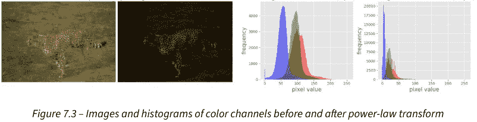

令像素值归一化到 \([0,1]\) 范围内。\(\gamma\) 的效果关键取决于它是小于 1 还是大于 1（如下表和下图所示）。

-   当 \(\gamma < 1\) 时，变换会扩展较低强度值，使暗区域变亮，提高阴影中的可见度。
-   相反，当 \(\gamma > 1\) 时，变换会压缩较低强度值，导致图像整体看起来更暗。

| Gamma | 曲线形状 | 效果 |
|---|---|---|
| \(\gamma < 1\) | 对角线以上 | 使阴影变亮 |
| \(\gamma = 1\) | 直线 | 无变化 |
| \(\gamma > 1\) | 对角线以下 | 使图像变暗 |

因此，与常见直觉相反，增大 \(\gamma\) 并不会使图像变亮，而是使其变暗；而小于 1 的值则产生变亮效果。该变换是非线性的：它重新分配对比度，而不仅仅是亮度。

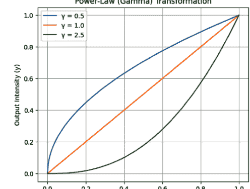

*图 7.4 – 幂律变换*

## 亮度调整

亮度是图像最基本的属性之一。调整亮度在图像增强、预处理、视觉美感和可读性方面起着关键作用。在许多实际应用中，尤其是涉及低光、过曝或欠曝图像时，亮度校正是迈向更好图像理解或下游处理（如目标检测、OCR 或分类）的第一步。让我们探讨如何使用 PIL 和 opencv-python 等库调整图像亮度。

在数字成像中，亮度是指图像感知到的强度。对于灰度图像，它直接对应像素值。对于彩色图像，则更为微妙，通常与特定颜色空间（如 HSV、Lab 或 YUV）中的亮度或明度分量相关。对于图像 \(I(x, y)\)，亮度调整后的图像 \(I'(x, y)\) 通常按下式计算：

\[
I'(x, y) = \alpha \cdot I(x, y) + \beta
\]

其中 \(\alpha\) 是对比度缩放因子（对于仅调整亮度通常为 1），\(\beta\) 是亮度偏移量（正值变亮，负值变暗）。

由于数字图像以固定值范围表示（例如 8 位图像为 0–255），调整后的值必须进行裁剪：

\[
I'(x,y)=\min(255,\max(0,\alpha\cdot I(x,y)+\beta))
\]

下表列出了亮度调整非常有用的几个用例：

| 领域 | 目的 |
|---|---|
| 摄影 | 校正欠曝/过曝的照片 |
| OCR 预处理 | 提高文本可见性 |
| 监控 | 增强昏暗或夜间影像 |
| 卫星图像 | 在分析前改善对比度 |
| 医学成像 | 揭示扫描中的隐藏结构 |

*表 7.2 – 不同场景下的亮度调整*

### 使用 PIL

让我们首先通过以下代码片段探索如何使用 PIL 调整亮度，步骤如下：

1.  首先，使用 `Image.open()` 加载图像，并使用 `ImageEnhance.Brightness(img)` 创建亮度增强器。
2.  `enhance(1.5)` 方法将亮度提高 50%（其中 1.0 为原始亮度）。
3.  使用 matplotlib 并排显示原始图像和增亮图像以进行比较。

本质上，它演示了如何使用 PIL 快速调整图像亮度并可视化结果。现在参考以下代码片段：

```python
img = Image.open('images/boy.png')
enhancer = ImageEnhance.Brightness(img)
bright_img = enhancer.enhance(1.5)
dark_img = enhancer.enhance(0.5)
# plot images and intensity histogram here, refer to github code
```

如果运行上述代码并并排绘制图像和通道直方图，您将得到类似下图的图像：

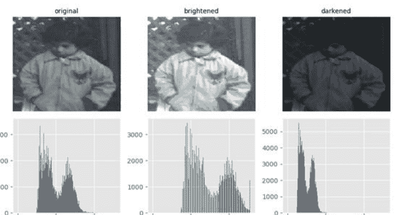

*图 7.5 – 使用 PIL 改变图像亮度*

它具有以下关键优点：使用直观，支持所有图像模式，并包含内置的伽马和色彩调整工具。

### 使用 OpenCV-Python

现在让我们使用以下代码片段，探索如何利用 opencv-python 通过仿射变换执行亮度调整。让我们通过以下逐步解释来理解代码：

-   首先使用 `cv2.imread()` 以 BGR 格式加载输入图像。使用函数 `cv2.cvtColor()` 将其转换为 RGB 格式，以便用 matplotlib 正确显示。
-   使用函数 `cv2.convertScaleAbs()` 对每个像素强度应用仿射变换：
    \[
    I'(x,y) = \alpha \cdot I(x,y) + \beta
    \]
-   \(\alpha\) 控制对比度：
    -   \(\alpha > 1\)：增大对比度（扩展强度范围）
    -   \(0 < \alpha < 1\)：降低对比度（压缩强度范围）
    -   \(\alpha = 1.0\)：保持原始对比度

```python
high_contrast_img = cv2.convertScaleAbs(img, alpha=2, beta=0)
# Brightness increase by adding constant
high_brightness_img = cv2.convertScaleAbs(img, alpha=1.0, beta=50)
plt.imshow(np.hstack((img, high_contrast_img, high_brightness_img)))
plt.axis('off')
```

如果运行上述代码片段，您将得到下图：

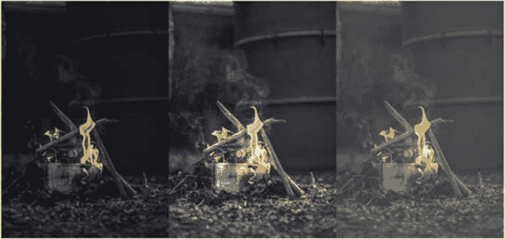

*图 7.6 – 使用 opencv-python 增加图像亮度*

该方法简单、高效，常用于实时图像增强。它通过 alpha 和 beta 同时支持亮度和对比度调整，适合批量处理，并在计算机视觉流程中广泛使用。

## 色调与感知增强

本节探讨基于强度的技术，如阈值处理、半色调化和抖动，这些技术通过修改像素色调来增强视觉感知，或为有限的显示和打印设备准备图像，包括广泛使用的 Floyd–Steinberg 误差扩散方法。

### 阈值处理

这是一种点运算，通过将低于某个阈值的所有像素设为 0，高于该阈值的所有像素设为 1，从灰度图像创建二值图像。如果 \(g\) 是 \(f\) 在某个全局阈值 \(T\) 下的阈值化版本，则可以表示为：

\[
g(x,y)=\begin{cases}1, & f(x,y)>T\\0, & \text{otherwise}\end{cases}
\]

为什么需要二值图像？原因有很多，例如，我们可能希望将图像分离为前景和背景；图像要用黑白打印机打印（所有灰度阴影需要仅用黑白点表示）；或者我们希望使用**形态学运算**对图像进行预处理，这将在后续章节中讨论。

以下代码片段展示了如何使用 `PIL.Image.point()` 方法进行固定阈值处理：

```python
im = Image.open('images/swans.jpg').convert('L')
threshold = [0, 50, 100, 150, 200]
for i in range(2, 5):
    im_bin = im.point(lambda x: x > threshold[i])
    # plot the binary image obtained with this threshold value here
```

如果运行上述代码片段并可视化在不同阈值下获得的二值图像，您会注意到阈值的选择如何影响最终结果。首先，观察原始图像中像素强度的分布。当使用单个固定阈值时，所有像素被迫分为两类：黑色或白色。

这通常会导致原始图像中平滑过渡的丢失。因此，本应逐渐变化的区域反而呈现为不自然的、锐利的边界或带状图案。这些人为的带状图案被称为*伪轮廓*（它们之所以出现，是因为连续的灰度级被突然分割为仅两个级别，破坏了平滑的强度变化）。简而言之，图像不是平滑的阴影，而是看起来“阶梯状”或“海报化”，这降低了视觉质量，并可能隐藏重要细节。

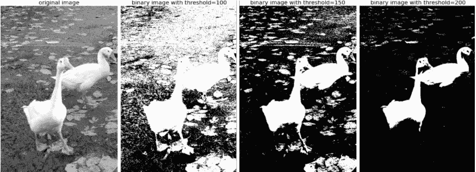

*图 7.7 – 在灰度级别上使用不同阈值创建二值图像*


我们将在*第 9 章*中回顾阈值处理。

## 随机半色调（随机抖动）

在阈值处理（二值量化）中，减少假轮廓伪影的一种方法是在量化之前向输入图像添加均匀分布的白噪声。具体来说，对于灰度图像 $f(x,y)$ 的每个输入像素，我们添加一个独立的均匀 $[-128,128]$ 随机数（可以表示为一个独立的均匀随机变量 $n(x,y)\sim U(-\Delta,\Delta)$），然后应用阈值处理。这可以表示为：

$$g(x,y)=1(f(x,y)+n(x,y)\geq T)$$

其中 $1(\cdot)$ 表示指示函数，若条件为真则等于 1，否则为 0；T 是阈值，$\Delta$ 控制噪声幅度（例如，对于 8 位图像，$\Delta=128$）。

这种技术通常被称为**随机抖动**，可视为**半色调**的一种简单形式，其中噪声用于打破大片均匀区域，并通过空间变化模拟中间灰度级。

与强制将所有像素变成非黑即白的严格区域（这会产生条带效应）不同，添加的噪声会使相邻像素随机跨越阈值翻转。在一定距离外观看时，这些随机图案会被人类视觉系统感知为平滑的灰度级，从而减少可见的轮廓伪影。

下面的代码块给出了一个实现：

```
im = Image.open('images/swans.jpg').convert('L')
im = Image.fromarray(np.clip(im + np.random.randint(-128, 128, \
    (im.height, im.width)), 0, 255).astype(np.uint8))
threshold = [0, 50, 100, 150, 200]
for i in range(2, 5):
    im_bin = im.point(lambda x: x > threshold[i])
    # plot binary image obtained with this threshold value here, refer
    github
```

如果运行上述代码片段并绘制所得到的二值图像，应得到下图：

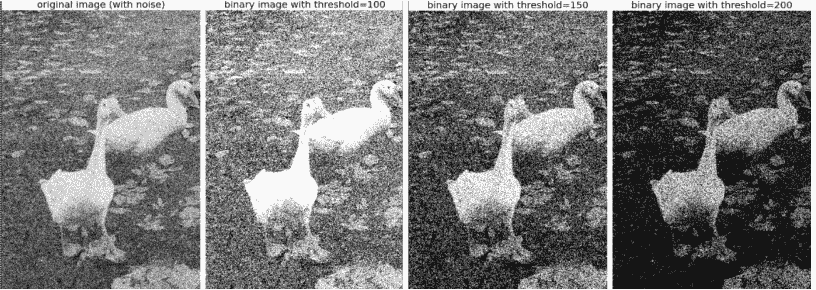

*图 7.8 – 使用阈值处理得到的二值图像*

请注意，在上图中，尽管生成的二值图像有些噪声，但伪轮廓已显著减少；在足够的模糊下（例如，从远处观看时），它们会给我们一种具有多个灰度级的印象。

## 抖动

虽然随机噪声添加（如半色调中讨论的）能减少可见的条带效应，但其方式是非结构化的。更一般地，**抖动**是指在量化之前或量化过程中刻意修改像素值的技术，目的是使量化误差在空间上分布，而不是集中在大片均匀区域。这种重新分布有助于打破诸如伪轮廓之类的人为图案，并产生中间灰度级的视觉错觉。抖动可以通过不同方式实现，包括**随机抖动**、**有序抖动**和**误差扩散方法**，每种方法在视觉质量和计算复杂度之间提供了不同的权衡。

## 带误差扩散的 Floyd–Steinberg 抖动

Floyd–Steinberg 算法通过在扫描方向上向前扩散量化误差来执行抖动，确保局部误差由后续像素决策来补偿。它把一个像素的残余量化误差推（加）到其相邻像素上，留待后续处理。它按照下图所示的相邻像素分布，将量化误差扩散出去：

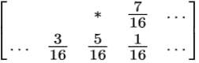

*图 7.9 – 使用 Floyd-Steinberg 误差扩散抖动传播量化误差*

在上图中，当前像素用星号（*）表示，空白像素表示先前已扫描的像素。算法从左到右、从上到下扫描图像。它逐一连续量化像素值；每次量化误差都会分配到相邻像素（尚未扫描）中，同时不影响已经量化的像素。如果多个像素被向下取整，那么算法就更有可能将接下来的像素向上取整，从而使平均量化误差接近于零。

令 $f(x,y) \in [0,1]$ 表示输入灰度图像，$g(x,y) \in \{0,1\}$ 表示二值化输出。

在每个像素 $(x,y)$ 处，我们定义 $\tilde{f}(x,y)=f(x,y)+e(x,y)$，其中 $e(x,y)$ 是从先前已处理像素传播过来的累积误差。

关键步骤如下：

- **量化步骤：** 将该像素量化为最近的调色板值（对于二值图像，阈值为 $T=0.5$ 时）：
  
  $$g(x,y)=1\bigl(\tilde{f}(x,y)\ge T\bigr)$$

- **量化误差：** 在 $(x,y)$ 处的量化误差为：
  
  $$\varepsilon(x,y)=\tilde{f}(x,y)-g(x,y)$$

- **误差扩散：** 将该误差按照固定权重分布到相邻的未处理像素：
  
  $$e(x+1,y)\mathrel{+}=\frac{7}{16}\varepsilon(x,y),\quad e(x-1,y+1)\mathrel{+}=\frac{3}{16}\varepsilon(x,y)$$
  $$e(x,y+1)\mathrel{+}=\frac{5}{16}\varepsilon(x,y),\quad e(x,y+1)\mathrel{+}=\frac{1}{16}\varepsilon(x,y)$$

- **守恒性质：** 这些权重满足 $\frac{7}{16}+\frac{3}{16}+\frac{5}{16}+\frac{1}{16}=1$，确保总量化误差被守恒并重新分布，而不是丢失。

与引入*随机噪声*的随机抖动不同，Floyd–Steinberg 使用确定性的、结构化的误差重新分布，从而：

- 更好地保留图像结构
- 降低噪声观感
- 获得更高的感知质量

接下来，Python 代码实现了 FS 抖动。下面列出了代码所执行的关键任务：

1. **颜色量化（find_closest_palette_color）：** 该函数将像素映射到一组精简灰度级中最接近的值。对于 num_colors = k，该函数创建一个调色板，其中的灰度级在 0 到 255 之间等步长分布：$step = \frac{255}{k-1}$。因此，像素强度会被取整到这 k 个灰度级中最接近的一个。
2. **抖动（get_dithered_image）：** 算法访问每个像素，并将其量化为最近的调色板灰度级。它计算量化误差：
   
   $error = original - quantized$
   
   然后根据固定权重将误差分布到相邻像素，如伪代码所示。这种误差扩散即使图像仅限于 k 个灰度级，也能产生中间强度的错觉。
3. **最终量化与裁剪：** 误差扩散后，图像再次被精确量化为 k 个灰度级。像素值被裁剪到 [0, 255] 并转换为 uint8。
4. **验证：** 代码使用 np.unique(dithered) 打印抖动图像中的唯一灰度级。这确认了输出符合预期的 k 个调色板灰度级。

现在，请参考下面的代码片段：

```
def find_closest_palette_color(old_pixel, num_colors=2):
    step = 255 / (num_colors - 1)
    return np.round(old_pixel / step) * step

def get_dithered_image(image, num_colors):
    dithered = np.copy(image)
    h, w = dithered.shape
    for x in range(h):  # Floyd-Steinberg Dithering
        for y in range(w):
            old_pixel = dithered[x, y]
            new_pixel = find_closest_palette_color(old_pixel, num_colors)
            dithered[x, y] = new_pixel
            quant_error = old_pixel - new_pixel
            if y + 1 < w:
                dithered[x, y + 1] += quant_error * 7 / 16
```

```python
if x + 1 < h and y > 0:
    dithered[x + 1, y - 1] += quant_error * 3 / 16
if x + 1 < h:
    dithered[x + 1, y] += quant_error * 5 / 16
if x + 1 < h and y + 1 < w:
    dithered[x + 1, y + 1] += quant_error * 1 / 16
return find_closest_palette_color(dithered, num_colors)

image = 255 * rgb2gray(imread('images/lena.jpg')[..., :3])
image = image.astype(np.float32)
dithered2 = get_dithered_image(image, 2)
dithered4 = get_dithered_image(image, 4)
# Display the original and dithered images side-by-side here
```

如果运行上述代码片段，应得到下图。该图显示，与之前的半色调方法相比，所获得的二值图像（使用 2 个灰度级）的质量有了极大改善。当在抖动中使用 4 个灰度级时，可以注意到质量进一步提高。

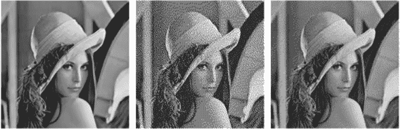

*图 7.10 – Floyd-Steinberg 抖动*

总结如下：

- 算法按**因果扫描顺序**（从左到右、从上到下）处理像素。
- 已经量化的像素保持不变。
- 后续像素会**受到先前误差的影响**，从而促使进行补偿。如果较早的像素被向下取整，后续像素往往会被向上取整。这保持了**局部平均强度**，从而产生没有条带效应的视觉平滑结果。


伪代码中呈现的 Floyd–Steinberg 抖动输出的是二值（黑白）图像，但这段代码更加灵活和强大！该算法的这个版本允许你生成具有 k 个不同灰度级的抖动灰度图像，而不仅仅是 2 个！无论你想要模拟复古打印机还是在保留视觉丰富度的同时压缩图像数据，只需选择：`num_colors = k`（例如，2、4、8...），代码将：

- 自动创建 k 个等间距的灰度级调色板（例如，k=4 时为 [0, 85, 170, 255]）
- 智能地量化并扩散像素误差以产生自然的外观结果
- 显示并验证输出中唯一色调的数量

与通常为二值量化呈现的经典 Floyd–Steinberg 公式不同，这种方法通过选择适当数量的输出强度级（`num_colors=k`）自然地扩展到 k 级灰度量化。调色板随后被构造为均匀间隔的灰度级，并且相同的误差扩散机制无需修改即可应用。该框架可进一步推广到彩色图像，通过对每个通道独立应用抖动处理。

阈值化速度快；它非常适合高对比度应用，如文本。半色调适用于传统印刷，当没有灰度时，而抖动则擅长用最少的灰度级模拟平滑色调。下表比较了上述三种方法：

| Feature | Thresholding | Halftoning | Dithering |
|---|---|---|---|
| Output | Binary | Patterned dots | Multi-tone illusion |
| Complexity | Very low | Medium | High |
| Spatial Context | None | Yes (patterned) | Yes (diffuses error) |
| Visual Quality | Low for photos | Medium–high | High |
| Customization | Static threshold | Grid patterns | Quantization + error |
| Hardware Use | Scanners | Printers | Displays, encoders |

*Table 7.4 – Thresholding vs. Halftoning vs. Dithering*

## 图像增强与直方图处理

直方图处理技术提供了一种更好的方法来改变图像中像素值的动态范围，使得其强度直方图具有期望的形状。正如我们所见，图像增强通过对比度拉伸操作是有限的，因为它只能应用线性缩放函数。

### 直方图滑动（平移）

滑动对每个像素加上或减去一个常数，在保持对比度的同时均匀地移动亮度。数学上可以表示为：

`I' = I + Δ`

下一段代码实现了上述直方图修改方法：

```
def histogram_stretching(image):
    min_val, max_val = np.min(image), np.max(image)
    stretched = 255 * (image - min_val) / (max_val - min_val)
    return stretched.astype(np.uint8)

def histogram_shrinking(image, target_range=(100, 200)):
    min_val, max_val = np.min(image), np.max(image)
    shrunk = (image - min_val) / (max_val - min_val) * \
            (target_range[1] - target_range[0]) + target_range[0]
    return shrunk.astype(np.uint8)

def histogram_sliding(image, shift_value=30):
    slid = np.clip(image + shift_value, 0, 255)
    return slid.astype(np.uint8)

image = cv2.imread('images/mandrill.jpg')
image = cv2.cvtColor(image, cv2.COLOR_BGR2LAB)
stretched_image = image.copy()
shrunk_image = image.copy()
slid_image = image.copy()
i = 0 # only stretch the intensity channel L, the very first channel
stretched_image[...,i] = histogram_stretching(stretched_image[...,i])
shrunk_image[...,i] = histogram_shrinking(shrunk_image[...,i])
slid_image[...,i] = histogram_sliding(slid_image[...,i])
image = cv2.cvtColor(image, cv2.COLOR_LAB2RGB)
stretched_image = cv2.cvtColor(stretched_image, cv2.COLOR_LAB2RGB)
shrunk_image = cv2.cvtColor(shrunk_image, cv2.COLOR_LAB2RGB)
slid_image = cv2.cvtColor(slid_image, cv2.COLOR_LAB2RGB)
plt.imshow(np.hstack((image, stretched_image, shrunk_image, slid_image)))
```

如果你运行上述代码片段，你应该得到以下图像：

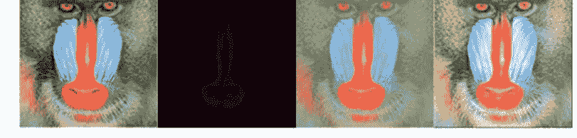

Figure 7.11 – Histogram stretching, shrinking, and sliding

### 使用 scikit-image 进行对比度拉伸和直方图均衡化

直方图均衡化使用单调且非线性的映射，该映射重新分配输入图像中的像素强度值，使得输出图像具有均匀的强度分布（平坦的直方图），从而增强图像的对比度。下图描述了直方图均衡化的变换函数：

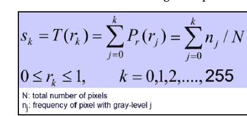

Figure 7.12 – Transform function for histogram equalization

以下代码块展示了如何使用 scikit-image 的 `exposure` 模块的 `equalize_hist()` 函数进行直方图均衡化。直方图均衡化实现有两种不同的风格：一种是对整个图像的全局操作，而第二种是局部（自适应）的，通过将图像分成块并对每个块运行直方图均衡化，使用 `equalize_adapthist()` 函数。下一段代码片段还比较了使用 scikit-image 的两种不同直方图处理技术，即对比度拉伸和直方图均衡化所获得的图像增强效果。

```
im = io.imread('images/beans_g.png')
im_rescale = exposure.rescale_intensity(im, \
    in_range=(0, 100), out_range=(0, 255)) # contrast stretching
im_rescale = im_rescale.astype(np.uint8)
im_eq = exposure.equalize_hist(im) # Global histogram equalization
im_adapteq = exposure.equalize_adapthist(im, \
    clip_limit=0.03) # Local (adaptive) histogram equalization
```

如果你运行上述代码片段并绘制图像以及 CDF（参考 GitHub 笔记本），你应该得到以下图像：

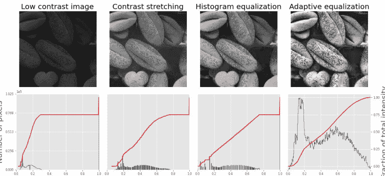

Figure 7.13 – Contrast stretching vs. Local / Global Histogram Equalization

前一幅图显示了前一段代码片段的输出结果。可以看出，自适应直方图均衡化在使输出图像的细节更清晰方面比直方图均衡化提供了更好的结果。

## 基于模糊逻辑的图像增强

我们已经探索了广泛使用的传统图像对比度增强方法，如直方图均衡化（HE）和对比度受限自适应直方图均衡化（CLAHE）。这些方法通常是全局的、缺乏灵活性，或容易受到噪声的影响。模糊逻辑提供了一种强大的替代方案，尤其适用于不确定或不精确的上下文，例如自然场景图像，其中像素强度分类（例如“暗”、“中等”、“亮”）本质上是模糊的。

模糊逻辑通过处理真实度的程度而不是二元决策来模仿人类推理。它通过以下方式工作：

- 定义表示语言类别的模糊集
- 使用隶属函数将输入值与这些模糊集关联
- 创建模糊规则以推断输出

在图像对比度增强中，像素的强度可能不是严格的暗或亮；它可能是部分两者。模糊逻辑通过为不同类别分配隶属度来容纳这一点，从而允许更细致的处理。

### 使用 Mamdani 系统进行模糊逻辑对比度增强

在本节中，让我们探索基于 Mamdani 模糊推理系统（FIS）的模糊逻辑对比度增强。模糊逻辑通过在 0 和 1 之间启用部分真值来模拟人类推理。在图像增强中，像素强度可以通过暗、中等和亮等模糊集来解释。然后模糊规则将这些输入集映射到输出强度校正，例如更暗、增强或更亮。

#### Mamdani FIS

Mamdani 系统是一种广泛使用的模糊推理机制，使用 min-max 操作进行规则评估和聚合，并使用重心去模糊化获得清晰的输出值。Mamdani FIS 包含四个步骤：

- **模糊化：** 将输入（像素强度）转换为隶属度。给定一个像素强度值，模糊化根据隶属函数（MF，例如三角形或高斯）将其映射为隶属度：

  `μ_dark(I), μ_medium(I), μ_bright(I)`

- **规则评估：** 使用模糊规则和逻辑运算（通常为 AND 的 min）来评估结果。应用 min 操作从前件推断输出模糊集：

  `μ_output(z) = max_i [ min( μ_input(I), μ_rule_i(z) ) ]`

  每个规则的触发强度使用 min 运算符确定，最终聚合的模糊输出使用 max 运算符计算。让我们定义以下模糊规则：

  - R₁: IF intensity is dark THEN output is darker
  - R₂: IF intensity is medium THEN output is enhanced
  - R₃: IF intensity is bright THEN output is brighter

- **聚合：** 组合所有规则的输出（通常使用 max）


- **去模糊化：** 将聚合的模糊集合转换为单个清晰输出（通常通过质心方法）。输入**隶属函数（MFs）**包括以下内容：
- **Dark：** 在强度值的较低范围内定义的梯形 MF
- **Medium：** 以中范围为中心的三角形 MF
- **Bright：** 在较高强度上方的梯形 MF

输入图像的动态范围首先使用最小和最大像素强度确定。然后模糊集合相对于该范围放置。这确保模糊系统适应输入图像的实际强度跨度。输出 MFs 包括以下内容：

- **Darker：** 设计为降低强度
- **Enhanced：** 针对中范围增强
- **Brighter：** 提高强度值

输入到输出的映射由 Mamdani 规则定义。输出也使用 scikit-fuzzy 隶属函数定义（例如，`trapmf`、`trimf`），并且使用相同的论域。

> 模糊系统可以通过增加隶属函数的数量并定义更详细的规则来进一步改进。这允许更精细的控制并更好地适应不同的图像特征。以下实现为可读性而一次处理一个像素。在典型的机器上，512×512 图像预计需要 ~1 分钟。对于生产使用，请考虑使用 `np.vectorize()` 向量化或用 NumPy 数组操作替换循环。

让我们现在考虑以下代码片段：

```
import skfuzzy as fuzz
def fuzzy_enhance_pixel(value):
    dark_level = fuzz.interp_membership(x, input_dark, value)
    medium_level = fuzz.interp_membership(x, input_medium, value)
    bright_level = fuzz.interp_membership(x, input_bright, value)
    rule_darker = np.fmin(dark_level, output_darker)
    rule_enhanced = np.fmin(medium_level, output_enhanced)
    rule_brighter = np.fmin(bright_level, output_brighter)
```

```
```python
aggregated = np.fmax(rule_darker, np.fmax(rule_enhanced,
    rule_brighter))
return fuzz.defuzz(x, aggregated, 'centroid')

def fuzzy_image_enhancement(img_gray):
    img_out = np.zeros_like(img_gray, dtype=np.uint8)
    h, w = img_gray.shape
    for i in range(h):
        for j in range(w):
            pixel = img_gray[i, j]
            enhanced_val = fuzzy_enhance_pixel(pixel)
            img_out[i, j] = np.clip(enhanced_val, 0, 255)
    return img_out

img_path = "images/cheetah.png"
img_gray = cv2.imread(img_path, cv2.IMREAD_GRAYSCALE)
img_min, img_max = int(np.min(img_gray)), int(np.max(img_gray))
x = np.arange(0, 256, 1) # fuzzy membership functions for input / output
range_width = img_max - img_min # fuzzy input MFs key points
low = img_min + 0.25 * range_width
mid = img_min + 0.5 * range_width
high = img_min + 0.75 * range_width
input_dark = fuzz.trapmf(x, [img_min, img_min, low, mid]) # Input fuzzy sets
input_medium = fuzz.trimf(x, [low, mid, high])
input_bright = fuzz.trapmf(x, [mid, high, img_max, img_max])
output_darker = fuzz.trapmf(x, [0, 0, 30, 100]) # Output fuzzy sets
output_enhanced = fuzz.trimf(x, [50, 128, 255])
output_brighter = fuzz.trapmf(x, [150, 200, 255, 255])
# Plot input and output membership functions here, refer to github notebook

img_fuzzy = fuzzy_image_enhancement(img_gray)
# Display result images (img_gray and img_fuzzy)
```
```

如果运行上述代码片段，您应该获得以下图表：

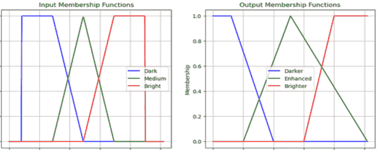

*图 7.14 – 模糊隶属函数*

下图显示了使用模糊 HEQ 获得的增强图像，以及并排的原始图像：

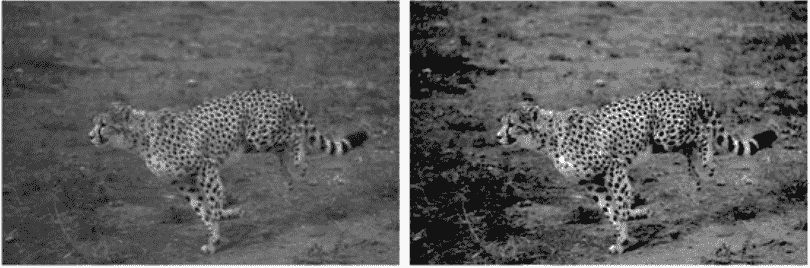

*图 7.15 – 模糊直方图均衡化*

让我们现在尝试理解上述代码片段的工作原理：

- **输入/输出 MFs**：根据输入图像范围动态缩放。
- **可视化**：显示 MF 绘图和增强图像输出。
- `fuzzy_enhance_pixel`：使用 `fuzz.interp_membership()` 执行模糊化，通过计算像素值属于每个模糊集合的强度来执行模糊化。对单个像素执行模糊化、推理、聚合和去模糊化。它使用 `np.fmin()` 进行 Mamdani 风格的规则应用（先验和后验之间的最小值）。它使用 `np.fmax()` 聚合规则输出。它使用 `fuzz.defuzz()` 进行基于质心的去模糊化。

- `fuzzy_image_enhancement`：遍历所有像素并应用增强。
- **动态隶属函数**：输入模糊集合根据图像强度范围（img_min、img_max）缩放，使其自适应。
  输出 MF 保持固定，但可以修改以调整对比度增强。
- **映射**：输入到输出的映射是通过预定义的模糊规则实现的。每个输入区域都与特定的变换（更暗、增强或更亮）相关联，通过相应的输出 MF。

模糊对比度增强的优点包括以下内容：

- 自适应于图像特征（最小值/最大值）
- 保留精细细节
- 避免过度增强和伪影
- 人类可理解的规则和推理

## 直方图匹配

**直方图匹配**是一种过程，其中图像被改变，使其直方图与另一个参考（**模板**）图像的直方图相匹配。其用例包括以下内容：

- **遥感**：归一化来自不同传感器的卫星图像
- **医学成像**：标准化在不同条件下拍摄的扫描
- **摄影**：匹配在不同光线或相机下拍摄的照片的美学

算法如下：

1. 如以下图所示，为每个图像计算累积直方图
2. 对于输入图像（待调整）中的任意给定像素值 $x_i$，我们需要在输出图像中找到相应的像素值 $x_j$，通过将输入图像的直方图与模板图像的直方图匹配
3. $x_i$ 像素值具有由 $G(x_i)$ 给出的累积直方图值。找到像素值 $x_j$，使得参考图像中的累积分布值，即 $H(x_j)$，等于 $G(x_i)$。
4. 输入数据值 xi 被 $x_j$ 替换

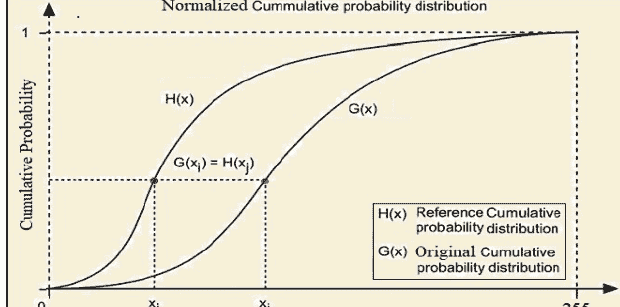

图 7.16 – 直方图匹配

## 使用 scikit-image

如解释的那样，直方图匹配调整一个图像（源）的颜色分布以匹配另一个图像（参考）的颜色分布，基于它们的直方图。此过程对于校正光照不一致或在图像数据集中实现一致的视觉外观特别有用。

下一个代码片段使用 skimage.exposure 模块中的 match_histograms() 函数。函数 match_histograms() 在 RGB 通道中独立匹配源和参考图像的累积分布函数（CDF）。这里，channel_axis=-1 告诉函数图像数组的最后一个维度表示颜色通道。执行的变换为：

p' = F_r^{-1}(F_s(p))

其中 F_s 和 F_r 分别是源和参考的 CDF，p 是源图像中的像素强度。这确保输出图像中的强度值具有与参考相似的直方图。现在，参考下一个代码片段：

```
from skimage.exposure import match_histograms
# Read source and reference images
source = imread('images/me.png')[..., :3]      # Image to correct
reference = imread('images/lena.jpg')[..., :3]  # Image with desired color profile
# Match histograms across RGB channels
matched = match_histograms(source, reference, channel_axis=-1)
```

```
matched = np.clip(matched, 0, 255).astype(np.uint8)
# plot images (source, reference and matched) here
```

如果运行上述代码片段并绘制图像，您应该获得如下图所示的图像：

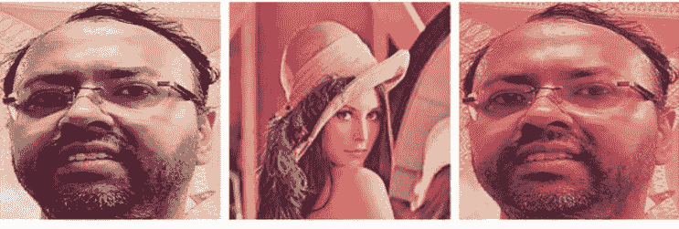

图 7.17 – 使用 scikit-image 的直方图匹配

skimage.exposure 模块中的函数 histogram() 和 cumulative_distribution() 可用于获取图像的直方图和 CDF（参考 GitHub 笔记本）。

## 颜色增强

颜色增强是数字图像处理中的一个基本步骤，用于改善视觉质量、校正不平衡或产生风格化效果。与操作像素强度的亮度或对比度调整不同，颜色增强侧重于调整图像的饱和度和色度内容。颜色由 RGB 图像中红色、绿色和蓝色通道的组合定义，可以增强或减弱以更好地与人类感知或视觉意图保持一致。增强颜色可以使图像看起来更鲜艳，而降低饱和度可以唤起微妙的艺术情绪。

Python 的 PIL.ImageEnhance 模块为调整颜色饱和度提供了一个简单而强大的接口。以下是演示颜色增强和去饱和的快速示例：

```
img = Image.open("images/parrot.jpg")
enhancer = ImageEnhance.Color(img)
colorful = enhancer.enhance(1.8)
desaturated = enhancer.enhance(0.3)
plt.imshow(np.hstack((img, colorful, desaturated))), plt.axis('off')
```


如果你运行上述代码片段，你应该会得到下图：

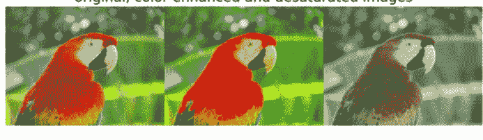

图 7.18 – 使用PIL进行颜色增强

## 使用白平衡算法进行颜色校正

白平衡旨在确保场景中的白色在图像中呈现为白色，以补偿光源的色温。以下是一些常用的算法：

- **灰度世界**：假设平均反射率为灰色，即在中性光照下R、G、B的平均强度应相等，并将每个通道缩放，使其平均值与全局平均值相等：$scale_c = \frac{avg_{gray}}{avg_c}$。
- **白平衡（逐通道百分位裁剪）**：独立调整每个R、G、B通道，并裁剪最低和最高百分位（例如0.05%和99.95%）以去除异常值。它将像素值线性重映射到[0, 255]范围：
  
  $$channel = \left(\frac{I - min}{max - min}\right) \times 255,$$
  
  并逐通道去除阴影和高光以归一化亮度。
- **白斑**：假设每个通道中最亮的像素应代表白色，并将每个通道缩放以使其最大强度变为255（$scale_c = \frac{255}{max_c}$）。
- **白斑百分位变体**：与白斑算法思路相同，但使用第95百分位代替绝对最大值。它对于噪声或孤立的镜面高光更加鲁棒。
- **灰度深浅（Minkowski范数）**：通过计算RGB强度的**Minkowski范数**来推广灰度世界算法：
  
  $$Wc = \left(\frac{1}{N}\sum_{i=1}^{N} (I_c(i))^p\right)^{\frac{1}{p}}$$

它在不同光照条件下适应性更强（实践中 $p \approx 6$ 效果良好）。它通过这个估计的光源来归一化每个通道。

下面的代码片段演示了使用上述经典算法进行*白平衡校正*，每种算法都旨在通过调整RGB通道来中和图像的色偏，以模拟理想光照（白光）：

```
# white balance for every channel independently
def white_balance(channel, perc = 0.05):
    mi, ma = (np.percentile(channel, perc), \
              np.percentile(channel,100.0-perc))
    channel = np.uint8(np.clip((channel-mi)*255.0/(ma-mi), 0, 255))
    return channel

image = imread("images/flowers.png")[..., :3]  # load color
balanced  = np.dstack([white_balance(channel, 0.05) \
                       for channel in cv2.split(image)])
# plot image and balanced side-by-side here
def gray_world(img):
    img = img.astype(np.float32)
    avg_rgb = np.mean(img, axis=(0, 1))
    avg_gray = np.mean(avg_rgb)
    scale = avg_gray / avg_rgb
    balanced = img * scale
    balanced = np.clip(balanced, 0, 255).astype(np.uint8)
    return balanced

def white_patch(img):
    img = img.astype(np.float32)
    max_rgb = np.max(img, axis=(0, 1))
    scale = 255 / max_rgb
    balanced = img * scale
    balanced = np.clip(balanced, 0, 255).astype(np.uint8)
    return balanced

def white_patch_percentile(img, percentile=95):
    img = img.astype(np.float32)
    scale = 255 / np.percentile(img, percentile, axis=(0, 1))
    balanced = img * scale
    balanced = np.clip(balanced, 0, 255).astype(np.uint8)
    return balanced
```

```python
def shades_of_gray(img, p=6):
    img = img.astype(np.float32)
    rgb_power = np.power(img, p)
    mean_power = np.mean(rgb_power, axis=(0, 1))
    illuminant = np.power(mean_power, 1/p)
    scale = np.mean(illuminant) / illuminant
    balanced = img * scale
    balanced = np.clip(balanced, 0, 255).astype(np.uint8)
    return balanced

plt.imshow(np.hstack((image, gray_world(image), white_patch(image), \
                     white_patch_percentile(image),
                     shades_of_gray(image))))
```

如果你运行上述代码片段，你应该会得到下图：

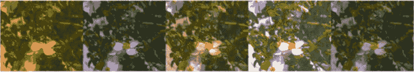

*图 7.19 – 使用白平衡算法进行颜色校正*

## 线性噪声平滑

线性（空间）滤波通过计算局部邻域内像素强度的加权和来运作。设$f(x,y)$表示输入图像，$g(x,y)$表示滤波后的输出。线性滤波器的定义如下：

$$g(x,y)=\sum_{i=-k}^{k}\sum_{j=-k}^{k} h(i,j)f(x-i,y-j)$$

其中$h(i,j)$是大小为$(2k+1)\times(2k+1)$的滤波器核（掩码），该操作对应二维离散卷积，可简写为$g=f*h$。线性滤波被广泛用于**噪声抑制（平滑）**，因为它会衰减图像中的高频成分。如果将观测图像建模为：

$$f(x,y)=s(x,y)+n(x,y)$$

其中$s(x,y)$是真实信号，$n(x,y)$是加性噪声，那么线性平滑通过对相邻像素取平均来降低$n(x,y)$的方差。因此，模糊通常被用作*预处理步骤*，在更高层次分析之前去除细小、无关的细节和噪声。

盒式滤波器是最简单的线性平滑算子，其所有权重都相等：

$$h(i,j)=\frac{1}{(2k+1)^2},\qquad \forall(i,j)$$

因此，滤波后的图像变为：

$$g(x,y)=\frac{1}{(2k+1)^2}\sum_{i=-k}^{k}\sum_{j=-k}^{k}f(x-i,y-j)$$

盒式滤波器具有以下效果：

- 每个像素被替换为局部**均值**
- 通过平均降低随机噪声
- 导致**边缘模糊**，因为尖锐的过渡被平滑化

一种更高级的线性滤波器使用高斯核：

$$h(i,j)=\frac{1}{2\pi\sigma^2}\exp\left(-\frac{i^2+j^2}{2\sigma^2}\right)$$

从而得到：

$$g(x,y)=\sum_{i=-k}^{k}\sum_{j=-k}^{k}h(i,j)f(x-i,y-j)$$

这里，权重随距离呈指数衰减，赋予邻近像素更大的重要性，并产生比盒式滤波器更平滑、更自然的模糊效果。

增大核大小$(2k+1)$或高斯标准差$\sigma$：

- 增强平滑效果
- 降低噪声方差
- 但也会移除精细细节

接下来的章节将演示如何对图像应用线性噪声平滑，首先使用`PIL.ImageFilter`类，然后使用`scipy.ndimage`模块的滤波函数。

## 使用盒式模糊核进行平均平滑

使用`PIL.ImageFilter.Kernel()`，盒式滤波器通过离散核实现，例如：

$$h=\frac{1}{9}\begin{bmatrix}1&1&1\\1&1&1\\1&1&1\end{bmatrix}$$

更大的核（例如5×5、7×7）对应于公式中$k$的增大，并产生更强的平滑效果。输出图像通过将该核与噪声图像进行卷积得到：

$$g=f*h$$

随着核大小的增大，噪声被更有效地去除，但边缘和精细结构也会变得越来越模糊。

```python
im = Image.open('images/mandrill_spnoise_0.1.jpg')
for n in [3,5]:
    box_blur_kernel = np.reshape(np.ones(n*n),(n,n)) / (n*n)
    im_smoothed = im.filter(ImageFilter.Kernel((n,n), \
                              box_blur_kernel.flatten()))
    # plot the smoothed image here
```

如果你运行上述代码片段并将图像并排绘制，你应该会得到下图。可以看出，盒式模糊核越大，输出图像被平滑得越厉害。

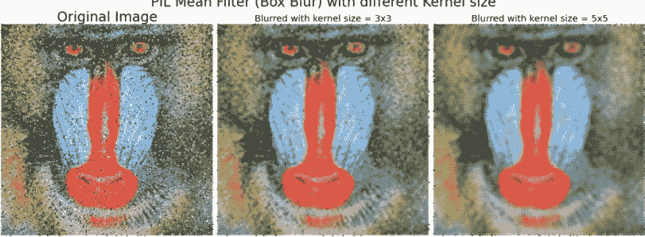

*图 7.20 – 使用不同核大小的盒式模糊滤波器进行去噪*

## 使用高斯模糊滤波器进行平滑

高斯模糊滤波器也是一种线性滤波器，但与简单的均值滤波器不同，它取核窗口内像素的加权平均来平滑某个像素（对应邻居像素的权重随该邻居与中心像素的距离呈指数衰减）。高斯模糊滤波器使用高斯核进行卷积：

g = f * h_σ

其中h_σ是标准差为σ的高斯核

- σ越大 → 核越宽 → 平滑越强
- 噪声逐渐被去除
- 图像细节越发模糊

通过采样二维高斯函数得到5×5的高斯核：

h(i,j) = 1/(2πσ²) exp( - (i² + j²)/(2σ²) ),      i,j ∈ −2,−1,0,1,2

对于常用的σ ≈ 1情况，归一化的5×5核为：

h = 1/273 [1 4 7 4 1; 4 16 26 16 4; 7 26 41 26 7; 4 16 26 16 4; 1 4 7 4 1]

注意

- 该核是对称且可分离的
- 归一化因子（273）确保：Σ_{i,j} h(i,j) = 1
- 中心附近的值较大，赋予邻近像素更高的权重，从而产生平滑、自然的模糊效果。

下面的代码演示了如何使用`PIL.ImageFilter.GaussianBlur()`，通过不同的半径参数值来平滑噪声更大的图像：

```
im = Image.open('images/mandrill_spnoise_0.2.jpg')
for radius in range(1, 4):
    im_smoothed = im.filter(ImageFilter.GaussianBlur(radius))
    # plot the smoothed image here, for the blur-radius of GaussianBlur
```


如果运行上述代码片段并绘制图像，你应该会得到下图。如图所示，使用半径更大的高斯滤波器时，图像会变得更平滑，去除更多噪声，同时也会使图像更模糊。

## 不同半径的 PIL 高斯模糊

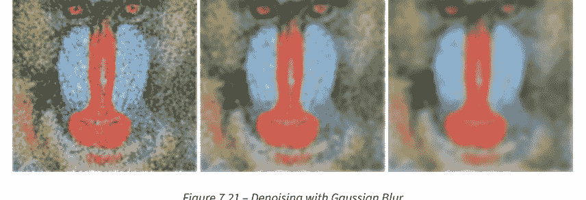

图 7.21 - 使用高斯模糊进行去噪

## 使用 scipy.ndimage 比较盒式和高斯核的平滑

线性滤波也可以使用 scipy.ndimage 模块中的函数来执行，该模块提供了基于卷积的平滑的高效实现。

当应用于受脉冲噪声（椒盐噪声）损坏的图像时，盒式和高斯平滑等线性滤波器产生的改善有限。这是因为脉冲噪声违反了加性噪声假设。

f(x, y) = { 0 or 1,    with probability p
               s(x, y),    otherwise }

在这种情况下，平均会将极端像素值扩散到邻近区域，导致模糊而没有有效去除噪声。这一局限性促使使用非线性滤波器（例如中值滤波），将在后续章节中讨论。

以下代码片段显示了对受脉冲（椒盐）噪声退化的猩猩图像应用线性滤波器的结果：

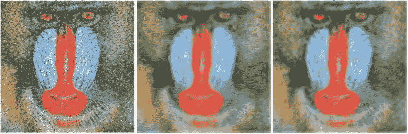

*图 7.22 – 使用 `scipy.ndimage` 高斯和盒式滤波器的平滑*

前一幅图显示了前一段代码的输出。如图所示，相同核大小的盒式滤波器比 σ = 2 的相同大小高斯滤波器使输出图像更模糊。

## 非线性噪声平滑

非线性（空间）滤波器与线性滤波器一样，通过在图像上滑动核（掩模）来操作局部邻域。然而，与计算加权和的线性滤波不同，非线性滤波器对邻域内的像素值应用**非线性函数**。

设 *f(x, y)* 表示输入图像，𝒩ₓ,ᵧ 表示以 (x, y) 为中心的邻域。一般非线性滤波器可表示为：**g(x, y) = Φ({f(s, t) | (s, t) ∈ 𝒩ₓ,ᵧ})**，其中 Φ(·) 是非线性算子（例如中值、众数、最大值等）。非线性滤波器比线性滤波器更强大；例如，在抑制非高斯噪声如尖峰方面，以及在边缘/纹理保持特性方面。非线性滤波器的一些例子有中值、双边、非局部均值和形态学滤波器。

**中值滤波器**用其邻域的中值替换每个像素：

$$g(x,y) = \operatorname{median} f(s,t) \mid (s,t) \in \mathcal{N}_{x,y}$$

中值滤波器

- 需要对邻域内强度进行**排序（排序）**
- 选择**中间值**而不是平均
- 对异常值具有鲁棒性，因为极端值不会显著影响中值

椒盐噪声可以建模为：

$$f(x,y) = \begin{cases} 0, & \text{with probability } p/2 \\ 1, & \text{with probability } p/2 \\ s(x,y), & \text{Otherwise} \end{cases}$$

由于脉冲噪声引入了**极端异常值**，中值算子有效地将其去除：

$$\text{median}0,,s(x,y),,1 \approx s(x,y)$$

其特性如下：

- 非线性：median(a + b) ≠ median(a) + median(b)
- 比线性平均更好地保持边缘
- 对于较大的核大小可能会引入**斑块区域**

**众数滤波器**用邻域中最频繁的强度值替换每个像素。

$$g(x,y) = \text{mode} f(s,t) \mid (s,t) \in \mathcal{N}_{x,y}$$

该滤波器适用于像素值**聚集**的情况，它鼓励**区域同质性**，并且增大核大小会增加平滑但降低纹理细节。

**最大值和最小值滤波器**基于极值选择：

$$g_{\max}(x,y) = \max f(s,t) \mid (s,t) \in \mathcal{N}_{x,y},...,g_{\min}(x,y) = \min f(s,t) \mid (s,t) \in \mathcal{N}_{x,y}$$

- **最大值滤波器**去除 *椒噪声*（暗脉冲）
- **最小值滤波器**去除 *盐噪声*（亮脉冲）
- 最大值和最小值滤波器对应于灰度形态学运算

膨胀：$g(x,y) = \max_{\mathcal{N}_{x,y}} f(s,t)$

腐蚀：$g(x,y) = \min_{\mathcal{N}_{x,y}} f(s,t)$

下表提供了线性滤波器与非线性滤波器比较的总结：

| 属性 | 线性滤波器 | 非线性滤波器 |
|---|---|---|
| 操作 | 加权和 | 非线性函数 |
| 噪声模型 | 高斯 | 脉冲/非高斯 |
| 边缘保持 | 差 | 更好 |
| 对异常值的鲁棒性 | 低 | 高 |

*表 7.5 - 线性与非线性滤波器的比较*

当噪声偏离高斯假设时，非线性滤波器特别有效。通过依赖**顺序统计或极值**，它们抑制异常值，同时保留边缘和纹理等重要图像结构。

以下各节演示了使用 PIL、scikit-image 和 scipy.ndimage 库函数实现一些非线性滤波器。

## 使用 PIL 进行平滑

PIL.ImageFilter 模块提供了一组用于图像非线性去噪的函数。在本节中，我们将通过示例演示其中一些。

### 使用中值滤波器

中值滤波器用邻域像素值的中值替换每个像素。该滤波器非常适合去除椒盐噪声，尽管它会去除图像中的小细节。我们需要首先对邻域强度进行排序，然后选择中间值。中值滤波对统计异常值具有弹性，模糊较少，且实现简单。下一代码块显示了如何使用

PIL.ImageFilter 模块的 MedianFilter() 函数，使用不同水平的噪声添加和用于中值滤波的不同大小的核窗口，从带噪声的猩猩图像中去除椒盐噪声。以下图显示了前一段代码的输出，对带不同水平添加噪声的噪声图像应用中值滤波后的输出图像，使用不同的核大小。如图所示，非线性中值滤波器对于脉冲（椒盐）噪声比线性均值和加权均值（高斯）滤波器效果好得多，尽管有一些斑块效应和细节损失。

```
prop_noise = 0.1 # proportion of pixels to add salt & pepper noise to
im = Image.open('images/mandrill.jpg')
n = int(im.width * im.height * prop_noise) # choose random locations
x, y = np.random.randint(0, im.width, n), np.random.randint(0, im.height, n)
for (x,y) in zip(x,y):
    im.putpixel((x, y), ((0,0,0) if np.random.rand() < 0.5 else \
    (255,255,255))) # generate salt-and-pepper noise
for sz in [3,7,11]:
    im_denoised = im.filter(ImageFilter.MedianFilter(size=sz))
    # plot the denoised image here
```

### 使用最大值和最小值滤波器

以下代码显示了如何使用 MaxFilter() 去除椒盐噪声，然后使用 MinFilter() 去除图像中的盐噪声。下一幅图显示了前一段代码块的输出。可以看出，最大值和最小值滤波器在分别去除噪声图像中的椒盐噪声方面具有一定的效果。

```
im = Image.open('images/mandrill_spnoise_0.1.jpg')
sz = 3
im_max_out = im.filter(ImageFilter.MaxFilter(size=sz))
im_min_out = im.filter(ImageFilter.MinFilter(size=sz))
```

如果运行上述代码片段并绘制滤波后的图像以及输入图像，你应该会得到以下图：

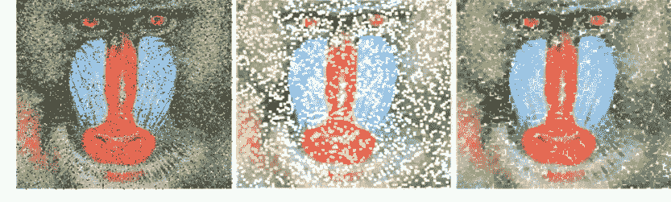

图 7.25 - 应用 PIL 最大值和最小值滤波器

## 使用 scikit-image 进行平滑（去噪）

scikit-image 库也在 restoration 模块中提供了一组非线性滤波器。在以下各节中，我们将讨论其中几个非常有用的滤波器，即双边滤波器和非局部均值滤波器。

### 使用双边滤波器

双边滤波器通过在加权方案中结合空间邻近性和强度相似性来实现边缘保持平滑。设 f(x, y) 表示输入图像。像素 (x, y) 处的滤波输出 g(x, y) 给出为：

g(x,y) = 1/W(x,y) Σ_{(s,t)∈N_{x,y}} exp(-((x-s)²+(y-t)²)/(2σ_s²)) exp(-((f(x,y)-f(s,t))²)/(2σ_r²)) f(s,t)

- (s, t) ∈ N_{x,y} 为邻近像素


-   第一个指数编码空间邻近性（由 σₛ 控制）
-   σₛ 控制空间衰减（图像平面中的距离）
-   第二个指数编码 **强度相似性**（由 σᵣ 控制）
-   σᵣ 控制 **范围（强度）相似性**
-   W(x, y) 是一个归一化因子，确保权重之和为 1。

直观上，与线性滤波器（如高斯模糊）对所有邻近像素进行平均不同，双边滤波器仅选择性地对那些在空间上接近且强度相似的邻居进行平均。因此，跨越边缘的像素（具有较大的强度差异）会获得可忽略的权重，从而防止在边界处进行平滑处理。这使得滤波器能够在保持尖锐边缘的同时 **减少均匀区域中的噪声**，使其对于需要在保留结构和细节的自然图像特别有效。

现在让我们从以下灰度山脉图像创建一个带噪声的图像。以下代码片段演示了如何使用 np.random_noise() 函数：

```python
im = color.rgb2gray(img_as_float(io.imread('images/mountain.png')))
sigma = 0.155
noisy = random_noise(im, var=sigma**2)
```

下图显示了通过向原始图像添加随机噪声而创建的带噪声图像。

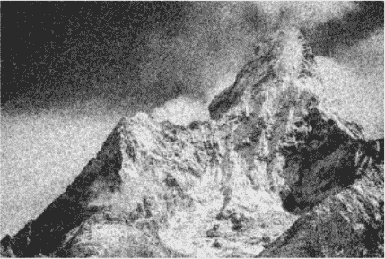

*Figure 7.26 – Noisy mountain image*

以下代码片段演示了如何使用双边滤波器对之前的带噪声图像进行去噪，并使用参数 σ_color 和 σ_spatial 的不同值。注意，scikit-image 中的 sigma_color 对应于 σᵣ（强度相似性），而 sigma_spatial 对应于 σₛ（空间邻近性）。

## 使用非局部均值

**非局部均值 (NLM)** 是一种非线性去噪方法，利用图像块的 **自相似性。** 对于输入图像 $f(x,y)$，像素 $(x,y)$ 处的恢复值计算为在（通常较大）搜索窗口 $\Omega$ 上加权平均：

```
g(x,y) = 1/Z(x,y) \sum_{(s,t)\in\Omega} w((x,y),(s,t)) f(s,t), \quad Z(x,y) = \sum_{(s,t)\in\Omega} w((x,y),(s,t))
```

其中权重取决于块相似性：

```
w((x,y),(s,t)) = exp\!\left(-\frac{\|P_{x,y} - P_{s,t}\|_2^2}{h^2}\right)
```

其中 $P_{x,y}$ 和 $P_{s,t}$ 表示以 $(x,y)$ 和 $(s,t)$ 为中心的矢量化块（例如 $k \times k$ 邻域），而 $h > 0$ 控制权重的衰减。

NLM 不是仅对邻近像素进行平均，而是对周围块看起来相似的像素进行平均，即使它们在图像中相距很远。因此，重复纹理得以保留，同时噪声被抑制。参数 $h$ 控制选择性：**$h$ 小 → 只有非常相似的块才有贡献（更好的细节保留）**，**$h$ 大 → 更多块有贡献（更强的平滑但可能丢失纹理）**。

让我们现在演示如何使用 skimage 的 NLM 滤波器实现对带噪声的鹦鹉图像进行去噪，使用以下代码片段。scikit-image 中的 denoise_nl_means() 函数通过对具有相似块的像素进行平均来执行非局部均值去噪；这里，patch_size=5 定义了 5×5 比较块，patch_distance=6 设置了搜索窗口（≈13×13），h 参数控制权重的衰减（平滑强度），fast_mode=False 使用准确但较慢的算法，而 channel_axis=-1 表示图像通道维度。

函数中的 h 参数控制块权重随块间距离的衰减。如果 h 很大，则允许在不相似的块之间进行更多平滑。

```
parrot = img_as_float(imread('images/parrot.jpg'))
sigma = 0.25
noisy = parrot + sigma * np.random.standard_normal(parrot.shape)
noisy = np.clip(noisy, 0, 1)
sigma_est = np.mean(estimate_sigma(noisy, channel_axis=-1))
patch_kw = dict(patch_size=5,     # 5x5 patches
                patch_distance=6, # 13x13 search area
                channel_axis=-1)
```

| Aspect | Bilateral filter | Non-local means (NLM) |
|---|---|---|
| Texture preservation | Limited | Very strong |
| Noise handling | Effective for moderate Gaussian noise | Very effective for Gaussian + structured noise |
| Impulse noise | Less effective | Moderate (median often better) |
| Computation cost | Low to moderate | High |
| Parameters | (\(\sigma_s\)) (spatial), (\(\sigma_r\)) (range) | (h), patch size (k), search window (s) |
| Scalability | Fast, suitable for real-time | Slower; may require optimization |
| Artifacts | Can produce cartoon-like smoothing | Can oversmooth if h is large |
| Best use cases | Edge-preserving smoothing, quick denoising | Texture-rich images, high-quality denoising |
| Implementation complexity | Simple | More complex |
| One-line summary | Fast, local, edge-preserving smoothing | Slow, non-local, texture-preserving denoising |

*Table 7.6 – A comparison of bilateral and NLM filter*

正如输出图像所示，算法的慢版本实现了比快速版本更好的 PSNR，代表了一种权衡。两种算法输出图像的 PSNR 都远高于带噪声图像。

## 使用 scipy.ndimage 进行百分位滤波平滑

`scipy.ndimage` 中的 `percentile_filter()` 函数通过从每个像素邻域中选择指定百分位来推广顺序统计滤波器。设 $f(x,y)$ 表示输入图像，$N_{x,y}$ 为大小为 $m=(2k+1)^2$ 的邻域。定义邻域中强度的有序集合：

\[f_{(1)}, f_{(2)}, \ldots, f_{(m)}, \qquad \text{where } f_{(1)} \le f_{(2)} \le \cdots \le f_{(m)}\]

百分位滤波器输出由下式给出：

\[g(x,y)=f_{(r)}, \qquad \text{where } r=\left\lceil\frac{p}{100}\cdot m\right\rceil\]

其中 *p* ∈ [0,100] 是选择的百分位。特殊情况包括以下：

- *p* = 50 → 中值滤波器：*g(x, y) = median(𝒩ₓ,ᵧ)*
- *p* = 0 → 最小值滤波器：*g(x, y) = min(𝒩ₓ,ᵧ)*
- *p* = 100 → 最大值滤波器：*g(x, y) = max(𝒩ₓ,ᵧ)*

百分位滤波器根据强度的 **秩（顺序）** 选择值，使其对异常值具有鲁棒性。对于脉冲（盐胡椒）噪声，极值（0 或 1）占据最低或最高秩，因此当 *p* ≈ 50 时会被拒绝。这解释了为什么中值滤波器（第 50 百分位）能有效去除此类噪声，同时比线性平均滤波器更好地保留边缘。

以下代码片段演示了如何使用此滤波器：

```
lena = imread('images/lena.jpg')
noise = np.random.random(lena.shape) # add salt-and-pepper noise to input
lena[noise > 0.9] = 255
lena[noise < 0.1] = 0
for p in range(25, 100, 25):
    for k in range(5, 25, 5):
        filtered = ndimage.percentile_filter(lena, percentile=p,
                                             size=(k,k,1))
        # plot the filtered image here
```

如果运行上述代码片段并绘制图像，您应该会得到以下图。如图所示，较低或较高的百分位倾向于使输出偏向较暗或较亮的值，而中值（*p* = 50）则提供平衡估计。在较小的核尺寸下，它实现了噪声 **抑制** 与细节保留之间的有效权衡，使其特别适用于受脉冲噪声污染的图像。

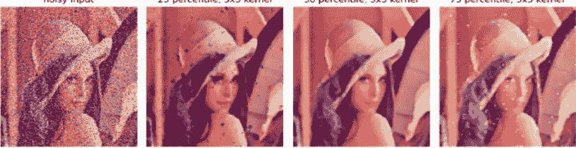

*Figure 7.29 – Denoising image with scipy.ndimage’s percentile filter*

## 交互式图像增强应用

在本节中，我们将使用 Python 的 Streamlit 库和模块化增强后端构建并解释一个实时交互式图像增强工具。如前所述，图像增强涉及改善视觉质量或突出特定特征。基于直方图的方法广泛用于此任务。该应用支持全局直方图均衡化（GHE）、亮度保持双直方图均衡化（BBHE）、最大熵 BBHE（BPHEME）、范围限制双直方图均衡化（RLBHE）、量化 BBHE（QBHE）以及带色彩保持的自适应伽马校正（AGCCPF）。

每种方法都有特定的益处，具体取决于图像内容和增强目标。要成功运行 app.py，您必须安装 image-enhancement 库，该库提供了应用使用的核心图像处理算法（如 GHE、BBHE 等）。

应用架构：下图显示了基本应用架构的示意图：

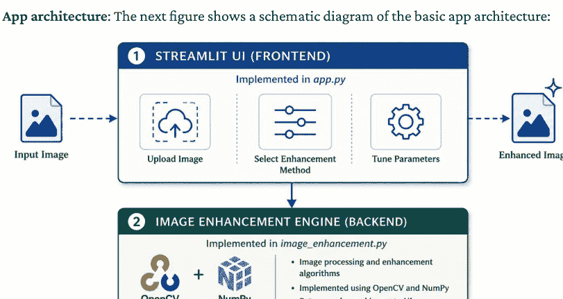

*Figure 7.30 – High-level architecture of the Streamlit application for image enhancement*

用户与 Streamlit UI（app.py）交互以上传图像、选择增强方法并调整参数。请求由使用 OpenCV 和 NumPy 实现的图像增强引擎（image_enhancement.py）处理，并将增强后的图像返回给用户。此架构突出了 UI 逻辑（Streamlit）与处理逻辑（增强引擎）之间的分离，从而实现模块化和易于扩展。


文件 app.py 作为您使用 Streamlit 构建的交互式图像增强工具的主应用程序脚本。它将用户输入（通过 Streamlit）和后端处理（通过 image_enhancement 模块）结合起来，为交互式尝试不同的图像增强技术构建响应迅速且直观的 GUI。以下是它的简要说明。

Python 脚本 app.py 创建了一个图形化 Web 界面，允许用户：

- 上传一张图像
- 从列表中选择图像增强方法
- 可选地调整方法特定的参数（如分箱数或 alpha）
- 查看原始图像与增强图像之间的实时视觉对比

下表总结了关键函数，如下一段代码所示：

| Section | Functionality |
|---|---|
| `st.file_uploader(...)` | 允许用户上传图像 |
| `Image.open(...), cv2.cvtColor()` | 读取并转换图像以进行处理 |
| `image_enhancement.IE(...)` | 初始化图像增强引擎（来自单独的 Python 模块） |
| `st.selectbox(...)` | 允许用户选择增强算法（启用模型选择） |
| `st.slider(...)` | 允许用户为所选方法动态调整参数 |
| Conditional if-elif block | 将所选增强方法应用于上传的图像 |
| `cv2.cvtColor(...)` again | 将结果从 BGR 转换为 RGB，以便在 Streamlit 中正确显示 |
| `st.columns(...) + st.image(...)` | 并排显示原始图像和增强图像 |

*Table 7.7 – Summary of the key functions in app.py*

其工作原理如下（高层流程）：

1. 用户上传图像
2. 用户选择增强方法
3. 可选滑块出现（如果方法需要参数）
4. 应用使用所选增强方法处理图像
5. 原始图像和增强图像并排显示

现在，参考下面 app.py 的代码：

```
## app.py
import streamlit as st
from image_enhancement import image_enhancement

st.title("📸 Selective Image Enhancement with Streamlit")
uploaded = st.file_uploader("Upload an Image", type=['png', 'jpg', 'jpeg'])
if not uploaded:  st.stop()
img = np.array(Image.open(uploaded).convert('RGB'))  # PIL to OpenCV BGR
bgr = cv2.cvtColor(img, cv2.COLOR_RGB2BGR)
ie = image_enhancement.IE(bgr, color_space='HSV')
method = st.selectbox("Enhancement Method", ["Global HE (GHE)", "Brightness Preserving HE (BBHE)"])  # refer git to more methods
bins, alpha = None, None
if method == "Quantized BBHE (QBHE)":
    bins = st.slider("Number of Gray Levels (QBHE)", \
        min_value=2, max_value=256, value=128)
elif method == "Adaptive Gamma ColorPreserving (AGCCPF)":
    alpha = st.slider("Alpha (AGCCPF)", min_value=0.0, \
        max_value=5.0, value=1.0)
if method == "Global HE (GHE)": out = ie.GHE()  # refer git to more methods
elif method == "Brightness Preserving HE (BBHE)": out = ie.BBHE()
enhanced = cv2.cvtColor(out, cv2.COLOR_BGR2RGB)
col1, col2 = st.columns(2)
with col1: st.image(img, caption="Original Image", use_column_width=True)
with col2: st.image(enhanced, caption="Enhanced Image", use_column_width=True)
```

从 Jupyter Notebook 单元格内部或从控制台运行以下命令以运行应用程序：

```
! python -m streamlit run app.py
```

它默认在 localhost:8501 打开一个浏览器窗口（或指定的端口）。现在，上传一张图像并交互式尝试不同的增强效果。下一张截图显示了应用程序的外观：

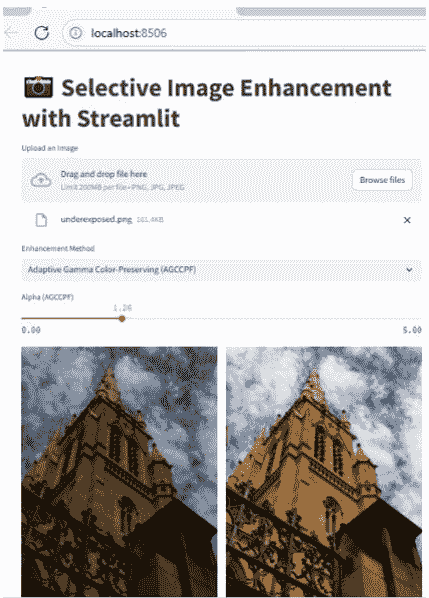

*Figure 7.31 – Streamlit app for image enhancement*

主要优势包括以下内容：

- **Modular Design:** 可轻松扩展以添加新的增强方法
- **Streamlit Integration:** 快速部署，支持滑块、文件上传和图像显示
- **Interactive UI:** 参数调整的即时反馈
- **Color Space Flexibility:** 可适应不同类型的视觉输入（HSV、YCrCb 等）

强烈建议读者通过集成以下附加功能来增强此应用程序的功能：

- 支持更多增强算法（例如，CLAHE、Retinex、去雾）
- 直方图实时可视化
- 批量图像处理
- 增强输出的下载按钮
- 性能指标，如熵或对比度评分

该应用程序的模块化架构使其易于扩展和定制。将此应用程序视为构建更强大、更具交互性的图像增强工具的基础！

## Denoising with BM3D

图像去噪是图像处理中的一项基本任务，旨在从噪声观测中恢复原始图像。**Block-Matching and 3D (BM3D)** 滤波，由 Dabov 等人于 2007 年提出，是一种最先进的去噪算法，以其在有效去除噪声的同时保留边缘和纹理的能力而闻名。本节全面解释了 BM3D，包括其理论、数学公式和 Python 实现。

设噪声图像 $y$ 被建模为 $y = x + n$，其中 $x$ 是原始干净图像，$n$ 是加性高斯白噪声（AWGN），其标准差为（有关深入讨论，请参阅图像恢复章节）。

BM3D 在两个主要阶段运行：

- **Basic estimate**（硬阈值）：分组相似的块，执行协作 3D 滤波，通过变换域中的硬阈值
- **Final estimate**（维纳滤波）：使用基本估计执行维纳滤波以获得更好的精度

总体 BM3D 去噪流程由三个基本操作组成，即块匹配、协作滤波和聚合，这些操作在上述两个估计阶段中迭代执行：

- **Block matching:** 在图像中查找相似的 2D 块 {$P_i$}。这些块堆叠成 3D 数组：[$P_i^1$, $P_i^2$, ..., $P_i^k$]。
- **Collaborative filtering:** 应用 3D 线性变换（例如，2D DCT + 1D Haar）。执行阈值或维纳滤波。逆变换得到去噪块。
- **Aggregation:** 重叠块使用加权平均聚合以形成最终图像。

要在 Python 中使用 BM3D，让我们首先按下一段代码所示安装 bm3d 库：

```
import bm3d  # first install with !pip install bm3d
image_path = 'images/mandrill_spnoise_0.3.jpg'  # Load a noisy image
noisy_image = img_as_float(io.imread(image_path))
denoised = bm3d.bm3d(noisy_image, sigma_psd=0.2, \
                    stage_arg=bm3d.BM3DStages.ALL_STAGES)
# Display the results here
```

如果您运行上述代码片段并绘制输入和输出图像，您应该得到以下图：

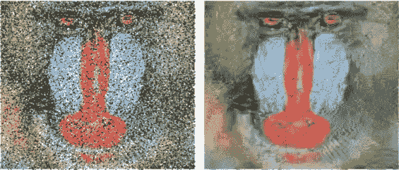

*Figure 7.32 – Denoising with BM3D*

前面的代码片段演示了如何评估和可视化 BM3D 去噪算法在不同噪声标准差（sigma_psd）设置下的性能，使用标准图像质量指标，如 **PSNR** 和 **Structural Similarity Index Measure (SSIM)**。以下是关键步骤：

- 向干净的灰度图像添加合成噪声
- 使用一系列 sigma_psd 值用 BM3D 进行去噪
- 评估去噪后的图像质量
- 可视化结果；原始、噪声和多个去噪输出显示在子图网格中，并附带其关联的 σ 值

**Core functions:**

- `bm3d.bm3d(...)`: 应用完整的 BM3D 去噪流程
- `peak_signal_noise_ratio(...)`: 衡量去噪图像与原始图像的接近程度（越高越好）
- `structural_similarity(...)`: 评估结构相似性（接近 1 的值更好）
- `plt.imshow(...)`: 显示每个结果以便比较

现在，向灰度 cameraman 图像（来自 `skimage.data`）添加高斯噪声，并使用不同的 sigma_psd 值应用 BM3D 去噪，并将您的 PSNR 和 SSIM 结果与 GitHub 笔记本中的我的参考实现进行比较。您应该得到如下图所示：


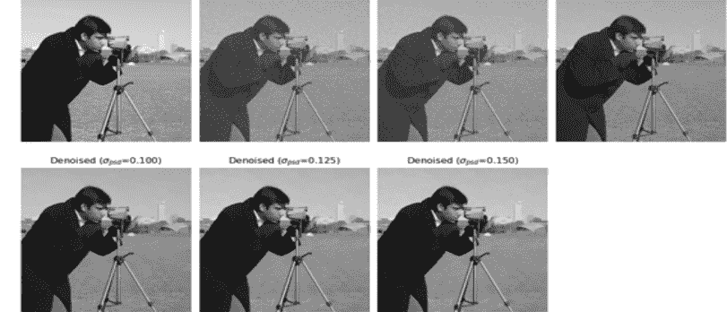

> Figure 7.33 – Denoising with BM3D with different noise variances

BM3D 在去噪方面提供了最先进的质量，能够保留边缘、精细细节和纹理，并能有效处理高低噪声水平。然而，与更简单的方法相比，它计算密集，且需要准确的噪声水平估计。

## Wavelet-based image fusion and enhancement

图像融合将同一场景的多个图像组合成一幅包含更多有意义信息的单幅增强图像。它在医学成像、遥感以及摄影中的曝光融合等应用中特别有用。基于小波变换的图像融合是一种广泛使用的多分辨率方法，它将输入图像分解为频率子带并使用融合规则进行组合。然后使用逆变换重建融合图像。本节详细介绍了基于小波的图像融合的数学解释、直觉以及 Python 实现。

## Discrete wavelet transform

离散小波变换（DWT）将图像分解为近似系数和细节系数：

- 近似系数（LL）：低频分量
- 细节系数（LH, HL, HH）：分别在水平、垂直和对角方向上的高频分量

设 f(x, y) 为大小为 M × N 的输入图像。进行一层 2D DWT 如下：

### Step 1: Row-wise filtering and downsampling

对图像的每一行进行卷积：

- 低通滤波器（h_L[n]），
- 高通滤波器（h_H[n]）

然后将结果下采样 2 倍（保留每第二个采样）：

```
L_r(x, y) = (f * h_L)(x, y) ↓₂
H_r(x, y) = (f * h_H)(x, y) ↓₂
```

这里，* 表示沿行的 1D 卷积。

### Step 2: Column-wise filtering and downsampling

然后将中间结果 L_r 和 H_r 沿列方向与相同的滤波器对 h_L^T 和 h_H^T 进行卷积，随后下采样 2 倍：

```
LL(x, y) = (L_r * h_L^T)(x, y) ↓₂
LH(x, y) = (L_r * h_H^T)(x, y) ↓₂
HL(x, y) = (H_r * h_L^T)(x, y) ↓₂
HH(x, y) = (H_r * h_H^T)(x, y) ↓₂
```

因此，图像被分解为四个子带：LL、LH、HL 和 HH。

这里，h_L^T 和 h_H^T 表示滤波器的转置（用于列方向卷积），而 ↓₂ 表示在相应方向上按因子二下采样。

常见的小波类型包括：

- **Haar (db1)**：最简单的正交小波。它执行基本的平均和差分。
- **Daubechies (dbN)**：具有更多消失矩以实现更平滑近似的正交小波族。

设 I₁ 和 I₂ 为两个输入图像。应用 2D 小波分解后，对系数应用融合规则。融合规则包括：

- **Mean**：平均系数
- **Max**：保留更强的特征
- **Min**：保留更弱的特征

接下来，使用逆 DWT 重建融合图像。

下面的代码演示了使用 DWT 进行图像融合，采用三种不同的融合策略：mean、max 和 min。下面是对代码每个部分的详细解释、其目的以及其工作原理：

- **Pywavelets (Pywt)**：小波变换的 Python 包装器；它支持 wavedec2（2D DWT）和 waverec2（逆 2D DWT）。
- **cv2**：OpenCV，用于图像读取、调整大小和灰度转换。
- **Numpy**：高效的数组操作。
- **Matplotlib.pylab**：用于图像显示和绘图。

函数 fuse_coefficients() 定义了两个小波系数矩阵如何融合。

方法包括以下内容：

- mean：取两个系数的平均值：Cf = (C1+C2)/2
- min：逐元素最小值，有助于抑制亮噪声：Cf = min(C1,C2)
- max：保留最大特征（例如强边缘）：Cf = max(C1,C2)

函数 fuse_images() 实现了图像融合流程。

图像调整大小确保两个图像大小相同（DWT 所需）。2D 小波分解使用选定的小波（默认 db1，即 Haar）执行多级 DWT。它返回：

- coeffs[0]：近似系数（低通）
- coeffs[1:]：细节系数的元组：
  - **Horizontal (LH)**
  - **Vertical (HL)**
  - **Diagonal (HH)**

每个层级将图像分解为融合系数：如果 i == 0，则融合近似系数；否则，融合细节系数。这些保留不同的方向特征（例如 HL 中的垂直边缘）。重建执行逆小波重建：

$I_{fused} = IDWT2(Af, Hf, Vf, Df)$

归一化确保最终图像缩放到 8 位范围 [0, 255]，适合显示。

现在，参考下面的代码片段：

```python
import pywt, cv2
import numpy as np
import matplotlib.pylab as plt

def fuse_coefficients(coeff1, coeff2, method='mean'):
    if method == 'mean':
        return (coeff1 + coeff2) / 2
    elif method == 'min':
        return np.minimum(coeff1, coeff2)
    elif method == 'max':
        return np.maximum(coeff1, coeff2)
    else: raise ValueError("Unsupported fusion method")

def fuse_images(im1, im2, fusion_method, wavelet='db1'): # Daubechies wavelet
    im2 = cv2.resize(im2, (im1.shape[1], im1.shape[0])) # Resize im2 to match im1
    coeffs1 = pywt.wavedec2(im1, wavelet) # Wavelet decomposition
    coeffs2 = pywt.wavedec2(im2, wavelet) # Wavelet decomposition
    # Fuse wavelet coefficients
    fused_coeffs = []
    for i in range(len(coeffs1)):
        if i == 0:
            fused_coeffs.append(fuse_coefficients(coeffs1[0], coeffs2[0], fusion_method)) # Approximation coefficients
        else: # Detail coefficients (horizontal, vertical, diagonal)
            c1 = fuse_coefficients(coeffs1[i][0], coeffs2[i][0], fusion_method)
            c2 = fuse_coefficients(coeffs1[i][1], coeffs2[i][1], fusion_method)
            c3 = fuse_coefficients(coeffs1[i][2], coeffs2[i][2], fusion_method)
            fused_coeffs.append((c1, c2, c3))
    fused_image = pywt.waverec2(fused_coeffs, wavelet) # Reconstruct fused image
    fused_image = 255 * (fused_image - fused_image.min()) / (fused_image.max() - fused_image.min()) # Normalize to 8-bit range
    return fused_image.astype(np.uint8)

im1 = cv2.imread('images/mask.png', cv2.IMREAD_GRAYSCALE) # load images
im2 = cv2.imread('images/dust.png', cv2.IMREAD_GRAYSCALE)
plt.gray() # Show images
plt.imshow(np.hstack((im1, im2, \
    cv2.resize(fuse_images(im1, im2, 'mean'), (im1.shape[1],
        im1.shape[0])),
    cv2.resize(fuse_images(im1, im2, 'max'), (im1.shape[1],
        im1.shape[0])),
    cv2.resize(fuse_images(im1, im2, 'min'), (im1.shape[1],
        im1.shape[0])))))
```

如果运行上述代码片段，你应该得到以下图：

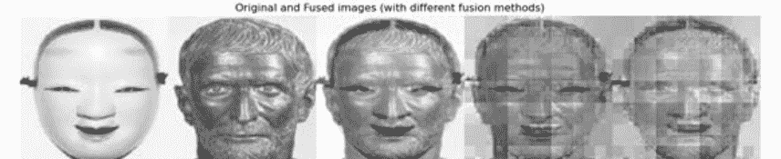

> Figure 7.34 – Image fusion with wavelets

DWT 用于融合的用例包括：

- 在空间和频率上均局部化
- 有效捕获边缘、纹理和平滑区域
- 灵活的融合规则适用于不同的应用（例如视觉对比度、噪声抑制）

## Image enhancement with deep learning models

随着深度学习的出现，图像增强已超越传统算法的局限性，使得数据驱动的恢复和感知质量提升成为可能。在本节中，我们探讨了最先进的深度模型，例如 Zero-DCE、MAXIM、DCP 和 EDSR，展示了它们在低光增强、去噪、去雾和超分辨率方面的强大能力。我们将仅关注使用预训练深度学习模型进行图像增强，而在自定义数据集上训练模型将在后续章节中介绍。

## Low-light image enhancement with Zero-DCE

低光图像增强是许多计算机视觉任务中的关键预处理步骤，尤其是在自动驾驶、监控、医学成像和夜间摄影中。传统的增强方法，如直方图均衡化、伽马校正和 Retinex-based 技术，在应用于严重曝光不足的图像时往往效果不佳，因为会放大噪声、造成色彩失真或过度饱和。

2020 年，Guo 等人引入了一种创新的基于学习的技巧，称为 Zero-Reference Deep Curve Estimation（Zero-DCE），它无需成对训练数据（即低光和真实正常光图像对），而是直接以无监督方式学习增强图像。本节解释了 Zero-DCE 的理论基础、直觉以及使用 PyTorch 的实际实现。

### Enhancement function: iterative curve estimation

Zero-DCE 的核心在于学习一组增强曲线以迭代调整像素强度。

每个像素值 x ∈ [0,1] 使用以下方式增强：

$x_{t+1} = x_t + α_t · x_t · (1 − x_t)$

该表达式可从一般光照调整直觉推导而来：x_t · (1 − x_t) 在中强度处（x=0.5）最大，使得增强能够非线性地自适应。α_t ∈ [−1,1] 由神经网络按像素和迭代学习。

迭代应用该曲线可逐步细化亮度。实际上，作者发现对称变体同样有效；这种形式避免了与 x · (1 − x) 的乘法，但由于其对称性，效果相似。

Zero-DCE 不需要真实图像。相反，它依赖于自正则化损失项：

- 空间一致性损失 L_spa：鼓励输入图像与增强图像之间的结构一致性。
- 曝光控制损失 L_exp：引导平均亮度到参考水平（通常为 0.6）。
- 色彩恒常性损失 L_col：确保 R、G 和 B 通道平衡。
- 光照平滑损失 L_tv：正则化预测的光照图。


总损失为：

$$L_{total} = \lambda_{spa} L_{spa} + \lambda_{exp} L_{exp} + \lambda_{col} L_{col} + \lambda_{tv} L_{tv}$$

所提出的网络 DCE-Net 轻量且为全卷积结构，由七个卷积层、ReLU 激活和跳跃连接构成，以保留空间信息。

**输入：** RGB 低光图像

**输出：** 用于 α_t 的 3 × n 通道堆栈，针对 n 次迭代的每个 3 个颜色通道。

最终层使用 tanh 激活以约束输出 α_t ∈ [−1,1]。

对于前向传递逻辑，网络预测 n 个单独的 α_t 映射，每个映射有 3 个通道。这些映射沿通道轴拆分以迭代应用增强曲线。迭代地使用增强曲线细化图像 x。如有需要存储中间结果（例如第 4 次和第 8 次迭代）。

以下 Python 代码演示了如何使用预训练模型增强几张低光图像。它首先将预训练权重加载到实例化的 DCENet 模型对象中，然后将模型移至 GPU 以加速。对于增强图像目录，它加载并归一化每个输入图像，将其转换为张量并移至 CUDA，然后应用模型并保存增强后的输出。

### 为什么这会有效？

- 增强曲线是逐像素自适应的，通过 CNN 学习
- 迭代应用允许渐进细化
- 损失项鼓励曝光校正、色彩平衡和结构保留，而无需监督
- 网络紧凑（少于 100k 参数），在 GPU 甚至移动设备上运行速度快

现在，参考以下代码片段：

```
import torch, torchvision, torch.nn as nn
from pathlib import Path

class DCENet(nn.Module):
    def __init__(self, n=8, return_results=[4, 6, 8]):
        super().__init__()
        self.n = n
        self.ret = return_results
        self.conv1 = nn.Conv2d(3, 32, kernel_size=3, padding=1, bias=True)
        self.conv2 = nn.Conv2d(32, 32, kernel_size=3, padding=1,
            bias=True)
        self.conv3 = nn.Conv2d(32, 32, kernel_size=3, padding=1,
            bias=True)
        self.conv4 = nn.Conv2d(32, 32, kernel_size=3, padding=1,
            bias=True)
        self.conv5 = nn.Conv2d(64, 32, kernel_size=3, padding=1,
            bias=True)
        self.conv6 = nn.Conv2d(64, 32, kernel_size=3, padding=1,
            bias=True)
        self.conv7 = nn.Conv2d(64, 3 * n, kernel_size=3, padding=1,
            bias=True)
        self.relu = nn.ReLU(inplace=True)
        self.tanh = nn.Tanh()

    def forward(self, x):
        out1 = self.relu(self.conv1(x))
        out2 = self.relu(self.conv2(out1))
        out3 = self.relu(self.conv3(out2))
        out4 = self.relu(self.conv4(out3))
        out5 = self.relu(self.conv5(torch.cat((out4, out3), 1)))
        out6 = self.relu(self.conv6(torch.cat((out5, out2), 1)))
        alpha_stacked = self.tanh(self.conv7(torch.cat((out6, out1), 1)))
        alphas = torch.split(alpha_stacked, 3, 1)
        results = [x]
        for i in range(self.n):
            x = x + alphas[i] * (torch.pow(x, 2) - x)
            if i + 1 in self.ret: results.append(x)
        return results, alpha_stacked

device = torch.device('cuda:0') # Run on GPU (e.g., google colab)
model = DCENet(return_results=[4, 8])
model.load_state_dict(torch.load('models/8LE-color-loss2_best_model.pth',
                map_location='cuda:0', weights_only=False)['model'])
model.to(device)
```

```python
inPath = Path('images/low_light_inp')
outPath = Path('images/enhanced_out')
outPath.mkdir(parents=True, exist_ok=True)
num_images = 0
for file in inPath.glob('*'):
    img = Image.open(file)
    img = torch.from_numpy(np.array(img))
    img = img.float().div(255)
    img = img.permute((2, 0, 1)).contiguous()
    img = img.unsqueeze(0)
    img = img.to(device)
    results, Astack = model(img)
    enhanced_image = results[1]
    torchvision.utils.save_image(enhanced_image, \
        outPath.joinpath('enhanced_' + file.name))
    num_images += 1
```

如果运行上述代码片段，您应获得以下图：

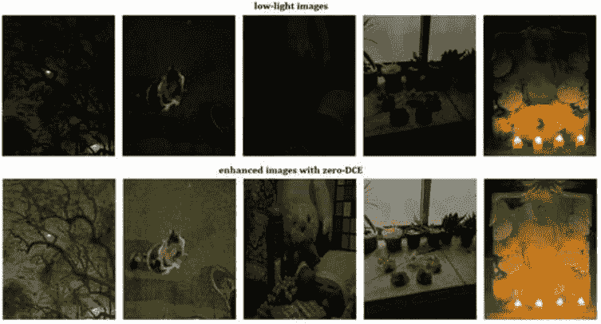

*Figure 7.35 – Low-light image enhancement with Zero-DCE pretrained model*

## 使用多轴 MLP 的去噪

传统的 Gaussian 滤波、wavelet shrinkage 和 BM3D 方法在一定程度上已被证明有效，但基于深度学习的方法现在引领了最先进水平。其中一个模型是 **Multi-Axis MLP (MAXIM)**，由 Google Research 开发，它在真实去噪基准测试 **Smartphone Image Denoising Dataset (SIDD)** 上展示了令人印象深刻的性能。

MAXIM (Tao et al., 2022) 是一种通用图像恢复框架，采用新颖的架构，集成了：

- **MAMLP** 以实现全局感受野学习
- **局部和全局操作** 以捕捉精细和粗糙特征
- **具有跳跃连接的分层编码器-解码器架构**

MAXIM 代表了一类新的神经架构，利用 MLP 进行去噪等密集图像预测任务。它在 SIDD 和其他基准测试上的强劲性能证明了其现实世界的相关性。

MAXIM 架构亮点包括：

- **基于 MLP 的处理：** 与卷积架构不同，MAXIM 用多轴 MLP 层替代自注意力或卷积，以实现高效处理
- **交叉门控机制：** 有助于编码器和解码器特征的更好融合
- **多尺度分层解码器：** 逐步重建精细细节

MAXIM 变体（例如 MAXIM-S3）设计为轻量且快速，同时仍提供顶级性能。在这里，我们将使用 Google 在 Hugging Face 上提供的预训练 MAXIM-S3 模型进行真实图像去噪，如下一段代码所示。Keras 和 Hugging Face 的集成使 MAXIM 在 Python 项目中易于用于实际增强任务。

代码中的关键步骤如下：

- **加载预训练模型：** 使用函数 `from_pretrained_keras()` 通过 Hugging Face 加载在 SIDD 数据集上训练的 MAXIM-S3 模型
- **遍历噪声图像：** 处理指定噪声文件夹中的所有 .jpg 图像
- **预处理每张图像：** 调整图像大小并将其转换为批量为 1 的张量（使用 `tf.expand_dims()`）以供模型输入
- **运行 MAXIM 去噪：** 生成 3 个中间输出；第 3 个 (`denoised[0][2]`) 是最终去噪结果
- **后处理输出：** 裁剪值（使用 `tf.clip_by_value()`）并将输出张量转换回可显示的图像格式
- **并排可视化：** 显示噪声输入和去噪输出以进行视觉比较

现在参考下一段代码片段：

```
from huggingface_hub import from_pretrained_keras
import tensorflow as tf
# Load pretrained MAXIM for SIDD denoising
model = from_pretrained_keras("google/maxim-s3-denoising-sidd")
for imf in sorted(glob('images/noisy/*.jpg')):
    im = Image.open(imf)          # Load a sample noisy image
    im = im.resize((256, 256))
    im_np = np.array(im)
    im_tensor = tf.convert_to_tensor(im_np, dtype=tf.float32)
    im_tensor = tf.expand_dims(im_tensor, 0)  # batch = 1
    denoised = model.predict(im_tensor) # Run inference for denoising
    denoised[0][0].shape, denoised[0][1].shape, denoised[0][2].shape
    denoised_np = tf.clip_by_value(denoised[0][2].squeeze(), 0, 255).numpy().astype(np.uint8) # Squeeze and convert back to uint8
    # Display input image im_np vs. Output denoised_np here
```

如果运行上述代码片段，您应获得以下图：

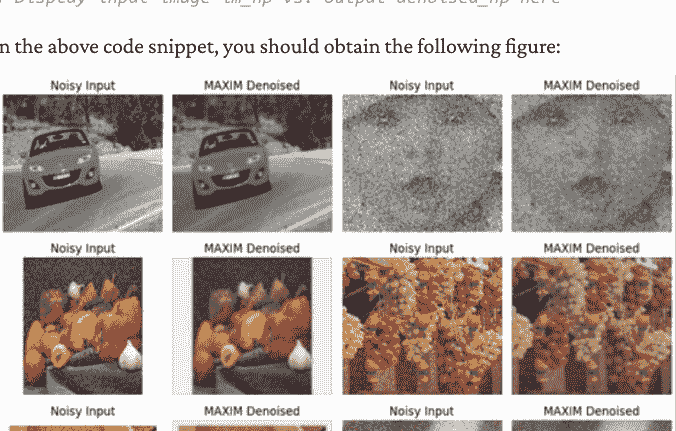

*Figure 7.36 – Denoising images with a pretrained MAXIM model*

MAXIM 在以下方面表现良好：

- **长程依赖：** 传统 CNN 受局部感受野限制。MAXIM 的 MLP 层可以建模全局上下文。
- **多尺度监督：** 有助于在各种空间分辨率下细化细节。
- **交叉门控块：** 改善编码器和解码器特征之间的交互。

## 使用暗通道先验的去雾

户外摄影通常由于雾霾、雾气或大气散射导致可见度降低。雾霾会影响色彩保真度和对比度，使目标检测和场景理解更加困难。在本节中，我们将探讨一种强大且广泛使用的图像去雾方法，称为 **暗通道先验 (DCP)**。

该技术最初由 He、Sun 和 Tang 在 2009 年具有影响力的论文中提出，利用了关于无雾图像的一个简单而深刻的观察：无雾户外图像中的大多数局部块都包含至少一个颜色通道中强度非常低的像素。这种统计先验，即暗通道，构成了有效的去雾算法的基础。

雾化图像的形成通常由大气散射模型建模：

$$I(x) = J(x) \cdot t(x) + A \cdot (1 - t(x))$$

其中：

- $I(x)$：像素 $x$ 处的观测雾化图像
- $J(x)$：场景辐射度（待恢复的真实图像）
- $A$：全局大气光（通常为 3 通道 RGB 向量）
- $t(x)$：介质透射率描述到达相机的未被散射的光的比例

去雾的目标是在给定 $I(x)$ 的情况下恢复 $J(x)$。

### 暗通道先验

考虑图像 $I$ 的暗通道，其中

- $\Omega(x)$：以像素 $x$ 为中心的局部块
- $I^c(y)$：像素 $y$ 处颜色通道 $c$ 的强度


This exploits the observation that in non-sky regions, at least one channel tends to have low intensity. In hazy images, these dark channels appear much brighter due to scattered light. Hence, the difference between the dark channel of a hazy image and a haze-free image becomes a cue for transmission estimation.

Let’s understand the algorithm step by step:

- Reads the input image.
- **Computes dark channel:** implemented by the function `dark_channel()`, which splits RGB channels using a minimum filter and morphological erosion on local patches, computes the minimum per-pixel across R, G, B and applies erosion with a kernel (patch size sz) to compute the local minimum — the dark channel.
- **Estimates global atmospheric light:** Implemented using the function `estimate_atmospheric_light()`, refer to the next code snippet. We assume the brightest pixels in the dark channel correspond to haze-opaque regions (e.g., sky or distant background). Their RGB values give us the atmospheric light vector A.
- **Flattens the dark channel and selects the top brightest pixels:** Averages their RGB values to estimate atmospheric light A.
- **Estimates transmission map** (dehazes the image) using the function `dehaze()`. We use the equation derived from the haze model and assume constant airlight over a local patch:
  
  $$t(x) = 1 - \omega \cdot I_{dark}(x)$$ 
  
  where $\omega$ is a constant (typically 0.95).
- **Recover scene radiance from the haze model:**
  
  $$J(x) = \frac{I(x) - A}{\max(t(x), t0)} + A$$
- Displays original and restored images side by side.

Now, refer to the following code snippet:

```
def dark_channel(im, sz):
    b, g, r = cv2.split(im)
    dc = cv2.min(cv2.min(r, g), b)
    kernel = cv2.getStructuringElement(cv2.MORPH_RECT, (sz, sz))
    dark = cv2.erode(dc, kernel)
    return dark
```

```
```python
def estimate_atmospheric_light(im, dark):
    [h, w] = im.shape[:2]
    imsz = h * w
    numpx = int(max(np.floor(imsz / 1000), 1))
    darkvec = dark.reshape(imsz, 1)
    imvec = im.reshape(imsz, 3)
    indices = darkvec.argsort()
    indices = indices[imsz-numpx:]
    atmsum = np.zeros([1, 3])
    for ind in indices:
        atmsum = atmsum + imvec[ind]
    A = atmsum / numpx
    return A


def dehaze(im, A, omega=0.95, t0=0.1):
    im3 = np.empty(im.shape, im.dtype)
    for ind in range(0, 3):
        im3[:, :, ind] = im[:, :, ind] / A[0, ind]
    transmission = 1 - omega * dark_channel(im3, 15)
    t = cv2.max(transmission, t0)
    J = np.empty(im.shape, im.dtype)
    for ind in range(0, 3):
        J[:, :, ind] = (im[:, :, ind] - A[0, ind]) / t + A[0, ind]
    return J


img = plt.imread('images/hazy.jpg')
A = estimate_atmospheric_light(img, dark_channel(img, 15))
dehazed_img = dehaze(img, A)
plt.imshow(np.hstack((img, dehazed_img))), plt.axis('off')
```
```

If you run the above code snippet, you should obtain the following figure:

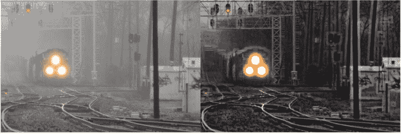

Figure 7.37 – Dehazing with dark channel prior

The method works best on natural outdoor images with distinct haze. Indoor images or those without strong haze may not benefit. Refining the transmission map (e.g., with guided filtering) can significantly improve visual quality.

## Super-resolution with enhanced deep residual networks

Image **super-resolution (SR)** is the task of reconstructing a **high-resolution (HR)** image from its **low-resolution (LR)** counterpart. It is crucial for applications like medical imaging (e.g., zooming in on scans), satellite and aerial imagery, surveillance and forensics, and enhancing consumer images and videos. Traditional methods like bicubic interpolation fail to preserve textures and sharp edges. Deep learning–based approaches, such as **Enhanced Deep Residual Networks (EDSR)**, provide a significant leap forward.

Given a low-resolution image $I_{LR}$, we aim to estimate its high-resolution counterpart $I_{SR}$, such that $I_{SR} \approx I_{HR}$. The network learns a mapping function $f_\theta$ parameterized by deep network weights:

$I_{SR} = f_\theta(I_{LR})$

## Architecture of EDSR

EDSR is an improved version of the **SRResNet** model, which builds on residual learning. Its architecture includes:

- **Feature extraction layer:** $F_0 = Conv(I_{LR})$
- **Residual blocks (×N):** Each block contains:
- Conv → ReLU → Conv
- **Residual skip connection:**
  
  $F_{i+1} = F_i + B(F_i)$
- **Long skip connection:**
  
  $F_{res} = F_0 + Conv(F_N)$
- **Upsampling layers:** Uses sub-pixel convolution or pixel shuffle [Shi et al., 2016]
- **Output layer:** Final convolution to get the RGB SR image

Now, let’s deep-dive into Python implementation and understand how the following code works. Here’s a concise summary of what the following code does, broken into key steps and functions:

- Loads and normalizes input image using Lambda(normalize) to center pixel values
- Defines residual blocks with res_block() using two convolutional layers and a skip connection
- Stacks multiple residual blocks (e.g., 16 blocks) and adds a long skip connection
- Applies upsampling via pixel_shuffle() in the upsample() function for 2×, 3×, or 4× resolution
- Builds the full model using edsr() that returns high-resolution output
- Loads pretrained weights from 'models/weights-edsr-16-x4.h5'
- Reads low-resolution input image using PIL.Image.open()
- Performs baseline upscaling via bicubic interpolation using PIL.Image.resize()
- Applies EDSR model inference using resolve_single() and resolve()
- Displays LR, bicubic, and EDSR outputs side by side using matplotlib.pyplot

Now refer to the following code snippet (to be run in Google Colab); for complete code, refer to GitHub:

```
# run in google colab (on GPU)
from tensorflow.keras.layers import Add, Conv2D, Input, Lambda
from tensorflow.keras.models import Model

def edsr(scale, num_filters=64, num_res_blocks=8, res_block_scaling=None):
    x_in = Input(shape=(None, None, 3))
    x = Lambda(normalize)(x_in)
    x = b = Conv2D(num_filters, 3, padding='same')(x)
    for i in range(num_res_blocks):
```

```
```python
def resolve_and_plot(model_pre_trained, lr_image_path):
    im_lr = Image.open(lr_image_path)
    lr = np.array(im_lr)[...,:3]
    sr_ci = np.array(im_lr.resize((lr.shape[1]*4, lr.shape[0]*4),
                                  Image.BICUBIC))[...,:3]
    sr_pt = resolve_single(model_pre_trained, lr)
    model_name = model_pre_trained.name.upper()
    # Plot low-res image (LR), sr_ci and sr_pt side-by-side here

weights_dir = 'models/'
lr_image_path = 'images/butterfly.png'
# EDSR baseline as described in the EDSR paper (1.52M parameters)
edsr_pre_trained = edsr(scale=4, num_res_blocks=16)
edsr_pre_trained.load_weights(os.path.join(weights_dir, \
                               'models/weights-edsr-16-x4.h5'))
resolve_and_plot(edsr_pre_trained, lr_image_path)
```
```

If you run the above code snippet, you should obtain the following figure:

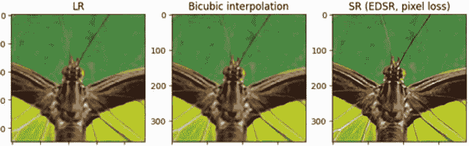

*Figure 7.38 – Image super-resolution with bicubic interpolation vs. a pretrained EDSR model*

The following table summarizes and compares the above images:

| Method | Description |
|---|---|
| Low-Resolution (LR) | Input image |
| Bicubic Interpolation | Baseline upscaling |
| EDSR Output | Deep-learning super-resolution |

*Table 7.8 – A comparison of the various methods*

The difference is visually striking. EDSR produces sharper edges, better textures, and natural colors compared to naive interpolation.

## Summary

In this chapter, we explored a wide range of image enhancement techniques, from point-wise intensity transformations (e.g., negative, power-law, contrast stretching) and histogram-based methods (e.g., equalization and matching) to noise reduction using linear (mean, Gaussian) and nonlinear filters (median, bilateral, non-local means). We also introduced fuzzy logic-based enhancement, wavelet-domain fusion, and deep learning-based methods for low-light correction, denoising, dehazing, and super-resolution. Readers should now be able to implement these techniques in Python, apply them to improve image quality, and interactively explore their effects using the Streamlit app. In the following chapter, we shall continue discussing more image enhancement techniques based on image derivatives and gradients.

## Get this book’s PDF version and more

Scan the QR code (or go to packtpub.com/unlock). Search for this book by name, confirm the edition, and then follow the steps on the page.

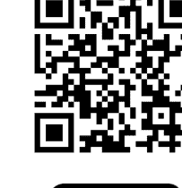

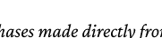

Note: Keep your invoice handy. Purchases made directly from Packt don’t require an invoice.


