### 8 基于导数的图像增强

本章探讨基于导数的图像增强，使用梯度、拉普拉斯算子以及高阶算子来突出边缘、锐化细节并增强局部结构。我们涵盖了 Sobel、Canny 和高斯拉普拉斯算子 LoG 等经典方法，以及罗盘和百分位梯度技术、脊线检测、结构化边缘检测，以及全卷积边缘检测 HED 和像素差分网络 PiDiNet 等深度学习方法。还讨论了使用高斯金字塔和拉普拉斯金字塔的多尺度增强。借助 scikit-image、OpenCV 和 scipy 的实用 Python 实现，可在边缘检测、对比度增强和细节优化方面获得实践经验。为了让概念更具实践性，一个交互式 Gradio 应用演示了 Canny 边缘检测，允许读者实时调整阈值并可视化结果；请注意，应用中未包含其他基于导数的增强方法。

本章将涵盖的关键主题如下：

- 图像导数
- 基于导数的经典增强
- 基于导数的边缘检测
- 结构化和基于脊线的边缘检测
- 基于深度学习的边缘检测
- 基于导数的多尺度增强

### 技术要求

在阅读本章各部分时，请跟随 Jupyter notebook 并运行必要的代码片段。本章对应的 notebook 的 GitHub 链接如下：https://github.com/PacktPublishing/Hands-On-Image-Processing-and-Computer-Vision-with-Python-Second-Edition。为使代码顺利运行，需要事先安装正确版本的库。如果版本不匹配，代码可能需要根据库中某些功能/函数被移除或弃用与否进行少量调整。

### 图像导数

我们可以使用有限差分计算数字图像的（偏）导数。在本节中，让我们讨论如何计算图像导数、梯度以及拉普拉斯算子，以及它们为何有用。

#### 导数和梯度

下图展示了如何使用有限差分（向前差分和中心差分，后者更精确）计算图像 I（即函数 f(x, y)）的偏导数，可通过与所示核进行卷积实现。该图还定义了梯度向量、其幅值（对应边缘强度）和方向（垂直于边缘）。输入图像中强度（灰度值）发生急剧变化的位置，对应于图像一阶导数强度出现峰值/尖峰（或谷值）的位置。

换句话说，梯度幅值的峰值标记了边缘位置，我们需要对梯度幅值进行阈值处理以在图像中寻找边缘，如下图所示：

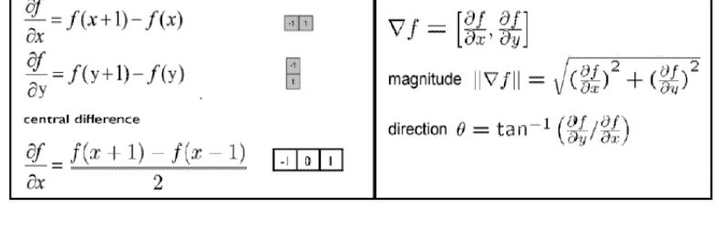

图 8.1 – 图像的偏导数和梯度

以下代码块展示了如何使用前面所示的卷积核计算梯度（包括幅值和方向），以灰度棋盘图像作为输入：

```python
def compute_grads(im):
    im_x = np.clip(signal.convolve2d(im, ker_x, mode='same'), 0, 1)
    im_y = np.clip(signal.convolve2d(im, ker_y, mode='same'), 0, 1)
    im_mag = np.sqrt(im_x**2 + im_y**2)
    im_dir = np.arctan(im_y / (im_x + eps))
    return im_x, im_y, im_mag, im_dir

eps = 1e-6
```

```python
ker_x, ker_y = [[-1, 1]], [[-1], [1]]
im = rgb2gray(imread('images/chess.png'))
im_x, im_y, im_mag, im_dir = compute_grads(im)
```

如果运行上述代码并将图像并排绘制，您应得到如下图所示的结果：

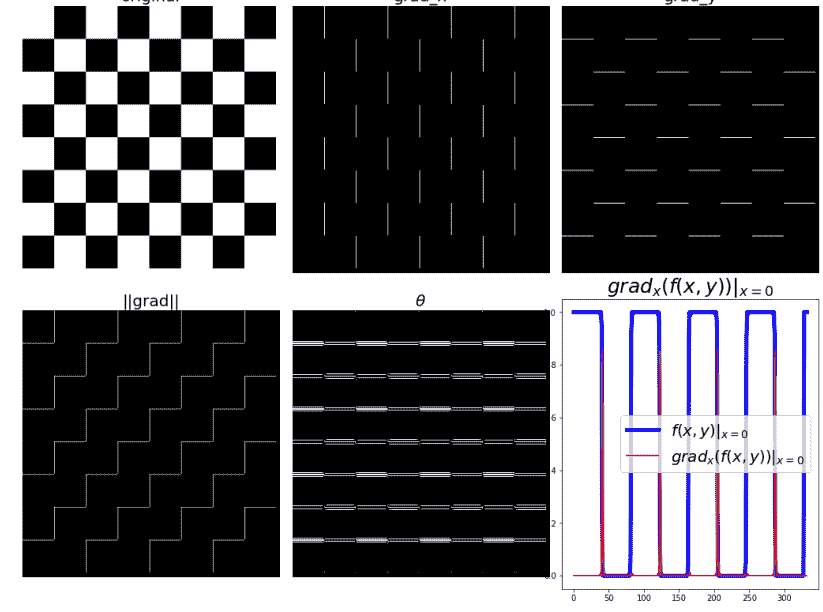

图 8.2 – 图像梯度（偏导数）和边缘

上图显示了前述代码块的输出结果。可以看出，x 和 y 方向的偏导数分别检测图像中的垂直和水平边缘。梯度幅值显示了图像不同位置边缘的强度。此外，如果我们从原始图像中选取同一行（例如第 0 行）的所有像素，可以看到一个方波（对应交替的黑白强度模式），而同一组像素的梯度幅值则在强度上出现尖峰（突然增加/减少），这些尖峰对应于（垂直）边缘。

#### 拉普拉斯算子

Rosenfeld 和 Kak 已证明，最简单的各向同性导数算子是拉普拉斯算子，其定义如图所示。拉普拉斯算子近似图像的二阶导数并检测边缘。它是一个各向同性（旋转不变）算子，零交叉点标记边缘位置；本章后面会进一步讨论。换句话说，在输入图像的一阶导数出现尖峰/峰值（或谷值）的位置，对应输入图像的二阶导数在相应位置出现零交叉，如下图所示：

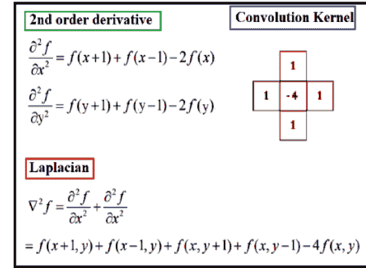

图 8.3 – 二阶导数和拉普拉斯算子

#### 拉普拉斯算子的性质

以下是拉普拉斯算子的一些有用性质：

- ∇²f(x,y)（拉普拉斯算子）是一个标量（不像梯度，它是一个向量）
- 计算拉普拉斯算子使用单个核（掩模）（不像梯度，通常有两个核，分别是 x 和 y 方向的偏导数）
- 作为标量，它没有方向，因此我们会丢失方向信息
- ∇²f(x,y) 是二阶偏导数的和（梯度表示由一阶偏导数组成的向量），但导数阶数越高，噪声增加越明显
- 拉普拉斯算子对噪声非常敏感。因此，拉普拉斯算子总是先进行平滑操作（例如使用高斯滤波）；否则，噪声会被极大放大

以下代码片段展示了如何使用前面所示的核通过卷积计算图像的拉普拉斯算子：

```python
ker_laplacian = [[0,-1,0],[-1, 4, -1],[0,-1,0]]
im = rgb2gray(imread('images/chess.png'))
im_lap = np.clip(signal.convolve2d(im, ker_laplacian, mode='same'), 0, 1)
```

如果运行上述代码并将图像并排绘制，您应得到如下图所示的结果：

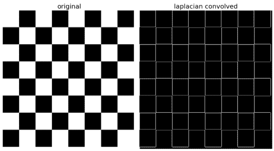

图 8.4 – 输入图像与拉普拉斯算子卷积

上图显示了前述代码片段的输出结果。可以看出，拉普拉斯算子的输出也找到了图像中的边缘。

#### 使用拉普拉斯方差进行模糊检测

模糊是图像处理中最基本的空间操作之一。它既可有意使用（例如艺术效果或预处理），也可无意产生（例如由于对焦不良或拍摄时的运动）。在许多计算机视觉应用中，检测图像是否模糊是一个关键步骤——例如在质量保证、自动对焦系统、医学成像或需要高频细节的预处理流程中。

本节探讨一种高效的无参考（盲）技术，使用拉普拉斯算子的方差来检测图像模糊。我们将解释其数学直觉，应用常见的空间滤波器（盒式和高斯），并提供一个注释完善的 Python 实现，分步演示该技术。

模糊会去除边缘和精细细节等高频内容。拉普拉斯算子作为二阶导数，对这些急剧变化很敏感。通过应用拉普拉斯算子并计算所得图像的方差，我们可以衡量细节水平：

- 方差高 → 边缘多 → 图像清晰
- 方差低 → 边缘少 → 图像模糊

在二维中，离散拉普拉斯算子通常表示为：

`ℒ = [[0, 1, 0], [1, -4, 1], [0, 1, 0]]`

它突出显示强度快速变化的区域。


## 方差阈值化

设 $\mathcal{L}(x,y)$ 为拉普拉斯变换后的图像。则**拉普拉斯方差**的计算方式为：

$$Var_{\mathcal{L}} = \frac{1}{N}\sum_{i=1}^{N}(\mathcal{L}_i-\mu)^2$$

其中：
- $N$ 是像素数
- $\mathcal{L}_i$ 是拉普拉斯像素值
- $\mu$ 是 $\mathcal{L}$ 的均值

设置阈值 $T$，使得：

**模糊** $\Longleftrightarrow Var_{\mathcal{L}} < T$

阈值 $T$ 取决于图像大小、内容和应用。常用的启发式值在 50 到 150 之间。

```python
def variance_of_laplacian(image):
    lap = cv2.Laplacian(image, cv2.CV_64F)
    return lap.var()


def apply_box_blur(image, ksize=15):
    return cv2.blur(image, (ksize, ksize))


def apply_gaussian_blur(image, ksize=15, sigma=5):
    return cv2.GaussianBlur(image, (ksize, ksize), sigma)


def detect_blur(image, threshold=100.0):
    gray = cv2.cvtColor(image, cv2.COLOR_BGR2GRAY)
    var_lap = variance_of_laplacian(gray)
    is_blurry = var_lap < threshold
    return is_blurry, var_lap

# Load and resize image
img_path = 'images/parrot.jpg'
original = cv2.imread(img_path)
original = cv2.resize(original, (400, 400))
# Apply filters
blur_box = apply_box_blur(original, ksize=15)
blur_gaussian = apply_gaussian_blur(original, ksize=15, sigma=5)
# Create image dictionary
images = {
"Original": original,
"Box Blur": blur_box,
"Gaussian Blur": blur_gaussian
}
# Display results
plt.figure(figsize=(8, 3))
for i, (title, img) in enumerate(images.items()):
    is_blur, score = detect_blur(img)
    label = f"{title}\nLaplacian Var: {score:.2f} → {'Blurry' if is_blur else 'Sharp'}"

    plt.subplot(1, 3, i+1)
    plt.imshow(cv2.cvtColor(img, cv2.COLOR_BGR2RGB)), plt.title(label)
```

如果运行上述代码，你应该会得到类似下图的图像：

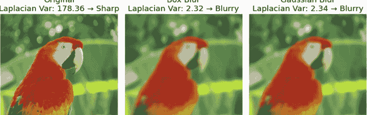

图 8.5 – 使用拉普拉斯方差进行模糊检测

## 噪声对梯度计算的影响

使用有限差分计算的导数滤波器对噪声相当敏感。正如我们在上一章所看到的，图像中与邻域像素强度值差异很大的像素通常就是噪声像素。一般来说，噪声越多，强度变化越大，滤波器得到的响应也越强。下一个代码块将向图像添加一些高斯噪声，以观察对梯度的影响。让我们再次考虑图像的单一行（准确地说，第 0 行），并绘制强度随 x 位置变化的曲线：

```
im = rgb2gray(imread('images/chess.png'))
sigma = 0.25
im = random_noise(im, var=sigma**2)
im_x, im_y, im_mag, im_dir = compute_grads(im)
```

如果运行上述代码片段并将所有图像并排绘制，你应该会得到类似下图的图像：

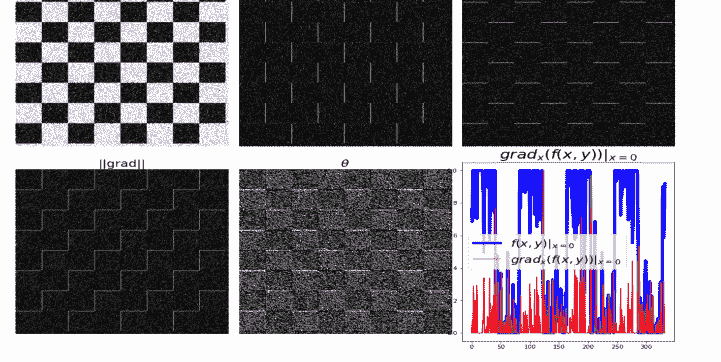

图 8.6 – 输入图像中的噪声对计算梯度的影响

上图显示了前一个代码块在棋盘图像中添加一些随机噪声后的输出。如我们所见，向输入图像添加随机噪声对（偏）导数和梯度幅值有很大影响；对应边缘的峰值几乎与噪声无法区分，图案也被破坏。

在应用导数滤波器之前对图像进行平滑处理应该是有帮助的，因为它会去除可能是噪声的高频分量，并迫使（与邻域不同的）噪声像素看起来更像其邻域。因此，解决方案是先用低通滤波器（如高斯滤波器）对输入图像进行平滑，然后在平滑图像中（使用阈值）寻找峰值。这就引出了 LoG 滤波器（如果使用二阶导数滤波器），我们将在本章后面探讨它。

## 使用导数的经典增强

本节介绍传统增强技术，例如反锐化掩模和基于熵的对比度增强。使用 PIL、OpenCV 和 scipy.optimize 的实用 Python 实现说明了导数如何增强图像对比度和细节。

## 反锐化掩模

反锐化掩模是一种锐化图像的技术，其做法是从图像本身减去图像的模糊版本。反锐化掩模常用的混合公式如下：

sharpened = original + (original − blurred) × amount

其中，amount 是一个参数。接下来的几节将演示如何使用 Python 中 scipy 的 ndimage 模块中的函数来实现此滤波器。

### 使用 PIL.ImageFilter

Python 图像库（PIL）通过其 ImageFilter 模块提供了一种便捷的 UnsharpMask 滤波器，如下面的代码片段所示：

```
# Load image
image = Image.open("images/me.jpg").convert("RGB")
# Apply Unsharp Mask from PIL
sharpened_pil = image.filter(\    ImageFilter.UnsharpMask(radius=2, percent=150, threshold=3))
# Display image and sharpened_pil here
```

函数 ImageFilter.UnsharpMask() 接受以下参数：

- radius：高斯模糊核的标准差（sigma）。值越大，模糊越强。该半径控制有多少细节被视为低频（即需要移除）。
- percent：应用的锐化量，以百分比表示（例如 150 表示 150%）。该百分比会放大提取出的细节层。
- threshold：将被锐化的最小亮度变化。有助于减少对噪声的锐化。该阈值会抑制平坦区域中的变化，避免噪声放大。

### 使用 OpenCV-Python

OpenCV-Python 提供了一种更灵活、更直观的方式，通过高斯模糊和线性混合来实现反锐化掩模，如下一个代码片段所示：

```
# Load image
img = cv2.imread("images/me.jpg")
img_rgb = cv2.cvtColor(img, cv2.COLOR_BGR2RGB)
# Apply Gaussian Blur
blurred = cv2.GaussianBlur(img, (0, 0), sigmaX=2)
# Unsharp Mask
alpha = 1.5
sharpened_cv = cv2.addWeighted(img, 1 + alpha, blurred, -alpha, 0)
sharpened_cv_rgb = cv2.cvtColor(sharpened_cv, cv2.COLOR_BGR2RGB)
# Display img_rgb and sharpened_cv_rgb here
```

上述代码的工作原理如下：

- cv2.GaussianBlur 使用高斯核对图像进行模糊处理。
- cv2.addWeighted() 执行混合操作；用 I 和 B 分别表示原始图像和模糊图像，则 sharpened = (1 + α) · I − α · B，其中 α = 1.5 会增强细节。

与 PIL 方法相比，这种方法对模糊和混合操作有更多控制，非常适合实验和高级应用。

## 使用 scipy.optimize 进行基于熵的对比度增强

在各种增强技术中，对比度增强起着关键作用，尤其是对于光照不足或动态范围较低的图像。本节介绍一种有理论依据的对比度增强方法，通过伽马校正来最大化图像的熵。

熵是衡量图像随机性或信息含量的指标。熵较高的图像通常表现出更丰富的纹理和更均匀分布的强度。因此，通过最大化熵来增强图像，可以得到更美观、信息更丰富的表示。

### 伽马校正

如前几章所述，伽马校正是一种非线性变换，定义如下：

$$I_{enhanced}(x,y)=I(x,y)^\gamma$$

其中：
- $I(x,y) \in [0,1]$ 是归一化像素强度
- $\gamma$ 是校正因子
- $\gamma < 1$ 使图像变亮
- $\gamma > 1$ 使图像变暗

伽马校正以非线性方式改变对比度，因此适用于光照或直方图分布不均匀的图像。

### 图像的熵

图像的香农熵定义如下：

$$H(I)=-\sum_{i=0}^{255}p(i)\log_2 p(i)$$

其中：
- $p(i)$ 是强度值 $i$ 的概率（归一化直方图计数）
- 对所有可能的强度级别求和

熵提供了信息内容的定量度量。更高的熵通常意味着更多的对比度和纹理变化。

### 方法：通过伽马最大化熵

关键思想是找到最佳伽马值，增强图像对比度，从而使所得图像的熵最大化。

这被表述为一个一维优化问题。

$$\gamma^*=\arg\max_{\gamma\in\Gamma}H(I^\gamma)$$


其中 Γ 是搜索范围。我们可以使用 `scipy.optimize.minimize_scalar` 求解该优化问题，最小化负熵。

以下 Python 代码演示了使用 OpenCV、scikit-image 和 SciPy 在灰度图像上实现的整个流程。步骤如下：

- **图像归一化：** 应用伽马变换到 [0, 1] 范围所需的
- **熵函数：** 基于直方图的全局熵计算
- **伽马优化：** 在有界区间 (0.1 到 5.0) 内执行标量函数优化
- **可视化：**
  - 显示原始图像和增强后的图像
  - 使用 2D 滑动窗口（通过 `skimage.filters.rank.entropy`）计算局部熵图，以说明空间对比度变化

现在，参考下一个代码片段：

```python
from skimage.filters.rank import entropy
from skimage.morphology import disk
from scipy.optimize import minimize_scalar

# Load and resize grayscale image
img = cv2.imread('images/moon.jpg', cv2.IMREAD_GRAYSCALE)
img = cv2.resize(img, (256, 256)) # standard size for visualization
# Normalize image to [0, 1]
img_norm = img / 255.0

# Define entropy computation
def compute_entropy(image):
    hist, _ = np.histogram(image, bins=256, range=(0, 1), density=True)
    hist += 1e-12 # to avoid log(0)
    return -np.sum(hist * np.log2(hist))

# Define gamma enhancement
def enhance_with_gamma(image, gamma):
    return np.power(np.clip(image, 0, 1), gamma)

# Objective function for optimization
def objective(gamma):
    enhanced = enhance_with_gamma(img_norm, gamma)
    return -compute_entropy(enhanced) # minimize negative entropy

# Find optimal gamma
res = minimize_scalar(objective, bounds=(0.1, 0.75), method='bounded')
optimal_gamma = res.x
enhanced_img = enhance_with_gamma(img_norm, optimal_gamma)
# Convert to 8-bit image
img_out = (enhanced_img * 255).astype(np.uint8)
entropy_map = entropy(img_out, disk(5))
# Visualization: plot img, img_out and entropy_map here
```

如果运行上述代码并将上述图像并排绘制，您应该得到如下图所示的图形：

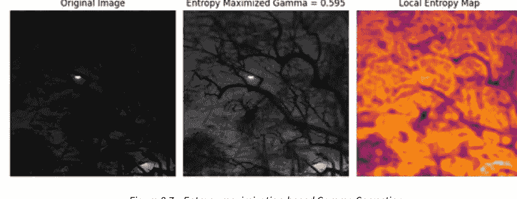

图 8.7 – 基于熵最大化的伽马校正

以下是观察结果：

- 对于低对比度或暗图像，最优 γ 通常小于 1，图像变亮并增加熵
- 增强是内容自适应的，由图像的固有信息含量驱动
- 局部熵图突出显示具有复杂纹理或边缘的区域

正如上文所述，熵最大化导致 γ 值实现对上述低对比度输入图像的显著对比度增强。

## 使用导数的边缘检测

让我们现在探索依赖于导数的经典边缘检测方法，包括 Sobel、Prewitt、Roberts、Scharr、Canny 和 Laplacian of Gaussian 滤波器。还引入了罗盘和百分位梯度技术用于方向性和局部边缘检测。

### 使用 scikit-image 的 Sobel 边缘检测器

( 一阶 ) 导数可以通过使用有限差分更好地近似。以下图所示的 Sobel 算子被广泛使用：

前一幅图显示了前一代码片段的输出。可以看出，图像的水平和垂直边缘由水平和垂直 Sobel 滤波器检测，而使用 Sobel 滤波器计算的梯度幅值图像检测两个方向上的边缘。

### 使用 scikit-image 的更多边缘检测器

图像处理算法中使用了相当多的不同边缘检测算子；它们都是离散的 ( 一阶或二阶 ) 微分算子，并试图近似图像强度函数的梯度（例如，我们之前讨论过的 Sobel 算子）。以下图表中显示的核是用于边缘检测的几个流行核。例如，近似一阶图像导数的流行导数滤波器是 Sobel、Prewitt、Scharr 和 Roberts 滤波器，而近似二阶导数的导数滤波器是 Laplacian：

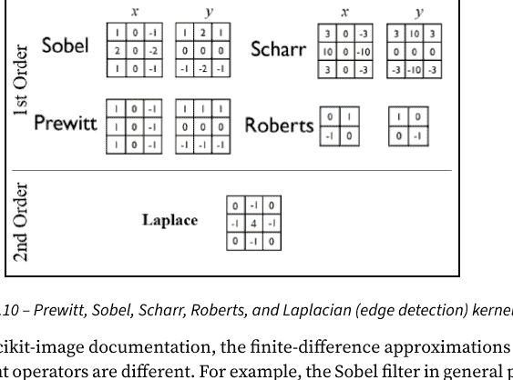

图 8.10 – Prewitt、Sobel、Scharr、Roberts 和 Laplacian（边缘检测）核

如 scikit-image 文档所述，不同算子计算的梯度的有限差分近似是不同的。例如，Sobel 滤波器通常比 Prewitt 滤波器性能更好，而 Scharr 滤波器比 Sobel 滤波器具有更小的旋转方差。以下代码块将不同的边缘检测器滤波器应用于金门大桥灰度图像并显示获得的梯度幅值：

```python
im = imread('images/goldengate.jpg', as_gray=True) # RGB image to gray scale
edges_rob = filters.roberts(im)
edges_sch = filters.scharr(im)
edges_sob = filters.sobel(im)
edges_pre = filters.prewitt(im)
edges_lap = np.clip(filters.laplace(im), 0, 1)
```

如果运行上述代码并将获得的边缘图像并排绘制，您应该得到如下图所示的图形：

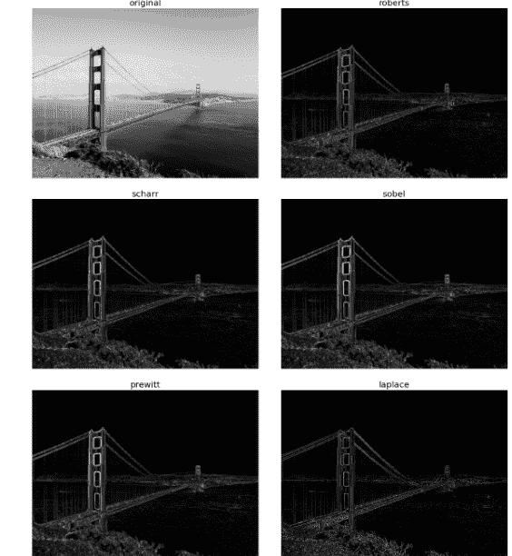

图 8.11 - 使用 Prewitt、Sobel、Scharr、Roberts 和 Laplacian 算子检测到的边缘

上图显示了前一代码片段的输出。再次，边缘检测的后处理步骤是非极大值抑制，它会变薄使用一阶导数获得的（较厚）边缘；我们之前没有执行此操作。在下一节中，正如我们将看到的，更先进的 state-of-the-art 边缘检测器 Canny 会自动执行此操作。

### 罗盘边缘检测器

虽然经典边缘检测器如 Sobel 和 Prewitt 估计水平和垂直方向上的强度变化，但罗盘边缘检测器利用多个方向以方向自适应方式更有效地检测边缘。

其中一个罗盘算子是 Kirsch 算子，它在八个罗盘方向（N、NE、E、SE、S、SW、W、NW）计算边缘幅值，在每个像素处突出显示最大方向响应。本章深入探讨 Kirsch 罗盘边缘检测器的理论、数学和 Python 实现。

- `kirsch_edge_detection()`:
  - 将图像转换为灰度
  - 使用 OpenCV 的 `filter2D` 将每个 Kirsch 核应用于图像
  - 将八个生成的滤波图像堆叠成 3D NumPy 数组
  - 使用 `np.max(..., axis=0)` 在各方向上保留每个像素的最大响应
- **最终输出：** 使用最强方向响应突出显示所有方向边缘的边缘图

现在，参考下一个代码片段：

```python
def kirsch_kernels():
    g = [
        np.array([[5, 5, 5], [-3, 0, -3], [-3, -3, -3]]),  # North
        np.array([[-3, 5, 5], [-3, 0, 5], [-3, -3, -3]]),   # NE
        np.array([[-3, -3, 5], [-3, 0, 5], [-3, -3, 5]]),   # East
        np.array([[-3, -3, 5], [-3, 0, 5], [-3, 5, 5]]),    # SE
        np.array([[-3, -3, -3], [-3, 0, -3], [5, 5, 5]]),    # South
        np.array([[-3, -3, -3], [5, 0, -3], [5, 5, -3]]),    # SW
        np.array([[5, -3, -3], [5, 0, -3], [5, -3, -3]]),    # West
        np.array([[5, 5, -3], [5, 0, -3], [-3, -3, -3]])     # NW
    ]
    return g

def kirsch_edge_detection(image):
    gray = cv2.cvtColor(image, cv2.COLOR_BGR2GRAY)
    kernels = kirsch_kernels()
    edge_maps = [cv2.filter2D(gray, -1, k) for k in kernels]
    kirsch_response = np.max(np.stack(edge_maps), axis=0)
    return kirsch_response

# Load image
image = cv2.imread("images/goldengate.jpg")
image = cv2.resize(image, (400, 400))
# Detect edges
kirsch_edges = kirsch_edge_detection(image)
# Display image and kirsch_edges here
```

如果运行上述代码，您应该得到如下图所示的图形：

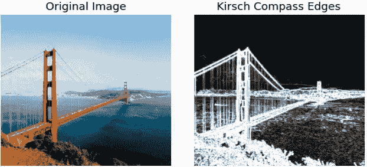

*图 8.13 – 检测 Kirsch 罗盘边缘*

罗盘边缘检测器，如 **Kirsch 算子**，由于其对方向性的敏感性，非常有效地进行鲁棒边缘提取。通过考虑八个方向并选择最强响应，它们在边缘方向可变或复杂时优于简单的梯度法。

这种方法在任何需要高保真结构检测的领域都有应用，并作为 Python 图像处理中边缘检测工具包的有价值补充。

### 交互式百分位梯度边缘检测

虽然传统的 Sobel、Prewitt 或 Canny 等方法检测强度急剧变化，但基于秩的滤波器，特别是基于百分位的梯度滤波器，为抗噪边缘检测提供了稳健的替代方案。本节介绍使用 `skimage.filters.rank.gradient_percentile` 函数的基于百分位的梯度计算，并提供由 Gradio 驱动的完全交互式演示。

传统的梯度滤波器使用固定核计算差异，这可能对噪声和强度变化敏感。基于秩的滤波器通过在局部邻域内使用 **秩统计**（如中位数和百分位）来缓解此问题。这使其更稳健于：

- 光照变化
- 异常值和噪声
- 模糊边缘

#### 局部百分位梯度

设 $I(x,y)$ 为灰度图像，$N(x,y)$ 表示像素 $(x,y)$ 周围的邻域。定义：

- $p_0$: 下百分位（例如 10%）
- $p_1$: 上百分位（例如 90%）

则像素 $(x,y)$ 处的 **百分位梯度** 幅值为：

$$G(x,y)=I_{p_1}(x,y)-I_{p_0}(x,y)$$


其中：

- $I_{p_0}(x, y)$ 是邻域 $N(x, y)$ 内 $p_0$ 百分位处的强度值
- $I_{p_1}(x, y)$ 类似地是 $p_1$ 百分位处的值

这些百分位值之间的差值捕捉了**强度变化范围**，在忽略微小波动或离群值的同时，聚焦于有意义的局部对比。

## 形态学足迹

邻域 $N(x, y)$ 由结构元素（或足迹）定义，通常是半径为 $r$ 的圆形或方形。半径越大，考虑的周围像素越多，细粒度细节会被平滑掉；半径越小，对局部变化越敏感。

现在，让我们使用下面的代码片段配合交互式 Gradio 界面，该界面允许用户上传图像并动态调整邻域半径和百分位阈值。这个 Python 脚本使用：

- Gradio 用于构建网页界面
- `skimage.filters.rank.gradient_percentile` 用于稳健的边缘检测
- `disk()` 用于定义局部邻域
- PIL、NumPy 和 `rgb2gray()` 用于图像预处理与转换

它允许用户：

- 上传图像
- 调整两个百分位（低和高）
- 设置邻域半径
- 查看基于百分位梯度滤波的**边缘图**

以下是以下代码的关键组成部分：

- grad io：用于创建交互式网页 UI，以运行和可视化 Python 函数
- gradient_percentile：计算两个局部百分位之间的强度范围来检测边缘。它接受以下输入参数：
  - image：由 Gradio UI 传入的 PIL 图像
  - footprint：用于滤波的圆形邻域半径
  - percentile_low (p0)：邻域内的较低百分位（例如第 10 百分位）
  - percentile_high (p1)：邻域内的较高百分位（例如第 90 百分位）
- disk：生成用于局部操作的圆形结构元素（邻域）

该函数计算每个像素局部邻域内 p1 和 p0 百分位之间的强度差。该差值的高值表示明显的局部对比，因此可能是**边缘**。

## 使用 skimage.filters.rank.gradient_percentile 进行边缘检测

上传图像并调整半径和百分位，即可使用基于百分位的梯度检测可视化边缘图。

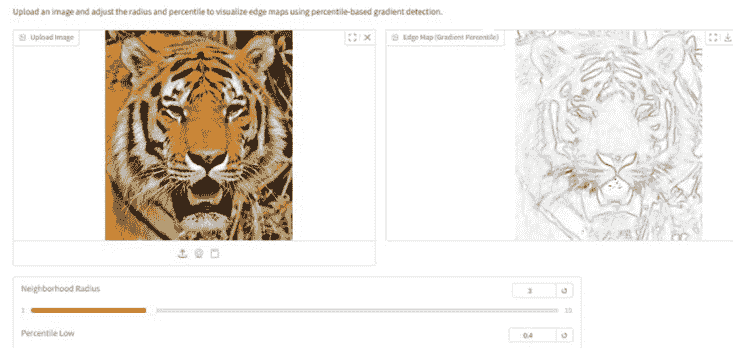

图 8.14 – 使用 Gradio 交互式地进行基于百分位的梯度计算

Gradio 界面也可以独立地在浏览器中打开（使用输出中提供的 URL）。通过滑动滑块来调整（更改）基于梯度百分位的边缘计算的输入参数，并观察对计算出的输出边缘的影响。

## 使用 scikit-image 的 Canny 边缘检测器

Canny 边缘检测器是一种流行的边缘检测算法，由 John F. Canny 开发。该算法包含以下多个步骤：

- 1. **平滑/降噪**：边缘检测操作对噪声敏感。因此，在最初阶段，使用 5×5 高斯滤波器去除图像中的噪声。
- 2. **计算梯度的幅值和方向**：然后对图像应用 Sobel 水平滤波器和垂直滤波器，计算每个像素的边缘梯度幅值和方向，如前所述。计算出的梯度角度（方向）随后被舍入到四个角度之一，分别代表每个像素的水平、垂直和两个对角线方向。
- 3. **非极大值抑制**：在这一步中，边缘被细化——任何可能不构成边缘的多余像素都被移除。为此，检查每个像素，看它是否在其梯度方向上的邻域中是局部极大值。结果得到具有细边缘的二值图像。
- 4. **连接与滞后阈值化**：在这一步中，决定检测到的所有边缘是否为强边缘。为此，使用两个（滞后）阈值 min_val 和 max_val。确定的边缘是那些强度梯度值高于 max_val 的边缘。确定的非边缘是那些强度梯度值低于 min_val 的边缘，并将它们丢弃。位于这两个阈值之间的边缘被分类为边缘或非边缘，

基于它们的连通性。如果它们连接到确定的边缘像素，则被认为是边缘的一部分。否则，它们也被丢弃。这一步还移除了小的像素噪声（假设边缘是长线条）。

所以最终，算法输出图像的强边缘。下面的代码块展示了如何使用 `scikit-image` 实现 Canny 边缘检测器：

```
```python
im = imread('images/tiger.jpg', as_gray=True)
im = ndiimage.gaussian_filter(im, 4)
im += 0.05 * np.random.random(im.shape)
edges1 = feature.canny(im)
edges2 = feature.canny(im, sigma=2)
```
```

如果你运行上述代码并绘制图像（im、edges1 和 edges2），你应该会得到下面这样的图：

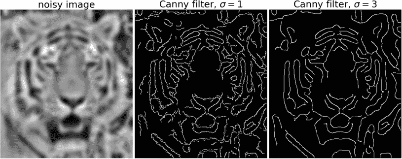

*图 8.15 – Canny 边缘检测*

上图显示了前面代码的输出；边缘是使用 Canny 滤波器，对初始高斯低通滤波器采用不同的 sigma 值来检测的。可以看出，σ 值越低，原始图像在开始时越少被模糊，因此可以找到更多边缘（更精细的细节）。

## LoG 和 DoG 滤波器

**高斯拉普拉斯（LoG）** 只是另一种线性滤波器，它是对图像依次应用高斯滤波器和拉普拉斯滤波器的组合。由于二阶导数对噪声非常敏感，因此在应用拉普拉斯算子之前，最好先通过平滑图像来去除噪声，以确保噪声不会被放大。由于卷积具有结合律性质，可以将其视为先对高斯滤波器取二阶导数（拉普拉斯），然后将得到的（组合）滤波器应用到图像上，因此得名 **LoG**。它可以使用**高斯差分（DoG）** 来高效近似，也就是两个具有不同尺度（方差）的高斯之差，如下图所示：

图 8.16 – LoG 和 DoG 滤波器

下面的代码片段展示了如何使用 scipy.signal 模块的 convolve2d() 函数计算 LOG 滤波器及相应的最佳 DoG 近似（在给定 σ 值的情况下），并将它们应用到同一幅输入图像上：

```
def plot_kernel(kernel, s, name):
    plt.imshow(kernel, cmap='YlOrRd', aspect='auto')

def LOG(k=12, s=3):
    n = 2*k+1 # size of the kernel
    kernel = np.zeros((n,n))
    for i in range(n):
        for j in range(n):
            kernel[i,j] = -(1-((i-k)**2+(j-k)**2)/(2.*s**2)) \
                * np.exp(-((i-k)**2+(j-k)**2)/(2.*s**2))/(pi*s**4)
    kernel = np.round(kernel / np.sqrt((kernel**2).sum()),3)
    return kernel

def DOG(k=12, s=3):
    n = 2*k+1 # size of the kernel
    s1, s2 = s * np.sqrt(2), s / np.sqrt(2)
    kernel = np.zeros((n,n))
    for i in range(n):
        for j in range(n):
            kernel[i,j] = \
                np.exp(-((i-k)**2+(j-k)**2)/(2.*s1**2))/(2*pi*s1**2)
                - np.exp(-((i-k)**2+(j-k)**2)/(2.*s2**2))/(2*pi*s2**2)
```

```
```python
kernel = np.round(kernel / np.sqrt((kernel**2).sum()),3)
return kernel

s = 3 # sigma value for LoG
img = rgb2gray(imread('images/me_sea.jpg'))
kernel = LOG()
outimg = convolve2d(img, kernel)
# plot the input, kernel and output side-by-side here
kernel = DOG()
outimg = convolve2d(img, DOG())
# plot the input, kernel and output side-by-side here
```
```

如果你运行上述代码，你应该会得到下面这样的图，它显示了输入图像以及使用 LoG 和 DoG 滤波器（σ = 3）得到的输出图像，以及相应核的可视化结果。从核的可视化可以看出，LoG 将对输入图像起带通滤波器（BPF）的作用（因为它同时阻断了低频和高频）。LoG 的带通特性也可以用 DoG 近似来解释（高斯滤波器是低通滤波器）。此外，我们可以看到，使用 LoG/DoG 滤波器得到的输出图像非常相似：

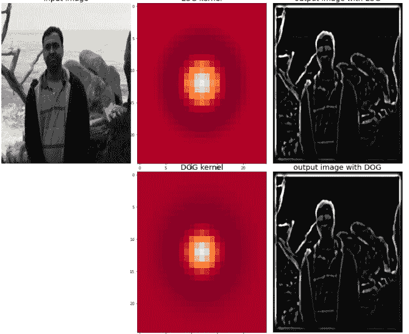

*图 8.17 – 对图像应用 LoG 和 DoG 滤波器*


我们可以看到从这些图像中，LoG 滤波器对于边缘检测非常有用。正如我们稍后将看到的，LoG 也可用于在图像中寻找斑点。

## 使用 scipy.ndimage 的 LoG 滤波器

`scipy.ndimage` 模块的 `gaussian_laplace()` 函数也可以用来实现 LoG，如以下代码片段所示。它演示了如何使用 `scipy.ndimage` 在不同尺度下应用拉普拉斯高斯 LoG 算子以观察多尺度行为：

```
```python
img = rgb2gray(imread('images/zebras.jpg'))
fig = plt.figure(figsize=(20,12))
plt.gray() # show the filtered result in grayscale
plt.subplot(331), plt.imshow(img), plt.axis('off')
plt.title('input image', size=15)
for sigma in range(1,9):
    plt.subplot(3,3,sigma+1)
    img_log = ndimage.gaussian_laplace(img, sigma=sigma)
    plt.imshow(np.clip(img_log,0,1)), plt.axis('off')
    plt.title('LoG with sigma=' + str(sigma), size=20)
```
```

如果运行上述代码，你应该会得到如下图所示的图形。

下图显示了使用不同平滑参数 σ 值的高斯滤波器的 LoG 滤波器得到的输入/输出图像：

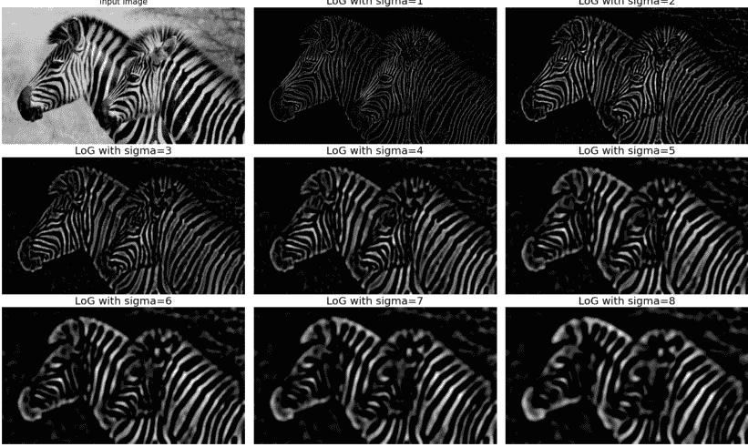

*Figure 8.18 – Applying LoG filter with different smoothing parameter values*

该实验展示了如何通过增加高斯平滑参数 σ 使 LoG 滤波器能够捕捉到越来越大的结构，从而在实践中体现了尺度空间的原理。

## 使用 LoG 滤波器的边缘检测

以下描述了使用 LOG 滤波器进行边缘检测的步骤：

- 首先，输入图像需要进行平滑处理（通过与高斯滤波器卷积）
- 然后，需要将平滑后的图像与拉普拉斯滤波器卷积以获得输出图像，如下所示：

$$\nabla^2(I(x,y) * G(x,y))$$

- 最后，需要计算最后一步得到的图像中的零交叉，如下图所示：

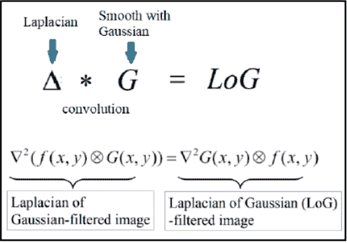

*Figure 8.19 – The LoG operator and the Derivative Theorem of Convolution*

## 使用 Marr-Hildreth 零交叉的边缘检测

计算 LoG 卷积图像中的零交叉（以检测边缘为二值图像）是由 Marr 和 Hildreth 提出的。可以通过查看 LoG 平滑图像的符号并将其定义为二值图像来识别边缘像素。计算零交叉的算法如下：

- 1. 首先，将 LoG 卷积图像转换为二值图像，将像素值替换为正值时为 1，负值时为 0。
- 2. 为了计算零交叉像素，我们只需查看该二值图像中非零区域的边界。
- 3. 边界可以通过找到任何具有零的直接邻居的非零像素来找到。

4. 因此，对于每个像素，如果它是非零的，考虑其八个邻居；如果任何邻居像素为零，则该像素可以被识别为边缘。此函数的实现留作练习。以下代码块使用零交叉检测同一斑马图像的边缘

```
def any_neighbor_opposite_sign(img, i, j):
    '''Check if any neighbor has opposite sign'''
    current = img[i, j]
    for k in range(-1, 2):
        for l in range(-1, 2):
            if k == 0 and l == 0:
                continue  # skip center pixel
            neighbor = img[i + k, j + l]
            if current * neighbor < 0:  # sign change
                return True
    return False

def zero_crossing(img):
    '''Detect zero-crossings in Laplacian-filtered image'''
    out_img = np.zeros_like(img, dtype=np.uint8)
    for i in range(1, img.shape[0] - 1):
        for j in range(1, img.shape[1] - 1):
            if any_neighbor_opposite_sign(img, i, j):
                out_img[i, j] = 255
    return out_img

fig = plt.figure(figsize=(25,15))
plt.gray() # show the filtered result in grayscale
for sigma in range(2,10, 2):
    plt.subplot(2,2,sigma//2)
    result = ndimage.gaussian_laplace(img, sigma=sigma)
    plt.imshow(zero_crossing(result)) # implement the function
                                 # zero_crossing() using the above
    algorithm
    plt.axis('off')
    plt.title('LoG with zero-crossing, sigma=' + str(sigma), size=20)
plt.show()
```

下图显示了前述代码块的输出，使用零交叉单独在不同 σ 尺度下识别边缘：

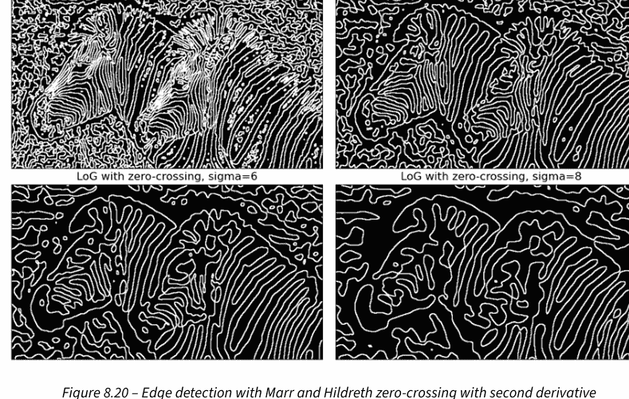

Figure 8.20 – Edge detection with Marr and Hildreth zero-crossing with second derivative

之前的图像显示了使用 LoG/DoG 作为边缘检测器的零交叉。需要注意的是，零交叉形成闭合轮廓。

## 使用 LoG、DoG 和 DoH 进行尺度空间斑点检测（scikit-image）

在图像处理中，空间指的是图像坐标的 2D 域，通常表示像素强度。另一方面，尺度指的是分析图像的细节级别。在精细尺度（σ 的小值，高斯滤波器的标准差）下，小边缘和纹理等图像特征得以保留。在粗尺度（较大的 σ）下，精细细节被抑制，只保留较大的结构。这种图像的多尺度表示被称为尺度空间。

## 为什么使用尺度空间？

现实世界场景中的物体由于距离、透视或缩放级别的不同而以各种大小出现。传统上在单一尺度下运行的特征检测器可能无法识别与假设大小不匹配的物体。尺度空间理论通过在多个尺度下分析图像来解决这个问题，确保可以检测到所有大小的特征。尺度空间的一个关键应用是斑点检测，我们旨在识别图像中与周围区域在属性（例如强度/亮度或纹理）上不同的区域。这些斑点大小各异，因此多尺度方法至关重要。使用的滤波器 LoG、DoG 和 Hessian 行列式 DoH 基于多尺度分析和微分几何。

scikit-image 提供了基于不同尺度空间技术的三种主要斑点检测函数：

- blob_log(): LoG 滤波器通过在高斯平滑后应用二阶导数（拉普拉斯）来增强圆形斑点状区域。它提供准确的结果但计算成本高。
- blob_dog(): DoG 是 LoG 的快速近似，通过减去用不同高斯核模糊的两个图像来实现。它精度较低但速度快得多，在大多数实际情况下更有效（用于 SIFT）。
- blob_doh(): DoH 更适合检测角状斑点。该方法使用二阶偏导数的 Hessian 矩阵来检测斑点状结构，尤其适用于检测角形斑点。

以下代码比较了所有三种方法：

```
from skimage.feature import blob_dog, blob_log, blob_doh
image = plt.imread('images/sunflowers.jpg')
image_gray = 1-rgb2gray(image) # detect white blobs
blobs_log = blob_log(image_gray, max_sigma=30, min_sigma=5, \
                    num_sigma=7, threshold=0.175)
# Compute radii in the 3rd column.
blobs_log[:, 2] = blobs_log[:, 2] * np.sqrt(2)
blobs_dog = blob_dog(image_gray, max_sigma=30, min_sigma=5, threshold=0.1)
blobs_dog[:, 2] = blobs_dog[:, 2] * np.sqrt(2)
blobs_doh = blob_doh(image_gray, max_sigma=30, min_sigma=5, threshold=0.01)
blobs_list = [blobs_log, blobs_dog, blobs_doh]
colors = ['blue', 'magenta', 'red']
titles = ['Laplacian of Gaussian', 'Difference of Gaussian', \
          'Determinant of Hessian']
sequence = zip(blobs_list, colors, titles)
fig, axes = plt.subplots(1, 3, figsize=(10, 3), sharex=True, sharey=True)
ax = axes.ravel()
for idx, (blobs, color, title) in enumerate(sequence):
    ax[idx].set_title(title)
    ax[idx].imshow(image)
    for blob in blobs:
        y, x, r = blob
        c = plt.Circle((x, y), r, color=color, linewidth=2, fill=False)
        ax[idx].add_patch(c)
    ax[idx].set_axis_off()
```


总之，使用 LoG、DoG 和 DoH 的尺度空间斑点检测提供了一个强大的框架，用于在多个分辨率下识别结构，在精度、速度和鲁棒性之间取得平衡，使其在真实图像的特征检测中不可或缺。

## 基于结构和脊线的边缘检测

在本节中，我们首先将使用 Hessian 分析和基于特征值的方法探索脊线和管状结构检测，以及使用 OpenCV ximgproc 进行的结构化边缘检测。接下来，我们将探索引导滤波和各向异性扩散用于边缘保持增强和抗噪特征检测。

## 用于管状结构检测的脊线算子（scikit-image）

在许多图像分析应用中，尤其是在生物医学成像中，检测细长、管状或血管状结构（如血管、神经纤维和神经突）至关重要。经典的边缘检测器往往由于其方向、厚度或对比度低而无法有效捕捉这些结构。为了解决这个问题，使用了一类称为脊线检测器或血管性滤波器的滤波器。这些算子利用图像强度的二阶导数，在检测脊线和山谷方面非常有效。现在让我们探索 scikit-image 库中可用的四种流行的脊线检测滤波器：

- Meijering filter
- Sato filter
- Frangi filter
- Hessian filter

我们将尝试理解它们的数学原理，并使用 Python 将它们应用于真实的医学图像。

那么，什么是脊线？**ridge** 是图像中强度轮廓在一个方向上具有局部最大值而在正交方向上保持相对恒定的细长区域。从数学上讲，脊线对应于图像 Hessian 矩阵的特征结构。

## Hessian 矩阵和特征值分析

给定灰度图像 *I(x, y)*，在每个像素处的 Hessian 矩阵 *H* 定义为二阶偏导数矩阵：

$$H = \begin{bmatrix} I_{xx} & I_{xy} \\ I_{xy} & I_{yy} \end{bmatrix}$$

其中：

- $I_{xx} = \frac{\partial^2 I}{\partial x^2}$
- $I_{yy} = \frac{\partial^2 I}{\partial y^2}$
- $I_{xy} = \frac{\partial^2 I}{\partial x\partial y}$

Hessian 的特征值 $\lambda_1, \lambda_2$（满足 $|\lambda_1| \leq |\lambda_2|$）提供了图像局部曲率的信息。

对于脊线检测：

- 一个特征值接近于零（平坦方向）
- 另一个特征值具有较大振幅（跨越脊线）

由于结构可能以不同的宽度出现，脊线算子通过使用标准差 σ 递增的高斯核对图像进行卷积来执行多尺度滤波。计算尺度归一化的二阶导数：

$I_{xx}^{(\sigma)} = \sigma^2 \cdot \frac{\partial^2 G_\sigma * I}{\partial x^2}$

这增强了对不同尺度脊线的敏感性并确保尺度不变性。

## scikit-image 中的脊线滤波器

以下是脊线滤波器。每个滤波器都有略微不同的侧重点或公式，但都使用 Hessian 矩阵及其特征值进行操作：

- **Meijering filter:**
  - Designed for neurite and elongated filament detection
  - Combines responses over multiple scales
  - Emphasizes line-like structures
- **Sato filter:**
  - Assumes that tubular structures are brighter than the background
  - Uses eigenvalue ratios to enhance tubes and suppress noise
- **Frangi filter:**
  - One of the most well-known vesselness filters [Frangi et al., 1998]
  - Sensitive to the shape of the structure
  - Uses the eigenvalues $\lambda_1, \lambda_2$ to compute the vesselness function shown below

$V(x,y)=\begin{cases}0, & \text{if } \lambda_2>0 \\ \exp\left(-\frac{R_B^2}{2\beta^2}\right)\left(1-\exp\left(-\frac{S^2}{2c^2}\right)\right), & \text{otherwise}\end{cases}$

Where:

- $R_B = \frac{|\lambda_1|}{|\lambda_2|}$ (blobness measure)
- $S = \sqrt{\lambda_1^2 + \lambda_2^2}$ (second-order structureness)
- $\beta, c$ are constants (e.g., $\beta = 0.5, c = 15$)

The filter enhances vessel-like, low-blob, high-structure features.

- **Hessian filter**
  - Simply computes the largest eigenvalue of the Hessian matrix across scales
  - A baseline for vessel enhancement

## 使用 scikit-image 的 Python 演示

现在让我们使用视网膜图像（来自 skimage.data）演示这些滤波器，该图像包含可见的血管，使用以下代码片段。以下是代码片段工作原理的逐步解释：

- `data.retina()` loads a sample retina image from scikit-image’s dataset (color)
- `color.rgb2gray()` converts it to grayscale since the filters work on single-channel images
- Apply each ridge filter:
  - `meijering()`, `sato()`, and `frangi()` accept optional parameters like sigmas to control the scale space. The `black_ridges=True` tells `frangi()` to treat dark vessels on a bright background.
  - `hessian()` returns the maximum Hessian eigenvalue response.
- Plotting each filter output side by side helps compare their effectiveness

现在参考以下代码片段：

```
from skimage import data
from skimage.filters import meijering, sato, frangi, hessian

# Load a sample image
image = data.retina() # blood vessels in retina
gray = color.rgb2gray(image)

# Apply different ridge operators
meijering_img = meijering(gray)
sato_img = sato(gray)
frangi_img = frangi(gray, black_ridges=True, sigmas=range(1,5))
hessian_img = hessian(gray)
# Plot the results here
```

如果运行上述代码并将获得的图像并排绘制，您应该获得如下图所示的图：

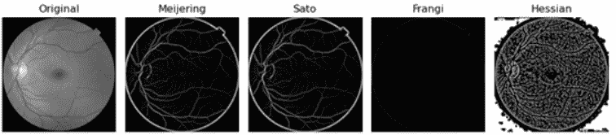

*Figure 8.22 – Ridge operator with scikit-image*

下表比较并总结了脊线算子：

| Filter | Designed for | Strengths | Notes |
|---|---|---|---|
| Meijering | Neurites, filaments | Good for thin, continuous lines | Multiscale |
| Sato | Tubular bright ridges | Good for noise suppression | Assumes bright tubes |
| Frangi | Vessels, medical images | Shape-aware, blob suppression | Best for vascular structures |
| Hessian | General ridge detection | Simple and fast | Not vessel-specific |

Table 8.2 – Ridge operators with scikit-image

脊线滤波器在各个领域有广泛的应用：

- **Medical imaging:** Blood vessels, bronchial trees, neural structures
- **Remote sensing:** Road, river, and pipeline extraction
- **Microscopy:** Detection of filaments and microtubules
- **Structural biology:** Nerve fibers, dendrites

脊线检测对于增强和提取复杂图像中的曲线结构至关重要。像 Frangi 和 Meijering 这样的滤波器利用 Hessian 矩阵的二阶导数和特征值分析来分离管状特征。使用 scikit-image 应用这些滤波器变得简单且高度可定制，使其成为图像处理工具箱中不可或缺的工具。

## 使用 OpenCV-Python 的结构化边缘检测

边缘检测是图像处理和计算机视觉中最基本的问题之一。传统的 Canny、Sobel 或 Laplacian 等方法侧重于基于局部梯度的方法，并且通常在噪声敏感性或复杂自然图像上的性能方面存在不足。结构化边缘检测由 Dollar 和 Zitnick 于 2013 年提出，将边缘检测表述为监督学习问题，其目标是使用决策森林预测结构化边缘图。它结合了机器学习和局部结构推理的优势，在准确性和速度方面优于传统检测器。

设 I ∈ R^{H×W×C} 为输入图像。边缘检测旨在生成一个二值或概率边缘图 E ∈ [0,1]^{H×W}，其中较高的值表示为边缘像素的可能性更高。

结构化边缘检测学习一个函数：f: R^{p×p×C} → R^{p×p}，它将局部图像块 x ∈ R^{p×p×C} 映射到结构化输出 y ∈ R^{p×p}，其中输出块中的每个像素对应于边缘的概率。

## 用于结构化输出的随机森林

结构化边缘检测使用一种称为结构化森林的随机决策森林变体，其中每棵树学习预测的不是单个标量标签，而是小的边缘图。

每棵决策树在标记的训练块集上进行训练：

 {(x_i, y_i)}_{i=1}^N


其中 $y_i$ 是补丁 $x_i$ 的真实边缘掩码。

在树的每个分裂节点中，目标是选择一个分裂函数 $\theta$ 来最大化信息增益。对于结构化输出，这需要定义掩码之间适当的距离度量 $d(y_i, y_j)$。Dollár 和 Zitnick 提出使用聚类将边缘补丁嵌入到低维的二元标签中。

令 $\phi(y_i) \in R^k$ 为此类嵌入，并定义簇上的熵：

$$H(S) = -\sum_{c=1}^{C} \frac{|S_c|}{|S|} \log\left(\frac{|S_c|}{|S|}\right)$$

分裂函数 $\theta$ 选择以最大化信息增益：

$$\Delta H = H(S) - \sum_{j \in \{L,R\}} \frac{|S_j|}{|S|} H(S_j)$$

其中 $S_L, S_R$ 是由 $\theta$ 分裂的左右子节点子集。

## 推理和边缘图聚合

在推理期间，使用滑动窗口提取重叠的补丁，并将每个补丁传递给森林。来自所有树的预测边缘图被平均并在图像上聚合，以生成最终的密集边缘图。

令 $T$ 为树的数量，$E_t(x)$ 为树 t 的预测边缘图，则像素 $i$ 处的聚合边缘响应为：

$$E(i) = \frac{1}{T} \sum_{t=1}^{T} E_t(i)$$

可以应用诸如非极大值抑制或边缘细化等后处理步骤。

结构化边缘检测已成功应用于目标提议生成、语义分割、立体匹配、医学图像边界检测和光流预处理。

其捕捉局部结构和上下文的能力使其特别适用于复杂的自然场景。让我们使用 opencv-python ximgproc 库函数来演示其工作原理。OpenCV 通过 cv2.ximgproc 模块为结构化边缘检测提供预训练模型。确保您使用 opencv-contrib-python 包以访问 cv2.ximgproc。

## 加载和应用检测器

使用 OpenCV 的 ximgproc 模块中的预训练模型，您可以以最少的设置快速应用最先进的边缘检测。与传统的 Canny 或 Sobel 等检测器相比，输出更平滑且结构更连贯。

下表总结了代码片段的工作方式：

| Step | Operation | Purpose |
|---|---|---|
| 1 | Load image using OpenCV | Read image from disk |
| 2 | Convert BGR → RGB | For correct color display |
| 3 | Normalize and convert to float32 | Prepare for model input |
| 4 | Load pretrained forest model | Use model.yml.gz |
| 5 | Call detectEdges() | Compute edge probability map |
| 6 | Visualize results | Inspect edges visually |

Table 8.3 – Breakdown of the steps from the next code snippet

现在，参考下一个代码片段：

```
# Load the image
image = cv2.imread('images/zebras.jpg')
image_rgb = cv2.cvtColor(image, cv2.COLOR_BGR2RGB)
# Initialize the structured edge detector
model_path = 'models/model.yml.gz'  # Download from
# https://github.com/opencv/opencv_extra/blob/master/testdata/cv/ximgproc/
edge_detector = cv2.ximgproc.createStructuredEdgeDetection(model_path)
# Convert to RGB float image
image_float = image.astype(np.float32) / 255.0
# Apply edge detection
edges = edge_detector.detectEdges(image_float)
```

前面的代码片段计算原始边缘概率图。一旦使用结构化边缘检测器计算出原始边缘概率图，它通常包含厚或模糊的边缘，尤其是在图像的底层结构平滑或模糊的地方。为了使这些边缘更清晰、更细、更局部化，我们应用两个重要的后处理步骤：方向图和 NMS。

## 使用方向图和 NMS

函数 computeOrientation() 估计每个检测到边缘的像素处的局部边缘方向图（或梯度方向）。由此产生的合乎逻辑的问题是，为什么需要方向？

为了抑制非边缘响应同时保留边缘结构，我们需要知道边缘位于哪个方向（例如垂直、水平、对角线）。这使我们能够执行方向抑制，即沿着垂直于边缘的方向将像素与其邻居进行比较。

函数 computeOrientation() 生成一个单通道浮点矩阵（与图像宽度和高度相同），其中每个像素存储边缘的方向角 θ（以弧度为单位，通常为 [0, π]）。

函数 `edgesNms()` 计算 **非极大值抑制 (NMS)**，这是一种经典技术，通过在垂直于边缘的方向上保留局部最大值来细化宽边缘响应。

假设你有一个宽的模糊边缘。你只想保留边缘宽度上的最强像素值，即边缘的中心。这是通过将每个像素的边缘强度与其沿垂直于边缘方向的邻居进行比较来实现的。如果像素不是局部最大值，则将其抑制为零。

令 $E(x,y)$ 为边缘强度，$\theta(x,y)$ 为方向。对于每个像素 $(x,y)$，我们计算：

$$E'(x,y)=\begin{cases} E(x,y), & E(x,y)>E(x',y')\land E(x,y)>E(x'',y'')\\ 0, & \text{otherwise}\end{cases}$$

其中 $(x',y')$ 和 $(x'',y'')$ 是 $(x,y)$ 在梯度方向上的邻居（即垂直于边缘方向 $\theta$）。

再次参考以下代码片段：

```python
# compute edge orientation map
orientation_map = edge_detector.computeOrientation(edges)
# apply non-maximum suppression
edges_nms = edge_detector.edgesNms(edges, orientation_map)
```

如果运行上述代码块并绘制原始输入图像以及输出的结构化边缘（在应用 NMS 之前和之后），你应该得到如下图所示：

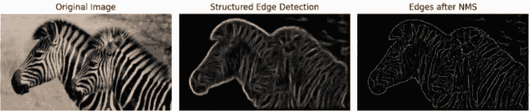

*Figure 8.23 – Structured edge detection with cv2.ximgproc*

结构化边缘检测结合了经典方法的速度和基于学习方法的准确性和适应性。

## 引导滤波用于边缘增强 (OpenCV-Python)

引导滤波，由 He 等人于 2010 年提出，提供了一种快速且边缘保持的图像平滑和细节优化方法。与双边滤波器不同，引导滤波避免了昂贵的迭代操作，非常适合实时和边缘感知的平滑任务。让我们探索引导滤波的数学基础、其实际应用，并提供使用 OpenCV 的 cv2.ximgproc.guidedFilter 的完整 Python 实现。

**引导滤波** 通过使用引导图像（通常是原始图像）来控制另一个图像（源图像）的平滑方式来执行边缘保持平滑。它假设输出在局部窗口中是引导图像的线性变换，这使其非常适合以下任务：

- Edge-aware denoising
- Detail enhancement
- HDR compression
- Image matting
- Depth map refinement

给定：

- **Input image I**: grayscale or color (used as guidance)
- **Source image p**: the image to be filtered (e.g., gradient, mask, etc.)
- **Output q**: the filtered result

对于每个局部窗口 ωₖ，窗口 ωk 中像素 i 的输出 qᵢ 被建模为引导图像的 **线性变换**：

qᵢ = aₖ Iᵢ + bₖ, ∀i ∈ ωk

其中

- aₖ, bₖ: linear coefficients constant in ωₖ
- Iᵢ: pixel intensity at position i

系数 aₖ, bₖ 通过最小化以下成本函数来估计：

E(aₖ, bₖ) = Σᵢ∈ωₖ ((aₖ Iᵢ + bₖ − pᵢ)² + ε aₖ²)

其中：

- ε: regularization parameter to control smoothness (prevents overfitting)

第二项鼓励 q 的梯度更小。

优化的解为：

aₖ = [ (1/|ω|) Σᵢ∈ωₖ Iᵢ pᵢ − μₖ p̄ₖ ] / [ σₖ² + ε ]
bₖ = p̄ₖ − aₖ μₖ

其中：

- μₖ, σₖ²: mean and variance of I in ωk
- p̄ₖ: mean of p in ωₖ

然后输出图像 q 通过使用盒式滤波器对所有 q_i 值进行平均获得。

让我们现在使用以下代码片段，使用 opencv-python 探索使用引导滤波的边缘增强应用：

```
from cv2.ximgproc import guidedFilter
# Load grayscale image and resize for faster processing
img = cv2.imread('images/we.jpg', cv2.IMREAD_GRAYSCALE)
img = cv2.resize(img, (256, 256))
# Normalize to float32 [0, 1]
img_float = img.astype(np.float32) / 255.0
# Step 1: Compute gradient magnitude
grad_x = cv2.Sobel(img_float, cv2.CV_32F, 1, 0, ksize=3)
grad_y = cv2.Sobel(img_float, cv2.CV_32F, 0, 1, ksize=3)
grad_mag = np.sqrt(grad_x**2 + grad_y**2)
# Step 2: Apply guided filter (guide = original image, input = grad_mag)
radius = 8
eps = 1e-3  # Regularization term
grad_mag_smooth = guidedFilter(guide=img_float, src=grad_mag, \
                                radius=radius, eps=eps)
# Step 3: Edge enhancement by subtraction
enhanced_edges = grad_mag - grad_mag_smooth
enhanced_edges = np.clip(enhanced_edges, 0, 1)
# Display img, grad_mag and enhanced_edges side-by-side here
```

如果运行上述代码并绘制图像，你应该得到如下图所示：

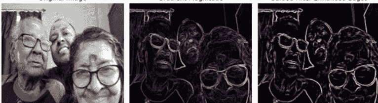

Figure 8.24 – Edge enhancement with guided filtering with opencv-python ximgproc

函数 guidedFilter() 接受以下参数：

- guide: the original image
- src: the gradient image to be smoothed
- radius: window size ω
- eps: regularization parameter ε


这会移除梯度中的微小变化，同时保留强边缘，因为引导图像包含边缘位置信息。

## 使用各向异性扩散的边缘检测

各向异性扩散是一种强大的图像处理技术，它在平滑图像的同时保留边缘结构。由 Perona 和 Malik（1990）提出，它通过基于局部图像梯度调整扩散强度，克服了线性（各向同性）扩散的局限性。这使其成为边缘保留平滑和边缘检测的理想选择。

## Perona–Malik 各向异性扩散

设 I(x, y, t) 表示随时间 t 演化的图像。经典的各向同性扩散（热方程）为：

∂I/∂t = ∇ · (∇I)

各向异性扩散将其修改为：

∂I/∂t = ∇ · (c(x, y, t) · ∇I)

其中：

- ∇I：图像梯度（衡量局部变化）
- c(x, y, t)：控制平滑量的扩散系数

函数 c(·) 通常被选为在边缘处抑制扩散：

c(∇I) = exp( - (∇I / K)² ) 或 c(∇I) = 1 / (1 + (∇I / K)² )

- K：边缘阈值参数；控制对边缘的敏感度
- 小梯度（均匀区域）：高 c → 更多的平滑
- 大梯度（边缘）：低 c → 边缘保留

下面的代码片段演示了各向异性扩散如何使边缘检测效果更好。关键函数如下：

- 来自 medpy 的 `anisotropic_diffusion(...)` 执行 Perona-Malik 平滑。
- `niter`：扩散迭代次数。
- `kappa`：对比度参数 K，用于抑制边缘处的扩散。
- `gamma`：时间步长（为保证稳定性应 ≤ 0.25）。
- `option`：选择传导函数 c(·)。

将平滑后的图像传递给标准的 Sobel 滤波器，以提取增强的边缘并减少噪声。

现在，请参考以下代码片段：

```
from medpy.filter.smoothing import anisotropic_diffusion
# Load and convert image to grayscale
image = rgb2gray(imread('images/umbc_lib.jpg'))
# Apply Perona-Malik anisotropic diffusion
diffused = anisotropic_diffusion(image, niter=20, \
                                kappa=30, gamma=0.1, option=1)
# Compute edges from original and diffused image using Sobel, to compare
edges_original = sobel(image)
edges_diffused = sobel(diffused)
# Plot image, diffused and edge_diffused side-by-side
```

如果你运行上述代码并并排绘制图像，你应该会得到如下图所示的图形；观察各向异性扩散如何保留甚至锐化重要边缘：

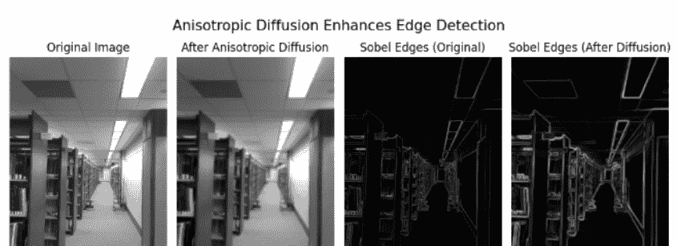

图 8.25 – 使用各向异性扩散的边缘检测

各向异性扩散非常适合边缘保留去噪和边缘增强。它在区域内平滑与保留区域边界之间取得了良好的平衡，这使其在医学成像和结构分析中尤其有价值。

## 基于深度学习的边缘检测

虽然 Sobel、Prewitt 和 Canny 等经典检测器快速且直观，但它们依赖于手动设计的滤波器，在复杂纹理、光照变化或噪声场景中常常失效。深度学习，尤其是卷积神经网络（CNNs），带来了边缘检测的范式转变。深度模型不是手动设计滤波器，而是直接从带标注的数据集中学习它们，从而更适应真实世界场景。本节介绍两种著名的基于深度学习的边缘检测器：整体嵌套边缘检测（HED）和像素差分网络（PiDiNet），并通过 Hugging Face 上可用的预训练模型演示其用法。

## 将边缘检测视为学习问题

设 \(I:\Omega\to\mathbb{R}^3\) 是定义在空间域 \(\Omega\subset\mathbb{R}^2\) 上的彩色图像。边缘检测的目标是学习映射 \(F_\theta(I)=E\)，其中 \(E:\Omega\to[0,1]\) 表示每个像素处存在边缘的概率。该学习问题被形式化为每个像素的二分类任务，并使用二元交叉熵等损失函数：

$$\mathcal{L}=-\sum_{x\in\Omega}\left[y(x)\cdot\log E(x)+(1-y(x))\cdot(1-\log E(x))\right]$$

其中 \(y(x)\in[0,1]\) 是真实边缘标签。

### 整体嵌套边缘检测（HED）

**整体嵌套边缘检测（HED）**是一种全卷积神经网络，它使用深度监督来提取多尺度边缘特征。它基于 VGG-16 架构，从多个卷积层产生侧输出。每个侧输出 \(E_s\) 是一个中间边缘图。它们通过可学习的权重 \(\alpha_s\) 进行融合：

$$F_\theta(I)=\sigma\left(\sum_{s=1}^{S}\alpha_s\cdot E_s\right)$$

其中 \(\sigma\) 是 sigmoid 激活函数。这种多尺度融合确保细粒度和粗粒度的边缘细节都得到保留。可以把 HED 想象成一个专家委员会，每个专家观察不同的图像尺度，他们的综合意见会生成一个稳健的边缘图。

### 像素差分网络（PiDiNet）

**像素差分网络（PiDiNet）**专为轻量级和实时边缘检测而设计。受传统梯度算子（如 Sobel）的启发，PiDiNet 在深度网络内学习像素差分核。PiDiNet 不使用复杂的空洞卷积或注意力机制，而是使用初始化为模拟经典滤波器的差分卷积。

$$G(x,y)=\sum_{i,j}K_{ij}\cdot I(x+i,y+j)$$

其中 \(K\) 是可训练的内核，初始化用于突出像素强度差异。PiDiNet 学习计算像素之间的智能差异，类似于 Sobel，但更灵活且由数据驱动。

从直观的角度来看，HED 和 PiDiNet 之间的关键区别在于它们学习的内容以及如何分配计算资源。HED 将边缘作为多尺度语义概念来学习，其中较深层捕获对象级边界，较浅层捕获精细细节，这使其在包含纹理、遮挡和光照变化的复杂自然场景中特别有效。相比之下，PiDiNet 专注于高效的局部强度差异，与经典梯度算子非常相似，但具有学习到的灵活性，从而能够以更少的参数和显著更低的计算成本逼近边缘响应。

换句话说，HED 优先考虑表示丰富性和全局上下文，而 PiDiNet 优先考虑效率和局部精度。这种区别解释了为什么 HED 通常以牺牲速度为代价来产生更具语义意义的边缘，而 PiDiNet 则在准确性和实时性能之间提供了很好的权衡，尤其是在资源受限的环境中。

以下代码片段演示了如何使用预训练的 HED 和 PiDiNet 模型从输入图像中检测边缘。步骤如下：

- **图像加载：** 使用 `PIL.Image` 加载图像并转换为 RGB
- **模型加载：** 通过 `controlnet_aux` 库使用来自 Hugging Face 的预训练模型
- **推理：** hed 检测器直接返回 NumPy 数组，而 pidi 返回 PIL 图像，该图像被转换为灰度并归一化
- **可视化：** 使用 Matplotlib 并排显示原始图像、PiDiNet 输出和 HED 输出

现在，请参考以下代码片段：

```
```python
import torch
from controlnet_aux import PidiNetDetector, HEDdetector

# Initialize PiDiNet detector
device = torch.device('cuda' if torch.cuda.is_available() else 'cpu')
print(device)
# cpu

# Load and preprocess image
img_path = 'images/cranes.jpg'
orig = Image.open(img_path).convert('RGB')
orig_np = np.array(orig)

pidi_detector = PidiNetDetector.from_pretrained(
                          "lllyasviel/Annotators").to(device)
hed_detector = HEDdetector.from_pretrained(
                          "lllyasviel/Annotators").to(device)

# Detect edges
with torch.no_grad():
    edge_hed = hed_detector(orig)
    edge_pidi_pil = pidi_detector(orig)
    edge_pidi = np.array(edge_pidi_pil.convert('L')) / 255.0 # normalize
```
```


运行上述代码片段并并排绘制图像（orig_np、edge_pidinet 和 edge_hed）后，您应该得到如下所示的结果：

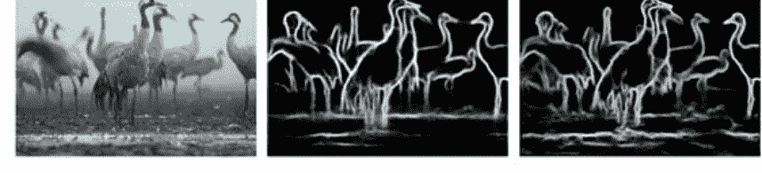

图 8.26 - 使用预训练深度学习模型 PiDiNet 和 HED 进行边缘检测

当原始图像具有清晰的对象结构时，PiDiNet 输出清晰、极简的边缘，而 HED 输出丰富、层次化的边缘：

- PiDiNet 快速高效，非常适合移动和嵌入式系统
- HED 擅长捕捉细微且分层的边界，适用于分割流水线

总之，像 PiDiNet 和 HED 这样的基于深度学习的边缘检测器通过学习数据驱动的滤波器，能够很好地泛化到多样化的图像场景，相较于经典方法实现了显著飞跃。PiDiNet 优先考虑速度和效率，而 HED 强调多尺度精度，使它们成为现代现实应用中边缘检测任务的互补工具。

## 基于导数的多尺度增强

基于导数的算子（如拉普拉斯算子）捕获对锐化和增强至关重要的高频细节。扩展这一思想，图像金字塔，特别是高斯金字塔和拉普拉斯金字塔，能够在多个空间尺度上实现基于导数的增强，从而对粗粒度和细粒度细节提供精细控制。

### 高斯金字塔：多尺度基础

高斯金字塔通过迭代平滑（使用高斯滤波器）和下采样，以逐渐降低的分辨率表示图像。每一层包含图像的低频内容（粗略结构）。形式上，如果 G₀ 是原始图像：

Gᵢ₊₁ = (GaussianBlur(Gᵢ))↓₂

这种结构允许在特定尺度上进行选择性增强，或作为导数运算的前置步骤。

```
# 导入高斯金字塔生成函数
from skimage.transform import pyramid_gaussian
image = imread('images/lena.jpg')
# 通过连续模糊和缩小图像来创建高斯金字塔。
# 'downscale=2' 表示每一层的宽高都是前一层的 1/2。
# 'channel_axis=-1' 表示颜色通道在最后一维。
pyramid = tuple(pyramid_gaussian(image, downscale=2, channel_axis=-1))
# 遍历所有金字塔层并显示每一层
for i, p in enumerate(pyramid): # 为每个金字塔层创建子图
    plt.subplot(1, len(pyramid), i + 1), plt.imshow(p), plt.axis('off')
    plt.suptitle('Gaussian Pyramid')
```

运行上述代码以获得 Lena 图像的高斯金字塔：

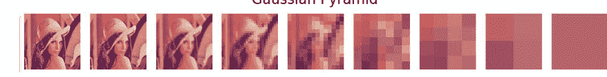

图 8.27 – Lena 图像的高斯金字塔

### 拉普拉斯金字塔：跨尺度的导数表示

拉普拉斯金字塔可以看作是拉普拉斯算子的多尺度版本。每一层存储图像与其平滑（扩展）版本之间的差异，有效地编码图像的带通或细节信息：

$L_i = G_i - \text{expand}(G_{i+1})$

因此，拉普拉斯金字塔将图像分解为多个分辨率下的高频导数，非常适合增强和重建。

```
from skimage.transform import pyramid_laplacian
def minmax_norm(img):
    # 对图像执行最小-最大归一化
    # 公式：(img - min) / (max - min)
    # 将像素值重新缩放到 [0, 1] 范围
    # 避免除以零，如果 max == min 则返回原图
    return (img - img.min()) / (img.max() - img.min()) \
        if img.max() > img.min() else img

# 构建下采样因子为 2 的拉普拉斯金字塔
pyramid = tuple(pyramid_laplacian(image, downscale=2, channel_axis=-1))
# 显示拉普拉斯金字塔的每一层
i, n = 1, len(pyramid)
for p in pyramid:
    p = minmax_norm(rgb2gray(p)) # 将每一层转换为灰度并归一化
```

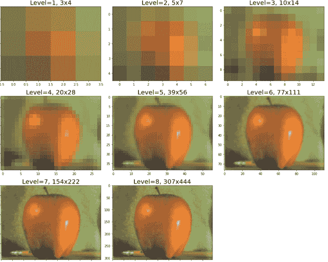

### 应用：多尺度混合与增强

通过使用高斯加权掩码混合两幅图像的拉普拉斯分量，可以在各个尺度上实现平滑、自然的过渡，适用于曝光融合和全景拼接。该过程之所以有效，是因为在重建之前，导数（拉普拉斯层）被无缝组合。

拉普拉斯金字塔将基于导数的增强扩展到多尺度领域，将图像分解为可以被选择性增强或重新组合的粗粒度和细粒度导数。这种方法形成了经典基于导数的锐化与现代多尺度增强技术（用于 HDR 成像、融合和边缘感知处理）之间的理论桥梁。

### 基于金字塔的图像混合

金字塔的一个经典应用是**无缝图像混合**，例如将苹果和橙子组合在一起。给定两幅图像 (A) 和 (B) 以及一个二值掩码 (M)，我们构建拉普拉斯金字塔 ($L_A$, $L_B$) 和一个高斯金字塔 ($G_M$)。在每一层：

$L_C^i = G_M^i L_A^i + (1 - G_M^i)L_B^i$

上图显示了输入图像以及用前面代码片段生成的输出图像。下图显示了输入、掩码和输出图像：

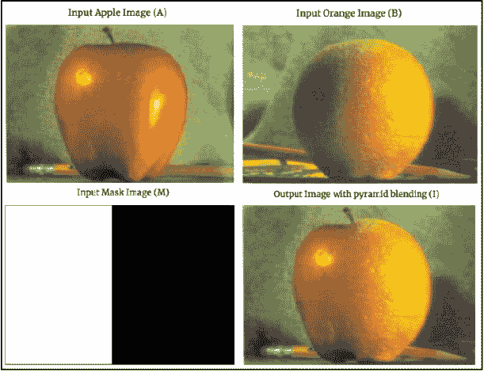

*图 8.31 – 要混合的图像、掩码以及使用金字塔混合的输出图像*

这种方法通过在多个空间频率下进行混合，实现了图像区域之间的平滑过渡，有效避免了简单二值掩码所产生的生硬边缘。金字塔混合在全景拼接和对象替换等应用中尤其强大，能够创建逼真的合成图像。

## 选择合适的边缘检测器

边缘检测中一个反复出现的挑战不是实现，而是选择。不同的算子对不同的图像特征有响应，例如噪声水平、结构几何形状（边缘 vs 斑点 vs 脊线）以及计算约束。下表提供了从场景到方法的实用映射，帮助做出明智决策：

| 场景 | 推荐方法 | 理由 |
|---|---|---|
| 低噪声图像，快速结果 | Sobel, Prewitt | 快速的一阶梯度就足够了 |
| 噪声图像 | Canny, LoG | 内置平滑降低噪声敏感性 |
| 需要细而定位准确的边缘 | Canny | 非极大值抑制产生清晰的边缘 |
| 斑点状结构（斑点、病灶） | Hessian (DoH) | 检测在所有方向上有曲率的结构 |
| 管状/曲线结构（血管、道路） | Ridge (Frangi) | 特征值分析捕获线条状模式 |
| 多尺度边缘检测 | LoG, DoG | 尺度空间公式捕获不同大小的边缘 |
| 方向性边缘强调 | Kirsch | 对特定方向敏感 |
| 实时/低计算环境 | Sobel, PiDiNet | 轻量且高效 |
| 复杂自然场景（语义边界） | HED | 学习对象级边缘 |
| GPU 可用，需要高精度 | HED | 深度多尺度表示 |
| 边缘设备/移动部署 | PiDiNet | 针对效率进行了优化 |

表 8.4 - 选择合适的边缘检测器

以下是一个实用的决策流程：

- 如果需要快速基线，从 Canny 开始
- 如果边缘有噪声，优先选择 Canny 或 LoG
- 如果检测斑点（斑点、病灶），使用 Hessian (DoH)
- 如果检测血管、裂缝、脊线，使用 Frangi
- 如果需要语义理解，使用 HED
- 如果需要实时的深度边缘，使用 PiDiNet

请注意，边缘检测器在什么是“边缘”的定义上存在根本差异：

- 基于梯度（Sobel, Canny）：强度不连续性
- 二阶（LoG, DoH）：曲率和零交叉
- 基于 Hessian 的脊线（Frangi）：方向各向异性
- 基于学习（HED, PiDiNet）：数据驱动的边界理解

## 总结

本章涵盖了基于导数的图像增强，包括经典方法如反锐化掩膜和基于熵的对比度增强，基于梯度和拉普拉斯的边缘检测器（Sobel、Prewitt、Roberts、Canny、LoG/DoG），使用高斯和拉普拉斯金字塔的多尺度技术，以及高级方法如脊线/结构边缘检测、引导滤波、各向异性扩散和基于深度学习的检测器（HED、PiDiNet）。

使用 scikit-image、OpenCV 和 scipy 的 Python 实现展示了实际应用，而交互式 Gradio 应用演示了 Canny 边缘检测，使读者能够尝试阈值并可视化结果。读者现在应该能够在 Python 中实现基于导数的增强、使用各种滤波器检测边缘、执行多尺度分析，并探索经典和基于深度学习的边缘检测。

在下一章中，我们将讨论图像恢复技术。

获取本书的 PDF 版本及更多内容

扫描二维码（或访问 packtpub.com/unlock）。按名称搜索本书，确认版本，然后按照页面上的步骤操作。


> 注意：请保留您的发票。直接从 Packt 购买的不需要发票。


