### 图像恢复：成像中的逆问题

图像恢复是图像处理和计算机视觉中的一个基本问题。其主要目标是从观测到的退化版本中重建或恢复出高质量的图像。退化可能源于成像系统的局限性、环境条件或传输信道，通常表现为模糊、噪声、低分辨率或数据缺失。恢复图像的能力具有巨大的实际意义，影响着医学诊断、天文学、遥感、摄影和监控等领域。

与**图像增强**不同，**图像增强**主观上改善视觉质量，而不一定对退化来源进行建模；**图像恢复**则依赖于退化过程的数学模型。通过结合原始图像如何被改变的知识，恢复方法旨在“逆转”该过程，并逼近真实、未退化的图像。

在本章中，我们将研究一系列图像恢复技术，从经典分析方法开始，经过稀疏表示，最后到达基于现代深度学习的方法。具体来说，我们将涵盖以下关键主题：

- 图像恢复作为逆问题
- 经典的图像去卷积方法
- 基于稀疏表示的图像恢复
- 基于深度学习的图像恢复
- 基于Stable Diffusion与DeepFill的图像修复

### 技术要求

在阅读本章不同部分时，请跟随Jupyter notebook（并运行必要的代码片段）。以下是本章对应notebook的GitHub链接：https://github.com/PacktPublishing/Hands-On-Image-Processing-and-Computer-Vision-with-Python-Second-Edition。为了代码无缝运行，需要在运行代码之前安装正确版本的库。如果版本不匹配，则可能需要根据库中的某些特性/函数是否被移除或弃用而对代码稍作调整。

请注意，本章中的实现基于Python（≥3.8），需要标准科学计算库以及深度学习框架。经典方法使用`numpy`和`scikit-image`，而深度学习部分还依赖`torch`、`diffusers`、`basicsr`、`simple_lama_inpainting`、`gradio`和`pyyaml`（建议与最近的稳定版本兼容）。建议使用支持CUDA的GPU来高效执行深度学习模型，在降低分辨率和批量大小的情况下，约6 GB显存足以进行推理，而≥8 GB显存可确保更流畅的性能。为了可复现性，一些部分还需要克隆外部仓库（例如NAFNet和InstructIR），内联提供了设置说明和依赖安装步骤。

### 图像恢复作为逆问题

图像恢复的本质在于将其视为成像中的**逆问题**。在数学上，观测到的退化图像*g(x, y)*可表示为：

$$g(x,y) = f(x,y) * h(x,y) + n(x,y)$$

其中：

- *f(x, y)*：未知的原始图像，
- *h(x, y)*：退化函数或点扩散函数（PSF），
- *n(x, y)*：加性噪声，
- *g(x, y)*：观测到的退化图像，
- *\**：卷积算子。

随后，恢复力图从原始图像$f(x,y)$中获得估计量$\hat{f}(x,y)$。然而，由于噪声和信息丢失，该问题在Hadamard意义下是不适定的：

- 1. 可能不存在唯一解。
- 2. 解可能不连续依赖于输入（不稳定性）。
- 3. 需要附加约束或先验来正则化解。

因此，图像恢复不是一个简单的反演问题，而是需要仔细建模、优化和先验知识的问题。下图展示了基本的图像退化模型：

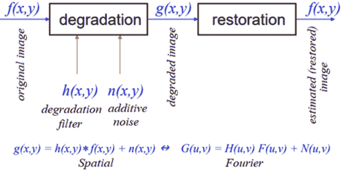

*图 9.1 – 图像恢复过程*

图像恢复的研究源远流长：

- **早期分析方法：** 维纳滤波和逆滤波等技术是在通信理论的背景下发展起来的，为高斯噪声下的去模糊提供了闭式解。
- **基于正则化的方法：** 吉洪诺夫正则化、全变差最小化和贝叶斯框架为不适定问题引入了稳定性。
- **稀疏表示与字典学习：** 恢复受益于稀疏编码和小波域去噪的进步，实现了更锐利的重建。
- **深度学习方法：** 卷积神经网络（CNN）、生成模型和Transformer彻底改变了恢复领域，在去噪、去模糊、超分辨率和修复方面取得了最先进的性能。

#### 图像恢复中的核心任务

若干典型问题构成了图像恢复研究的基础：

- **图像去噪：** 在保留精细结构的同时去除噪声。早期方法使用线性滤波器；现代方法利用非局部相似性和深度神经网络。
- **图像去模糊：** 逆转运动模糊或散焦模糊的影响。解决方案从经典去卷积到使用学习先验的盲去模糊不等。
- **图像修复：** 填补图像中缺失或损坏的区域。现代技术采用基于块的合成和深度生成模型。
- **去雾与去雨：** 去除大气薄雾、雾气或雨痕，以恢复可见度和对比度。基于物理的模型和CNN主导了近期的进展。
- **超分辨率：** 从低分辨率输入重建高分辨率图像，利用先验、稀疏编码和深度超分辨率网络。

#### 去噪与去模糊

对于图像去噪，退化主要由加性随机噪声（如高斯传感器噪声、泊松散粒噪声）引起。

- **模型：** $g(x, y) = f(x, y) + \eta(x, y)$
- **目标：** 在保留细节（边缘、纹理）的同时抑制噪声。
- **典型方法：** 高斯平滑、非局部均值、BM3D、深度去噪网络（DnCNN、NAFNet）。

对于图像去模糊，退化是由模糊核的卷积（运动模糊、散焦模糊、大气湍流）引起的。

- **模型：** $g(x, y) = (h * f)(x, y) + \eta(x, y)$
- **目标：** 通过去卷积消除模糊，同时对噪声具有鲁棒性。
- **典型方法：** 逆滤波、维纳滤波、Richardson–Lucy去卷积、深度盲去模糊网络。

关键区别在于，去噪处理的是*随机噪声去除*，而去模糊则侧重于*逆转确定性卷积*。

#### 应用

图像恢复具有现实世界的重要性：

- **医学成像：** 增强MRI或CT扫描图像，以便准确诊断。
- **天文学与遥感：** 校正望远镜和卫星图像中的大气畸变。
- **监控与取证：** 改善降质影像，用于识别和分析。
- **摄影：** 减少低光或手持拍摄中的噪声和模糊。

由于模糊是图像退化中最常见且在数学上易于处理的形式之一，我们从经典的图像去卷积技术开始，这些技术旨在从模糊观测中恢复清晰图像。

### 经典的图像去卷积方法

模糊是成像系统中最常见的退化形式之一。它源于光学缺陷、曝光期间的运动或失焦拍摄。在数学上，模糊可以建模为原始图像$f(x, y)$与点扩散函数（PSF）$h(x, y)$的卷积，可能随后再加上噪声$n(x, y)$：

$g(x, y) = f(x, y) * h(x, y) + n(x, y)$

去卷积过程试图反转这一操作，即从观测到的模糊图像$g(x, y)$中恢复$f(x, y)$的估计。


## 频域表述

利用卷积定理，傅里叶变换将卷积转换为乘法：

$$G(u, v) = F(u, v) \cdot H(u, v) + N(u, v)$$

其中 $G, F, H, N$ 分别是 $g, f, h, n$ 的傅里叶变换。

因此，如果 $H(u, v)$ 已知，我们可以尝试通过下式恢复 $F(u, v)$：

$$F(u, v) \approx G(u, v) / H(u, v)$$

这就引出了逆滤波（Inverse Filter），也就是我们的起点。

接下来，我们使用高斯模糊模型来演示逆滤波。我们从灰度 Lena 图像开始，在频域中施加高斯模糊，生成一幅退化版本：

```
im = 255*rgb2gray(imread('images/lena.jpg'))
gauss_kernel = np.outer(signal.gaussian(im.shape[0], 3), # Gaussian blur
                        signal.gaussian(im.shape[1], 3))

freq = fp.fft2(im) # FFT of image and kernel
freq_kernel = fp.fft2(fp.ifftshift(gauss_kernel)) # this is H(u,v)
convolved = freq * freq_kernel  # Apply convolution theorem
im_blur = fp.ifft2(convolved).real
im_blur = 255 * im_blur / np.max(im_blur)  # Normalize
```

现在，我们将模糊图像的频谱除以模糊核的频谱。由于除以非常小的值会放大噪声，我们添加一个小常数 $\varepsilon$ 以保持稳定：

$$\hat{F}(u, v) = G(u, v) / (H(u, v) + \varepsilon)$$

```
epsilon = 10**-6
freq = fp.fft2(im_blur)
freq_kernel = 1 / (epsilon + freq_kernel) # avoid division by zero
convolved = freq * freq_kernel
im_restored = fp.ifft2(convolved).real
im_restored = im_restored / np.max(im_restored) # Normalize
```

如果运行上述代码，并将得到的输入图像、模糊图像、恢复图像和差分图像可视化，你应该会得到类似下图的图像：

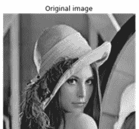

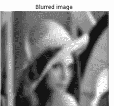

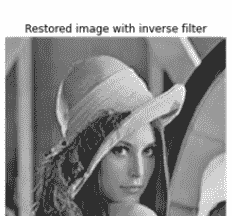

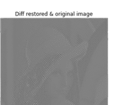

图 9.2 – 使用逆滤波进行图像恢复（高斯模糊）

上面的图像分别以对数尺度展示了逆滤波核的频谱（高通滤波器，HPF）、原始 Lena 图像、经高斯低通滤波器（LPF）模糊后的 Lena 图像以及恢复后图像的频谱。你可以使用傅里叶变换一章中定义的函数来绘制（2D 和 3D）频谱，得到类似下图的图像：

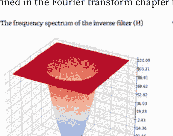

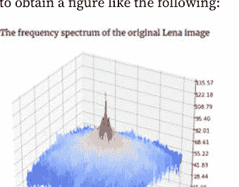

**模糊 Lena 图像（经高斯低通滤波）的频谱**

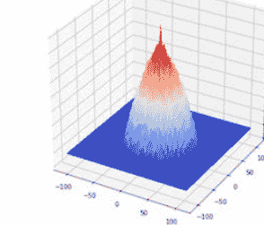

**恢复后 Lena 图像的频谱（经逆滤波）**

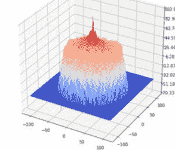

图 9.3 – 高斯模糊核频谱与逆滤波图像的频谱

类似地，我们可以使用逆滤波对已知运动模糊核造成的模糊图像进行去模糊。代码保持不变，只有模糊核发生变化，如下面的代码所示。注意，在频域中应用卷积之前，我们需要创建一个与原始图像大小相同的零填充核，如下一个代码片段所示：

```
im = 255 * rgb2gray(imread('images/scene.jpg'))
kernel_size = 21  # create 21x21 horizontal motion blur
mblur_kernel = np.zeros((kernel_size, kernel_size))
mblur_kernel[int((kernel_size-1)/2), :] = np.ones(kernel_size)
mblur_kernel = mblur_kernel / kernel_size
pad_y = (im.shape[0] - kernel_size) // 2 # Zero-pad kernel
pad_x = (im.shape[1] - kernel_size) // 2
mblur_kernel = np.pad(mblur_kernel,
                      ((pad_y, pad_y+1), (pad_x, pad_x+1)), 'constant')
freq = fp.fft2(im) # Apply motion blur via FFT
freq_kernel = fp.fft2(fp.ifftshift(mblur_kernel))
im_blur = fp.ifft2(freq * freq_kernel).real
im_blur /= np.max(im_blur)
```

同样，如果将图像并排绘制，你应该会得到类似下图的结果：

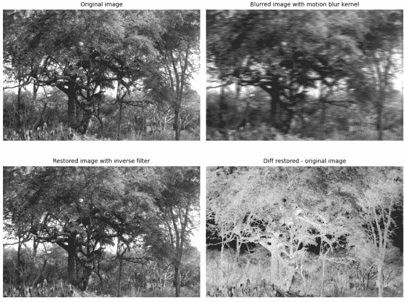

图 9.4 – 使用逆滤波进行图像恢复（运动模糊）

可以看出，逆滤波本质上是一个高通滤波器（HPF），因为模糊对应低通滤波（LPF）。

对于无噪声且模糊核完全已知的图像，逆滤波效果相当不错。然而，当存在噪声时，逆滤波会严重失效，因为高频分量（噪声占主导）被放大了。这就促使人们采用更稳健的替代方案，例如维纳滤波，它在去模糊与噪声抑制之间取得平衡。

## 使用维纳滤波进行反卷积

在上一节中，我们介绍了在模糊核已知的情况下用于图像去模糊的逆滤波。然而，其主要缺点之一是对噪声极其敏感。即使模糊图像中只有少量噪声，也可能导致重建图像出现严重的不稳定。

在真实成像系统中，噪声是不可避免的。因此，图像恢复的一项重要任务不仅是消除模糊，还要同时抑制噪声。一个经典的解决方案是维纳滤波，它将图像恢复表述为一个统计估计问题。

逆滤波试图通过相除来恢复 $F(u, v)$：

$$\hat{F}(u, v) = G(u, v) / H(u, v)$$

这仅在噪声 $N(u, v) = 0$ 时有效。但当存在噪声时，除以 $H(u, v)$ 的小数值会急剧放大噪声，产生糟糕的结果。

### 维纳滤波——一种统计解决方案

维纳滤波引入统计估计，将恢复问题视为最小均方误差（MMSE）估计问题：

$$\hat{F}(u, v) = \arg\min_{\hat{F}} E\left[ \left|F(u, v) - \hat{F}(u, v)\right|^2 \right]$$

维纳滤波在频域的闭式解为：

$$\hat{F}(u, v) = \frac{H^*(u, v)}{|H(u, v)|^2 + S_\eta(u, v)/S_f(u, v)} G(u, v)$$

其中 $H^*(u, v)$ 是 $H(u, v)$ 的复共轭，$S_\eta(u, v)$ 是噪声的功率谱密度（PSD），$S_f(u, v)$ 是原始图像的功率谱密度。$S_\eta(u, v)/S_f(u, v)$ 这项是信噪比（SNR）的倒数。我们需要记住：

- 当噪声较低时，$S_\eta \ll S_f$，该滤波器的行为类似于逆滤波。
- 当噪声较高时，它会抑制有噪频率。

因此，维纳滤波在细节保留与噪声抑制之间提供了偏差-方差权衡。然而，在现实场景中，$S_\eta(u, v)$ 和 $S_f(u, v)$ 事先是未知的：

- 噪声 PSD $S_\eta(u, v)$：需要知道传感器或信道噪声的统计分布，而这很少能获得。
- 图像 PSD $S_f(u, v)$：取决于原始图像的内容（纹理、边缘等），而我们无法获得这些信息。

因此，对大多数实际图像恢复问题而言，直接应用上述方程是不可行的。

### 无监督维纳滤波

无监督维纳滤波通过从观测到的退化图像本身同时估计 $S_\eta(u, v)$ 和 $S_f(u, v)$ 来解决这一问题。其核心思想是：在退化模型 $G(u, v) = H(u, v)F(u, v) + N(u, v)$ 下，我们可以利用关于噪声和信号结构的统计假设来近似未知的功率谱。现在来估计 PSD。观测到的功率谱为：

$$S_g(u, v) = E\left[|G(u, v)|^2\right] = |H(u, v)|^2 S_f(u, v) + S_\eta(u, v).$$

这提供了观测到的退化图像频谱与未知功率谱之间的直接关系。

噪声估计：如果假设噪声为高斯白噪声，则 $S_\eta(u, v)$ 可以由跨频率的常数近似：

$$S_\eta(u, v) \approx \sigma_\eta^2$$

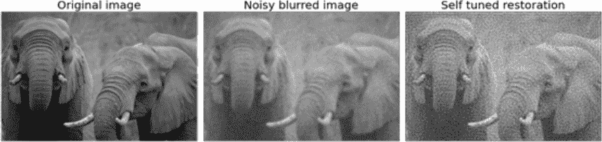

以下是需要注意的要点：

- 维纳滤波通过自适应地对频率加权，从而在去模糊和去噪之间取得平衡。
- 与逆滤波不同，它不会在高频处过度放大噪声。

在实践中，当模糊核近似已知时，即使存在中等程度的噪声，维纳滤波也能提供视觉上令人满意的恢复效果。

## 图像恢复中的吉洪诺夫正则化

逆滤波天真地尝试：

$$\hat{F}(u,v)=\frac{G(u,v)}{H(u,v)}$$

问题在于：如果某些频率处 $H(u,v) \approx 0$，相除会灾难性地放大噪声。维纳滤波通过对噪声和信号功率谱建模解决了这一问题。但如果噪声统计特性未知呢？这时就需要正则化方法，尤其是*吉洪诺夫正则化*。

### 变分表述

我们不直接求逆，而是将恢复问题视为一个优化问题：寻找一个估计 $f$，它既能解释观测数据，又能尊重关于自然图像的某些先验。吉洪诺夫泛函为：

$$\hat{f}=\arg\min_f\left(\|h*f-g\|_2^2+\lambda\|Lf\|_2^2\right)$$

*数据保真项* &nbsp;&nbsp;&nbsp;&nbsp;&nbsp;&nbsp;&nbsp;&nbsp;&nbsp;&nbsp; *正则化 / 先验*

其中 $\|h*f-g\|_2^2$ 确保恢复图像经过模糊后与观测图像一致（数据保真），$L f$：一个编码先验知识的线性算子，$\lambda > 0$：控制权衡的正则化参数。$L$ 的常见选择有：

- $L=I$：惩罚图像的能量（全局平滑）。
- $L=\nabla$：惩罚大的梯度，促使图像平滑。

因此，这一先验通常被称为“保真 + 平滑”先验。


## Fourier 域解

如果我们假设循环卷积并使用 $L=I$，问题在傅里叶域中简化。方程变为：

$$\hat{F}(u,v)=\frac{H^*(u,v)}{|H(u,v)|^2+\lambda}G(u,v)$$

这与维纳滤波器惊人地相似：

- **维纳分母：** $|H|^2+S_\eta/S_f$
- **Tikhonov 分母：** $|H|^2+\lambda$

Tikhonov 用常数 $\lambda$ 替换统计比值 $S_\eta/S_f$，提供了对平滑度的**确定性控制**。

以下是偏差-方差权衡：

- 如果 $\lambda\to 0$，方程退化为逆滤波器，放大噪声。
- 如果 $\lambda$ 非常大，滤波器会抑制所有高频 → 过度平滑的结果。
- 选择 $\lambda$ 在对观测的保真度（保留细节）和平滑先验（抑制噪声）之间取得平衡。

因此，Tikhonov 在图像恢复中体现了偏差-方差**权衡**。

## 超越恒等先验

如果 $L$ 是梯度算子（∇），则先验惩罚粗糙度，导致经典的平滑先验。这等价于最小化：

$$\|h*f-g\|_2^2+\lambda\|\nabla f\|_2^2$$

这与基于扩散的去噪相关（类似于二次平滑先验）。可以插入其他先验：

- 拉普拉斯算子 → 惩罚高阶二阶导数。
- 保边先验（非二次范数）→ 与全变分（TV）正则化相关。

因此，Tikhonov 是更广泛的变分恢复方法族的原型。让我们与维纳滤波进行比较：

| Aspect | Tikhonov | Wiener |
|---|---|---|
| Formulation | Variational minimization | Statistical estimation |
| Assumptions | No explicit noise model, constant penalty | Requires noise and signal PSD |
| Adaptivity | Global, deterministic | Adaptive to local frequency SNR |
| Pros | Simple, tunable, mathematically elegant | Adaptive, robust to noise |
| Cons | Needs λ tuning, oversmooths | Requires noise statistics (or estimation) |

*Table 9.1 – Comparing Tikhonov regularization with Wiener filtering*

**Tikhonov regularization** 提供了一种确定性的、变分的图像恢复方法，在数据保真度和平滑先验之间取得平衡。它比维纳滤波更简单但适应性更差。它是通向更高级先验如 TV、稀疏先验和现代深度先验的门户。

如果比值 $S_\eta/S_f$ 被常数 $\lambda$ 近似，则维纳和 Tikhonov 在数学上相似。因此，维纳是统计/贝叶斯的，而 Tikhonov 是变分/正则化为基础的。下面的代码片段实现了 Tikhonov 恢复并与维纳恢复进行比较，并且为了视觉比较，我们将并排绘制恢复后的图像：

```python
from skimage import color, data, img_as_float, restoration
from scipy.signal import convolve2d as conv2
from numpy.fft import fft2, ifft2, fftshift

im = color.rgb2gray(img_as_float(data.astronaut()))  # Load image
im = im[50:300, 150:400]  # crop
n = 15
psf = np.ones((n, n)) / n**2  # Blur with PSF
blurred = conv2(im, psf, 'same')
np.random.seed(0)  # Add Gaussian noise
noisy = blurred + 0.05 * np.random.standard_normal(blurred.shape)

def tikhonov_restore(noisy, psf, lam=0.01):  # Tikhonov Restoration
    psf_padded = np.zeros_like(noisy)
    psf_padded[:psf.shape[0], :psf.shape[1]] = psf
    psf_padded = fftshift(psf_padded)
    H = fft2(psf_padded)
    G = fft2(noisy)
    H_conj = np.conj(H)
    F_hat = (H_conj / (np.abs(H)**2 + lam)) * G
    f_hat = np.real(ifft2(F_hat))
    return np.clip(f_hat, 0, 1)

tikhonov_restored = tikhonov_restore(noisy, psf, lam=0.01)
wiener_restored, _ = restoration.unsupervised_wiener(noisy, psf)
```

如果运行上述代码并并排可视化原始、模糊和噪声以及 Tikhonov 和维纳恢复的图像，您应该得到如下图所示的图：

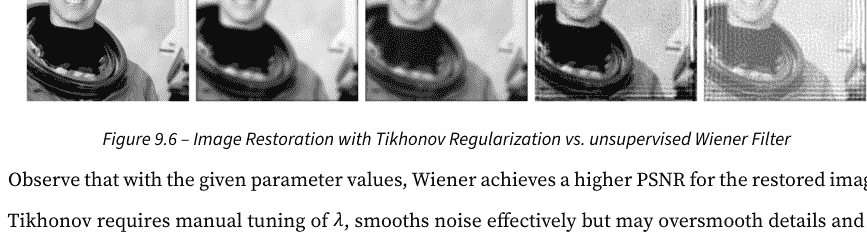

Figure 9.6 – Image Restoration with Tikhonov Regularization vs. unsupervised Wiener Filter

观察到在给定的参数值下，维纳恢复图像的 PSNR 更高。

Tikhonov 需要手动调参 λ，有效平滑噪声但可能过度平滑细节，且更简单且确定性。维纳自适应估计噪声-信号比，通常更好地保留细节，在噪声统计未知时在实际情况下更实用。

## 维纳滤波和 Tikhonov 正则化的贝叶斯解释

图像恢复也可以在贝叶斯推理框架下进行，其目标是恢复给定退化观测 g 时最可能的干净图像 f。我们假设退化模型：

$$g = Hf + \eta$$

其中加性高斯噪声 $\eta \sim N(0, \sigma^2 I)$。因此，似然为：

$$p(g \mid f) \propto \exp\left( -\frac{1}{2\sigma^2} \| Hf - g \|^2 \right)$$

先验和估计策略包括以下内容：

- **维纳滤波：** 贝叶斯 MMSE（期望）估计
  - 假设信号 f 和噪声都是具有已知协方差的高斯分布。
  - **MMSE** 估计量为：

    $$\hat{f}_{\text{Wiener}} = E[f \mid g]$$

  - 导致频率域中的经典维纳滤波解。
  - 解释：找到给定噪声观测的*期望图像*，在高斯假设下最优。
- **Tikhonov 正则化：** 贝叶斯 MAP 估计
  - 假设图像上的高斯先验：

    $$p(f) \propto \exp\left( -\frac{\lambda}{2} \| Lf \|^2 \right)$$

  - **最大后验（MAP）** 估计量为：

    $$\hat{f}_{\text{Tikhonov}} = \arg\max_f p(f \mid g)$$

  - 等价于最小化：

    $$\|Hf-g\|^2 + \lambda\|Lf\|^2$$

  - 解释：找到给定观测的*最可能图像*，在保真度和平滑先验之间取得平衡。

关键见解：

- 维纳滤波 = 贝叶斯 MMSE → 对所有可能解进行平均。
- Tikhonov 正则化 = 贝叶斯 MAP → 选择单一最可能的解。

这种区别解释了为什么维纳滤波与*二阶统计量*（协方差）紧密相关，而 Tikhonov 更通用，并自然扩展到其他先验（例如 TV、稀疏性）。

## 使用 CLEAN 算法的去卷积

CLEAN 是一种经典的去卷积算法，最初在射电天文学中发明，用于从干涉测量（合成图像或“脏图”）中重建天空亮度分布，其中仪器点扩散函数（PSF），称为脏波束，具有很强的旁瓣。原始算法（Högbom，1974）将天空建模为稀疏的点源集合，然后迭代地从脏图像中减去 PSF 的缩放和移位副本以构建干净分量集合。最后，“恢复波束”（平滑/理想化的 PSF）与干净分量卷积并与残差相加以产生恢复图像。CLEAN 的贪婪、匹配追踪风格使其在恢复稀疏、点状结构方面具有鲁棒性，并且仍然是许多现代去卷积方案的基础方法和概念基线。

从先前用于去卷积的离散退化模型开始：

$$g[i,j] = (h * f)[i,j] + \eta[i,j],$$

其中 $g$ 是观测到的脏图像，$h$ 是 PSF（脏波束），$f$ 是未知的真实图像，$\eta$ 是噪声。CLEAN 假设真实图像 $f$ 可很好地用点源（狄拉克函数）的稀疏线性组合近似：

$$f[i,j] \approx \sum_k a_k\,\delta[i-p_k,\,j-q_k]$$

其中振幅为 $a_k$，位置为 $(p_k,q_k)$。将此模型与 $h$ 卷积得到：

$$(h * f)[i,j] \approx \sum_k a_k\,h[i-p_k,\,j-q_k]$$

因此，脏图像被解释为移位 PSF 的叠加。CLEAN 是一种贪婪算法，它找到剩余最大的 PSF 形状贡献，减去 PSF 的缩放副本，并记录相应的 delta（干净分量）。

### Högbom CLEAN

设 $r^{(0)} = g$ 为初始残差（脏图像）。在迭代 $t$ 时：

- 找到峰值（最大绝对值）残差：

  $$(p_t, q_t) = \arg\max_{(i,j)} |r^{(t)}[i,j]|$$

  设 $s_t = r^{(t)}[p_t, q_t]$ 为有符号峰值。
- 将缩放的 delta 分量添加到干净分量图 $c$：

  $$c[p_t, q_t] \leftarrow c[p_t, q_t] + \gamma\, s_t$$

  其中 $0 < \gamma \le 1$ 为环路增益。
- 从残差中减去以 $(p_t, q_t)$ 为中心的 PSF，按 $\gamma s_t$ 缩放：

  $$r^{(t+1)} \leftarrow r^{(t)} - \gamma s_t \cdot \text{shift}(h, p_t, q_t)$$

迭代直到峰值低于阈值 $\tau$（通常与噪声水平相关）或达到最大迭代次数。终止后，通过将干净分量 $c$ 与平滑恢复波束 $b$（通常是近似真实 PSF 主瓣的高斯）卷积，并加上最终残差来计算恢复图像：

$$\hat{f} = (c * b) + r^{(T)}$$

这种两项组合保留了干净的点状结构（来自 $c * b$）和残差中剩余的低振幅扩展通量。

CLEAN 有效的原因如下：

- **对 PSF 形状的贪婪匹配：** CLEAN 明确匹配并移除 PSF 形状的模式，减少可能隐藏较弱源的旁瓣混淆。
- **环路增益：** $\gamma$ 控制稳定性。使用 $\gamma < 1$ 可防止过度减法并在噪声中稳定算法；较小的 $\gamma$ 导致更慢但更安全的收敛。
- **恢复波束：** 它用平滑波束替换通常复杂（并且可能有噪声）的 PSF 主瓣，以产生视觉上可解释的图像并避免放大高频噪声。
- **稀疏性先验：** CLEAN 通过从离散 delta 构建图像有效地施加稀疏性先验（点源）；这就是为什么 CLEAN 在稀疏的天文场景中表现良好，但在平滑变化的扩展对象上表现较差。

在数学上，**CLEAN** 与匹配追踪和贪婪稀疏近似密切相关（我们将在下一节中解释）：在每一步，CLEAN 选择与残差最佳匹配的字典原子（移位的 PSF）并以系数 $\gamma s_t$ 减去它。


下一个代码片段实现了 Högbom CLEAN（使用 `hogbom_clean()` 函数），并在一个被高斯点扩散函数模糊、可选用高斯噪声破坏的 ALMA 星系图像上进行了演示。以下是重要步骤：

1. 构建归一化高斯点扩散函数（`make_gaussian_psf`）。
2. 通过将真实图像与点扩散函数卷积并添加噪声（如果 `USE_SYNTHETIC_BLUR`）来创建合成脏图。
3. 运行 `hogbom_clean` 提取清洁分量和残差。
4. 通过将清洁分量与恢复波束卷积并加上残差，形成最终恢复图像。
5. 可视化真实图像、脏图、清洁分量和恢复图像，并打印简单的 MSE 指标。

现在，请参考以下代码片段：

```python
def make_gaussian_psf(size, sigma):
    assert size % 2 == 1, "psf size should be odd"
    ax = np.arange(-(size // 2), size // 2 + 1, dtype=float)
    xx, yy = np.meshgrid(ax, ax)
    psf = np.exp(-(xx**2 + yy**2) / (2.0 * sigma**2))
    psf /= psf.sum()
    return psf

def hogbom_clean(
    dirty, psf, gain=0.1, niter=1000, threshold=1e-4, verbose=False
):
    dirty = dirty.astype(np.float64)
    residual = dirty.copy()
    clean_components = np.zeros_like(dirty)
    psf_flipped = psf  # psf is symmetric in many cases
    for i in range(niter):
        peak_idx = np.unravel_index(np.argmax(residual), residual.shape)
        peak_val = residual[peak_idx]
        clean_components[peak_idx] += gain * peak_val
        delta = np.zeros_like(dirty)
        delta[peak_idx] = gain * peak_val
        sub = convolve2d(
            delta, psf_flipped, mode='same', boundary='fill', fillvalue=0.0)
        residual = residual - sub
    g_sigma = max(0.5, PSF_SIGMA / 2.0)
    g_size = (
        psf.shape[0]
        if psf.shape[0] % 2 == 1
        else psf.shape[0] + 1
    )

    restoring_beam = make_gaussian_psf(g_size, g_sigma)
    restored = (
        convolve2d(clean_components, restoring_beam, mode='same')
        + residual
    )
    return restored, clean_components, residual

def prepare_image(path, max_dim=None):
    img = io.imread(path)
    if img.ndim == 3:
        img_gray = color.rgb2gray(img)
    else:
        img_gray = (
            img.astype(float) / 255.0
            if img.dtype == np.uint8
            else img.astype(float)
        )
    img_gray = img_as_float(img_gray)
    if max_dim is not None:
        h, w = img_gray.shape
        if max(h, w) > max_dim:
            scale = max_dim / float(max(h, w))
            img_gray = resize(
                img_gray,
                (int(h * scale), int(w * scale)),
                preserve_range=True
            )
    return img_gray

img = prepare_image('images/phangs.jpg', max_dim=368)
img = img / img.max()
ground_truth = img.copy()
psf = make_gaussian_psf(11, 0.5)
if USE_SYNTHETIC_BLUR:
    dirty = convolve2d(ground_truth, psf, mode='same', boundary='wrap')
else:
    dirty = ground_truth.copy()

if ADD_NOISE:
    rng = np.random.default_rng(0)
    dirty = dirty + rng.normal(scale=0.01, size=dirty.shape)
dirty = np.clip(dirty, 0.0, 1.0)
restored, clean_comp, residual = hogbom_clean(
    dirty, psf, gain=0.1, niter=5000, threshold=0.03, verbose=True)
# plot results
```

如果你运行上述代码并将图像并排绘制，应该会得到如下图所示的结果：

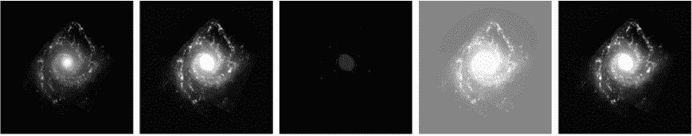

*图9.7 – 使用CLEAN算法进行图像恢复；图片来源：ALMA (ESO/NAOJ/NRAO)/ESA/NASA/PHANGS, S. Dagnello (NRAO)（最左侧原始图像）*

让我们逐个讲解上述演示中的关键函数和代码块，说明它们的作用和微妙之处：

- **make_gaussian_psf**：构建高斯点扩散函数。
- **hogbom_clean**：实现迭代CLEAN算法，在残差图像中找到峰值，减去按比例缩放的PSF版本，并累积“清洁分量”（源位置上的δ函数）。
- **恢复波束**：用小高斯函数近似PSF主瓣，以获得更平滑的最终图像。
- 以下是工作流程：
    1. 加载真实图像。
    2. 使用PSF进行模糊并添加噪声 → 得到脏图。
    3. 应用CLEAN迭代 → 得到清洁分量 + 残差。
    4. 通过将清洁分量与恢复波束卷积并加上残差来恢复最终图像。

**均方误差（MSE）**在恢复前后都会被计算。

在实践中，CLEAN需要仔细选择参数：环路增益（γ）通常保持较小（0.05–0.3）以保证稳定性，增益越低则需要的迭代次数越多；停止阈值应设置为噪声标准差的几倍；PSF必须足够大以捕获旁瓣，并使用高斯恢复波束近似其主瓣，以获得视觉上令人满意的结果。在计算上，朴素的卷积使CLEAN成本高昂，计算量随PSF大小和迭代次数扩展，但基于FFT的方法、Clark CLEAN和批量减法策略提供了大幅加速。

经典的Högbom CLEAN也有局限性：它假设稀疏的点源，难以处理扩展结构、PSF失配或糟糕的停止规则，常常产生伪影或偏差。为解决这些问题，出现了许多变体，例如用于效率和广域成像的Clark和Cotton–Schwab CLEAN，用于扩展源的多尺度和波变换CLEAN，以及最近结合稀疏恢复、正则化或贝叶斯先验以提高鲁棒性的新公式。

逆滤波和维纳滤波在频域中全局操作，并假设线性模型和平滑先验；它们适用于平滑的扩展信号，但可能难以处理旁瓣混淆和强非高斯噪声。CLEAN是贪心/空间的方法，显式建模离散点源并迭代减去PSF形状的图案：当场景稀疏且PSF具有强旁瓣时，它表现出色。从信号处理的角度来看，CLEAN ≈ 匹配追踪，字典 = {平移的PSF原子}；恢复波束类似于用更平滑的基函数对稀疏编码进行后处理。CLEAN是一个很有启发性的例子，说明算法假设（稀疏性、点源）如何影响恢复算法的形式和成功。

## 基于稀疏表示的图像恢复

稀疏表示基于这样一个观察：自然图像块位于低维流形附近，可以通过少量原型原子的稀疏线性组合来近似。因此，字典学习 + 稀疏编码为去噪和其他恢复任务提供了一种强大且可解释的方法。

我们从图像中提取重叠的图像块 $x_i \in \mathbb{R}^{p^2}$，并假设每个块在字典 $D \in \mathbb{R}^{p^2 \times K}$ 中具有稀疏线性模型：

$$
x_i \approx D \alpha_i \text{ 且 } \| \alpha_i \|_0 \le s,
$$

其中 $\alpha_i$ 是稀疏编码，$s$（稀疏度）是允许的非零元素个数。对于固定的字典 $D$，图像块 $x$ 的稀疏编码问题是：

$$
\min_{\alpha} \| x - D \alpha \|_2^2 \quad \text{约束条件} \quad \| \alpha \|_0 \le s,
$$

该问题通常是NP难的。正交匹配追踪（OMP）是一种贪心算法，它通过迭代选择当前残差最相关的字典原子，然后执行正交投影更新系数来近似求解该问题。OMP提供了快速、广泛使用的近似解，也是 `transform_algorithm='omp'` 所实现的方法。

字典学习通过求解以下问题联合估计 $D$ 和稀疏编码 $A = [\alpha_1, ..., \alpha_N]$：

$$
\min_{D,A} \| X - D A \|_F^2 \text{ 约束条件 } \forall i \| \alpha_i \|_0 \le s,
$$

通常采用交替最小化：

- 固定 $D$，计算稀疏编码 $A$（例如 OMP）。
- 固定 $A$，更新 $D$（例如最小二乘、列归一化）。

`sklearn.decomposition.DictionaryLearning` 实现了这种交替策略（一种类似MOD/在线的实现）。

## 为什么使用零均值图像块？

许多字典学习流程在训练前会去除每个图像块的DC（均值）分量。这会将低频（均值/亮度）信息与纹理信息分离，让原子专注于结构（边缘、图案）。在重建后重新加上图像块均值，可以保持正确的亮度。

下一个代码片段实现了基于图像块的字典学习去噪。步骤如下：

- 加载灰度图像并添加高斯噪声。
- 从噪声图像中提取重叠图像块（并从干净图像中提取用于字典训练）。
- 从干净图像块（子集）中学习字典 $D$。
- 对图像块进行零均值化，并使用OMP为噪声图像块计算稀疏编码。
- 重建图像块 $\hat{x}_i = D\hat{\alpha}_i$ 并重新加上图像块均值。
- 通过平均重叠图像块的重建结果来重组图像。

这是一个经典的流程（Elad & Aharon 风格），通过将局部图像块投影到学习到的低维流形上来去除噪声。

让我们逐步查看代码：

1. **定义参数：** 下面的代码块定义了以下参数：
    - `patch_size`：较小的图像块（6–12）捕捉局部纹理；8×8是标准。
    - `stride`：较小的步长 → 更多重叠（质量更好，速度更慢）。
    - `n_atoms`：必须大于图像块维度，冗余有帮助；$p^2=64$，所以512是过完备×8。
    - `sparsity`：对于8×8图像块通常为2–6；控制去噪强度。
    - `n_samples_for_dict`：用于学习字典的训练图像块数量；较大以获得鲁棒原子。

现在参考以下代码：

```python
patch_size = 8          # p (patch size)
stride = 3              # step between patches (overlap)
n_atoms = 512            # K, dictionary size
sparsity = 4             # s, nonzeros per patch
n_samples_for_dict = 40000
random_state = 0
```

2. **加载和灰度转换：** 加载Lena图像并转换为[0,1]范围内的浮点数；如果是RGB，则使用亮度转换转为灰度图像，代码如下：

```python
img = img_as_float(io.imread("images/lena.jpg"))
if img.ndim == 3:
    img_gray = color.rgb2gray(img)
else:
    img_gray = img.copy()
```


3. **添加噪声：** 使用下一段代码添加零均值高斯噪声，标准差为 `sigma`。裁剪可确保有效强度：

   ```
   sigma = 0.08
   rng = np.random.RandomState(random_state)
   noisy = img_gray + rng.normal(scale=sigma, size=img_gray.shape)
   noisy = np.clip(noisy, 0.0, 1.0)
   ```

4. **提取重叠块：** 下一段代码片段实现以下功能：

   - 函数 `view_as_windows()` 使用给定的步长生成所有块。块被向量化为行以便学习和编码。
   - 同时从干净图像中获取 `patches_clean` 用于字典训练（比在噪声块上训练更稳健）。

   现在，参考下一段代码：

   ```
   from skimage.util import view_as_windows
   p = patch_size
   windows_clean = view_as_windows(noisy, (p,p), step=stride)
   n_rows, n_cols, _, _ = windows_clean.shape
   num_patches = n_rows * n_cols
   patches_clean = windows_clean.reshape(num_patches, p*p)
   ```

5. **子采样训练块并零均值化：** 子采样可避免内存爆炸，如下一段代码片段所示。零均值块使字典学习结构，而非直流分量。

   ```
   n_train = min(n_samples_for_dict, num_patches)
   train_idx = rng.choice(num_patches, size=n_train, replace=False)
   train_patches = patches_clean[train_idx]
   train_means = train_patches.mean(axis=1, keepdims=True)
   train_patches_zm = train_patches - train_means
   ```

6. **字典学习（sklearn）：** 下一段代码片段执行以下操作：

   - `DictionaryLearning.fit()` 在稀疏编码（OMP）和字典更新之间交替。
   - `dl.components_` 为行（原子）；我们将其转置得到列 $D$。
   - 将列归一化为单位范数以稳定编码。

   参考下一段代码片段：

   ```
   dl = DictionaryLearning(n_components=n_atoms,
       transform_algorithm='omp', transform_n_nonzero_coefs=sparsity,
       random_state=random_state, n_jobs=-1, verbose=1, max_iter=200)
   dl.fit(train_patches_zm)
   D = dl.components_.T
   col_norms = np.linalg.norm(D, axis=0)
   D /= np.maximum(col_norms, 1e-12)
   ```

7. 去噪：块均值和稀疏编码。接下来，使用下一段代码片段：

   - 使用 transform() 进行稀疏编码（OMP），稀疏度为非零数。
   - 将每个块重构为所选原子的线性组合 + 重新加上均值。

   参考下一段代码：

   ```
   patch_means = patches.mean(axis=1, keepdims=True)
   patches_zm = patches - patch_means
   codes = dl.transform(patches_zm)  # batch OMP
   recon_patches_zm = codes.dot(D.T)
   recon_patches = recon_patches_zm + patch_means
   ```

8. 通过重叠平均重建整个图像：最后，重建图像：

   - 重叠块被求和；weight_image 计数重叠。相除得到平均值。一种简单但有效的聚合策略。
   - 更好的做法是按块使用高斯加权，以强调中心像素并减少块状效应。

   参考下一段代码：

   ```
   recon_image = np.zeros_like(noisy, dtype=np.float64)
   weight_image = np.zeros_like(noisy, dtype=np.float64)

   k = 0
   for i in range(n_rows):
       for j in range(n_cols):
           patch = recon_patches[k].reshape(p, p)
           row, col = i * stride, j * stride
           recon_image[row:row+p, col:col+p] += patch
           weight_image[row:row+p, col:col+p] += 1.0
           k += 1

   reconstructed = recon_image / np.maximum(weight_image, 1e-8)
   reconstructed = np.clip(reconstructed, 0.0, 1.0)
   ```

9. 指标和保存：使用下一段代码片段报告去噪改善前后的 PSNR，以量化去噪改善：

   ```
   psnr_noisy = peak_signal_noise_ratio(img_gray, noisy)
   psnr_rec = peak_signal_noise_ratio(img_gray, reconstructed)
   io.imsave("images/noisy.png", (noisy*255).astype(np.uint8))
   io.imsave("images/reconstructed.png", (reconstructed*255).astype(np.uint8))
   ```

如果运行上述代码并并排绘制输入、降质和重建图像，您应获得如下图所示的图像：

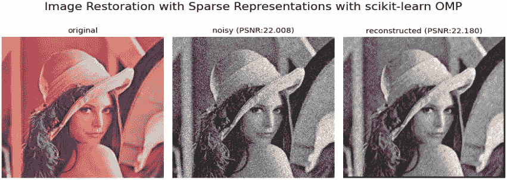

*图 9.8 — 使用 OMP（scikit-learn）的稀疏表示图像恢复*

在实践中，稀疏表示图像恢复涉及仔细的选择和权衡：小块（例如 8×8）与适度的重叠（步长 1–4）平衡结构捕获和计算；过完备字典（K ≥ p²）鼓励稀疏性和更清晰的重建；稀疏度控制偏差-方差权衡，较低的值更积极地去噪但有丢失细节的风险。

在干净块上训练的字典优于噪声块上的字典，尽管当只有噪声数据可用时，迭代去噪后训练方案会有所帮助。零均值预处理和深思熟虑的聚合（例如高斯加权）对于避免接缝至关重要。虽然字典学习和 OMP 计算密集，但并行化、批处理和在线更新可提高可扩展性。

诸如 K-SVD、块匹配（BM3D）、即插即用学习先验或多尺度字典等增强可进一步提高性能。实现稳定性需要字典列归一化、安全除法、仔细的边界处理、内存管理和通过固定随机种子实现可重复性。

现在，让我们总结基于稀疏字典的学习/去噪方法：

- 提取大小为 $p \times p$ 的重叠块 $x_i$。
- 子采样干净块并计算零均值版本用于训练。
- 通过交替最小化（稀疏编码 + 字典更新）使用 OMP 学习字典 $D$。
- 对于每个噪声块，减去均值，计算 OMP 编码 $\hat{\alpha}_i$（$\leq s$ 个非零）。
- 重构块 $\hat{x}_i = D\hat{\alpha}_i + \text{mean}$。
- 通过加权平均合并块以获得恢复图像。

## 使用深度学习的图像恢复

虽然传统的图像恢复方法依赖于显式的退化模型（例如维纳滤波、Tikhonov 正则化、CLEAN 或使用 OMP 的稀疏编码），但深度学习方法反而从大型数据集中学习隐式先验。退化函数 H（例如模糊 + 噪声）通常未知或过于复杂，无法进行解析建模。深度神经网络学习映射 fθ: g ↦ f̂，其中 g 是降质输入，f̂ 是恢复输出，θ 是从数据中学习的可训练参数。

这种方法以数据为驱动，已被证明在去噪、去模糊、去雨、超分辨率和修复等许多任务中优于手工制作的先验。与经典的逆方法不同，深度学习可以在不知道退化算子的情况下联合处理噪声抑制、细节恢复和感知质量增强。

在最新模型中，非线性激活自由网络（NAFNet）已成为图像恢复任务的强大架构，包括去噪。

### 使用 NAFNet 的图像去噪

噪声观测模型为：

g = f + n

其中 f 是干净图像，n ~ N(0, σ²I) 是加性高斯噪声，g 是观测到的噪声图像。

目标是估计使期望误差最小化的 f̂：

f̂ = argmin_f̂ E[‖f − f̂‖²]

这是深度学习的视角。不是通过显式先验求解，我们训练参数化网络 fθ，使其最小化经验风险：

θ* = argmin_θ Σ_{i=1}^N ‖f_i − fθ(g_i)‖²

其中 (f_i, g_i) 是干净/噪声图像的训练对。这等价于从数据中学习贝叶斯 MMSE 估计器。

### NAFNet 架构

以下为关键特性：

- 无非线性激活（例如 ReLU、GELU）→ 用简单的门控和乘法交互代替。

- 简洁：卷积、层归一化、简单乘法（“门控线性单元”）。

- 性能：在去噪（SIDD 数据集）、超分辨率和去雨方面实现 SOTA，同时 FLOPs 更少。

在数学上，NAFBlock 用以下方式替换非线性：

y = x + Conv₂( σ( LN(Conv₁(x)) ) ⊙ Conv₃(x) )

其中 ⊙ 是逐元素乘法，LN 是层归一化。这降低了复杂度，同时保留了表示能力，使网络高效且稳定。

现在，让我们逐步介绍以下 Python 演示，该演示在噪声图像上运行 NAFNet 以对其进行去噪。它使用官方 NAFNet 仓库（https://github.com/megvii-research/NAFNet）和预训练权重。以下是详细步骤。

1. 克隆并安装依赖项：在 jupyter 单元 / 控制台中运行以下命令，该命令克隆仓库、安装 requirements 并以开发模式设置 NAFNet。前缀 --no_cuda_ext 确保即使没有 GPU 编译扩展也能运行（在 CPU 上很有用）。以下是命令：

   ```
   !git clone https://github.com/megvii-research/NAFNet
   %cd NAFNet
   !pip install -r requirements.txt
   !pip install --upgrade --no-cache-dir gdown
   !python setup.py develop --no_cuda_ext
   ```

2. 加载实用工具/库：使用下一段代码块导入以下库/模块/函数：

   - basicsr 是 NAFNet 使用的恢复框架。
   - create_model 加载预训练模型。
   - tensor2img 将张量 → numpy 用于可视化。

   以下是代码：

   ```
   from basicsr.models import create_model
   from basicsr.utils import img2tensor as _img2tensor, tensor2img, imwrite
   from basicsr.utils.options import parse
   ```

3. 图像预处理助手：定义以下用于图像 i/o、图像到张量转换和并排显示的辅助函数，如下一段代码片段所示：

   ```
   def imread(img_path):
       img = cv2.imread(img_path)
       img = cv2.cvtColor(img, cv2.COLOR_BGR2RGB)
       return img

   def img2tensor(img, bgr2rgb=False, float32=True):
       img = img.astype(np.float32) / 255.
       return _img2tensor(img, bgr2rgb=bgr2rgb, float32=float32)
   ```


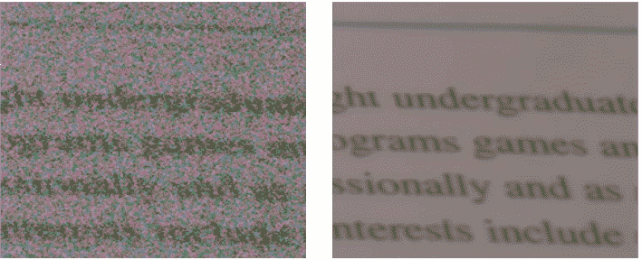

*图 9.9 – 使用 NAFNet 进行图像去噪*

NAFNet 通过将非线性激活函数替换为更简单的乘法门控机制，实现了最先进的去噪效果。其贝叶斯解释为：通过在成对的噪声-干净图像上训练，隐式地学习了去噪的 MMSE（最小均方误差）估计器。

提供的演示展示了如何使用预训练权重运行 NAFNet 进行去噪，即使在真实噪声图像上也能获得优异的结果。

## 使用 InstructIR 进行引导式图像恢复

经典的以及基于深度学习的图像恢复方法依赖于显式先验或针对特定退化（如去噪、去模糊、去雨或超分辨率）训练的端到端学习模型。然而，真实世界的退化是多样、重叠的，并且对其去除方式往往带有主观性。例如，一个用户认为的“恢复”（如去除雨滴），另一个用户可能认为是“编辑”（如让照片看起来更有电影感）。

**基于指令的图像恢复（InstructIR）** 通过引入自然语言提示的引导式恢复来解决这一差距。用户无需提供精确的退化模型或盲先验，只需*用文字描述*他们的需求，例如“去除雨滴但保留背景”，模型便会学习将视觉恢复与这些指令对齐。这代表了一种范式转变：图像恢复成为一个多模态条件生成问题，图像和文本共同指导输出。

如前所述，在标准图像恢复中，即经典方法中，我们将退化建模为：

$$y = Hx + n$$

在大多数恢复方法中，目标是给定 $y$ 估计 $x$。在 InstructIR 中，问题被重新表述为条件推断：

$$\hat{x} = f_{\theta}(y,t)$$

其中 $y$ = 退化图像，$t$ = 文本指令嵌入（由提示词导出），$f_\theta$ = 参数为 $\theta$ 的恢复模型，$\hat{x}$ = 恢复后的图像。因此，恢复不仅以图像为条件，还通过自然语言结合了用户意图。

为了实现语言-视觉对齐，系统使用了以下组件：

-   **语言编码器：** 预训练语言模型 $g_\phi$ 将指令提示编码为嵌入向量 $z_t = g_\phi(t)$，其中 $z_t \in \mathbb{R}^d$。
-   **指令头：** 线性/非线性投影 $h_\psi$ 将语言嵌入映射到与退化类型对齐的空间：

    $$e_t, d_t = h_\psi(z_t)$$

    其中 $e_t$ 是指令嵌入，$d_t$ 是预测的退化类型。

-   **恢复网络：** 核心图像恢复主干网络 $f_\theta$（一个类似 NAFNet 的、带注意力的 U-Net）接收退化图像和文本嵌入：

    $$\hat{x} = f_\theta(y, e_t)$$

InstructIR 优化一个联合目标函数：

$$\mathcal{L} = \lambda_{rec} \cdot \|x - \hat{x}\|_1 + \lambda_{per} \cdot \mathcal{L}_{perceptual}(\hat{x}, x) + \lambda_{deg} \cdot \mathcal{L}_{cls}(d_t, d^*)$$

其中 $\|x - \hat{x}\|_1$ 确保像素保真度，$\mathcal{L}_{perceptual}$ 提升感知质量，$\mathcal{L}_{cls}$ 确保退化预测与真实类型匹配。这种设计允许模型在保真度、感知质量和指令遵循度之间取得平衡。

现在，让我们通过下一个 Python 代码片段来理解如何使用 InstructIR 实现图像恢复。首先设置环境（克隆 git 仓库），导入必要的库并定义可配置参数：

```python
! git clone https://github.com/mv-lab/InstructIR
%cd InstructIR

import yaml
import random
from utils import *
from models import instructir
from text.models import LanguageModel, LMHead

CONFIG    = "configs/eval5d.yml"
USE_WANDB = False
LM_MODEL  = "models/lm_instructir-7d.pt"
MODEL_NAME = "models/lm_instructir-7d.pt"
SEED = 42
DEVICE = torch.device("cuda" if torch.cuda.is_available() else "cpu")
```

接下来是模型包装器。让我们定义以下类，它加载恢复模型和语言模型，并将它们集成在一起：

```python
class InstructIR_Model:

    def __init__(self):
        seed_everything(SEED=SEED)
        torch.backends.cudnn.deterministic = True
        # Load config
        with open(os.path.join(CONFIG), "r") as f:
            config = yaml.safe_load(f)
        self.cfg = edict2namespace(config)
        # Create restoration model
        self.model = instructir.create_model(
            input_channels = self.cfg.model.in_ch,
            width = self.cfg.model.width,
            enc_blks = self.cfg.model.enc_blks,
            middle_blk_num = self.cfg.model.middle_blk_num,
            dec_blks = self.cfg.model.dec_blks,
            txtdim = self.cfg.model.txtdim).to(DEVICE)
        self.load_models()
```

这根据配置和权重设置了 InstructIR 网络。下一步是模型加载。定义 load_models() 方法来加载图像恢复模型和文本嵌入头，如下所示：

```python
def load_models(self):
    # Load pretrained image restoration weights
    self.model.load_state_dict(torch.load(MODEL_NAME,
                                          map_location=DEVICE), strict=True)
    # Load language model for text instructions
    if self.cfg.model.use_text:
        self.language_model = LanguageModel(model=self.cfg.llm.model)
        self.lm_head = LMHead(embedding_dim=self.cfg.llm.model_dim,
                              hidden_dim=self.cfg.llm.embd_dim, num_classes=self.cfg.llm.nclasses).to(DEVICE)
        self.lm_head.load_state_dict(torch.load(LM_MODEL,
                                                map_location=DEVICE), strict=True)
    else:
        self.language_model = self.lm_head = None
```

下一个代码片段中的 restore_img() 函数实现了以下功能：

-   输入图像被归一化并转换为张量。

现在，让我们改用一张不同的输入图像（一张青蛙的图片），并去除噪声：

```python
img = "images/frog.png"
prompt = "Can you remove the little dots in the image? It is very unpleasant"
image, restored_image = ins.restore_img(img, prompt)
```

使用相同的输入运行上述代码，可以得到如下图所示的结果：

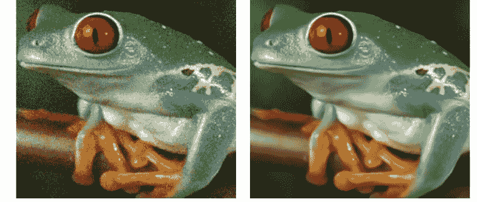

图 9.11 – 使用 InstructIR 进行去噪

最后，我们可以使用 gradio 为引导式恢复构建一个用户界面：

```python
import gradio as gr

def restore_image(image, prompt):
    image, restored_image = ins.restore_img(image, prompt, False)
    return (255*restored_image / restored_image.max()).astype('uint8')

iface = gr.Interface(fn=restore_image, inputs=['image', 'text'],
    outputs='image')
iface.launch()
```

这允许用户上传图像并输入诸如“去除模糊并使其看起来清晰”之类的指令。

以下是关键要点：

-   InstructIR 统一了图像先验和语言先验，允许灵活、由用户控制的恢复。
-   与盲恢复不同，它利用了来自指令的语义线索。
-   除了去噪或去雨，它还能在单一框架内实现恢复 + 润饰 + 编辑。

下表比较了基于经典先验和基于深度学习先验的图像恢复方法：

| 方面 | 经典先验（Tikhonov、TV、稀疏） | 深度恢复（NAFNet） | 基于指令（InstructIR） |
|---|---|---|---|
| 方法公式 | 优化 + 手工设计先验 | 学习映射 $y \rightarrow x$ | 带文本的学习映射 $(y,t) \rightarrow x$ |
| 灵活性 | 低（固定先验） | 中（特定任务） | 高（指令引导） |
| 用户控制 | 间接（调整 λ、先验） | 无（固定映射） | 通过自然语言直接控制 |
| 泛化能力 | 仅限于已建模的退化 | 训练中见过的效果好 | 强（通过提示处理未见过的退化） |
| 数据需求 | 低 | 高 | 非常高（多模态） |
| 可解释性 | 高 | 中 | 较低（黑盒、提示驱动） |
| 典型输出 | 保守、平滑的恢复 | 基准级别的干净图像 | 恢复 + 增强 |

*表 9.1 – 基于经典先验和基于深度学习先验的图像恢复方法比较*

经典先验对于可解释、有原则的恢复很有用，但在真实性方面存在困难。NAFNet 及类似网络在明确定义的退化基准上占主导地位。InstructIR 代表了一种新范式，从*特定任务*的恢复转向用户引导的、多用途的恢复，弥合了恢复与交互式图像编辑之间的差距。

## 使用 DeepFill 的基于 Stable Diffusion 的图像修复

本节解释了现代扩散模型（Stable Diffusion）如何用于图像修复，如何将其与较旧的 CNN 修复模型（如 DeepFill）进行对比，并逐行讲解所提供的演示代码。你将了解扩散背后的数学原理、条件修复的工作原理、流程在底层做什么，以及关于质量、速度和伪影的实用技巧。

**DeepFill（经典 CNN 修复）**（例如，Yu 等人，2018/2019）使用带有上下文注意力或部分卷积的编码器-解码器网络，从周围上下文合成缺失像素。这些方法速度快，适用于许多结构化空洞，但在高度不受约束的内容或全局语义方面可能表现不佳。

**基于扩散的修复（Stable Diffusion）** 将修复视为条件生成采样：模型被训练为以提示词和掩码图像为条件，对噪声图像（或潜在表示）进行去噪，从而能够合成与文本引导和全局场景线索相匹配的高质量、语义合理的内容。扩散方法通常会产生更逼真、全局更一致的结果，但代价是计算量更大。


扩散模型包含以下过程（我们将在最后一章更深入地探讨）。

1. **前向（加噪）过程**：扩散模型定义了一个前向马尔可夫链，逐步将干净图像 $x_0$ 损坏为噪声：

$$
q(x_t \mid x_{t-1}) = \mathcal{N}(x_t; \sqrt{1-\beta_t}\,x_{t-1},\,\beta_t I),
$$

对于时间步 $t = 1, ..., T$。

闭式形式：

$$
x_t = \sqrt{\bar{\alpha}_t}\,x_0 + \sqrt{1-\bar{\alpha}_t}\,\epsilon, \quad \epsilon \sim \mathcal{N}(0,I),
$$

其中 $\alpha_t = 1 - \beta_t$ 且 $\bar{\alpha}_t = \prod_{s=1}^{t} \alpha_s$。

2. **学习到的反向（去噪）过程**：神经网络 $\epsilon_\theta(x_t, t, \text{cond})$ 被训练以预测添加的噪声 $\epsilon$。采样使用学习到的反向步骤从 $x_t$ 恢复 $x_{t-1}$。一个流行的更新（简化）为：

$$
\hat{x}_{t-1} = \frac{1}{\sqrt{\alpha_t}}\left(x_t - \frac{1-\alpha_t}{\sqrt{1-\bar{\alpha}_t}}\,\epsilon_\theta(x_t, t, \text{cond})\right) + \sigma_t z,
$$

其中 $z \sim \mathcal{N}(0,I)$ 且 $\sigma_t$ 为依赖于调度的噪声项。

为了将采样引导向条件（例如文本提示 $p$），**分类器-free 引导** 形成调整后的噪声预测：

$$\epsilon_{\text{guided}} = \epsilon_\theta(x_t, t \mid \text{cond}) + w\big(\epsilon_\theta(x_t, t \mid \text{cond}) - \epsilon_\theta(x_t, t \mid \emptyset)\big)$$

其中 $w$ 为引导尺度。较大的 $w$ 增强条件（更忠实于提示），但可能降低

## Stable Diffusion 中内插的概念

*Stable Diffusion 内插（我们将在第 13 章重访）通常在潜在空间中操作：*

- 图像由 **变分自编码器（VAE）** 编码为潜在 $z_0$：

$$
z_0 = \text{Enc}(x_0)
$$

- 为了仅内插被遮挡区域，管道构建一个噪声潜在，其中仅遮挡区域被加噪，而已知的未遮挡区域被保留（或用作条件）。常见的方法产生与遮挡区域一致的全噪声潜在 $z_T$，或在未遮挡区域合并原始潜在，在遮挡区域合并噪声潜在：

$$
z_t = z_t^{\text{noisy}} \odot \text{mask} + z_0 \odot (1 - \text{mask})
$$

因此模型只需在 mask 内生成合理内容，同时保持其余部分不变。

- 去噪器 UNet $\epsilon_\theta$ 以文本（提示）为条件，同时也以遮挡图像表示（或显式 mask 通道）为条件，因此它知道要修改哪些像素。
- 去噪循环结束后，最终潜在由 VAE 解码器解码：

$$
\hat{x}=\operatorname{Dec}(\hat{z}_0)
$$

实际上，管道实现细节各不相同（精确的潜在混合、模型是否接受遮挡图像作为额外通道或通过交叉注意力）。关键思想：仅在 mask 内生成；保持未遮挡内容一致。

现在，让我们演示如何使用以下 Python 代码片段使用 DeepFill 实现图像内插。注意代码需要在 Google Colab 或具有高显存的 GPU 上运行。

**目的：** 检查 GPU 并报告显存。Stable Diffusion 内插是显存密集型的；这有助于决定是否应使用 CPU 卸载或半精度。

**注意：** 显存非常低的 GPU（例如日志中显示的 2 GB）不足以进行正常的 float16 推理；需要 CPU 卸载或在更低的批处理大小/更小模型下运行。

参考代码片段：

```
```python
# run on colab / with high GPU VRAM
if torch.cuda.is_available():
    device = torch.device("cuda")
    print("GPU Name:", torch.cuda.get_device_name(device))
    total_memory = torch.cuda.get_device_properties(device).total_memory
    print(f"Total GPU Memory: {total_memory / (1024 ** 3):.2f} GB")
    allocated = torch.cuda.memory_allocated(device)
    reserved = torch.cuda.memory_reserved(device)
    print(f"Memory Allocated : {allocated / (1024 ** 3):.2f} GB")
    print(f"Memory Reserved  : {reserved / (1024 ** 3):.2f} GB")
else:
    print("CUDA is not available.")
```
```

接下来，让我们浏览下一个代码片段，它执行以下操作：

- `StableDiffusionInpaintPipeline.from_pretrained(...)` 加载一个内插微调的 Stable Diffusion 模型（文本 + mask 条件）。
- `torch_dtype=torch.float32` 使用 32 位浮点数（安全但显存更高）。如果你的 GPU 较好且显存充足，float16 (`torch.float16`) 更快且使用更少显存。
- `.enable_model_cpu_offload()` 将模型的部分在空闲时移动到 CPU（适用于显存有限的 GPU）。这会用延迟换取更低的峰值显存。

参考代码片段：

```
```python
# run in colab
from diffusers import StableDiffusionInpaintPipeline
```
```

```
DEVICE = torch.device("cuda" if torch.cuda.is_available() else "cpu")
# Load model in float32 (safe) and use CPU offloading
pipe = StableDiffusionInpaintPipeline.from_pretrained(
    "runwayml/stable-diffusion-inpainting",
    torch_dtype=torch.float32).to(DEVICE)
pipe.enable_model_cpu_offload()  # for low VRAM GPUs
```

下一步是使用下一个代码片段执行以下任务：

图像和 mask 预处理：Stable Diffusion 模型是在 512×512 图像上训练的，调整到预期大小可获得最佳结果。Mask 是单通道（L）图像，其中 mask 像素标记要内插的区域（通常白色 = 替换，黑色 = 保留）。

调用管道：pipe(prompt, image, mask_image, num_inference_steps=20) 运行条件去噪：

- prompt 是文本引导；应仔细选择以匹配所需内容/语义。
- num_inference_steps 控制采样步数（质量与速度的权衡）。20 是快速运行；典型质量在 50-100 步时提高。

管道返回 PIL 图像在 .images[0] 中。

参考以下代码：

```
image = Image.open("images/me_child_damaged.jpg")
    .convert("RGB").resize((512, 512)) # Resize input
mask_image = Image.open("images/me_child_inpaint_mask.jpg")
    .convert("L").resize((512, 512))
output = pipe(
    # Run inpainting
    prompt="a beautiful landscape", image=image, mask_image=mask_image,
    num_inference_steps=20).images[0]
```

最后，定义函数 plot_inpainted () 来可视化/绘制图像。此可视化显示损坏的输入（带孔的原始图像）、遮罩输入（显示模型替换区域的红色叠加）以及内插输出（最终生成结果）。

mask 值应归一化（如果 mask 为 0..255 则转换为 0..1）。在下一个代码片段中，叠加 alpha 乘以 mask，因此白色 mask 区域会被突出显示。

参考下一个代码片段：

```
def plot_inpainted(image, mask_image, output):
    mask = np.array(mask_image)
    mask = mask / mask.max() # normalize
    # Create a transparent overlay: red color with alpha
    overlay = np.zeros((*mask.shape, 4))  # RGBA
    overlay[..., 0] = 1.0  # Red channel
    overlay[..., 3] = 0.5 * mask  # Alpha: 0.5 where mask is True, 0 elsewhere
```

```
```python
# plot the image, masked-overlayed input (overlay) and output here)

plot_inpainted(image, mask_image, output)
```

如果运行上述代码，你应该得到如下图所示。注意红色 mask 表示将在损坏输入图像中进行内插的区域：

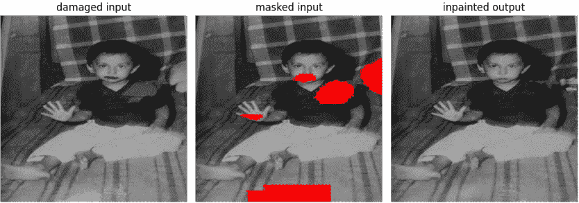

*图 9.12 – 使用 DeepFill 进行图像内插*

实际上，使用扩散模型进行有效内插需要仔细设置和调优。Mask 通常遵循约定 `白色 = 替换，黑色 = 保留`，并且必须与图像对齐。提示强烈影响生成的区域，因此结合场景上下文和风格提示可提高真实感。关键参数包括 `guidance_scale`（典型 6–10，平衡提示保真度和真实感）、`num_inference_steps`（预览用 20，质量用 50–100）以及固定种子以实现可重复性。

GPU 显存可通过 float16、CPU 卸载或 VAE 切片来管理，尽管 CPU 仅推理很慢。可能出现接缝、不一致的照明或幻觉几何等伪影，可通过羽化 mask 和强上下文提示来缓解。与基于 CNN 的方法如 DeepFill（快速、结构保持，适用于小孔）相比，扩散内插在语义编辑和由文本引导的新内容生成方面表现出色。

一个良好的工作流程包括仔细的 mask 准备、调整到 512×512（或分块）、迭代提示/种子探索，以及轻微的后处理（色彩匹配、混合）。最后，合乎道德的使用要求尊重许可、版权和数据集限制。

## 使用 LaMa 进行内插

**大掩模内插（LaMa）**，通常描述为 *具有傅里叶卷积的分辨率鲁棒大掩模内插*，是一种现代内插方法，旨在为非常大的孔洞合成合理内容，同时保留高分辨率细节和全局一致性。与小孔修补或局部传播方法不同，LaMa 为模型提供全局感受野（通过频域/傅里叶式操作），使其能够推理长程结构、光照和场景语义，并且这种方式在不同分辨率下保持鲁棒。


## 数学框架

设 $x \in \mathbb{R}^{H\times W \times 3}$ 为未知的干净图像，$m \in \{0,1\}^{H\times W}$ 为二进制掩码，且 $m(p)=1$ 表示像素 $p$ 缺失（需要修复）。观测到的（带掩码的）图像为：

$$ y = (1 - m) \odot x + m \odot v, $$

其中 $\odot$ 表示逐元素乘法，$v$ 是任意填充值（例如零）。

图像修复问题就是根据 $y$ 和 $m$ 估计 $\hat{x}$，即：

$$ \hat{x} = f_\theta(y, m), $$

其中 $f_\theta$ 是一个学习得到的生成器（即 LaMa 模型）。

训练过程会在大量样本 $(x, m)$ 上最小化重建损失与感知损失的组合：

$$ \mathcal{L}(\theta) = \lambda_{\text{pix}} \| (1 - m) \odot f_\theta(y, m) - (1 - m) \odot x \|_1 + \lambda_{\text{perc}} \mathcal{L}_{\text{perc}}(f_\theta(y, m), x) + \lambda_{\text{adv}} \mathcal{L}_{\text{adv}}(\cdot), $$

还可以加上风格损失或频域损失。LaMa 最关键的结构改动是用全局/傅里叶运算替代或增强标准卷积，使 $f_\theta$ 能以参数高效的方式混合来自整幅图像的信息（而不仅仅是局部感受野）。

## LaMa 为何有效

以下是 LaMa 有效的原因：

- **在不显著增加参数和深度的情况下获得全局感受野：** 傅里叶域运算让网络能够以较低成本建模长距离相关性（例如水平线、重复图案）。从空间角度看，这相当于拥有了极大的卷积核，但实现方式是在频域中进行逐元素乘法。

- **分辨率鲁棒性：** 由于 LaMa 在频域中进行推理，并且训练时使用了多尺度增强，因此同一模型无需重新训练即可泛化到不同图像尺寸；在实际应用中，它处理超大掩码和高分辨率输入的效果优于仅依赖局部信息的方法。

- **实用的损失组合：** 感知损失（VGG）+ 像素损失 + 可选的判别器损失，共同提升结构真实感和视觉真实感。

- **推理过程简单：** 训练完成后，LaMa 只需一次前向传播（无需迭代优化），并且对于常见的图像尺寸而言速度很快。

接下来的代码片段使用 `simple_lama_inpainting` 库中的 SimpleLama 函数，根据给定的修复掩码对输入图像进行修复，并将修复后的图像与原始图像并排可视化：

```
from simple_lama_inpainting import SimpleLama
simple_lama = SimpleLama()
img_path = "images/jump_orig.jpg"
mask_path = "images/jump_mask.jpg"
image = Image.open(img_path)
```

```
mask = Image.open(mask_path).convert('L')
output = simple_lama(image, mask)
plot_inpainted(image, mask, output)
```

运行上述代码后，你应该会得到类似下图的输出：

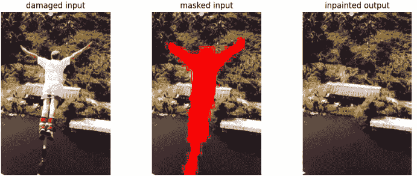

*图 9.13 – 使用 LaMa 修复图像中的掩码区域*

现在我们来逐行理解上述代码，以及 SimpleLama 所封装的典型工作流程：

- `from simple_lama_inpainting import SimpleLama`：这行代码导入了一个围绕预训练 LaMa 模型的便捷封装类。该封装隐藏了繁琐的样板工作：加载权重、选择设备（CPU/GPU）、输入预处理、模型前向传播，以及输出后处理以生成 PIL/NumPy 图像。
- `simple_lama = SimpleLama()`：这行代码实例化该封装。构造函数内部的典型工作包括：
  - 加载 LaMa 网络架构；
  - 按需下载/加载预训练权重；
  - 决定运行设备（若有 CUDA 则用 cuda，否则用 cpu）；
  - 设置为评估模式（`model.eval()`）；
  - 设置数值精度（float32 或 float16），并可选地启用内存优化。
  
  某些封装还支持传入参数，如 `device='cuda'`、`half=True` 或 `model_variant='original'`，以控制性能和内存占用。

- `image = Image.open(img_path)`：加载 RGB 输入（PIL.Image）。LaMa 期望输入是 3 通道的 RGB 图像；尺寸可以不同，但通常会在内部进行填充/缩放，以适配模型的约束。
- `mask = Image.open(mask_path).convert('L')`：加载掩码并转换为单通道（L）。掩码的重要约定：
  - 通常，255（白色）表示需要修复的孔洞区域，0（黑色）表示保留区域。
  - 请确认所用封装的掩码约定；如有需要，可将其转换为二进制（`mask = (mask_np>128).astype(np.uint8)`）。

- `output = simple_lama(image, mask)`：这单次调用就完成了主要的繁重工作。在内部，它通常执行以下步骤：
  a. **预处理：**
    - 将 PIL 图像转换为 NumPy 数组。
    - 对图像进行归一化（例如缩放到 [0,1] 或 [-1,1]）。
    - 将掩码转换为 [0,1] 范围内的二值浮点掩码。
    - 可能对图像进行填充/裁剪，使其尺寸适配网络要求（例如 8 或 32 的倍数）。良好的封装会填充并在后续移除填充。
  b. **（可选）多尺度/从粗到细设置：** LaMa 的变体可能会构建多尺度输入，或为提高效率将图像缩放到较低分辨率后再细化。对于大尺寸输入，封装可能会自动执行这些操作。
  c. **模型前向传播：**
    - 转换为 PyTorch 张量并移动到相应设备。
    - `with torch.no_grad(): out = model(inp, mask)`：单次前向传播，输出修复后的张量。
    - 核心模型使用 U-Net/编码器-解码器结构，并在部分层中采用傅里叶风格的全局运算。
  d. **后处理：**
    - 将输出张量转换回图像域（裁剪、转换为 uint8）。
    - 裁剪/移除预处理阶段添加的填充。
    - 返回 PIL 图像或 NumPy 数组。

函数 `plot_inpainted(image, mask, output)` 用于可视化原始输入、掩码叠加以及输出结果，这有助于检查接缝是否自然、结果是否合理。

使用 LaMa 进行修复时，请确保掩码是二值的（0 表示保留，255 表示孔洞）；如果结果看起来异常，可以尝试反转掩码。对掩码边缘进行高斯模糊羽化，有助于在边界处实现更平滑的混合。虽然 LaMa 具有分辨率鲁棒性，但大尺寸图像仍可能超出 GPU 内存，因此可考虑使用带重叠的分块处理、多尺度选项，或改用 CPU 运行（较慢，但内存使用更灵活）。

如需更快的推理速度，可使用 `device='cuda'` 的 GPU，并在支持的情况下使用 float16；对于中等尺寸的图像，CPU 也依然可行。若想提升质量，可以调整掩码羽化、使用更大范围的上下文裁剪，或应用后处理颜色匹配以改善融合效果。最后，当存在真实参考图像时，可以用 PSNR、SSIM、LPIPS 或 FID 等指标评估结果，但也要高度重视目视检查，因为修复质量往往具有主观性。

就优势而言，LaMa 非常擅长处理大孔洞、复杂语义和高分辨率编辑。它对掩码尺寸具有鲁棒性（在训练或设计上能跨分辨率泛化）。推理为单次前向传播（相比迭代优化方法更快）。

不过，它也可能生成看似合理但实际错误的内容（如果没有提示词，语义可能与原始内容不符）。掩码边界处可能产生轻微的颜色/光照不匹配，因此羽化掩码会有帮助。对于几何结构较强的对象（例如人造直线、人脸），可能需要语义感知约束或额外条件（例如边缘图或参考块）。

**何时不宜使用：** 当必须严格保留孔洞内的原始像素时（例如取证或法律用途），生成式修复并不合适。当需要精确恢复像素时（例如科学图像），经典复原方法结合基于模型的方法可能更可取。

## 图像修复与图像编辑

图像编辑和图像修复是生成式深度学习模型在计算机视觉领域中最令人兴奋的两类应用。与旨在去除退化（例如模糊、噪声、雾霾）的经典复原任务不同，编辑和修复允许对图像进行语义级别的修改。编辑根据自然语言提示修改图像的某些部分，而修复则通过合成合理内容来恢复缺失或损坏的区域。这两类任务通常都被建模为条件图像生成问题，要求输出图像既忠实于观测到的像素（掩码外部），也忠实于用户提供的语义提示。

从核心上看，这些任务都涉及求解以下逆问题：

$$y = M \odot x + (1 - M) \odot n,$$

其中 $y$ 是观测到的损坏或不完整图像，$x$ 是我们要恢复的真实（修复后）图像，$M$ 是表示已知区域（$M = 1$）和缺失/编辑区域（$M = 0$）的二进制掩码，$n$ 是需要被幻觉生成或替换的未知内容。目标是估计 $x$，使得：

$$x = \arg\max_x p(x \mid y, M, \text{prompt}),$$

其中提示（prompt）提供语义或文本条件。基于扩散的生成模型（例如 Stable Diffusion、Kandinsky）通过对自然图像的概率分布 $p(x)$ 建模并采样出逼真的补全内容，使这一目标成为可能。接下来，我们将使用最先进的扩散模型来探索图像编辑和图像修复。

## 使用扩散模型进行图像编辑

图像编辑指对图像中的现有内容进行有针对性的修改，例如替换某个物体或改变风格。扩散模型通过以下方式实现这一点：将图像编码到潜在空间中，用掩码指定要修改的区域，再解码出一个与源图像和目标提示都一致的新版本。从数学上看，该问题可以表示为：

$$\hat{x} = \arg\max_x p(x \mid y, M, p_t, p_s),$$

其中 $y$ 是输入图像，$M$ 是要修改的区域（掩码），$p_t$ 是目标文本提示，$p_s$ 是源提示（负向引导：“不要保留旧内容”）。


DiffEdit 通过添加**去噪扩散隐式模型（DDIM）**反演来扩展扩散模型：输入图像被映射回潜在扩散空间，从而实现局部修改。下面的代码片段实现了基于扩散的图像编辑：

```
```python
import torch
from diffusers import (StableDiffusionDiffEditPipeline,
                       DDIMScheduler, DDIMInverseScheduler)
from diffusers.utils import load_image, make_image_grid

pipe = StableDiffusionDiffEditPipeline.from_pretrained( # Load pipeline
                                      "stabilityai/stable-diffusion-2-1",
                                      torch_dtype=torch.float16)
pipe.scheduler = DDIMScheduler.from_config(pipe.scheduler.config)
pipe.inverse_scheduler = DDIMInverseScheduler.from_config(
    pipe.scheduler.config)
pipe = pipe.to("cuda")
pipe.enable_vae_slicing()

img_url = "https://github.com/Xiang-cd/DiffEdit-stable-diffusion/raw/main/
assets/origin.png"
base = load_image(img_url).resize((768, 768)) # Load base image
source_prompt = "a bowl of fruits" # Source VS Target prompts
target_prompt = "a bowl of pears"
# Step 1: Generate semantic mask
mask_image = pipe.generate_mask(image=base, source_prompt=source_prompt,
                                target_prompt=target_prompt)
mask_disp = Image.fromarray((mask_image.squeeze() * 255)
                             .astype("uint8"), "L").resize((768, 768))
# Step 2: Invert image into latent space
inv_latents = pipe.invert(prompt=source_prompt, image=base).latents
# Step 3: Apply editing with target prompt
edited = pipe(mask_image=mask_image, image_latents=inv_latents,
              prompt=target_prompt, negative_prompt=source_prompt,
              guidance_scale=7.5)
              .images[0]
# Display results
make_image_grid([base, mask_disp, edited], rows=1, cols=3)
```
```

如果你运行上述代码片段，你应该会得到类似下图的结果：

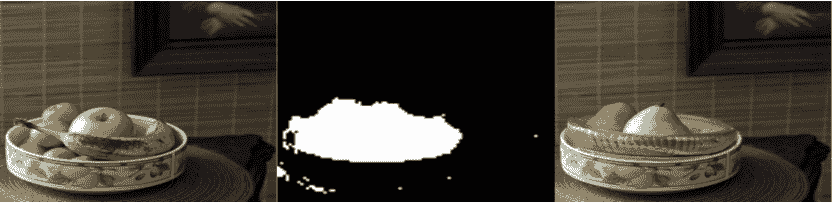

*图9.14 – 使用Stable Diffusion模型进行图像编辑*

现在让我们详细理解这段代码。步骤如下：

-   **流水线设置：** 使用 DiffEdit 包装器加载 Stable Diffusion v2.1。
-   **基础图像：** 原始图像（一碗水果）。
-   **提示词：** 源提示词（“一碗水果”）引导掩码生成；目标提示词（“一碗梨”）指定编辑内容。
-   **掩码生成：** 模型自动推断出源提示词与目标提示词之间差异区域的掩码。
-   **潜在反演：** 使用 DDIM 反演将原始图像映射到潜在空间。
-   **编辑步骤：** 流水线用与目标提示词对齐的内容替换掩码区域，同时保持其余部分不变。
-   **可视化：** 并排显示原始图像、掩码和编辑后的输出。

这使得只需极少的用户输入即可实现强大的、由提示词驱动的编辑。

> **注意**
>
> DDIM 反演近似地逆转了 DDIM 生成过程，将真实图像映射到扩散模型的潜在噪声轨迹中，从而实现保持结构的、由提示词驱动的图像编辑。**去噪扩散概率模型（DDPM）**依赖于随机马尔可夫去噪过程（将在*第13章*中详细介绍），而**去噪扩散隐式模型（DDIM）**采用确定性的非马尔可夫公式，能以更少的采样步数获得相当的图像质量。

## 使用扩散模型进行图像修复

图像修复旨在*恢复图像中缺失或损坏的部分*。与编辑不同，掩码由用户明确提供，模型必须用语义一致的内容填充空洞。其概率公式为：

$$\hat{x} = \underset{x}{\arg\max}\ p(x \mid y, M, p),$$

其中 $M$ 定义缺失区域，$p$ 是描述该区域应填充内容的引导提示词。

基于扩散的修复模型（例如 Kandinsky 2.2 修复模型）在训练时随机应用掩码，迫使模型生成既符合上下文又符合提示词的逼真补全内容。接下来的代码片段实现了基于扩散的图像修复：

```
from diffusers import AutoPipelineForInpainting
from diffusers.utils import load_image, make_image_grid

# Load Kandinsky inpainting pipeline
pipeline = AutoPipelineForInpainting.from_pretrained(
    "kandinsky-community/kandinsky-2-2-decoder-inpaint",
    torch_dtype=torch.float16)
pipeline.enable_model_cpu_offload()
pipeline.enable_xformers_memory_efficient_attention()  # optional optimization
init_image = load_image("https://huggingface.co/datasets/huggingface/documentation-images/resolve/main/diffusers/inpaint.png")
mask_image = load_image("https://huggingface.co/datasets/huggingface/documentation-images/resolve/main/diffusers/inpaint_mask.png")
prompt = "a black cat with glowing eyes, cute, adorable, disney, pixar, highly detailed, 8k"  # Prompt for inpainting
negative_prompt = "bad anatomy, deformed, ugly, disfigured"
image = pipeline(  # Run inpainting
    prompt=prompt, negative_prompt=negative_prompt,
    image=init_image, mask_image=mask_image).images[0]
# Show results
make_image_grid([init_image, mask_image, image], rows=1, cols=3)
```

如果你运行上述代码，你应该会得到类似下图的结果：

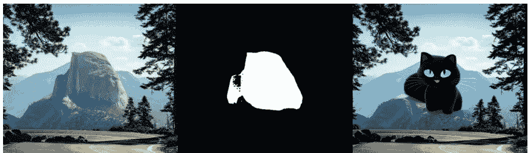

图9.15 – 使用Stable Diffusion模型进行图像修复

现在让我们详细理解这段代码。步骤如下：

-   **流水线：** 加载 Kandinsky 2.2 修复模型，针对文本引导的空洞填充进行了优化。
-   **输入图像和掩码：** 掩码指定要替换的像素（白色=空洞，黑色=保留）。
-   **提示词：** 丰富的文本描述引导内容生成（此处，添加一只皮克斯风格的黑猫）。
-   **修复步骤：** 模型填充掩码区域，同时尊重未掩码的上下文和提示词。
-   **可视化：** 并排显示原始图像、二值掩码和修复后的输出。

这展示了扩散模型如何在用户意图引导下真实地替换或合成图像区域。本节在统一框架下介绍了编辑和修复：两者都是提示词引导的逆问题，但编辑自动推断掩码，而修复则需要明确的掩码。

下表对图像编辑和图像修复进行了并排比较，这将帮助你清晰地了解 LaMa 修复的定位：

| 维度 | 图像编辑 | 图像修复 |
|---|---|---|
| **目标** | 有意修改或增强图像的某些部分（例如，修饰、重新着色）。 | 用合理的内容填补缺失或移除的区域。 |
| **用户控制** | 高；用户决定更改什么以及如何更改（手动调整）。 | 低到中等；用户仅提供掩码；模型决定如何补全区域。 |
| **输入** | 原始图像和明确的编辑指令（笔刷、滤镜等） | 原始图像和指示空洞的二值掩码。 |
| **输出** | 根据用户偏好调整后的同一图像版本。 | 语义一致、上下文感知的缺失区域补全。 |
| **技术** | 传统工具（Photoshop、GIMP、滤镜）、基于GAN的编辑器、修饰。 | 深度生成模型（例如，LaMa、部分卷积网络、扩散修复）。 |
| **应用** | 人像修饰、颜色调整、对象替换、风格迁移。 | 对象移除、损坏照片修复、场景补全、内容修复。 |
| **评估** | 对所需编辑的主观满意度；有时使用自动化质量指标。 | 一致性、逼真度、感知合理性（PSNR、SSIM、LPIPS、FID等）。 |
| **自动化** | 通常是手动或半自动。 | 一旦提供掩码，完全自动化。 |

*表9.9 – 图像编辑与图像修复的对比*

这清楚地表明，修复是编辑的一个专门子集，侧重于*恢复/填充*，而编辑是一个更广泛的概念。


## 润饰与外扩

图像修复侧重于填补图像中缺失或掩蔽的区域，图像编辑侧重于直接操作内容，而润饰和外扩则代表了生成式图像处理中两种互补而又截然不同的范式：

- 润饰是增强或优化现有图像内容的过程——改进细节、修正瑕疵、调整光照，甚至在不改变核心结构的前提下对图像进行风格化修改。它广泛应用于摄影、广告和艺术领域，其目标不是替换内容，而是使内容更精良。
- 另一方面，外扩会通过生成给定画面之外合理的新内容，来超越原始图像边界。它在扩展画布的同时保持语义和风格的一致性。随着 Stable Diffusion、DALL·E 等扩散模型的出现，外扩技术变得尤为流行，因为这些模型能够根据输入上下文生成连贯的场景扩展。

这两种技术都依赖于图像到图像转换的原理：输入图像被编码为潜在表示，在文本提示的引导下进行修改，然后再解码回像素空间。

## 润饰

润饰本质上是一种受约束的图像到图像转换形式，输入和输出应保持大致相似，只是细节得到增强或修正。形式上，设 I 为输入图像，z = E(I) 为其通过自编码器 E 得到的潜在编码。扩散过程用受控噪声扰动该潜在表示：

z_t = sqrt(alpha_t) z + sqrt(1 - alpha_t) epsilon,   epsilon ~ N(0, I)

其中 t 是扩散时间步，alpha_t 控制噪声水平。

在润饰过程中，我们选择较低的噪声强度（即较小的 t），这意味着扩散模型主要保留 I 的原始结构。然后，模型在文本条件 c（提示词）的引导下对 z_t 进行去噪：

z_hat_0 = D_theta(z_t | c)

其中 D_theta 是去噪 UNet。最后，将潜在表示解码回图像空间：

I_hat = G(z_hat_0)

关键参数是 strength（强度）；如果 strength → 0，结果几乎与原图相同（最小程度的润饰），而 strength → 1 则意味着显著变化（更接近编辑）。这使得润饰在增强与变换之间形成一个连续的权衡。下面的代码片段提供了图像润饰的一种实现：

```
from diffusers import StableDiffusionImg2ImgPipeline
from IPython.display import Image as IPImage, HTML, display

model_id = "runwayml/stable-diffusion-v1-5"  # CONFIG
prompt = "a person standing in front of pictures in a gallery, well-lit, vivid
```

```python
colors, enhanced contrast, sharp details"
strength = 0.1 # Retouching factor (low=subtle changes, high=stronger edits)
guidance_scale = 7.5
device = "cuda" if torch.cuda.is_available() else "cpu"
pipe = StableDiffusionImg2ImgPipeline.from_pretrained(model_id,
    torch_dtype=torch.float16 if device=="cuda" else torch.float32).to(device)
input_image = Image.open("images/me.jpg").convert("RGB") # LOAD IMAGE
input_image = input_image.resize((512, 512))

with torch.autocast(device): # RETOUCH IMAGE
    result = pipe(prompt=prompt, image=input_image,
        strength=strength, guidance_scale=guidance_scale).images[0]
result.save("images/me_retouched.jpg") # SAVE & DISPLAY
```

在上述代码中，输入照片根据提示词被轻微修改。当 strength=0.1 时，只有光照、锐度和对比度得到改善。更高的强度（>0.5）则会走向语义编辑，而非细微润饰。如果运行上述代码，你应该会得到类似下图的输出：

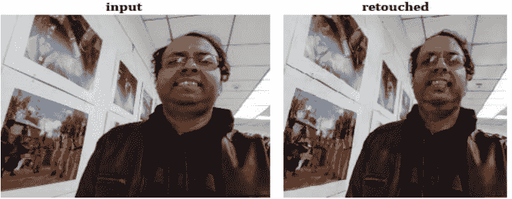

*图 9.16 – 使用 Stable Diffusion 进行图像润饰*

## 外扩

外扩在保持视觉和语义一致性的同时，将图像扩展到原始边界之外。与修复（填补图像内部的空洞）不同，外扩是在一个新的画布空间上进行的。数学上，考虑定义在域 Ω ⊂ ℝ² 上的输入图像 *I*。外扩将 *I* 扩展到更大的域 Ω′ ⊃ Ω。扩散模型使用以下方式填充 Ω′\Ω（新区域）：

$$\hat{I}(x)=\begin{cases}I(x), & x\in\Omega\\G_\theta(z,c), & x\in\Omega'\\Omega\end{cases}$$

其中 G<sub>θ</sub> 根据 *I* 的上下文和提示词 *c* 生成新的像素。

mask.paste(255, orig_box)

# run outpainting
with torch.autocast(device):
    result = pipe(
        prompt=prompt,
        image=expanded,
        mask_image=mask,
        strength=strength,
        guidance_scale=guidance_scale
    ).images[0]

result.save("images/me_outpainted.jpg")
lt.imshow(np.hstack((np.array(expanded), np.array(result))))

如果运行上述代码，你应该会得到类似下图的输出：

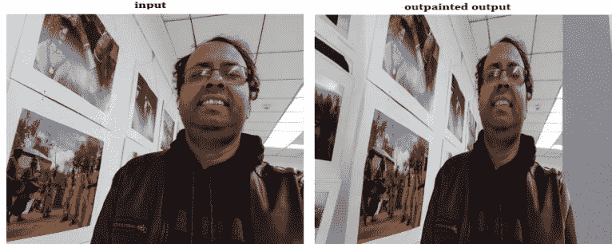

图 9.17 – 使用 Stable Diffusion 进行图像外扩

现在让我们详细理解这段代码。步骤如下：

- **管线加载：** 我们使用 StableDiffusionInpaintPipeline，因为外扩在技术上是对新增区域进行的一种修复。
- **画布扩展：** 将图像嵌入更大的白色画布中，并在上下添加额外空间。这些空白区域将用于合成新内容。
- **掩码创建：** 在保留内容（原始图像）的区域，掩码为白色；在生成新内容（填充区域）的区域，掩码为黑色。这确保了只有新区域被合成。
- **扩散过程：** strength=0.3 允许适度的创造性，同时保持上下文完整；guidance_scale=7.5 平衡了对文本提示的遵循度与真实感。
- **结果：** 模型垂直外推图像。输出包含画廊场景的合理延续，光照和透视保持一致。

下表总结了润饰与外扩之间的主要区别：

| 维度 | 润饰 | 外扩 |
|---|---|---|
| **目标** | 增强/优化现有图像，而不改变主要内容。 | 将图像扩展到原始边界之外。 |
| **输入** | 原始图像 + 提示词。 | 原始图像、扩展画布和掩码。 |
| **掩码使用** | 不需要（作用于整张图像）。 | 需要（定义扩展区域）。 |
| **数学视角** | 低噪声约束扩散（保持结构）。 | 扩展域 Ω′\Ω 中基于扩散的生成。 |
| **应用** | 人像润饰、对比度增强、照片改进。 | 创意场景扩展、全景视图、故事板。 |

*表 9.7 – 润饰与外扩的对比*

上表同时展示了**基于 Kandinsky 的外扩**（前述）和**基于 Stable Diffusion 修复的外扩**（上文），为你提供了两种不同但又相关的工作流程。

## 总结

在本章中，我们探讨了图像复原的基础和高级方法，涵盖了从经典信号处理方法到现代稀疏与基于模型的技术。我们从非盲去模糊方法开始，如维纳滤波和吉洪诺夫正则化，并通过贝叶斯估计的视角进行解读。随后，我们讨论了诸如 GLEAN 之类的迭代方法，以及通过稀疏表示和匹配追踪算法实现的先进先验，强调了它们捕捉图像精细结构的能力。

在整个过程中，我们既强调了理论基础（从逆问题建模到正则化和贝叶斯估计），也强调了使用 Python 代码演示的实际实现。这种双重视角使读者不仅能够理解这些方法如何运作，还能理解它们在不同条件下成功或失败的原因。

图像复原仍然是图像处理和计算机视觉中的核心问题，它连接了数学、信号处理和深度学习。这里讨论的方法为下一章将涉及的更高级主题奠定了基础，如深度生成式复原、盲去模糊和基于学习的混合框架，这些主题不断推动着从退化观测中恢复高质量图像的可能性边界。


## 订阅 Agentic Engineering 并在途中获取一本免费电子书

如果你喜欢这一章，**Agentic Engineering** 可能就是你的社区。

通过 Packt 的专家网络，我们分享失败修复、实时项目运行、实施 playbook，以及关于未来几年将决定代理式 AI 走向的对话的思想领导力。

我们创建这份通讯是为了回应许多构建者告诉我们的共同挫败感：围绕代理的对话太多集中在发布、模型更新和公司公告上，而在真正需要构建时，关于什么有效的内容却太少。

如果你感同身受，请使用下面的链接订阅。我们提供 Valentina Alto 所著的 *AI Agents in Practice* 的免费副本，让你从加入 crib 的那一刻起就开始旅程。把它当作一个微妙的暗示，暗示你即将进入的地方。我们在这里有分享有用东西的习惯，而且还有更多。

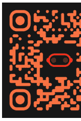

https://packt.link/IQQG8
