### 10

### 图像分割：从经典方法到深度学习

**图像分割** 是计算机视觉中的一个基础问题，专注于将图像分解为语义或结构上一致的区域。与对整个场景用单一标签进行概括的 **图像分类**，或使用边界框等粗略空间抽象来表示物体的 **目标检测** 不同，分割通过在像素级分配标签，对视觉内容提供密集且细粒度的解释。我们将在下一章中探讨这两者。像素级推理能够更丰富地表示场景结构，连接低级视觉线索与高级语义理解，并在医学成像到场景解析和交互式视觉系统等应用中发挥关键作用。

形式上，给定图像 $I: \Omega \subset \mathbb{R}^2 \to \mathbb{R}^c$，分割寻求一个划分：

$$\Omega = \bigcup_{k=1}^{K} R_k, \quad R_i \cap R_j = \emptyset$$

其中每个区域 $R_k$ 对应一个语义或结构上有意义的实体。

分割技术已发生了巨大演变。早期方法依赖于强度统计、梯度、形态学和变分法，而现代方法则利用卷积神经网络、变换器、扩散模型和基础模型。本章分为两个主要部分：经典图像分割和基于深度学习的分割。

在本章中，我们将学习以下主题：

- 经典图像分割
- 深度学习用于图像分割

它们共同提供了统一的理论和实践处理。

到本章结束时，你将对图像分割从经典方法如阈值化、分水岭和基于图的技巧，到现代深度学习方法包括 CNN、变换器和基于查询的模型，产生理解。你还将能够在真实世界数据集上实现和比较这些方法，以为不同应用选择合适的方法。

### 技术要求

在阅读本章不同章节的同时，请跟随 Jupyter notebook 并运行必要的代码片段。以下是对应本章 notebook 的 GitHub 链接：

https://github.com/PacktPublishing/Hands-On-Image-Processing-and-Computer-Vision-with-Python-Second-Edition. 在运行代码之前，必须安装正确版本的库，以便代码无缝运行。如果版本不匹配，代码可能需要根据库中某些功能/函数是否被移除或弃用，进行少量调整。

### 经典图像分割

经典分割方法依赖于强度分布、空间连续性、边缘信息、区域同质性和能量最小化原则的显式数学建模。这些方法可解释、计算高效，并构成了现代深度学习模型的理论骨架。我们将主题分组为概念块。

### 基于阈值的分割

阈值化是图像分割中最基本且最可解释的方法之一。它将强度空间划分为不相交的区域，使得每个区域内的像素具有相似的灰度特征。虽然经典阈值方法将图像分为两个类别（**前景/背景**），但许多真实世界图像包含 **多个语义区域**，这促使了 **多级阈值化**。

### 从二值 Otsu 到多 Otsu 阈值化

经典 Otsu 方法（由 Nobuyuki Otsu 于 1979 年提出）通过最大化 **类间方差** 来确定最佳阈值：

$$\sigma^2_{\text{between}} = \omega_0(\mu_0 - \mu_T)^2 + \omega_1(\mu_1 - \mu_T)^2$$

其中 $\omega_i$ 是类别 $i$ 的概率（权重），$\mu_i$ 是类别 $i$ 的平均强度，$\mu_T$ 是图像的全局平均强度。

最佳阈值通过求解以下式子获得：

(t₁*, …, tₖ₋₁*) = argmaxₜ₁,…,ₜₖ₋₁ ∑ᵢ₌₁ᴷ ωᵢ (μᵢ − μ_T)²

这等价于最大化 **类间方差**，由于：

σ²_total = σ²_within + σ²_between

这隐式最小化了 **类内方差**。

### 计算考虑

对所有阈值组合进行暴力搜索的复杂度为：

O(L^{K−1}),

其中 L 是灰度级数。复杂度随类别数 K 的增加而指数增长。实际实现（如 scikit-image 中）使用动态规划或直方图预计算来显著降低计算成本。

多 Otsu 本质上将直方图建模为 K 个聚类的混合。它试图找到最佳分离这些聚类的阈值。当直方图为多峰时效果最佳。

下一个代码片段使用 scikit-image 实现来演示 Multi-Otsu 算法。它根据指定的期望类别数计算最佳强度阈值。默认情况下，类别数为三，这会产生两个最佳阈值，将直方图划分为三个不同区域。这些阈值在下图中的强度直方图上以垂直红色线可视化，清楚地指示了类别之间的分离。

模块 skimage.filters 中的函数 threshold_multiotsu() 计算最佳阈值。

默认行为：K = 3 个类别并返回 K − 1 = 2 个阈值：[t₁, t₂]。内部它计算直方图（p(i)），搜索阈值组合并最大化类间方差。函数 np.digitize() 将每个像素分配给一个类别：

类别 0：I ≤ t₁，类别 1：t₁ < I ≤ t₂ 且 类别 2：I > t₂。

**直方图和阈值：** 直方图近似 PMF p(i)。红色线 = 最佳阈值，峰值对应不同区域（例如，背景、物体、高光）。阈值位于峰值之间。最后以伪色显示分割区域，每种颜色对应一个类别。这会产生标签图，如图所示：

```
from skimage import data
from skimage.filters import threshold_multiotsu
image = data.camera()
thresholds = threshold_multiotsu(image)
regions = np.digitize(image, bins=thresholds)
# Plot image, histogram (use image.ravel() to flatten image) and regions
```


如果运行上述代码，绘制图像/直方图，你应该会得到如下图所示的图形：

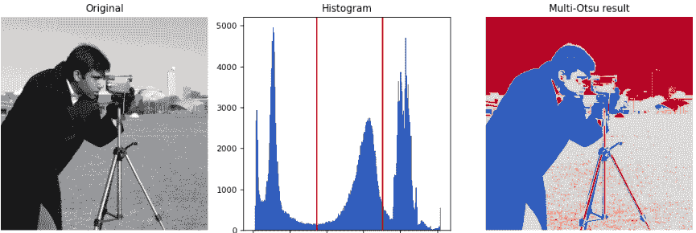

*Figure 10.1 – Thresholding with multi-Otsu*

多阈值 Otsu 是一种阈值分割算法，用于根据图像中灰度级的强度将输入图像的像素分离为若干个不同的类别。它是一种**简单而强大**的无监督分割方法，其可解释性建立在统计方差之上。可以将其视为经典图像处理与现代基于学习的分割之间的桥梁。

多阈值 Otsu 假设**强度可分离性**。当直方图具有明显的峰值且噪声较低时效果最佳。对光照变化和重叠的强度分布敏感。

> **Note**
>
> 尽管有更先进的分割技术可用，阈值分割仍然被广泛使用，因为其简单、计算高效，并且在强度分离清晰的场景中性能强劲，例如生物医学成像和文档分析，在这些场景中它通常作为快速可靠的基线。

## 边缘、区域和地形分割

分割技术大致可分为**基于边缘**、**基于区域**和**地形（形态学）**方法。基于边缘的方法依赖于检测强度不连续性，基于区域的方法利用同质性，而地形方法将图像解释为几何表面。本节重点介绍**分水岭分割**作为统一的地形方法，随后介绍结合区域和形态学进行物体计数的实用流程。

### Watershed segmentation

分水岭分割是一种强大的形态学方法，其根源于**数学形态学**（由 Jean Serra 和 Georges Matheron 创立）。它将图像解释为**地形表面**，其中像素强度 → 海拔，暗区域 → 山谷（盆地），亮区域 → 山峰（峰顶）。

设 $I(x, y)$ 为输入图像。梯度幅值：

$$\nabla I = \sqrt{\left(\frac{\partial I}{\partial x}\right)^2 + \left(\frac{\partial I}{\partial y}\right)^2}$$

表示**边缘强度**，形成地形表面。

分水岭分割定义为：

$$L = \text{Watershed}(\nabla I, \text{markers}),$$

其中 $\nabla I$ 是梯度图像（地形表面），markers 是指示区域的初始种子，$L$ 是标记的分割图。

### Flooding analogy

想象从标记点开始的水漫过程：

- 1. 水从标记开始填充盆地。
- 2. 随着水位上升，盆地扩张。
- 3. 当两个盆地相遇时，会形成分水岭线（边界）。

该过程产生的分割边界与**高梯度区域（边缘）**对齐。

### Marker-based watershed

为避免过度分割，使用**标记控制分水岭**：

- 内部标记 → 物体区域
- 外部标记 → 背景

标记定义为：

$$M(x, y) = \begin{cases} k, & \text{if pixel belongs to marker } k \\ 0, & \text{otherwise} \end{cases}$$

下面的代码片段演示了使用分水岭的灰度图像分割。以下是关键步骤：

- **1. Image loading and preprocessing:** 函数 `rgb2gray()` 来自 `skimage.color` 模块将 RGB 图像转换为灰度，确保基于强度的处理。
- **2. Noise reduction:** 函数 `median()` 来自 `skimage.filters.rank` 模块使用半径为 2 的 **disk** 结构元素（SE）应用**中值滤波**并在保留边缘的同时去除噪声。数学上：

$$I'(x, y) = \text{median}\{I(s, t) \mid (s, t) \in \mathcal{N}(x, y)\},$$

其中 $\mathcal{N}$ 指像素 $(x, y)$ 周围的邻域。

- **3. Marker extraction:** 首先计算局部梯度：

$$G(x,y) = \max_{(s,t)\in \mathcal{N}(x,y)} I(s,t) - \min_{(s,t)\in \mathcal{N}(x,y)} I(s,t)$$

（衡量像素周围**局部**的**强度变化**程度），随后进行阈值化，将**平坦区域（低梯度）**识别为标记。接下来使用 `scipy.ndimage` 模块中的 `label()` 函数进行连通分量标记，分配唯一 ID。

- **4. Gradient computation:** 函数 `rank.gradient()` 产生**地形表面**。薄边缘（小磁盘）确保边界精确。
- **5. Watershed transformation:** 使用 `skimage.segmentation` 模块中的 `watershed()` 函数实现。从标记开始淹没。边界在高梯度脊线处形成。
- **6. Visualization:** 原始图像、梯度图、标记图和最终分割叠加图像使用 matplotlib 并排绘制，如下一段代码所示：

```
from scipy import ndimage as ndi
from skimage.filters import rank
from skimage.util import img_as_ubyte

image = img_as_ubyte(rgb2gray(imread('images/earth.png')[..., :3]))
denoised = rank.median(image, disk(2))
markers = rank.gradient(denoised, disk(5)) < 20 # threshold
markers = ndi.label(markers)[0]
gradient = rank.gradient(denoised, disk(2))
labels = watershed(gradient, markers)
# display image, gradient, markers and labels overlayed side-by-side here
```

如果运行上述代码并绘制图像，你应该会得到如下图所示的图形：

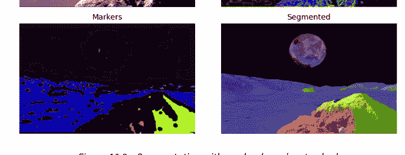

*Figure 10.2 – Segmentation with marker-based watershed*

> **Note**
>
> `img_as_ubyte()` 函数将 `rgb2gray()` 产生的归一化浮点图像 `[0,1]` 转换为 8 位（`uint8`）图像 `[0,255]`，这是 `skimage.filters.rank.median()` 的预期输入格式。
>
> **Advantages:** 精确的边界定位，并且自然地结合了边缘信息。
>
> **Limitations:** 对噪声敏感 → 过度分割，需要良好的标记选择。

从关注使用由精心定义的标记引导的梯度驱动淹没来分离区域的基于标记的分水岭分割出发，我们现在转向一个实际应用，在该应用中分割与形态学操作相结合以解决一个现实世界的视觉任务——使用分割和形态学计数硬币。

## Counting coins with segmentation and morphology

### Problem formulation

给定包含多个硬币的灰度或 RGB 图像 $I(x,y)$，我们希望确定**单个硬币的数量** $N_c$。我们可以用 $N_c = \max(L)$ 来估计硬币数量，其中 $L$ 是标记的分割图。这可以形式化为以下流程：

- **1. Thresholding/Binary segmentation:** 将前景（硬币）与背景分离。
- **2. Morphological processing/Cleaning** (opening, closing, distance transform, watershed): 清理掩膜，细化分割，并在必要时分离接触的硬币。
- **3. Distance transform:** 计算每个前景像素到最近背景像素的距离。数学上，

$$D(x,y)=\min_{(x',y')\in\mathrm{background}}\lVert(x,y)-(x',y')\rVert$$

- **4. Watershed separation:** 使用从标记开始的地形淹没来分割接触的物体。
- **5. Connected component labeling:** 为每个连通的硬币分配唯一标签，识别每个硬币。
- **6. Counting:** 计算唯一标签的数量。
- **7. Binary segmentation:** 阈值化从灰度图像 $I$ 产生掩膜 $M$：

$$M(x,y)=\begin{cases}1, & I(x,y)>T\\0, & I(x,y)\le T\end{cases}$$

其中 $T$ 是阈值，使用 Otsu 方法计算。

### Morphological operations

形态学操作有助于**清理二值掩膜并分离接触的硬币**。设 $B$ 为二值图像，$S$ 为 SE（结构元素，一种用于在形态学操作中探测和处理图像邻域的小型预定义形状/核）。现在，让我们定义形态学操作：

- **Erosion** ($\ominus$): $B \ominus S = \{z \mid S_z \subseteq B\}$。去除小的噪声像素并缩小物体。
- **Dilation** ($\oplus$): $B \oplus S = \{z \mid S_z \cap B \neq \varnothing\}$。扩张物体并连接附近像素。
- **Opening** ($\circ$): $B \circ S = (B \ominus S) \oplus S$。去除小物体/噪声并平滑边界。
- **Closing** ($\bullet$): $B \bullet S = (B \oplus S) \ominus S$。填充物体内部的小孔。
- **Distance transform and watershed:** 为分离接触的硬币，首先计算二值掩膜的距离变换 $D(x,y)$，其中峰值对应硬币中心。将其用作标记并应用**分水岭算法**以将重叠区域分割为不同的独立物体。
- **Labeling and counting:** 分割和形态学细化后，二值掩膜包含**连通分量**。标记每个分量：$L = \operatorname{label}(M)$。**硬币数量**为：$N_c = \max(L)$。

让我们使用以下代码片段实现硬币计数。以下是关键步骤：

- **1. Load image:** 使用 `skimage.data` 模块中的 `coins()` 函数加载硬币图像。
- **2. Thresholding:** 使用 `skimage` 中的 `filters.threshold_otsu()` 函数将前景硬币与背景分离。
- **3. Morphological cleaning:** 使用 `skimage` 中的 `morphology.remove_small_objects()` 函数和 `scipy.ndimage` 中的 `binary_fill_holes()` 函数分别去除噪声并填充硬币内部的孔洞。

```python
from skimage import io, color, filters, measure, morphology, data
gray = data.coins()
thresh = filters.threshold_otsu(gray)
binary = gray > thresh
cleaned = morphology.remove_small_objects(binary, min_size=100)
cleaned = ndi.binary_fill_holes(cleaned)
# plot gray, binary and cleaned images side-by-side here.
```


如果运行上述代码并绘制图像，你应该会得到如下图所示的图形：

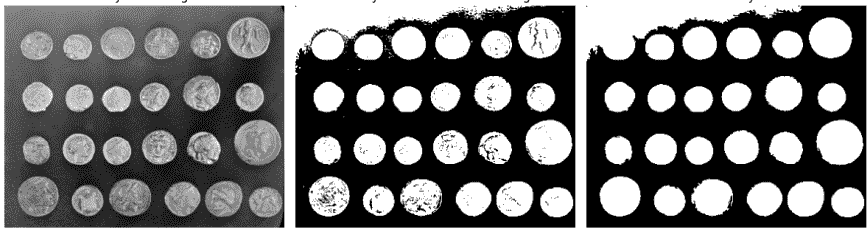

Figure 10.3 – Mathematical morphology to create binary mask from coins image

以下是正在发生的事情的分解：

+   1. **Distance transform:** 使用模块 scipy.ndimage 中的函数 distance_transform_edt() 计算距离变换输出 D（距离），这里峰值对应于硬币中心。
+   2. **Marker extraction:** 使用 skimage.features 模块中的函数 peak_local_max() 在上面计算的距离图上检测局部最大值。这些作为 watershed 的标记。
+   3. **Marker image construction:** 为每个检测到的峰值分配唯一的标签。
+   4. **Watershed segmentation:** 使用 skimage.segmentation 中的函数 watershed() 对 −D(x,y) 应用 watershed 分割，使得峰值成为盆地，watershed 分离接触的硬币。
+   5. **Visualization:** 并排绘制距离变换输出（突出显示中心）、标记图图像（分割的种子）和 watershed 分割（分离的硬币）输出，如下一段代码片段所示：

```
from skimage.feature import peak_local_max
from skimage.segmentation import watershed

distance = ndi.distance_transform_edt(cleaned)
coords = peak_local_max(distance, footprint=np.ones((3, 3)),
labels=cleaned)
markers = np.zeros_like(distance, dtype=int)
for i, (r, c) in enumerate(coords, start=1): markers[r, c] = i
labels = watershed(-distance, markers, mask=cleaned)
# plot the images distance, markers and labels side-by-side here
```

如果运行上述代码并绘制图像，你应该会得到如下图所示的图形：

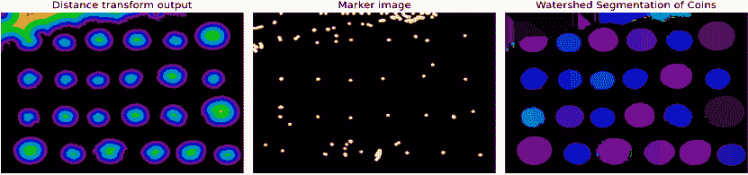

以下是代码中正在发生的事情的分解：

+   1. **Region-based filtering:** 函数 `skimage.measure.regionprops()` 用于计算分割区域的以下属性：面积、周长、偏心率和 solidity。
+   
+   2. **Circularity measure:**
+   
+      $$C = \frac{4\pi A}{P^2},$$
+   
+      其中 $A$ 和 $P$ 分别是相应区域的面积（像素总数）和周长（$C \approx 1 \to$ 圆）。使用它通过阈值过滤非硬币区域，例如 0.7，如代码中所用（硬币应具有比例如具有相同周长的矩形区域更高的圆度值）。它去除噪声和不规则形状。
+   
+   3. **Final counting:** 函数 `skimage.measure.label()` 用于标记精炼区域。然后计算连通分量的数量以找到硬币的数量。
+   
+   4. **Visualization:** 并排绘制 watershed 标签图像、带 regionprop 过滤的 cleaned 标签图像以及带有硬币中心位置标记的叠加图像（使用每个区域的 centroid 属性获得，作为连通分量的几何中心：
+   
+      $$(x_c,y_c)=\left(\frac{1}{A}\Sigma x,\frac{1}{A}\Sigma y\right)$$
+   
+      如下一段代码片段所示：

```
```python
regions = measure.regionprops(labels)
coin_labels = []
for region in regions:
    circularity = 4. * np.pi * region.area / (region.perimeter ** 2 + 1e-6)
    if circularity > 0.7 and region.area > MIN_AREA:
        coin_labels.append(region.label)
coin_mask = np.isin(labels, coin_labels)
clean_labels = measure.label(coin_mask)
num_coins = clean_labels.max()
print(f"Number of coins detected: {num_coins}")
# Number of coins detected: 24
# Plot labels, clean_labels, gray side-by-side and mark centroid here
```
```

虽然 SLIC 基于 solely 颜色和空间邻近性生成超像素，但 MaskSLIC 通过结合先验掩码信息来约束超像素在感兴趣区域内形成，从而扩展了该框架。

- **Mathematical formulation:** SLIC 执行局部的 **k-means clustering**，使用距离度量：
  
  $$D = \sqrt{d_c^2 + \left(\frac{m}{S}\right)^2 d_s^2},$$
  
  其中 $d_c = \sqrt{(L_i - L_j)^2 + (a_i - a_j)^2 + (b_i - b_j)^2}$（颜色距离），$d_s = \sqrt{(x_i - x_j)^2 + (y_i - y_j)^2}$（空间距离），$S$: 预期超像素大小和 $m$: 紧凑度参数。

- **Optimization objective:** SLIC 最小化：
  
  $$\sum_{k=1}^{K} \sum_{i \in S_k} D\left(i, C_k\right)^2$$
  
  其中 $C_k$ 是聚类中心。

- **MaskSLIC extension:** MaskSLIC 引入约束：
  
  $$S_k \subseteq \mathcal{M}$$
  
  其中 $\mathcal{M}$ 是预定义的掩码。关键思想是限制聚类到相关区域，提高边界 adherence 并避免超像素跨越对象边界。

- **Region Adjacency Graph (RAG) merging:** 尽管 *superpixels* 通过对相似像素进行分组显著降低了计算复杂度，但它们通常会产生 *over-segmented* 表示，其中单个语义对象可能被分割成许多小区域。为了获得更大、更有意义的对象级分割， subsequently 使用 Region Adjacency Graph 将外观相似的相邻超像素合并。
  
  超像素化后，图像表示为 **graph over regions** $G = (V, E)$，其中 $V = \{S_1, S_2, ..., S_K\}$ 是超像素集合，$E$ 是 **adjacent regions** 之间的边集合。

- **Node attributes (Region Statistics):** 每个区域 $S_i$ 与特征相关联（例如平均颜色），
  
  $$\mu_i = \frac{1}{|S_i|} \sum_{(x,y) \in S_i} I(x, y),$$
  
  其中 $|S_i|$: 区域中的像素数和 $I(x, y)$: 像素强度（或 RGB/Lab 空间中的向量）。

- **Edge weights (Similarity Measure):** 边编码相邻区域 $w_{ij} = \| \mu_i - \mu_j \|_2$ 之间的 **dissimilarity**，s.t. 小 $w_{ij} \rightarrow$ 相似区域；大 $w_{ij} \rightarrow$ 不相似区域。

- **Hierarchical region merging:** RAG merging 执行 **iterative agglomerative clustering**
  
  $$(S_i, S_j) = \arg \min_{(i,j) \in E} w_{ij}$$
  
  受 $w_{ij} < \tau$ 约束，其中 $\tau$ 是阈值（停止时没有边满足阈值）。

当两个区域 $S_i$ 和 $S_j$ 合并时，$S_{ij}=S_i\cup S_j$，更新均值

$$\mu_{ij}=\frac{|S_i|\mu_i+|S_j|\mu_j}{|S_i|+|S_j|}.$$

合并后，边权重重新计算 $w_{(i,j),k}=\lVert\mu_{ij}-\mu_k\rVert_2$。

这是通过函数 `_weight_mean_color()` 实现的（refer github）。RAG merging 最小化 intra-region variance

$$\min\sum_k\sum_{(x,y)\in S_k}\lVert I(x,y)-\mu_k\rVert^2,$$

受 adjacency constraints 约束。

- **RAG merging transforms:** 超像素 → 语义上有意义的区域，通过逐步对相似相邻区域进行分组，形成低级过分割和高级别分割之间的桥梁。

下一段代码演示并比较 **SLIC** 与 **MaskSLIC**。首先读取输入图像并使用 `rgb2lab()` 转换为 *Lab* 空间以进行 *perceptually uniform* 聚类，同时掩码通过 `remove_small_objects()`、`remove_small_holes()` 和 `opening()` 进行阈值处理和精炼。

函数 `segmentation.slic()` 在 $(x,y,L,a,b)$ 特征空间中生成 SLIC 超像素，而 MaskSLIC 将分割限制在掩码区域内以获得更有意义的超像素。然后对两种分割应用基于 RAG 的合并以获得语义连贯的区域。

辅助函数（`_weight_mean_color()`、`merge_mean_color()`、`merge_segments()`，refer github）使用 `graph.rag_mean_color()` 构造 RAG，并通过 `graph.merge_hierarchical()` 基于平均颜色相似性 *merge adjacent regions* 层次化。

最后，`mark_boundaries()` 并排可视化原始图像、掩码、SLIC、MaskSLIC 及其合并输出。

```
```python
def merge_segments(img, segments):
    rag = graph.rag_mean_color(img, segments)
    labels = graph.merge_hierarchical(
        segments, rag, thresh=35,
        rag_copy=False, in_place_merge=True,
        merge_func=merge_mean_color,
        weight_func=_weight_mean_color)
    return color.label2rgb(labels, img, kind='avg')

img = plt.imread('images/cats.jpg') #input data
lum = color.rgb2lab(img)
mask = color.rgb2gray(plt.imread('images/cat_mask.jpg')) > 0.1
mask = morphology.remove_small_objects(mask, min_size=499)
mask = morphology.remove_small_holes(mask, area_threshold =499)
mask = morphology.opening(mask, morphology.disk(3))
slic = segmentation.slic(lum, n_segments=200, start_label=1)
```


以下是关键步骤：

读取输入图像并进行 **downsample** 以提高效率。使用 `skimage.segmentation` 模块中的函数 `felzenszwalb()` 来实现 **graph-based segmentation**。其内部工作原理如下：

- **1. Building graph:** 图像首先被建模为一个无向图

  $$G=(V,E),$$

  其中 $V$ 表示像素（每个像素是一个节点），$E$ 表示相邻像素之间的边（例如 4- 或 8-连通性）且 $w(i,j)$ 表示边权重，衡量不相似度（例如颜色/强度差异）。

- **2. Formation of components:** 最初，每个像素形成自己的组件：

  $$C_i=\{i\}.$$

  边按 **non-decreasing order of weight** 排序，并迭代合并组件，采用贪心策略（类似于构建最小生成树）。

- **3. Inter-component dissimilarity:** 连接两个组件 $C_1$ 和 $C_2$ 的最小边权重为：

  $$D(C_1,C_2)=\min_{i\in C_1,\,j\in C_2} w(i,j)$$

  可用作区域间相似度的度量。

- **4. Merge criterion:** 若满足以下条件则合并 $C_1$ 和 $C_2$：

  $$D(C_1,C_2)\leq\min(\operatorname{Int}(C_1)+\tau(C_1),\ \operatorname{Int}(C_2)+\tau(C_2)),$$

  其中 $\operatorname{Int}(C)=\max_{e\in MST(C)}w(e)$ 指组件 $C$ 的内部差异（区域内变化），定义为 $C$ 的 **maximum edge weight inside the MST**（最小生成树）的最大值，因此小的 $\operatorname{Int}(C)\rightarrow$ 非常均匀的区域且大的 $\operatorname{Int}(C)\rightarrow$ 区域内变化更大。

  $\tau(C)=\frac{k}{|C|}$ 是一个自适应阈值，$k$ 是控制分割粒度比例参数，$|C|$ 是组件中的像素数。

- **5. Component growth:** 从 **single-pixel components** 开始。如果邻近组件相似（边权重低）且内部变化小，则合并它们。由于 $\tau(C)$，更大的组件需要更强的证据才能合并。组件自适应地从像素生长为区域，确保合并在感知上有意义的边界处停止，从而实现高效且保留边缘的分割。使用函数 `quickshift()` 实现基于模式寻求聚类的分割。它将每个像素视为联合空间-颜色空间 $(x,y,I)$ 中的点，并执行 **kernel density estimation (KDE)**：

  $$p(z)=\sum_i K\left(\frac{\lVert z-z_i\rVert^2}{h^2}\right),$$

  其中 $z=(x,y,I)$：特征向量，$K$：核（例如高斯）和 $h$：带宽（控制邻域大小）。然后每个像素链接到具有更高密度的最近邻，形成一棵树；聚类（段）作为像素收敛到相同的密度模式（局部最大值）而出现。像素“向高密度区域移动”，分组为段，而无需指定聚类数量。

使用函数 `watershed()` 和 `slic()` 分别实现 watershed 分割和 SLIC 超像素化，如下一段代码所示：

```python
from skimage.segmentation import felzenszwalb, slic, quickshift, \
    watershed, mark_boundaries

img = plt.imread('images/rose.jpg')[:, ::2, ::2] # downsamples
segments_fz = felzenszwalb(img, scale=100, sigma=0.5, min_size=50)
segments_slic = slic(img, n_segments=250, compactness=10, sigma=1, \
                    start_label=1)

segments_quick = quickshift(img, kernel_size=3, max_dist=6, ratio=0.5)
gradient = sobel(rgb2gray(img))
segments_watershed = watershed(gradient, markers=250, compactness=0.001)
fz_merged = merge_segments(img, segments_fz)
slic_merged = merge_segments(img, segments_slic)
quick_merged = merge_segments(img, segments_quick)
watershed_merged = merge_segments(img, segments_watershed)
# PLOT the segmented and rag-merged images here
```

如果运行上述代码并绘制图像，你应该得到如下图所示的结果：

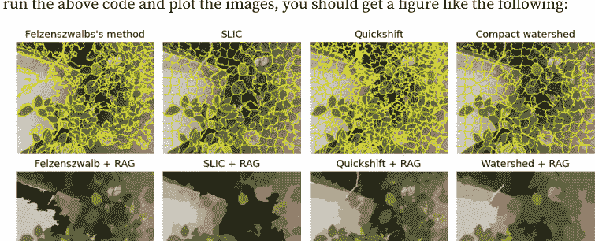

Figure 10.7 – Segmentation (Quickshift, Watershed, Felzenszwalb) vs. Superpixelation (SLIC)

超像素化不是最终分割，它充当中间层表示。它能够在深度网络中实现高效的基于图的 learning 和区域池化。基于超像素的分割提供了一种强大的抽象：SLIC 在 5D 特征空间中聚类像素。MaskSLIC 结合先验掩码以提高精度。多种算法提供权衡。SLIC 与 RAG 结合：像素 → 超像素 → 区域。这种分层视图在经典分割和现代深度学习 pipeline 之间形成关键桥梁，同时实现效率和可解释性。

## Variational and energy-based segmentation

变分方法将图像分割表述为 **energy minimization problem**，目标是找到一个最优划分（或表示），在 **data fidelity** 和 **regularity** 之间取得平衡：

$$E = E_{\text{data}} + \lambda E_{\text{regularization}},$$

其中 $E_{\text{data}}$：确保与观测图像相似，$E_{\text{regularization}}$：强制平滑或结构约束且 $\lambda$：权衡参数。这些方法深深植根于 **calculus of variations**，导致 **Euler–Lagrange PDEs** 和迭代优化。

### Chan–Vese active contours

Chan–Vese 模型是一种 **region-based active contour method**，**does not rely on image gradients**，使其对弱或缺失边缘具有鲁棒性。

- **Energy functional:**

  $$E(c_1, c_2, C) = \mu \cdot \text{Length}(C) + \lambda_1 \int_{\text{inside}(C)} |I - c_1|^2 dx + \lambda_2 \int_{\text{outside}(C)} |I - c_2|^2 dx,$$

  其中 $C$：轮廓（分割边界），$c_1, c_2$：内部/外部均值强度，$\mu$：平滑权重，$\lambda_1, \lambda_2$：数据保真权重。

- **Level set formulation:** 轮廓 $C$ 使用 **level set function** $\phi(x, y)$ 隐式表示：

  $$C = \{(x, y) \mid \phi(x, y) = 0\}$$

  使用 Heaviside 函数 $H(\phi)$，能量变为：

  $$E(\phi) = \mu \int |\nabla H(\phi)| dx + \lambda_1 \int |I - c_1|^2 H(\phi) dx + \lambda_2 \int |I - c_2|^2 (1 - H(\phi)) dx$$

- **Euler–Lagrange evolution:** 最小化导致以下梯度更新，

  $$\frac{\partial \phi}{\partial t} = \delta(\phi) \left[ \mu \text{div}\left(\frac{\nabla \phi}{|\nabla \phi|}\right) - \lambda_1 (I - c_1)^2 + \lambda_2 (I - c_2)^2 \right]$$

下一段代码实现 Chan–Vese 分割：使用 `skimage.segmentation` 模块中的函数 `chan_vese()`。关键参数是 `mu`（平滑，控制轮廓规则性），`lambda1`、`lambda2`（区域拟合权重），`init_level_set`（初始轮廓，这里为棋盘格）和 `extended_output`（函数返回分割掩码，并且当 `extended_output=True` 时可选地返回水平集函数和能量历史）。如下一段代码所示，它返回一个包含 3 个元素的元组：分割（`cv[0]`：最终二值掩码，1 → 区域内部，0 → 区域外部），水平集函数（`cv[1]`：最终隐式轮廓 $\phi(x, y)$，零水平定义边界）和能量演化（`cv[2]`：迭代过程中的能量值列表，用于监控收敛）。

```python
from skimage.segmentation import chan_vese
image = img_as_float(data.camera())
cv = chan_vese(image, mu=0.25, lambda1=1, lambda2=1,  # play with parameters
    tol=1e-3, max_num_iter=200, dt=0.5,  # to see how they impact the result
    init_level_set="checkerboard", extended_output=True)
# Plot image, cv[0], cv[1], cv[2] side-by-side
```

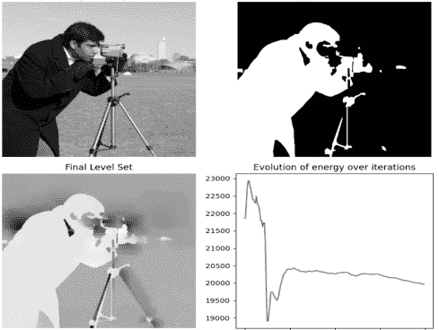

*Figure 10.8 – Segmentation with Chan-Vese (active contour)*

轮廓演化以最小化能量，基于强度统计分离区域。上述代码实现 **region-based segmentation** 而不依赖边缘。即使 **edges are weak or missing** 也能工作。分割由 **region homogeneity** 驱动。

### Mumford–Shah functional

Mumford–Shah 模型是分割和边缘检测的 **foundational variational framework**。

- **Functional definition:**

  $$E(u,\Gamma)=\int_{\Omega}|I-u|^2dx+\lambda\int_{\Omega\setminus\Gamma}|\nabla u|^2dx+\nu|\Gamma|,$$

  其中 $u(x)$：图像的分段光滑近似，$\Gamma$：边缘集（不连续性）且 $|\Gamma|$：边缘长度。这里，**Data term**：对图像的保真度（第 1 项），**Smoothness term**：分段光滑区域（第 2 项）且 **Edge term**：惩罚边界复杂性（第 3 项）。算法平衡 **denoising + segmentation + edge detection**。

- **Ambrosio–Tortorelli approximation:** 直接最小化困难，因此通过引入辅助变量 $v(x)$ 进行近似：

  $$E(u,v)=\int\left[\beta(u-f)^2+\alpha v^2|\nabla u|^2+\frac{1}{2}\left(\rho|\nabla v|^2+\frac{(1-v)^2}{\rho}\right)\right]dx,$$

  其中 $v(x)\approx 0$ 在边缘处，$v(x)\approx 1$ 在光滑区域且 $\rho\to 0$：尖锐边缘近似。

- **Euler–Lagrange PDEs:**

  $$\frac{\partial u}{\partial t}=\nabla\cdot(v^2\nabla u)-\frac{\beta}{\alpha}(u-f),\qquad \frac{\partial v}{\partial t}=\nabla^2v-\frac{2\alpha|\nabla u|^2v}{\rho}-\frac{v-1}{\rho^2}$$


The next figure summarizes everything:

## Image Segmentation with Calculus of Variations

### MUMFORD-SHAH (MS) FUNCTIONAL

functional minimization
$E_{MS}(u,\Gamma)=\beta\int_{\Omega}(u-f)^2dx+\alpha\int_{\Omega\setminus\Gamma}|\nabla u|^2dx+length(\Gamma)$
$\Omega\subset\mathbb{R}^2$ is connected, bounded, open subset
$\Gamma\subset\Omega$
edge set segmenting $\Omega$

### AMBROSIO-TORTORELLI (AT) APPROXIMATION OF MS FUNCTIONAL

functional minimization
$E_{AT}(u,v)=\int_{\Omega}\left(\beta(u-f)^2+\alpha(v^2|\nabla u|^2)+\frac12\left(\rho|\nabla v|^2+\frac{(1-v)^2}{\rho}\right)\right)dx$
$\rho\to0,\ v\to1-\chi_{\Gamma}$
edge indicator
$v(x)\approx0$ if $x\in\Gamma$ and $v(x)\approx1$

### Euler-Lagrange Equations & system of coupled elliptic PDEs

for Gradient-descent updates
$\frac{\partial u}{\partial t}=\nabla\cdot(v^2\nabla u)-\frac{\beta}{\alpha}(u-f);\quad\left.\frac{\partial u}{\partial n}\right|_{\partial\Omega}=0,$
$\frac{\partial v}{\partial t}=\nabla^2v-\frac{2\alpha|\nabla u|^2v}{\rho}-\frac{(v-1)}{\rho^2};\quad\left.\frac{\partial v}{\partial n}\right|_{\partial\Omega}=0$
Neumann boundary conditions
Ref https://web.cs.hacettepe.edu.tr/~erkutbil/717_s12w06_ms_tv.pdf

*Figure 10.9 – Image segmentation with Mumford-Shah (Variational method)*

The next code snippet provides a Python demo that solves the Ambrosio–Tortorelli model using alternating minimization (AM) and conjugate gradients.

The class AmbrosioTortorelliMinimizer implements the Ambrosio–Tortorelli approximation of the Mumford–Shah functional, solving a variational segmentation problem via alternating minimization. It iteratively computes a piecewise-smooth image $u$ and an edge indicator $v$ by solving coupled PDEs using conjugate gradient optimization. The outputs consist of a denoised/segmented image and its corresponding edge map. Here are the key steps that describe how it works:

## Algorithm workflow

- 1. **Edge update:** The method solve_edges() implements
  $\nabla^2 v - \frac{2\alpha|\nabla u|^2 v}{\rho} - \frac{v-1}{\rho^2}=0$
  It uses a conjugate gradient solver and produces edge map.
- 2. **Image update:** The method solve_image() implements
  $\nabla\cdot(v^2\nabla u)-\frac{\beta}{\alpha}(u-f)=0,$
  smooths the image except across edges.
- 3. **Alternating minimization:** Implemented using the method minimize(), which iteratively refines $u$ and $v$.
- 4. **Multi-channel processing:** Applies algorithm per RGB channel.
- Output
  $u$: segmented/smoothed image and $v$: edge map
- **Visualization**
  Original image, smoothed/segmented image, and edge map.

Now refer to the next code snippet (for complete code refer github):

```
class AmbrosioTortorelliMinimizer():

    def solve_edges(self):
        size = self.g.shape[0]* self.g.shape[1]
        A = LinearOperator( (size, size), matvec = \
            self.edge_linear_operator, dtype = np.float64)
        b = np.ones(size) * self.beta / (4 * self.epsilon)
        self.edges, _ = scipy.sparse.linalg.cg(A, b, tol = self.tol, \
                                    maxiter = self.maxiter)
        self.edges = np.power(self.edges.reshape(*self.g.shape), 2)
        return self.edges

    def solve_image(self):
        size = self.g.shape[0]* self.g.shape[1]
        A = LinearOperator( (size, size), matvec = \
            self.image_linear_operator, dtype = np.float64)
        b = self.g.reshape(size)
        self.f, _ = scipy.sparse.linalg.cg(A, b, tol = self.tol, \
                                    maxiter = self.maxiter)
        self.f = self.f.reshape(*self.g.shape)
        self.update_gradients()
        return self.f

    def minimize(self):
        for i in range(0, self.iterations):
            self.solve_edges(); self.solve_image()
        self.edges = np.power(self.edges, 0.5)
        cv2.normalize(self.f, self.f ,0,255,cv2.NORM_MINMAX)
        cv2.normalize(self.edges, self.edges ,0,255,cv2.NORM_MINMAX)
        return np.uint8(self.f), 255 - np.uint8(self.edges)

f = plt.imread('images/parrot.jpg')
result, edges = [], []
for channel in cv2.split(f):
    solver = AmbrosioTortorelliMinimizer(channel, iterations = 1, \
                                    tol = 0.1, solver_maxiterations = 6)
    u, v = solver.minimize()
```

```
```python
result.append(u)
edges.append(v)

u, v = cv2.merge(result), np.maximum(*edges)
# plot f, u, v side-by-side here
```
```

If you run the preceding code, you should obtain a figure like the following:

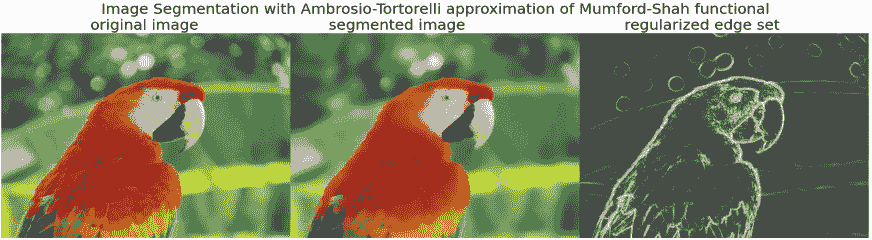

*Figure 10.10 – Image segmentation with Mumford-Shah functional (Ambrosio-Tortorelli approximation)*

While variational and energy-based segmentation methods formulate the problem in a continuous optimization framework by minimizing carefully designed energy functionals, an alternative perspective emerges by representing the image as a graph or random field, where segmentation is performed through probabilistic inference over discrete structures, leading naturally to graphical and probabilistic methods, which we shall explore in the next section.

## Graphical and probabilistic methods

Graphical and probabilistic segmentation methods model images as **graphs or probabilistic fields**, where pixels are nodes and interactions encode spatial and appearance relationships. These methods typically optimize the energy of the form:

$$E(f)=\sum_p D_p(f_p)+\sum_{(p,q)\in\mathcal{N}}V_{pq}(f_p,f_q)$$

where $f_p$: label (class assignment) of pixel $p$ (e.g., foreground or background), $D_p(f_p)$: data term (likelihood), $V_{pq}(f_p,f_q)$: pairwise smoothness term and $\mathcal{N}$: neighborhood system.

## GrabCut

GrabCut is an interactive graph-cut-based segmentation algorithm that combines:

- **Gaussian Mixture Models (GMMs)** for appearance modeling
- **Graph cuts** for global energy minimization

### Energy Formulation:

E(f, θ) = Σₚ Dₚ (fₚ | θ) + Σ₍p,q₎∈N Vₚq (fₚ, f_q),

where θ: model parameters (e.g., foreground/background GMM parameters like means, variances, and mixture weights).

Dₚ(fₚ): Data Term (Unary Term), which measures how well pixel p fits the assigned label fₚ. Typically, Dₚ(fₚ) = −logP(Iₚ | fₚ), negative log-likelihood from GMM. If pixel intensity Iₚ looks like foreground → low cost for fₚ = foreground and if not → high cost. In simple words, it refers to how likely is this pixel to belong to this class.

Vₚq(fₚ, f_q): Smoothness Term (Pairwise Term), which penalizes neighboring pixels (p,q) having different labels:

Vₚq(fₚ, f_q) = γ · [fₚ ≠ f_q] · exp(−β|Iₚ − I_q|²),

where fₚ, f_q : Labels assigned to pixels (e.g., foreground/background), Iₚ, I_q: Pixel intensities or color values. If two pixels look similar → strong penalty for assigning different labels and if very different → weak penalty.

In simple words, nearby similar pixels should have the same label. Here γ: controls strength of smoothness and β: controls sensitivity to intensity differences. Again, Data term → individual pixel decision, Smoothness term → neighborhood consistency, Segmentation balances: “Fit the data” + “Keep regions smooth”.

### Optimization via Graph Cuts

First construct a graph: Nodes → pixels and Edges → neighborhood connections. Add Source (foreground) and Sink (background). Solve using min-cut / max-flow:

min_f E(f) ⇔ minimum cut.

### Iterative refinement

GrabCut alternates between estimating GMM parameters θ and minimizing energy via graph cut. This is similar to an EM (Expectation Maximization)-like optimization.

### GrabCut with OpenCV-Python

GrabCut is an interactive image segmentation method based on graph cuts (max-flow/min-cut) that separates foreground from background using minimal user input. The user typically provides a loose bounding box around the object, after which the algorithm iteratively refines the segmentation. If the result is imperfect, additional user scribbles marking foreground or background pixels can be provided to correct errors and further improve the segmentation quality. The next code snippet demonstrates how the flowers (foreground objects) from an image can be segmented from the background using this algorithm. Here are the steps:

- 1. Load Image: First read the input dahlia flowers image with cv2.imread() function (remember it reads an RGB image in BGR format).


2. **初始化：** 掩码（mask）被初始化为零（背景）。掩码图像是一种图像，通过它我们可以指定图像中哪些区域是：

- 确定是背景：值为 0（或标志 `cv2.GC_BGD`）
- 确定是前景：值为 1（或标志 `cv2.GC_FGD`）
- 可能是背景/前景：使用以下标志 `cv2.GC_PR_BGD`（值为 2）和 `cv2.GC_PR_FGD`（值为 3）。

3. **定义模型：** `bg_model` 和 `fg_model`——分别是背景和前景的内部 GMM 参数。

4. **提供初始提示：** 提供花朵周围一个矩形（`rect`）的坐标，向算法给出（粗略的）提示，即该矩形定义了**可能的前景区域**。

5. **运行 GrabCut：** 调用 opencv-Python 的 `grabCut()` 函数从输入图像中分割出前景花朵（物体），参数如下：

- 输入图像、空白掩码和前景矩形坐标。
- 模式参数设置为 `cv2.GC_INIT_WITH_RECT`。
- 运行算法的迭代次数（这里为 5），它执行 5 次迭代：*GMM 估计*、*图割优化*，并修改所提供的掩码图像。

6. **提取最终掩码：** 修改掩码，使所有值为 0/2 的像素设为 0（背景），所有值为 1/3 的像素设为 1（前景）。

7. **应用掩码：** 将输入图像与最终掩码相乘，提取前景物体并获得分割后的图像，如下一个代码片段所示。

```
import cv2

img = cv2.imread('images/dalhia.jpg')
img_orig = img.copy()
mask = np.zeros(img.shape[:2],np.uint8)
bg_model = np.zeros((1,65),np.float64)
fg_model = np.zeros((1,65),np.float64)
rect = (200,20,720,680) #(80,100,720,550)

cv2.grabCut(img, mask, rect, bg_model, fg_model, 5,
            cv2.GC_INIT_WITH_RECT)
mask2 = np.where((mask==2)|(mask==0), 0, 1).astype('uint8')
cv2.rectangle(img_orig, rect[:2], rect[-2:], (255,0,0), 2)
img = img*mask2[:,:, np.newaxis]
plt.imshow(np.hstack((cv2.cvtColor(img_orig, cv2.COLOR_BGR2RGB), \
            cv2.cvtColor(img, cv2.COLOR_BGR2RGB)))), plt.colorbar()
```

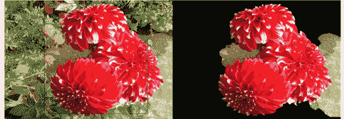

## 图 10.11 – 使用 GrabCut（基于掩码）进行图像分割

上图显示了通过运行上述代码片段，使用 GrabCut 算法得到的输入图像、绘制在前景物体周围的边界框矩形以及分割出的物体。注意，初始矩形遗漏了花朵的一小部分，并且包含了图像的一部分背景。

> 注意
> 输出取决于初始矩形。如果物体没有完全位于矩形内，或者包含了背景，就会出现错误。可以通过手动笔划（基于掩码的初始化）进行细化。

从输出图像中，我们可以直接看到提取出的前景。可以看到，分割输出中也（错误地）包含了一部分背景。这可以通过提供带有手动笔划的掩码来纠正，这些笔划定义了一些（错误识别的）前景和背景像素（基于掩码的初始化）。下一行代码加载一个掩码图像（参考本书随附的 GitHub 仓库），其中提供了一些此类笔划（涂鸦）（绿色笔划标记一些前景像素，蓝色笔划标记一些背景像素）：

```
newmask = cv2.imread('images/dahlia_mask.png')
```

现在需要使用这个掩码来运行算法。下一个代码块展示了如何使用这个掩码运行 `cv2.grabCut()` 函数。下图显示了该代码块的输出，即算法仅以掩码中的笔划作为提示，正确分割出的前景物体：

```
mask = 2*np.ones(img.shape[:2],np.uint8)
# blue scribble pixels are surely backgrounds
mask[(newmask[...,0] >= 200)&(newmask[...,1] <= 20)&(newmask[...,2]<=20)] = 0 #
# green scribble pixels are surely foregrounds
mask[(newmask[...,0] <= 20)&(newmask[...,1] >= 200)&(newmask[...,2]<=20)] = 1
mask, bg_model, fg_model = \
    cv2.grabCut(img,mask,None,bg_model,fg_model,5,cv2.GC_INIT_WITH_MASK)
mask = np.where((mask==2)|(mask==0),0,1).astype('uint8')
img = img*mask[:,:,np.newaxis]
plt.imshow(cv2.cvtColor(img,cv2.COLOR_BGR2RGB)), plt.colorbar()
```

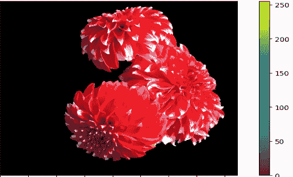

如你所见，**GrabCut** 将分割问题求解为：

$$\text{Segmentation} = \arg\min E(f)$$

使用**概率建模 + 图优化**。

## 条件随机场

条件随机场（CRFs）将分割建模为一个**具有上下文依赖关系的概率标注问题**，其中每个像素的标签不仅取决于其自身的特征，还取决于其邻居。

### 概率模型

直观地说，CRF 通过根据与相邻像素的一致性来细化每个像素的标签，从而改善分割，确保区域的空间连贯性，而不是独立的逐像素预测。

给定图像 $I$，我们对标签分配 $\mathbf{X}=\{x_i\}$ 进行建模，其中 $x_i$ 是像素 $i$ 的标签（例如前景/背景或语义类别），并且 $P(\mathbf{X}\mid I)=\frac{1}{Z}\exp(-E(\mathbf{X}))$，其中 $Z$：**配分函数**（归一化概率），$E(\mathbf{X})$：**吉布斯能量**，衡量一个标签分配的好坏，低能量 → 高概率。CRF 选择使能量最小化的标签分配（最大后验，MAP）。

**能量函数：**

$$E(\mathbf{X}) = \sum_i \psi_u(x_i) + \sum_{i<j} \psi_p(x_i,x_j),$$

其中 $\psi_u(x_i)$ – 一元势（数据项）：衡量像素 $i$ 与标签 $x_i$ 的匹配程度。它通常来自分类器（例如 CNN 输出或标注），在下面的实现中，它直接来自标注标签。

$\psi_p(x_i,x_j)$ – 成对势：鼓励像素之间的空间一致性。

一元 → “这个像素想成为什么”，成对 → “它的邻居想让它成为什么”。

2. **将标注转换为标签：** 将 RGB → 离散标签 $x_i \in \{1,2, ..., K\}$（整数类别），其中 $K$ 是标注中唯一标签的数量。这定义了 CRF 的**标签空间**。

3. **处理未知标签：** 一些像素可能具有**未知标签**（颜色中 HAS_UNK = 0）。这些像素对一元项的贡献较弱。CRF 对它们更多依赖**成对项**。

4. **初始化密集 CRF 模型：** 全连接 CRF：

$E(\mathbf{X}) = \sum_i \psi_u(x_i) + \sum_{i<j} \psi_p(x_i, x_j)$

其中每个像素都与**其他所有像素**交互，`DenseCRF()` 类的构造函数实例化一个 **CRF** 对象，如下一个代码片段所示。

5. **一元势（数据项）：**

$\psi_u(x_i) = -\log P(x_i)$

使用函数 `unary_from_labels()` 从标注中导出，置信度由 `gt_prob`（代码中为 0.7）控制。使用 `setUnaryEnergy()` 方法设置**一元势** $\psi_u(x_i)$，为每个像素标签编码初始信念（数据项），其中强标注 → 强一元势，弱/未知 → CRF 可以纠正。

## 成对势（平滑性与上下文）

在实践中，成对势通常使用*高斯*和双边*核*来实现，它们在保持重要图像边界和像素之间上下文关系的同时，鼓励*空间一致性*。

- **高斯核（空间平滑）：** 使用函数 `create_pairwise_gaussian()` 计算 $\exp\left(-\frac{|p_i - p_j|^2}{2\sigma^2}\right)$，仅依赖于空间距离。使用方法 `addPairwiseEnergy()` 将其添加到 CRF 中。
- **双边核（边缘感知平滑）：** 使用函数 `create_pairwise_bilateral()` 计算 $\exp\left(-\frac{|p_i - p_j|^2}{2\sigma_a^2} - \frac{|I_i - I_j|^2}{2\sigma_b^2}\right)$。再次使用方法 `addPairwiseEnergy()` 将其添加到 CRF 中。如果像素**距离近 + 颜色相似 → 强交互**，**颜色不同 → 弱交互**。它在平滑的同时保留边缘。

使用 `addPairwiseEnergy()` 方法向 **CRF** 添加一个**成对势项** $\psi_p(x_i, x_j)$。其工作原理和接受的参数如下：`feats`（特征向量，例如空间或双边特征）、`compat`（权重 w，平滑强度：使用高斯核计算像素之间的相似性，并定义*像素之间相互影响的强度*）。**高斯** → 平滑附近的像素（空间平滑），而**双边** → 仅平滑颜色相似的像素（保留边缘的细化），鼓励**附近像素 → 相同标签**并去除噪声。

**平均场推断：** 这是一种有效的近似方法，将困难的优化问题转化为迭代滤波和概率更新。使用 `inference(n_iter)` 方法运行**平均场推断**，迭代 `n_iter` 次（例如代码中为 5 次）并更新：

$Q_i(x_i) \propto \exp\left(-\psi_u(x_i) - \sum_j \psi_p(x_i, x_j)\right)$


它输出Q：所有像素的标签概率分布。

下面的代码执行基于Dense CRF的图像分割细化，使用从标注标签导出的一元势以及高斯/双边成对势来加强空间和外观一致性，然后通过平均场推断和MAP估计生成最终的颜色编码分割。

## 内部迭代步骤

每次迭代执行：

- 1. 消息传递：聚合所有像素的信息，对应：

$$\sum_{j} \psi_p(x_i, x_j)$$

通过高效滤波实现。

- 2. 成对滤波：应用高斯+双边核；通过高维滤波实现高效。
- 3. 兼容性变换：应用标签兼容性 $\mu(x_i, x_j)$
- 4. 添加一元项：与 $\psi_u(x_i)$ 结合
- 5. 归一化：$Q_i(x_i) \leftarrow \frac{1}{Z_i} \exp(-\text{energy})$，确保概率有效
- 6. MAP估计：$x_i^* = \arg\max Q_i(x_i)$，对应下一个代码片段中的 `MAP = np.argmax(Q, axis=0)`。最终分割（标注）= 每个像素的最可能标签。

最后，将通过MAP推断获得的分割标签转换为颜色编码的RGB图像，为每个类别分配不同的颜色，从而产生视觉上可解释的分割结果（`MAP = colorize[MAP, :]`）。

```python
import pydensecrf.densecrf as dcrf
from pydensecrf.utils import unary_from_labels, create_pairwise_bilateral,\
    create_pairwise_gaussian

img = imread('images/cow.png')
anno_rgb = imread('images/cow_annot.png').astype(np.uint32)
anno_lbl = anno_rgb[:, :, 0] + (anno_rgb[:, :, 1] << 8) + \
    (anno_rgb[:, :, 2] << 16)

colors, labels = np.unique(anno_lbl, return_inverse=True)
HAS_UNK = 0 in colors
if HAS_UNK: colors = colors[1:]
colorize = np.empty((len(colors), 3), np.uint8)
colorize[:, 0] = (colors & 0x0000FF)
colorize[:, 1] = (colors & 0x00FF00) >> 8
colorize[:, 2] = (colors & 0xFF0000) >> 16
n_labels = len(set(labels.flat)) - int(HAS_UNK)
d = dcrf.DenseCRF(img.shape[1] * img.shape[0], n_labels)
U = unary_from_labels(labels, n_labels, gt_prob=0.7, zero_unsure=HAS_UNK)
```

## 注意

Kullback–Leibler（KL）散度衡量一个概率分布与另一个概率分布之间的差异：$KL(Q || P) = \sum_x Q(x) \log \frac{Q(x)}{P(x)}$。它量化了当我们使用近似分布Q代替真实分布P时“丢失”了多少信息。在CRF平均场推断中，我们迭代更新Q以近似P(X | I)：KL散度减小表明Q越来越接近真实分布P，即算法正在收敛。

为什么CRF效果很好？它细化粗糙的分割，使标签与目标边界对齐——锐化边界并保留精细结构。它去除孤立的噪声预测。下表对最后两种基于图的方法进行了分割比较：

| 方法 | 关键思想 | 优势 |
|---|---|---|
| GrabCut | 图割 + 高斯混合模型 | 交互式分割（通过全局优化） |
| CRF | 概率图模型 | 边界细化（通过上下文感知细化） |

表10.1：用于图像分割的GrabCut与CRF方法

GrabCut通过使用颜色模型的全局能量最小化执行交互式、数据驱动的分割，而CRF通过在像素级别强制空间和上下文一致性来细化分割输出，从而产生更清晰、更连贯的目标边界。

## 基于学习的经典分割

这类方法桥接了经典图像处理和机器学习，将分割表述为监督学习问题。这些方法不纯粹依赖阈值或梯度，而是使用人工设计的特征从数据中学习决策边界。

### 使用分类进行分割

可训练分割将每个像素视为特征向量，并使用分类器预测其标签。给定图像 $I(x, y)$。

我们提取特征：

$f_i = \phi(I, x_i, y_i)$,

其中：$f_i \in \mathbb{R}^d$：像素i处的特征向量，$\phi(\cdot)$：特征提取函数（强度、纹理等）。分割问题变为：

$\hat{y}_i = \arg\max_k P(y_i = k | f_i)$。

随机森林分类器：随机森林是决策树的集成：

$P(y_i = k | f_i) = \frac{1}{T} \sum_{t=1}^{T} P_t(y_i = k | f_i)$,

其中T：树的数量，每棵树使用轴对齐分裂划分特征空间。

流程如下：

- 1. 特征提取 → $f_i$
- 2. 训练标签 → $y_i$
- 3. 分类器训练
- 4. 逐像素预测

下一个代码片段实现了基于分类的分割。步骤如下：

- 1. **加载图像并定义训练标签：** 从皮肤图像（使用`data.skin()`下载）中提取子区域用于训练，并初始化标签图$y_i$，区域是手动标注的：每个整数$k$ = 类别标签（稀疏标注 → 减少标注工作量）。
- 2. **特征提取：** $f_i = [I_i, \text{texture}_i, \text{multi-scale responses}]$

函数`partial()`创建一个新函数，其中一些参数被预先填充。多尺度高斯滤波在不同尺度（**不同细节级别**）捕获结构：

这些是在多个空间尺度（分辨率）上计算的图像特征：

- $F = \{f_{\sigma_1}(I), f_{\sigma_2}(I), ..., f_{\sigma_n}(I)\}$，其中$\sigma$ = 尺度（例如，高斯模糊级别）
- 小尺度 → 精细细节（边缘、纹理）
- 大尺度 → 粗糙结构（形状、区域）

典型特征：在不同高斯尺度下计算的强度、边缘（梯度）、纹理（拉普拉斯、Hessian）。

为什么有用？因为物体在不同尺寸下看起来不同：检测小物体 → 小尺度，检测大物体 → 大尺度。

### 训练随机森林

学习映射：$f_i \to y_i$。函数`fit_segmenter()`提取带标签的像素，并且仅在标注区域上训练分类器，如下一个代码片段所示。

```python
from sklearn.ensemble import RandomForestClassifier
from functools import partial

full_img = data.skin()
img = full_img[:900, :900]
training_labels = np.zeros(img.shape[:2], dtype=np.uint8)
training_labels[:170, :400] = 1
training_labels[600:900, 200:650] = 2
training_labels[330:430, 210:320] = 3
training_labels[150:200, 720:860] = 4
features_func = partial(feature_multiscale_basic_features,
    intensity=True, edges=False, texture=True,
    sigma_min=1, sigma_max=16, channel_axis=-1)

features = features_func(img)
clf = RandomForestClassifier(n_estimators=50, n_jobs=-1, \
                             max_depth=10, max_samples=0.05)
clf = future.fit_segmenter(training_labels, features, clf)
result = future.predict_segmenter(features, clf)
# Plot img with training_label contour and result image side-by-side
```

如果运行上述代码并并排绘制图像，您应该得到下图：

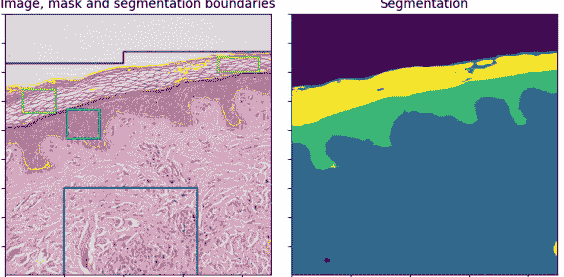

*图10.14 – 图像、掩码、分割边界以及预测的分割标签（训练数据）*

```python
img = imread('images/cow.png')
anno_rgb = imread('images/cow_annot.png').astype(np.uint32)
anno_lbl = anno_rgb[:,:,0] + (anno_rgb[:,:,1] << 8) + (anno_rgb[:,:,2] << 16)
colors, labels = np.unique(anno_lbl, return_inverse=True)
HAS_UNK = 0 in colors
if HAS_UNK:  colors = colors[1:]
colorize = np.empty((len(colors), 3), np.uint8)
colorize[:,0] = (colors & 0x0000FF)
colorize[:,1] = (colors & 0x00FF00) >> 8
colorize[:,2] = (colors & 0xFF0000) >> 16
n_labels = len(set(labels.flat)) - int(HAS_UNK)
d = dcrf.DenseCRF(img.shape[1] * img.shape[0], n_labels)
U = unary_from_labels(labels, n_labels, gt_prob=0.7, zero_unsure=HAS_UNK)
d.setUnaryEnergy(U)
feats = create_pairwise_gaussian(sdims=(3, 3), shape=img.shape[:2])
d.addPairwiseEnergy(feats, compat=3, kernel=dcrf.DIAG_KERNEL, \
                    normalization=dcrf.NORMALIZE_SYMMETRIC)
feats = create_pairwise_bilateral(sdims=(80, 80), schan=(13, 13, 13), \
                                  img=img, chdim=2)
d.addPairwiseEnergy(feats, compat=10, kernel=dcrf.DIAG_KERNEL,
```


```
normalization=dcrf.NORMALIZE_SYMMETRIC)
Q = d.inference(5) # Run five inference steps
MAP = np.argmax(Q, axis=0) # most probable class for each pixel
MAP = colorize[MAP,:]
MAP = MAP.reshape(img.shape)
# Plot img, anno_rgb, MAP and overlay side-by-side here
```

函数 predict_segmenter() 计算 ŷᵢ = classifier(fᵢ)。生成完整的分割图（逐像素预测）。函数 mark_boundaries() 在图像上叠加边界。相同的模型应用于未见过的数据（泛化到新图像），如下一段代码所示。

```
img_new = full_img[:700, 900:]
features_new = features_func(img_new)
result_new = future.predict_segmenter(features_new, clf)
# Plot img_new with segmentation boundaries and result_new side-by-side
```

如果运行上述代码并将图像并排绘制，你应该得到下图：

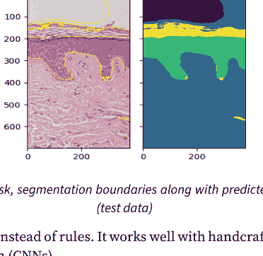

图 10.15 – 图像、掩码、分割边界以及预测的分割标签（测试数据）

该方法从数据中学习而不是规则。它在手工制作的特征上效果良好。它是深度学习分割（CNNs）的前身。

## 集成分割

组合多个分割输出以提高鲁棒性：

S = S₁ ∩ S₂  或  S₁ ∪ S₂。

不同方法捕捉不同的属性：基于边缘 → 边界，基于区域 → 同质性，而超像素 → 结构。组合它们可以减少错误。下一段代码片段演示了如何在 Python 中实现集成分割。步骤如下：

- 1. 预处理：将输入图像转换为灰度
- 2. 基于边缘的分割（Watershed）：使用 skimage.filters 模块中的函数 sobel() 计算边缘并突出显示边界。定义种子，运行 watershed 并生成分割 S₁
- 3. **超像素分割（SLIC + Graph Cut）：** 使用 `skimage.segmentation` 中的函数 `slic()` 首先生成超像素，然后构建 RAG 并使用 *normalized cut* 最小化：`cut(A,B)/assoc(A,V)`，以生成分割 S₂。
- 4. **组合分割：** 使用函数 `join_segmentations()` 计算 S = S₁ ∩ S₂，它保留方法之间的一致性，如下一段代码片段所示：

```
from skimage.segmentation import slic, join_segmentations, watershed
coins = (255*rgb2gray(data.astronaut())).astype('uint8')
edges, markers = sobel(coins), np.zeros_like(coins)
foreground, background = 1, 2
markers[coins < 30.0] = background
markers[coins > 150.0] = foreground
ws = watershed(edges, markers)
seg1 = label(ws == foreground)
seg2 = slic(coins, n_segments=200, max_num_iter=160, \
            sigma=1, compactness=0.75, channel_axis=None, start_label=0)
g = graph.rag_mean_color(coins, seg2, mode='similarity')
seg2 = graph.cut_normalized(seg2, g)
segj = join_segmentations(seg1, seg2)
# Show the segmentations: plot coins, seg1, seg2 and segj side-by-side
```

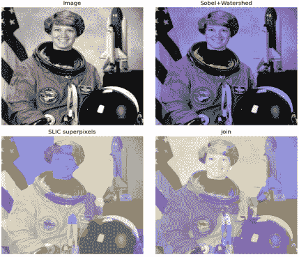

*图 10.16 – 集成分割*

如上所述，基于学习的经典分割使用手工制作的特征和机器学习模型进行逐像素分类，而集成方法则组合多个分割以获得稳健和准确的结果。

我们迄今为止学习了经典分割技术，包括阈值分割、watershed 和基于形态学的方法、超像素、变分模型、图形和概率方法，以及基于学习的经典分割。在这些基础之上，接下来我们将探索现代

用于语义和实例分割的深度学习方法，范围从基于 CNN 的架构如 FCNs 和 DeepLab 到基于 Transformer 的模型包括 DETR、SegFormer、Mask2Former 和 OneFormer。

## 深度学习用于图像分割

与之前探索的经典方法不同，经典方法中的分割依赖于手工制作的特征、阈值和启发式规则，深度学习直接从数据中学习分层表示。基于卷积和 Transformer 的架构建模复杂的空间模式，能够在光照、尺度、纹理和遮挡变化下实现鲁棒分割。

形式上，映射 $F_\theta$ 由具有参数 $\theta$ 的深度网络参数化，在数据集 $\{(I_i, Y_i)\}_{i=1}^N$ 上优化，通过最小化损失函数：

$\mathcal{L}(\theta) = \sum_{i=1}^N \ell\left(F_\theta(I_i), Y_i\right)$

其中 $\ell$ 衡量预测分割掩码与真实分割掩码之间的差异（例如，交叉熵、Dice 损失）。

与经典流程的关键区别在于，特征提取和决策制定在单个端到端可训练模型中统一。这使得网络能够自动学习难以手动设计的跨尺度、上下文感知的特征。

本部分考虑的三种范式在预测精细程度上有区别：

- - 语义分割为每个像素分配类别标签，而不区分对象实例。
- - 实例分割区分同一类别的各个对象实例。
- - 全景分割将两者统一，提供完整的场景理解，通过标记“事物”（可计数对象）和“东西”（无定形区域）。

本章的这一部分将发展这些范式的理论基础、架构原则和实际实现，突出显示深度模型如何重新定义图像分割的最新技术。对于基于深度学习的分割，建议从现在开始在 Google Colab 上使用 GPU 加速运行所有代码，以确保更快的推理和训练性能。

## 使用 CNN 的语义分割

在本节中，我们专注于使用预训练卷积神经网络（CNNs）进行语义分割，涵盖多个库和框架，如 PyTorch（torchvision、torch hub）、TensorFlow（Model Garden）、KerasHub、KerasCV 和 segmentation_models_pytorch。

为什么使用预训练模型？预训练模型是在大规模数据集如 ImageNet、Pascal VOC 和 COCO 上训练的网络，提供学习到的表示：

$f_\theta^{\text{pretrained}}: I \to Y.$

注意

虽然本章侧重于使用预训练模型进行推理，但下一章将涵盖从头训练分割模型、在自定义数据集上微调，以及领域适应和数据集特定优化。

### 全卷积网络

全卷积网络（FCNs）代表了语义分割的基础架构，通过消除全连接层并将其替换为卷积操作。设编码器网络提取分层特征：

$$F = \phi(I) \in \mathbb{R}^{h \times w \times C}$$

而不是展平 $F$，FCNs 应用 $1 \times 1$ 卷积：

$$Z = W * F \in \mathbb{R}^{K \times h \times w}$$

这会产生类别分数图，然后进行上采样：

$$\hat{Y} = \text{Upsample}(Z)$$

像素 $p$ 处的最终预测为：

$$\hat{y}_p = \operatorname{argmax}_k \operatorname{softmax}(Z)_k(p)$$

**跳跃连接：** 为了恢复空间细节，FCNs 组合不同深度的特征：

$$F_{\text{fused}} = F_{\text{deep}} + \sum_{l} \alpha_l F_l$$

其中 $F_l$ 是中间特征图。这里，深层 → 语义理解，浅层 → 空间精度，而融合 → 精确的密集预测。

**局限性：** 由于重复下采样和有限的多尺度上下文建模，导致边界模糊。

**使用 torchvision.models.segmentation 的 Python 演示**

集成分割工作流程通过以下阶段进行：

- - **模型加载：** 预训练的 FCN-ResNet50、DeepLabV3-ResNet50、DeepLabV3-MobileNetV3-Large 和 LR-ASPP-MobileNetV3-Large 模型从 torchvision.models.segmentation 加载，使用 .to(DEVICE) 移动到所选设备，并使用 .eval() 切换到评估模式。


+   - **图像预处理：** 使用OpenCV读取输入图像，通过`cv2.cvtColor()`从BGR转换为RGB，并通过`preprocess()`函数转换为网络所需的张量格式。
+   - **推理：** 在`torch.no_grad()`块内执行预测，以减少内存使用并提高执行效率。每个模型通过`model(input_tensor)["out"]`生成分割logits。
+   - **分辨率对齐：** 必要时，使用`F.interpolate()`将logits调整到公共空间分辨率，以便不同模型的预测能够一致地组合。
+   - **概率估计：** 使用`F.softmax(..., dim=1)`将对齐后的logits转换为类别概率图。然后对每个模型使用`torch.argmax()`获得逐像素分割掩码，并将结果掩码存储起来供后续可视化使用。
+   - **集成投票：** 将所有模型的概率图收集到`prob_maps`中，使用`torch.stack()`组合，并通过`torch.mean()`求平均，以执行软投票集成融合。通过对平均概率图应用`torch.argmax()`得到最终的集成分割掩码。
+   - **可视化：** 并排显示各个模型的掩码和最终的集成掩码，以便对各组成模型的预测与共识集成结果进行视觉比较。

现在参考下一个代码片段：

```
import torch, torch.nn.functional as F

from torchvision.models.segmentation import (
    fcn_resnet50, FCN_ResNet50_Weights,
    deeplabv3_resnet50, DeepLabV3_ResNet50_Weights,
    deeplabv3_mobilenet_v3_large, DeepLabV3_MobileNet_V3_Large_Weights,
    lraspp_mobilenet_v3_large, LRASPP_MobileNet_V3_Large_Weights)

models_dict = {"FCN-R50": \
    fcn_resnet50(weights=FCN_ResNet50_Weights.COCO_WITH_VOC_LABELS_V1),
    "DeepLab-R50": deeplabv3_resnet50( \
        weights=DeepLabV3_ResNet50_Weights.COCO_WITH_VOC_LABELS_V1),
    "DeepLab-Lite": deeplabv3_mobilenet_v3_large( \
        weights=DeepLabV3_MobileNet_V3_Large_Weights.COCO_WITH_VOC_LABELS_V1),
    "LRASPP": lraspp_mobilenet_v3_large( \
        weights=LRASPP_MobileNet_V3_Large_Weights.COCO_WITH_VOC_LABELS_V1)}

for name in models_dict:
    models_dict[name] = models_dict[name].to(DEVICE).eval()

img_rgb = cv2.cvtColor(cv2.imread("images/cycle.jpg"), cv2.COLOR_BGR2RGB)
```

```
```python
input_tensor = preprocess(img_rgb)  # refer to GitHub for preprocess()
prob_maps,individual_masks = [], []
with torch.no_grad():
    for name, model in models_dict.items():
        probs = F.softmax(model(input_tensor)["out"], dim=1)
        prob_maps.append(probs)
        individual_masks.append(
            torch.argmax(probs,dim=1).squeeze().cpu().numpy())
ensemble_prob = torch.mean(torch.stack(prob_maps), dim=0)  # Soft Voting
ensemble_mask = torch.argmax(ensemble_prob, dim=1).squeeze().cpu().numpy()
# Plot individual and ensemble masks here side-by-side
```
```

如果你运行上述代码，你应该得到如下图像：

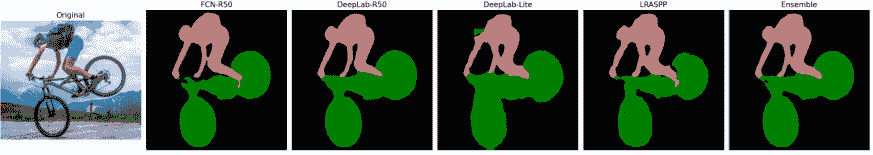

*图10.17 – 使用预训练深度学习模型进行集成投票的图像分割*

尽管FCN开创了语义分割，但它们常常在边界精度和多尺度上下文建模方面遇到困难。*DeepLab*系列通过空洞卷积和*空洞空间金字塔池化*（ASPP）解决了这些挑战，在不牺牲空间分辨率的情况下实现更丰富的上下文理解。

## 空洞卷积与DeepLab系列

**DeepLab** 使用空洞（扩张）卷积改进FCN：

$$y[i] = \sum_k x[i + r \cdot k], w[k],$$

其中$r$是扩张率，能够在不降低空间分辨率的情况下获得更大的感受野。

利用空洞空间金字塔池化（ASPP）捕获多尺度上下文：

$$\mathrm{ASPP}(x) = \bigoplus_{r \in \{r_1,r_2,r_3,r_4\}} \mathrm{Conv}_r(x),$$

它在多个扩张尺度上聚合特征。DeepLab变体从DeepLabV1（CRF细化）、DeepLabV2（空洞卷积）、DeepLabV3（ASPP）逐步演进到DeepLabV3+（编码器-解码器细化）。

## 使用 `torchvision.models.segmentation` 的DeepLabV3

DeepLabV3推理流程与之前的FCN/Torchvision分割示例类似，留作读者练习（参考随附的GitHub仓库）。这里使用预训练的`deeplabv3_resnet101()`模型从输入图像生成语义分割图

使用Torchvision预处理、前向推理、通过F.interpolate()对logits进行上采样，以及使用torch.argmax()进行逐像素预测。下图展示了DeepLabV3的分割输出和叠加效果：

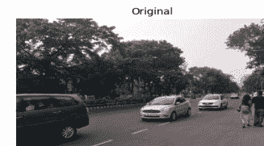

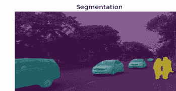

图10.18 - 使用torchvision.models.segmentation中的DeepLabV3进行图像分割

DeepLabV3不仅限于PyTorch生态系统。下面的示例使用来自TensorFlow Model Garden的预训练DeepLabV3模型演示相同的语义分割任务，使读者能够比较两个主流深度学习框架中的工作流程。

## 使用TensorFlow Model Garden的DeepLabV3

该代码演示了使用来自TensorFlow Model Garden的预训练DeepLabV3模型进行语义分割：下载并加载在Cityscapes数据集上训练的冻结推理图，将其包装为可调用的TensorFlow推理函数，并通过调整大小和NumPy转换对输入图像进行预处理，以匹配模型期望的输入格式。然后执行前向推理以获得逐像素语义预测，将预测的分割图调整回原始图像分辨率，将类别索引映射到语义标签和RGB颜色以进行可视化，并可选地加载地面真值掩码，用于分割性能的定性或定量评估。现在，参考以下代码片段：

```
tar = tarfile.open("models/deeplab_model.tar.gz")
for m in tar.getmembers():
    graph_def = tf.compat.v1.GraphDef.FromString(
        tar.extractfile(m).read())
    tar.close()
model = tf.function(lambda x:
    tf.import_graph_def(graph_def, input_map={"ImageTensor:0": x},
                        return_elements=["SemanticPredictions:0"]))

def segment(img_file):
    img = Image.open(img_file).convert("RGB")
    h, w = img.size[1], img.size[0]
    inp = np.asarray(img.resize((2049,1025)))[None]
    seg = model(inp)[0].numpy()[0]    # inference
    seg = cv2.resize(seg,(w,h),interpolation=cv2.INTER_NEAREST)
    return img, seg
```

函数`segment()`执行预处理，运行DeepLab模型生成逐像素分割，加载地面真值，并返回图像、预测和GT。按照下一个代码片段所示运行推理，获得如下图像：

```
img, seg = segment("images/mit_driveseg_sample.png", \
"images/mit_driveseg_sample_gt.png")
# Plot img, seg, overlay and gt side-by-side here
```

如果你运行上述代码，并将原始图像、预测的分割掩码和叠加图像并排绘制，你应该得到如下图：

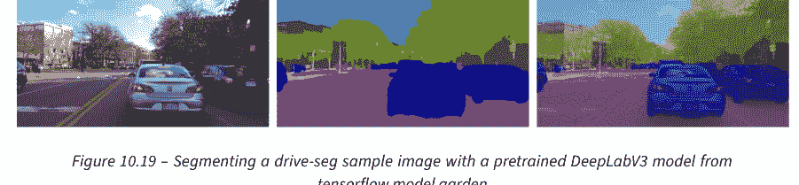

图10.19 – 使用来自tensorflow model garden的预训练DeepLabV3模型对drive-seg示例图像进行分割

如果你将原始图像、地面真值分割掩码和叠加图像并排绘制，你应该得到如下图（比较这些图）：

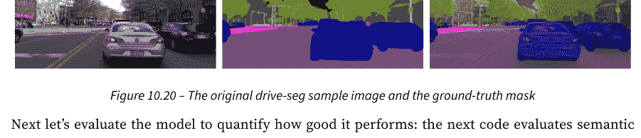

图10.20 – 原始drive-seg示例图像和地面真值掩码

接下来，让我们评估模型以量化其性能：下面的代码通过`evaluate_single()`函数将预测标签与地面真值掩码进行比较来评估语义分割预测，通过逻辑掩码和索引统一标签映射，使预测类别与注释方案匹配。它使用掩码求和计算有效（非void）像素上的像素精度，使用`sklearn.metrics.confusion_matrix()`构建混淆矩阵以捕获逐类别的预测统计，并利用矩阵的对角线和行/列和推导出每个类别的交并比（IoU）值。最后，使用`np.mean()`计算各类别的平均IoU，并使用`tabulate()`以格式化表格呈现详细的逐类别评估结果。

```
def evaluate_single(seg_map, ground_truth):
    seg_map[np.logical_or(seg_map==14,seg_map==15)] = 13
```


```
```python
seg_map[np.logical_or(seg_map==3, seg_map==4)] = 2
seg_map[seg_map==12] = 11
acc = np.sum((seg_map[ground_truth!=-19]==ground_truth[ground_truth!=-19]))/\
    np.sum(ground_truth!=-19)
cm = confusion_matrix(ground_truth[ground_truth!=-19],
    seg_map[ground_truth!=-19], labels=np.array([0,1,2,5,6,7,8,9,11,13]))
intersection = np.diag(cm)
union = np.sum(cm, 0) + np.sum(cm, 1) - np.diag(cm)
return acc, intersection, union

acc, intersection, union = evaluate_single(seg, gt)
class_iou = np.round(intersection / union, 5)
# pixel accuracy: 0.98714
# mean class IoU: 0.53555
```
```

你还可以使用 *Torchvision* 库中的预训练 *DeepLabV3* 模型（例如 `deeplabv3_resnet50`），通过 `torch.hub.load()` 加载并运行推理，以生成代表每个像素最可能类别的逐像素语义分割图。这留给读者作为练习（参见随附的 GitHub 仓库）。下图显示了生成的预测分割掩码和叠加结果：

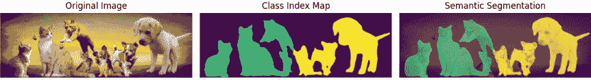

*图 10.21 – 使用通过 PyTorch hub 加载的、以 ResNet-50 为主干的预训练 DeepLabV3 进行语义分割*

## 使用 `Keras_hub` 的 DeepLabV3+

此示例遵循前面讨论的相同 DeepLabV3 语义分割流程，并留给读者作为练习（请参阅随附的 GitHub 仓库）。下图显示了 KerasHub DeepLabV3+ 模型产生的预测分割掩码和叠加可视化：

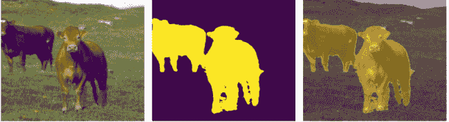

*图 10.22 – 使用 `keras_hub` 中的 DeepLabV3+ 处理的一张图像、其（语义）分割掩码及叠加图像*

```
```python
else: output = model(img_tensor)
prob = F.softmax(output, dim=1)
prob_maps.append(prob)
mask = torch.argmax(prob, dim=1)
hard_masks.append(mask)
# Soft Voting Ensemble
ensemble_prob = torch.mean(torch.stack(prob_maps), dim=0)
ensemble_mask = torch.argmax(ensemble_prob, dim=1).squeeze().cpu().numpy()
# Majority Voting
hard_stack = torch.stack(hard_masks)
majority_mask = torch.mode(hard_stack, dim=0)[0].squeeze().cpu().numpy()
# Plot ensemble and majority masks side-by-side here
```
```

如果运行上述代码，你应该得到类似下图的图像：

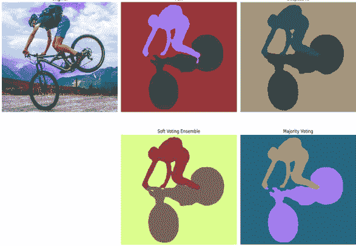

*图 10.24 – 使用 SMP 和 Torchvision 进行多模型分割与集成学习*

上述讨论的集成方法整合了多个语义分割模型的预测，以提高逐像素的类别准确率。然而，它们本质上仍局限于为每个像素分配单一类别标签，并且无法区分同一类别中的不同对象实例。这一局限性促使人们转向实例感知分割，其目标不仅是对像素进行分类，还要区分并定位场景中的单个对象实例。

## 实例分割

在语义分割（每个像素被分配一个类别标签）之后，实例分割更进一步，区分同一类别中的*单个对象实例*。例如，语义分割将属于“猫”的所有像素标记为一个类别，而实例分割

则为每只猫分配单独的分割掩码。形式上，给定图像 $I \in \mathbb{R}^{H\times W\times 3}$，实例分割旨在预测一个集合：

$$y = \{(M_i, c_i, b_i)\}_{i=1}^{N},$$

其中 $M_i \in \{0,1\}^{H\times W}$：实例 $i$ 的二元掩码，$c_i \in \{1,\ldots,C\}$：类别标签，$b_i \in \mathbb{R}^4$：边界框。

## Mask R-CNN：两阶段实例分割框架

随着何恺明等人（2017）提出 **Mask R-CNN**，实例分割得到了显著发展。Mask R-CNN 通过添加一个用于预测分割掩码的并行分支，扩展了 **Faster R-CNN**。

Mask R-CNN 由三个主要组件组成：

- **骨干网络：** 深度 CNN（例如 ResNet-50 + FPN）提取特征图：

  $$F = \phi(I),$$

  其中 $\phi$ 是骨干函数。

- **区域提议网络（RPN）：** 生成候选对象区域（锚框）：

  $$\mathcal{R} = \{r_i\}_{i=1}^{K}$$

  每个区域都具有物体性得分和边界框细化。

- **ROI 头（多任务学习）：** 对于每个提议区域，**分类头**预测类别 $c_i$，**边界框回归器**细化 $b_i$，**掩码头**预测二元掩码 $M_i$。Mask R-CNN 优化一个**多任务损失**：

  $$\mathcal{L} = \mathcal{L}_{cls} + \mathcal{L}_{box} + \mathcal{L}_{mask}$$

Mask R-CNN 的总体训练目标被表述为一个*多任务损失*，它联合监督分类、边界框回归和掩码预测，并使用一种关键的对齐机制来实现精确的区域特征提取。各个组成部分定义如下：

- **分类损失：**

  $$\mathcal{L}_{cls} = -\log p_{c^*},$$

  其中 $c^*$ 是真实类别。

- **边界框损失：**

  $$\mathcal{L}_{box} = \sum_{i\in x,y,w,h} \operatorname{SmoothL1}(t_i - t_i^*),$$

  其中 **Smooth $L_1$** 损失是标准 $L_2$ 损失的稳健替代。当误差较小时，其行为类似于 L2 损失（二次）；当误差较大时，类似于 L1 损失（线性）。

- **掩码损失：** 与分类不同，掩码预测是逐像素的**二元分类**：

  $$\mathcal{L}_{mask} = \frac{1}{m^2}\sum_{u,v}[y_{uv}\log \hat{y}_{uv} + (1-y_{uv})\log(1-\hat{y}_{uv})].$$

其中 $y_{uv}$：真实掩码，$\hat{y}_{uv}$：预测掩码，$m \times m$：掩码分辨率（通常为 28×28）。

- **ROIAlign：** Mask R-CNN 用 **ROIAlign** 替换 ROI Pooling，消除了量化误差：

$$F_{aligned}(x, y) = \sum_{i,j} w_{ij}\,F(x_i, y_j)$$

这种双线性插值确保了**像素级对齐**，这对精确掩码至关重要。

> **注意**
> 
> 边界框回归是学习将粗略的对象提议细化为准确对象位置的过程，通过预测相对于初始锚框或区域提议的连续坐标偏移 $(\Delta x, \Delta y, \Delta w, \Delta h)$ 来实现。直观地说，模型不是直接猜测边界框，而是“微调”一个粗糙的框，使其紧密贴合对象，从而提高目标检测中的定位精度。

下面的代码片段（完整代码请参阅 GitHub）演示了通过 torchvision 使用带有 ResNet-50 + 特征金字塔网络（FPN）主干的 Mask R-CNN 进行实例分割。`models.detection.maskrcnn_resnet50_fpn()` 在 COCO 数据集上预训练。该模型为检测到的对象预测边界框、类别标签和分割掩码。网络在可用时自动使用 GPU，而 `eval()` 会禁用训练专用层。输入图像被转换为形状为 $\mathbb{R}^{3\times H\times W}$ 的张量，`unsqueeze(0)` 添加批量维度 $\mathbb{R}^{1\times 3\times H\times W}$。在推理期间，模型输出包含 "boxes"、"labels"、"scores" 和 "masks" 的字典。低置信度检测被过滤掉，软掩码 $M_i \in [0,1]^{H\times W}$ 使用 $\hat{y}_{uv} > 0.3$ 阈值化为二元掩码。为每个实例分配不同颜色以进行视觉区分，并使用 alpha 混合生成 RGB 叠加图像：

$$I_{overlay} = \alpha M + (1 - \alpha) I$$

最终可视化并排显示原始图像、预测掩码和分割叠加效果。

```
model = torchvision.models.detection.maskrcnn_resnet50_fpn(weights="DEFAULT")
model.eval()
image = Image.open('images/cats_dogs.jpg').convert("RGB")
img_tensor = transforms.ToTensor()(image).unsqueeze(0).to(device)
with torch.no_grad(): outputs = model(img_tensor)
scores, masks = outputs[0]['scores'], outputs[0]['masks']
labels = outputs[0]['labels']
keep = scores > 0.7
masks = masks[keep].cpu().numpy()
h, w = masks.shape[-2:]
combined_mask = np.zeros((h, w, 3)) # RGB canvas
cmap = plt.get_cmap('gist_rainbow')
for i, m in enumerate(masks):
```


```
mask_binary = m.squeeze() > 0.3  # Threshold the soft mask
color = np.array(cmap(1 / len(masks))[:, :3])  # Get vibrant RGB
combined_mask[mask_binary] = color
# Plot image, combined_mask and the overlay here
```

如果你运行上述代码并绘制图像，你应该会得到类似下图的结果：

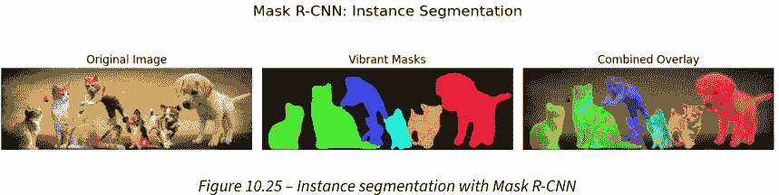

Mask R-CNN 能够分别检测同一类别的多个对象。它能生成像素级精确的分割掩码。即使在杂乱场景中也能很好地工作。

- **为什么 Mask R-CNN 表现出色？** 它将分类和掩码预测解耦，避免了任务之间的竞争。它通过 ROIAlign 保持空间精度。由于共享主干网络，它非常高效。
- **Mask R-CNN 的局限性：** 两阶段 → 相对较慢，内存占用大，不适合实时应用。

## YOLO（YOLOv8 / YOLOv11）：单阶段公式化

现代实例分割架构，如 **基于 YOLO 的分割模型**，采用 **单阶段公式化方案，能够实现实时推理**，同时保持有竞争力的精度。在本节中，我们将使用 **Ultralytics YOLO11 分割模型** 探索 **基于 YOLO 的实例分割**，并研究其理论基础和实际实现。随后，我们将把它的设计选择和性能特征与 **经典的两阶段 Mask R-CNN 架构** 进行对比。

- **从检测到分割：YOLO 的视角：** 由 Joseph Redmon 提出的传统 YOLO（You Only Look Once）最初是为目标检测设计的：

  $$f_{\theta}(I) \rightarrow \{(b_i, c_i, s_i)\}_{i=1}^{N},$$

  其中 $b_i$：边界框，$c_i$：类别，$s_i$：置信度。

- **扩展到实例分割：** YOLO 分割模型将此公式扩展为包含像素级掩码：

  $$f_{\theta}(I) \rightarrow \{(b_i, c_i, s_i, M_i)\}_{i=1}^{N},$$

  其中 $M_i \in [0,1]^{H\times W}$ 是预测掩码。

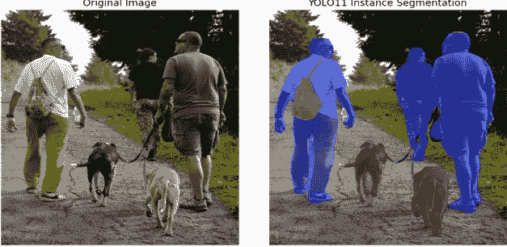

*图 10.26 – 使用第 11 代 Nano 版本的 YOLO 分割模型进行实例分割*

**为什么 YOLO 速度快？** YOLO 避免了 **区域提议网络（RPN）** 和逐 ROI 计算。相反，它执行：

单次前向传播 ⇒ 所有预测

这使得每张图像的推理复杂度为 O(1)，并且 GPU 利用率高度优化。

**实际观察：** 掩码精度可能略低于 Mask R-CNN，但非常适合实时应用（自动驾驶、视频分析、监控）。与 Mask R-CNN 不同，YOLO **不直接预测全分辨率掩码**。相反，它使用低秩掩码近似。这降低了计算复杂度：

O(HW) → O(K + HW)，其中 K ≪ HW。

基于 YOLO 的实例分割代表了向统一架构、实时性能和可扩展部署的重大转变。与 Mask R-CNN 一起，它完善了实例分割技术的完整谱系，其中 Mask R-CNN → **注重精度**，YOLO → **注重速度**。实例分割通过提供对象级理解和像素级精度，弥合了检测与分割之间的差距。

Mask R-CNN 因其优雅的公式化和强大的性能而仍然是一种基础方法，而现代基于 YOLO 的方法则朝着实时应用的方向推进。

## 基于 Transformer 的分割

Transformer 架构通过用 **全局自注意力机制** 取代卷积归纳偏置，从根本上重塑了图像分割。与依赖局部感受野的基于 CNN 的分割不同，基于 Transformer 的模型显式建模 **长程依赖关系**，从而实现更卓越的场景理解。

给定输入图像 \(I \in \mathbb{R}^{H\times W\times 3}\)，基于 Transformer 的分割模型旨在学习一个映射：

$$f_\theta: I \to \mathcal{Y},\quad y \in \mathbb{Z}^{H\times W}$$

其中每个像素都被分配一个语义或实例标签。所有 Transformer 模型的核心是 **缩放点积注意力**：

$$\operatorname{Attention}(Q,K,V)=\operatorname{softmax}\left(\frac{QK^T}{\sqrt{d_k}}\right)V,$$

其中 $Q=XW_Q$：查询（我们正在寻找的内容），$K=XW_K$：键（存在的内容），$V=XW_V$：值（要聚合的信息）。**基于 Transformer 的模型代表了图像分割的根本性转变——从局部卷积推理转向通过注意力进行全局上下文建模。** 这一范式源于 Ashish Vaswani 等人（2017 年）的开创性工作《Attention Is All You Need》，并由 Alexey Dosovitskiy 等人（2021 年）扩展到视觉领域。

### 数学基础：自注意力与令牌化图像表示

DPT、DETR、**SegFormer** 和 Mask2Former 等基于 Transformer 的分割模型共享统一的理论框架，该框架根植于《Attention Is All You Need》中引入的 Transformer 范式，并在 **视觉 Transformer（ViT）** 中扩展到视觉领域。

虽然 **SETR** 等早期工作证明了 *纯 ViT* 可用于密集预测，但现代架构（**DPT、SegFormer、Mask2Former**）通过解决其在空间分辨率和效率方面的局限性，显著改进了这一基线。本节将建立理解这些模型所需的数学和概念基础。

**密集预测：** 语义分割被定义为一种密集映射：

$$S:\Omega\subset\mathbb{R}^2\to\mathcal{C},$$

其中 $\Omega$ 是图像域，$\mathcal{C}$ 是语义类别的集合。目标是为每个像素分配一个标签，这需要全局推理（场景级理解）和局部精度（精细边界）。

**从图像到令牌：Patch 嵌入：** 设输入图像为：

$$I\in\mathbb{R}^{H\times W\times 3}$$

Patch 嵌入的关键步骤如下：

- **Patch 划分：** 图像被划分为大小为 $P\times P$ 的不重叠 patch：$N=\frac{HW}{P^2}$。每个 patch 被展平：

  $$x_i\in\mathbb{R}^{P^2C}.$$

- **线性投影（Patch 嵌入）：** 每个 patch 被投影到一个潜在空间：

  $$z_i=Ex_i+b,\quad E\in\mathbb{R}^{D\times P^2C}\text{ 且 }z_i\in\mathbb{R}^{D}.$$

  堆叠所有令牌：

  $$Z_0=[z_1,\ldots,z_N]\in\mathbb{R}^{N\times D}$$

- **等效卷积视角：** 这等价于 Conv2D($P,P$)，在数学上与每个 patch 的线性投影完全相同，这揭示了 Transformer 首先将图像转换为令牌序列：Patch → 令牌，图像 → 序列，Transformer → 全局推理引擎。与局部操作的 CNN（依赖卷积归纳偏置：局部性和平移等变性）不同，Transformer 允许所有 patch 直接交互（通过全局上下文建模）。

- **位置编码：** Transformer 缺乏固有的空间感知能力；为了使其具有置换不变性，需要注入位置信息：

  $$Z_0 \leftarrow Z_0 + E_{pos},\quad E_{pos} \in \mathbb{R}^{N\times D}$$

  设计选择各不相同：例如，*ViT* / *DPT* 使用 *可学习的嵌入*，*Swin* 使用 *相对位置偏置*，而 *SegFormer* 则移除了显式的 *位置编码*。位置告诉模型：“这个 patch 在图像中的什么位置？”没有它，空间结构就会丢失。没有位置编码，**左上角**的像素与**右下角**的像素将无法区分。位置编码恢复了 **几何信息**，从而能够理解对象边界、空间关系和场景布局。

- **自注意力（核心机制）：** 基本操作是：

  $$\operatorname{Attention}(Q,K,V)=\operatorname{softmax}\left(\frac{QK^T}{\sqrt{d_k}}\right)V$$

  这个方程告诉我们：每个令牌决定它应该对其他每个令牌“*关注*”多少。把每个令牌想象成图像的一个 patch。

  从 $Z \in \mathbb{R}^{N\times D}$ 出发，我们计算：

  $$Q=ZW_Q,\quad K=ZW_K,\quad V=ZW_V.$$

  下表解释了 Q、K 和 V 的含义：

  | 符号 | 含义 | 直觉理解 |
  |---|---|---|
  | Q（查询） | “我在寻找什么？” | 每个令牌提出一个问题 |
  | K（键） | “我包含什么？” | 每个令牌描述自身 |
  | V（值） | “我提供什么信息？” | 实际内容 |

  *表 10.2：Transformer 中的查询-键-值*

这实现了全局交互，每个 patch 查询所有其他 patch，度量相似度并聚合相关信息。因此，每个像素都能“看到”整个图像。这可以看作是像素之间的对话：每个 patch 提出一个问题（**查询**），与所有其他 patch 进行比较（**键**），并收集相关信息（**值**）。这使得 **上下文感知分割** 成为可能，这与依赖局部邻域的 CNN 不同。

下图展示了 **缩放点积注意力机制**，其中输入令牌被转换为 **查询（Q）、键（K）和值（V）** 向量。它展示了相似度分数 $(QK^T)$ 如何被计算、缩放、通过 softmax 归一化，并用于生成 **值的加权和**，从而使每个令牌能够关注输入中最相关的部分。


- **3. 第二次归一化：**  
  $\hat{Z}_l = \operatorname{LayerNorm}(Z'_l)$，  
  这为非线性变换准备了特征。

- **4. 前馈网络（FFN）+ 残差连接：**  
  $\operatorname{FFN}(x) = W_2\sigma(W_1x)$，  
  $Z_{l+1} = Z'_l + \operatorname{FFN}(\hat{Z}_l)$

FFN 独立作用于每个 token。它引入了非线性和特征变换。完整的 Transformer 层可以总结为：

*层 = 归一化 → 注意力 → 残差 → 归一化 → FFN → 残差*

下图（完整 Transformer 层示意图）展示了这一流程，其中：

- **输入 tokens** $Z_l$（patch 嵌入）进入该层
- **自注意力** 允许每个 token 在整个图像上进行全局关注 → 实现**上下文聚合和长距离依赖**。
- **残差连接** 确保训练稳定并保留原始信息。
- **层归一化** 提高收敛性和数值稳定性
- **FFN（MLP）** 独立地细化每个 token 位置的特征

**输出：** $Z_{l+1}$ 是输入 tokens 的**上下文感知、全局增强表示**。

在堆叠 $L$ 个这样的层之后：$Z_0 \rightarrow Z_1 \rightarrow \cdots \rightarrow Z_L$，最终表示 $Z_L$ 用于下游任务，如**语义分割**，在此过程中它被重塑并解码为逐像素预测。

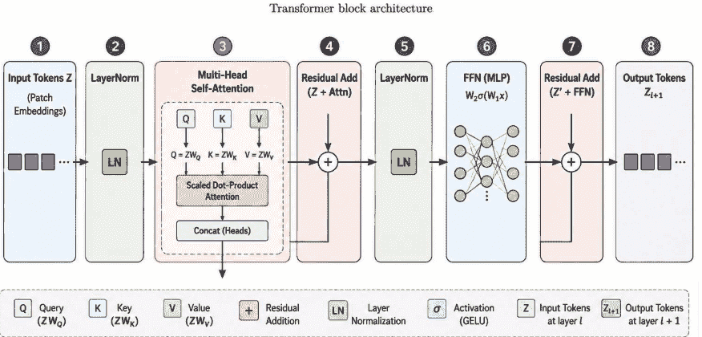

*图 10.28 – Transformer 块架构*

**计算复杂度：** $QK^T \in \mathbb{R}^{N\times N}$。因此，时间：$\mathcal{O}(N^2 d)$，内存：$\mathcal{O}(N^2)$，所以高分辨率图像 $\rightarrow$ 较大的 $N$ $\rightarrow$ 昂贵的计算。这推动了分层 Transformer（**SegFormer**）、高效解码器（**DPT**）和基于查询的方法（**DETR**、**Mask2Former**）的发展。

**从 Tokens 到稠密预测：用于分割的解码器头：** 编码后：

$Z_L \in \mathbb{R}^{N\times D}$，

将其重塑为：

$Z_L \rightarrow \mathbb{R}^{H/P \times W/P \times D}$，

不同的架构以不同方式将 tokens 映射到像素预测（不同的分割模型采用不同的解码器策略）。

## 纯 ViT 稠密预测 — SETR

诸如 SEgmentation TRansformer（**SETR**）之类的早期工作表明，tokens 可以直接映射到分割：$\hat{Y} = \text{Upsample}(W Z_L)$，无需层级结构且解码器极简。**SETR** 将图像视为**patch 序列**，并使用**无卷积的 Transformer 编码器**执行**逐像素分割**。它是一个**纯 ViT + 线性解码器**模型：使用纯 ViT 编码器，将 tokens 重塑为空间网格，应用 *1x1 卷积*和*双线性上采样*到全分辨率。这等价于对每个 token 进行分类，然后进行插值。

**局限性：** 空间细节较差，边界定位较弱，计算成本高。这促使人们研究更先进的架构。

## 使用 DPT 进行多尺度特征融合

**稠密预测 Transformer（DPT）** 是一种针对分割和深度估计等稠密预测任务调整的*纯视觉 Transformer（ViT）*架构。与标准 ViT 不同，DPT 引入了**多尺度特征融合**，将 tokens 投影回空间网格。关键洞察如下：全局注意力 $\rightarrow$ 捕获**场景上下文**，多尺度融合 $\rightarrow$ 恢复**精细空间细节**。**DPT** 从多个层中提取特征：

$F = \text{Fusion}(F_1, F_2, F_3, F_4), \quad \hat{Y} = \text{Upsample}(F)$

其中浅层 $\rightarrow$ 细粒度细节，深层 $\rightarrow$ 语义信息，融合 $\rightarrow$ 精确分割。

下一个代码片段从 Hugging Face 加载一个预训练的 DPT 模型，处理输入图像，并通过预测每个像素的类别标签来执行**语义分割**。预测的 logits 被调整到原始图像分辨率，转换为分割图，然后着色并与原始图像混合，以并排方式可视化分割结果。

方法 `DPTForSemanticSegmentation.from_pretrained()` 使用 **ViT-Large 骨干网络**，并输出 logits：

$\mathbf{L} \in \mathbb{R}^{C \times H' \times W'}$

**上采样：** 函数 `torch.nn.functional.interpolate()` 执行：

$\hat{Y}(x,y) = \arg\max_c L_c(x,y)$

现在请参考下一个代码片段：

```python
from transformers import DPTImageProcessor, DPTForSemanticSegmentation

model_id = "Intel/dpt-large-ade"
processor = DPTImageProcessor.from_pretrained(model_id)
model = DPTForSemanticSegmentation.from_pretrained(model_id).to(device)
image = Image.open("images/men_beach2.jpg").convert("RGB")
inputs = processor(images=image, return_tensors="pt").to(device)
with torch.no_grad(): outputs = model(**inputs)
logits = outputs.logits
prediction = torch.nn.functional.interpolate(
    logits, size=image.size[::-1], mode="bilinear", align_corners=False)
seg_map = prediction.argmax(1).squeeze().cpu().numpy()
seg_color = get_vibrant_mask(seg_map)  # refer github for the function
overlay = (np.array(image) * 0.5 + seg_color * 0.5).astype(np.uint8)
# Plot image_np, seg_color and overlay side-by-side here
```

如果你运行上述代码，应该会得到类似下图的结果：

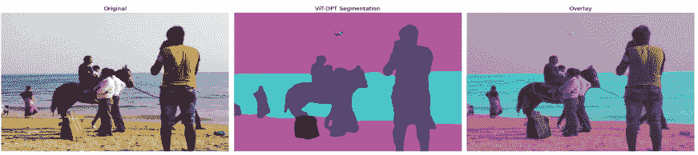

*图 10.29 – 使用预训练 DPT（ViT）进行语义分割*

**为什么需要插值：** Transformer 在 patch 网格上操作 → 分辨率降低 → 必须恢复原始尺寸。

## 基于查询的 DETR 预测

**DETR**（DEtection TRansformer，检测 Transformer）将图像视为*一组待发现的对象*，而不是像素网格。它使用固定数量的可学习对象查询——可以将它们视为“槽位”，询问：*“有属于我的对象吗？”*——每个查询直接预测一个**类别标签、边界框和掩码**。该模型不是对像素进行标记，而是询问：*“存在哪些对象？”*

在训练期间，**匈牙利匹配** 将每个预测查询分配给一个真实对象（一对一），因此模型学会生成**唯一、不重叠的检测结果**，而无需 NMS 之类的后处理。对于**全景分割**，DETR 简单地将这些对象预测（things）与背景区域（stuff）结合起来，形成完整的**场景理解**。

DETR 引入了对象查询：

$Attention(Q_o, Z_L, Z_L)$

每个查询预测**对象类别**和**掩码/区域**。**DETR** 将分割重新表述为**集合预测问题**。给定对象查询 Q，DETR 预测：

$\hat{Y} = \{(c_i, b_i, m_i)\}_{i=1}^N$

其中 $c_i$：类别标签，$b_i$：边界框，$m_i$：掩码。训练使用：

- **匈牙利匹配：**  
  $\mathcal{L} = \sum_{i=1}^N \mathcal{L}_{\mathrm{match}}(y_i, \hat{y}_{\sigma(i)})$

- **全景分割：** DETR 扩展到全景分割：  
  $\text{Panoptic} = \text{Things} \cup \text{Stuff}$

下一个代码片段加载一个预训练的 **DETR 全景分割模型**（它使用函数 DetrForSegmentation.from_pretrained() 加载预训练模型 **facebook/detr-resnet-50-panoptic**），并将其应用于输入图像，以在单次前向传播中**同时分割对象（things）和背景区域（stuff）**。它预处理图像、运行推理、将预测的分割图转换为彩色区域，并将其叠加在原始图像上进行可视化。

detr_processor（使用函数 DetrImageProcessor.from_pretrained() 加载的另一个预训练模型）负责**图像预处理和后处理**（通过处理器方法 post_process_panoptic_segmentation()）——它将图像转换为模型所需的张量，之后将原始输出转换为逐像素分割图——而 detr_model 是**基于 Transformer 的网络（ResNet-50 骨干 + DETR）**，它使用对象查询来预测分割片段。

直观地说，DETR 使用**基于 Transformer 的对象查询**全局地查看整个图像，并直接预测整个场景的分割片段，后处理步骤将这些预测转换为**逐像素全景掩码**，然后着色并叠加到原始图像上进行可视化。这会产生**分割图**和**segments_info**。与逐像素模型不同，**DETR 输出对象级掩码**，因此不需要**NMS（非极大值抑制）**。其关键优势在于端到端学习以及统一的检测 + 分割。现在，请参考下一个代码片段：

```python
from transformers import DetrImageProcessor, DetrForSegmentation

detr_processor = DetrImageProcessor.from_pretrained( \
    "facebook/detr-resnet-50-panoptic") # DETR (Panoptic Segmentation)

detr_model = DetrForSegmentation.from_pretrained(\
    "facebook/detr-resnet-50-panoptic").to(device)

def run_pipeline(image_path):
```


- **多阶段分层编码器** 生成多分辨率特征图。编码器输出通过多尺度特征融合组合为：

  $$F = \operatorname{concat}(F_1, F_2, F_3, F_4)$$

- **无位置编码**（一个关键创新——空间信息被隐式保留）。

- **轻量级 MLP 解码器** 高效融合多尺度特征，因此最终的分割预测为：

  $$\hat{Y} = \operatorname{MLP}(F)$$

这种设计避免了重型解码器（如 U-Net 风格），保留了空间细节，并显著减少了计算量。因此，SegFormer 可以被理解为一种*使用 Transformer 实现的类 CNN 分层特征提取器，并结合了一个简单而强大的解码器*。

现在，我们用下一个代码片段来演示语义分割，该片段使用预训练模型 **nvidia/segformer-b0-finetuned-ade-512-512**。这里，**processor**（AutoImageProcessor）将图像转换为归一化张量，并处理调整大小、填充和批处理。

它还执行**后处理**，而 **model**（AutoModelForSemanticSegmentation）实现了 SegFormer 架构，并输出形状为 `[1, C, H′, W′]` 的 **logits**，其中 `C` 是类别数量。

`post_process_semantic_segmentation()` 方法将 logits *上采样* 到原始图像大小，在类别维度上应用 **argmax**，并返回一个**逐像素类别图**：

$$\hat{Y}(x,y) = \operatorname{argmax}_c\ \operatorname{logits}_c(x,y)$$

```python
from transformers import AutoImageProcessor,AutoModelForSemanticSegmentation
model_name = "nvidia/segformer-b0-finetuned-ade-512-512"
processor = AutoImageProcessor.from_pretrained(model_name)
model = AutoModelForSemanticSegmentation.from_pretrained(model_name)

def run_segmentation(image_path):
    image = Image.open(image_path).convert("RGB")
    image_np = np.array(image)
    inputs = processor(images=image, return_tensors="pt").to(device)
    with torch.no_grad(): outputs = model(**inputs)
    segmentation = processor.post_process_semantic_segmentation(outputs, \
            target_sizes=[image.size[::-1]])[0]
    seg_color = colorize(segmentation)
    overlay = (0.4 * image_np + 0.6 * seg_color).astype(np.uint8)
    # Plot image_np, seg_color and detr_overlay side-by-side here

run_segmentation("images/cricket.jpg")
```

如果运行上述代码，你应该会得到如下图所示的结果：

这个示例展示了一个强大的思想：SegFormer 提供了一种统一的架构，但特定于数据集的训练决定了模型“看到”和“理解”的内容。

模型使用 Transformer 注意力全局理解场景。每个像素都基于上下文和语义进行分类。不同的数据集强调不同的环境：ADE20K → 通用场景，Cityscapes → 自动驾驶，CamVid → 道路理解。

## 掩码分类 Transformer：Mask2Former

Mask2Former 将分割表述为一个集合预测问题，预测掩码-类别对：

$\{(M_i,c_i)\}_{i=1}^{N}$

其中 $M_i$ 是预测的软/二值掩码，$c_i$ 是其类别标签。与基于 CNN 的分割中独立的逐像素分类不同，

$\hat{y}(x,y)=\underset{k}{\operatorname{argmax}}\,P_k(x,y)$，

像素 $(x,y)$ 的最终标签来自置信度最高的掩码预测：

$\hat{y}(x,y)=c_{i^*},\quad i^*=\underset{i}{\operatorname{argmax}}\,M_i(x,y)$

这在基于 Transformer 的单一框架内统一了语义、实例和全景分割，使用基于全局注意力的 token 交互，而不是仅依赖 CNN 的局部感受野。训练使用匈牙利匹配和组合的集合预测损失：

$\mathcal{L}=\lambda_{cls}\mathcal{L}_{cls}+\lambda_{mask}\mathcal{L}_{mask}+\lambda_{dice}\mathcal{L}_{dice},$

其中 $\mathcal{L}_{cls}$ 是分类损失，$\mathcal{L}_{mask}$ 是逐像素掩码损失（如 BCE），$\mathcal{L}_{dice}$ 是 Dice 重叠损失。这种公式化方法提高了全局一致性，减少了重复预测，并产生更清晰的分割边界。

以下代码片段演示了使用 Mask2Former 结合预训练 Transformer 模型进行通用分割，涵盖语义、实例和全景分割。使用了两个预训练模型："facebook/mask2former-swin-large-ade-semantic" 用于语义分割，"facebook/mask2former-swin-large-coco-panoptic" 用于全景/实例分割，其中相同的 Mask2Former 架构在不同的训练目标下被重复使用。

函数 colorize() 为分割掩码分配基于 HSV 的视觉上可区分的颜色，确保相邻区域和对象实例之间的清晰分离。函数 overlay() 将分割输出与原始图像混合，同时可以选择性地保留背景区域。有关这些函数的定义，请参阅 GitHub。

语义分割使用 post_process_semantic_segmentation() 方法执行，该方法在整个图像上生成密集的逐像素类别标签。实例分割使用 post_process_instance_segmentation() 来检测和分离单个对象实例（“things”），例如人或汽车，并为每个对象分配唯一 ID。全景分割使用 post_process_panoptic_segmentation() 执行，该方法将语义“stuff”区域（天空、道路）和实例感知的“thing”对象统一为完整的场景表示。最终可视化显示

原始图像以及语义、实例和全景分割输出及其相应的叠加结果。

```python
from transformers import Mask2FormerImageProcessor, \
                         Mask2FormerForUniversalSegmentation
sem_processor = Mask2FormerImageProcessor.from_pretrained(\
                         "facebook/mask2former-swin-large-ade-semantic")
sem_model = Mask2FormerForUniversalSegmentation.from_pretrained(\
                         "facebook/mask2former-swin-large-ade-semantic").to(device)
mask_processor = Mask2FormerImageProcessor.from_pretrained(\
                         "facebook/mask2former-swin-large-coco-panoptic")
mask_model = Mask2FormerForUniversalSegmentation.from_pretrained(\
                         "facebook/mask2former-swin-large-coco-panoptic").to(device)

def segment_and_display(image_path):
    image = Image.open(image_path).convert("RGB")
    image_np = np.array(image)
    h, w = image_np.shape[:2]
    # 1 Semantic Segmentation
    inputs = sem_processor(images=image, return_tensors="pt").to(device)
    with torch.no_grad():
        outputs = sem_model(**inputs)
    sem_seg = sem_processor.post_process_semantic_segmentation(\
                         outputs, target_sizes=[(h, w)])[0]
    # 2 Instance Segmentation (filter out "things")
    inputs_mask = mask_processor(images=image, \
                         return_tensors="pt").to(device)
    with torch.no_grad(): mask_outputs = mask_model(**inputs_mask)
    instance_result = mask_processor.post_process_instance_segmentation(\
                         mask_outputs, target_sizes=[(h, w)])[0]
    inst_map = np.zeros((h, w), dtype=np.int32)
    segmentation_tensor = instance_result["segmentation"].cpu().numpy()
    instance_counter = 1
    for res in instance_result["segments_info"]:
        if res["label_id"] < 80:
            binary_mask = (segmentation_tensor == res["id"])
            inst_map[binary_mask] = instance_counter
            instance_counter += 1
    # 3. Panoptic Segmentation
    panoptic_result = mask_processor.post_process_panoptic_segmentation(\
                         mask_outputs, target_sizes=[(h, w)])[0]
    pan_map = panoptic_result["segmentation"].cpu().numpy()
```

```python
# Plot imgs and overlays here side-by-side

segment_and_display("images/men_beach.jpg")
```

如果运行上述代码，你应该会得到如下图所示的结果：

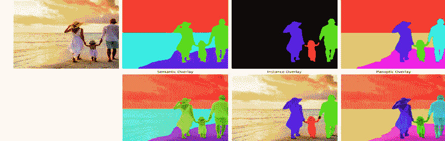

图 10.33：使用预训练 Mask2Former 进行语义、实例和全景分割

Mask2Former 引入了一种范式转变：不是标记像素 → 而是预测物体为掩码；不是局部决策 → 而是进行全局推理；不是多个独立模型 → 而是提供统一框架。Mask2Former 不问“这个像素是什么？”；相反，它问“场景中存在哪些物体，它们的掩码在哪里？”下表展示了深度分割模型的演进：

| 模型类型 | 核心思想 | 解决的局限 |
|---|---|---|
| SETR | 纯 ViT | 缺乏空间细节 |
| DPT | 多尺度融合 | 改进定位 |
| DETR | 基于查询的推理 | 以对象为中心的建模 |
| SegFormer | 分层 Transformer | 效率 + 可扩展性 |
| Mask2Former | 统一分割 | 泛化所有任务 |

表 10.3：基于 Transformer 的分割模型

## 使用预训练的 OneFormer 分割 Cityscapes 和 ADE20K 数据集图像

基于 Transformer 的分割技术的最新进展催生了统一的架构，能够在单一模型中处理多种分割任务：语义分割、实例分割和全景分割。OneFormer 就是这样一个模型，它通过引入任务条件分割扩展了掩码分类的思想（如 Mask2Former），使单个网络能够跨数据集和分割范式进行泛化。OneFormer 同时学习“分割什么”（任务）和“如何分割”（掩码预测）。这实现了跨数据集泛化、多任务学习，并减少了模型冗余。


接下来代码首先从 ADE20K 和 Cityscapes 加载基准图像，为基于 OneFormer 的通用分割准备输入。它使用 OneFormerProcessor 进行预处理（调整大小、归一化、标记化）和 OneFormerForUniversalSegmentation 进行基于变换器的推理。函数 `segment_image()` 执行语义分割，生成彩色掩码和叠加可视化，并显示最终的分割结果。

```python
from transformers import OneFormerProcessor, \
                        OneFormerForUniversalSegmentation

ade20k_image = Image.open('images/ADE_val_00000519.png').convert('RGB')
cityscapes_image = Image.open(\
    'images/stuttgart_00_000000_000113_leftImg8bit.png').convert('RGB')

ade_processor = OneFormerProcessor.from_pretrained(\
                        "shi-labs/oneformer_ade20k_swin_large")
ade_model = OneFormerForUniversalSegmentation.from_pretrained(\
                        "shi-labs/oneformer_ade20k_swin_large").to(device).eval()
city_processor = OneFormerProcessor.from_pretrained(\
                        "shi-labs/oneformer_cityscapes_swin_large")
city_model = OneFormerForUniversalSegmentation.from_pretrained(\
                        "shi-labs/oneformer_cityscapes_swin_large").to(device).eval()

def segment_image(image, processor, model, device):
    inputs = {k: v.to(device) for k, v in processor(image, ["semantic"],
                        return_tensors="pt").items()}
    with torch.no_grad():
        seg_map = processor.post_process_semantic_segmentation(
            model(**inputs), target_sizes=[image.size[::-1]])[0].cpu()
        # Plot image, seg_map and overlay side-by-side here

segment_image(ade20k_image, processor=ade_processor, model=ade_model,
              device='cuda')
```

如果运行上述代码对 ADE20K 中的图像进行分割，你应该会得到如下图所示的结果：

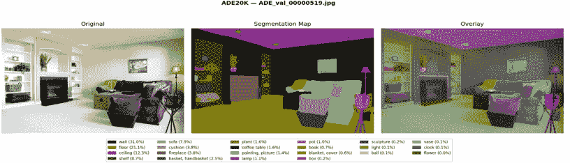

> *图 10.34 – 使用预训练 OneFormer 分割 ADE20k 图像*

同样，要对 Cityscapes 中的图像进行分割，请运行以下代码：

```python
segment_image(cityscapes_image, processor=city_processor, model=city_model)
```

如果运行上述代码，你应该会得到如下图所示的结果：

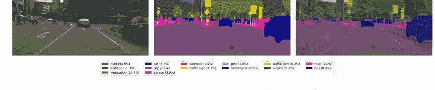

> *图 10.35 – 使用预训练 OneFormer 分割 Cityscape 图像*

上述代码演示了真实世界的数据集，介绍了标准化的评估基准，并为通用分割流程奠定了基础。OneFormer 学会了在任何任务下、在任何地方分割任何东西，使用单一统一的变换器。

要点：最后一部分将经典的、基于 CNN 的和基于变换器的分割统一在共同的视角下，突出了方法如何从像素/区域建模演进到以对象为中心和基于查询的表示。它强调了语义、实例和全景分割在现代架构中的核心区别和联系。

## Summary

在本章中，我们建立了图像分割的坚实基础，从经典概念发展到现代深度学习和基于变换器的方法。我们探讨了语义、实例和全景分割的基本公式，并研究了诸如 CNN 和变换器（例如 DPT、SegFormer、DETR、Mask2Former）等架构如何建模空间上下文、全局依赖和对象级推理。通过理论见解和实际实现，读者对分割模型如何从像素级分类演进到统一的、基于查询的框架有了清晰的理解。这一基础为我们进入下一部分做好了准备，在那里分割将变得更加交互式、多模态和以应用为驱动。

在第 11 章《图像分割的更多深度学习方法》中，我们将探索可提示的基础模型、视觉-语言和文本引导分割、单目深度估计和 3D 场景理解，以及用于真实世界分割任务的先进架构和实用流程。

## Get this book’s PDF version and more

扫描二维码（或访问 packtpub.com/unlock）。按书名搜索此书，确认版本，然后按照页面上的步骤操作。


UNLOCK NOW

> Note: Keep your invoice handy. Purchases made directly from Packt don’t require an invoice.
