### 11 More Deep Learning Methods for Image Segmentation

在上一章讨论的经典和基于深度学习的分割技术的基础上，本章继续探索下一代深度学习方法，强调灵活性、泛化能力和真实世界部署。我们首先介绍 SAM 和 MaskCLIP 等可提示基础模型，它们能够通过最少的用户输入或文本指导实现分割，然后介绍视觉-语言和基于扩散的方法，将语义与生成建模连接起来。

本章随后转向实际应用，演示分割如何在背景操纵和工业级框架中的对象检测等任务中使用。特别关注训练自定义模型，包括 U-Net 变体和现代骨干网络，进一步扩展到医学成像（MRI、CT）和多源卫星数据的遥感等特定领域应用。最后，我们讨论 3D 分割和可视化，以及对评估指标（IoU、Dice、mAP）的严格处理，使读者具备设计、训练和评估跨不同真实场景分割系统的理论理解和实用工具。

在本章中，我们将学习以下关键主题：

- Promptable foundation models for image segmentation
- Depth estimation and 3D scene understanding from a single image
- Practical applications of image segmentation
- Training a custom segmentation model
- 3D segmentation of liver CT images with Swin-UNETR
- Remote sensing: Multi-source satellite imagery segmentation with mixed-attention UNet
- Segmentation evaluation metrics

## Technical requirements

在阅读本章不同部分的同时，请跟随 Jupyter notebook 并运行必要的代码片段。以下是对应本章笔记本的 GitHub 链接：https://github.com/PacktPublishing/Hands-On-Image-Processing-and-Computer-Vision-with-Python-Second-Edition。在运行代码之前，必须安装正确版本的库才能无缝运行。如果版本不匹配，代码可能需要根据库中某些功能/函数是否被移除或弃用进行少量调整。

## Promptable foundation models for image segmentation

传统分割模型被训练为将图像 $I \in \mathbb{R}^{H \times W \times 3}$ 直接映射到密集标签图 $S: \Omega \subset \mathbb{R}^2 \to \mathcal{C}$，其中 $\mathcal{C}$ 是固定的类别集合。相比之下，**promptable foundation models** 将分割重新定义为 **条件预测问题**，输出不仅取决于图像，还取决于外部 **prompt** $p$：

$$S(x, y \mid p) = f_\theta(I, p),$$

其中提示 $p$ 可以采用多种形式：稀疏点、边界框、文本描述和粗略掩码。这种范式引入了 **交互式、零样本和可泛化分割**，其中单一模型可以在无需重新训练的情况下分割任意对象。

### Segment Anything Model

**Segment Anything Model (SAM)** 是一个在大规模掩码上训练的大规模视觉基础模型。它使用点、框或掩码作为指导执行 **prompt-driven segmentation**。SAM 将分割分解为三个组件：

- Image encoder: $F = E_I(I), \quad F \in \mathbb{R}^{N \times D}$
- Prompt encoder: $P = E_p(p)$
- Mask decoder: $M = D(F, P)$

最终预测：

$$M(x, y) = \sigma\left(f_\theta(I, p)\right),$$

其中 $\sigma$ 是产生二值掩码的 sigmoid 函数。因此，SAM 学习的是以提示为条件的通用分割函数，而非固定类别。

下一个代码片段演示了使用 SAM 在 GPU 上进行高效的自动图像分割。预训练的 ViT-Huge SAM 模型从 `sam_model_registry` 加载，采用 FP16 精度以实现更快的 CUDA 推理，并且 `SamAutomaticMaskGenerator()` 通过采样图像点并使用 IoU 和稳定性标准进行过滤来生成候选分割掩码。


生成的掩码包含分割图、区域和置信度分数；选择最大的掩码，为其分配不同的颜色，并在原始图像上分别独立显示和叠加显示。

```python
import torch, base64
from segment_anything import sam_model_registry, SamAutomaticMaskGenerator
assert torch.cuda.is_available(), "CUDA not available. Install GPU PyTorch."
sam_checkpoint = "models/sam_vit_h_4b8939.pth"
model_type = "vit_h"  # Load SAM (FP16 + eval)
sam = sam_model_registry[model_type](checkpoint=sam_checkpoint)
device = "cuda" if torch.cuda.is_available() else "cpu"
sam.to(device)
sam = sam.half()  # Use mixed precision
mask_generator = SamAutomaticMaskGenerator(  # Optimized Mask Generator
    sam, points_per_side=16, pred_iou_thresh=0.88,
    stability_score_thresh=0.92, crop_n_layers=1,
    min_mask_region_area=100)
image_path = "images/penguins.jpg"
image = cv2.imread(image_path)  # Load + Resize Image
image_rgb = cv2.cvtColor(image, cv2.COLOR_BGR2RGB)
max_size = 1024
h, w = image_rgb.shape[:2]
scale = max_size / max(h, w)
if scale < 1:
    image_rgb = cv2.resize(image_rgb, (int(w * scale), int(h * scale)))
with torch.no_grad():  # Generate Masks (NO GRAD)
    with torch.cuda.amp.autocast():
        masks = mask_generator.generate(image_rgb)
masks = sorted(masks, key=lambda x: x['area'], reverse=True)
top_mask = masks[0]['segmentation']  # Postprocess
sam_mask_viz = np.zeros_like(image_rgb)  # Create SAM 1 Visualization
if masks:
    sorted_masks = sorted(masks, key=(lambda x: x['area']), reverse=True)
    for i, ann in enumerate(sorted_masks[:10]):  # Top 10 objects
        m = ann['segmentation']
        color = (np.array(plt.cm.hsv(i / 10)[:3]) * 255).astype(np.uint8)
        sam_mask_viz[m] = color
# Visualization: Plot image_rgb, sam_mask_viz side-by-side here
```

如果运行上述代码并将图像并排绘制，你应该得到如下图所示的结果：

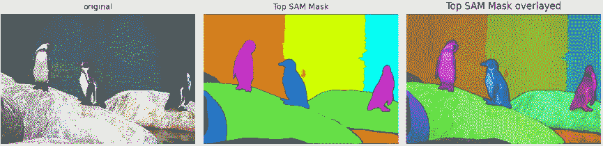

*Figure 11.1 – Image segmentation with SAM*

接下来，分离分割后的对象并启用下游处理：

```python
mask = top_mask.astype(np.uint8)  # Extract Object Crop
object_crop = image_rgb * mask[..., None]
```

## 视觉-语言大语言模型集成（通过 Ollama 的 LLaVA）

接下来，将分割后的对象（图像裁剪）通过 API 调用（`requests.post`）发送到像 LLaVA 这样的视觉-语言模型，其中图像被编码并与文本提示配对。模型随后执行多模态推理，即联合处理视觉特征和语言，以生成分割对象的自然语言描述。数学上，

$$\mathrm{Description}=g_{\phi}(M\odot I),$$

其中 $g_{\phi}$ 是一个多模态大语言模型（LLM）。

因此，SAM + LLaVA = “分割 → 理解 → 描述” 流程。

先决条件：安装并运行 Ollama（ollama serve），并拉取 LLaVA 模型，同时安装所需的 Python 库（例如 requests）。

```python
# ollama serve
# ollama pull llava
# Send to Ollama (LLaVA)
with open("images/object_crop.jpg", "rb") as f:
    img_base64 = base64.b64encode(f.read()).decode("utf-8")
response = requests.post("http://localhost:11434/api/generate",
    json={"model": "llava",
          "prompt": "Describe this segmented object in detail.",
          "images": [img_base64],
          "stream": False})
print(response.json()["response"])
```

```
Ollama Description:
This image captures a serene night scene at the zoo. The main focus is on three black birds, perched confidently on rocks near the water's edge. One bird stands out with its wings spread wide, perhaps ready for flight or simply enjoying the cool breeze.
The backdrop of this peaceful tableau is a tranquil pond, its surface calm and still. A dock stretches across it, providing a vantage point from which to observe the birds. On either side of the dock, two black birds are visible, their silhouettes stark against the moonlit sky.
The photo has been edited with a color palette that is mostly dark, giving it a striking contrast. This effect enhances the night-time ambiance and makes the birds stand out even more. The overall composition of the image suggests a quiet moment in nature, captured at the right time.
```

### Note

- Resize images → reduces quadratic transformer cost
- FP16 + autocast → faster inference
- Mask filtering → improves quality

你可以使用 SAM 2 作为高精度精炼引擎，它接收其他工具（例如 SAM）找到的粗略边界框，并将其转换为像素级精确、特定于对象的分割掩码。

## MaskCLIP：语言对齐的分割

对比语言-图像预训练（CLIP）通过使用对比损失训练两个编码器来学习图像和文本的共享嵌入空间：将匹配的图像-标题对拉近，同时将不匹配的对推开，从而通过比较相似度分数实现零样本识别。

MaskCLIP 将分割扩展到视觉-语言领域，结合了 CLIP 和分割 Transformer 的思想，通过将密集图像特征（像素/区域嵌入）与文本嵌入对齐，使得每个像素（或掩码）被分配给文本描述最相似的标签，从而有效地实现文本驱动的开放词汇分割，而无需显式的逐类训练。

以下是数学视角。设图像嵌入为 F = E_I(I)，文本嵌入为 T = E_T(t)。

那么分割变为：

S(x, y) = argmax_c ⟨F_{x,y}, T_c⟩

即像素-文本相似性匹配。

尽管 MaskCLIP 是概念性的，但它可以使用 Mask2Former 来近似。下面的代码演示了使用预训练 Mask2Former 组件的通用/全景分割，其中 Mask2FormerImageProcessor.from_pretrained() 通过调整大小和归一化准备图像，而 `Mask2FormerForUniversalSegmentation.from_pretrained()` 加载学习权重（例如 COCO 全景）。前向传递 `model(**inputs)` 为预测区域生成掩码 logits 和类别分数，而 `processor.post_process_panoptic_segmentation()` 将原始输出转换为密集分割图 $S$，为每个像素分配唯一的段 ID。函数 `get_vibrant_mask(segmentation)` 使用不同的 RGB 值对段 ID 进行着色以实现视觉可解释性（参考 GitHub），叠加混合 $I_{\mathrm{overlay}} = 0.5I + 0.5S_{\mathrm{color}}$ 将分割掩码与原始图像结合，以同时可视化场景内容和预测区域。

```python
from transformers import (
    Mask2FormerImageProcessor, Mask2FormerForUniversalSegmentation)
processor = Mask2FormerImageProcessor.from_pretrained(\
    "facebook/mask2former-swin-large-coco-panoptic")
model = Mask2FormerForUniversalSegmentation.from_pretrained(\
    "facebook/mask2former-swin-large-coco-panoptic").to(device)
image = Image.open("images/men_beach2.jpg").convert("RGB")
inputs = processor(images=image, return_tensors="pt").to(device)
with torch.no_grad(): outputs = model(**inputs)
target_size = [image.size[::-1]]                    # Post-Process
result = processor.post_process_panoptic_segmentation(\
    outputs, target_sizes=target_size)[0]
segmentation = result["segmentation"].cpu().numpy()
seg_color = get_vibrant_mask(segmentation) # Colorize Seg-Map, refer GitHub
image_np = np.array(image) # Create Overlay
overlay = (image_np * 0.5 + seg_color * 0.5).astype(np.uint8)
# Plot image_np, seg_color and overlay images Side-by-Side
```

如果运行上述代码并将图像并排绘制，你应该得到如下图所示的结果：

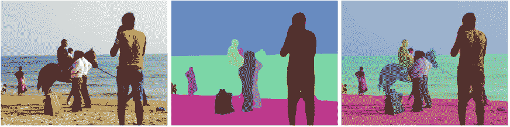

*Figure 11.2 – Image segmentation with MaskCLIP*

虽然 *MaskCLIP* 展示了语言对齐特征如何通过分割骨干增强语义分割，但下一节将进一步扩展这一思想，通过探索文本引导的分割，其中自然语言提示直接影响分割过程。


## 基于视觉-语言模型的文本引导语义分割

现代分割不再局限于固定的标签集合。通过利用视觉-语言对齐和生成式建模，我们可以直接使用自然语言提示（例如“汽车”、“天空”、“戴帽子的人”）来分割物体。这一范式建立在 CLIP 等模型之上，并扩展到扩散模型等生成框架，在这些框架中，分割问题被转化为条件生成问题。

从文本到分割掩码：给定图像 $I \in \mathbb{R}^{H\times W\times 3}$ 和文本提示 $t$，我们的目标是预测一个分割掩码：

$S(x,y) = p(m = 1 \mid I, t), \quad S: \Omega \to [0,1]$

其中 $\Omega \subset \mathbb{R}^2$ 是图像域，$S(x,y)$ 表示像素 $(x,y)$ 属于由 $t$ 描述的概念的概率。

**视觉-语言对齐：** 使用联合嵌入空间：

$z_I = f_\theta(I), \quad z_t = g_\phi(t)$

分割由相似度驱动：

$S(x,y) \propto \langle z_I(x,y), z_t \rangle$

这实现了开放词汇分割，即在训练过程中标签不是固定的。

### CLIPSeg：实用的文本到掩码分割

CLIPSeg 将 CLIP 风格的嵌入与轻量级解码器相结合，根据文本提示生成逐像素掩码。处理器对文本进行分词并对图像进行预处理，而模型则预测与查询概念逐像素相关性对应的分割 logits。通过 sigmoid 函数将 logits 转换为概率：

$S(x,y) = \sigma(\text{logits}(x,y))$

其中 $S(x,y) \in [0,1]$ 表示像素 $(x,y)$ 属于查询对象的概率。`interpolate()` 函数将预测掩码上采样回原始图像分辨率，以实现像素级对齐。现在，请参考以下代码片段：

```python
from transformers import CLIPSegProcessor, CLIPSegForImageSegmentation
processor = CLIPSegProcessor.from_pretrained("CIDAS/clipseg-rd64-refined")
model = CLIPSegForImageSegmentation.from_pretrained(
    "CIDAS/clipseg-rd64-refined").to(device)
url = "https://images.unsplash.com/photo-1492144534655-ae79c964c9d7"
image = Image.open(requests.get(url, stream=True).raw).convert("RGB")
prompt = "car"
inputs = processor(text=prompt, images=image, return_tensors="pt") \
    .to(device)
with torch.no_grad():
    outputs = model(**inputs)  # Inference
mask = outputs.logits.unsqueeze(1)

mask = torch.sigmoid(mask)
mask = torch.nn.functional.interpolate(mask,
    size=image.size[::-1], mode="bilinear", align_corners=False)
mask_np = mask[0, 0].cpu().numpy()
# Plot image and mask_np images Side-by-Side
```

如果你运行上述代码并将图像并排绘制，你应该会得到类似下面的图形：

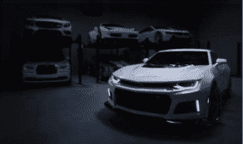

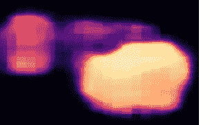

图 11.3 - 使用 CLIPSeg 分割汽车

该模型基于 CLIP 嵌入和轻量级解码器。它将图像和文本提示编码到一个共享的嵌入空间（通过 CLIP）。然后，一个分割头（transformer/解码器）根据文本预测掩码。该模型并非传统意义上的“像素分类”。相反，它在每个像素处回答一个问题：这个像素是否属于文本所描述的概念？

### 用于交互式文本引导分割的 Gradio 应用

下一个代码片段构建了一个 Gradio 应用，它使用 CLIPSeg 执行文本引导的语义分割，为用户提示所描述的任何对象生成二值掩码，并将其叠加到图像上。在这里，自然语言提示直接生成逐像素掩码。

函数 segment_with_clipseg() 将图像和文本提示转换为对齐的嵌入，并使用 CLIPSeg 预测逐像素 logits，以指示每个像素与查询概念的匹配程度。通过 sigmoid 激活将 logits 转换为概率掩码，调整到原始图像大小，并进行阈值化以获得二值分割掩码。函数 create_overlay() 在原始图像上高亮检测到的区域，而 Gradio 界面提供了一个交互式应用，用户可以上传图像并输入文本提示（例如“汽车”）来生成相应的分割掩码和叠加可视化。

```python
def segment_with_clipseg(image_pil, text):
    inputs = clipseg_processor(
        text=[text], images=[image_pil],
        padding=True, return_tensors="pt").to(device)
    with torch.no_grad():
        outputs = clipseg_model(**inputs)
    logits = outputs.logits[0]  # (H, W)
    mask = torch.sigmoid(logits).cpu().numpy()  # logits -> mask
    mask = cv2.resize(mask, (image_pil.size[0], image_pil.size[1]))
    mask = (mask > 0.5).astype(np.uint8) * 255  # Threshold
    return mask

def create_overlay(image_np, mask):
    overlay = image_np.copy()
    overlay[mask > 0] = [255, 0, 0]
    return cv2.addWeighted(image_np, 0.7, overlay, 0.3, 0)

def process(image, text):
    image_np = np.array(image.convert("RGB"))
    mask = segment_with_clipseg(image, text)
    overlay = create_overlay(image_np, mask)
    return mask, overlay

import gradio as gr

demo = gr.Interface(
    fn=process,
    inputs=[gr.Image(type="pil"), gr.Textbox(label="Text Prompt")],
    outputs=[gr.Image(label="Mask"), gr.Image(label="Overlay")],
    title="⚡ Text-to-Semantic Segmentation (CLIPSeg)"
)
demo.launch()
```

Gradio 应用如下图所示：

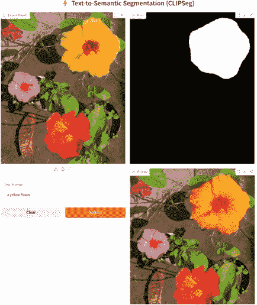

在这里，处理器将图像和文本转换为对齐的嵌入，模型预测逐像素 logits，sigmoid 激活将其转换为概率掩码。经过阈值化后，获得二值分割掩码，并与原始图像混合以进行可视化。

## 从单张图像进行深度估计与 3D 场景理解

人类视觉能够自然地根据单目观察推断深度、几何结构和空间关系。在计算机视觉中，从单张 RGB 图像恢复三维结构是一个高度不适定的逆问题，因为多个不同的 3D 场景可能投影到同一张 2D 图像上。近年来，基于 transformer 的深度学习模型通过从海量数据集中学习几何先验，显著提升了单目深度估计的性能。一旦估计出密集深度，就可以将图像提升到 3D 空间，生成点云、重建场景并执行语义 3D 理解。本节将演示一个完整的流程，涵盖单目深度估计、点云生成、多视图融合以及基于最先进 transformer 架构的语义 3D 重建。

### 从图像到深度：单目深度估计

单目深度估计预测一个密集深度图 $D: \Omega \to \mathbb{R}^{+}$，其中 $\Omega \subset \mathbb{R}^{2}$ 表示图像域，$D(x,y)$ 表示从相机到像素 $(x,y)$ 的估计距离。与立体视觉或 LiDAR 不同，单目深度估计完全依赖于学习到的几何线索，例如透视失真、纹理梯度、物体尺度先验、遮挡、阴影、语义上下文等。现代基于 transformer 的模型以端到端方式学习这些关系。

### 密集预测 Transformer

该演示使用预训练模型 `intel/dpt-large`，它基于密集预测 Transformer（DPT）架构。DPT 结合了视觉 Transformer（ViT）、多尺度特征融合和密集预测解码。与感受野有限的 CNN 不同，transformer 模型通过自注意力建模全局图像依赖关系。

对于图像 token，$X = x_1, x_2, \ldots, x_N$，自注意力计算：

$$\operatorname{Attention}(Q,K,V)=\operatorname{softmax}\left(\frac{QK^{T}}{\sqrt{d}}\right)V.$$

其中 $Q$ = 查询矩阵，$K$ = 键矩阵，$V$ = 值矩阵，$d$ = 嵌入维度。这使网络能够对场景几何进行全局推理。

该模型预测一个密集深度张量：

$$\hat{D}=f_{\theta}(I),$$

其中 $I$ = RGB 图像，$f_{\theta}$ = transformer 深度网络，$\hat{D}$ = 预测的深度图。


在训练过程中，目标最小化重建误差：

$$\mathcal{L}_{depth} = \frac{1}{N} \sum_{i=1}^{N} |D_i - \widehat{D}_i|$$

或尺度不变损失，例如：

$$\mathcal{L}_{si} = \frac{1}{N} \sum_{i} d_i^2 - \frac{1}{N^2} \left(\sum_{i} d_i\right)^2$$

其中 $d_i = \log D_i - \log \widehat{D}_i$。

下一个代码片段使用预训练的基于变换器的 DPT 模型 Intel/dpt-large 进行单目深度估计。输入 RGB 图像使用 DPTImageProcessor 进行预处理，通过 DPTForDepthEstimation 处理，网络预测出密集深度图，其中通常较亮的像素代表更近的区域，较暗的像素代表更远的区域。

处理器（DPTImageProcessor）处理归一化、调整大小和张量转换。模型（DPTForDepthEstimation）执行基于变换器的深度预测。模型被移动到 GPU 以加速。

## 深度估计流水线

get_depth() 函数处理完整的推理流水线：将图像转换为 PyTorch 张量（return_tensors="pt"），将张量移动到 GPU，在不计算梯度的情况下运行变换器模型（torch.no_grad()），使用双三次插值将预测的深度图重新调整回原始图像大小，并将深度值归一化到范围（[0,1]）以便可视化。最后，Matplotlib 并排显示原始图像和估计的深度图。以下是步骤：

- 1. **图像处理：** processor(images=image, return_tensors="pt") 将 RGB 图像转换为归一化的 PyTorch 张量。
- 2. **前向传播：** outputs = model(**inputs)。变换器预测：outputs.predicted_depth，即密集深度张量。
- 3. **上采样：** 变换器在较低分辨率下内部预测深度，使用函数 torch.nn.functional.interpolate()。双三次插值（mode="bicubic"）恢复原始图像分辨率。
- 4. **归一化：** 最小-最大归一化将深度值映射到 [0,1] 以便可视化。

生成的深度图突出显示以下内容：

- 靠近的物体 → 更亮
- 远处的物体 → 更暗

变换器成功地从单张图像重建了相对场景几何。

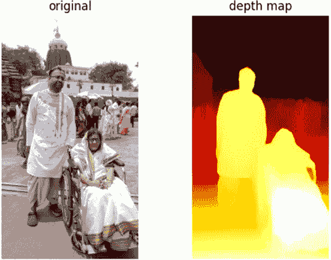

*Figure 11.5 – Depth map for an image with DPT*

使用 DPT 从单张图像预测的深度图提供了密集的逐像素 *几何线索*，可以直接利用以将 2D 场景信息提升到 3D 空间，自然地为点云生成和完整 3D 重建铺平道路。

## 点云生成和 3D 重建

一旦深度被估计，2D 图像可以通过将每个像素反投影到相机空间来提升到 3D 空间，其中每个像素 $(u, v)$ 具有深度 $D(u, v)$ 使用逆相机投影模型转换为 3D 点。具体而言，假设针孔相机几何，深度值提供了恢复空间坐标所需的缺失尺度：每个像素首先相对于相机内参（焦距和主点）进行归一化，然后按其深度缩放以获得 3D 空间中的 $(X, Y, Z)$。这在图像像素和 3D 点之间建立了直接的一对一映射，形成了点云的基础。

点云是一组 3D 点：

$$P = \{(X_i, Y_i, Z_i)\}_{i=1}^{N}$$

每个点存储空间坐标和 RGB 颜色。

## 相机投影几何

对于具有深度 $z = D(x, y)$ 的图像像素 $(x, y)$，3D 坐标为：

$$X = \frac{(x-c_x)z}{f_x},\quad Y = \frac{(y-c_y)z}{f_y},\quad \text{and}\quad Z = z,$$

其中 $f_x, f_y$ = 焦距 和 $c_x, c_y$ = 光学中心。这些方程反转了相机投影模型。

- **生成点云：** 此函数 `depth_to_pointcloud()` 遍历图像像素，将深度转换为 3D 坐标，存储 RGB 颜色并构建 Open3D 点云。
- **多视图融合：** 多个视图改善几何覆盖。代码处理由 `image_paths` 给出的图像列表。每张图像产生一个点云（pcd），使用函数 `depth_to_pointcloud()`，该函数需要图像和对应的深度图。云被合并：`combined += pcd`
- **体素下采样：** 使用方法 `voxel_down_sample()` 执行，体素化减少冗余和噪声。不是数百万个点，相邻点被聚合到体素单元中。
- **法线估计：** 方法 `estimate_normals()` 计算表面法线，近似局部几何，并且对于网格重建、渲染、光照和表面分析至关重要。
- **交互式 3D 可视化：** 如下一个代码片段所示，Open3D 可视化被 Plotly 替换（以便可以轻松地从 Colab 笔记本运行），使用以下代码行：`o3d.visualization.draw_geometries = draw_geometries`（参考 GitHub）。Plotly 启用基于浏览器的渲染、缩放、旋转和交互式探索。

完整的重建流水线变为：

$I \rightarrow D \rightarrow P \rightarrow S,$

其中 $I$ = RGB 图像，$D$ = 深度图，$P$ = 点云，$S$ = 重建场景。这架起了 2D 视觉和 3D 几何之间的桥梁。现在，参考以下代码：

```
```python
import open3d as o3d

def depth_to_pointcloud(color, depth):
    h, w = depth.shape
    fx, fy, cx, cy = w / 2, h / 2, 500, 500  # Camera intrinsics (approximate)
    points, colors = [], []
    for y in range(h):
        for x in range(w):
            z = depth[y, x]
            if z <= 0:
                continue
            X, Y = (x - cx) * z / fx, (y - cy) * z / fy
            points.append([X, Y, z])
            colors.append(color[y, x] / 255.0)
    pcd = o3d.geometry.PointCloud()
    pcd.points = o3d.utility.Vector3dVector(np.array(points))
    pcd.colors = o3d.utility.Vector3dVector(np.array(colors))
    return pcd
```
```

```
```python
# multiple views
image_paths = ["we_puri1.jpeg", "we_puri2.jpeg", "we_puri3.jpeg"]
# image_paths = glob('vic_*.jpg')
pcds = []
for path in image_paths:
    img_rgb = cv2.cvtColor(cv2.imread(path), cv2.COLOR_BGR2RGB)
    pcds.append(depth_to_pointcloud(img_rgb, get_depth(img_rgb)))
final_pcd = fuse_pointclouds(pcds) # Fuse, refer to github
o3d.visualization.draw_geometries([final_pcd]) # Visualize
```
```

如果运行上述代码，你应该获得如下图所示的结果：

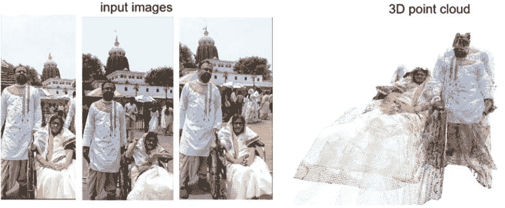

*Figure 11.6 – Generating 3D point cloud*

虽然点云生成从深度重建了场景的几何结构，但它不编码任何物体身份的概念，促使需要集成语义信息以实现有意义的 3D 理解，正如我们在下一节中将要探索的那样。

## 语义 3D 融合

深度单独提供几何但不提供语义含义。语义分割为每个像素分配类别标签：$S(x,y) \in \{1,\ldots,C\}$。结合深度和分割能够实现语义 3D 映射、场景理解、机器人、自动导航和 AR/VR 重建。

下一个代码片段使用 nvidia/segformer-b0-finetuned-ade-512-512。如前所述，SegFormer 结合了分层变换器和高效解码。以及无位置编码的多尺度融合。$\text{outputs} = \text{seg\_model}(**\text{inputs})$ 产生分割 logits：

$L \in \mathbb{R}^{C \times H \times W}$

最终分割图为：

$S(x,y) = \underset{c}{\operatorname{argmax}}\; L_c(x,y)$

使用以下方式实现：`seg = logits.argmax(dim=1)[0]`

每个 3D 点现在存储：$(X,Y,Z,c)$ 其中 $(X,Y,Z)$ = 几何，$c$ = 语义类别。这将普通点云转变为语义点云。随机颜色分配给语义类别，每个物体类别在 3D 空间中变得视觉可区分。

函数 `depth_seg_to_pointcloud()` 执行以下操作：

- 估计深度
- 预测语义标签
- 将像素投影到 3D
- 分配语义颜色
- 构建语义点云

生成的语义点云同时编码几何、结构和物体身份。这对于自动驾驶、具身 AI、机器人、数字孪生、神经场景重建、SLAM 系统等至关重要。

完整的流水线可以总结为：

$I \rightarrow (D,S) \rightarrow (X,Y,Z,c) \rightarrow \mathcal{P}_{semantic}$

其中 $I$ = RGB 图像，$D$ = 深度，$S$ = 语义分割，$(X,Y,Z,c)$ = 语义 3D 点 和 $\mathcal{P}_{semantic}$ = 语义点云。现在，参考以下代码片段：

```
```python
from transformers import AutoImageProcessor, AutoModelForSemanticSegmentation

seg_processor=AutoImageProcessor.from_pretrained("nvidia/segformer-b0-finetuned-ade-512-512")
seg_model=AutoModelForSemanticSegmentation.from_pretrained("nvidia/segformer-b0-finetuned-ade-512-512")

def get_segmentation(image):
    with torch.no_grad():
        outputs = seg_model(**seg_processor(images=image, return_tensors="pt"))
        logits = torch.nn.functional.interpolate(outputs.logits, size=image.shape[:2], mode="bilinear", align_corners=False)
        return logits.argmax(dim=1)[0].cpu().numpy()

def depth_seg_to_pointcloud(color, depth, seg):
    h, w = depth.shape
    fx, fy, cx, cy = 500, 500, w / 2, h / 2
    points, colors, cmap = [], [], np.random.randint(0, 255, (256, 3))
    for y in range(h):
        for x in range(w):
            z = depth[y, x]  # if z <= 0: continue
```
```

```
X, Y = (x - cx) * z/fx, (y - cy) * z/fy
points.append([X, Y, z])
colors.append(cmap[seg[y, x]] / 255.0)  # color_val
pcd = o3d.geometry.PointCloud()
pcd.points = o3d.utility.Vector3dVector(np.array(points))
pcd.colors = o3d.utility.Vector3dVector(np.array(colors))
return pcd, points, colors

img_rgb = cv2.cvtColor(cv2.imread('cats.jpg'), cv2.COLOR_BGR2RGB)
depth, seg = get_depth(img_rgb), get_segmentation(img_rgb)
pcd_semantic, points, colors = depth_seg_to_pointcloud(img_rgb, depth, seg)
pcd_semantic = pcd_semantic.translate(-pcd_semantic.get_center())
o3d.visualization.draw_plotly([pcd_semantic])
```

如果你运行上述代码，你应该会得到类似下面的图：

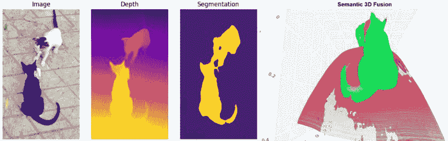

*图 11.7 – 基于语义融合的语义三维场景理解*

基于Transformer的深度估计使从单目RGB图像中获得密集的几何理解成为可能。通过结合深度预测、语义分割和几何投影，现代深度学习系统可以从普通照片中重建具有语义意义的三维场景。这将二维感知、几何、语义、空间推理等统一到一个可微分的单一流程中，用于下一代场景理解系统。

## 图像分割的实际应用

虽然现代分割模型在数学上很优雅，但它们真正的影响在于实际部署，从移动应用和视频通话到自动驾驶系统。在本节中，我们将探讨实用的、面向生产的流程，展示分割模型如何用于实时系统和大规模框架中。

## 使用 MediaPipe + DeepLabV3 (TFLite) 实现背景虚化

该应用演示了使用适用于移动和边缘设备的轻量级模型进行实时前景-背景分离。系统使用MediaPipe和DeepLabV3的TensorFlow Lite版本来高效执行语义分割。给定图像 I(x, y)，模型预测一个类别掩码：

S(x, y) ∈ {0,1}

其中 S(x, y) = 1 → 前景（人物/物体），S(x, y) = 0 → 背景。然后我们应用：

I_final(x, y) = { I(x, y), 如果 S(x, y) = 1; Blur(I(x, y)), 其他情况 }

这会产生类似视频会议工具的人像背景虚化效果。

下一个代码片段演示了使用MediaPipe的高级视觉任务API实现背景虚化。一个加载了DeepLabV3 TFLite模型的vision.ImageSegmenter执行逐像素语义分割，以生成区分前景和背景的类别掩码。该掩码被阈值化为二值掩码，背景使用高斯滤波进行模糊处理，最终图像通过将清晰前景与模糊背景混合而成。生成的流程随后通过一个简单的Gradio界面公开，允许用户上传图像并交互式查看原始图像、分割掩码和背景虚化结果。

```
# run in colab
from mediapipe.tasks.python import vision
base_options = python.BaseOptions(model_asset_path="deeplabv3.tflite")
options = vision.ImageSegmenterOptions(
    base_options=base_options, output_category_mask=True)
segmenter = vision.ImageSegmenter.create_from_options(options)

def segment_and_blur(img):
    mp_image = mp.Image(image_format=mp.ImageFormat.SRGB, data=img)
    result = segmenter.segment(mp_image)
    mask = result.category_mask.numpy_view().squeeze()
    binary_mask = (mask > 0.2).astype(np.uint8) * 255
    binary_mask_rgb = np.stack([binary_mask]*3, axis=-1)
    blurred = cv2.GaussianBlur(img, (55, 55), 0)
    condition = mask > 0.1
    final = np.where(condition[..., None], img, blurred)
    return img, binary_mask_rgb, final

with gr.Blocks() as demo:
    gr.Markdown("## DeepLabV3 Background Blur (TFLite + MediaPipe)")
    with gr.Row():
        input_img = gr.Image(type="numpy", label="Upload Image")
```

```
image = cv2.imread("dogs_cats.jpg")
image_rgb = cv2.cvtColor(image, cv2.COLOR_BGR2RGB)

# INSTANCE SEGMENTATION (Mask R-CNN)
cfg_ins = get_cfg()
cfg_ins.merge_from_file(model_zoo.get_config_file(
    "COCO-InstanceSegmentation/mask_rcnn_R_101_FPN_3x.yaml"))
cfg_ins.MODEL.WEIGHTS = model_zoo.get_checkpoint_url(
    "COCO-InstanceSegmentation/mask_rcnn_R_101_FPN_3x.yaml")
cfg_ins.MODEL.DEVICE = device
predictor_ins = DefaultPredictor(cfg_ins)
outputs_ins = predictor_ins(image)
v_ins = Visualizer(
    image_rgb, MetadataCatalog.get(cfg_ins.DATASETS.TRAIN[0]), scale=1.2)
ins_result = v_ins.draw_instance_predictions(outputs_ins["instances"].to("cpu"))

# PANOPTIC SEGMENTATION (FPN)
cfg_pan = get_cfg()
cfg_pan.merge_from_file(model_zoo.get_config_file(
    "COCO-PanopticSegmentation/panoptic_fpn_R_101_3x.yaml"))
cfg_pan.MODEL.WEIGHTS = model_zoo.get_checkpoint_url(
    "COCO-PanopticSegmentation/panoptic_fpn_R_101_3x.yaml")
cfg_pan.MODEL.DEVICE = device
predictor_pan = DefaultPredictor(cfg_pan)
panoptic_seg, segments_info = predictor_pan(image)["panoptic_seg"]
metadata = MetadataCatalog.get(cfg_pan.DATASETS.TRAIN[0])
v_pan = Visualizer(image_rgb, metadata, scale=1.2)
pan_result = v_pan.draw_panoptic_seg_predictions(
    panoptic_seg.to("cpu"), segments_info)

# SEMANTIC FROM PANOPTIC
panoptic_np = panoptic_seg.to("cpu").numpy()
semantic_map = np.zeros_like(panoptic_np)
for segment in segments_info: semantic_map[panoptic_np == segment["id"]] = segment["category_id"]
v_sem = Visualizer(image_rgb, metadata, scale=1.2, instance_mode=ColorMode.SEGMENTATION)
sem_result = v_sem.draw_sem_seg(torch.tensor(semantic_map))
# Plot image_rgb, sem_result, ins_result, pan_result side-by-side here
```

高效的数据加载通过tf.data.Dataset实现，支持批处理、缓存、预取和并行处理。预处理流程加载图像和掩码，将强度归一化到[0,1]，并使用最近邻插值调整大小，同时保持标签完整性。

U-Net编码器反复应用卷积、ReLU激活和最大池化。池化逐步降低空间分辨率，同时增加语义抽象。跳跃连接将编码器和解码器特征拼接起来：

D_l = Concat(U_l, E_l),

从而保留精细的边界信息。解码器使用Conv2DTranspose进行可学习的上采样，并重建详细的分割掩码。最后的1×1卷积充当逐像素分类器，将特征通道映射为类别logits：

Z ∈ ℝ^{H×W×C},

随后进行softmax概率估计：

P(c | x, y) = e^{z_c} / Σ_k e^{z_k}

下图展示了U-Net架构：

## U-Net 架构

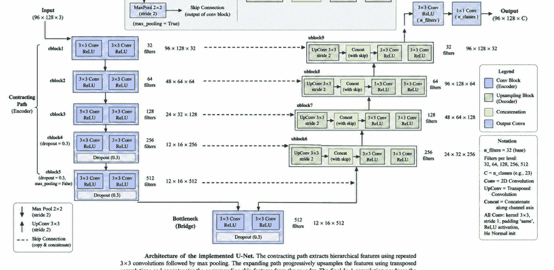

图 11.10 – U-Net 架构

模型使用`SparseCategoricalCrossentropy(from_logits=True)`和Adam优化器进行训练。分割质量使用平均IoU评估：

$$IoU = \frac{TP}{TP + FP + FN}$$

自定义的`MeanIoUWrapper`在指标计算之前使用`tf.argmax()`将logits转换为离散标签。在训练期间，前向传播计算预测，评估损失，通过反向传播获得梯度，并迭代更新参数。完整代码请参阅本书附带的GitHub仓库。

最后，训练好的模型使用`unet.to_json()`和`save_weights()`进行序列化，然后使用`model_from_json()`重建，以便将来部署和推理。函数`show_predictions()`并排可视化输入图像、真实掩码和预测分割，用于定性评估：

```
```python
# run in colab
path = kagglehub.dataset_download("kumaresanmanickavelu/lyft-udacity-challenge")
from tensorflow.keras.layers import Input, Conv2D, MaxPooling2D, \\
                                 Dropout, Conv2DTranspose, concatenate

train_image_list = sorted(glob('lyft-udacity-challenge/dataA/dataA/CameraRGB/*.png'))
train_mask_list = sorted(glob('lyft-udacity-challenge/dataA/dataA/CameraSeg/*.png'))
test_image_list = sorted(glob('lyft-udacity-challenge/dataA/dataA/CameraRGB/*.png'))
test_mask_list = sorted(glob('lyft-udacity-challenge/dataA/dataA/CameraSeg/*.png'))
train_dataset=tf.data.Dataset.from_tensor_slices((train_image_list,train_mask_list))
test_dataset = tf.data.Dataset.from_tensor_slices((test_images_list,test_masks_list))

def conv_block(inputs=None, n_filters=32, dropout_prob=0, max_pooling=True):
    conv = Conv2D(n_filters, kernel_size = 3, activation='relu',
                  padding='same',
                  kernel_initializer=tf.keras.initializers.HeNormal())(inputs)
    conv = Conv2D(n_filters, kernel_size = 3, activation='relu',
                  padding='same',
                  kernel_initializer=tf.keras.initializers.HeNormal())(conv)
    if dropout_prob > 0: conv = Dropout(dropout_prob)(conv)
    next_layer = MaxPooling2D(pool_size=(2,2))(conv) if max_pooling else conv
    skip_connection = conv
```
```


return next_layer, skip_connection

def upsampling_block(expansive_input, contractive_input, n_filters=32):
    up = Conv2DTranspose(n_filters, kernel_size = 3, strides=(2,2),
                         padding='same')(expansive_input)
    merge = concatenate([up, contractive_input], axis=3)
    conv = Conv2D(n_filters, kernel_size = 3, activation='relu',
                  padding='same',
                  kernel_initializer=tf.keras.initializers.HeNormal())(merge)
    conv = Conv2D(n_filters, kernel_size = 3, activation='relu',
                  padding='same',
                  kernel_initializer=tf.keras.initializers.HeNormal())(conv)
    return conv

def unet_model(input_size=(96, 128, 3), n_filters=32, n_classes=23):
    inputs = Input(input_size)
    #contracting path
    cblock1 = conv_block(inputs, n_filters)
    cblock2 = conv_block(cblock1[0], 2*n_filters)
    cblock3 = conv_block(cblock2[0], 4*n_filters)
    cblock4 = conv_block(cblock3[0], 8*n_filters, dropout_prob=0.3)
    cblock5 = conv_block(cblock4[0],16*n_filters, dropout_prob=0.3, \
                         max_pooling=None)
    # expanding path
    ublock6 = upsampling_block(cblock5[0], cblock4[1], 8 * n_filters)
    ublock7 = upsampling_block(ublock6, cblock3[1], n_filters*4)
    ublock8 = upsampling_block(ublock7,cblock2[1] , n_filters*2)
    ublock9 = upsampling_block(ublock8,cblock1[1], n_filters)
    conv9 = Conv2D(n_filters, 3, activation='relu', padding='same',
                   kernel_initializer='he_normal')(ublock9)
    conv10 = Conv2D(n_classes, kernel_size=1, padding='same')(conv9)
    model = tf.keras.Model(inputs=inputs, outputs=conv10)
    return model

unet = unet_model((img_height, img_width, num_channels))

@tf.keras.utils.register_keras_serializable()
class MeanIoUWrapper(tf.keras.metrics.MeanIoU):
    def __init__(self, num_classes, name="mean_iou", **kwargs):
        super().__init__(num_classes=num_classes, name=name, **kwargs)
    def update_state(self, y_true, y_pred, sample_weight=None):
        y_pred = tf.argmax(y_pred, axis=-1)
        y_true = tf.squeeze(tf.cast(y_true, tf.int32), axis=-1)
        return super().update_state(y_true, y_pred, sample_weight)

miou_metric = MeanIoUWrapper(NUM_CLASSES)
unet.compile(optimizer='adam',
    loss=tf.keras.losses.SparseCategoricalCrossentropy(from_logits=True),
    metrics=['accuracy', miou_metric])
model_history = unet.fit(train_dataset, epochs=EPOCHS)
# Epoch 1/25
# accuracy: 0.3421 - loss: 2.2086 - mean_iou: 0.0528
# ...
# Epoch 25/25
# accuracy: 0.9659 - loss: 0.1007 - mean_iou: 0.7020

plt.plot(model_history.history["accuracy"])
plt.plot(model_history.history["loss"])

以下图表显示了训练 epoch 期间的准确率和损失曲线：

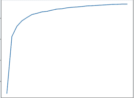

*图 11.11 – 训练 epoch 期间准确率的提升*

现在，损失的下降：

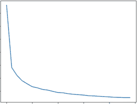

*图 11.12 – 训练 epoch 期间损失的下降*

使用模型对测试输入图像进行推理并并排绘制原始图像、真实和预测掩码将产生如下图所示的图像：

## 使用训练 30 个 epoch 的 U-Net 进行语义分割

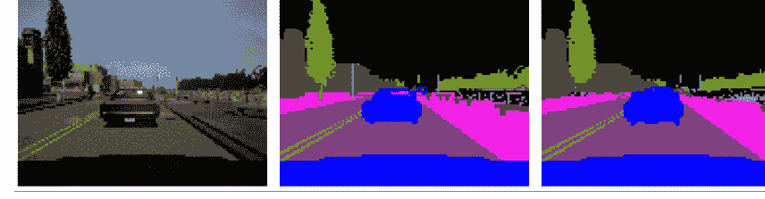

图 11.13 – 使用在 Lyft-Udacity 数据集上训练的 U-Net 模型的语义分割

评估循环在测试数据集上计算平均 IoU。最终性能：平均 IOU ≈ 0.69，这对于在调整大小的图像上训练的紧凑型 U-Net 来说是一个很强的性能。现在，请参考以下代码片段：

```
def evaluate_model(model, dataset): # model evaluation
    metric = MeanIoUWrapper(NUM_CLASSES)
    for images, masks in dataset:
        logits = model(images, training=False)
        metric.update_state(masks, logits)
    print("\nMean IoU:", metric.result().numpy())
    return metric

processed_test_image_ds.batch(1)
test_dataset = processed_test_image_ds.cache().shuffle(BUFFER_SIZE).batch(1)
evaluate_model(unet, test_dataset)
# Mean IoU: 0.69191945
```

## 使用 segmentation_models_pytorch 的基于 ResNet18 主干的 U-Net

现代分割系统通常使用预训练编码器来提高收敛速度、特征质量和泛化能力。不是从头训练编码器，而是重用预训练的 CNN 主干。这种方法被称为编码器-解码器迁移学习。

下面的代码片段演示了使用 segmentation_models_pytorch 实现的预训练 ResNet18 编码器的 U-Net 模型的语义分割，segmentation_models_pytorch 提供了生产就绪的架构，如 U-Net、FPN、PSPNet 和 DeepLabV3+，具有可互换的主干。

自定义 PyTorch Dataset 类使用 Albumentations 加载和预处理 Lyft-Udacity 道路场景图像和掩码，而 DataLoader 实现了高效的批处理和 GPU 训练。模型 smp.Unet(encoder_name="resnet18") 使用预训练的 ResNet18 编码器进行迁移学习，其中残差连接改善了梯度流动和特征提取。解码器从分层语义特征重建密集分割掩码。

训练使用 nn.CrossEntropyLoss() 进行前向传播、反向传播和优化器更新，而分割质量使用像素准确率、平均 IoU 和 Dice 系数进行评估。预测使用 torch.argmax() 转换为语义标签，并使用 Cityscapes 风格的颜色映射进行可视化。与自定义 TensorFlow U-Net 相比，SMP 实现更具可扩展性、训练速度更快，并且由于预训练编码器和工业级抽象，更适合实际部署。现在，请参考代码片段：

```
from torch.utils.data import Dataset, DataLoader
import segmentation_models_pytorch as smp
from torchmetrics.classification import (MulticlassAccuracy,
                                        MulticlassJaccardIndex,
                                        MulticlassF1Score)

train_images = sorted(glob.glob("lyft-udacity-challenge/dataA/dataA/CameraRGB/*.png"))
train_masks  = sorted(glob.glob("lyft-udacity-challenge/dataA/dataA/CameraSeg/*.png"))

class LyftDataset(Dataset):  # DATASET
    def __len__(self):
        return len(self.images)

    def __getitem__(self, idx):
        image = imageio.imread(self.images[idx])
        mask = imageio.imread(self.masks[idx])
        mask = np.max(mask, axis=-1)
        augmented = self.transform(image=image, mask=mask)
        image = augmented["image"]
        mask = augmented["mask"].long()
        return image, mask

train_loader = DataLoader(LyftDataset(train_images, train_masks),
    batch_size=BATCH_SIZE, shuffle=True, num_workers=2, pin_memory=True)
test_loader = DataLoader(LyftDataset(test_images, test_masks),
    batch_size=BATCH_SIZE, shuffle=False, num_workers=2, pin_memory=True)
model = smp.Unet(encoder_name="resnet18", encoder_weights=None,
                in_channels=3, classes=NUM_CLASSES).to(DEVICE)
criterion = nn.CrossEntropyLoss()
optimizer = torch.optim.Adam(model.parameters(), lr=LR)
train_miou_metric = MulticlassJaccardIndex(num_classes=NUM_CLASSES,
average="macro").to(DEVICE)

for epoch in range(EPOCHS):  # TRAINING LOOP
```

```
model.train()
epoch_loss = 0.0
train_miou_metric.reset()
for images, masks in tqdm(train_loader, desc=f"Epoch {epoch+1}/{EPOCHS}"):
    images = images.to(DEVICE)
    masks = masks.to(DEVICE)
    optimizer.zero_grad()
    outputs = model(images)
    loss = criterion(outputs, masks)
    loss.backward()
    optimizer.step()
    epoch_loss += loss.item()
    preds = torch.argmax(outputs, dim=1)
    train_miou_metric.update(preds, masks)

torch.save(model.state_dict(), "unet_smp.pth")
model.eval()

with torch.no_grad():
    for images, masks in tqdm(test_loader, desc="Evaluating"):
        images = images.to(DEVICE)
        masks = masks.to(DEVICE)
        outputs = model(images)
        preds = torch.argmax(outputs, dim=1)

model.eval()
with torch.no_grad():
    images, masks = next(iter(test_loader))
    outputs = model(images)
    preds = torch.argmax(outputs, dim=1)

image_np = images[0].cpu().permute(1,2,0).numpy()
true_mask = masks[0].cpu().numpy()
pred_mask = preds[0].cpu().numpy()
# Plot image_np, true_mask and pred_mask side-by-side here

# Epoch [25/25]
# Loss      : 0.1301
# Accuracy  : 0.7326
# Mean IoU  : 0.6693
# Mean Dice : 0.7567
```


如果运行上述代码并将图像并排显示，您应该会得到类似下图的图像：

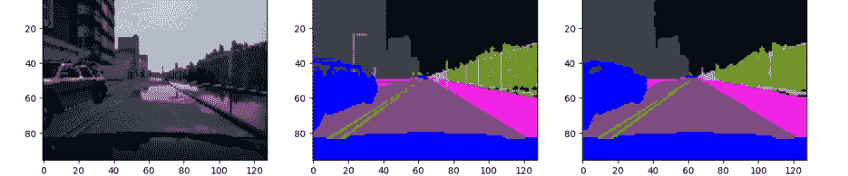

图11.14 – 使用在Lyft-Udacity数据集上训练的、以ResNet-18为骨干网络的U-Net进行语义分割

这些实验展示了分割系统的发展演变：

经典CNN → 编码器-解码器U-Net → 预训练骨干U-Net

现代分割越来越依赖预训练特征提取器、多尺度表示、跳跃连接和迁移学习。这些原理构成了DeepLabV3+、SegFormer、Mask2Former、SAM以及基于扩散的分割系统等先进架构的基础。

## 使用segmentation_models训练UNet以分割脑肿瘤MRI图像

医学图像分割是深度学习在医疗保健领域最重要的应用之一。在神经影像学中，从MRI扫描中准确勾画肿瘤区域有助于诊断、手术计划、放疗和疾病监测。与自然图像分割不同，医学分割需要较高的边界精度，因为很小的定位误差也可能对应具有临床意义的解剖区域。

本节演示了使用来自segmentation_models库的、带预训练ResNet34编码器的U-Net架构，对脑肿瘤MRI扫描进行医学图像分割。该模型执行二值逐像素分割，预测每个像素属于肿瘤还是背景。来自LGG MRI数据集的MRI图像和相应掩码被下载、调整大小、转换为二值掩码，并使用ImageNet统计数据进行归一化，以匹配预训练编码器的分布。

TensorFlow数据管道执行高效的加载、批处理、预处理和预取，以加速GPU训练。U-Net编码器利用残差学习提取分层语义特征，而解码器通过转置卷积和跳跃连接重建精细的空间细节，这些细节对于保留解剖边界至关重要。模型通过sm.Unet(构建：

```
backbone_name="resnet34", encoder_weights="imagenet", classes=1, activation="sigmoid")
```

其中sigmoid层输出每个像素的肿瘤概率。

为了处理由小肿瘤区域引起的类别不平衡，训练结合了二元交叉熵损失和Dice损失，从而改善重叠质量并提高分割鲁棒性。性能使用IoU和Dice/F1指标进行评估，这两种指标在医学分割中广泛使用。训练使用Adam优化器以及ReduceLROnPlateau、EarlyStopping和ModelCheckpoint回调，以实现稳定收敛并防止过拟合。

在推理过程中，网络预测概率图，再通过阈值化获得二值肿瘤掩码；结果使用原始MRI图像、真实掩码、概率热图和分割叠加进行可视化，以进行定性临床解读。现在，请参考以下代码片段：

```python
# run in colab
path = kagglehub.dataset_download("mateuszbuda/lgg-mri-segmentation")
import segmentation_models as sm

sm.set_framework("tf.keras")
sm.framework()
preprocess_input = sm.get_preprocessing("resnet34") # backbone
images = sorted(glob.glob(\
    "/content/data/lgg-mri-segmentation/kaggle_3m/**/[!_mask].tif", \
    recursive=True))
masks = sorted(glob.glob(\
    "/content/data/lgg-mri-segmentation/kaggle_3m/**/*_mask.tif",\
    recursive=True))

def tf_load_sample(img_path, mask_path):
    img, mask = tf.numpy_function(func = load_sample_np,
        inp = [img_path, mask_path], Tout = [tf.float32, tf.float32])
    img.set_shape([IMG_SIZE, IMG_SIZE, 3])
    mask.set_shape([IMG_SIZE, IMG_SIZE, 1])
    return img, mask

split = int(len(images) * 0.8) # Train / val split 80/20
ds_full = tf.data.Dataset.from_tensor_slices((images, masks)) \
    .shuffle(1000, seed=42)
train_ds = (ds_full.take(split)
    .map(tf_load_sample, num_parallel_calls=AUTOTUNE)
    .batch(BATCH_SIZE).prefetch(AUTOTUNE))
val_ds = (ds_full.skip(split)
    .map(tf_load_sample, num_parallel_calls=AUTOTUNE)
    .batch(BATCH_SIZE).prefetch(AUTOTUNE))
imgs_test, masks_test = next(iter(train_ds)) # Sanity check
```

```
model = sm.Unet(
    backbone_name    = BACKBONE,        # ResNet34 encoder
    encoder_weights  = "imagenet",      # pretrained weights
    input_shape      = (IMG_SIZE, IMG_SIZE, 3),
    classes          = NUM_CLASSES,     # 1 output channel
    activation       = "sigmoid",       # binary output
    encoder_freeze   = False)           # fine-tune entire network

model.compile(optimizer = keras.optimizers.Adam(learning_rate=1e-4),
    loss = sm.losses.BinaryCELoss() + sm.losses.DiceLoss(),  # combined loss
    metrics = [sm.metrics.IOUScore(threshold=0.5, name="iou"),
        sm.metrics.FScore(threshold=0.5,   name="f1")]    # Dice coefficient
callbacks = [keras.callbacks.ModelCheckpoint("best_unet_brain.keras",
    save_best_only = True, monitor = "val_iou", mode = "max", verbose=1)]
history = model.fit(train_ds, validation_data = val_ds,
    epochs = 30, callbacks = callbacks)

# Epoch 30/30
# 0.8422 - iou: 0.7364 - loss: 0.1783 - val_f1: 0.7945 - val_iou: 0.6723 -
# val_loss: 0.2296 - learning_rate: 2.5000e-05
# Plot "loss", "valloss", "iou", "valiou", "f1","valf1" from history.history
```

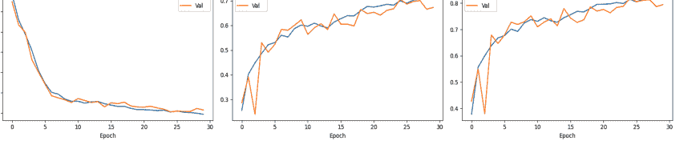

图11.15 – 训练期间的组合损失、IOU、F1 / Dice分数

```
model.load_weights("best_unet_brain.keras")
imgs_batch, masks_batch = next(iter(val_ds))
preds = model(imgs_batch, training=False)      # (B, H, W, 1) sigmoid probs
preds_bin = tf.cast(preds > 0.5, tf.float32)   # (B, H, W, 1) binary mask
# Plot img, mask, prob_map and overlay side-by-side for first 4 scans here
```

如果运行上述代码并将图像并排显示，您应该会得到类似下图的图像：

## 注意

与传统的基于CNN的方法相比，Swin-UNETR通过自注意力捕获长距离空间依赖，具有关键优势，而CNN本身受限于局部感受野。这使得Swin-UNETR能够更有效地对CT体数据中的全局3D上下文关系进行建模，从而在复杂的解剖分割中改善结构一致性。

预训练的BTCV分割包预测14个腹部器官类别，包括肝脏、脾脏、肾脏、胰腺、胃、主动脉和胆囊。模型使用SwinUNETR()初始化，参数包括in_channels=1、out_channels=14和feature_size=48，同时使用torch.load()和model.load_state_dict()加载预训练解剖权重。医学图像预处理包括使用Orientation(axcodes="RAS")进行方向归一化、使用Spacing(pixdim=(1.5,1.5,2.0))进行体素重采样、使用ScaleIntensityRange()进行亨氏单位强度归一化，以及使用pad32()进行空间填充，以确保与Transformer窗口大小兼容。

由于全卷推理超出GPU内存限制，因此使用sliding_window_inference()进行推理，该方法将CT体数据划分为重叠的3D块，并平滑地合并预测结果。网络输出14个器官类别的逐体素logits，通过torch.softmax()转换为概率，并通过.argmax(1)转换为最终分割标签。

代码使用np.where(seg==6)提取含有肝脏的轴向切片，并可视化原始CT切片、分割图、叠加图和肝脏聚光渲染图。完整的run_inference()流程自动执行NIfTI加载、预处理、Transformer推理、softmax分类和器官分割。最后，measure.marching_cubes()将体积分割掩码转换为多边形网格，用于平滑的3D解剖表面重建和可视化。重建的3D网格能够在临床规划中直观地显示解剖结构，使外科医生和研究人员能够更好地理解器官形态、空间关系和患者特定几何结构，用于术前评估和模拟。

现在，请参考下一个代码片段（完整代码请参阅本书随附的GitHub仓库）：

```
import nibabel as nib
from monai.networks.nets import SwinUNETR
from monai.transforms import (EnsureChannelFirst, Orientation, Spacing,
    ScaleIntensityRange, EnsureType, Compose)
from monai.inferers import sliding_window_inference

INPUT_DIR = "Task03_Liver/imagesTr"      # Config
BUNDLE_DIR = "bundles/swin_unetr_btcv_segmentation"
LABELS = {0:"background",1:"spleen",2:"r.kidney",3:"l.kidney",4:"gallbladder",
    5:"esophagus",6:"liver",7:"stomach",8:"aorta",9:"inf.vena cava",
    10:"portal vein",11:"pancreas",12:"r.adrenal",13:"l.adrenal"}
```


base_kwargs = dict(in_channels=1, out_channels=14, feature_size=48)
model = SwinUNETR(**base_kwargs).to(device)
ckpt = torch.load(f"{BUNDLE_DIR}/models/model.pt", map_location=device)
model.load_state_dict({k.replace("module.",""): v for k,v in ckpt.items()},\
                    strict=False)

model.eval()
preprocess = Compose([EnsureChannelFirst(channel_dim="no_channel"),
    Orientation(axcodes="RAS"),
    Spacing(pixdim=(1.5,1.5,2.0), mode="bilinear"),
    ScaleIntensityRange(a_min=-175, a_max=250, b_min=0., b_max=1., clip=True),
    EnsureType()])

def run_inference(ct_path):
    nii = nib.load(ct_path)
    img_t = preprocess(nii.get_fdata()).astype(np.float32)
    img_padded, orig_shape = pad32(img_t) # refer to github for pad32
    with torch.no_grad():
        pred = sliding_window_inference(img_padded.unsqueeze(0).to(device),
            roi_size=(96,96,96), sw_batch_size=2, predictor=model, overlap=0.5)
    H,W,D = orig_shape
    seg = torch.softmax(pred,1).argmax(1).squeeze()[:H,:W,:D].cpu().numpy()
    return img_t.squeeze().cpu().numpy(), seg

ct_path = os.path.join(INPUT_DIR,"liver_3.nii.gz")
img, seg = run_inference(ct_path)
# Plot img, seg, overlay side-by-side here

如果你运行上述代码并将图像并排绘制，应能获得类似下图的效果：

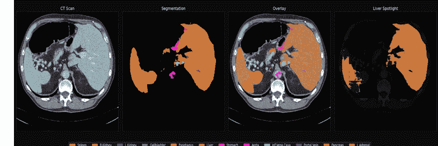

图 11.17 – MONAI：Swin UNETR 对肝脏 CT 图像的轴向分割

## 使用 Vedo 进行三维可视化

接下来的代码使用 `Mesh()` 函数构建彩色器官网格。每个器官接收独特的颜色、透明度和交互式渲染。显示两个同步面板：CT 体积渲染和器官分割网格。这样可以同时进行解剖学解读：

```
from vedo import Volume, Mesh, LegendBox, Plotter
LABELS={0:"background",1:"spleen",2:"r.kidney",3:"l.kidney",4:"gallbladder",
         5:"esophagus",6:"liver",7:"stomach",8:"aorta",9:"inf.vena cava",
         10:"portal vein",11:"pancreas",12:"r.adrenal",13:"l.adrenal"}
COLORS = np.array([
    [0,0,0],[255,128,0],[255,0,0],[0,0,255],[0,255,0],
    [255,255,0],[210,105,30],[255,20,147],[255,0,255],[0,255,255],
    [128,0,128],[255,165,0],[0,128,255],[255,69,0]
], dtype=np.uint8)/255.0
meshes = [] # create organ meshes
for label, name in LABELS.items():
    if label == 0: continue
    mask = seg == label
    if mask.sum() == 0: continue
    verts, faces, _, _ = measure.marching_cubes(mask, 0)
    mesh = Mesh([verts, faces])
    mesh.c(COLORS[label]).alpha(0.7)
    mesh.name = name
    meshes.append(mesh)

legend = LegendBox(meshes)
ct_vol = Volume(img) # --- CT volume ---
ct_vol.cmap("bone")
ct_vol.alpha([0,0.1,0.2,0.4,0.8])
plt = Plotter(N=2, axes=9, bg="black", size=(1600,800))
plt.show(ct_vol, at=0)  # left panel (CT)
plt.show(meshes, at=1)  # right panel (segmentation)
```

如果你运行上述代码，应能得到类似下图的结果：

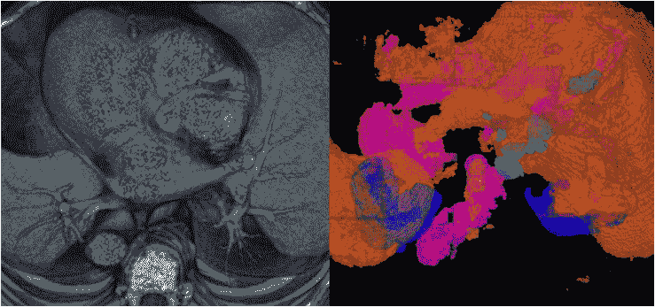

## 使用 VTK 进行体积渲染

VTK 执行 GPU 加速的体积渲染。CT 体积表示为：`VtkImageData`。不透明度传递函数通过 `opacity.AddPoint()` 函数定义组织透明度。颜色传递函数将强度值映射到组织颜色。渲染图像近似于临床使用的放射学可视化系统。你可以使用 `camera.Azimuth(2)` 方法旋转相机 180 帧。每帧渲染画面被捕获并存储。最后，可使用 `imageio.mimsave()` 创建分割器官的 3D 旋转动画。代码请参阅 GitHub。

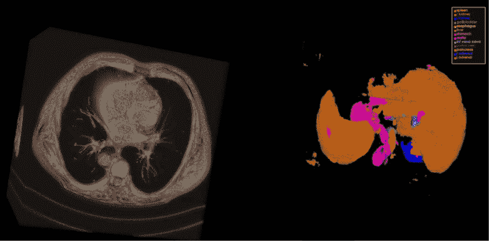

## 为什么 Swin-UNETR 表现优异

Swin-UNETR 之所以表现出色，是因为它结合了以下组件，如下表所示：

| 组件 | 优势 |
|---|---|
| Swin Transformer | 长程上下文建模 |
| 移位窗口 | 高效注意力 |
| U-Net 解码器 | 精确定位 |
| 跳跃连接 | 恢复空间细节 |
| 层次化特征 | 多尺度理解 |
| 预训练 | 改进泛化 |

表 11.1 – Swin-Unet 的关键架构组件及其在图像分割中的相应优势

在了解了使 Swin-UNETR 能够有效建模复杂三维解剖结构的架构设计选择之后，我们现在将这些优势与其在实际医学影像场景中的实际影响联系起来。

## 三维器官分割的应用

基于 Transformer 的体积分割有许多应用，如肝脏肿瘤分析、放疗计划、手术导航、器官体积估计、疾病进展追踪、多器官解剖建模、数字孪生生成、机器人手术辅助等。与经典 CNN 方法不同，Swin-UNETR 利用分层自注意力来捕获跨体积 CT 数据的长程解剖依赖关系，生成适用于现代临床 AI 系统的高精度器官分割图。

## 遥感：使用混合注意力 U-Net 进行多源卫星图像分割

卫星图像的语义分割是现代遥感和地理空间智能系统中最重要的任务之一。与自然图像分割不同，遥感图像包含大规模空间结构、严重的类别不平衡、季节外观变化、大气畸变以及来自不同传感器和卫星的多源采集伪影。因此，对道路、建筑物、植被、水体、裸地和城市区域进行准确分割，对于城市规划、精准农业、灾害管理、军事监视、环境监测和自主导航等应用至关重要。

在本节中，使用 `segmentation_models_pytorch` 库中的混合注意力 U-Net（MAnet）架构对卫星图像进行多类语义分割训练。该网络采用预训练的 ResNet34 编码器以及注意力引导的解码器模块，以改进上下文特征聚合和边界定位。

完整流程包括：

- 1. 从大型卫星图像中提取补丁
- 2. RGB 掩码编码为类别标签
- 3. 类别平衡损失计算
- 4. 使用 Albumentations 进行数据增强
- 5. 混合 Dice + 交叉熵优化
- 6. 混合注意力 U-Net 训练
- 7. 全图像分块推理与重建
- 8. 使用 Dice 系数进行定量评估

## 遥感中的语义分割

设输入卫星图像为 $I: \Omega \to \mathbb{R}^3$，其中 $\Omega \subset \mathbb{Z}^2$ 表示图像格网。语义分割的目标是估计一个密集的类别映射 $S: \Omega \to \{0,1, ..., C-1\}$，其中 $C$ 表示语义土地覆盖类别的数量。

对于像素 $(x, y)$，$S(x, y) = c$ 表示该像素属于类别 $c$，如道路、植被、水体、城区、裸地、建筑物和阴影。与图像分类不同，分割执行像素级预测，既需要局部纹理理解，也需要全局上下文推理。

## 卫星图像分割中的挑战

遥感分割面临几个独特的挑战，例如：

- **大空间分辨率：** 卫星图像的尺寸可能超过数千像素：
  
  $H, W \gg 1024$
  
  直接处理此类图像的计算成本很高，因为对于卷积特征图，GPU 内存大约按 $O(HW)$ 增长。

- **严重的类别不平衡：** 某些类别在图像中占主导地位。例如，背景或植被可能占据（80%）的像素，而道路或河流可能占据不到（1%）。这会导致有偏优化，因为标准交叉熵最小化的是平均误差：
  
  $\mathcal{L}_{CE} = - \sum_{c=1}^{C} y_c \log p_c$
  
  频繁出现的类别主导梯度。

- **多源变异性：** 图像来自不同的卫星、传感器、高度、大气条件和采集时间。因此，同一土地覆盖类别可能表现出截然不同的光谱外观。


下面的代码片段将在多源卫星影像图块上训练一个 MANet 模型，以执行多类别土地覆盖分割，使用加权交叉熵和 Dice 损失，并结合数据增强与分块推理。

## 数据准备与训练策略

以下实现流程通过基于图块的训练、标签编码、类别平衡策略和数据增强来应对这些挑战，从而实现对大型、异质卫星影像的稳健分割：

- 1. **基于图块的训练：** 为了克服内存限制，将大尺寸卫星影像划分为较小的图块（PATCH=512）。函数 `extract_patches()` 从 RGB 图像和分割掩码中提取大小为 512 × 512 的非重叠图块。

数学上，

$$P_{ij}=I[x_i:x_i+P, y_j:y_j+P],$$

其中 P = 512 表示图块大小。这样可将训练数据集转换为成千上万个更小的样本（图块总数：5318）。基于图块的训练具有多项优势，例如降低 GPU 内存消耗、增大数据集规模、提升随机多样性，以及更容易进行小批量优化。

- 2. **基于颜色的掩码编码：** 数据集将语义掩码存储为 RGB 彩色图像，而不是整数标签。例如：

| RGB 颜色 | 语义类别 |
|---|---|
| (0,255,0) | 植被 |
| (255,0,0) | 建筑物 |
| (0,0,255) | 水体 |

下面的代码片段会构建一个映射（`COLOR_MAP`）。编码操作将 RGB 掩码转换为类别标签张量：

$$M(x,y) \in \{0,1,\ldots,C-1\}$$

转换过程使用：`label[(mask==c).all(axis=-1)] = i`。这会生成适合神经网络训练的整数值分割掩码。

- 3. **类别不平衡补偿：** 使用中值频率平衡来处理类别不平衡问题。

设 $f_c = \frac{N_c}{\sum_k N_k}$ 表示类别 $C$ 的频率，其中 $N_c$ 是属于类别 $C$ 的像素数。

类别权重定义为：

$$w_c = \frac{\operatorname{median}(f)}{f_c + \epsilon}$$

实现方式为：class_weights = median / (freq + 1e-6)。因此，稀有类别会获得更大的权重。稀有类别会得到较高的权重，而占主导地位的类别会得到小得多的权重。这显著提升了针对细薄或罕见结构的分割质量。

- 4. **数据增强：** 遥感数据集的大小通常有限。数据增强可人为地增加训练多样性。该流程使用 Albumentations（HorizontalFlip、VerticalFlip、RandomRotate90、RandomBrightnessContrast），这些增强方法可提升对方向、光照、季节变化和传感器噪声的不变性。数学上，数据增强从 T ~ P(T) 中采样变换，并生成 Ĩ = T(I)，从而近似一个更大的训练分布。

分割模型通过 `smp.MAnet()` 实例化。该架构结合了：ResNet34 编码器、U-Net 解码器和注意力聚合模块。下面逐一详述。

编码器提取层次化特征图：F₁, F₂, ..., Fₗ，其中较深层包含越来越语义化的表示。预训练的 ResNet34 编码器最初在 ImageNet 数据集上训练，因此可以利用自然图像表示进行迁移学习。

解码器逐步对潜在特征进行上采样：

```
F_{l-1} = U(F_l),
```

其中 U 表示上采样。

跳跃连接融合编码器和解码器的表示：

```
ĤF_i = [F_i^{enc}, F_i^{dec}]
```

从而保留精细的空间细节。

混合注意力模块自适应地对重要的空间区域和通道进行加权。注意力系数通过以下方式学习：

```
A = σ(WF + b),
```

其中 F 表示特征图，W 是可学习参数，σ 是 sigmoid 函数。

精炼后的特征表示为：

```
F' = A ⊙ F
```

其中 ⊙ 表示逐元素相乘。这使网络能够聚焦于道路、水体边界和建筑物等语义重要的区域。

Dice 系数衡量预测与真实标签之间的重叠程度。

对于预测（P）和真实标签（G），Dice(P, G) = 2|P∩G| / |P|+|G|。

因此，Dice 损失为 L_Dice = 1 − Dice(P, G)。Dice 损失对不平衡的分割问题尤其有效，因为它直接优化区域重叠。

训练目标结合了加权交叉熵和 Dice 损失。数学上，

$$\mathcal{L} = \lambda \mathcal{L}_{CE} + (1-\lambda)\mathcal{L}_{Dice},$$

其中 $\lambda = 0.5$。这种混合形式结合了：

- 像素级分类准确率
- 区域级重叠优化

网络使用 **AdamW** 优化，它将权重衰减与自适应梯度估计解耦。此外，还通过函数 `clip_grad_norm_()` 进行梯度裁剪。这会强制满足 $\|\nabla\theta\|_2 \leq 1$，从而防止梯度爆炸，使优化过程更稳定。

当优化停滞时，调度器通过函数 `torch.optim.lr_scheduler.ReduceLROnPlateau` 降低学习率。如果验证损失进入平台期，学习率将变为：

$$\eta_{t+1} = 0.5\eta_t$$

自适应调度可改善局部最小值附近的收敛。

这里，训练损失稳步下降。这表明收敛成功。基于 Dice 的损失下降意味着预测区域与真实标签区域之间的重叠在不断增加。

训练好的模型使用函数 `torch.save()` 保存。这会存储模型权重、优化器状态和训练轮次，从而可以在之后恢复训练，而不会丢失优化器的统计信息。

由于 GPU 内存限制，大型卫星影像无法直接处理。解决方案是分块推理。先对影像进行填充，然后独立分割每个图块：

$$\hat{S}_{ij} = f_{\theta}(P_{ij})$$

随后将预测出的图块拼接在一起，最后移除填充。这样就重建出整幅卫星影像的分割图。现在，请参考下面的代码片段：

```
```python
# run on GPU / in colab
# CORE SETUP
path = kagglehub.dataset_download(
    "hammadjavaid/multi-source-satellite-imagery-for-segmentation"
)
PATCH = 512

def extract_patches(img, mask):
    H, W, _ = img.shape
    patches = []
    for y in range(0, H - PATCH, PATCH):
        for x in range(0, W - PATCH, PATCH):
            im = img[y:y + PATCH, x:x + PATCH]
```
```

```
```python
m = mask[y:y + PATCH, x:x + PATCH]
patches.append((im, m))
return patches

model = smp.MAnet(
    encoder_name="resnet34", encoder_weights="imagenet",
    classes=NUM_CLASSES, activation=None
).to(device)

optimizer = torch.optim.AdamW(model.parameters(), lr=1e-3)
scheduler = torch.optim.lr_scheduler.ReduceLROnPlateau(optimizer, factor=0.5)

# CLASS WEIGHTS (imbalanced learning)
class_weights = torch.tensor(
    class_weights, dtype=torch.float32
).to(device)

def dice_loss(pred, gt):
    # LOSS FUNCTION (Dice + CE)
    pred = torch.softmax(pred, dim=1)
    gt_onehot = F.one_hot(gt, NUM_CLASSES).permute(
        0, 3, 1, 2
    ).float()
    inter = (pred * gt_onehot).sum((2, 3))
    union = pred.sum((2, 3)) + gt_onehot.sum((2, 3))
    dice = (2 * inter + 1e-6) / (union + 1e-6)
    return 1 - dice.mean()

# DATA LOADER (patch dataset assumed pre-built)
loader = DataLoader(ds, batch_size=8, shuffle=True)

for epoch in range(10):  # TRAINING LOOP
    model.train()
    total_loss = 0

    for x, y in loader:
        x, y = x.to(device), y.to(device)
        optimizer.zero_grad()
        pred = model(x)
        loss = (
            0.5 * F.cross_entropy(
```
```

```
pred, y, weight=class_weights
) + 0.5 * dice_loss(pred, y)
)
loss.backward()
torch.nn.utils.clip_grad_norm_(model.parameters(), 1.0)
optimizer.step()
total_loss += loss.item()

avg_loss = total_loss / len(loader)
scheduler.step(avg_loss)
print(f"Epoch {epoch}: Loss {avg_loss:.4f}")

# Epoch 6 Loss 0.6810934002238108
# Epoch 7 Loss 0.6643141189464052
# Epoch 8 Loss 0.6605846921304115
# Epoch 9 Loss 0.637118750452099

# SAVE MODEL
torch.save(
    {"model": model.state_dict(),
    "optimizer": optimizer.state_dict(),
    "epoch": epoch},
    "checkpoint_MAUnet.pth"
)

# inference
model.eval()
img, gt = ds[0]
img = img / img.max()

with torch.no_grad():
    pred = model(img.unsqueeze(0).to(device))
pred = torch.argmax(pred, 1).squeeze().cpu().numpy()

# plot img, ground truth, and pred side-by-side here
```

如果运行上述代码并将图像并排显示，你应该会得到类似下图的结果：


## 多源卫星影像分割与混合注意力 UNet

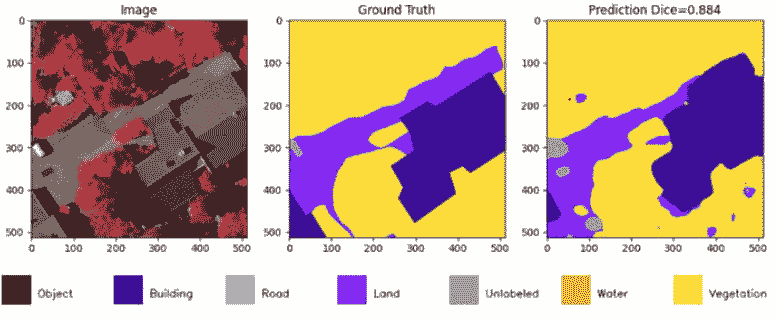

*Figure 11.20 – Segmenting satellite image patches with MA-UNet*

多类 Dice 分数针对每个类别进行计算。最终分数为：

$$\mathrm{Dice}_{\mathrm{mean}} = \frac{1}{C}\sum_{c=1}^{C} \mathrm{Dice}_c$$

Dice 分数接近 1 表示分割重叠度极佳。

预测的标签掩膜通过函数 `decode_mask()` 转换回 RGB 颜色。这会生成可解释的土地覆盖图，其中每个语义类别都使用不同的颜色显示。

典型的可视化包括原始卫星图像、真实掩膜和预测分割图并排显示。这种定性分析至关重要，因为分割质量通常取决于边界精度和区域一致性，而不仅仅是数值指标。

```python
i = 1
img_path, mask_path = imgs[i], masks[i]
img = cv2.imread(img_path)
mask = cv2.imread(mask_path)
img = cv2.cvtColor(img, cv2.COLOR_BGR2RGB)
mask = cv2.cvtColor(mask, cv2.COLOR_BGR2RGB)
H, W, _ = img.shape

# pad image to multiple of PATCH
pad_h = (PATCH - H % PATCH) % PATCH
pad_w = (PATCH - W % PATCH) % PATCH
img_pad = np.pad(img, ((0, pad_h), (0, pad_w), (0, 0)), mode='reflect')
mask_pad = np.pad(mask, ((0, pad_h), (0, pad_w), (0, 0)), mode='reflect')
Hp, Wp, _ = img_pad.shape
```

尽管采用了有效的分块、注意力融合和类别不平衡处理，遥感分割仍然具有挑战性，原因在于高分辨率复杂性、多传感器变异性和严重的类别不平衡，这促使了像混合注意力 U-Net 这样专门的架构，以实现更好的全局上下文建模和精细细节保留。

MAnet 架构提供了若干重要优势：

- 改进的上下文推理
- 增强的边界定位
- 更好的小目标检测
- 高效的编码器-解码器融合
- 对类别不平衡的鲁棒性

注意力机制在遥感中特别有用，因为卫星场景包含跨越多个尺度的高度异构空间结构。

## 应用

混合注意力卫星分割系统广泛应用于土地覆盖分类、洪水制图、作物监测、野火评估、城市扩张分析、军事侦察、海岸线提取、道路网络检测和环境监控。这些系统构成了现代地理空间 AI 管道的关键组成部分。

在探索了涵盖经典、深度学习和基于 Transformer 的范式的各种分割方法后，我们现在以介绍用于定量评估分割性能的标准评估指标作为本章的结尾。

## 分割评估指标

评估分割模型的质量与设计模型本身一样重要。在语义分割和实例分割中，预测掩膜 Ŷ 必须与真实掩膜 Y 进行比较，以量化模型识别对象边界和语义区域的准确性。

设 $Y \subseteq \Omega$ 表示属于真实对象区域的像素集合，$\hat{Y} \subseteq \Omega$ 表示预测的分割区域，其中 $\Omega$ 为图像域。

对于二值分割，每个像素要么属于前景类，要么属于背景类。真实类别与预测类别之间的比较通常使用混淆矩阵量来表达：

- **True Positive (TP):** 正确预测的前景像素
- **False Positive (FP):** 错误预测为前景的背景像素
- **False Negative (FN):** 模型遗漏的前景像素
- **True Negative (TN):** 正确预测的背景像素

这些量构成了大多数分割指标的基础。

## 交并比指标

交并比 Intersection over Union (IoU) 指标，也称为 Jaccard Index，衡量预测区域与真实区域之间的重叠程度：

IoU = |Y ∩ Ŷ| / |Y ∪ Ŷ|

其中 Y ∩ Ŷ 表示交集（共同像素），Y ∪ Ŷ 表示并集（属于任一掩膜的所有像素）。

使用混淆矩阵术语，

IoU = TP / (TP + FP + FN)

其中 IoU = 1 为完美分割，IoU = 0 表示无重叠。IoU 越高，表示定位和边界一致性越好。IoU 同时惩罚假阳性和假阴性，使其成为语义分割最可靠的指标之一。

IoU 广泛用于医学图像分割、自动驾驶、卫星图像分析、器官和肿瘤分割，以及 Cityscapes 和 Pascal VOC 等基准数据集。对于多类分割，IoU 对每个类别独立计算并取平均：

mIoU = 1/C Σ_{c=1}^C IoU_c

其中 C 为类别数。

## Dice 系数

Dice 相似系数 Dice Similarity Coefficient (DSC) 衡量两个集合之间的相似性，在医学成像中特别流行：

Dice = 2|Y ∩ Ŷ| / (|Y| + |Ŷ|)

用混淆矩阵量表示，

Dice = 2TP / (2TP + FP + FN)

Dice 系数与 IoU 密切相关：

Dice = 2·IoU / (1 + IoU)

反之，

IoU = Dice / (2 − Dice)

### Note

Dice 的取值范围为 0 到 1。Dice 越高，表示重叠越强。Dice 比 IoU 对小结构更敏感。这一特性使 Dice 特别适用于肿瘤分割、病变检测、血管分割和脑 MRI 分析。

## Dice 损失

深度学习模型通常优化 Dice 损失：

```
L_Dice = 1 − Dice
```

或其可微分的软版本：

```
L_Dice = 1 − (2 Σ_i p_i g_i + ε) / (Σ_i p_i + Σ_i g_i + ε)
```

其中 p_i 为预测概率，g_i 为真实标签，ε 用于防止除零。Dice 损失对于前景仅占图像一小部分的失衡数据集非常有效。

## 像素准确率

像素准确率衡量正确分类像素的比例：

```
Accuracy = correct pixels / total pixels
```

对于二值分割，

```
Accuracy = (TP + TN) / (TP + TN + FP + FN)
```

像素准确率评估全局分类正确性，但在高度不平衡的数据集上可能具有误导性。有时会出现准确率很高，但分割完全无用的情况，因为对象从未被检测到。因此，像素准确率不应单独用于分割评估。

## 平均像素准确率

对于多类分割，我们有：

```
Mean Accuracy = (1/C) Σ_{c=1}^C TP_c / (TP_c + FN_c)
```

其中 C 为语义类别数。

## 平均平均精度

平均平均精度 Mean Average Precision (mAP) 指标在实例分割和目标检测中广泛使用，特别是对于 Mask R-CNN、YOLO 和 Detectron2 等模型。与语义分割指标不同，mAP 同时评估：

- 定位质量
- 分类正确性

## 精确率和召回率

精确率定义为：

Precision = TP / (TP + FP)

而召回率为：

Recall = TP / (TP + FN)

如果其 IoU 超过阈值，则认为预测是正确的，通常为：IoU ≥ 0.5。该标准通常写为 AP₅₀。

## 平均精度

对于给定类别，在不同置信度阈值下计算精确率-召回率曲线。平均精度 AP 为该曲线下的面积：

AP = ∫₀¹ p(r) dr,

其中 p(r) 是召回率的函数。

平均平均精度：所有类别的平均值给出：

mAP = 1/C Σ_{c=1}^C AP_c

## COCO 风格的 mAP

COCO 基准在多个 IoU 阈值上评估 AP：{0.50,0.55,0.60,...,0.95} 并取平均：

mAP_coco = 1/10 Σ_{t=0.50}^{0.95} AP_t

这比仅使用 AP₅₀ 产生更严格的评估。

## 获取本书的 PDF 版本和更多内容

扫描二维码（或访问 packtpub.com/unlock）。按书名搜索本书，确认版本，然后按照页面上的步骤操作。


Note: Keep your invoice handy. Purchases made directly from Packt don’t require an invoice.


