### 12 图像分类与目标检测

在上一章关于图像分割的基础上，本章探讨了两个基础的计算机视觉任务——图像分类和目标检测，这些任务使机器能够识别、分类、定位和解释视觉内容。本章从特征可视化和迁移学习开始，逐步介绍现代范式，如 Transformer、自监督学习、少样本学习、联邦学习和对抗鲁棒性，然后再研究高级检测、实例分割、OCR、地标分析以及实际的视觉应用。综合起来，这些技术构成了智能视觉理解系统的基础，架起了低级图像处理与高级语义推理之间的桥梁。

现代图像分类网络并非直接在像素空间中运行。相反，它们将图像转换为高维特征嵌入，在其中语义相似性变得在几何上具有意义。

在本章中，我们将学习以下主题：

- 使用 t-SNE 可视化高维图像特征
- 图像分类
- 用于图像分类的迁移学习
- 使用注意力网络进行图像分类
- 少样本学习
- 用于图像分类的贝叶斯神经网络
- 使用半监督学习进行图像分类
- **掩码自编码器 (MAE)**
- 联邦学习（隐私保护深度学习）用于分布式图像分类
- 针对图像分类的神经网络对抗攻击
- 利用 EfficientNet 特征构建图像搜索引擎
- 目标检测
- 使用 RetinaNet 进行目标检测
- 使用 Mask R-CNN 进行目标检测和实例分割
- 光学字符识别和视觉语言文本提取管道
- 使用 MediaPipe 的增强现实滤镜和基于地标的人脸-手部分析
- 手部地标检测和手势可视化
- 使用首阶运动模型进行 Deepfake 生成
- 使用 YOLOv8 分割进行车辆损伤检测和严重程度评估

### 技术要求

在阅读本章各节的同时，请跟随 Jupyter 笔记本（并运行必要的代码片段）。以下是本章对应笔记本的 GitHub 链接：https://github.com/PacktPublishing/Hands-On-Image-Processing-and-Computer-Vision-with-Python-Second-Edition。在运行代码之前，必须安装正确版本的库，才能无缝运行代码。如果版本不匹配，代码可能需要根据库中某些功能/函数是否被移除或弃用进行少量调整。

### 使用 t-SNE 可视化高维图像特征

在训练图像分类器或目标检测器之前，了解图像在特征空间中的表示方式通常很有用。深度神经网络将图像转换为高维嵌入向量，其几何结构编码了语义信息。属于相似类别的图像往往聚类在一起，而不相关的图像则占据特征空间的远距离区域。

不幸的是，这些特征向量可能包含数百或数千个维度，无法直接可视化。降维技术如主成分分析（PCA）和 t-分布随机邻域嵌入（t-SNE）提供了一种将高维表示投影到二维空间同时保留重要结构关系并在 2-D（或 3-D）中可视化的机制。可视化有助于建立直觉，了解神经网络如何在特征空间中组织和分离视觉概念，使学习到的表示更易于解释和分析。

本节演示了如何使用 t-SNE 可视化原始图像表示以及从预训练卷积神经网络提取的深度特征。

### 使用 t-SNE 的 MNIST 嵌入

MNIST 数据集由 70,000 张大小为 28 × 28 的灰度手写数字图像组成。每张图像可视为 784 维空间中的一个向量 x ∈ ℝ⁷⁸⁴。虽然人类可以轻松区分数字，但在 784 维空间中手写数字的分布很难直接解释。

**主成分分析：** 一种常见的降维方法是主成分分析（PCA），它寻求最大方差的正交方向。给定中心化观测值 $X = [x_1, x_2, ..., x_n]^T$，PCA 计算协方差矩阵 $C = \frac{1}{n} X^T X$ 并求解特征向量 $C v_i = \lambda_i v_i$。前导特征向量定义了保留最大方差的投影方向。虽然 PCA 计算效率高，但它是一种线性变换，通常无法保留图像数据集中存在的非线性结构。

**t-分布随机邻域嵌入（t-SNE）：** t-SNE 由 van der Maaten 和 Hinton 于 2008 年提出，是一种专门为可视化设计的非线性降维技术。对于每对样本 $x_i$ 和 $x_j$，在原始空间中定义一个概率分布：

$$p_{j|i} = \frac{\exp\left(-\frac{|x_i - x_j|^2}{2\sigma_i^2}\right)}{\sum_{k \neq i} \exp\left(-\frac{|x_i - x_k|^2}{2\sigma_i^2}\right)}$$

低维嵌入点 $y_i$ 定义了另一个概率分布：

$$q_{ij} = \frac{(1 + |y_i - y_j|^2)^{-1}}{\sum_{k \neq l} (1 + |y_k - y_l|^2)^{-1}}$$

使用 Student t 分布。

最优嵌入通过梯度下降最小化 Kullback-Leibler 散度：

$$KL(P||Q) = \sum_i \sum_j p_{ij} \log \frac{p_{ij}}{q_{ij}}$$

与 PCA 不同，t-SNE 更关注保留局部邻域关系而非全局方差。

**MNIST 可视化：** 以下示例随机选择 10,000 张 MNIST 图像并比较 PCA 和 t-SNE 投影。仅显示了必要的代码（完整代码请参阅 GitHub）。

```python
X, y = fetch_openml('mnist_784', version=1, return_X_y=True)
X = X.values / 255.0
idx = np.random.choice(len(X), 10000)
X, y = X[idx], y[idx]
pca = PCA(n_components=2)
X_pca = pca.fit_transform(X)
tsne = TSNE(n_components=2, perplexity=40, random_state=0)
X_tsne = tsne.fit_transform(X)
```

 resulting two-dimensional embeddings are visualized using scatter plots.

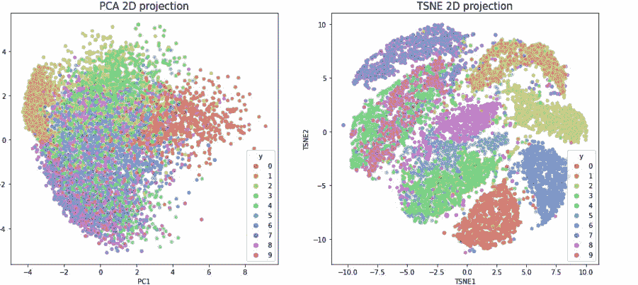

*Figure 12.1 - PCA vs. t-SNE 2D manifolds for MNIST*

PCA 投影通常在数字类别之间表现出大量重叠，因为线性投影无法有效分离复杂流形。然而，t-SNE 嵌入揭示了对应于数字 0–9 的不同簇。视觉外观相似的数字，如 4 和 9 或 3 和 5，可能更接近，而视觉上不同的类别则占据单独区域。

该实验说明了现代计算机视觉中的一个重要原则：属于同一语义类别的图像通常位于嵌入在更高维空间中的低维流形上。

### 可视化 VGG16 的深度特征

前一个示例直接将 t-SNE 应用于原始图像像素。现代深度学习系统很少在像素空间中运行。相反，图像被转换为由卷积神经网络学习的可区分特征嵌入。为了演示这一概念，我们使用预训练的 VGG16 网络并可视化从 Animal-10 数据集提取的特征。

**使用 VGG16 进行特征提取：** 预训练的 VGG16 网络在其输出附近包含多个全连接层。倒数第二层，记为 FC2，产生 4096 维特征向量：

$$f = f_{VGG16}(x) \in \mathbb{R}^{4096}$$

它捕获语义图像内容。不是使用最终的分类输出，而是提取这些特征向量并用作图像描述符。特征提取器创建如下：

```python
model = VGG16(weights='imagenet')
feat_extractor = Model(inputs=model.input,
    outputs=model.get_layer("fc2").output)
```

每张图像被调整大小并通过网络转发。

```python
feat = feat_extractor.predict(x).ravel()
features.append(feat)
```


产生每个图像一个 4096 维的表示。

**将 t-SNE 应用于 CNN 特征：** 获取深度特征后，应用 t-SNE。

```
tsne = TSNE(n_components=2)
embedding = tsne.fit_transform(features)
```

所得坐标使用颜色编码的动物类别进行可视化。与原始像素不同，VGG16 特征编码了从数百万张图像中学习到的高级语义信息。因此，|f_i − f_j| 成为视觉相似度的有意义度量。如前所述，狗的图像往往占据特征空间中相近的区域，而大象和蝴蝶则相距更远。所得的 t-SNE 图通常会显示出与动物类别相对应的良好分离的簇，尽管网络从未在 Animal-10 数据集上进行过显式训练。这一现象展示了深度卷积表示的 remarkable 可迁移性。

**缩略图可视化：** 更具信息量的可视化方法是在 t-SNE 嵌入上叠加实际图像缩略图，使用 AnnotationBbox()。用户不再只是观察彩色点，而是可以直接检查哪些图像占据相邻位置。此类可视化为数据集探索、异常检测、特征调试、迁移学习分析和嵌入质量评估提供了强大的工具。

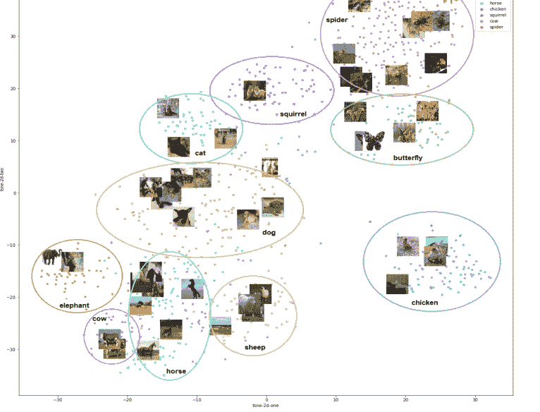

图 12.2 – Animal-10 数据集样本的 t-SNE 2D 流形可视化

虽然 t-SNE 可视化特征嵌入，但 **可解释 AI** 技术例如 *激活图* 可视化揭示了 CNN 层学习了什么，这促使接下来开发的 CNN Brain Viewer Dashboard。

## CNN 脑查看器仪表板

深度学习系统的一个常见批评是其似乎缺乏可解释性。尽管卷积神经网络实现了 remarkable 的分类准确率，但理解中间层捕获了什么信息仍然具有挑战性。一个有用的策略是可视化网络各处生成的激活图。

**从边缘到语义：** CNN 学习分层表示：

| 层深度 | 通常学习到的特征 |
|---|---|
| 早期层 | edges, corners |
| 中间层 | textures, patterns |
| 深层 | object parts |
| 最终层 | semantic concepts |

*表 12.1: CNN 的分层表示*

这种层次结构类似于人类视觉皮层的处理方式，其中更抽象的表示在更深的区域中出现。

**ResNet18 特征可视化：** 仪表板使用预训练的 ResNet18 模型。向前钩子附加到选定的层。

```
def hook_fn(name):
    def hook(module, input, output):
        activations[name] = output.detach()
    return hook

model = models.resnet18(weights=models.ResNet18_Weights.DEFAULT).to(DEVICE)
model.eval()
activations = {} # hooks storage
model.conv1.register_forward_hook(...) # register layers
model.layer1.register_forward_hook(...)
model.layer2.register_forward_hook(...)
model.layer3.register_forward_hook(...)
model.layer4.register_forward_hook(...)
```

向前钩子提供了一种非侵入式的方法，可以在不改变其架构或重新训练模型的情况下从预训练网络捕获中间激活，从而使特征可视化变得简单可靠。这些钩子在推理期间捕获中间特征张量。

对于特征张量 $A \in \mathbb{R}^{C\times H\times W}$，通过在通道上平均计算简单的激活图：

$$M(x,y)=\frac{1}{C}\sum_{c=1}^{C}A_c(x,y),$$

得到网络注意力的粗略表示。

**热力图叠加：** 激活图被归一化：

$$M' = \frac{M-\min(M)}{\max(M)-\min(M)}$$

并叠加到原始图像上。

```
overlay_img = 0.5 * image + 0.5 * heatmap
```

所得可视化突出显示强烈激活特定 CNN 层的图像区域。

### 使用 Gradio 进行交互式探索

仪表板提供了一个交互式界面。

```
demo = gr.Interface(  # GRADIO UI
    fn=cnn_brain_view,
    inputs=[gr.Image(type="pil", label="Upload Image"),
            gr.Slider(0, 4, step=1, value=0,
                      label="CNN Layer (0=Early → 4=Deep)")],
    outputs=[gr.Image(label="Input"),
             gr.Image(label="Activation Heatmap"),
             gr.Image(label="Overlay (Model Attention)")],
    title="CNN Brain Viewer (ResNet18)",
    description="Visualize how CNNs transform images from edges → textures →
semantic object parts")
demo.launch()
```

允许用户选择不同的网络深度并观察表示如何演变。CNN 脑查看器仪表板如下所示：

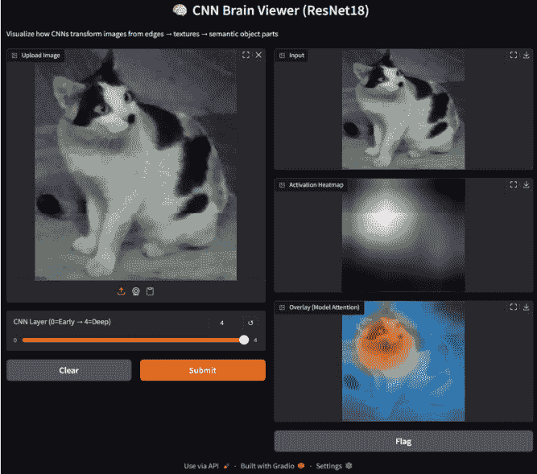

图 12.3 – CNN 脑查看器 Gradio 应用（使用 ResNet18）

一个典型的观察是：Conv1 专注于边缘和边界，Layer1 捕获局部纹理，Layer2 捕获重复结构，Layer3 捕获对象组件，Layer4 专注于语义上有意义的区域。

本节展示了理解图像表示的三种互补方法：

- PCA 揭示方差的主要方向
- t-SNE 在高维空间中揭示非线性簇结构
- CNN 激活可视化揭示深度神经网络内部的分层特征提取

 together，这些技术提供了关于现代图像分类系统如何将原始像素转换为语义上有意义的特征嵌入的宝贵直觉，为本章其余部分讨论的迁移学习、视觉 Transformer、自监督学习、图像检索和目标检测技术奠定了基础。

## 图像分类

因此，在 ImageNet 上训练的网络通常只需少量修改即可用于完全不同的分类问题。

**VGG16 架构：** VGG16 由 Simonyan 和 Zisserman 于 2015 年提出，由 13 个卷积层后接 3 个全连接层组成。该网络接受 RGB 图像 **x** ∈ ℝ²²⁴ײ²⁴׳ 并产生 1000 个 ImageNet 类别的后验概率：ŷ = *f*(**x**; θ)，其中 θ 表示学习到的网络参数。原始 VGG16 架构包含约 138 × 10⁶ 个可训练参数，使其成为最早能够实现 ImageNet 最先进性能的深度卷积网络之一。

**实验数据集：** *Cats vs Dogs* 数据集包含两个类别：*Cats* 和 *Dogs*。数据集结构为

```
dataset/
├── training_set/
│   ├── cats/
│   └── dogs/
└── test_set/
    ├── cats/
    └── dogs/
```

实验使用 8,000 张训练图像和 2,000 张测试图像。每张图像均调整为 224 × 224 以匹配 VGG16 输入要求。

**数据加载和预处理：** ImageDataGenerator 创建高效的输入管道，可自动从磁盘加载图像并应用 VGG16 特定预处理（均值减法和通道归一化）。`flow_from_directory()` 函数然后从训练和测试文件夹读取图像，将其调整为 (224, 224)，根据子目录名称（cats 和 dogs）分配二进制标签，并为模型训练和评估生成小批量。

```
train_datagen = ImageDataGenerator(preprocessing_function=preprocess_input)
train_data = train_datagen.flow_from_directory('dataset/training_set',
            target_size=(IMAGE_SIZE, IMAGE_SIZE), batch_size=BATCH_SIZE,
            class_mode='binary', shuffle=True)
```

### 方法 1：使用预训练的 VGG16 网络

最简单的策略是按 ImageNet 训练的方式使用 VGG16。

```
pretrained_vgg16_model = VGG16(weights='imagenet', include_top=True)
```

由于 ImageNet 不包含单一的“dog”或“cat”类别，而是包含许多品种，因此预测的 ImageNet 标签必须合并为两个超类。例如，

```
"Persian cat" → cat
"Siamese cat" → cat
```


```text
"Golden retriever" → dog
"Beagle" → dog
```

因此，模型预测可以写作：

$\hat{y}=g(f_{\mathrm{ImageNet}}(x)),$

其中$g(\cdot)$表示类别合并操作。主要优点是无需额外训练，展示了ImageNet特征的可迁移性，并且部署非常简单：

```python
pretrained_vgg16_model = VGG16(weights='imagenet', include_top=True)
```

主要局限性在于：网络是针对1000个ImageNet类别而非猫狗分类优化的；当预测的品种不在映射中时会产生错误；分类边界也未针对目标数据集进行调整。

## 方法2：使用VGG16进行迁移学习

更有效的策略是复用卷积特征提取器，并训练一个新的分类头。原始VGG16分类器被移除。

```python
base_model = VGG16(weights='imagenet', include_top=False,
    input_shape=(224,224,3))
```

仅保留卷积主干网络。

**冻结特征提取器：** 预训练参数被冻结。

```python
for layer in base_model.layers:
    layer.trainable = False
```

从数学角度看，主干网络变为固定映射$\mathbf{z}=f_{\mathrm{VGG16}}(\mathbf{x})$，其中$\mathbf{z}\in\mathbb{R}^{7\times7\times512}$表示高层特征张量。训练期间仅优化新添加的分类层。

**设计新的分类头：** 输出特征张量通过全局平均池化转换为紧凑的特征向量：

$z_k=\frac{1}{HW}\sum_{i=1}^{H}\sum_{j=1}^{W}F_k(i,j),$

其中$F_k$表示第$k$个特征图。该操作大幅减少参数量并缓解过拟合。分类器头为：

```python
base_model = VGG16(weights='imagenet', include_top=False,
    input_shape=(224,224,3))
x = base_model.output
x = GlobalAveragePooling2D()(x)
x = Dense(256, activation='relu')(x)
x = Dropout(0.3)(x)
output = Dense(1, activation='sigmoid')(x)
```

最终预测为：$\hat{y}=\sigma(\mathbf{w}^{T}\mathbf{z}+b)$，其中$\sigma(t)=\frac{1}{1+e^{-t}}$是sigmoid激活函数。

### 二元交叉熵损失

由于任务仅包含两个类别，网络使用二元交叉熵进行训练：

$\mathcal{L} = -y \log(\hat{y}) - (1 - y)\log(1 - \hat{y}),$

其中$y \in \{0,1\}$为真实标签。

优化目标为：

$\theta^* = \arg\min_{\theta} \sum_{i=1}^{N} \mathcal{L}_i$

使用Adam优化器求解：

```python
transfer_learning_model.compile(optimizer=Adam(learning_rate=1e-4), # compile
loss='binary_crossentropy', metrics=['accuracy'])
```

### 模型训练

网络训练五个轮次（epochs）。

```python
transfer_learning_model.fit(train_data, validation_data=test_data, epochs=5)
# Epoch 5/5
# [1m250/250[0m [32m------------------------------[0m[37m[0m [1m68s[0m 271ms/step -
# accuracy: 0.9808 - loss: 0.0537 - val_accuracy: 0.9835 - val_loss: 0.0585
```

由于主干网络已经包含从ImageNet学习到的高判别性视觉表示，训练快速收敛。下图展示了观察到的学习曲线。在整个训练过程中，验证损失稳步下降，表明预训练特征成功适应了新任务。

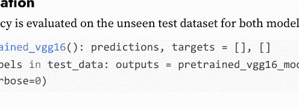

图12.4 – 迁移学习训练与损失

## 性能评估

在两个模型上，使用未见过的测试数据集评估分类准确率：

```python
def evaluate_pretrained_vgg16():
    predictions, targets = [], []
    for images, labels in test_data:
        outputs = pretrained_vgg16_model.predict(images, verbose=0)
        decoded = decode_predictions(outputs, top=1)[0][0][1]
        predictions.append(map_imagenet_class(decoded))
        targets.append(idx_to_class[int(labels[0])])
    print("Pretrained VGG16 Accuracy:", accuracy_score(targets, predictions))
    return acc

pretrained_acc, _, _ = evaluate_pretrained_vgg16() # evaluate pretrained model
transfer_acc, _, _ = evaluate_transfer_vgg16() # evaluate TL model (refer GitHub)
```

**预训练的VGG16：** 该ImageNet模型取得了96.22%的测试准确率，混淆矩阵如下：

[668  47]
[  1  554]

测试数据集上的分类报告如下：

| 指标 | 猫 | 狗 |
|---|---|---|
| **精确率** | **1.00** | **0.92** |
| **召回率** | **0.93** | **1.00** |
| **F1分数** | **0.97** | **0.96** |

*表12.3：使用预训练模型在测试数据集上的分类报告*

考虑到该模型从未专门针对猫狗分类进行训练，这一结果出人意料地强大。

**迁移学习VGG16：** 在替换分类头并重新训练后，测试准确率提升至98.35%，混淆矩阵为[990  10; 23  977]。这一改进证明了将预训练特征适应到目标领域的有效性。

**分类指标：** 迁移学习模型取得：

| 指标 | 猫 | 狗 |
|---|---|---|
| 精确率 | 0.98 | 0.99 |
| 召回率 | 0.99 | 0.98 |
| F1分数 | 0.98 | 0.98 |

*表12.4：使用微调模型（带迁移学习）在测试数据集上的分类报告*

均衡的精确率和召回率表明模型在两个类别上都表现良好。预训练模型学习了一个为ImageNet优化的决策函数$f_{\mathrm{ImageNet}}: \mathcal{X} \to \mathbb{R}^{1000}$。迁移学习在保留已学到的视觉表示的同时，修改最终分类器：$f_{\text{cats-dogs}}: \mathcal{X} \to \mathbb{R}^2$。卷积滤波器继续检测耳朵、毛发纹理、眼睛和身体形状，但最终决策边界变得专门用于区分猫和狗。

**预测结果可视化：** 下图展示了测试数据集中预训练模型失败、但微调（FT，带迁移学习）预测正确分类的一些图像。迁移学习后的VGG16能产生更具任务针对性和鲁棒性的猫狗预测，尤其是在具有异常姿态、遮挡或外观变化的挑战性图像上。

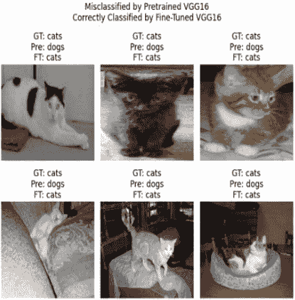

*图12.5 – 微调VGG16预测成功而预训练模型失败的测试图像*

下图展示了数据集之外的猫和狗图像，预训练模型和微调VGG16模型均正确分类。

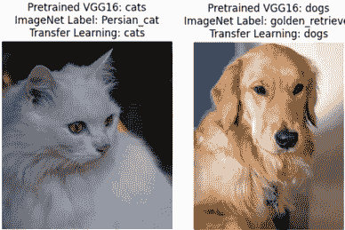

*图12.6 – 使用预训练模型与迁移学习模型预测数据集外图像的标签*

## 实践注意事项

**微调：** 在本实验中，所有卷积层均被冻结。一种常见的改进是部分微调：

```python
for layer in base_model.layers[-4:]:
    layer.trainable = True
```

允许最深层适应目标领域。

**数据增强：** 通常可以通过随机翻转、旋转、缩放和亮度扰动进一步提高性能，这些操作增加了训练多样性并减少了过拟合。

**现代替代方案：** 尽管VGG16在教学上仍然重要，但较新的架构通常以更少的参数提供更高的准确率：ResNet、EfficientNet、ConvNeXt、视觉Transformer（ViT）和Swin Transformer。本章稍后将探讨其中的许多模型。

这个例子展示了现代计算机视觉的核心思想之一：从大规模数据集中学习到的强大图像表示可以在许多下游任务中复用。预训练的VGG16网络尽管从未针对该目的训练，却已经在猫狗分类上取得了超过96%的准确率。通过将原始ImageNet分类器替换为轻量级任务特定头，并仅重新训练少量参数，迁移学习将准确率提升到98%以上。这种显著的性能提升，加上更短的训练时间和更少的数据需求，解释了为什么迁移学习已成为实际图像分类系统的默认策略。

## 使用VGG16进行迁移学习（PyTorch）

同样的迁移学习工作流也可以在PyTorch中实现，使用来自`torchvision.models`的预训练VGG16网络。卷积主干网络被冻结，最终分类器替换为二分类头，并且仅在新添加的层上使用Cats-vs-Dogs数据集进行训练。PyTorch实现用**ImageFolder**和**DataLoader**取代了Keras的**ImageDataGenerator**，使用`torchvision.models.VGG16`代替`tf.keras.applications.VGG16`，采用**BCEWithLogitsLoss**和**torch.optim.Adam**进行训练，并使用原生PyTorch API执行推理和模型保存。其性能与TensorFlow/Keras版本相当，将预训练模型的准确率从约**97.4%**提升到迁移学习后的**98.5%**。完整实现可在配套的GitHub仓库中获取，下图展示了模型对测试图像的分类结果。

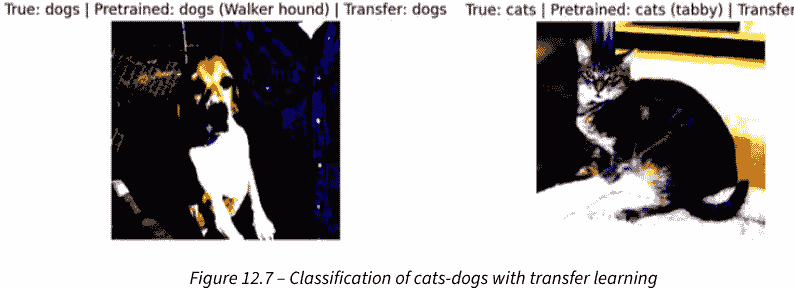

虽然*迁移学习*复用了从大规模数据集中学到的知识，*注意力机制*通过使网络能够选择性地关注信息量最大的图像区域来进一步提升分类性能，我们将在下一节探讨这一点。


## 使用注意力网络的图像分类

传统的 CNN 对每个特征图和图像区域都同等重要地处理。然而，人类自然会关注场景中最具信息量的部分——例如猫的脸而不是背景的草地。注意力机制试图模仿这种行为，通过自动学习**要强调哪些特征以及在哪里查看**，从而提高分类准确性和可解释性。

### 带通道注意力和空间注意力的 CNN

考虑观察一张鸟的图像。某些特征图可能对羽毛、喙或翅膀做出强烈响应，而其他特征图可能包含很少有用的信息。通道注意力学习哪些特征图很重要，而空间注意力则识别与分类决策最相关的图像区域。

给定特征张量 $F \in \mathbb{R}^{H\times W\times C}$，通道注意力计算 $F' = M_c(F) \odot F$，而空间注意力进一步将特征细化为 $F'' = M_s(F') \odot F'$。

**通道注意力：** 直观上，通道注意力就像特征图的音量控制：有用的通道被放大，而信息较少的通道被衰减，如下一段代码所示。直观上，GlobalAveragePooling2D 询问“哪些特征在整个图像中持续存在？”，而 GlobalMaxPooling2D 询问“哪些特征在图像中的任何位置出现得最强？”，两者共同为计算通道重要性提供了互补的线索。

```
```python
class ChannelAttention(tf.keras.layers.Layer): # for complete code refer to GitHub

    def call(self, inputs):
        avg_pool = tf.keras.layers.GlobalAveragePooling2D()(inputs)
        avg_pool = self.shared_layer_one(avg_pool)
        avg_pool = self.shared_layer_two(avg_pool)
        max_pool = tf.keras.layers.GlobalMaxPooling2D()(inputs)
        max_pool = tf.keras.layers.Reshape((1,1,filters))(max_pool)
        max_pool = self.shared_layer_one(max_pool)
        max_pool = self.shared_layer_two(max_pool)
        attention = tf.keras.layers.Add()([avg_pool,max_pool])
        attention = tf.keras.layers.Activation('sigmoid')(attention)
        return tf.keras.layers.Multiply()([inputs, attention])
```
```

**空间注意力：** 空间注意力像聚光灯一样突出重要对象区域并抑制背景杂乱。通道注意力决定*什么*特征图（例如毛皮、眼睛、翅膀）很重要，而空间注意力决定图像中*哪里*这些重要特征位于。

```
```python
class SpatialAttention(tf.keras.layers.Layer):
    def call(self, inputs):
        avg_pool = tf.keras.layers.Lambda(
```

```
```python
lambda x: tf.keras.backend.mean(
    x, axis=3, keepdims=True)(inputs)
max_pool = tf.keras.layers.Lambda(
    lambda x: tf.keras.backend.max(
        x, axis=3, keepdims=True))(inputs)
attention = tf.keras.layers.Concatenate(
    axis=3)([avg_pool, max_pool])
attention = self.conv2d(attention)
return tf.keras.layers.multiply(
    [inputs, attention])
```
```

> **注意**
> 
> 通道注意力通常首先应用以强调最具信息量的特征图，提供更强且噪声更少的表示，以便空间注意力随后能更有效地定位重要区域。

**向 CNN 添加注意力：** *注意力*模块在 *卷积* 和 *批归一化* 块之后插入。

```
```python
import tensorflow as tf
print(tf.__version__)
# 2.18.0
simple_cnn_with_attention = tf.keras.model.Sequential([
    tf.keras.layers.Conv2D(32, 3, input_shape=ds_info.features['image'].shape,
                           activation='elu', padding='same'),
    tf.keras.layers.BatchNormalization(),
    tf.keras.layers.Conv2D(32, 3, padding='same', activation='elu'),
    tf.keras.layers.BatchNormalization(),
    ChannelAttention(32,8),
    SpatialAttention(7),
    ...                         # for complete code refer GitHub
])
```
```

> **注意**
> 
> 批归一化 (**BatchNorm**) 层将中间激活归一化为在 mini-batch 内近似零均值和单位方差，稳定并加速训练，同时提高收敛性。

函数 `tfds.load()` 自动下载（如需）、准备并加载 CIFAR-100 数据集作为 TensorFlow 数据管道，同时返回数据集元数据，如类别名称、图像形状和数据集大小。

```
import tensorflow_datasets as tfds
from tf_explain.core.grad_cam import GradCAM
gpus = tf.config.experimental.list_physical_devices('GPU')
(ds_train, ds_test), ds_info = tfds.load('cifar100', split=['train', 'test'],
                                      shuffle_files=True, as_supervised=True, with_
info=True)
```

网络在 CIFAR-100 上训练，并与一个相同的 *基线* CNN 模型 **不带注意力** 进行比较。下图显示了改进的学习行为。

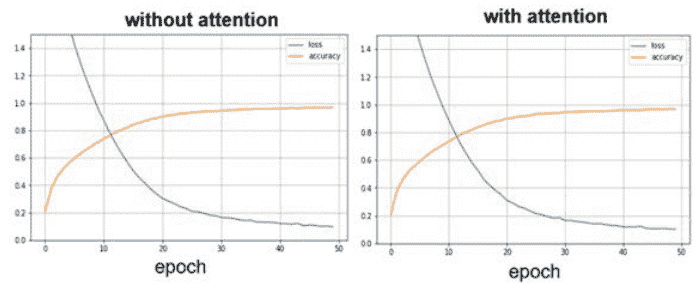

*图 12.8 – 带和不带注意力的 CNN 的训练曲线*

模型首先预测图像类别，然后 **Grad-CAM** 从预测类别向最后的卷积层反向传播梯度，以生成类激活热图，显示哪些图像区域对决策贡献最大。比较 *基线* 和 *注意力增强* CNN 的热图提供了 **可解释 AI (XAI)** 可视化，有助于解释 *为什么* 会做出预测，以及模型是关注目标对象而不是无关背景区域，如下一段代码所示。

```
y_pred = model.predict(img[None])  # Prediction
pred_class = np.argmax(y_pred)
explainer = GradCAM()  # Grad-CAM explanation
heatmap = explainer.explain([img], None), model, class_index=pred_class,
                              image_weight=0.8)
plt.imshow(heatmap)  # Visualization
```

下图表明，注意力使 *Grad-CAM* 激活在目标对象周围更加集中。

## 使用带和不带注意力层的 ConvNets 进行图像分类的 GradCAM 可视化

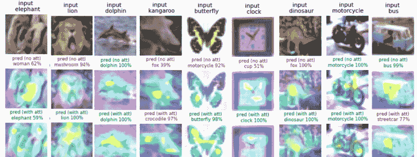

图 12.9 – 使用 CNN（带和不带注意力层）进行图像分类的 GradCAM 可视化

# 注意

tf.config.experimental 命名空间包含在 TensorFlow 急切执行转换期间引入的低级运行时控制，提供高级硬件和内存管理功能，这些功能最初标记为实验性，后来成为稳定 API 的一部分。

## 使用视觉 Transformer (ViT) 进行图像分类

CNN 使用局部感受野分析图像。视觉 Transformer 反而将图像视为一系列小块，类似于句子中的单词。自注意力允许每个块直接与其他每个块交互，从而使模型能够捕捉长程关系。对于 N 个图像块，

Attention(Q, K, V) = softmax( (Q K^T) / sqrt(d) ) V

在这些示例中，我们将使用 transformers 库（由 Hugging Face 开发），该库提供了轻松访问用于视觉、语言和多模态任务的最先进预训练 Transformer 模型。它让我们只需几行代码即可下载、预处理并使用预训练的 Transformer-based 视觉模型进行推理，而无需从头实现架构。预训练的 ViT 模型可以加载为：

```
from transformers import ViTImageProcessor, ViTForImageClassification
processor = ViTImageProcessor.from_pretrained("google/vit-base-patch16-224")
model = ViTForImageClassification.from_pretrained("google/vit-base-patch16-224", output_attentions=True)
```

使用预训练的 ViT 模型进行推理模式（`model.eval()`），输入图像被转换为块并处理，以获得类别预测（分类分数：logits）和自注意力图（attentions），随后可以可视化以揭示对模型决策影响最大的图像区域。

```
```python
model.eval()
inputs = processor(images=image, return_tensors="pt")  # Forward pass
with torch.no_grad():
    outputs = model(**inputs, output_attentions=True)
logits = outputs.logits
attentions = outputs.attentions
```
```

Attention rollout（参考 GitHub 中的函数 `rollout_attention()`）结合多个 Transformer 层的注意力图，以可视化哪些图像块对最终预测贡献最强。下图显示了叠加在输入图像上的典型注意力热图。

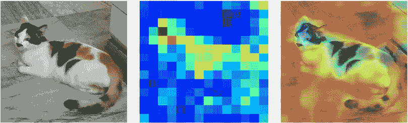

*图 12.10 – 可解释 AI – ViT 图像分类的注意力热图*

## 使用 ViT 进行花卉分类

微调预训练的 ViT（在牛津 102 花卉数据集上微调）可实现高度准确的花卉物种识别。与仅返回标签的传统分类器不同，Transformer 注意力图揭示了哪些花瓣、纹理和花卉结构影响了预测。

```
```python
model = AutoModelForImageClassification.from_pretrained(
    "MaulikkMadhavi/vit-base-flowers102", output_attentions=True)
```
```

上传的花卉图像使用预训练的 ViT 进行分类，显示前 5 个预测结果，以及注意力 rollout 热图，该热图突出显示对预测最负责任的图像区域，如以下代码片段所示：

```
```python
with torch.no_grad():
    outputs = model(**inputs, output_attentions=True)  # ViT inference
top5 = torch.topk(torch.nn.functional.softmax(outputs.logits, dim=-1)[0], k=5)
mask = rollout_attention(outputs.attentions)  # Attention Heatmap
```
```


这些结果通过一个交互式 Gradio Web 应用呈现，用于实时模型探索和可视化，如下图所示。

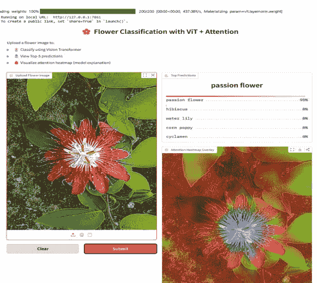

图 12.11 – 使用 ViT + Attention 的花卉分类 Gradio 应用

## 使用 Swin Transformer 的图像分类

标准 Vision Transformer 的局限性在于，全局注意力对于大图像来说计算成本很高。Swin Transformer 通过将注意力限制在局部窗口中，同时逐步在相邻窗口之间交换信息来解决这个问题。可以将 Swin Transformer 视为将 CNN 的局部性与 Transformer 注意力的灵活性相结合。与全局注意力复杂度不同，Swin Transformer 通过分层窗口式注意力实现了近似线性复杂度。

以下代码片段使用预训练的 Swin Transformer 首先对一只鹦鹉图像进行分类，然后预测最可能的物体类别。为了解释预测结果，将预测类别分数的梯度反向传播到输入图像，生成突出对决策影响最大的像素的显著性图；然后将生成的热力图叠加到原始图像上进行可视化，如下代码片段所示：

```
model = SwinForImageClassification.from_pretrained(
    "microsoft/swin-base-patch4-window7-224")
outputs = model(**inputs)    # Forward pass
```

```
pred_class = outputs.logits.argmax()  
score = outputs.logits[0, pred_class]  # Saliency map  
score.backward()  
saliency = (inputs["pixel_values"].grad.abs().mean(dim=1)[0])  
overlay = cv2.addWeighted(image, 0.6, heatmap, 0.4, 0)  # Overlay heatmap on image
```

这种方法使用 **基于梯度的显著性** 来揭示哪些图像区域最强烈地影响了 Swin Transformer 的分类决策，使其成为 **可解释 AI (XAI)** 的一个例子，而不同于 ViT attention-rollout 可视化。下图显示了生成的显著性图和注意力叠加。

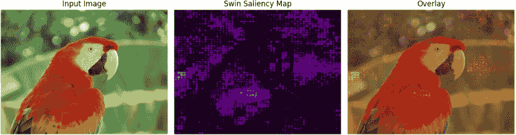

*图 12.12 – 使用 Swin Transformer 的显著性图*

注意力机制使深度网络能够像人类视觉感知一样选择性地分配计算资源。CNN 注意力模块改善了特征选择，而 Vision Transformers 和 Swin Transformers 采用自注意力来建模长距离图像关系并生成高度可解释的分类决策。

## 少样本学习

传统的监督图像分类每个类别需要数百或数千个标记示例。相比之下，**少样本学习 (FSL)** 旨在仅从少量标记示例中学习新类别。形式上，在 *N*-way *K*-shot 任务中，模型必须使用每个类别仅 *K* 个标记示例对 *N* 个类别进行分类。FSL 在注释数据稀缺的领域尤其重要，例如医学成像、遥感和工业检测。

直观上，少样本学习类似于人类学习：在看到新鸟种的几个例子后，人通常可以识别未来图像中的相似鸟类。现代 FSL 系统通过学习可迁移的视觉表示而不是记忆类别标签来实现这一能力。

## 使用 CLIP 的零样本学习

CLIP 模型使用对比学习在数亿对图像-文本对上联合学习图像和文本表示。在推理期间，可以通过将图像与描述候选类别的文本提示进行比较来执行分类，*无需任何任务特定训练*（这就是 CLIP 是零样本模型的原因）。

下一个代码使用预训练的 CLIP 模型通过将输入图像与多个文本描述进行比较并选择文本嵌入与图像嵌入最相似的类别来执行零样本图像分类，同时可视化影响预测的区域。CLIPModel 加载预训练的 CLIP 神经网络，而 CLIPProcessor 自动对文本提示进行分词并将输入图像预处理为模型所需格式。

```
```python
# Load pretrained CLIP
from transformers import CLIPProcessor, CLIPModel
model = CLIPModel.from_pretrained("openai/clip-vit-base-patch32")
classes = ["a photo of a dog", "a photo of a horse", "a photo of a parrot"]
outputs = model(**inputs)
logits = outputs.logits_per_image # Image-text similarities
probs = logits.softmax(dim=1)
```
```

CLIP 不是从固定的分类器头进行预测，而是计算图像和文本嵌入之间的相似度。文本描述与图像嵌入最相似的类别被选为预测结果。为了可视化模型的推理，可以将 Grad-CAM 应用于视觉编码器：

```
```python
logits[0, class_idx].backward() # Grad-CAM
cam = (acts * weights.unsqueeze(1)).sum(dim=2)
```
```

生成的热力图突出显示对所选文本提示贡献最大的图像区域，为零样本预测提供了可解释的解释。下图显示了生成的图像-文本相似度分数和分类概率。

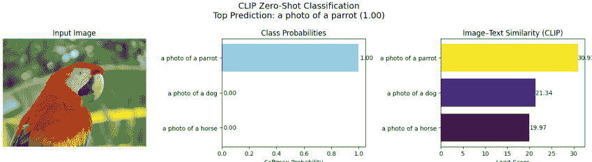

*图 12.13 – 使用 CLIP 的零样本图像分类*

## 使用 DINOv2 的少样本学习

DINOv2 是一个无类别标签训练的自监督 Vision Transformer。与学习显式类别不同，DINOv2 学习强大的视觉嵌入，可用于下游任务。可以使用类别原型构建一个简单的少样本分类器：在此示例中，分类头被移除，网络纯粹用作特征提取器，将每个图像映射到高维嵌入向量。

```
```python
model = timm.create_model('vit_base_patch14_dinov2.lvd142m', pretrained=True)
model.reset_classifier(0)  # use embeddings
```
```

```
The embedding function computes a feature vector f(x) for each image.
with torch.no_grad():
    emb = model(x)
```

**基于原型的少样本分类：** 提供一个仅包含每个类别几个示例的小支持集。

```
support_set = {"dog": ["dog1.png", "dog2.png"],
               "cat": ["cat1.png", "cat2.png"]}
```

对于每个类别，嵌入被平均以形成 **原型**（类别代表）：

$$p_c = \frac{1}{N_c}\sum_{i=1}^{N_c} f(x_i)$$

```
embs = [get_embedding(p) for p in paths]
prototypes[cls] = torch.stack(embs).mean(0)  # prototype construction
```

直观上，原型充当嵌入空间中类别的“中心”。

**基于相似度的预测：** 查询图像被嵌入并使用 **余弦相似度** 与所有类别原型进行比较：

$$\operatorname{sim}(q,p_c)=\frac{q^T p_c}{\lVert q\rVert\lVert p_c\rVert}$$

按以下代码实现。

```
query_emb = get_embedding("lab.png")
sim = F.cosine_similarity(query_emb, proto, dim=0)
```

预测类别只是相似度最高的原型：

$$\hat{c}=\arg\max_c \operatorname{sim}(q,p_c)$$

与传统的监督嵌入不同，DINOv2 通过在未标记图像的多个增强视图上进行 *自监督* **教师-学生** 训练学习通用视觉表示，其中学生学习匹配教师的 **基于原型的语义表示**，鼓励具有相似底层视觉内容的图像占据特征空间的相近区域，同时对外观变化保持不变。

因此，拉布拉多图像产生的嵌入比 **猫原型** 更接近 **狗原型**，即使只有几个支持示例可用。从本质上讲，少样本学习成为嵌入空间中的 **最近原型搜索**，利用大规模自监督预训练期间学习到的强大视觉知识。

仅使用每个类别两个支持图像来构建类别原型。查询图像使用 DINOv2 进行嵌入，并分配给余弦相似度最高的原型的类别。下图显示了代表性的支持图像以及检索到的预测。


# DINOv2 少样本分类
预测：狗 (0.18)

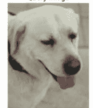

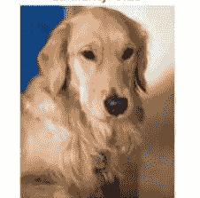

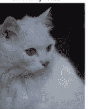

图 12.14 – 使用 DINOv2 的少样本图像分类

与 CLIP 不同，DINOv2 不需要文本提示，完全依赖于学习到的嵌入空间中的视觉相似性。

# 使用深度人脸嵌入的少样本人脸识别（孪生网络）

人脸识别可以表述为一个度量学习问题，其中图像被映射到嵌入空间，使得同一个人的人脸彼此靠近，而不同身份的人脸则相距较远。与传统分类不同，新的身份只需通过存储其嵌入即可添加，无需重新训练模型，如此处示例所示（完整代码请参阅 GitHub）。

# 注释

人脸识别是孪生网络学习最成功的应用之一。经典的孪生网络（如 FaceNet）通过使用对比损失或三元组损失联合训练两个相同的编码器来学习保持相似性的嵌入空间。相比之下，此处的示例使用的是未以孪生方式训练的预训练 ResNet18 编码器；然而，识别仍然是通过使用相似性度量比较嵌入来执行的，遵循了基于孪生网络的人脸识别所依据的相同基本原理。

FaceEncoder 使用预训练的 ResNet18 主干（而不是经典的孪生训练网络）来提取面部特征并将其转换为归一化的 128 维嵌入，而 forward() 方法则为基于相似性的人脸识别生成这些嵌入。

```
# Siamese Encoder (ResNet backbone)
class FaceEncoder(nn.Module):
    def __init__(self, embedding_dim=128):
```
```
```python
super().__init__()
backbone = models.resnet18(weights=models.ResNet18_Weights.DEFAULT)
backbone.fc = nn.Identity()  # remove classification head
self.backbone = backbone
self.projector = nn.Sequential(
    nn.Linear(512, 256),
    nn.ReLU(inplace=True),
    nn.Linear(256, embedding_dim)
)

def forward(self, x):
    feat = self.backbone(x)          # [B, 512]
    emb = self.projector(feat)       # [B, D]
    emb = F.normalize(emb, dim=1)    # L2-normalize
    return emb

model = FaceEncoder(embedding_dim=128).to(device)  # Build model
model.eval()                                      # inference mode
```
```

**人脸嵌入提取：** 预训练的 *ResNet18* 主干（`models.resnet18`）通过使用 `nn.Identity()` 移除其最终分类层而转换为特征提取器。每张人脸由一个归一化的 128 维嵌入向量表示，该向量作为个人外观的紧凑数值签名。

**画廊构建：** 每个人物的多张图像被转换为嵌入并取平均值以形成原型表示：

$$p_c = \frac{1}{N_c}\sum_{i=1}^{N_c} e_i$$

其中 $e_i$ 表示人脸嵌入，$p_c$ 是身份 $c$ 的原型，其使用以下代码行实现：

```
```python
gallery[person] = torch.stack(embs).mean(0) # average embedding (prototype)
```
```

在函数 `build_gallery_embeddings()` 中，该函数按人创建嵌入。

**人脸匹配：** 查询人脸被嵌入并与所有画廊原型使用余弦相似度进行比较：

$$\operatorname{sim}(q,p) = \frac{q^T p}{\lVert q\rVert\cdot\lVert p\rVert}$$

实现如下：

```
```python
q_emb = model(q).squeeze(0) # q is the query face
# Compute similarities
```
```

```
results = []
for person, g_emb in gallery.items():
    sim = F.cosine_similarity(q_emb, g_emb, dim=0).item() # similarity with a face g
    results.append((person, sim))
```

选择相似度分数最高的人物身份；低于阈值的分数被标记为未知。

```
results = sorted(results, key=lambda x: x[1], reverse=True)
top_results = results[:top_k]
best_person, best_score = top_results[0]
if best_score < threshold: final_label = "Unknown"
```

这本质上是少样本人脸识别，因为每个身份只需要很少的画廊图像。

可视化：系统显示查询图像以及最相似的画廊人脸及其相似度分数，提供识别结果的直观解释，如下所示：

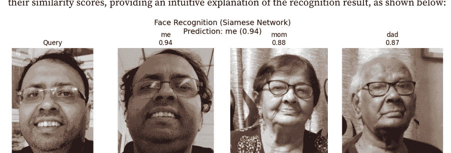

图 12.15 – 使用深度人脸嵌入的人脸识别

# 通过孪生微调提高识别效果

当前实现依赖于预训练 ResNet18 提取的通用 ImageNet 特征。识别性能通常可以通过使用对比损失、三元组损失或现代人脸识别目标（如 ArcFace）对编码器进行微调来提高。例如，对比损失为：

L = y D² + (1 − y) max(0, m − D)²

其中 D 表示嵌入距离，m 为边界。这种度量学习方法将匹配的人脸拉得更近，同时将不同身份推得更远，从而产生更具判别性的嵌入。

# 使用 FaceNet 进行人脸识别

在实践中，专门的人脸识别模型如 FaceNet 比通用图像分类器更受青睐。FaceNet 直接在人脸图像上使用三元组损失进行训练，并学习一个高度判别性的嵌入空间，其中欧几里得或余弦距离对应于面部相似性。

```
from facenet_pytorch import InceptionResnetV1
model = InceptionResnetV1(pretrained='vggface2').eval()  # Pretrained FaceNet
embedding = model(face_tensor)
```

函数 get_embedding() 对人脸图像进行预处理，将其通过预训练的人脸编码器在推理模式下（torch.no_grad()）传递，并返回表示该人脸的归一化嵌入向量。然后将画廊嵌入与查询嵌入使用余弦相似度进行比较，选择相似度分数最高的人物身份作为预测匹配。

```
def get_embedding(path):
    img = transform(Image.open(path).convert("RGB")).unsqueeze(0)
    with torch.no_grad():
        emb = model(img)
    return F.normalize(emb, dim=1)

gallery = {  # face images
    "Dad": get_embedding("images/dad.jpg"),
    "Me": get_embedding("images/me.jpg"),
    "Mom": get_embedding("images/mom.jpg")}
query = get_embedding("images/query.png")

scores = { name: F.cosine_similarity(query, emb).item()
           for name, emb in gallery.items()}
prediction = max(scores, key=scores.get)
```

与少样本 ResNet18 示例不同，FaceNet 已针对人脸识别进行了优化，因此通常在无需额外训练的情况下就能实现显著更高的准确率，同时产生更具判别性的相似度分数，匹配和不匹配人脸之间的分离更好，如下图所示。

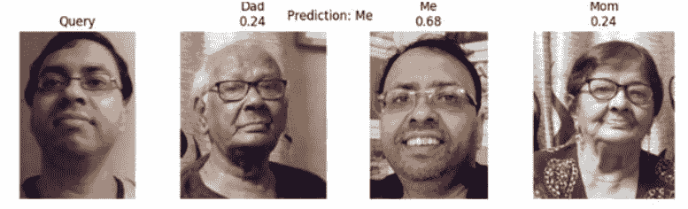

图 12.16 – 使用 FaceNet 的人脸识别

总之，识别流程将人脸转换为嵌入，使用余弦相似度进行比较，并分配最近原型的身份。使用孪生风格的度量学习进行微调或使用预训练的人脸识别模型如 FaceNet 可以进一步提高识别性能。

# 用于图像分类的贝叶斯神经网络

传统的神经网络为每个权重学习单一确定值。相比之下，贝叶斯神经网络（BNN）将每个权重建模为概率分布，使网络不仅能估计预测，还能估计其不确定性。这在医疗成像、自动驾驶和遥感等安全关键应用中尤为重要，在这些应用中，了解预测的 *置信度* 可能与预测本身一样重要。直观地说，贝叶斯网络不是问“最佳权重是什么？”，而是问“在给定数据的情况下，哪些权重范围是合理的？”

**贝叶斯神经网络：** 在确定性网络中，权重是固定的：$W = w$ 而在贝叶斯网络中，每个权重由分布表示：

$$W \sim \mathcal{N}(\mu, \sigma^2)$$

其中 $\mu$ 和 $\sigma$ 在训练期间学习。预测分布通过对所有可能权重进行边缘化获得：

$$p(y|x, D) = \int p(y|x, W),\,p(W|D),\,dW$$

其中 $D$ 表示训练数据。由于该积分对于深度网络是不可处理的，因此通常使用 **变分推断**、**蒙特卡洛采样** 和 **MC Dropout** 等近似方法。

**贝叶斯线性层：** 关键思想是用 *高斯分布权重* 替换 *确定性权重*。

```
```python
class BayesianLinear(nn.Module):
    def forward(self, x):
        weight_std = torch.exp(0.5 * self.weight_logvar)
        weight = self.weight_mu + weight_std * torch.randn_like(weight_std)
        return F.linear(x, weight, bias)
```
```

在每次 *前向* 传递中，都会从学习到的分布中抽取一个 *新权重* 样本。因此，对同一张图像的两次评估可能会产生略有不同的预测。网络不是致力于单一模型，而是有效地评估许多合理模型并组合它们的预测。

**变分学习和 KL 正则化：** 训练同时优化分类准确性和不确定性估计。损失结合了交叉熵和 KL 散度惩罚：

$$L = L_{CE} + \beta D_{KL}(q(W)\|p(W)),$$

其中 $L_{CE}$：分类损失，$q(W)$：学习到的后验，$p(W)$：先验分布，$D_{KL}$：复杂度惩罚。在实现中：

```
```python
ce = F.cross_entropy(out_bnn, y_batch)
kl = bnn.kl_loss() / len(train_dataset)
loss_bnn = ce + 0.01 * beta * kl
```
```


KL 项可防止权重分布变得过度复杂，并充当贝叶斯正则化器。

**蒙特卡洛预测：** 单次前向传播提供一个采样的模型。多次前向传播近似预测分布。

```
def forward_mc(model, x, samples=3):
    outputs = []
    for _ in range(samples):
        outputs.append(model(x))
    return torch.stack(outputs).mean(0)
```

从数学上讲，

$$p(y|x) \approx \frac{1}{N} \sum_{i=1}^{N} p(y|x,W_i)$$

其中 $W_i$ 是采样的权重实现。让多个略有不同的网络对预测进行投票通常会产生更可靠的估计。

**比较贝叶斯和确定性网络：** 实验训练了两者。

```
bnn = BayesianNN()
dnn = DeterministicNN()
```

在来自 sklearn.datasets 的手写数字数据集上：

```
data = load_digits()
```

使用两个全连接层。

贝叶斯网络通常训练更慢，并且可能实现略低的准确率，因为它学习的是整个权重分布而不是单一的最优解。示例输出：

```
Deterministic NN Accuracy: 0.9694
Bayesian NN Accuracy:      0.8833
```

这种准确率的降低通常会被改进的不确定性估计所抵消。

**不确定性估计：** 贝叶斯网络最重要的优势在于它量化预测置信度。

```
mean_probs, uncertainty = predict_mc(bnn, X_test[:5])
```

其中 mean_probs = 平均预测，uncertainty = 预测标准差。

```
pred = mean_probs[i].argmax().item()
unc = uncertainty[i].mean().item()
```

下图显示了少数测试图像的预测数字和不确定性值 σ。更高的不确定性表示采样网络之间存在分歧，因此对预测的置信度较低。如果不同的采样模型对一个数字意见不一致，网络会认识到自己不确定，而不是做出过度自信的预测。

贝叶斯神经网络（不确定性）

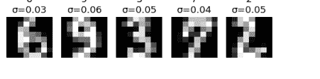

图 12.17 - 使用贝叶斯神经网络对图像进行分类对 MNIST 数字进行分类

尽管完整的贝叶斯神经网络通过学习权重上的分布来提供原则性的不确定性估计，但其计算成本促使人们采用蒙特卡洛 Dropout 等高效近似方法，我们接下来将探讨它。

## MC dropout：一种实用的贝叶斯近似

真正的贝叶斯神经网络可能计算成本高昂。一种优雅的近似方法是蒙特卡洛 Dropout，由 Yarin Gal 和同事提出。关键思想是在推理期间保持 dropout 激活：

```
class MCDropoutNN(nn.Module):

    def __init__(self):
        ...
        self.dropout = nn.Dropout(0.3)

    def forward(self, x):
        x = self.dropout(x)
        return self.fc2(x)
```

并执行多次随机前向传播：

```
model.train()    # keep dropout active
for _ in range(20):
    logits = model(x)
```

每次传播有效地采样了不同的网络。

**蒙特卡洛 Dropout 预测：** 函数 mc_dropout_predict() 使用 dropout 启用进行多次随机前向传播（完整代码请参阅 GitHub），然后返回平均类别概率（mean_probs）作为预测，并将变异性（uncertainty）作为模型置信度的度量。

```
mean_probs, uncertainty = mc_dropout_predict(mc_model, X_test)
```

预测均值为 $\bar{p} = \frac{1}{N} \sum_{i=1}^{N} p_i$，不确定性从样本方差估计：

$\sigma^2 = \frac{1}{N} \sum_{i=1}^{N} (p_i - \bar{p})^2$

这可以在不显式学习权重分布的情况下产生不确定性估计。

**结果：** 示例输出：

```
Deterministic NN Accuracy: 0.9722
MC Dropout Accuracy:       0.9750
```

下一个可视化显示每个测试图像的预测数字和不确定性值 $\sigma$，这次使用 MC dropout。

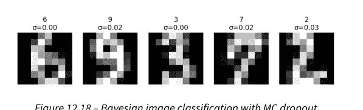

与 *完整的贝叶斯网络* 不同，*MC Dropout* 通常能达到与确定性模型相当的准确率，同时仍提供有用的不确定性估计，如下表所示。

| 方法 | 学习权重分布 | 不确定性估计 | 计算成本 |
|---|---|---|---|
| Deterministic NN | No | No | Low |
| Bayesian NN | Yes | Excellent | High |
| MC Dropout | Approximate | Good | Moderate |

*表 12.5: Deterministic vs. Bayesian Network for image classification*

*贝叶斯神经网络* 通过学习 *权重上的概率分布* 提供了对不确定性的最原则性处理，而 *MC Dropout* 则通过 *随机 dropout 采样* 近似 *贝叶斯推理*。尽管确定性网络通常能实现略高的分类准确率，但 *贝叶斯* 方法提供了宝贵的 *置信度估计*，可以揭示模糊、噪声或超出分布的输入。

总之，贝叶斯神经网络将图像分类从预测单一答案转变为预测一系列合理答案的分布，从而实现不确定性感知的决策制定。MC Dropout 提供了一种实用的近似方法，在仅对标准神经网络进行少量修改的情况下保留了许多贝叶斯优势。

## 使用半监督学习进行图像分类

在许多现实世界应用中，获取大量标记图像既昂贵又耗时，而未标记图像却十分丰富。**半监督学习（SSL）** 通过利用少量标记数据集和大量未标记数据集来解决这一挑战。其核心思想是未标记样本包含有关底层数据分布的有价值信息，可以提高分类性能。

直观地说，SSL 模仿人类学习：学生可能从少数带注释的示例中学习，然后根据相似性和一致性为许多额外示例推断标签。

**FixMatch – 从未标记图像中学习：** FixMatch 是一种 *半监督学习* 方法，通过反复使用当前网络从弱增强的未标记图像生成伪标签来迭代改进模型，但仅在预测高度自信时才使用。这些伪标签随后用于在同一图像的强增强版本上训练模型，强制在扰动下保持一致。直观地说，它是一个自我强化的循环，其中模型先从“可靠的猜测”中学习，然后在标准端到端训练过程中逐步完善其预测和对未标记数据的使用。

下一个 python 演示实现了 FixMatch 的简化版本，这是最具影响力的 SSL 算法之一（完整代码请参阅 GitHub）。模型首先在少量标记子集上训练，然后为 *未标记* 图像生成 **伪标签**。只有 10% 的训练样本被视为标记：

```
num_labeled = int(0.1 * len(X_train))
X_l = torch.tensor(X_train[:num_labeled])
y_l = torch.tensor(y_train[:num_labeled])
X_u = torch.tensor(X_train[num_labeled:])
```

这里 **标记集：** $(X_l, y_l)$ 和 **未标记集：** $X_u$。

**分类网络：** 使用一个简单的全连接神经网络：

```
class Net(nn.Module):
    def __init__(self):
        super().__init__()
        self.fc1 = nn.Linear(64,128)
        self.fc2 = nn.Linear(128,10)

    def forward(self,x):
        return self.fc2(F.relu(self.fc1(x)))
```

网络将 64 维数字向量映射到 10 个数字类别之一。

**监督学习基线：** 基线模型仅使用标记子集进行训练。

```
logits = model_sup(X_l)
loss = F.cross_entropy(logits, y_l)
```

这最小化标准 *分类损失* $L_{sup} = -\sum_i y_i \log p_i$，其中 $p_i$ 表示 **预测类别概率**。

**伪标记：** SSL 模型首先为未标记样本预测标签。它预测一个 *概率分布* 并将 *伪标签* 分配给最自信的类别：

$\hat{y} = \arg\max_k p(k|x_u)$

```
weak_logits = model_ssl(X_u)
probs = F.softmax(weak_logits, dim=1)
max_probs, pseudo_labels = probs.max(dim=1)
```

仅保留高置信度预测（$p_{max} \geq \tau$）。

```
mask = max_probs >= 0.7
```

直观地说，模型说：“我足够确信此图像属于类别 K，因此我将暂时将其视为标记示例。”

**一致性正则化：** 这些 *伪标签* 被视为同一图像的强增强版本的临时目标。*更强的增强* 是通过添加 *噪声* 创建的。*FixMatch* 假设 *小的扰动* 不应改变预测类别。

```
noise = torch.randn_like(X_u) * 0.05
strong_logits = model_ssl(X_u + noise)
loss_unsup = F.cross_entropy(strong_logits[mask], pseudo_labels[mask])
```

然后鼓励模型对两个版本产生相同的预测。**无监督一致性损失** 为：

$L_u = CE(f(x_u^{strong}), \hat{y})$

其中 $\hat{y}$ = 来自弱增强图像的 *伪标签*，$x_u^{strong}$ = 强增强图像，$CE(\cdot)$ = 交叉熵。直观地说，如果图像被分类为“7”，则在小扰动后预测仍应为“7”。

**组合目标：** 最终的 SSL 目标结合 *监督* 和 *无监督损失*：

```
loss = loss_sup + lambda_u * loss_unsup
```

在数学上，$L = L_{sup} + \lambda_u L_{unsup}$，其中 $\lambda_u$ 控制未标记数据的贡献。直观地说，模型充当自己的教师：对未标记样本的自信预测成为伪标签，并且网络被训练在扰动后仍产生相同的预测，从而使其能够从大量未标记数据中学习。

**性能评估：** 分类准确率在测试集上计算。

```
preds = model(X).argmax(dim=1)
acc = (preds == y).float().mean()
```

演示获得的典型结果为：


| 方法 | 精度 |
|---|---|
| 有监督（10% 标签） | 89.4% |
| 半监督（10% + 未标记） | 92.8% |

*表 12.6：有监督与半监督分类精度*

尽管使用完全相同的标记样本数量，SSL 通过利用未标记数据实现了更高的精度。

**可视化：** 代码生成了以下几幅可视化结果：

## 预测网格

```
preds_sup = model_sup(X_test_t[:10]).argmax(1)
preds_ssl = model_ssl(X_test_t[:10]).argmax(1)
```

第一行显示有监督模型的预测结果，而第二行显示 SSL 模型的预测结果。绿色标签表示正确分类，红色标签表示错误。

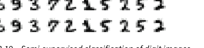

*图 12.19 – 数字图像的半监督分类*

## 精度比较

```
plt.bar(labels, accuracies)
```

下面的条形图比较了有监督学习和半监督学习的性能，清楚地说明了利用未标记数据的益处。

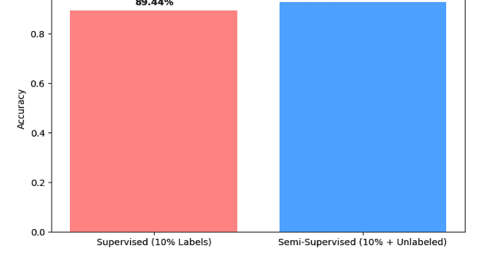

*图 12.20 – 使用数字图像的有监督与半监督分类精度*

传统的有监督学习仅从标记图像中学习：少量标签 → 分类器。半监督学习 additionally 从未标记图像的结构中学习：

少量标签 + 大量未标记图像 → 更好的分类器。

未标记数据充当一种指导，帮助网络发现更准确的决策边界。随着模型改进，其伪标签变得更可靠，使其能够逐步从更大比例的未标记数据集中学习。这种利用大量未标记数据的能力使得半监督学习对现代图像分类应用特别有吸引力。

## Masked Autoencoders（MAE）：通过重建缺失图像块进行自监督学习

Masked Autoencoders（MAE）是一种强大的自监督学习框架，可在无需图像标签的情况下学习视觉表征。模型不是预测类别标签，而是通过从图像的可见部分重建缺失的图像区域来学习。

核心思想非常简单：

- 将图像分割成块
- 随机遮蔽大部分块（通常为 75%）
- 仅将可见块输入 Vision Transformer（ViT）编码器
- 训练一个轻量级解码器来重建缺失的块

通过解决此重建任务，网络学习到丰富的语义表征，后续可迁移到图像分类、目标检测、分割和其他视觉任务。MAE 的学习方式类似于解决拼图游戏。即使大部分碎片缺失，模型也能从周围上下文推断出缺失内容。

> 注意
> 
> 自监督学习（SSL）通过从数据本身自动生成监督信号，而不是使用人工提供的标签，从未标记数据中学习有用的特征表征。Masked Autoencoders（MAE）是一种 SSL 方法，因为它们随机遮蔽大部分图像块，并训练 Vision Transformer 从可见块重建缺失块，使用原始图像作为自身的监督信号。

MAE 架构：Masked Autoencoder 由以下部分组成：

- Patch Embedding Layer
- Vision Transformer Encoder
- Masking Module
- Lightweight Decoder
- Reconstruction Loss

模型通过最小化原始图像块与重建图像块之间的重建误差进行预训练。重建目标为：

$$L = \frac{1}{N}\sum_{i=1}^{N}|x_i - \hat{x}_i|^2$$

其中 $x_i$ = 原始块，$\hat{x}_i$ = 重建块，$N$ = 被遮蔽块的数量。与有监督学习不同，不需要类别标签。

**加载预训练 MAE：** 以下代码从 Hugging Face 加载预训练的 MAE 模型：

```
processor = AutoImageProcessor.from_pretrained("facebook/vit-mae-base")
model = ViTMAEForPreTraining.from_pretrained("facebook/vit-mae-base")
```

该模型已使用 MAE 重建目标在数百万张图像上进行了预训练。

**数据集准备：** 为演示目的，将 CIFAR-10 图像调整为 ViT 输入尺寸。

```
dataset = CIFAR10(root="./data", train=False, download=True,
                 transform=transforms.Resize((224,224)))
img, label = dataset[0]
```

该图像用作重建和特征提取实验的输入。

**重建缺失块：** 预处理后，图像通过预训练的 MAE。

```
inputs = processor(images=img, return_tensors="pt")
with torch.no_grad():
    outputs = model(**inputs)
```

模型返回：

```
loss, reconstruction = outputs.loss, outputs.logits
```

其中 loss = 重建误差，logits = 重建图像块。重建损失表示模型恢复缺失信息的准确程度。

```
print(loss.item())
```

较低的重建损失意味着模型已学习到有意义的视觉结构和上下文。

**可视化 MAE 重建：** 重建的块被重新排列到原始图像布局中。

```
reconstruction = reconstruction.squeeze()
reconstruction = reconstruction.reshape(num_patches, num_patches, \
                                        patch_size, patch_size, 3)
```

 resulting 可视化比较了原始图像和重建图像。

```
ax[0].imshow(img_np); ax[1].imshow(reconstruction)
```

尽管预训练期间隐藏了图像的大部分区域，模型通常仍能相当好地恢复整体对象结构。

**随机块遮蔽：** MAE 在训练期间通常遮蔽约 75% 的图像块。以下可视化说明了遮蔽过程：

```
for y in range(0,224,16):
    for x in range(0,224,16):
        if np.random.rand() < 0.75:
            masked[y:y+16, x:x+16] = 0
```

遮蔽后的图像仅包含一小部分可见块。通过隐藏大部分图像，模型被迫学习高级语义概念而不是记忆像素。

**Vision Transformer 块表征：** MAE 继承了 Vision Transformer 使用的基于块的表征。对于 patch_size 为 16，224 × 224 的图像变为 14 × 14 = 196 个块 token。以下可视化显示了块网格：

```
ax.axhline(i); ax.axvline(i)
```

每个块成为由 Transformer 处理的独立 token。

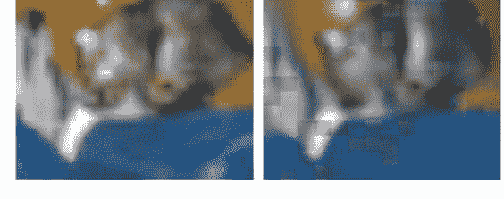

*图 12.21 – 使用 MAE 的图像重建*

**块激活图：** 编码器为每个图像块生成特征向量。

```
tokens = model.vit(inputs["pixel_values"]).last_hidden_state
```

移除 CLS token 后，计算每个块的特征幅度：

```
patch_tokens = tokens[0,1:,:]
activation_map = torch.norm(patch_tokens, dim=1)
```

这会生成一个热图，指示哪些图像区域产生最强的 Transformer 激活。亮区域对应包含更具信息量的视觉内容的块。

 resulting 嵌入总结了图像的视觉内容。这些学习到的表征通常可高度迁移到下游任务。

**MAE 特征的 PCA 可视化：** 从 500 张 CIFAR-10 图像中提取的特征使用 PCA 投影到二维。

```
pca = PCA(n_components=2)
emb = pca.fit_transform(features)
```

散点图揭示了 MAE 如何在特征空间中组织图像。尽管模型在预训练期间从未见过类别标签，但属于相似语义类别的图像通常会形成可见的簇。

**学习表征的 t-SNE 可视化：** 使用 t-SNE 可获得更强大的非线性可视化。

```
tsne = TSNE(n_components=2, perplexity=30)
emb = tsne.fit_transform(features)
```

 resulting 特征图通常表现出对象的清晰语义分组。这表明 MAE 学习了有意义的表征，即使其训练目标纯粹基于重建。

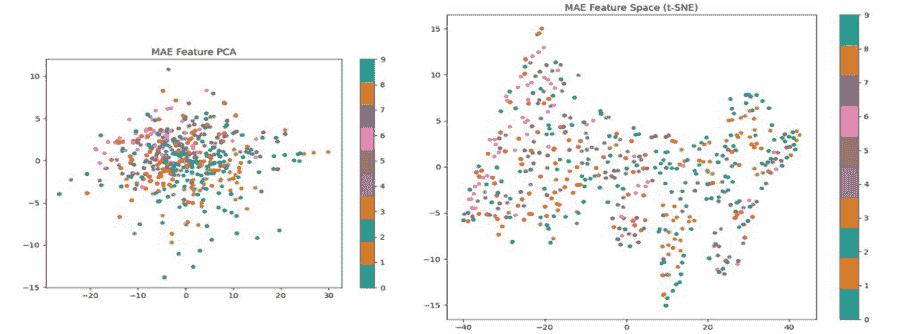

*图 12.24 – 使用 PCA 和 t-SNE 的 MAE 特征空间二维流形*

**为什么 MAE 有效：** 传统有监督学习优化：图像 → 类别标签，MAE 而是优化：可见块 → 缺失块。因为重建需要理解对象结构、纹理、形状和上下文，模型自然学习到丰富的视觉表征。与有监督学习不同，可以利用数百万张未标记图像。关键见解是 **重建缺失图像块迫使模型学习视觉内容的语义理解**，使 MAE 成为现代计算机视觉任务的有效基础模型。


# 联邦学习（隐私保护深度学习）用于分布式图像分类

传统的深度学习假设所有训练数据都收集并存储在中央服务器上。在许多现实世界应用中，例如医院、移动设备、银行和自动驾驶汽车，由于隐私、法律或安全限制，共享原始数据可能是不可能的。

联邦学习（FL）通过允许多个客户端在不共享本地数据的情况下协作训练模型来解决这一挑战。每个客户端不是传输图像，而是训练本地模型并仅将模型更新（权重或梯度）发送到中央服务器。

Server ← Model Updates ← Clients

服务器聚合更新并将改进后的全局模型分发回所有客户端。

数学表述：假设有 K 个客户端。客户端 k 拥有本地数据集 D_k = (x_i, y_i) 并最小化其本地目标：

F_k(w) = 1/|D_k| Σ_{(x,y)∈D_k} L(f(x; w), y)

其中 w = 网络参数，L = 分类损失，f = CNN 模型。

全局优化问题变为：

F(w) = Σ_{k=1}^K |D_k|/N F_k(w)

其中 N = Σ_{k=1}^K |D_k| 是样本总数。

联邦平均（FedAvg）：最广泛使用的联邦学习算法是联邦平均（FedAvg）。每个客户端本地训练并产生权重 w_1, w_2, ..., w_K。服务器计算 w_global = 1/K Σ_{k=1}^K w_k 并重新分发平均模型。这种简单的平均过程使所有客户端都能从集体学习中受益，同时保持其数据私密。

想象五个医院（A、B、C、D、E）各自拥有医学图像。医院 A、B 和 C 从不共享图像。相反，每个医院训练一个本地 CNN 并仅将学习到的参数发送到中央服务器。服务器平均参数并创建一个更强的全局模型，该模型在从未看到其原始数据的情况下间接从所有医院学习。

数据集：Fashion-MNIST：演示使用手写时尚数据集：28 × 28 灰度服装图像，属于十个类别：T-Shirt、Trouser、Pullover、Dress、Coat、Sandal、Shirt、Sneaker、Bag 和 Ankle Boot。数据集随机划分为五个模拟客户端。

```
num_clients = 5
client_indices = np.array_split(indices, num_clients)
```

每个客户端接收其自己的私有子集。

## CNN 分类器
使用轻量级 CNN 进行图像分类。

```
class CNN(nn.Module):
    def forward(self,x):
        f = self.features(x)
        return self.classifier(f)
```

架构由卷积层用于特征提取、最大池化用于空间缩减以及全连接层用于分类组成。

## 本地客户端训练
每个客户端使用其本地数据集独立训练。

```
def local_train(model, loader):
    pred = model(x)
    loss = criterion(pred, y)
    loss.backward()
```

客户端永远不会将其图像暴露给任何其他客户端或服务器。仅共享学习到的权重。

## 联邦聚合
本地训练后，服务器使用 FedAvg 聚合客户端模型。

```
def fedavg(weights):
    avg = copy.deepcopy(weights[0])
    for key in avg.keys():
        for i in range(1, len(weights)):
            avg[key] += weights[i][key]
        avg[key] /= len(weights)
    return avg
```

概念上，

$w_{global} = \frac{1}{K} \sum_{k=1}^{K} w_k$

 resulting model becomes the new global model.

## 联邦训练循环
训练通过多次通信轮次进行。

```
for r in range(rounds):
    local_weights = []
    for client_loader in clients:
        w = local_train(local_model, client_loader)
    global_model.load_state_dict(fedavg(local_weights))
```

每个轮次包括
- 将全局模型发送给客户端
- 本地客户端训练
- 聚合客户端模型
- 更新全局模型

该过程重复进行直到收敛。

## 集中式学习基线
为了比较，使用整个数据集训练传统的集中式模型。

```
central_model = CNN()
```

这代表了所有数据可以存储在一个位置的理想场景。

## 联邦与集中式准确率
实验比较了两种方法获得的测试准确率。如下一图所示，联邦和集中式分类器的准确率随训练轮次增加，联邦准确率最终达到 90.6%（略低于其集中式对应物）。

```
Plt.plot(federated_acc)
Plt.plot(central_acc)
```

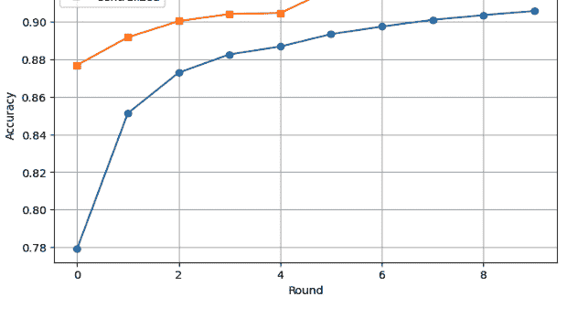

*Figure 12.25 – Federated vs. Centralized classifier performance over epochs*

### 观察到的性能：

| Round | Federated Accuracy |
|-------|--------------------|
| 0 | 77.9% |
| 5 | 89.3% |
| 9 | 90.6% |

*Table 12.7: Federated classification accuracy over rounds*

## Note
由于联邦学习在异构本地数据上优化模型且通信受限，与集中式训练相比会失去一些全局统计效率，但仍然接近，因为所有客户端共同近似相同的底层数据分布。联邦模型在从未访问集中式数据的情况下逐渐接近集中式性能。

## 混淆矩阵分析
分类性能可以使用混淆矩阵进行分析。

```
cm = confusion_matrix(y_true, y_pred)
```

矩阵揭示了联邦训练中经常混淆的服装类别、强类、弱类以及错误模式。接近对角线的矩阵表示良好的分类性能。

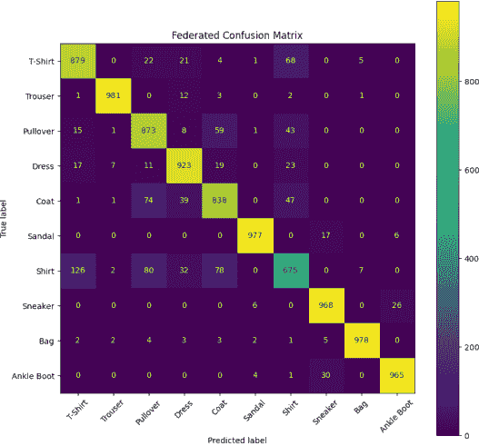

*Figure 12.26 – Confusion matrix for classification*

## 学习特征空间可视化
提取中间 CNN 特征并使用 t-SNE 投影到二维。

```
f = global_model.features(x)
embedding = tsne.fit_transform(features[:3000])
```

 resulting visualization shows how the network organizes clothing categories in feature space. Well-separated clusters indicate that the federated model has learned discriminative representations.

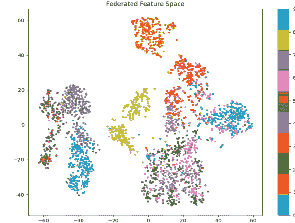

*Figure 12.27 – 2D t-SNE manifold of fashion-MNIST dataset with federated learning*

## 客户端数据分布
以下可视化说明了训练样本如何在客户端之间分布。

```
client_sizes = [len(idx) for idx in client_indices]
```

在真实联邦系统中，客户端通常拥有高度不平衡的数据集，使得学习变得更加具有挑战性。

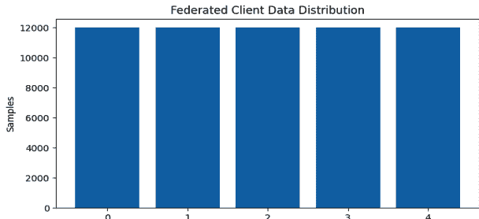

*Figure 12.28 – Federated client data distribution*

## 预测可视化
最后一幅图显示了 Fashion-MNIST 测试图像以及预测标签。

```
pred = global_model(img.unsqueeze(0).to(device)).argmax()
```


## 什么是对抗样本？
设 $x$ 表示输入图像，$f(x)$ 为神经网络的预测。对抗图像构造为：

$$x_{adv}=x+\delta$$

其中 $\delta$ 是专门选择以最大化模型分类错误的小扰动。尽管 $|\delta|$ 极小，但 resulting prediction may change dramatically.

### 为什么对抗攻击有效？
神经网络在非常高维空间中运行。即使在数千个像素上应用的微小扰动也可能累积成网络决策边界的巨大变化。直观地，想象站在悬崖边缘。轻微的推动可能足以使你越过边界。同样，图像可能靠近分类边界，允许微小扰动改变预测类别。

### 白盒与黑盒攻击
- **White-Box Attack:** 攻击者知道模型架构、参数和梯度。FGSM 是经典的白盒攻击，因为它直接使用模型梯度。
- **Black-Box Attack:** 攻击者仅观察输出或概率，并且无法访问内部模型细节。这种攻击在实践中通常更现实。

## 快速梯度符号法（FGSM）
最简单且最具影响力的对抗攻击之一是 Ian Goodfellow 等人提出的 **快速梯度符号法（FGSM）**。FGSM 使用分类损失相对于输入图像的梯度。给定损失 $J(\theta,x,y)$，对抗图像为：

$$x_{adv}=x+\epsilon\,\operatorname{sign}(\nabla_xJ(\theta,x,y))$$

其中 $x$ = 原始图像，$y$ = 真实标签，$\theta$ = 模型参数，$\epsilon$ = 攻击强度，$\nabla_xJ$ = 相对于图像像素的损失梯度。sign 操作强制每个像素扰动朝最大增加分类错误的方向移动。

梯度告诉我们：“每个像素应朝哪个方向移动以最快增加网络的损失？” 而不是执行多次优化迭代，FGSM 在该方向上进行单步。扰动因此变为 $\delta=\epsilon\,\operatorname{sign}(\nabla_xJ)$，计算成本低廉但非常有效。

**加载预训练图像分类器：** 演示使用预训练的 MobileNetV2 分类器。

```
```python
model = models.mobilenet_v2(weights=models.MobileNet_V2_Weights.DEFAULT)
model.eval()
```
```

该网络在 ImageNet 数据集上训练，可以识别 1000 个物体类别。


## 图像预处理

图像调整大小后转换为张量。

```python
img = transform(img)
img = img * 2 - 1
```

像素值从 [0,1] 缩放到 [−1,1]，以匹配模型所期望的预处理。

## 计算输入梯度

FGSM 的核心步骤是计算损失相对于输入图像的梯度。

```python
image.requires_grad = True
output = model(image)
loss = nn.CrossEntropyLoss()(output, label)
loss.backward()
```

从数学上看，$g = \nabla_x J(\theta, x, y)$ 衡量了损失对每个图像像素的敏感程度。

## 符号梯度扰动

FGSM 仅保留梯度的符号。

```python
perturbations = image.grad.sign()
```

这对应于 $\operatorname{sign}(\nabla_x J)$，其中每个像素都会根据哪个方向会增加损失，而收到 +1 或 −1 的扰动。

## 扰动可视化

扰动图像揭示了攻击者打算在哪些位置修改像素。

```python
plt.imshow((perturbations.squeeze().numpy().transpose(1,2,0)+1)/2)
```

尽管扰动看起来具有一定结构，但当用 ε 缩放时，其幅度通常非常小。

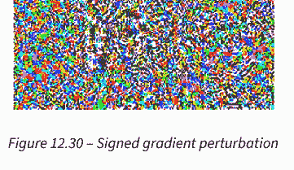

*图 12.30 – 符号梯度扰动*

**生成对抗图像：** 使用多种扰动强度来实施攻击：

```python
epsilons = [0, 0.01, 0.1, 0.2]
```

对抗图像按如下方式生成：

```python
adv_x = input_tensor + eps * perturbations
```

对应于 $x_{adv} = x + \epsilon \cdot \operatorname{sign}(\nabla_x J)$。$\epsilon$ 的值越大，产生的攻击就越强。

**有效像素约束：** 扰动之后，图像必须保持在有效的像素范围内。

```python
adv_x = torch.clamp(adv_x, -1, 1)
```

这会防止像素超出允许的值范围。

**Top-5 预测可视化：** 对于每张对抗图像，代码都会显示扰动后的图像、预测类别以及 ImageNet 的 Top-5 概率。

```python
preds = decode_predictions(output)
```

这让我们能够观察到增加扰动强度如何改变网络的置信度。

**典型行为：** 当 $\epsilon = 0$ 时，网络会正确预测为*大熊猫*。随着 $\epsilon$ 从 0.01 → 0.1 → 0.2 增大，*预测置信度*不断下降，并最终转移到错误的类别，尽管在人类看来，图像仍然可被识别为大熊猫。这体现了深度神经网络惊人的脆弱性。这种脆弱性在安全敏感型应用中尤为关键，例如医学影像、自动驾驶和监控系统；在这些场景中，微小且不易察觉的扰动可能导致高置信度的错误决策，从而带来潜在严重的现实后果。

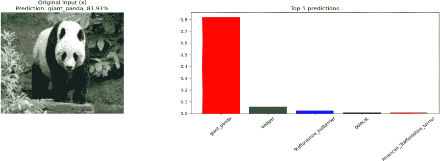

*图 12.31 – 使用预训练 MobileNet 在 FGSM 攻击下的 Top-5 预测（ε=0.01）*

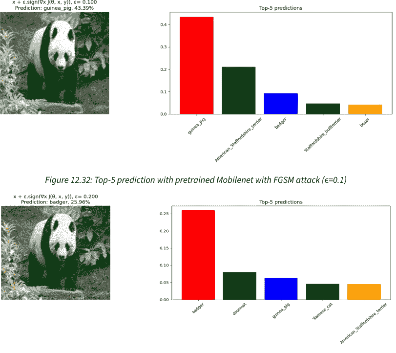

*图 12.32 – 使用预训练 MobileNet 在 FGSM 攻击下的 Top-5 预测（ε=0.1）*

*图 12.33 – 使用预训练 MobileNet 在 FGSM 攻击下的 Top-5 预测（ε=0.2）*

## 对抗攻击的防御

目前已提出多种策略：

- **对抗训练：** 使用对抗样本进行训练：

  $$L = L(x) + L(x_{adv}),$$

  使网络更加鲁棒
- **防御性蒸馏：** 平滑决策边界并降低敏感性
- **输入去噪：** 尝试在分类前移除对抗扰动
- **认证防御：** 在有界扰动区域内提供数学上的鲁棒性保证

## 对抗学习的应用

尽管对抗样本最初被视为安全威胁，但如今它们不仅被广泛用于评估模型鲁棒性，还通过对抗训练来提升鲁棒性；此外，它们还可应用于模型调试、可解释人工智能、安全测试、自动驾驶汽车安全和医学人工智能验证等场景。

提取出的特征向量可看作一种学习到的图像描述符。对于输入图像 $x$，有 $f = \Phi(x)$，其中 $\Phi(\cdot)$ 表示预训练的 EfficientNet 编码器，$f$ 是最终得到的特征嵌入。直观地说，网络将像素转换为一个紧凑的数值签名，该签名捕获了形状、纹理、物体局部和语义信息。

**构建图像数据库：** 数据集中的所有图像都会经过特征提取器。

```python
feat = feat_extractor.predict(x).ravel()
features.append(feat)
```

这会生成一个特征矩阵 $F = \begin{bmatrix} f_1 \\ f_2 \\ \vdots \\ f_N \end{bmatrix}$，其中每一行对应一张图像。代码处理了 Caltech101 中的约 9,000 张图像，并存储它们的 *EfficientNet* 描述符。

## 为什么需要降维？

深度 CNN 嵌入通常具有非常高的维度。为了减少存储并加速相似性搜索，代码使用了主成分分析（PCA）：

```python
pca = PCA(n_components=500)
pca.fit(features)
pca_features = pca.transform(features)
```

PCA 将原始特征向量 $f$ 投影到一个低维空间：

$$z = W^T f$$

其中 $W$ 包含特征协方差矩阵的主特征向量。得到的压缩特征向量 (z) 在显著降低内存和计算需求的同时，保留了大部分判别性信息。

**查询搜索引擎：** 给定一张查询图像，提取其特征向量。

```python
img, x = load_image("images/guitar.jpg")
feature = feat_extractor.predict(x).ravel()
pca_feature = pca.transform(feature.reshape(1,-1))
```

然后将查询嵌入与数据库中的每张图像用余弦距离进行比较。

```python
similar_idx = [distance.cosine(pca_feature, feat) for feat in pca_features]
```

*余弦相似度* 衡量的是特征向量之间的夹角：

$$\operatorname{sim}(a,b) = \frac{a^T b}{\lVert a \rVert \lVert b \rVert}$$

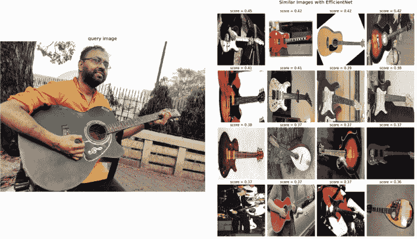

*图 12.35 – 使用查询图像搜索得到的相似图像*

**可视化特征空间：** 理解检索性能的一种有效方式是用 PCA 或 t-SNE 来可视化特征嵌入。例如，`emb = pca.transform(features)` 或 `tsne.fit_transform(features)`。相似的物体类别往往会在嵌入空间中形成簇，这表明 EfficientNet 已经学习到了有意义的图像语义组织。

**计算复杂度：** 设 *N* 为数据库图像数，*d* 为特征维度。暴力搜索每次查询需要 *O(Nd)* 次运算。对于非常大的图像集合，可以使用 *FAISS*、*Annoy* 或 *ScaNN* 等近似最近邻方法，将检索时间从秒级降低到毫秒级。

**改进搜索引擎：** 以下几种增强手段可以显著提升检索质量：

- 将 *EfficientNet* 替换为 DINOv2 等自监督模型
- 使用来自 CLIP 的多模态嵌入
- 使用三元组损失对网络进行微调
- 用 FAISS 索引替换暴力搜索
- 在向量数据库中存储嵌入，以支持大规模部署

到目前为止，我们已经学习了图像分类，其目标是为整张图像分配一个标签。在这个基础上，接下来我们将更进一步迈向目标检测，其目标不仅是识别图像中存在什么，还要使用边界框定位其中的每个物体。

## 目标检测

**目标检测** 扩展了图像分类，它同时识别 **图像中存在什么物体以及它们位于何处**，从而将图像分类与空间定位结合在一起。

$x_D = \{(c_i, b_i, s_i)\}_{i=1}^{N}$, $b_i = (x_i, y_i, w_i, h_i)$; $f(x) \rightarrow \{(c_i, b_i)\}_{i=1}^{N}$

### 交并比（IoU）

IoU = Area(B_pred ∩ B_gt) / Area(B_pred ∪ B_gt).

例如，模型不再仅仅预测 Dog，而是输出 Dog 以及一个包围这只狗的边界框。多个物体可以同时被检测到，每个物体都有自己的类别和位置。

### 使用 RetinaNet 进行目标检测

在本节中，我们将使用 PyTorch 中一个在 COCO 数据集上训练好的 RetinaNet-ResNet50-FPN 预训练模型，无需额外训练即可检测多个物体。

RetinaNet - 一种单阶段检测器：RetinaNet 是一种极具影响力的单阶段检测器，它结合了：

- 用于特征提取的 ResNet50 骨干网络
- 用于多尺度检测的特征金字塔网络（FPN）
- 用于处理类别不平衡的 Focal Loss

其关键创新是 Focal Loss：

$$FL(p_t) = -(1 - p_t)^\gamma \log(p_t)$$

其中 $p_t$ 是模型对正确类别预测的概率。容易样本对损失的贡献更小，从而迫使网络关注困难的物体。

你可以把 RetinaNet 想象成使用 FPN 在多个分辨率下扫描图像，并在各处提出候选物体。然后，Focal Loss 会抑制大量容易的背景区域，让检测器专注于真正的物体。最终的结果是，一个准确的检测器能够在单次前向传播中识别出多个物体及其位置。

**加载预训练模型：** 使用预训练的 COCO 权重加载检测器。

```python
model = torchvision.models.detection.retinanet_resnet50_fpn(weights="DEFAULT")
model.eval()
```

对应的 COCO 类别名称可通过以下方式获得：

```python
weights = RetinaNet_ResNet50_FPN_Weights.DEFAULT
COCO_CLASSES = weights.meta["categories"]
```

该模型可以识别大约 80 个常见的物体类别，包括人、车辆、动物和日常家居物品。

**运行推理：** 将输入图像转换为张量，并传入 RetinaNet。

```python
img_tensor = transforms.ToTensor()(image)
with torch.no_grad():
    outputs = model([img_tensor])[0]
```


模型返回：

```
boxes, scores, labels = outputs["boxes"], outputs["scores"], outputs["labels"]
```

概念上，Image → RetinaNet → Box_i, Class_i, Score_i，其中每个检测结果由一个边界框、类别标签和置信度分数组成。

**多尺度检测与 FPN：** 物体在图像中以不同尺寸出现。RetinaNet 使用特征金字塔网络将来自多个分辨率的信息结合起来：

$P_l = Conv(C_l) + Up(P_{l+1})$

从而能够同时检测小物体和大物体。

**置信度阈值：** 低置信度的检测结果会被移除。

```
threshold = 0.6
keep = scores >= threshold
boxes, scores, labels = boxes[keep], scores[keep], labels[keep]
```

这减少了误报并提高了可视化质量。

**可视化：** 每个检测到的类别都被分配一个唯一颜色，并绘制边界框和标签：

```
colors = generate_colors(len(unique_labels))
cv2.rectangle(img, (x1,y1), (x2,y2), color, 3)
text = f"{class_name} ({score:.2f})"
```

最终输出以视觉可解释的形式显示物体的位置、预测类别和置信度分数。

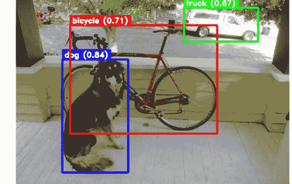

**RetinaNet 为何有效：** RetinaNet 结合了深度特征提取（ResNet50）、多尺度表示学习（FPN）和对类别不平衡的稳健处理（*Focal Loss*）。这些组件使其能够在保持高推理速度的同时，准确检测各种尺度的多个物体。

**优点：** RetinaNet 在保持相对高效的同时实现了高检测精度，这得益于其用于多尺度物体检测的 **特征金字塔网络（FPN）** 和 **Focal Loss**，后者将学习重点放在困难样本上并缓解前景-背景类别不平衡。作为一个在 *COCO* 上预训练的模型，它可以在无需额外训练的情况下检测各种物体类别。与 *YOLO*（另一种流行的物体检测模型，将在稍后介绍）相比，后者优先考虑实时推理速度，*RetinaNet* 更强调检测精度，特别是在小物体和具有挑战性的物体上，使其非常适合高质量检测任务。

**局限性：** 小型、严重遮挡或视觉上模糊的物体仍可能被遗漏或误分类，并且推理速度通常比 YOLO 等轻量级检测器慢。由于模型是在 COCO 上预训练的，除非在特定任务数据集上进行微调，否则在特定领域物体上的性能可能会下降。

## 使用 Mask R-CNN 进行物体检测和实例分割

虽然像 RetinaNet 这样的物体检测器仅预测边界框，但 **Mask R-CNN** 通过额外生成每个检测物体的 **像素级分割掩码** 来扩展检测功能（如我们在分割章节中所见）。因此，每个实例由类别标签、置信度分数、边界框和分割掩码表示，从而能够精确地定位物体边界。

**Mask R-CNN 是一个两阶段物体检测器：** 第一阶段（**区域建议网络，RPN**）生成候选物体区域，而第二阶段对每个区域进行分类，细化其边界框，并为每个检测到的实例预测逐像素的分割掩码。

在此示例中，我们使用一个在 **COCO 数据集** 上训练的 **预训练 Mask R-CNN 模型**（`maskrcnn_resnet50_fpn`）。该模型采用 ResNet-50 主干和 **特征金字塔网络（FPN）** 进行多尺度特征提取，并在物体分类和定位的同时预测物体掩码。对于输入图像，网络返回：

```
outputs = model([img_tensor])[0]
boxes, scores, labels, masks = outputs["boxes"], outputs["scores"],
outputs["labels"], outputs["masks"]
```

使用置信度阈值移除低置信度检测结果（`keep = scores >= 0.50`）。每个保留的检测结果都被分配一个唯一颜色，并使用四个互补视图进行可视化：

- **原始图像** – 输入场景
- **掩码叠加** – 实例分割掩码
- **物体轮廓** – 提取的物体边界
- **最终检测视图** – 掩码、轮廓、边界框、类别标签和置信度分数的组合

分割掩码是通过对预测概率图进行阈值处理获得的，其中彩色掩码与原始图像混合以创建透明叠加层。

```
mask = (mask[0] > 0.5).astype(np.uint8)
final_result = np.where(mask[:, :, None],
                        final_result * (1 - alpha) + overlay * alpha, final_result)
```

物体边界使用 OpenCV 轮廓提取。还生成了一个检测摘要表（参见 GitHub），显示每个实例的预测类别、置信度分数和分割面积。

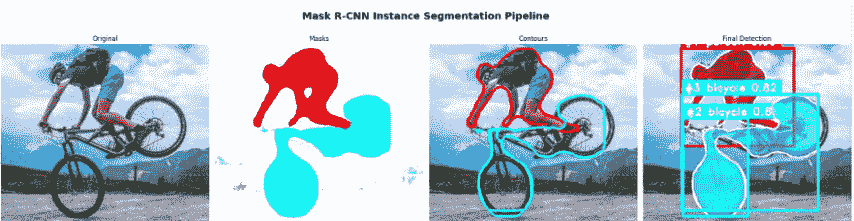

*Figure 12.37 – Object detection and instance segmentation with Mask R-CNN*

Mask R-CNN 可以被视为同时执行 **物体检测和语义分割**。首先，检测器识别物体 *位于何处*，然后专用的掩码分支预测 *哪些* 像素属于每个物体。与仅仅在自行车周围画一个框不同，Mask R-CNN 可以精确地勾勒出车架、车轮和车把，提供更丰富的场景理解。可视化展示了 Mask R-CNN 如何从原始图像数据逐步推进到实例掩码、轮廓和最终检测。这种像素级定位在医学图像分析、自动驾驶、机器人、视频监控和图像编辑等应用中特别有用。

**练习：** 预训练模型有时会对同一物体产生多个重叠检测（例如，此处的 cycle 物体被检测了两次，每次对应一个车轮）。通过在可视化之前应用 **非极大值抑制（NMS）**（或按类别 NMS；使用 `torchvision.ops.nms`）来扩展实现，以移除冗余检测并获得更清晰的实例分割结果。

虽然物体检测和实例分割对视觉物体进行定位和描绘，但 OCR 将相同的定位原理扩展到文本区域，然后执行字符识别，使机器能够直接从图像中读取文本信息，我们将在下一节中探讨这一点。

## 光学字符识别（OCR）和视觉语言文本提取管道

本节通过引入 **光学字符识别（OCR）** 作为后检测或独立的识别模块，扩展了之前关于物体检测的讨论。OCR 在 **视觉感知和机器可读文本** 之间架起桥梁，使系统能够解释结构化文档、场景文本以及发票、招牌、支票和车牌等身份相关视觉内容。

### 问题建模：从像素到文本：

给定输入图像 $I \in \mathbb{R}^{H\times W\times 3}$，OCR 旨在学习映射：

$$F_{OCR}: I \rightarrow \mathcal{T},$$

其中 $\mathcal{T}=t_1,t_2,\ldots,t_n$ 是识别出的文本标记序列。经典 OCR 系统将其分解为两个阶段：

- **文本检测：** 定位区域 $R_i \subset I$
- **文本识别：** 将每个区域解码为字符串 $t_i=f_\theta(R_i)$

现代系统将两者集成到统一的深度学习管道中。

### 使用 Tesseract 的基线 OCR

Tesseract OCR 是一种传统的 **基于 LSTM 的识别引擎**，结合了版面分析。当文本结构良好（文档、发票）且预处理改善对比度和噪声水平时效果最佳。它支持页面分割模式（`--psm`）和 OCR 引擎模式（`--oem`）。

**数学视角：** Tesseract 使用序列建模近似 $\arg\max_T P(T\mid I)$：

$$P(T\mid I)=\prod_{i=1}^{n}P(t_i\mid I,t_{<i})$$

**实现 - 发票文本提取：** 图像首先转换为灰度，然后应用 OCR：

```
gray = cv2.cvtColor(bill, cv2.COLOR_BGR2GRAY)
text = pytesseract.image_to_string(gray, config=r'--oem 3 --psm 4')
```

灰度转换降低了光度复杂性，而 `--psm 4` 假设 **稀疏列式版面**，适用于发票。


*Figure 12.38 – Extracting text with OCR using Tesseract*


**输出解释：** 提取的文本重构了结构化的账单信息，例如发票元数据（日期、ID）、行项目解析（食品项目、数量、价格）和最终总计。

这展示了传统 OCR 的一个关键局限：它本身并不理解结构——只处理文本序列。

**多语言场景文本识别：** 场景文本（例如招牌）引入了非拉丁文字、噪声/失真以及可变光照。

**示例：孟加拉语 + 英语招牌 OCR**

```
text = pytesseract.image_to_string(img, lang='ben', config=config)
```

多语言 OCR 扩展了识别 ℱ * OCR: I → 𝒯 * lang，其中语言条件解码为：P(T | I, L)，L 为语言先验。与文档 OCR 不同，多语言场景文本识别必须同时处理多样化的文字、复杂的背景、透视失真、可变照明和语言识别，使得识别任务变得更加困难。

多语言 OCR 通过结合特定语言的字符字典和语言模型来处理多种文字，使解码器能够识别并区分同一图像中不同语言的文本。输出包括混合语言检测：英语词元（例如“ CCTV ”、“ PARKING ”）和孟加拉文字识别。这突出了对语言模型和训练字符字典的依赖。


*图 12.39 – 使用 Tesseract 的多语言场景文本识别*

在探索了使用 Tesseract 的经典 OCR 之后，我们现在转向基于深度学习的 OCR，即 PaddleOCR，它在现实场景中提供了更大的鲁棒性。

## 深度学习 OCR：PPOCR（PaddleOCR）

*PaddleOCR 引入了三阶段深度流水线：*

- 文本检测（DBNet）
- 角度分类
- 文本识别（SVTR / CRNN 变体）

**主要优势：** 与 Tesseract 不同，它联合学习检测和识别，对弯曲和旋转文本具有鲁棒性，并在真实图像上提供更好的性能。

```
ocr = PaddleOCR(use_angle_cls=True, lang='en')
result = ocr.ocr(image_path, cls=True)
```

提取的组件为边界框 $B_i$、文本预测 $t_i$ 和置信度分数 $s_i$。

**可视化：** 系统使用 draw_ocr 将 $(B_i, t_i, s_i)$ 叠加到图像上，实现可解释性。

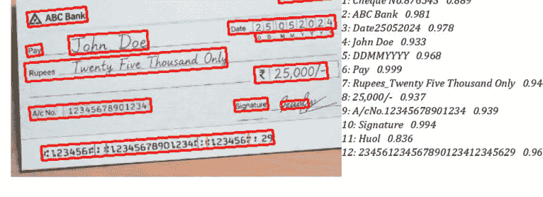

*图 12.40 – 使用 PPOCR 从银行支票中提取文本*

*PaddleOCR 通过解耦检测和识别以获得稳定性，显式建模 $P(T, B \mid I) = P(B \mid I) \cdot P(T \mid B, I)$。*

## ALPR（自动车牌识别）：通过检测 + 识别的端到端 OCR

自动车牌识别（ALPR）是一种专门的 OCR 问题，其中必须先定位文本区域，然后才能进行字符识别。因此，现代 ALPR 系统采用两阶段流水线：

$I \xrightarrow{\text{YOLOv5}} R_i \xrightarrow{\text{OCR}} t_i,$

其中 $R_i$ 表示检测到的车牌区域，$t_i$ 为识别的车牌文本。在此示例中，车牌定位使用 YOLOv5 执行，YOLOv5 是一种单阶段目标检测器，可在一次前向传递中预测边界框和类别概率，从而实现实时检测。

预训练的 YOLOv5m6 模型通过迁移学习在 Car Plate Detection Kaggle 数据集上进行微调，该数据集包含 433 张带有车牌边界框标注的车辆图像。在训练期间，检测器通过优化定位、目标性和分类损失来学习预测车牌位置 $(x_{\min}, y_{\min}, x_{\max}, y_{\max})$。检测到的车牌区域随后被裁剪并传递给 Tesseract OCR，后者提取字母数字车牌号码，形成完整的端到端 ALPR 系统。

### 可视化最终结果：

识别的车牌号码被渲染在检测到的图像上。

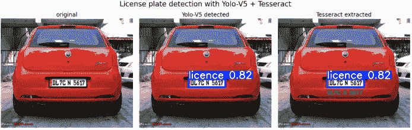

*图 12.42 – 使用 YOLOv5 + Tesseract 的车牌检测*

因此，完整的 ALPR 流水线可以总结为 图像 → YOLOv5（车牌 ROI）→ Tesseract（车牌号码）。通过结合基于深度学习的目标检测与**模块化感知流水线**，系统可自动定位车辆车牌并提取其字母数字标识，形成现代智能交通和监控系统的基础。

OCR 系统已从手工规则 → CNN/LSTM 流水线 → 视觉 Transformer 演进。现代 OCR 不再只是字符识别——它现在是一个**视觉语言理解任务**，与目标检测、场景理解和生成建模紧密集成。

## 使用 EasyOCR 的场景文本识别

在构建了使用 YOLO 和 Tesseract 的完整 ALPR 流水线之后，让我们现在探索 EasyOCR，这是一个轻量级的基于深度学习的 OCR 系统（基于 CNN 特征提取和序列解码），只需几行代码即可实现鲁棒的场景文本检测和识别。

**推理模型：** *I* → *CNN* → *SequenceDecoder* → *T*。它输出边界框、文本和置信度分数。

```python
import easyocr
reader = easyocr.Reader(['en'])
img = cv2.imread("images/car.png")
results = reader.readtext(img)
```

提取的车牌文本显示在下一幅图中。

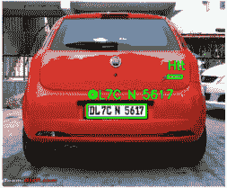

*图 12.43 – 使用 EasyOCR 的车牌识别*

实时地标检测器能够估计密集的面部和手部关键点，使其成为交互式视觉应用的理想框架。

在本节中，我们使用 *MediaPipe* 的 Tasks API 来构建 Snapchat 风格的面部滤镜并可视化手部地标。这些示例展示了现代地标检测如何用于面部增强、手势分析、虚拟配饰和人机交互。

## 面部地标检测和 Snapchat 风格滤镜

MediaPipe Face Landmarker 预测由 468 个地标组成的密集面部网格：

$$L = \{(x_i, y_i, z_i)\}_{i=1}^{468}$$

其中每个地标代表眼睛、眉毛、鼻子、嘴唇或下颌线等语义上有意义的面部位置。给定图像 $I$，检测器学习映射 $f(I) \to L$，估计图像空间中归一化的地标坐标。这些地标提供了对面部几何表示，不受尺度和中等姿态变化的影响。

在实现中，*MediaPipe* 的 Face Landmarker 模型通过 *Tasks API* 初始化：

```python
from mediapipe.tasks.python import vision
options = vision.FaceLandmarkerOptions(base_options=base_options,
        output_face_blendshapes=False,
        output_facial_transformation_matrixes=True, num_faces=1)
self.detector = vision.FaceLandmarker.create_from_options(options)
```

该模型加载面部地标模型并将推理限制为图像中最突出的面部。在推理之前，*OpenCV* 图像被转换为 *MediaPipe* 的内部图像表示：

```python
mp_image = mp.Image(image_format=mp.ImageFormat.SRGB, data=frame)
result = self.detector.detect(mp_image)
```

这是预测地标的核心推理步骤。选择特定的地标索引来定义感兴趣的面部区域：左眼（33）、右眼（263）、鼻尖（1）、嘴角（61、291）。地标用作放置虚拟对象的锚点，例如太阳镜、胡须和卡通鼻子。例如，眼部地标

```python
left_eye, right_eye = face_landmarks[33], face_landmarks[263]
```

为放置太阳镜提供了稳定的参考点，而鼻尖和嘴角则不然。

为了正确放置滤镜，眼间距被用作比例参考：

$$d = \sqrt{(x_r - x_l)^2 + (y_r - y_l)^2},$$

其中 $(x_l, y_l)$ 和 $(x_r, y_r)$ 表示左眼和右眼坐标。然后将叠加宽度计算为 $W_f = \alpha d$，其中 $\alpha$ 是经验选择的缩放因子，例如太阳镜宽度计算为：

```python
glass_w = int(1.4 * abs(rx - lx))
```


该策略会自动调整滤镜尺寸以适应不同的面部尺寸。所选的关键点会被转换为图像坐标，并由一个边界矩形包围。这提供了直观的可视化效果，展示了MediaPipe如何将人脸划分为具有语义意义的区域，如眼睛、眉毛、鼻子、嘴唇和整个面部。然后，利用PNG alpha通道进行感知透明度的合成，从而生成视觉上逼真的叠加效果，且不会出现可见的矩形伪影（通过alpha混合实现）。

```
pts = np.array([[int(face_landmarks[i].x*w), int(face_landmarks[i].y*h)]
    for i in indices])
x, y, bw, bh = cv2.boundingRect(pts)
```

下图展示了该管线的三个阶段：原始图像、检测到的面部区域，以及带有太阳镜、胡须和卡通鼻子滤镜的最终Snapchat风格增强图像。

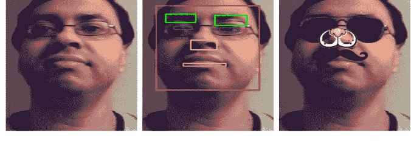

图12.45 – 使用MediaPipe的Snapchat滤镜

## 手部关键点检测与手势可视化

MediaPipe手部关键点检测器（Hand Landmarker）为每只检测到的手估计21个解剖学关键点：

$H = \{(x_i, y_i, z_i)\}_{i=1}^{21}$

这些关键点对应于手指关节、指尖和手掌位置，为手部提供了一种紧凑的骨骼表示。该检测器学习 $g(I) \rightarrow H$，其中 $H$ 编码手部姿态和细粒度的手指关节运动。预训练的手部关键点检测器使用MediaPipe Tasks API初始化：

```
options = vision.HandLandmarkerOptions(base_options=base_options, num_hands=2)
self.detector = vision.HandLandmarker.create_from_options(options)
```

这支持同时跟踪最多两只手。与基于边界框的检测器不同，关键点模型能够捕捉细粒度的手指运动，因此适用于手势识别和手语分析。手部骨骼可以表示为图 $G = (V, E)$，其中顶点 $V$ 对应关键点，边 (E) 定义关节之间的解剖连接。例如，拇指链由(0,1)、(1,2)、(2,3)、(3,4)表示。这些骨骼连接编码为：

```
HAND_CONNECTIONS = [(0,1), (1,2), (2,3), (3,4), ...]
```

人体姿态的表示。它们共同说明了现代计算机视觉的一个关键趋势：从粗略的物体检测转向**密集的关键点定位和对人体解剖的几何感知理解。**

除了可视化和分析之外，关键点表示还可以作为生成模型的运动描述符。通过跟踪面部或身体关键点随时间的变化，可以将运动从一个主体转移到另一个主体，从而实现逼真的图像动画和DeepFake生成。下一节将通过**一阶运动模型（First Order Motion Model，FOMM）**来探讨这一思想，该模型利用学习到的基于关键点的表示来合成运动。

## 使用一阶运动模型生成Deepfake

**一阶运动模型（First Order Motion Model，FOMM）**是一种用于图像动画的关键点生成框架，它可以将运动从驱动视频转移到单个源图像。给定源图像 $I_s$ 和驱动帧 $I_d^t$，目标是通过以下方式合成动画帧：

$$I^t = G(I_s, K_s, K_d^t),$$

其中，$G$ 是生成器网络，$K_s$ 和 $K_d^t$ 分别是从源图像和驱动帧中提取的稀疏运动关键点。

在运行*DeepFake*管线之前，需要从GitHub克隆官方的*FOMM*代码仓库，并将*Colab*环境配置为使用与预训练模型及依赖项兼容的Python版本。该仓库包含图像动画所需的预训练网络架构、配置文件、运动迁移算法和实用函数。

```
!git clone https://github.com/AliaksandrSiarohin/first-order-model
```

后续步骤会加载预训练检查点，并使用模型的关键点检测器和生成器网络，将运动从驱动视频转移到静态源图像，生成逼真的动画DeepFake序列。与依赖手动定义的面部关键点的经典人脸动画方法不同，FOMM自动学习关键点：

$$K = \{(x_i, y_i)\}_{i=1}^N$$

从而使模型能够以*自监督*的方式发现与运动相关的区域。源帧和驱动帧之间的运动会被转换为稠密变形场，在图像合成前对源图像特征进行扭曲。预训练的关键点检测器和生成器通过以下方式加载：

```
generator, kp_detector = load_checkpoints(config_path='config/vox-256.yaml',
                                    checkpoint_path=filename)
```

其中，kp_detector 估计运动关键点，generator 合成动画输出。源图像和驱动视频帧会被调整为模型的训练分辨率：

```
selected_image = imread('/content/socrates.png')[..., :3]
driving_video = [resize(frame, (256,256))[..., :3] for frame in driving_video]
```

然后使用以下代码片段生成动画（完整代码请参考GitHub）：

```
predictions = make_animation(resize(np.asarray(selected_image), (256,256)),
[resize(frame,(256,256)) for frame in driving_frames],
generator, kp_detector)
```

在内部，模型执行

$K_s = f_{kp}(I_s),\ K_d^t = f_{kp}(I_d^t)$

随后进行运动估计和图像生成：

$M_t = \Phi(K_s, K_d^t),\ \hat{I}^t = G(I_s, M_t)$

生成的序列保留了源图像的外观和身份，同时复现了驱动视频中观察到的面部表情、头部姿态和运动。最后，驱动帧、源图像和合成输出会并排显示（动态视频请参考GitHub）：

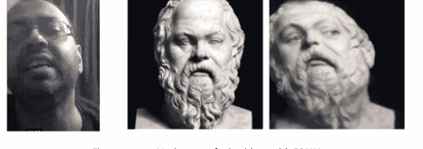

*图12.47 – 使用FOMM进行视频中的运动迁移*

尽管基于扩散的更新型虚拟形象模型现在已经实现了更高的真实感，但FOMM仍然是最有影响力和计算效率最高的DeepFake生成方法之一，它展示了一张静态图像如何通过学习到的运动迁移实现动画化：外观 + 运动 → 动画视频。这一原理构成了现代语音头部合成、虚拟化身、数字人以及神经视频生成系统的基础。

## 使用YOLOv8分割进行车辆损坏检测与严重程度评估

**保险理赔评估**传统上依赖人工检查车辆损坏情况，这一过程耗时、主观且成本高昂。现代计算机视觉系统可以通过定位损坏区域、估计其范围并提供客观的严重程度度量来自动化该过程。在本演示中，我们在Kaggle的**CarDD（车辆损坏检测）**数据集上训练了YOLOv8的分割版本，该数据集包含凹痕、划痕、裂缝和破损部件等标注的车辆损坏。与预测矩形边界框的目标检测不同，实例分割预测像素级掩码，从而能够准确估计损坏面积。

首先，从Kaggle下载CarDD（车辆损坏检测）数据集，并将其解压到本地dataset/目录中，这将提供训练和评估YOLOv8分割模型所需的车辆图像及对应的损坏标注。

```
!kaggle datasets download -d nasimetemadi/car-damage-detection
!unzip -q car-damage-detection.zip -d dataset
```

导入Ultralytics YOLO框架，并加载预训练的YOLOv8 Nano分割（YOLOv8n-seg）模型，该模型已在COCO数据集上训练，可以作为在车辆损坏分割任务上进行迁移学习和微调的起点：

```
from ultralytics import YOLO
model = YOLO("yolov8n-seg.pt")
```

与YOLOv5相比，YOLOv8提供了无锚框检测、改进的特征提取、更好的精度-速度权衡，以及在小型目标上更强的性能。

数据集准备与标注转换：CarDD数据集以COCO格式提供，而YOLOv8分割需要YOLO多边形格式的标注。预处理流程中最重要的部分是将COCO分割掩码转换为归一化的多边形坐标，使用convert_coco_to_yolo_seg()函数完成；完整代码请参考GitHub。该代码需要在Colab / GPU上运行。对于每个标注，提取多边形顶点并进行归一化：

```
x, y = largest_seg[i] / w, largest_seg[i + 1] / h
```

这将像素坐标转换为范围在 ([0,1]) 内的归一化坐标，使标注与分辨率无关。转换后的标签随后写入YOLO分割文件：

```
line = f"{cls_id} " + " ".join(map(str, points))
```

随后生成数据集配置文件。

```
with open("damage_seg.yaml", "w") as f:
    f.write(yaml_text)
```

该YAML文件指定了训练和验证图像路径，以及YOLOv8使用的损坏类别。

训练YOLOv8分割模型：分割网络使用预训练的YOLOv8模型进行初始化（从以下位置下载）：

```
model = YOLO("yolov8n-seg.pt")
```

在CarDD数据集上训练/微调预训练的YOLOv8分割模型。根据GPU和Colab负载情况，训练可能需要几分钟到几小时；请耐心等待训练过程完全结束后再继续。

```
model.train(data="damage_seg.yaml", epochs=30, imgsz=640, batch=8)
```


在这里，预训练模型将其学到的视觉特征适配到车辆损伤分割任务上。在训练过程中，YOLO 联合优化定位、分类和分割掩码损失，以提升像素级的损伤预测能力。

**损伤分割与严重程度估计**：训练结束后，加载性能最佳的检查点。

```
best_model = YOLO("runs/segment/train-7/weights/best.pt")
```

在测试图像上执行推理：

```
results = best_model(test_image)
```

模型返回与检测到的损伤区域对应的分割掩码。通过统计掩码像素数量来估算总损伤面积。

```
masks = results[0].masks.data.cpu().numpy()
for mask in masks:
    area = np.sum(mask > 0.5)
    total_damage += area
```

数学上，如果 M(x, y) 表示二值损伤掩码，则 A = Σₓ,ᵧ M(x, y) 给出以像素为单位的损伤面积。随后，该面积被映射到严重程度类别：

```
if total_damage < 5000:    severity = "Minor"
elif total_damage < 20000:  severity = "Moderate"
else:                       severity = "Severe"
```

尽管方法较为简单，这种基于规则的方式展示了如何将分割输出转换为保险相关的量化指标。

**结果可视化**：预测掩码直接渲染在车辆图像上。

```
annotated = results[0].plot()
```

将原始图像与分割出的损伤区域进行并排对比，能够对预测质量进行直观验证。最终输出不仅定位了受损部件，还提供了估计的严重程度等级，展示了深度学习如何助力自动化保险检查、理赔处理、车队管理和车辆状况评估系统。

## 本章小结

本章全面介绍了现代图像分类与目标检测的完整历程，涵盖了基础的深度学习方法以及提升精度、效率、鲁棒性和数据效率的新兴范式。通过整合识别、定位、分割、文本提取和基于关键点的分析，这些方法使机器能够从视觉数据中提取有意义的信息，并支持广泛的现实应用。本章所建立的概念自然地为下一章铺平了道路——下一章的重点将从理解图像转向通过生成式 AI 和图像合成模型来创造图像。在下一章中，我们将探索计算机视觉领域最新的生成式 AI 模型。

## 订阅 Agentic Engineering，并在参与过程中免费获取一本电子书

如果你已经订阅，可以跳过这部分。你已经找到了志同道合的人。

如果没有，我们希望自从几章前我们首次介绍 **Agentic Engineering** 以来，你所读到的内容已经足以让你有理由再看一眼。不过不强求，只是温和地劝说你一下。

订阅后，我们将免费赠送一本 Valentina Alto 所著的 *AI Agents in Practice*。

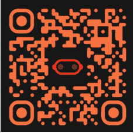

https://packt.link/IQQG8

13
