### 图像处理与计算机视觉中的生成式 AI

前一章聚焦于图像分类和目标检测，计算机视觉系统在其中学习识别和定位视觉内容。相比之下，本章探索快速发展的生成式 AI 领域，模型不仅要理解图像，还要学会创建、修改、修复和变换图像。本章从生成对抗网络和变分自编码器开始，逐步深入到基于扩散的方法（如 Stable Diffusion、SDXL、ControlNet 和 GPT 图像模型），并使用 Python 介绍现代图像合成、图像编辑、修复、风格迁移和多模态视觉系统的理论基础与实践实现。

本章首先介绍生成建模的基础概念，包括**生成对抗网络（GANs）**和**变分自编码器（VAEs）**，然后逐步推进到现代基于扩散的方法，涵盖 Stable Diffusion、SDXL、ControlNet 和 OpenAI GPT-Image 模型。本章还探讨了多模态视觉-语言系统、提示引导的图像生成、可控图像合成，以及用于真实世界计算机视觉和图像处理应用的实用 Python 实现。这些主题共同为理解那些将现代视觉 AI 从图像理解推向图像创造的技术提供了全面介绍。

在本章中，我们将学习以下主题：

- 使用条件生成对抗网络（cGANs）进行类别条件图像生成
- 使用条件变分自编码器（CVAE）进行条件图像生成
- Pix2Pix 和 CycleGAN 用于图像到图像的转换
- 基于 StyleGAN 的高保真人脸合成与语义操作
- GFPGAN：使用生成式人脸先验进行盲人脸修复
- 去噪扩散概率模型（DDPMs）
- 使用 Stable Diffusion 进行文本到图像的生成
- 使用 InstructPix2Pix 进行图像编辑
- 使用 ControlNet 进行结构引导的图像生成
- Stable Diffusion 和 SDXL 的实际应用
- 用于保持身份的姿态引导生成的 IP-Adapter 和 ControlNet
- 使用 DALL·E 2 和 DALL·E 3 API 进行图像生成
- GPT 图像 API：生成、编辑、修复和视觉

# 技术要求

在阅读本章各节时，请跟随 Jupyter notebook（并运行必要的代码片段）。以下是本章对应的 notebook 的 GitHub 链接：https://github.com/PacktPublishing/Hands-On-Image-Processing-and-Computer-Vision-with-Python-Second-Edition。为了使代码能够无缝运行，在运行代码之前，必须安装正确版本的库。如果版本不匹配，根据库中的某些特性/函数是否被移除或弃用，代码可能需要进行一些细微调整。

# 使用条件生成对抗网络（cGANs）进行类别条件图像生成

**生成对抗网络（GANs）**由 Ian Goodfellow 及其同事于 2014 年提出，是现代机器学习中最具影响力的生成模型之一。GAN 由两个相互竞争的神经网络组成：一个**生成器** *G*，从随机噪声中合成图像；一个**判别器** *D*，试图区分真实图像和生成图像。通过这种对抗博弈，生成器逐渐学会生成越来越逼真的样本。

原始的 GAN 学习数据分布 *p(x)*，但对生成何种类型的图像几乎无法控制。例如，在 *Fashion-MNIST* 上训练时，标准 GAN 可能生成衬衫、鞋子、连衣裙或包，但无法被指示合成特定类别。**条件生成对抗网络（cGANs）**通过将生成器和判别器都附加类别标签、属性或文本描述等额外信息作为条件，克服了这一限制。

**训练数据集**：*Fashion-MNIST* 是一个基准图像数据集，包含**10 个服装类别中的 70,000 张 28 × 28 灰度图像**（例如 T 恤、裤子、连衣裙、运动鞋和包），特别适合用于演示 cGAN，因为离散的类别标签能够清晰地展示**类别条件图像生成**，使模型能够按需合成特定服装类别，同时训练计算成本较低。

**条件对抗学习**：在 cGAN 中，生成器接收潜在向量 *z* 和条件 *y*：*x̂ = G(z, y)*。

类似地，判别器评估图像-标签对：*D(x, y)*。

目标函数变为：

min_G max_D 𝔼_{x ~ p_data}[log D(x, y)] + 𝔼_{z ~ p_z}[log(1 − D(G(z, y), y))]

因此，判别器不仅要判断图像是否逼真，还要判断图像是否与所提供的条件匹配。在本例中，y 对应于 Fashion-MNIST 的十个类别之一，使模型能够按需生成特定服装类别。

**生成器架构**：生成器对类别标签进行嵌入，将其与潜在向量拼接，将结果投影为特征张量，并将其上采样为 28 × 28 的 Fashion-MNIST 图像。

```
class Generator(nn.Module):
    def __init__(self):
        super().__init__()
        self.emb = nn.Embedding(NUM_CLASSES, 128)
        self.fc = nn.Sequential(
            nn.Linear(LATENT_DIM + 128, 7*7*256),
            nn.ReLU()
        )
        self.net = nn.Sequential(
            nn.ConvTranspose2d(256,128,4,2,1),
            nn.ReLU(),
            nn.ConvTranspose2d(128,64,4,2,1),
            nn.ReLU(),
            nn.Conv2d(64,1,3,1,1),
            nn.Tanh()
        )

    def forward(self, z, y):
        y = self.emb(y)
        x = torch.cat([z,y], dim=1)
        x = self.fc(x).view(-1,256,7,7)
        return self.net(x)
```

__init__() 方法通过定义网络层和可训练参数来构建网络架构，而 forward() 方法实现从输入到输出的前向传播过程中执行的计算。生成器首先使用 nn.Embedding() 将类别标签转换为可学习的嵌入表示。该嵌入捕获每个类别的语义信息，并将离散标签转换为连续的向量表示。然后，使用 torch.cat() 将潜在向量和类别嵌入拼接起来。数学上，

$$h = [z; e(y)]$$

这种组合表示被投影为低分辨率特征图，并使用转置卷积逐步上采样，将空间分辨率从 7 × 7 → 14 × 14 → 28 × 28 逐步提高。最后，Tanh 激活函数生成归一化的灰度图像。

**投影判别器**：一种朴素的 conditioning 方法是将标签与图像特征拼接。现代 cGAN 通常使用投影判别器，它提供更强的条件约束。判别器提取图像特征并计算投影分数：

$$h(x)^T e(y)$$


它衡量图像与提供的类别标签之间的兼容性：

```
class Discriminator(nn.Module):
    def __init__(self):
        super().__init__()
        self.emb = nn.Embedding(NUM_CLASSES, 256)
        self.conv = nn.Sequential(
            nn.utils.spectral_norm(nn.Conv2d(1,64,4,2,1)),
            nn.LeakyReLU(0.2),
            nn.utils.spectral_norm(nn.Conv2d(64,128,4,2,1)),
            nn.LeakyReLU(0.2))
        self.fc = nn.Linear(128*7*7, 256)
        self.out = nn.Linear(256,1)

    def forward(self, x, y):
        h = self.conv(x).view(x.size(0), -1)
        h = self.fc(h)
        proj = (h * self.emb(y)).sum(1, keepdim=True)
        return self.out(h) + proj
```

判别器提取图像特征 h(x) 并计算投影 proj，对应于

D(x,y) = f(h(x)) + h(x)^T e(y)

第一项衡量图像的真实性，而投影项衡量图像特征与提供的类别标签之间的一致性。这种机制显著改善了类别条件生成。GAN 训练通常由于对抗优化动态而不稳定，这可能导致梯度消失/爆炸、判别器过于强大、训练振荡以及模式崩溃（生成器仅产生少数重复样本，而非捕捉完整的数据分布）。为了稳定训练，应用了谱归一化 nn.utils.spectral_norm()，它约束了判别器的 Lipschitz 常数并防止不稳定的梯度增长。

一旦使用指数移动平均 EMA 等技术改善了训练稳定性，下一步就是评估生成输出的质量。

## Exponential Moving Average (EMA) Generator
GAN 参数在训练期间可能会大幅波动。为了获得更平滑、更可靠的样本，会维护一个 EMA 生成器。

```
G_ema = Generator().to(device)
G_ema.load_state_dict(G.state_dict())

def ema_update(beta=0.999):
    with torch.no_grad():
        for p, p_ema in zip(G.parameters(), G_ema.parameters()):
            p_ema.data.mul_(beta)
            p_ema.data.add_(p.data*(1-beta))
```

EMA 模型在评估和图像生成期间使用。更新

$$\theta_{EMA}=\beta\theta_{EMA}+(1-\beta)\theta,$$

其中 $\beta=0.999$ 使用以下方式实现：`p_ema.data.mul_(beta).add_(p.data * (1 - beta))`。

EMA 生成器用于评估和样本生成，因为它通常能产生更清晰、更稳定的结果。

## Evaluating Image Quality with FID
模型使用 Fréchet Inception Distance (FID) 进行评估，FID 是生成模型的标准度量。给定真实图像的特征分布 $(\mu_r,\Sigma_r)$ 和生成图像的特征分布 $(\mu_g,\Sigma_g)$，FID 分数是：

$$FID=\lVert\mu_r-\mu_g\rVert_2^2+\operatorname{Tr}(\Sigma_r+\Sigma_g-2(\Sigma_r\Sigma_g)^{1/2})$$

FID 值越低，表示生成图像越接近真实数据分布。实现会定期计算 FID。

```
from torchmetrics.image.fid import FrechetInceptionDistance
fid_metric = FrechetInceptionDistance(feature=64).to(device)
```

FID 衡量真实图像和生成图像分布之间的相似性，是生成模型最广泛使用的指标之一。

```
def compute_fid(real, fake):
    fid_metric.reset()
    fid_metric.update(real, real=True)
    fid_metric.update(fake, real=False)
    return fid_metric.compute().item()

fid_score = compute_fid(real_fid, fake_fid)
```

并自动保存性能最佳的模型。

对抗训练：使用 hinge-loss 目标在判别器和生成器更新之间交替进行。对于每个小批量，生成器首先生成类别条件伪造图像，用于更新判别器。

```
LATENT_DIM = 128
z = torch.randn(real.size(0), LATENT_DIM, device=device)
fake = G(z,y).detach()
d_loss = (F.relu(1-D(real,y)).mean() + F.relu(1+D(fake,y)).mean())
opt_d.zero_grad(); d_loss.backward()
opt_d.step()
A new batch of fake images is then generated to update the generator.
z = torch.randn(real.size(0), LATENT_DIM, device=device)
fake = G(z,y)
g_loss = -D(fake,y).mean()
```

```
opt_g.zero_grad(); g_loss.backward()
opt_g.step()
ema_update()
```

## Hinge Loss
与原始 GAN 损失不同，实现使用 *hinge loss*：

$$L_D = \mathbb{E}[\max(0,1 - D(x, y))] + \mathbb{E}[\max(0,1 + D(G(z, y), y))]$$

并且

$$L_G = -\mathbb{E}[D(G(z, y), y)]$$

（在上述代码中为 d_loss 和 g_loss）。Hinge loss 通常比二元交叉熵提供更稳定的优化和更好的样本质量。

每个 epoch 之后，EMA 生成器使用 Fréchet Inception Distance (FID) 进行评估，生成可视化，并保存性能最佳的模型。为了改善收敛，余弦退火学习率调度在训练期间逐渐降低学习率。

```
sched_g = torch.optim.lr_scheduler.CosineAnnealingLR(opt_g, EPOCHS)
sched_d = torch.optim.lr_scheduler.CosineAnnealingLR(opt_d, EPOCHS)
```

这种交替优化过程使生成器能够生成越来越逼真的类别条件 Fashion-MNIST 图像，同时保持稳定的对抗训练。下图展示了使用 Fashion-MNIST 训练 cGAN 的示意图：

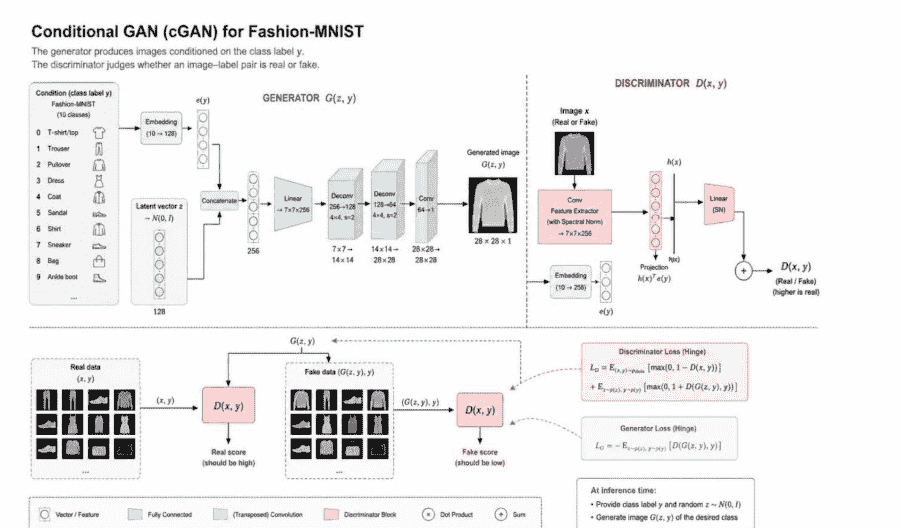

Figure 13.1 – Training a Conditional GAN (cGAN) model with fashion-MNIST images

训练后，网络学习到一个类别条件潜在空间，能够根据用户指定的类别生成逼真的 Fashion-MNIST 图像。类别嵌入、投影判别、谱归一化、hinge loss、EMA 平均和基于 FID 的模型选择相结合，比基本的条件 GAN 实现产生了显著更好的结果。

## Class Transition in the Conditional Latent Space
以下函数演示了训练好的 cGAN 如何通过在保持潜在向量固定的同时对学习到的类别嵌入进行插值，从而平滑地将一个 Fashion-MNIST 类别转变为另一个类别。

Embedding Interpolation：函数 class_transition() 通过在保持潜在向量固定的同时对两个类别的嵌入进行插值来生成一系列图像，从而可视化类别之间的平滑语义转换。

```
def class_transition(class_a, class_b, steps=15):
    z = torch.randn(1, LATENT_DIM, device=device)
    emb_a = G.emb(torch.tensor([class_a], device=device))
    emb_b = G.emb(torch.tensor([class_b], device=device))
    imgs = []

    with torch.no_grad():
        for alpha in np.linspace(0, 1, steps):
            emb = ((1 - alpha) * emb_a + alpha * emb_b)
            img = generate_from_embedding(G, z, emb)
            imgs.append(img.cpu())
    return imgs
```

Image Generation from an Interpolated Embedding：函数 generate_from_embedding() 绕过标签嵌入层，并直接从潜在向量和任意（可能为插值）类别嵌入合成图像。插值后的嵌入与固定的潜在向量连接并通过生成器传递，生成对应于中间语义状态的图像：

```
def generate_from_embedding(G, z, emb):
    x = G.fc(torch.cat([z, emb], dim=1))
    x = x.view(-1, 256, 7, 7)
    return G.net(x)
```

### Transition Sequence
生成一系列中间嵌入，产生两个 Fashion-MNIST 类别之间的平滑视觉转换。例如，

```
images = class_transition(7, 9)
```

创建从 **Sneaker**（类别 7）到 **Ankle Boot**（类别 9）的渐进转换，说明学习到的条件嵌入空间捕捉了服装类别之间有意义的语义关系。

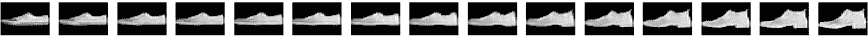

*Figure 13.4 – Class transition – from Sneaker to Ankle Boot in cGAN latent space*

## Visualizing the Learned Conditional Manifold with t-SNE
为了检查学习到的条件空间的结构，为每个 Fashion-MNIST 类别生成 500 张图像，并使用 t-SNE 将其从原始 784 维图像空间投影到 2D 流形。这种可视化有助于评估生成器是否学习到不同类别的良好分离且语义上有意义的聚类，表明条件解耦有效。

```
imgs = G(z, labels)
X = images.view(images.size(0), -1).numpy()
tsne = TSNE(n_components=2, perplexity=30, random_state=42)
X_2d = tsne.fit_transform(X)
```

 resulting 可视化显示，不同 Fashion-MNIST 类别的样本形成大体上不同的聚类，表明 cGAN 学会了类别特定的表示。视觉上相似的类别如 **Shirt, Pullover, and Coat** 存在一些重叠，而 **Bag, Sneaker, and Ankle Boot** 等类别则很好地分离。这种聚类证明了良好的类别可分性和结构良好的条件潜在流形。

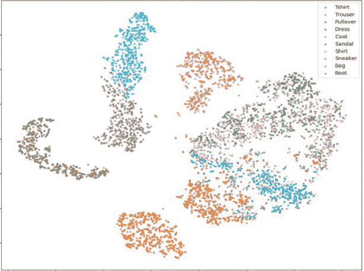

*Figure 13.5 – t-SNE 2D-manifold for fashion-MNIST samples generated with cGAN*

## Advantages
对生成图像类别的显式控制，通过 hinge loss 和谱归一化改善训练稳定性，通过 EMA 平均获得高质量样本，使用投影判别实现有效的标签条件。


**局限性：** 训练仍然计算密集，模式崩溃仍可能发生（模式崩溃是指 GAN 生成器学会生成有限种类的样本，同时忽略真实数据分布的大部分），并且 FID 并不能完美地与人类感知相关。

总体而言，cGANs 通过对抗学习提供了强大的可控性和高保真样本生成，但其训练复杂性和不稳定性促使了替代的概率方法，例如 CVAEs，我们将在下文介绍其以实现更稳定但更平滑的条件生成。

## 使用条件变分自编码器（CVAE）的条件图像生成

cGANs 通过生成器和判别器之间的对抗博弈生成图像，而 **变分自编码器（VAEs）** 学习数据的概率潜在表示，并通过解码从学习到的分布中抽取的潜在向量来生成新样本。 **条件变分自编码器（CVAE）** 通过将类别标签纳入编码器和解码器来扩展 VAE，从而实现可控的图像生成。给定潜在变量 $z$、图像 $x$ 和类别标签 $y$，CVAE 对条件分布 $p_\theta(x|z,y)$ 建模，通过指定标签 $y$ 即可合成所需类别的图像。

与 GAN 不同，GAN 可能遭受模式崩溃，CVAEs 明确地将潜在空间正则化为遵循已知的先验分布，通常是标准高斯分布。这产生了一个平滑且可解释的潜在流形，支持插值、可视化和语义操作。

**CVAE 架构：** 架构由三个主要组件组成：

- **Encoder：** 将图像-标签对 $(x,y)$ 映射到潜在分布
- **Reparameterization Layer：** 采样潜在代码 $z$
- **Decoder：** 在 $z$ 和 $y$ 的条件下重建图像

编码器预测潜在分布的均值和方差：

$q_\phi(z|x,y) = \mathcal{N}(\mu(x,y), \sigma^2(x,y)),$

其中 $\mu$ 和 $\sigma$ 由神经网络学习。解码器建模 $p_\theta(x|z,y)$，根据潜在代码和类别标签重建或生成图像。下一代码片段中的 CVAE 类实现了一个条件变分自编码器，该自编码器学习 Fashion-MNIST 图像的类别条件潜在表示：

```
```python
class CVAE(nn.Module):

    def __init__(self):
        super().__init__()
        self.mu = nn.Linear(256, LATENT_DIM) # LATENT_DIM = 64
        self.logvar = nn.Linear(256, LATENT_DIM)
        self.label_fc = nn.Linear(NUM_CLASSES, 32)
        self.encoder = nn.Sequential(...) # refer to GitHub for complete code
        self.decoder = nn.Sequential(...) # refer to GitHub for complete code
```
```

```
```python
def encode(self, x, y):
    y = self.label_fc(F.one_hot(y, NUM_CLASSES).float())
    h = self.encoder(torch.cat([x, y], dim=1))
    return self.mu(h), self.logvar(h)

def reparameterize(self, mu, logvar):
    std = torch.exp(0.5 * logvar)
    return mu + torch.randn_like(std) * std

def decode(self, z, y):
    y = self.label_fc(F.one_hot(y, NUM_CLASSES).float())
    return self.decoder(torch.cat([z, y], dim=1))

def forward(self, x, y):
    mu, logvar = self.encode(x, y)
    z = self.reparameterize(mu, logvar)
    return self.decode(z, y), mu, logvar
```
```

**基于类别标签的条件化：** 类别标签首先转换为独热向量并投影到连续嵌入空间（`self.label_fc`）。标签嵌入在编码器中与图像特征拼接，在解码器中与潜在向量拼接。这种条件化机制使模型能够学习类别特定的潜在分布并生成属于所需 Fashion-MNIST 类别的图像。

**Encoder：** 编码器接收展平的 28 × 28 图像以及嵌入的类别标签。编码器并非直接生成潜在向量，而是预测高斯分布的参数：

$$\mu = f_\mu(x,y), \log \sigma^2 = f_\sigma(x,y)$$

**重参数化技巧：** 直接从高斯分布采样会阻止梯度通过网络传播。因此 VAE 使用重参数化技巧。数学上，

$$z = \mu + \sigma \odot \epsilon, \qquad \epsilon \sim \mathcal{N}(0, I)$$

该公式保持可微性并使端到端训练通过反向传播成为可能。

**Decoder：** 解码器从潜在代码和类别嵌入重建图像。生成执行为：

$$\hat{x} = D(z,y),$$

其中 $D$ 表示解码器网络。

**CVAE 损失函数：** CVAE 目标结合了重建精度和潜在空间正则化。重建项确保忠实的数据生成，而 KL 散度则将潜在空间正则化为平滑的先验分布，从而在 CVAE 框架中实现有意义的插值和采样。

```
def cvae_loss(recon, x, mu, logvar):
    recon_loss = F.binary_cross_entropy(recon, x, reduction="sum")
    kl = -0.5 * torch.sum(1 + logvar - mu.pow(2) - logvar.exp())
    return recon_loss + BETA * kl
```

完整的损失为：

$$L = L_{\text{recon}} + \beta L_{\text{KL}},$$

其中 $L_{\text{recon}} = -\sum_i x_i \log \hat{x}_i + (1 - x_i)\log(1 - \hat{x}_i)$ 且 $L_{\text{KL}} = D_{KL}(q_\phi(z|x,y) \| \mathcal{N}(0,I))$。

超参数 $\beta$ 控制重建保真度与潜在空间平滑度之间的权衡。

**无对抗训练：** 与 GAN 不同，CVAEs 只需要单一网络且不涉及判别器。这与 cGANs 中使用的对抗训练范式形成对比，在该范式中生成器和判别器相互竞争，凸显了 CVAEs 作为条件生成模型更广泛家族中更稳定但通常更不清晰的替代方案。因此训练仅由标准的前向和反向传递组成：

```
recon, mu, logvar = model(x, labels)
loss, recon_loss, kl = cvae_loss(recon, x, mu, logvar)
loss.backward()
optimizer.step()
```

这使得 CVAEs 比 GANs 更容易且更稳定地训练，尽管生成的图像通常略显模糊。

**类别条件图像生成：** 训练后，可通过采样潜在向量并指定类别标签来生成图像。

```
z = torch.randn(1, LATENT_DIM)
for cls in range(10):
    label = torch.tensor([cls]) # same_z_different_labels
    img = model.decode(z, label)
```

下图显示了从每个 Fashion-MNIST 类别生成的示例，证明解码器已学习到类别特定的视觉特征，例如鞋子、包、连衣裙和衬衫。

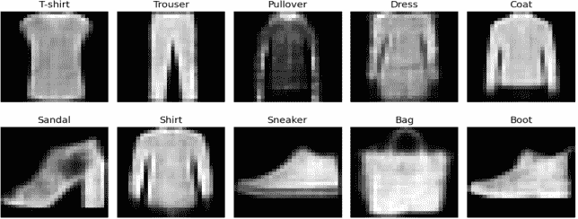

*Figure 13.6 – Sample images generated with CVAE trained on fashion-MNIST images*

## 使用 t-SNE 可视化潜在空间：

为研究学习到的潜在表示，可将编码器产生的潜在均值投影到二维，使用 t-SNE。

```
mu, _ = model.encode(x, labels)
coords = TSNE(n_components=2, perplexity=20).fit_transform(features)
```

 resulting 流形显示 Fashion-MNIST 类别占据潜在空间的不同区域。相似的类别如衬衫、毛衣和外套表现出部分重叠，而视觉上不同的类别如包、运动鞋和靴子形成良好分离的簇。这证明 CVAE 已学习到有意义的类别结构化潜在表示。

## 跨类别条件遍历：

通过固定潜在向量 *z* 并在线性插值两个类别标签之间，解码器生成从 *sneaker* 到 *ankle boot* 的平滑语义过渡。此实验分离了类别条件化的影响，并证明 CVAE 可以在保持底层潜在风格的同时连续融合对象类别。下述代码在保持潜在向量 *z* 固定的同时执行 **类别条件插值**。语义过渡完全由变化的类别标签嵌入驱动：

$$x_{\alpha}=D(z,(1-\alpha)y_1+\alpha y_2)$$

```
# Encode one sneaker and one bag
z = torch.randn(1, LATENT_DIM, device=device)
y1 = torch.tensor([7], device=device)  # Sneaker
y2 = torch.tensor([9], device=device)  # Ankle Boot
y1_hot = F.one_hot(y1, NUM_CLASSES).float()  # One-hot labels
y2_hot = F.one_hot(y2, NUM_CLASSES).float()

with torch.no_grad():
    for a in enumerate(np.linspace(0,1,15)):
        y = (1-a)*y1_hot + a*y2_hot       # Label interpolation
        img = model.decode(z, y)
        img = img.view(28, 28).cpu()
```


当 α 从 0 变化到 1 时，通过对类别条件向量进行插值，生成图像会在两个 Fashion-MNIST 类别之间平滑过渡，这证明了所学条件潜在空间的连续性。

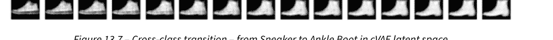

图 13.7 – cVAE 潜在空间中的跨类别过渡——从运动鞋到短靴

### 类内潜在空间遍历：

与在语义类别之间切换（例如上一个例子中的“运动鞋”到“短靴”）的*跨类别*遍历不同，*类内*遍历保持类别标签固定（例如下一个代码片段中 7 代表运动鞋），并通过在*潜在向量*之间进行*插值*，CVAE 生成同一物体类别的平滑变化，这表明所学潜在空间能够捕获诸如*形状*和*风格*这类连续的类内属性：

```
x1 = img_sneaker.view(1,-1).to(device)
x2 = img_bag.view(1,-1).to(device)
y1 = torch.tensor([7], device=device) # Sneaker
y2 = torch.tensor([8], device=device) # Bag
mu1,_ = model.encode(x1, y1)
mu2,_ = model.encode(x2, y2)

for i,a in enumerate(np.linspace(0,1,15)):
    z = (1-a)*mu1 + a*mu2
    out = model.decode(z, y1)
```

完整实现可在随附的 GitHub 仓库中获取，这里仅展示最终的遍历可视化结果。

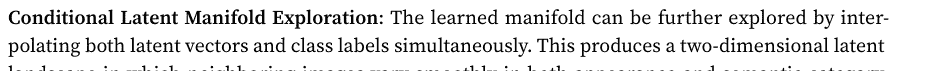

图 13.8 – 使用 cVAE 的类内（运动鞋）潜在遍历

### 条件潜在流形探索：

通过同时插值潜在向量和类别标签，可以进一步探索学习到的流形。这将生成一个二维潜在景观，其中相邻图像在外观和语义类别上都平滑变化，有助于理解 CVAE 如何组织 Fashion-MNIST 概念（代码参见 GitHub）。

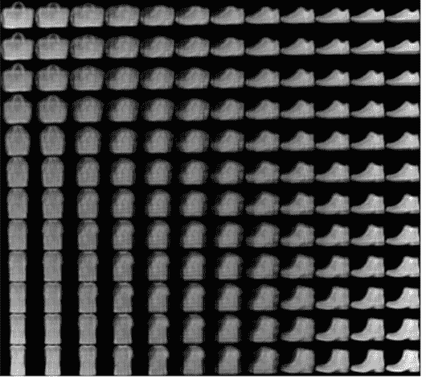

*图 13.9 – 使用 cVAE 的条件潜在流形探索*

### CVAE 与 cGAN 的对比：

与 cGAN 相比，CVAE 提供了更平滑、更具可解释性的潜在空间，支持有意义的插值，并且训练更可靠，因为它们避免了对抗优化。然而，cGAN 通常能生成更清晰、更逼真的图像。因此，当潜在空间分析、表示学习和可控生成比照片级逼真度更重要时，人们往往更倾向使用 CVAE。此外，cGAN 的潜在表示往往形成更清晰的类别分离簇，而 CVAE 的潜在表示则重叠更多，因为 KL 散度正则化鼓励所有类别共享一个共同的连续潜在流形（可比较 2D-tSNE 流形）。

总体而言，当稳定性、可解释性和结构化潜在表示是主要目标时，CVAE 更受青睐，尤其是在特征分析、受控插值和下游表示学习等任务中；而 cGAN 则更适合视觉保真度和感知清晰度至关重要的应用，例如高质量图像合成和逼真的数据增强。

## 用于图像到图像转换的 Pix2Pix 和 CycleGAN

图像到图像转换旨在学习两个视觉域之间的映射，是一个实用工具，可以减少人工投入，并在实际应用中实现可扩展的跨域视觉合成。给定来自一个域的输入图像 *x*，目标是生成另一个域中对应的图像 *y*，同时保留底层场景结构。示例包括草图转照片、卫星图转地图、夏季转冬季以及马转斑马的转换。Pix2Pix 和 CycleGAN 是基于 GAN 的两个里程碑式图像转换框架。尽管它们都学习图像域之间的映射，但在训练期间可用的监督信息上有着本质区别。

### Pix2Pix – 成对图像转换：

Pix2Pix 由 Phillip Isola 等人（2017）提出，假设存在*成对*的训练样本 $(x,y)$，其中每个输入图像都有对应的真实目标图像。生成器学习 $G:x\to y$，判别器则区分真实图像对 $(x,y)$ 与伪造图像对 $(x,G(x))$。目标函数结合了对抗损失和 $L_1$ 重建损失：

$$L_{\mathrm{Pix2Pix}}=L_{\mathrm{GAN}}(G,D)+\lambda L_1(G),$$

其中 $L_1(G)=\mathbb{E}_{x,y}[\|y-G(x)\|_1]$。对抗项促进真实性，而重建项保持与目标图像的对应关系。

### CycleGAN – 非成对图像转换：

获取成对数据集通常成本高昂，甚至不可能。CycleGAN 由 Jun-Yan Zhu 等人（2017）提出，通过从两个非成对图像集合中学习来解决这一限制。

考虑两个域：$X=$ 马，$Y=$ 斑马。CycleGAN 学习两个生成器：$G:X\to Y$、$F:Y\to X$，以及两个判别器 $D_X$ 和 $D_Y$。

关键创新在于**循环一致性约束**：

$$F(G(x))\approx x,\quad G(F(y))\approx y$$

由此产生循环一致性损失：

$$L_{\mathrm{cyc}}=\mathbb{E}_x[\|F(G(x))-x\|_1]+\mathbb{E}_y[\|G(F(y))-y\|_1]$$

完整目标为：

$$L=L_{\mathrm{GAN}}(G,D_Y)+L_{\mathrm{GAN}}(F,D_X)+\lambda L_{\mathrm{cyc}}$$

循环约束避免了任意映射，并有助于在改变外观的同时保留内容。

> **注意**
> 
> 在*成对*设置中，每个输入图像都与真实目标对齐（例如，图像到掩码的映射），而在*非成对*设置中，两个域是独立且不对齐的（例如，马和斑马图像的独立集合，彼此没有一一对应关系）。

### CycleGAN 架构：

下一张图展示了 CycleGAN 框架。该模型包含：

- 1. 判别器 $D_Y$：检测假的斑马
- 2. 判别器 $D_X$：检测假的马
- 3. 循环一致性损失，强制执行可逆映射

## 使用预训练 CycleGAN 进行马到斑马的转换

与其从头训练 CycleGAN（通常需要大量数据、计算资源且耗时），接下来的 Python 演示使用来自官方 CycleGAN 实现的预训练 马 ↔ 斑马 模型，对单张输入图像执行图像转换。首先，安装所需的 PyTorch 和可视化库，然后下载

StyleGAN3 的设置包括克隆 NVIDIA 的官方仓库、安装所需依赖（ninja、click、requests、tqdm、pyspng、imageio-ffmpeg），以及下载预训练的 FFHQ 1024x1024 生成器检查点，用于推理和图像合成。

```
!git clone https://GitHub.com/NVlabs/stylegan3.git
%cd stylegan3
!pip install ninja click requests tqdm pyspng imageio-ffmpeg
!wget https://api.ngc.nvidia.com/v2/models/nvidia/research/stylegan3/
versions/1/files/stylegan3-t-ffhq-1024x1024.pkl
```

### 模型加载与潜在采样：

在提供的实现中，使用 NVIDIA 官方检查点加载预训练的 StyleGAN3 模型（FFHQ 数据集）：

```
with dnnlib.util.open_url("stylegan3-t-ffhq-1024x1024.pkl") as f:
    G = legacy.load_network_pkl(f)["G_ema"].to(device)
```

这里，G_ema 代表**指数移动平均生成器**，它能提供比原始权重更高质量的样本。该模型在两种潜在空间中运行：

- Z 空间：输入高斯噪声
- W 空间：中间解耦表示（隐式学习）

> **注意**
> 
> 解耦潜在空间是这样一种表示：不同的潜在维度或方向对应生成图像中不同且很大程度上独立的语义属性，例如姿态、年龄、表情或发型。

### 从潜在空间生成图像：

每张图像都从一个采样的潜在向量生成：

z ~ N(0,I),   x = G(z)

```
def generate(seed):
    z = torch.from_numpy(np.random.RandomState(seed).randn(
        1, G.z_dim)).to(device)
    label = torch.zeros([1, G.c_dim], device=device)
    img = G(z, label)
```

该函数通过采样基于种子的潜在向量、将其输入带有零类别标签的 StyleGAN 生成器，并将输出张量后处理为有效的 8 位 RGB 图像数组来生成合成图像。固定种子可确保结果可复现。类别条件 c 在此处未使用（FFHQ 是无条件的），输出张量会从 [−1,1] 归一化到 [0,255]。以下是一些使用不同种子生成的合成人脸：


## StyleGAN3 合成人脸

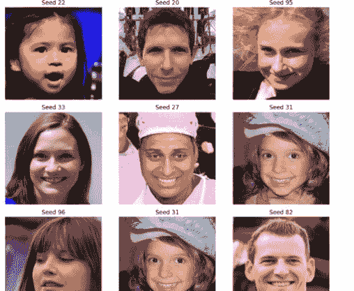

图13.11——使用StyleGAN3生成的合成人脸

潜在空间插值：StyleGAN的一个关键特性是潜在空间在语义上是平滑的。给定两个潜在编码（z₁, z₂），插值定义为：

```
z(α) = (1 − α)z₁ + αz₂,      α ∈ [0,1]
```

这会产生渐进的语义过渡，例如身份变换、姿态过渡和表情融合。

下一个代码片段生成两个基于种子的潜在向量，并在多个步骤间进行线性插值，将每个插值后的向量输入StyleGAN，以可视化生成器产生的合成人脸图像之间的平滑过渡。

```
z1 = torch.from_numpy(np.random.RandomState(100).randn(1,G.z_dim)).to(device)
z2 = torch.from_numpy(np.random.RandomState(500).randn(1,G.z_dim)).to(device)
for alpha in np.linspace(0,1,9):
    z = (1-alpha)*z1 + alpha*z2
    img = G(z, torch.zeros([1,G.c_dim], device=device))
```

与像素空间插值不同，潜在空间插值保持了真实性，因为生成器将线性潜在流形映射到非线性图像流形。

### 潜在空间插值

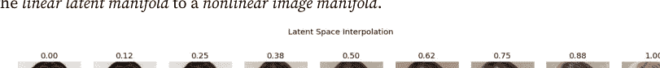

图13.12——使用StyleGAN3进行潜在空间插值

### 局部潜在扰动与流形结构

通过对中心潜在向量进行扰动，可以在潜在空间中进行局部探索：

$$z' = z + \Delta z$$

其中仅修改选定的维度：

```python
delta[0] = (i-grid//2)*0.5
delta[1] = (j-grid//2)*0.5
z = center + delta
```

早期的潜在维度通常控制**全局属性**（姿态、性别、光照）。微小的扰动揭示了StyleGAN3编码了一个**局部平滑流形**，支持可控合成。

### StyleGAN3中的风格混合

StyleGAN引入了一种**基于风格的生成器架构**，其中不同层控制不同层次的抽象。合成过程为：

$$w=f(z),\quad x=G_s(w)$$

风格混合会替换潜在风格中的部分子集：

$$w_l^{(mix)}=\begin{cases}w_l^{(A)}, & l<k\\ w_l^{(B)}, & l\ge k\end{cases}$$

该方程定义了StyleGAN风格混合：早期层（$l<k$）使用来自潜在变量$A$的风格，后期层（$l\ge k$）使用来自潜在变量$B$的风格，从而生成一个结合了$A$的粗略结构和$B$的精细细节的混合图像。

以下代码实现了这一点：通过从行种子和列种子生成潜在向量，将一个向量的早期层风格与另一个向量的后期层风格组合，并合成一个合成人脸图像网格，以可视化受控的语义特征迁移。

```python
W_row, W_col = [], []
for s in [10,20,30]:
    z = torch.from_numpy(np.random.RandomState(s).randn(1,G.z_dim)).to(device)
    W_row.append(G.mapping(z, None))
for s in [100,200,300]:
    z = torch.from_numpy(np.random.RandomState(s).randn(1,G.z_dim)).to(device)
    W_col.append(G.mapping(z, None))

for r in range(3):
    for c in range(3):
        w = W_row[r].clone()
        w[:,8:] = W_col[c][:,8:]
        img = G.synthesis(w)
```

函数$G.mapping()$将来自输入潜在空间$Z$的随机潜在向量$z$转换为解耦潜在空间$W$中的中间潜在表示$w$，在该空间中，姿态、面部结构和纹理等语义属性变得更加独立可控。这里早期层→粗略结构（姿态、脸型），而后期层→精细纹理（皮肤、头发、光照）。这使得**无需监督的语义解耦**成为可能。

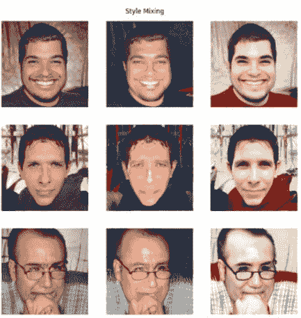

*图13.13——使用StyleGAN3进行风格混合*

## StyleGANEX：高保真反演与身份编辑

虽然StyleGAN3专注于无条件合成，但StyleGANEX将StyleGAN扩展为真实图像编辑和反演框架，结合了*GAN反演*、基于编码器的潜在预测、特征级优化和人脸对齐流程。它专为**真实世界的人脸编辑、重建和变形**而设计。

StyleGANEX的搭建涉及克隆官方仓库，该仓库提供了高保真人脸重建、操作和变形所需的预训练模型、反演框架和潜在编辑工具。

```bash
!git clone https://github.com/williamyang1991/StyleGANEX.git
```

**GAN反演问题：** 给定真实图像$x$，GAN反演旨在找到潜在编码$w$，使得：

$$w^* = \underset{w}{\operatorname{argmin}}\; \mathcal{L}(G(w), x),$$

其中$\mathcal{L}$是重建损失（像素+感知），$G$是预训练生成器。StyleGANEX通过优化潜在编码$w$、中间特征$f$和随机噪声图$n$来改进这一点，其中$\phi(\cdot)$是感知特征提取器（通常是VGG）。

**解码反演后的人脸表示：** 函数decode()使用pSp解码器（基于StyleGAN生成器构建）从潜在编码、中间特征和噪声图中重建人脸图像，并将输出转换为可显示的RGB图像。

```python
def decode(model, w, f, noise):
    with torch.no_grad():
        img, _ = model.decoder([w], input_is_latent=True,
            first_layer_feature=f, noise=noise)
    img = (img.clamp(-1,1) + 1) * 127.5
    img = img.permute(0,2,3,1)[0].cpu().numpy().astype(np.uint8)
    return Image.fromarray(img)
```

**通过潜在插值进行人脸变形：** 首先，将两张人脸对齐并反演到W⁺潜在空间，产生潜在表示w₁和w₂。然后通过在这些潜在编码之间进行线性插值来创建变形序列：

$$w(\alpha) = (1 − \alpha)w_1 + \alpha w_2,    \alpha \in [0,1]$$

每个插值后的潜在向量由pSp/StyleGAN生成器解码，生成中间人脸图像，并将所得帧组合成动画GIF。相关代码如下：

```python
w1, f1, n1, _, _ = invert(img1, psp, lm, inv_steps)
w2, f2, n2, _, _ = invert(img2, psp, lm, inv_steps)
frames = []
for a in np.linspace(0, 1, steps):
    w = (1-a)*w1 + a*w2
    frames.append(np.array(decode(psp, w, f1, n1)))
imageio.mimsave("morph.gif", frames, fps=15)
```

此处，invert()将每张人脸映射到StyleGAN（W⁺）潜在空间，w = (1 − a)w1 + a * w2执行潜在插值，decode()重建相应的人脸图像，mimsave()将所有生成的帧组合成平滑的变形动画。这产生了时间上平滑的人脸变换，在潜在空间而不是像素空间中形成连续轨迹。所得序列展示了StyleGAN潜在流形的语义连续性，其中面部身份逐渐变化（从左脸到右脸），同时保持照片级真实感。

StyleGAN 变形过程

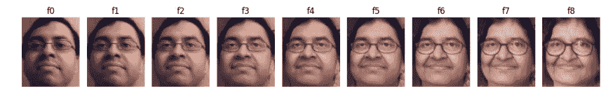

*图13.14——使用StyleGANEX进行人脸变形*

**时间变形可视化：** 生成的GIF展示了身份转换、平滑的面部结构变形以及高频细节的保留。

这证实了*StyleGANEX*潜在空间是**语义一致且测地线平滑的**（即，沿着*潜在空间中最短路径*的插值会在生成的图像中产生渐进、连续的变化，而不会出现突变的视觉伪影，从而证实了StyleGANEX潜在空间中的语义一致性）。

**StyleGAN3**学习的是*纯生成流形*：$z \to x$，而**StyleGANEX**学习的是*可逆语义映射*：$x \leftrightarrow w \leftrightarrow x'$。它们共同代表了现代生成视觉中的两种互补范式：先合成（StyleGAN3）和先重建与编辑（StyleGANEX）。

在生成和编辑这两种互补范式的基础上，下一个方法介绍了如何进一步利用预训练生成先验来执行图像恢复任务。

## GFPGAN：使用生成式人脸先验进行盲人脸恢复

**生成式人脸先验GAN（GFPGAN）**是一个人脸恢复框架，它将恢复网络与预训练的StyleGAN先验相结合，从退化图像中恢复真实且保持身份的人脸细节。与纯粹在像素层面操作的传统增强方法不同，GFPGAN利用学习到的人脸流形来重建合理的人脸结构。

给定退化图像$y$，$y = D(x) + n$，其中$x$是未知的高质量人脸图像，$D(\cdot)$表示未知的退化过程，$n$表示噪声，目标是估计恢复后的图像$\hat{x} = R(y)$。GFPGAN使用预训练的StyleGAN生成器$x_G = G(w)$来约束重建，其中$w$是StyleGAN潜在空间中的潜在表示。该模型结合了重建损失、感知损失、对抗损失和身份保持损失，以生成视觉上真实且保持面部身份的人脸。

**安装GFPGAN：** 搭建过程包括克隆仓库、安装所需的依赖项，以及下载预训练的GFPGAN v1.3检查点。

```bash
!git clone https://github.com/TencentARC/GFPGAN.git
%cd GFPGAN/
!pip install -r requirements.txt
!wget https://github.com/TencentARC/GFPGAN/releases/download/v1.3.0/GFPGANv1.3.pth -P experiments/pretrained_models
```

**加载恢复模型：** 预训练的GFPGAN模型初始化如下：

```python
restorer = GFPGANer(model_path='experiments/pretrained_models/GFPGANv1.3.pth',
                    upscale=2, arch="clean")
```


在这里，`upscale=2` 将图像分辨率提高一倍，而 `arch="clean"` 则选择轻量级的复原架构。

### 人脸复原

核心复原步骤为：

```
_, _, restored_img = restorer.enhance(img, paste_back=True)
```

`enhance()` 函数会检测面部区域，利用生成式先验恢复面部细节，并将增强后的面部重新嵌入原始图像中。完整的复原函数可简化为：

```
def restore_image_gfpgan(img):
    restorer = GFPGANer(model_path='experiments/pretrained_models/GFPGANv1.3.pth', \
                        upscale=2, arch="clean")
    _, _, restored_img = restorer.enhance(img, paste_back=True)
    return restored_img
```

### 可视化结果

该演示复原了多张面部图像，并将原始图像与增强后的输出并排展示：

```
restored = restore_image_gfpgan(cv2.imread(input_path))
```

复原后的图像通常会展现出更清晰的面部特征、更少的伪影、更高的纹理质量以及更强的感知真实感，这说明了生成式面部先验在盲人脸复原中的有效性，如下图所示（图中将一组退化人脸及其 GFPGAN 复原版本以网格形式绘制出来）。

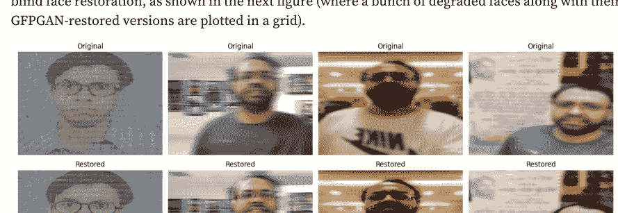

*图 13.15 – 使用 GFPGAN 进行盲人脸复原*

下图中展示了更多复原的人脸：

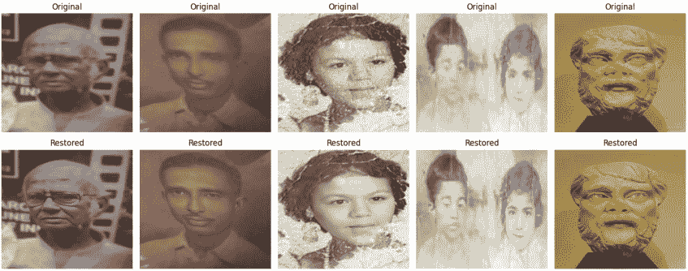

*图 13.16 – 使用 GFPGAN 进行盲人脸复原*

当 GFPGAN 利用对真实人脸结构的习得知识（*强面部先验*）从严重退化或低分辨率图像中恢复出保持身份特征的高质量面部细节时，它比传统增强方法更受青睐。

除了基于 GAN 的框架（包括 cGAN、CVAE、CycleGAN、StyleGAN 和 GFPGAN）之外，现代生成式 AI 中另一个互补且同样具有开创性的范式是 *扩散模型*，它已成为通过迭代去噪进行高保真图像合成的基础方法。

## 去噪扩散概率模型（DDPM）

扩散模型已成为最成功的生成建模范式之一，为 Stable Diffusion、Imagen 和 DALL-E 等现代图像合成系统提供动力。与通过对抗训练学习生成图像的 GAN 不同，**去噪扩散概率模型（DDPM）** 学习逐步逆转随机噪声过程。其核心思想非常简单：通过添加高斯噪声逐步破坏图像，直至其变成纯噪声，然后训练一个神经网络来逆转这一过程并重建原始图像。

DDPM 由两个互补的过程组成：

- **前向扩散**（添加噪声）
- **反向扩散**（去除噪声）

这两个过程共同定义了一条马尔可夫链，将图像转换为噪声，再从噪声重建图像。

## 前向扩散过程

前向过程通过在 $T$ 个时间步上添加高斯噪声来逐步破坏图像信息。从一张干净图像 $x_0$ 出发：

$$q(x_t \mid x_{t-1}) = \mathcal{N}\left(x_t; \sqrt{\alpha_t}x_{t-1}, (1-\alpha_t)I\right)$$

其中 $\alpha_t = 1 - \beta_t$，$\beta_t$ 是一个较小的方差调度，控制每一步添加的噪声量。DDPM 的一个显著特性是：任意时间步的图像都可以直接从原始图像采样得到：

$$q(x_t|x_0) = \mathcal{N}\left(x_t; \sqrt{\bar{\alpha}_t} x_0, (1-\bar{\alpha}_t)I\right)$$

其中 $\bar{\alpha}_t = \prod_{s=1}^{t} \alpha_s$（它决定了在时间步 $t$ 时原始图像保留了多大比例）。等价地：

$$x_t = \sqrt{\bar{\alpha}_t} x_0 + \sqrt{1-\bar{\alpha}_t} \epsilon, \quad \epsilon \sim \mathcal{N}(0, I)$$

该方程表明，每一幅带噪图像都只是原始图像与高斯噪声的加权组合。下面的代码通过逐步用高斯噪声破坏图像，模拟了 DDPM 的前向扩散过程。

### 噪声调度

下面的代码使用线性方差调度：

```
T = 1000
betas = np.linspace(1e-4, 0.02, T)
alphas = 1 - betas
alpha_bar = np.cumprod(alphas)
```

序列 $\beta_t$ 决定了信息被破坏的速度。早期的时间步只引入轻微扰动，而后期的时间步则逐渐用噪声淹没图像。

### 可视化前向扩散

前向扩散过程通过以下代码实现。在选定的时间步上，使用闭式扩散方程生成图像：

$$x_t = \sqrt{\bar{\alpha}_t} x_0 + \sqrt{1-\bar{\alpha}_t} \epsilon, \quad \epsilon \sim \mathcal{N}(0, I)$$

实现为：

```
noise = np.random.randn(*img.shape)
xt = (np.sqrt(alpha_bar[t]) * img + np.sqrt(1-alpha_bar[t]) * noise)
```

这里，`img` 对应原始图像 $x_0$，而 `noise` 表示高斯噪声样本 $\varepsilon$。在 $t = 0$ 时，图像几乎不变。随着 $t$ 增大，图像的贡献减少，噪声的贡献增加，视觉结构逐渐消失，直到图像变得与高斯噪声无法区分。生成的可视化展示了轨迹 $x_0 \rightarrow x_{50} \rightarrow x_{100} \rightarrow \cdots \rightarrow x_{999}$，演示了扩散如何将自然图像转变为纯噪声。

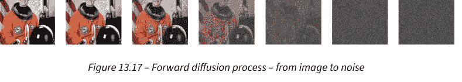

*图 13.17 – 前向扩散过程 – 从图像到噪声*

U-Net 估计噪声分量，而调度器计算下一个去噪样本 $x_{t-1}$。从概念上讲，每次迭代执行以下过程：带噪图像 → 较少噪声的图像 → 更干净的图像，直到生成逼真的图像。

### 可视化反向扩散

在采样过程中记录中间状态。

```
capture_steps = [999,900,800,700, 600,500,400,300, 200,100,50,0]
```

收集到的快照揭示了视觉结构的逐渐显现，如下图所示：

- $t = 999$：纯高斯噪声
- $t = 700$：出现微弱的颜色块
- $t = 400$：出现粗略的物体结构
- $t = 100$：出现可辨认的语义内容
- $t = 0$：最终合成图像

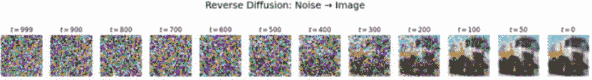

*图 13.18 – 反向扩散过程 – 从噪声到图像*

上述可视化凸显了扩散模型最直观的方面之一：图像生成本质上是一个逐步去除噪声的过程（注意在去噪过程中视觉结构如何逐渐显现）。

*DDPM* 提供了一种与 GAN 根本不同的图像生成方法。它不是学习从潜向量到图像的直接映射，而是学习一系列去噪操作，逐步将随机噪声转换为逼真样本。其训练目标稳定，潜表示表达力强，并且始终能够达到最先进的图像质量。

前向扩散过程按照以下公式逐步破坏图像：

$$x_t = \sqrt{\bar{\alpha}_t}x_0 + \sqrt{1-\bar{\alpha}_t}\epsilon,$$

而反向扩散过程学习估计并去除噪声分量 $\epsilon_\theta(x_t,t)$，从而从纯噪声中重建图像。这个简单而强大的思想构成了现代基于扩散的生成式 AI 系统的基础。

## 潜空间扩散模型

最初的**去噪扩散概率模型（DDPM）**直接在图像像素上执行扩散过程。尽管非常有效，但像素空间扩散的计算成本很高，因为高分辨率图像包含数百万个值。**潜空间扩散模型（LDM）**通过在一个由**变分自编码器（VAE）**学习的压缩潜表示中执行扩散（而非在像素空间中）来解决这一限制。这一思想构成了 Stable Diffusion 等现代扩散系统的基础。

给定图像 $x$，编码器 $E$ 将其映射为潜表示 $z = E(x)$，其中 $z$ 比原始图像小得多。然后对 $z$ 而不是 $x$ 应用扩散。

去噪后，解码器 $D$ 重建图像：$\hat{x} = D(z)$。例如，一张 $512 \times 512 \times 3$ 的图像包含 786,432 个像素值，而 Stable Diffusion VAE 将其压缩为大小为 $(4, 64, 64)$ 的潜张量，仅包含 16,384 个值——大约缩小了 48 倍。这极大地减少了内存占用和计算成本。

### 用于潜压缩的变分自编码器

Stable Diffusion VAE 使用以下方式加载：

```
vae = AutoencoderKL.from_pretrained("stabilityai/sd-vae-ft-mse").to(device)
```

图像被编码到潜空间并重建。

```
latent = vae.encode(x).latent_dist.sample()
recon = vae.decode(latent).sample
```

编码器将图像压缩为低维潜表示，而解码器则从该表示重建图像。重建结果与原始图像非常相似，如下图所示，这表明尽管潜空间的维度低得多，但它保留了大多数视觉上重要的信息。

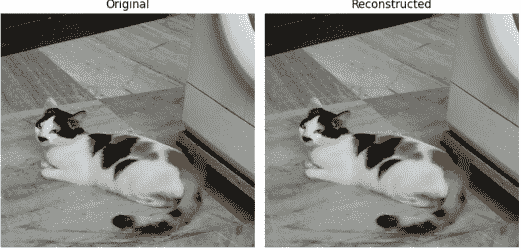

*图 13.19 – VAE 潜空间重建*

> **注意**
>
> 从数学上讲，编码器预测一个高斯潜分布 $q_\phi(z|x) = \mathcal{N}(\mu(x), \sigma^2(x))$，并使用**重参数化技巧**从中采样一个潜变量：
>
> $z = \mu + \sigma \odot \epsilon, \quad \epsilon \sim \mathcal{N}(0, I)$

### 潜空间插值

潜空间插值在实践中很有用，因为它能够在不同语义概念之间实现平滑过渡，从而支持受控生成，并在引入代码之前揭示所学潜空间的*连续性*和*结构*。


潜在表示的一个重要属性是其连续性。通过在潜在向量之间进行插值，可以平滑地对图像进行变形。两张图像首先被编码：

```
z1 = vae.encode(x1).latent_dist.mean
z2 = vae.encode(x2).latent_dist.mean
```

通过线性插值生成中间潜在编码。

```
z = (1-a)*z1 + a*z2
```

其中 \(z_\alpha = (1 - \alpha)z_1 + \alpha z_2, \quad 0 \le \alpha \le 1.\) 每个插值的潜在向量被解码以生成图像。 resulting 序列揭示了两个对象之间平滑的语义过渡，表明潜在空间中相近的点对应于视觉上相关的图像。这种连续性是潜在空间非常适合基于扩散的图像生成的关键原因之一。

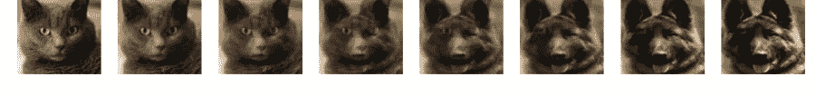

*Figure 13.20 – Latent space interpolation*

## 理解潜在扩散

在潜在扩散模型中，高斯噪声被添加到潜在向量而不是像素上：

\[
z_t = \sqrt{\bar{\alpha}_t}z_0 + \sqrt{1 - \bar{\alpha}_t}\epsilon, \quad \epsilon \sim \mathcal{N}(0,I)
\]

然后神经网络学习预测并去除这种噪声，逐步恢复干净的潜在表示。为了说明潜在退化的效果，潜在表示被人为缩放：

```
noisy = latent * (step / 1000)
img = vae.decode(noisy).sample
```

随着潜在幅度减小，解码后的图像逐渐失去结构和细节。该实验为潜在扩散提供了直观理解：信息在潜在空间中逐步被破坏，然后通过去噪恢复。

VAE Decoding of Scaled Latents

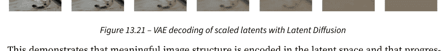

*Figure 13.21 – VAE decoding of scaled latents with Latent Diffusion*

这表明有意义的图像结构被编码在潜在空间中，并且渐进的噪声破坏会导致语义和视觉细节的逐渐丧失，这促使需要学习去噪过程来恢复高质量图像。

```
pipe.to('cuda')
# torch_dtype=torch.float16
```

该管道包含一个 CLIP 文本编码器、一个潜在空间 *VAE*、一个 *U-Net* 去噪器和一个扩散调度器。使用半精度（float16）可降低内存消耗并加速现代 GPU 上的推理。

### 文本到图像生成

核心图像生成步骤为：

```
img = pipe(prompt, num_inference_steps=30).images[0]
```

给定文本描述，管道从随机潜在噪声开始并执行 30 步逆扩散，以合成与提示匹配的图像。数学上，该过程可总结为：

\[
z_T \sim \mathcal{N}(0,I) \rightarrow z_{T-1} \rightarrow \cdots \rightarrow z_0 \rightarrow x,
\]

其中每个去噪步骤都由提示嵌入引导。

### 从多个提示生成图像

演示为四个不同的提示生成图像。

```
prompts = ["A futuristic city", "A medieval castle",
           "A cyberpunk street", "A photorealistic tiger"]
```

每个提示独立处理。

```
for prompt in prompts:
    img = pipe(prompt, num_inference_steps=30).images[0]
```

生成的图像展示了 Stable Diffusion 所学习的卓越语义理解。尽管从纯噪声开始，模型仍能合成视觉上连贯的场景，对应于未来建筑、历史结构、赛博朋克环境和逼真野生动物。

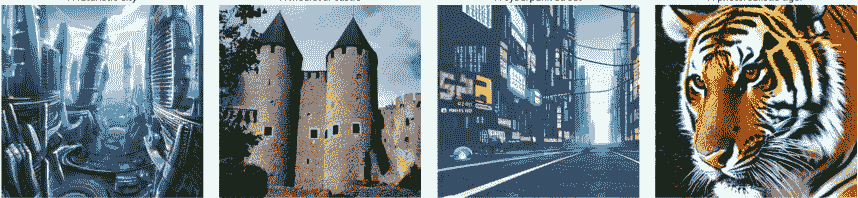

*Figure 13.22 — Text-to-image generation with Stable Diffusion*

生成的输出清楚地表明，不同的文本提示引导模型朝向视觉空间的不同语义区域，从而产生相应不同的图像（例如，城市未来场景、历史城堡、赛博朋克街道和逼真动物），从而证明了扩散式图像合成中强大的文本条件控制。

Stable Diffusion 通过结合扩散模型、潜在空间学习和多模态文本-图像表示，成为生成式 AI 的一个重要里程碑。与直接将潜在向量映射到图像的 GAN 不同，Stable Diffusion 在每个步骤都以文本提示为条件，逐步去噪潜在表示。这使得可以从自然语言描述中进行高度可控的图像合成，使 Stable Diffusion 成为现代文本到图像生成的最广泛使用的框架之一。

## 使用 InstructPix2Pix 进行图像编辑

虽然 Stable Diffusion 可以仅从文本生成图像，但许多实际应用需要根据文本指令编辑现有图像。示例包括改变物体的外观、修改艺术风格、改变光照条件或将草图转换为逼真照片。InstructPix2Pix 通过学习遵循自然语言编辑指令同时保留输入图像的内容和结构来解决此问题。

给定输入图像 \(x\) 和文本指令 \(c\)，目标是生成编辑后的图像 \(y = F(x, c)\)，其中 \(F(\cdot)\) 表示学习到的图像编辑模型。与文本到图像生成不同，目标不是从头创建新图像，而是根据指令转换现有图像。

### InstructPix2Pix 架构

InstructPix2Pix 基于 Stable Diffusion 框架构建并执行基于扩散的图像编辑。模型接收：

- 输入图像
- 文本编辑指令
- 噪声潜在表示

文本指令使用语言编码器编码：\(c = T(\text{instruction})\)，而输入图像使用变分自编码器（VAE）映射为潜在表示：\(z = E(x)\)。扩散 U-Net 然后在图像潜在和指令嵌入的条件下执行迭代去噪：\(\epsilon_\theta(z_t, t, c)\)。最终编辑图像使用 VAE 解码器重建：\(\hat{y} = D(z_0)\)。由于模型同时以图像内容和文本指令为条件，因此可以在保留整体场景的同时仅修改请求的属性。

### 加载预训练模型

预训练的 InstructPix2Pix 管道加载如下：

```
from diffusers import StableDiffusionInstructPix2PixPipeline
pipe = StableDiffusionInstructPix2PixPipeline.from_pretrained(
    "timbrooks/instruct-pix2pix")
```

该管道包含用于图像编辑的 Stable Diffusion 潜在扩散模型以及指令遵循组件。

### 输入图像和编辑指令

演示使用手袋草图作为源图像。

```
input_image = Image.open("bag_sketch.png").convert("RGB")
```

然后提供详细的指令。

```
prompt = """
```

## 使用 ControlNet 进行结构引导的图像生成

虽然诸如 Stable Diffusion 之类的文本到图像模型可以从文本提示生成高度逼真的图像，但它们通常对生成内容的空间结构提供有限的控制。ControlNet 通过引入额外的条件信号来解决此限制，例如边缘、深度图、分割掩码、人脸姿势或草图，同时保留扩散模型的生成能力，从而实现对图像构图的精确控制。

给定控制信号 \(c\)（例如边缘图）和文本提示 \(y\)，ControlNet 模拟条件分布 \(p(x|c, y)\)，允许图像生成同时由结构信息和语义指令引导。

### ControlNet 架构

ControlNet 通过添加一个可训练分支来扩展 Stable Diffusion，该分支处理外部控制信号。原始 Stable Diffusion U-Net 基本保持不变，而 ControlNet 分支提取结构信息并将其注入去噪过程。

令 \(z_t\) 表示时间步 \(t\) 处的噪声潜在表示。去噪器变为 \(\epsilon_\theta(z_t, t, c, y)\)，其中 \(z_t\) 是噪声潜在，\(c\) 是控制图像，\(y\) 是文本提示。因此生成的图像不仅受文本语义约束，还受提供的几何结构约束。

### 提取边缘引导

演示使用马图像作为输入并提取 Canny 边缘图。

```
gray = cv2.cvtColor(np.array(input_image), cv2.COLOR_RGB2GRAY)
edges = cv2.Canny(gray, 100, 200)
```

Canny 检测器计算图像梯度并识别显著的强度不连续性，生成捕获物体形状和姿势同时丢弃纹理和颜色信息的边缘表示。然后边缘图转换为三通道图像：

```
edges = cv2.cvtColor(edges, cv2.COLOR_GRAY2RGB)
```

该边缘图像作为提供给 ControlNet 的结构条件信号。

### 加载 ControlNet 模型

训练于 Canny 边缘图的 ControlNet 模型使用以下方式加载：

```
controlnet = ControlNetModel.from_pretrained("lllyasviel/sd-controlnet-canny")
```

该网络已学习边缘结构如何对应于逼真图像内容，因此可以在生成过程中保留物体几何。ControlNet 模型随后与 Stable Diffusion 集成：

```
pipe = StableDiffusionControlNetPipeline.from_pretrained(
    "runwayml/stable-diffusion-v1-5",
    controlnet=controlnet)
```

 resulting 管道将文本提示的语义引导与边缘图的结构引导相结合。


仅需少量去噪步骤即可实现图像合成，从而使实时图像生成成为可能。本节将展示使用预训练扩散管道的 **SDXL** 和 *SDXL-Turbo* 的若干实际应用。

## SDXL-Turbo 文生图

SDXL-Turbo 能以极少的扩散步骤直接从文本提示生成图像。

```
pipe_t2i = AutoPipelineForText2Image.from_pretrained("stabilityai/sdxl-turbo")
prompt = """A futuristic cyberpunk city at sunset, cinematic lighting, ultra detailed"""
image = pipe_t2i(prompt, guidance_scale=0, num_inference_steps=2).images[0]
```

与通常需要20–50次去噪迭代的传统扩散模型不同，SDXL-Turbo 采用 **对抗扩散蒸馏（ADD）**，仅需1–4步去噪即可生成图像，同时保持惊人的高视觉质量。`pipe_t2i()` 函数可在现代 GPU 上于不到一秒的时间内（根据文本提示）生成图像，使 SDXL-Turbo 适用于快速概念生成、实时设计探索和创意原型制作等交互式应用。

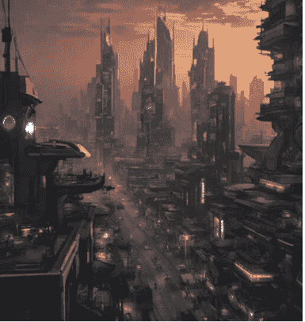

*图 13.25 – 使用 SDXL-turbo 进行文生图*

该示例使用文本描述生成了一座未来主义赛博朋克城市，展示了蒸馏扩散模型的卓越效率。

> **注意**
>
> SDXL 示例使用了两个密切相关的管道：**文生图**（`pipe_t2i`）和**图生图**（`pipe_i2i`）。文生图管道从纯随机噪声和一个文本提示生成图像：$x_0 = G(y)$，其中 $y$ 表示提示，$G$ 表示扩散模型。由于未提供输入图像，模型可以完全自由地合成新场景。

## 排版生成

SDXL 的主要改进之一在于其在生成的图像中呈现可读文本的能力得到增强。以下提示要求生成一张包含标题和主题列表的会议海报：

```
prompt = """
Professional conference poster.
Title:
COMPUTER VISION 2026
"""

image = pipe_t2i(prompt, guidance_scale=0, num_inference_steps=40).images[0]
```

模型同时合成视觉布局和内嵌文本。尽管生成的排版仍可能偶尔出现拼写错误，但相比难以渲染连贯文本的早期扩散模型，SDXL 已是显著的进步。

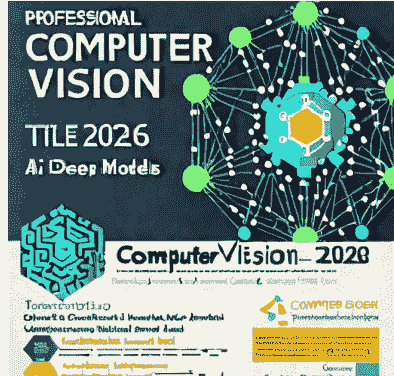

图 13.26 – 使用 SDXL 进行排版生成

> **注意**
>
> 尽管 SDXL-Turbo 针对 1–4 步去噪进行了优化，但排版生成有时可能会从额外迭代中受益，因为文本需要高度精确的空间结构；不过，超过几步后是否能改善并不确定，因为该模型主要针对超快速低步数推理进行训练。

## 提示敏感性

扩散模型对提示措辞高度敏感。考虑以下序列：

```
prompts = ["A cat", "A realistic cat", "A realistic Persian cat",
"A realistic Persian cat sitting on a sofa"]
image = pipe_t2i(prompt, guidance_scale=0, num_inference_steps=2).images[0]
```

随着语义约束逐步增加，生成的图像也变得越来越具体。这说明提示在习得的潜空间中定义了一条轨迹，更丰富的描述通常会产生更符合用户意图的输出。

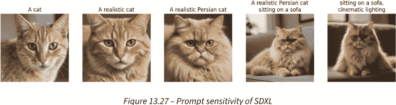

*图 13.27 – SDXL 的提示敏感性*

## 速度与质量权衡

去噪步骤的数量直接影响生成质量：

```
prompt = "A futuristic robot"
steps = [1,2,4,8]
for s in steps:
    img = pipe_t2i(prompt, num_inference_steps=s, guidance_scale=0).images[0]
```

较少的步骤可快速生成图像，但可能出现伪影或细节减少。增加步骤数通常会提高视觉保真度，但代价是额外的计算量。SDXL-Turbo 经过专门优化，即使在扩散迭代次数很少时也能保持质量。

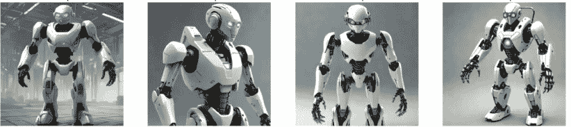

*图 13.28 – SDXL 的速度与质量权衡*

## 随机种子探索

扩散模型从随机潜在噪声生成图像。不同的随机种子会产生不同的样本，同时保持提示语义不变。

```
seeds = range(6)
for ax, seed in zip(axes, seeds):
    generator = torch.Generator(device="cuda").manual_seed(seed)
    img = pipe_t2i(prompt, num_inference_steps=2, guidance_scale=0,
                   generator=generator).images[0]
```

生成的图像在姿态、构图、光照和物体外观上表现出差异，展示了基于扩散生成过程的随机性。

## 使用 SDXL-Turbo 进行图生图细化

一个有用的工作流是首先生成粗略概念，然后通过 *图生图扩散* 对其进行细化。

**阶段 1 – 概念创建：** 使用文生图（`pipe_t2i`）管道生成概念：

```
concept_prompt = """fantasy dragon city, flying dragons, ancient towers,
 fantasy landscape, concept art, cinematic lighting"""
pipe_t2i = AutoPipelineForText2Image.from_pretrained("stabilityai/sdxl-turbo",
    torch_dtype=torch.float16,
    variant="fp16")
concept = pipe_t2i(prompt=concept_prompt, num_inference_steps=4).images[0]
```

**阶段 2 – 细化：** 图生图管道（`pipe_i2i`）从现有图像开始，根据文本提示对图像进行修改：

$$x_{out} = G(x_{in}, y)$$

其中 $x_{in}$ 是输入图像，$y$ 是文本指令（*文本提示*）。

```
detail_prompt = """highly detailed fantasy dragon city, ultra detailed
architecture,
    cinematic lighting, fantasy masterpiece, sharp focus, intricate textures"""
pipe_i2i = AutoPipelineForImage2Image.from_pretrained("stabilityai/sdxl-turbo",
    torch_dtype=torch.float16,
    variant="fp16")
refined = pipe_i2i(prompt=detail_prompt, image=concept, strength=0.35).images[0]
```

第一阶段确立整体设计，第二阶段引入建筑细节、纹理、光照效果和更高的视觉保真度。这种分层工作流广泛用于概念艺术、游戏设计和建筑可视化。

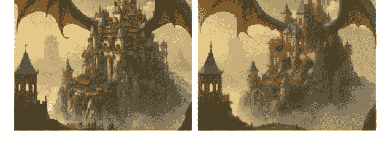

*图 13.29 – 使用 SDXL 进行图生图扩散*

## 人脸修复

图生图扩散还可以修复受损照片：

```
face_image = Image.open('child.jpg').convert('RGB')
result = pipe_i2i(prompt="""restore photograph, preserve face identity""",
    image=face_image, strength=0.35).images[0]
```

该提示引导模型去除划痕、提高清晰度并增强图像质量，同时保留面部身份、姿态和场景内容。这种修复能力对于档案图像增强和照片恢复极具价值。

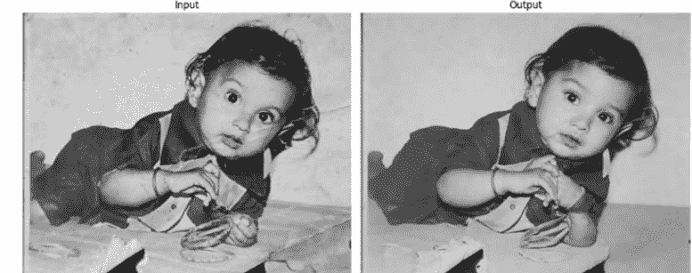

图 13.30 – 使用 SDXL 进行人脸修复

## 渲染风格转换

将 SDXL 与 ControlNet 结合，可以在保持图像几何结构的同时修改风格。首先提取 Canny 边缘图：

```
controlnet = ControlNetModel.from_pretrained("diffusers/controlnet-canny-sdxl-1.0",
    torch_dtype=torch.float16)
img_np = np.array(Image.open("horse.jpg").convert("RGB"))
edges = cv2.Canny(img_np,100,200)
```

边缘图在生成过程中充当结构约束。

```
result = pipe_i2i(prompt=style_prompt, image=image, control_image=control_image).images[0]
```

使用诸如“动漫插图”或“转换为水彩画”之类的提示（`style_prompt`），模型仅改变渲染风格，同时保留物体布局、姿态、视角和场景构图。这展示了 ControlNet 将图像结构与视觉外观分离的能力。

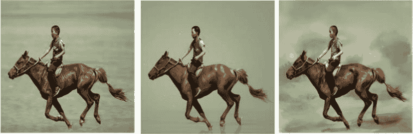

*图 13.31 – 使用 SDXL 进行风格转换*

## 基于扩散的超分辨率

扩散模型还可以执行图像放大：

```
pipe=StableDiffusionUpscalePipeline.from_pretrained(\
    "stabilityai/stable-diffusion-x4-upscaler")
upscaled = pipe(prompt="high quality photograph", image=low_res_image).images[0]
```

扩散模型并非简单地插值像素，而是合成合理的高频细节，从而生成更清晰、更逼真的高分辨率图像。

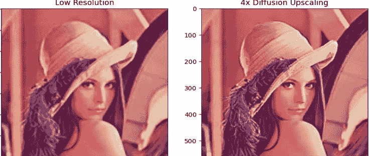

*图 13.32 – 使用 Stable Diffusion 进行图像超分辨率*


## 图像修复

修复通过利用周围像素的上下文信息来填补缺失或不需要的图像区域。

```
pipe = StableDiffusionInpaintPipeline.from_pretrained(
    "runwayml/stable-diffusion-inpainting").to("cuda")
image = Image.open('man.jpg').convert('RGB')
mask = Image.open('man_mask.png').convert('RGB')
result = pipe(prompt="natural background", image=image, mask_image=mask).images[0]
```

掩码标识要修改的区域，而扩散模型生成与周围场景一致的内容。应用包括对象移除、图像修复和内容感知编辑。

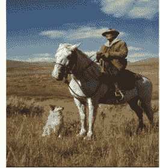

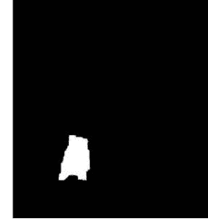

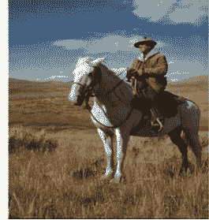

图 13.33 – 使用 Stable Diffusion 进行图像修复

## 艺术风格生成

扩散模型仅通过提示工程即可模仿各种艺术风格。

```
from diffusers import StableDiffusionPipeline
pipe = StableDiffusionPipeline.from_pretrained(
    "runwayml/stable-diffusion-v1-5", torch_dtype=torch.float16).to("cuda")
styles = ["oil painting", "anime illustration", "pixel art", "pencil sketch"]
for style in styles:
    prompt = (
        f"A majestic castle on a mountain, "
        f"{style}"
    )
    img = pipe(prompt, num_inference_steps=30, guidance_scale=8).images[0]
```

对于每种风格，提示“A majestic castle on a mountain”都会加上所需的艺术描述进行扩充。生成的图像在保留场景语义的同时采用截然不同的视觉外观，展示了现代扩散模型强大的风格迁移能力。

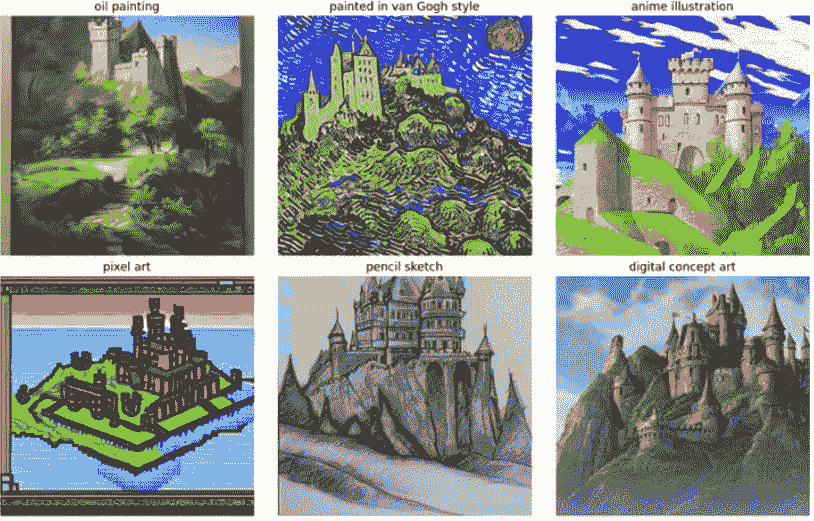

*图 13.34 – 使用 Stable Diffusion 进行艺术风格生成*

除了基于风格的提示工程之外，扩散模型还可以使用外部视觉和结构条件机制进行引导，以实现更精确和可控的生成，我们将在下一节中探讨。

## IP-Adapter 和 ControlNet 用于身份保持的姿势引导生成

文本到图像扩散模型的一个局限是，它们无法可靠地在同时控制姿势和构图的情况下保持特定人物的外观。两种最新的条件机制解决了这个问题。**IP-Adapter（Image Prompt Adapter）** 将参考图像的视觉信息注入扩散模型，而 **ControlNet** 则施加诸如边缘、深度图、分割掩码或人体姿势等结构约束。通过结合这两种方法，可以生成在遵循所需姿势的同时保持人物身份的图像。

**IP-Adapter：** 传统的 Stable Diffusion 仅依赖文本嵌入。IP-Adapter 通过从参考图像中提取视觉特征并将其通过额外的交叉注意力层注入扩散 U-Net 来扩展条件机制。设 *T* 表示文本嵌入，*I* 表示从视觉编码器提取的图像嵌入。扩散模型变为 ε<sub>θ</sub>(z<sub>t</sub>, t, T, I)，

其中 z_t 是噪声潜在表示。因此，生成过程同时受文本和视觉信息的引导。IP-Adapter 使用以下方式加载到 Stable Diffusion 流水线中：

```
pipe.load_ip_adapter("h94/IP-Adapter", subfolder="models", weight_name="ip-adapter_sd15.bin")
pipe.set_ip_adapter_scale(0.8)
```

参数 ip_adapter_scale 控制参考图像的影响。较大的值会增加身份保持，而较小的值会为文本提示提供更大的自由度。

ControlNet：尽管 IP-Adapter 保留了外观，但它并未明确约束图像几何。ControlNet 引入了一个辅助网络，对扩散过程进行结构信号的条件化。给定控制图像 c，去噪过程变为 ε_θ(z_t, t, T, c)。在此示例中，控制信号是描述所需身体姿势的 OpenPose 骨架：

```
controlnet = ControlNetModel.from_pretrained("lllyasviel/control_v11p_sd15_openpose")
```

OpenPose 图像充当几何蓝图，迫使生成的主题遵循指定的姿势，同时与文本提示保持一致。

## 结合身份和姿势约束：完整的流水线结合了三种条件来源：

- Text prompt – controls semantic content
- Reference image (IP-Adapter) – preserves identity and appearance
- OpenPose skeleton (ControlNet) – constrains body pose

Stable Diffusion 流水线构建为：

```
pipe = StableDiffusionControlNetPipeline.from_pretrained("runwayml/stable-diffusion-v1-5",
    controlnet=controlnet, torch_dtype=torch.float16)
```

然后使用以下方式进行生成：

```
images = pipe(prompt="professional portrait photograph",
    image=openpose_image, ip_adapter_image=reference_image,
    num_inference_steps=30, guidance_scale=7.5, num_images_per_prompt=4).images
```

这里，openpose_image 提供姿势信息，而 reference_image 提供面部外观和身份线索。生成的图像继承了参考图像的面部特征和视觉风格，同时采用 OpenPose 骨架编码的姿势。与通常会改变样本间身份的普通文本到图像生成不同，结合 IP-Adapter 和 ControlNet 的框架能够实现受控合成，其中身份和姿势可以独立操纵。这种能力对于头像生成、虚拟摄影、数字人类、角色动画、时尚可视化和姿势引导人像合成特别有价值。

## IP-Adapter + OpenPose ControlNet

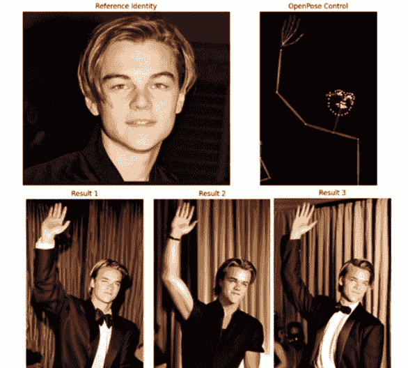

图 13.35 – 使用 ip-adapter 和 controlnet 进行身份保持的姿势引导图像生成

安装阶段加载 Stable Diffusion v1.5、OpenPose ControlNet 模型和 IP-Adapter 权重。流水线随后附加 IP-Adapter 注意力层并使用 set_ip_adapter_scale() 设置其影响。在推理期间，OpenPose 图像通过 image 参数提供，身份参考通过 ip_adapter_image 提供，文本提示指定所需外观。扩散模型融合所有三个条件来源以生成在保持身份的同时符合目标姿势的光栅化逼真人像。

## 使用 DALL·E 2 和 DALL·E 3 API 进行图像生成

OpenAI 的 DALL·E 模型系列能够从自然语言描述生成高质量的文本到图像。给定文本提示 y，模型学习条件分布 p(x|y)，其中 x 表示生成的图像。DALL·E 2 引入了强大的文本引导图像合成和变体生成，而 DALL·E 3 则显著改善了提示理解、组合推理、场景连贯性、排版以及对详细说明的遵循。这些模型广泛用于概念艺术、广告、产品可视化、讲故事、建筑设计和创意内容生成。

要使用 API，请在 OpenAI Platform(https://platform.openai.com/?utm_source=chatgpt.com) 上创建账户，从仪表板生成 API 密钥，添加计费积分，并注意图像生成是按使用量计费的，成本取决于模型（例如 DALL·E 2 与 DALL·E 3）、图像分辨率和生成的图像数量。

以下代码配置 OpenAI API 并安装所需的库：

```
!pip install openai pillow matplotlib requests

import os
os.environ['OPENAI_API_KEY'] = '<your API key here>'

from openai import OpenAI
client = OpenAI()
```

API 密钥对 OpenAI 图像生成服务的请求进行身份验证，而 OpenAI 客户端提供对 DALL·E 图像生成端点的访问。

## 使用 DALL·E 2 生成图像：DALL·E 2 直接从文本提示创建图像。

```
resp = client.images.generate(model="dall-e-2", prompt=prompt,
    size="1024x1024", n=1)
```

模型接收文本描述并生成一个或多个与提示一致的图像。在演示中，对同一提示请求多次生成以可视化输出多样性。由于图像生成具有随机性，反复执行通常会产生对同一描述的不同解释。辅助函数 generate_dalle2() 为每个提示创建基础图像和两个额外变体。

```
def generate_dalle2(prompt):  # DALL-E 2 generator
    resp_base = client.images.generate(model="dall-e-2",
                                    prompt=prompt, size="1024x1024",  n=1)
    base_img = get_image(resp_base.data[0].url)
    resp_vars = client.images.generate(model="dall-e-2",
                                    prompt=prompt, size="1024x1024",  n=2)
    var1 = get_image(resp_vars.data[0].url)
    var2 = get_image(resp_vars.data[1].url)
    return base_img, var1, var2
```

## 使用 DALL·E 3 生成图像：DALL·E 3 的访问方式类似。

```
resp = client.images.generate(model="dall-e-3", prompt=prompt,
size="1024x1024")
```

类似的辅助函数 generate_dalle3(prompt) 生成同一提示的三个独立实现。与 DALL·E 2 相比，DALL·E 3 通常产生更好的提示遵循性、改进的空间推理、更连贯的对象关系、更高的视觉真实感、更优越的排版和文本渲染以及对复杂指令更准确的解释。

## 基于提示的图像生成：实验在多样化的想象提示集合上评估两种模型。

```
prompts = [
    "Photo of Victoria Memorial Hall in the winter...",
```


```text
“泰姬陵漂浮在空中……”,
“一只长颈鹿在繁忙的东京街道上骑自行车……”,
...
]
```

该提示词集合有意融合了著名地标、历史重想象、不可能场景、拟人化动物、科幻概念和创意艺术构图。这类提示词为评估语义理解和视觉创造力提供了一个有效的基准。

**自动化对比流程：** 对于每个提示词，程序执行以下操作：

```python
dalle2_imgs = generate_dalle2(prompt)
dalle3_imgs = generate_dalle3(prompt)
```

生成的图像被排列成对比网格，其中第一行对应 DALL·E 2 的输出，第二行对应 DALL·E 3 的输出。这种并排可视化使得能够针对相同的文本描述比较提示词忠实度、构图质量、场景复杂度、对象一致性、艺术真实感和输出多样性。

**下载并显示结果：** 辅助函数

```python
def get_image(url):
    response = requests.get(url)
    return Image.open(io.BytesIO(response.content))
```

从 API 返回的 URL 下载生成的图像，并将其转换为 PIL 图像以便可视化。随后这些图像会被自动保存。

```python
plt.savefig(out_path, dpi=150)
```

从而支持在大量提示词上进行大规模基准测试。

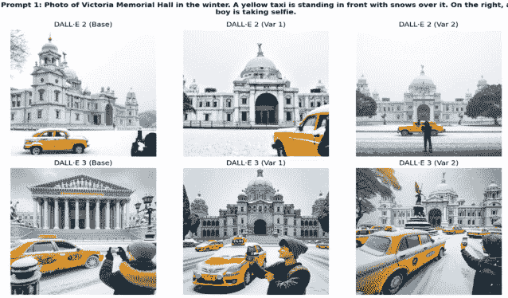

*图 13.36 – 使用相同提示词通过 DALL·E 2 与 DALL·E 3 生成图像*

与 DALL·E 2（使用相同的提示词集合）相比，DALL·E 3 生成的图像更详细、更符合提示词，这反映了其语义理解和视觉连贯性的提升，如最后一幅图和下一幅图（使用两个不同提示词）所示。

**提示词 2：** 埃菲尔铁塔淹没在水下，周围有潜水员在游泳。

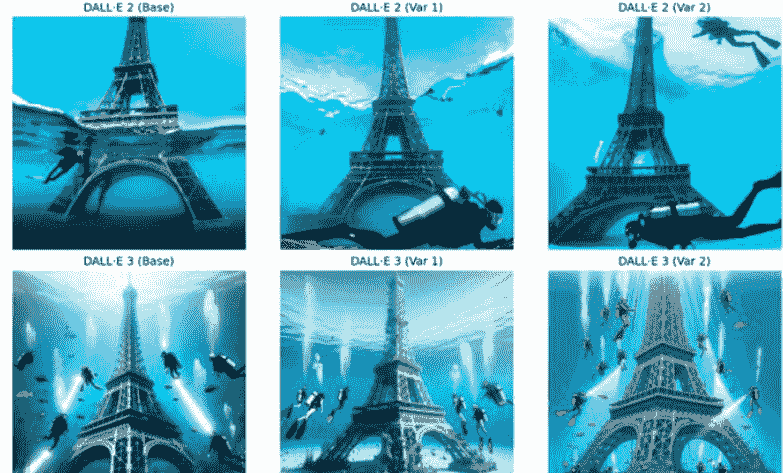

*图 13.37 – 使用相同提示词通过 DALL·E 2 与 DALL·E 3 生成图像*

## DALL·E 2 与 DALL·E 3 的对比：该实验通常会揭示几个质的差异：

DALL·E 2 仍然适用于快速图像生成和实验，而 DALL·E 3 通常能产生更忠实、视觉上更连贯的结果，尤其是对于涉及多个对象、详细空间布局和叙事性描述的较长提示词。

### 备注

LLM（大语言模型）是一种在大规模文本数据上训练的神经网络，用于理解和生成人类语言。现代多模态 LLM 还可以与图像、音频和视频交互。值得注意的是，DALL·E 和 GPT-Image 并非 LLM；它们是 OpenAI 专有的专用图像生成模型（与 Stable Diffusion 不同，但据信它们将基于 Transformer 的架构与基于扩散的图像生成相结合），与 ChatGPT 等 LLM 协同工作，通过自然语言提示词执行图像生成、编辑、内修补、外修补和修复相关任务。多家公司提供了具有不同优势的多模态 AI 系统，如下表所示。在本章中，我们仅专注于 OpenAI 的 DALL·E 和 GPT-Image 模型，因为它们具有强大的图像生成和编辑能力、通过 API 易于使用，并且与计算机视觉和图像处理应用密切相关。

下表总结了几个流行的 LLM 和图像生成模型：

| 公司 | AI 系统 | 优势 | 局限性 |
|---|---|---|---|
| OpenAI | ChatGPT + GPT-Image / DALL·E | 出色的图像生成、编辑、内修补、指令遵循和 API 支持 | 在科学图像修复方面不够专门 |
| Google | Gemini | 强大的多模态推理和生态集成 | 图像编辑能力因版本而异 |
| Anthropic | Claude | 出色的长上下文推理和文档理解能力 | 原生图像生成功能有限 |
| xAI | Grok | 实时信息访问和多模态交互 | 图像创建生态较小 |
| Microsoft | Copilot | 生产力工具集成和可访问性 | 高度依赖底层基础模型 |

*表 13.2 – 面向图像相关任务的主要多模态 AI 系统对比*

在超越使用 **DALL·E 2** 和 **DALL·E 3** 的特定模型生成之后，下一节将探讨通过 **GPT Image API** 提供的更广泛的图像生成和编辑能力，以实现更灵活、更集成的多模态工作流。

## GPT Image API：生成、编辑、内修补和视觉

OpenAI 生态系统为图像理解和图像生成提供了统一的多模态框架。诸如 GPT-4.1、GPT-4o 和 GPT-5.1 等视觉模型可以分析图像、回答视觉问题、比较多幅图像并生成结构化报告，而 GPT Image 模型可以通过自然语言指令合成、编辑、修复、重新着色和变换图像。与需要 ControlNet、IP-Adapter 或分割网络等专用架构的传统扩散流水线不同，GPT Image API 通过单一的提示词驱动接口暴露这些能力。

**设置：** OpenAI API 需要从 OpenAI 平台获取 API 密钥。创建账户并添加计费信息后，可以从开发者仪表板生成 API 密钥，并将其提供给客户端：

```python
from openai import OpenAI
api_key = "<your_api_key>"
client = OpenAI(api_key=api_key)
```

对于图像理解任务，图像通常被编码为 Base64 字符串并传递给视觉模型，而图像生成和编辑任务则使用 GPT Image API。

### 使用 GPT 视觉进行图像理解

现代 GPT 模型可以同时处理文本和图像。图像以 `Base64` 格式编码，并与文本查询一起提供。

```python
image_path = "images/family.png"
base64_image = encode_image(image_path)
data_url = f"data:image/jpeg;base64,{base64_image}"
response = client.responses.create(model="gpt-4.1-mini",
    input=[{"role": "user",
    "content": [{"type": "input_text", "text": "what's in this image?"},
                {"type": "input_image", "image_url": data_url}] }])
```

对于以下输入图像，生成了如下描述：

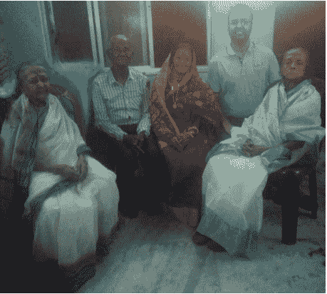

*图 13.38 – 使用 GPT 视觉进行图像理解*

```python
print(response.output_text)
```

```text
The image shows a group of five people sitting indoors. Among them, there are three elderly women and one elderly man, all dressed in traditional Indian attire, including sarees for the women and a checked shirt for the man. There is also a younger man standing at the right side of the group wearing a light blue polo shirt. The scene appears to be a family or social gathering. The room has a window in the background, and the lighting suggests the picture was taken indoors during the evening or night.
```

该模型执行视觉场景理解，并生成对图像内容的自然语言描述。典型应用包括图像描述、视觉搜索、无障碍工具、文档理解和图像索引。

### 使用 GPT Image 进行图像编辑

GPT Image 模型支持基于指令的图像编辑。模型不是从头生成图像，而是根据提示词修改现有图像。

```python
result = client.images.edit(model="gpt-image-1", image=open("cat.jpg","rb"),
                             prompt="Enhance lighting and make it cinematic")
```

该模型在根据指令调整光照、颜色、纹理和整体外观的同时，保留图像结构，如下所示（输入猫图像和编辑后图像并排显示）。

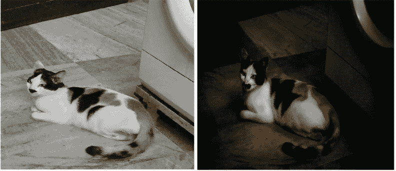

*图 13.39 – 使用 GPT-image 进行图像编辑*

应用包括照片增强、重新照明、色彩校正、艺术变换和内容修改。

### 边缘引导编辑

传统计算机视觉可以与生成式 AI 相结合。在此示例中，OpenCV 使用 Canny 检测器提取边缘。边缘图被转换为掩码，并通过 `create_edge_mask()` 函数（参考 GitHub）提供给 GPT Image。函数 `edge_inpaint()` 将边缘掩码用作*编辑区域规范*；它将原始图像连同掩码一起发送给 `client.images.edit()`，指示模型仅修改掩码中的边缘像素，将检测到的边缘替换为发光的艺术线条，并返回 AI 编辑后的图像。

```python
def edge_inpaint(image):
    mask = create_edge_mask(image)  # find edges (Canny), convert to RGBA mask
```


```python
result = client.images.edit(model="gpt-image-1", image=open(image, "rb"),
    mask=open("images/mask.png", "rb"),
    prompt="Replace edges with artistic glowing lines")
return Image.open(io.BytesIO(base64.b64decode(result.data[0].b64_json)))
```

这展示了一种混合工作流：传统图像处理提供结构引导，而生成式 AI 合成新的视觉内容。该 Gradio 应用结合了 OpenCV 边缘检测与 GPT Image 修复功能，通过交互式 Web 界面自动将图像边缘替换为 AI 生成的发光艺术轮廓。

```python
import gradio as gr

gr.Interface(fn=edge_inpaint, inputs=gr.Image(type="filepath"),
    outputs=gr.Image(),
    title="OpenCV + GenAI Hybrid").launch()
```

下图展示了用于边缘引导图像生成的 Gradio 界面：

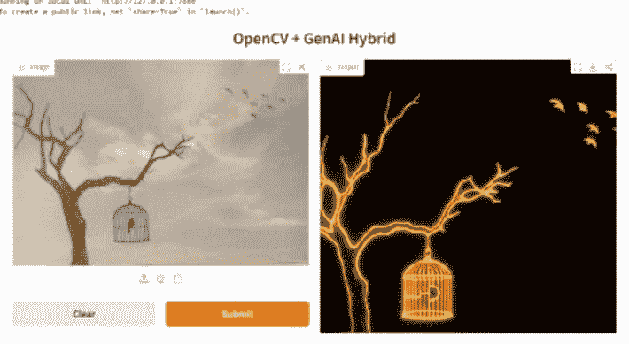

图 13.40 – 使用 GPT 图像进行边缘引导图像编辑的 Gradio 应用

## 图像修复（Image inpainting）

修复功能可在保留周围内容的同时，填补缺失或被遮罩的图像区域。

```python
result = client.images.edit(model="gpt-image-1", image=img_f, mask=mask_f,
    prompt="Fill the masked region realistically")
```

遮罩用于标识需要修改的区域，模型会合成视觉上一致的内容，如下方 Gradio 应用所示（参见 GitHub）。

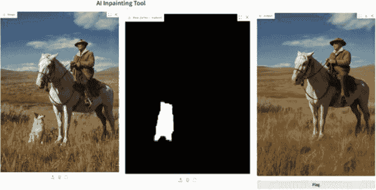

图 13.41 – 使用 Gradio 和 GPT-image 模型（OpenAI API）的 AI 修复工具

典型应用包括物体移除、划痕去除、损坏修复、背景补全和内容替换。

## AI 风格迁移

GPT Image 可以将图像转换为所需的艺术风格，同时保留不同程度的结构信息。下一个 Gradio 演示中的 `build_prompt()` 函数会根据结构保持参数动态调整提示词。低数值允许创造性重新诠释，而高数值则保留几何形状、物体布局和透视。`style_transfer()` 函数使用 GPT Image Editing 将选定的艺术风格应用于输入图像，同时强制实现所需的结构保持水平。

```python
client = OpenAI(api_key=api_key)

def build_prompt(style, strength):
    if strength < 0.3:
        return f"""Transform this image into {style} style.
        Feel free to creatively reinterpret the scene."""
    else:
        return (f"Apply {style} style. Preserve composition,"
                f"geometry, object positions and perspective."
                f"Only modify colors, textures and lighting.")

def style_transfer(image_path, style, strength):
    prompt = build_prompt(style, strength)
    result = client.images.edit(model="gpt-image-1",
                                image=open(image_path, "rb"), prompt=prompt)
    img_bytes = base64.b64decode(result.data[0].b64_json)
    return Image.open(io.BytesIO(img_bytes))
```

用于应用吉卜力风格的 Gradio 应用界面如下所示：

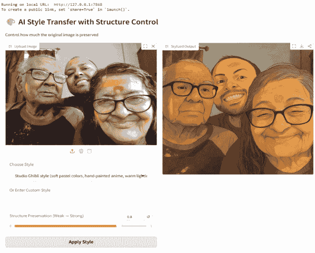

图 13.42 – 使用 GPT 图像从输入图像生成吉卜力风格图像的 Gradio 应用

支持的风格包括动漫、水彩、油画、赛博朋克、铅笔素描、吉卜力工作室和梵高。这种方法提供了一种可控的风格迁移形式，无需单独的风格迁移网络。

## 人脸修复

视觉模型和图像生成模型可以组合成一个两阶段的修复流水线。

### 阶段 1：图像评估

GPT Vision 首先分析图像质量。该模型会估计输入旧照片的模糊程度、噪声、划痕和修复需求。

```python
response = client.responses.create(model="gpt-4.1",
    input=[{"role": "user", "content": [
        {"type": "input_text", "text": """Analyze this image. Estimate:
blur level,
    noise level, scratches, restoration needs"""},
        {"type": "input_image", "image_url": f"data:image/jpeg;base64,{base64.b64encode(img_bytes).decode()}"}
    ]}])
```

```python
analysis = response.output_text
print("\nGPT Vision Analysis:")
print(analysis)
```

> **摘要**：
> 这是一张严重模糊的复古图像，噪声较低，无明显划痕。修复工作主要应侧重于提升清晰度、对比度，并重建关键面部特征，以恢复照片的清晰度和个性。

### 阶段 2：修复

```python
result = client.images.edit(model="gpt-image-1", image=[("old_photo.jpg", img_bytes)], prompt="""Restore this photograph. Remove blur. Remove noise.

Improve facial detail. Preserve identity.""")
```

模型在保留原始身份和整体外观的同时，增强了面部细节。

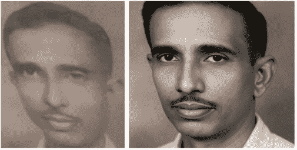

图 13.43 – 使用 GPT Vision 进行人脸修复

应用包括历史照片修复、家庭照片增强、档案数字化和人脸重建。

## 多图像合成

GPT Image 可以联合推理多张输入图像，如下一段代码所示：

```python
result = client.images.edit(model="gpt-image-1",
    image=[open("images/beach.png", "rb"), open("images/whale.jpg", "rb")],
    # image=[open("images/giraffe.jpg", "rb"), open("images/bird.jpg", "rb")]
    prompt="Combine these into a realistic product scene")
```

模型将来自多个来源的视觉概念（鲸鱼与海滩、长颈鹿与鸟类）融合成一个连贯的构图，如下图所示。

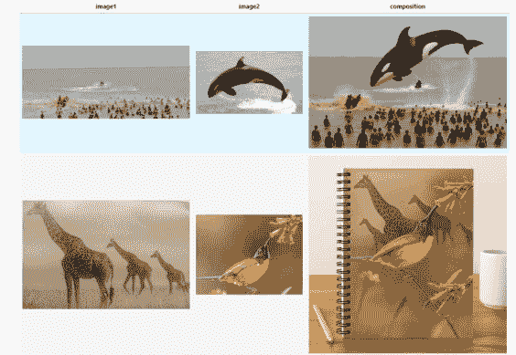

图 13.44 – 使用 GPT-image 进行多图像合成

应用包括广告设计、产品可视化、概念艺术和合成场景创作。

## 电商产品增强

产品图像可以自动转换为专业的营销照片。

```python
result = client.images.edit(model="gpt-image-1", image=f,
    prompt="""Place this product in a professional
    studio background with soft lighting""")
```

模型通过改善背景、光照、反射和呈现质量来执行虚拟摄影，如下一个 Gradio 应用所示。

### 电商产品生成器

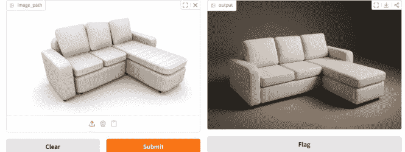

图 13.45 – 使用 GPT-image 进行电商产品增强的 Gradio 应用

## 视觉问答（VQA）

视觉模型可以回答关于图像的任意问题。下一段代码中的 `analyze()` 函数将图像和自然语言问题发送给多模态 GPT 模型，并返回模型对图像的视觉理解。

```python
def analyze(image, question):
    with open(image, "rb") as f:
        b64 = base64.b64encode(f.read()).decode()
    response = client.responses.create(model="gpt-4.1-mini",
        input=[{"role": "user", "content": [
            {"type": "input_text", "text": question},
            {"type": "input_image", "image_url": f"data:image/jpeg;base64,{b64}"}
        ]}])
    return response.output_text
```

展示 VQA 的 Gradio 应用界面如下图所示：

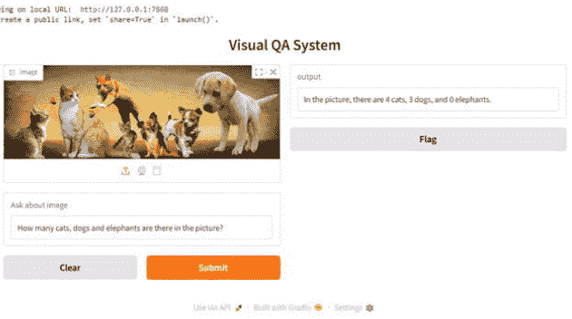

图 13.46 – 使用 GPT-Image 的视觉问答系统 Gradio 应用

> **注意**
>
> 上述三个基本步骤为：**编码图像 → 将图像和问题发送给 GPT → 返回答案。** 这种能力被称为**视觉问答（VQA）**，下一个 Gradio 应用对此进行了演示。

## 自动化工业检测（检测制造缺陷）

GPT Vision 可以充当质量检查助手。下一段代码使用多模态 GPT 模型作为自动化质量检查员，分析胶囊图像的*制造缺陷*，并返回结构化的 JSON 检测报告，其中包含检测到的缺陷、位置、严重程度、置信度分数和总体质量评估。

```python
with open("images/capsules.png", "rb") as f:
    image_b64 = base64.b64encode(f.read()).decode()

prompt = """You are an industrial quality-control inspector. Analyze the image carefully. Look for:
Scratches, Cracks, Corrosion, Missing parts, Deformation, Surface
contamination, Paint defects,
Manufacturing anomalies. Return ONLY valid JSON:
{"defect_found": true,  "defects": [{"type": "",  "location": "", "severity": "",
"confidence": 0, "description": ""}],  "overall_quality": "",  "inspection_summary": ""}"""

response = client.responses.create(model="gpt-4o", input=[{"role": "user",
    "content": [{"type": "input_text", "text": prompt},
                {"type": "input_image",
                 "image_url": f"data:image/jpeg;base64,{image_b64}"}]}])
result = response.output_text
print(result)
```

函数 `base64.b64encode(...)` 将图像转换为适合 API 传输的文本格式。

`prompt` 定义了检测任务并指定了所需的 JSON 输出格式。函数 `client.responses.create(...)` 将图像和检查指令发送给 GPT 视觉模型。此处，`"role": "user"` 再次表明提示词和图像是用户输入给模型的内容，`"type": "input_text"` 提供缺陷检查指令，`"type": "input_image"` 提供待分析的胶囊图像，其中 `response.output_text` 以 JSON 格式获取模型的检测报告，`print(result)` 显示生成的质量控制报告。

结果以结构化 JSON 形式返回。

```json
{
    "defect_found": true,
    "defects": [{"type": "crack", "location": "first capsule", "severity": "high", "confidence": 0.95,
        "description": "Visible crack running down the length of the capsule."}, ...]
}
```

随后的可视化代码（参见 GitHub）将 JSON 输出转换为仪表板，显示缺陷位置、严重程度、置信度分数和检测摘要。


## 质量控制报告

### 整体质量：差

发现多处缺陷，包括裂纹、变形和表面污染，影响胶囊的完整性和外观。

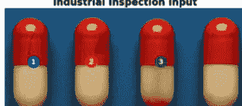

- **#1 裂纹**
  - 严重程度：高
  - 置信度：95.0%
  - 位置：第一个胶囊
  - 可见裂纹沿胶囊长度方向向下延伸。

- **#2 变形**
  - 严重程度：中
  - 置信度：90.0%
  - 位置：第二个胶囊
  - 胶囊红色部分可见表面变形。

- **#3 表面污染**
  - 严重程度：中
  - 置信度：85.0%
  - 位置：第三个胶囊
  - 胶囊下部可见褐色变色。

检测到的缺陷：3

图 13.47 – 使用 GPT-Image 检测制造缺陷

这展示了多模态基础模型如何协助工业质量保证。

## 图像着色

GPT-Image 可将灰度照片转换为逼真的彩色图像。

```
prompt = """Colorize this grayscale photograph. Preserve: geometry, faces, objects, composition. Add realistic natural colors. Photorealistic. High quality. Historical accuracy if applicable."""

input_image = "images/balloons.png"
with open(input_image, "rb") as img:
    result = client.images.edit(model="gpt-image-1", image=img, prompt=prompt)
```

该提示指示模型在生成合理色彩的同时保留几何形状和内容。

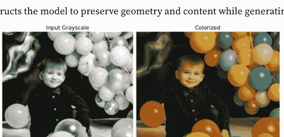

图 13.48 – 使用 GPT-Image 对灰度图像进行着色

应用包括历史图像修复、胶片修复、档案数字化以及文化遗产保护。

## 草图到照片级真实合成

手绘草图可以转换为逼真图像。

```
prompt = """Convert this sketch into a photorealistic image."""
```

模型保留形状、构图、透视和姿势，同时生成逼真的纹理、光照和材质。

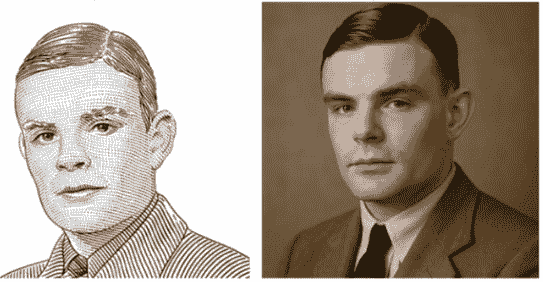

*图 13.49 – 从草图生成照片级真实图像（艾伦·图灵）*

应用包括概念设计、建筑、时尚和工业原型制作。

## 绘画到照片级真实转换

绘画和艺术作品可以转换为摄影图像。

```
result = client.images.edit(model="gpt-image-1", image=img, prompt=prompt)
```

转换在保留场景结构的同时，将艺术纹理替换为逼真的视觉细节。

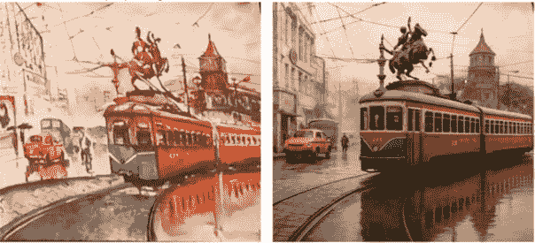

*图 13.50 – 从绘画生成照片级真实图像*

## 局部对象编辑

特定对象可通过自然语言指令进行修改。

```
prompt = """Change the yellow car to red. Preserve everything else."""
```

与传统的基于分割的方法不同，GPT-Image 通过对场景的语义理解执行局部编辑。

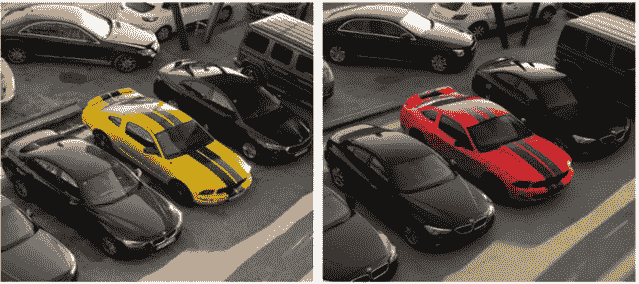

*图 13.51 – 使用 GPT-Image 进行局部对象（汽车）编辑*

应用包括产品定制、虚拟原型制作和设计探索。

## 对象移除

不需要的对象可以在不显式提供掩码的情况下被移除，如下所示：

```
prompt = """Remove the person from the image. Keep everything else unchanged."""
```

模型重建被隐藏的背景并一致地填充被移除区域。这是一种广义的 *语义修复* 形式，如下图所示：

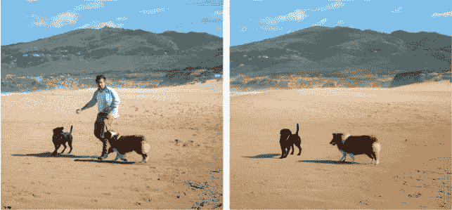

*图 13.52 – 使用 GPT-Image 进行对象移除*

将原始图像和结果图像（使用上述提示生成）并排绘制，您将得到以下图：

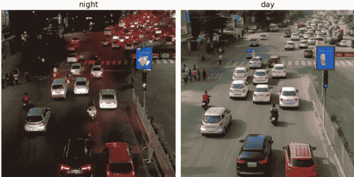

图 13.54 – 使用 GPT-Image 进行夜到日转换

季节转换：植被、积雪覆盖、大气和光照条件在保持底层地貌结构的同时被修改，如使用下一提示对维多利亚纪念大厅图像所做的那样。

```
prompt = """Convert this summer scene into a realistic winter scene."""
```

将原始图像和结果图像（使用上述提示生成）并排绘制，您将得到以下图：


图 13.55 – 使用 GPT-Image 进行夏到冬转换


图 13.56 - 使用 GPT-5 对两张图像进行变化检测

模型比较两张图像并识别：新建筑、拆除结构、道路修改、植被变化、城市扩张和施工活动。输出以结构化 JSON 返回并转换为表格报告以供进一步分析。

## 医学图像解读

视觉模型可以提供医学图像的教育性分析。下一段代码使用多模态 GPT 模型分析大脑 MRI 图像（如下所示）并生成非诊断性报告，描述可见解剖结构、图像方向、结构、观察结果和局限性。

```
with open("images/mri.png", "rb") as f:
    image_b64 = base64.b64encode(f.read()).decode()

response = client.responses.create(model="gpt-5.1", input=[{"role": "user",
"content": [{"type": "input_text", "text": "Analyze this brain MRI. Describe visible anatomy, orientation, structures, observations, and limitations. Do not provide a diagnosis."},
{"type": "input_image", "image_url": f"data:image/jpeg;base64,{image_b64}"}]}])

print(response.output_text)
```

- **可见解剖结构（主要区域）**
  - 大脑半球：额叶（上部）、颞叶（侧部/下部）。
  - 深部灰质结构：丘脑在中线附近部分可见。
  - 脑室系统：侧脑室体部（中线、低信号）。
  - 中线结构：大脑镰、半球间裂。
  - 颅底/眶区：
    - 眶和外眼肌
    - 鞍/鞍上区（垂体区）
    - 海绵窦/蝶窦区
    - 脑干上部开始在下方出现。
    - . . .

代码将 MRI 图像和分析提示发送给多模态 GPT 模型，并返回对扫描的结构化教育性描述，而不尝试医学诊断。


模型描述可见解剖结构和成像特征，同时避免确定性诊断。潜在应用包括医学教育、图像标注、数据集文档和临床工作流程辅助。人类专家审查对于诊断决策至关重要。

GPT Vision 和 GPT Image API 提供统一的多模态框架，用于图像理解、生成、编辑、修复、修复、风格迁移、视觉问答、工业检测、遥感分析和医学图像解读。通过将大型视觉语言模型与强大的图像生成能力相结合，这些 API 能够通过简单的自然语言指令实现复杂的计算机视觉工作流程，显著减少对任务特定架构和专门训练流程的需求。

> 注意
> 上述各节中使用的 GPT-4.1 和 GPT-5 是为推理、语言生成、编码和图像理解而设计的多模态 LLM，而 gpt-image-1 是专门的图像生成模型，用于根据文本提示和现有图像创建和编辑图像。

## 生成式 AI 用于化学

这些练习展示了使用 GPT-Image 在化学中使用多模态生成式 AI 的应用，完整代码和实现可在随附的 GitHub 仓库中获得；仅显示最终生成的输出。

### 练习 1：杂化可视化

生成教科书风格的信息图表，比较 sp、sp² 和 sp³ 杂化，包括几何形状、键角和示例（BeCl₂、BF₃、CH₄），展示自动化学图生成：


图 13.58 – GPT-Image 生成化学教育内容

此示例展示了生成式 AI 如何快速生成高质量的化学教育图表，用于科学传播和教学材料。

### 练习 2：类药分子设计

使用分子图像作为输入供视觉模型分析结构并提出新型类似物，然后使用 GPT-Image 生成其 2D 骨架式，展示分子设计的图像到推理到图像流程。

输入药物（阿莫西林）分子

生成的新类药分子


图 13.59 – GPT-Image 从现有药物分子生成新型类药分子

此示例说明了生成式 AI 如何通过将化学结构图像转化为新型设计概念来支持分子构思和可视化，为教育、化学信息学和 AI 辅助药物发现研究提供有用的工具。


## 小结

在本章中，我们考察了塑造现代生成式计算机视觉的主要范式，包括GAN、VAE、扩散模型、潜在扩散和多模态基础模型。通过动手示例，我们展示了这些技术如何实现高质量图像生成、图像到图像转换、人脸复原、结构保持编辑、身份引导合成、图像修复、视觉推理和智能图像分析。结合全书所涉及的主题，这些方法展示了从传统图像处理和视觉识别向能够理解并创建视觉内容的强大生成系统的转变。

在整本书中，我们完成了一段旅程：从基础的图像处理和计算机视觉任务——图像操作、增强、复原、分类、目标检测和分割——到现代生成式和多模态AI系统。各章共同展示了计算机视觉从理解视觉内容到生成、编辑和控制视觉内容的演进，为当代AI驱动的图像处理提供了一个统一视角。

## 获取本书的PDF版本及更多内容

扫描二维码（或访问 https://packtpub.com/unlock）。按名称搜索本书，确认版本，然后按照页面上的步骤操作。


立即解锁

注意：请准备好购买凭证。直接从Packt购买的书无需凭证。

## 三步解锁本书的免费福利

### 步骤1

请准备好购买凭证，以备*步骤3*使用。如果你有实体书，请用手机扫描，并将其保存为PDF、JPG或PNG格式。

如需查找购买凭证的更多帮助，请访问 https://www.packtpub.com/en-us/unlock?step=1。

### 注意

如果你直接从Packt购买本书，则无需凭证。完成*步骤2*后，即可立即访问专属内容。

### 步骤2

扫描二维码或访问 packtpub.com/unlock。


在打开的页面上（类似于桌面端的*图14.1*），按名称搜索本书并选择正确的版本。


*图14.1：Packt解锁页面（桌面端）*

### 步骤3

选择图书后，登录你的Packt账户，或免费创建一个。然后上传你的购买凭证（PDF、PNG或JPG格式，最大10 MB）。按照屏幕上的说明完成该流程。

### 需要帮助

如果你遇到困难需要帮助，请访问 https://www.packtpub.com/unlock-benefits/help 查看常见问题解答，了解如何找到购买凭证以及更多信息。此二维码将带你进入帮助页面。


注意：如果仍然遇到问题，请联系 customercare@packt.com。


packtpub.com

订阅我们的在线数字图书馆，即可完整访问超过7,000本图书和视频，以及行业领先的工具，帮助你规划个人发展、推进职业生涯。如需更多信息，请访问我们的网站。

## 为什么订阅？

- 借助来自4,000多位行业专业人士的实用电子书和视频，花更少时间学习，更多时间编码
- 通过专为你打造的技能计划提升学习效果
- 每月免费获得一本电子书或一个视频
- 支持全文搜索，便于访问关键信息
- 可复制、粘贴、打印和添加书签

在 www.packtpub.com，你还可以阅读一系列免费技术文章、订阅多种免费新闻通讯，并获得Packt纸质书和电子书的专属折扣与优惠。

## 你可能还喜欢的其他书籍

如果你喜欢这本书，你可能还会对Packt的以下其他书籍感兴趣：


### 每位AI工程师都必须构建的30个智能体

Imran Ahmad

ISBN: 978-1-80610-901-2

- 部署生产就绪的智能体系统，实现安全可靠的扩展
- 使用LangChain和LangGraph，通过模块化架构构建自主智能体
- 实现具备复杂记忆、规划和推理能力的智能体
- 将工具、API和外部数据无缝集成到智能体工作流中
- 建立健壮的评估框架，以衡量和优化智能体性能
- 实施护栏和可解释性功能，确保道德和安全部署
- 构建多智能体系统，用于复杂的协作任务编排
- 在医疗、金融和法律领域应用特定的智能体架构


### 用于构建多智能体系统的智能体架构模式

Dr. Ali Arsanjani, Juan Pablo Bustos

ISBN: 978-1-80602-957-0

- 应用设计模式来处理指令漂移、改进协调，并构建容错AI系统
- 使用智能体技术栈的三个层设计系统：函数调用、工具协议（MCP）和A2A协作
- 开发负责任、合乎道德且可治理的GenAI应用
- 使用ADK、LangGraph和CrewAI等框架并附代码示例
- 掌握提示工程、LLMOps和AgentOps最佳实践
- 使用RAG、微调和上下文学习构建智能体系统

## Packt正在寻找像你一样的作者

如果你有兴趣成为Packt的作者，请访问 authors.packt.com 并立即申请。我们与成千上万的开发者和技术专业人士（就像你一样）合作，帮助他们与全球技术社区分享见解。你可以提交一般性申请，申请我们正在招募作者的具体热门主题，或提交你自己的创意。

## 分享你的想法

现在你已经读完了*《Python图像处理与计算机视觉实战》*，我们很想听听你的想法！如果你从Amazon购买了这本书，请点击此处直接进入该书的Amazon评论页面分享反馈，或在购买该书的网站上留下评论。

你的评论对我们和技术社区都很重要，将帮助我们确保提供优质内容。

## 索引

### 符号

- 二维卷积 202, 230-233
  - 与三维卷积对比 234, 235
- 二维DCT 182
- 二维DFT 171
- 二维FFT 172
- 三维卷积 233, 234
  - 与二维卷积对比 234, 235
- α合成 98

### A

- AdamW 554
- 自适应伽马校正与色彩保持（AGCCPF） 318
- 神经网络的对抗攻击
  - 用于图像分类 610, 611
- 对抗扩散蒸馏（ADD） 678
- 仿射变换
  - 应用 87-89
  - 应用于图像 64, 65
- Alpha（α）通道 96
- 交替最小化（AM） 468
- 幅度量化 5
- 动画GIF 21
- 各向异性扩散 382
- 匿名化 81
- 抗锯齿 78, 163
  - 使用scikit-image 166, 167
- ArcFace 591
- 艺术风格生成
  - 使用稳定扩散 684, 685
- 增强现实（AR）滤镜
  - 用于场景文本识别 629
- 自动车牌识别（ALPR） 625-627
- 平均精度（AP） 562

### B

- 后向扭曲 59
- 带通滤波器（BPF） 256, 257
  - 使用DoG核 256, 257
- 带阻/带拒（陷波）滤波器（BSF/BRF） 257
  - 高斯带阻滤波器（GBSF） 259, 260
  - 周期性（正弦）噪声的去除 257-259
- 带阻滤波器 239
- 桶形畸变 54
- 批归一化（BatchNorm） 581
- 贝叶斯神经网络（BNN）
  - 蒙特卡洛Dropout 595, 596
  - 用于图像分类 593-595
- 最大熵BBHE（BPHEME） 318
- 偏差-方差权衡 403
- 双三次插值 155, 156
- 双边滤波器
  - 使用 311-313
- 双边核 475
- 双线性插值 77, 154, 156
- 双变量B样条逼近 157
- blend() 函数 97
- 斑点检测 370
- 块匹配与3D（BM3D）
  - 基本估计阶段 322
  - 最终估计阶段 322
  - 用于去噪 322–324
- 蓝、绿、红（BGR） 20
- 边界框
  - 绘制 92
- 方框模糊核 205
  - 用于线性噪声平滑 304
- 方框滤波器 303
- 方框核 239
- 脑肿瘤MRI图像
  - 使用UNet分割 542–544
- 亮度保持双直方图均衡化（BBHE） 318
- Brown-Conrady模型 143
- Butterworth 239
- Butterworth低通滤波器（BLPF） 245

### C

- 相机标定 143
- Canny边缘检测器
  - 与scikit-image一起使用 363, 364
- 车辆损伤检测（CarDD） 634, 635
- CIE色度图
  - 应用 30
- 循环移位灰度图像 83
- 类别条件图像生成 640
  - 使用条件生成对抗网络（cGANs） 640–648
- 类别条件插值 651
- 图像去卷积的经典方法 398
  - 维纳滤波的贝叶斯解释 408, 409
  - 使用CLEAN算法 409
  - 频域公式化 399–402
  - Tikhonov正则化 405
  - 使用维纳滤波器 402
- 经典图像分割 450
  - 基于边缘的分割 453
  - 图模型与概率方法 470
  - 基于学习的经典分割 479
  - 基于区域的分割 453
  - 基于超像素的分割 460
  - 基于阈值的分割 450
  - 地形（形态学）分割 453
  - 变分与基于能量的分割 466
- 无分类器引导 428
- CLIPSeg 521
- CNN脑部查看器仪表板
  - 使用Gradio进行交互式探索 571, 572
- 粗尺度 370
- 颜色条 13
- 色域 29
- 颜色查找表（CLUT） 115
- 颜色映射（cmap） 13
- 色彩突出效果
  - 通过HSV操作创建 36
  - 模拟 52, 53
- 颜色空间 5, 29
  - HSV颜色空间中的颜色增强 34
  - Lab颜色空间中的颜色偏移 37, 38
  - 转换为另一种颜色空间 31
  - 青、品红、黄、黑（CMYK） 29
  - 色调、饱和度、明度（HSV） 29
  - 图像数组坐标（NumPy风格） 40
  - 转换图像数据结构 40
  - Lab（CIELAB） 29
  - 绘图坐标（Matplotlib风格） 41
  - 红、绿、蓝（RGB） 29
  - 使用HSV和YCbCr颜色空间进行肤色检测 39, 40
  - YCbCr 29
  - YIQ 29
  - YUV 29


- colour-science Python 库 30
- Compass 边缘检测器 357, 358
- 压缩比 109
- 条件生成对抗网络 (cGANs) 640
    - 用于类别条件图像生成 640-647
- 条件图像生成
    - 使用条件变分自编码器 (CVAE) 648-653
- 条件随机场 (CRFs) 474
    - 内部迭代步骤 477, 478
    - 手动迭代 478
    - MAP 推断 475, 476
    - 成对势 476, 477
    - 概率模型 474
- 条件变分自编码器 (CVAE) 639
    - 架构 648
    - 用于条件图像生成 648-653
- 连通分量 457
- 对比语言-图像预训练 (CLIP) 519
- 对比度受限自适应直方图均衡化 (CLAHE) 292
- ControlNet 686
    - 用于结构引导图像生成 676, 677
- 卷积 201, 229
    - 2D 卷积 230-233
    - 3D 卷积 233, 234
    - 与相关性对比 213-215
- 卷积神经网络 (CNNs) 383
    - 语义分割 484
- 基于卷积的重采样
    - 使用 PIL 165, 166
- 频域中的卷积
    - 应用 219
    - 卷积定理 219, 220
    - 使用高斯模糊核进行卷积 220
    - 频率谱可视化 220
    - 应用高斯模糊 224
- 图像处理中的卷积
    - 频域卷积 203
    - 需要 202
    - 实际应用 204
    - 空域卷积 203
    - 空域与频域对比 204
    - 时间复杂度 204
- 空域中的卷积
    - 应用 204
    - 使用 opencv-python 应用 211, 212
    - 使用 scipy.ndimage 应用 209-211
    - 使用 scipy.signal 应用 205-208
    - 性能基准测试 212
- 卷积核
    - 浮雕核 210
    - 提亮核 210
    - 锐化核 210
- 卷积定理 203
- Cooley-Tukey FFT 算法 189
- 计数硬币
    - 形态学操作 457-460
    - 使用分割 456
- 互相关 215, 216
    - 使用 scipy.signal 215, 216
- 十字阴影滤镜
    - 实现 126, 128
- 三次卷积核 155
- 三次样条 155
- 累积分布函数 (CDF) 72
    - 计算 71, 73
    - 属性 72
- 自定义分割模型
    - 训练 534
    - 使用 Keras Functional API 训练 U-Net 534-539
    - 使用 ResNet18 主干训练 U-Net 539-542

## D

- DALL·E 2 与 DALL·E 3 690
- 暗通道先验 (DCP) 335
    - 用于去雾 335-338
- 数据预处理 81
- 数据类型
    - 二值掩码，使用布尔图像 28
    - 在数据类型之间转换 28
    - 检查图像的数据类型 27
    - 溢出和裁剪 28
- 装饰器 16
- DeepFill
    - 使用 Stable Diffusion 427, 428
- 深度学习
    - 用于图像分割 484
- 基于深度学习的边缘检测 383
    - 作为学习问题 384
- defisheye 135, 136
- 去噪
    - 使用块匹配与 3D (BM3D) 322-324
    - 使用样条滤波器 160, 161
- 去噪扩散隐式模型 (DDIM) 436, 437
- 去噪扩散概率模型 (DDPM) 437, 666-670
    - 前向扩散过程 666, 667
    - 潜在扩散 671
    - 潜在空间插值 670
    - 反向扩散过程 668, 669
- 密集预测 Transformer (DPT) 503, 524, 525
- 深度估计
    - DPT 524, 525
    - 单目深度估计 524
    - 流程 525, 526
- 基于导数的多尺度增强 386
    - 高斯金字塔 386
    - 图像重建和增强 388
    - 拉普拉斯金字塔 387
    - 选择右侧边缘检测器 391, 392
- 导数
    - 用于经典增强 350
    - 用于边缘检测 354
- 检测 Transformer (DETR) 504
- Detectron2 532, 534
- 海森行列式 (DoH) 370
- DFT 属性 188
    - 分配律 194
    - 线性 194
    - Parseval/Rayleigh 定理 198
    - 周期性 190, 191
    - 振铃伪影 192
    - 旋转 195
    - 可分离性 188, 189
    - 相似性/缩放 196
    - 平移和相位中的偏移 197
    - windowing 190, 191
- Dice 相似系数 (DSC) 560, 561
    - dice loss 561
    - 平均像素准确率 561
    - 像素准确率 561
- 高斯差分 (DoG) 256
- 基于扩散的超分辨率 683
- 扩散模型
    - 用于图像修复 437, 439
- 数字图像处理 6
    - 可重复性和版本兼容性 4, 5
- 直接卷积 226
- 脏波束 409

- PNG 22
- PPM/PNM 22
- TIFF 22
- 滤波 202, 240
    - 特征 240
    - 在频域中 240
- 细尺度 370
- 一阶运动模型 (FOMM)
    - 用于 Deepfake 生成 633, 634
- 鱼眼校正
    - 在 cv2.remap() 中插值方法 135
- 鱼眼失真图像
    - 校正 54
- 鱼眼效果
    - 使用 Knew 控制视场 134
    - 去除鱼眼失真 133
- FixMatch 597
- Floyd-Steinberg 抖动
    - 使用误差扩散 284-288
- 聚焦效果 81
- 前向映射 59
- 基础变分框架 467
- 基于傅里叶的位置编码 239
- 傅里叶特征网络 (FFNs) 239, 261, 262
    - 使用 JAX 实现 262-268
    - 训练 262
- 分数布朗场 (FBF) 模型 177
- 帧
    - 从动画 GIF 中提取 21, 22
- Frangi 376
- Fréchet Inception 距离 (FID) 643
- 频域 239
    - 滤波 240
- 频域卷积 203
- 频域滤波器
    - 低通滤波器 (LPF) 241
    - 类型 240
- 频率谱可视化 220
    - 使用 2D 绘图 220, 221
    - 使用 3D 绘图 222, 223
- Frobenius 范数 173
- 全卷积网络 (FCNs) 485-487
    - Atrous Convolution 487
    - DeepLab 系列 487
    - 使用 keras-cv 的 DeepLabV3+ 491
    - 使用 Keras_hub 的 DeepLabV3+ 490
    - 使用 tensorflow model garden 的 DeepLabV3 488-490
    - 使用 torchvision.models.segmentation 的 DeepLabV3 487, 488
    - 使用 SMP 和 Torchvision 的多模型分割和集成 492
    - 使用 SMP 和 Torchvision 的多模型分割 493
- 基于模糊逻辑的图像增强 292, 293
    - 颜色增强 299
    - 使用 Mamdani 系统的对比度增强 293

## G

- 高斯混合模型 (GMMs) 470
- 高斯金字塔 386, 387
- 生成对抗网络 (GANs) 639, 657
- 生成面部先验 GAN (GFPGAN) 664, 666
    - 安装 664, 665
- 几何变换 86
    - 应用仿射变换 87-89
    - 图像反射 86
    - 图像旋转 86
    - 应用透视变换 89, 90
- Gibbs 能量 474
- Gibbs 现象 193
- 全局直方图均衡化 (GHE) 318
- GPT 图像 API 691
    - AI 风格迁移 695, 696
    - 自动化工业检测 699-701
    - 背景替换 704
    - 遥感中的变化检测 706
    - 电子商务产品增强 698
    - 边缘引导编辑 693, 694
    - 人脸修复 696, 697
    - 图像上色 701, 702
    - 使用 GPT image 进行图像编辑 693
    - 图像修复 694, 695
    - 使用 GPT vision 理解图像 692
    - 局部对象编辑 703
    - 医学图像解释 707
    - 多图像合成 697, 698
    - 对象移除 703
    - 绘画到照片级转换 702
    - 场景转换 704
    - 草图到照片级合成 702
    - 可视问答 (VQA) 699
- GrabCut 470, 471
    - 迭代细化 471
    - 通过图割优化 471
    - 使用 OpenCV-Python 471-474
- Gradio 522-524
    - 用于构建交互式 Sepia 滤镜应用 47
- 基于图的合并 (RAG) 463
- 图形和概率方法
    - 条件随机场 (CRFs) 474
    - GrabCut 470, 471
- 灰度图像着色
    - 使用复古风格上色 35
    - 显示色相渐变 34
    - 在 HSV 颜色空间中 34
- 灰世界算法 300
- 引导滤波器 380
- 引导滤波 379-381

## H

- 半色调 283
- 手部关键点检测
    - 使用 MediaPipe 631-633
- hard_light 混合模式 103
- 海森矩阵 372
- 使用 t-SNE 的高维图像特征 566
    - CNN 大脑查看器仪表板 570
    - 从 VGG16 可视化深度特征 568-570
    - MNIST 嵌入 566, 567
- 高通滤波器 (HPF) 250, 400, 402
    - 使用 skimage.filters 的 Butterworth 滤波器 255, 256
    - 理想方法 251, 252
    - SNR 随截止频率变化 254
    - 使用 scipy.fftpack 252-254
- 高分辨率 (HR) 338
- 直方图均衡化 (HE) 292
- 直方图匹配 297
    - 使用 scikit-image 298


