## 2
量子态、操作与测量

本章涵盖理解后续章节所需的基础数学知识。我们将使用 Python 作为工具来理解本章涉及的数学概念。

我们将首先简要介绍线性代数，它是量子信息处理的基础。然后，我们将简要回顾量子力学的历史，并将其与量子比特（qubit）的定义联系起来。最后，我们将介绍量子操作，包括酉操作和非酉的量子测量。

上述代码片段可解释如下：

- 1. 首先，导入 numpy 并使用别名 np。
- 2. 然后，使用 numpy 的 array() 函数创建两个向量 x 和 y。
- 3. 接下来，创建两个矩阵 A 和 B。
- 4. 最后，使用 numpy 的 kron() 函数创建两个张量积 v 和 w。

前者（张量积 v）是向量 x 与矩阵 A 的张量积，而后者（张量积 w）是向量 y 与矩阵 B 的张量积。

向量上可以进行加、减、标量乘法等算术运算。矩阵和张量也是如此。下面的代码片段展示了向量、矩阵和张量上的一些算术运算示例：

```
# Arithmetic operations
#vectors
z = x + y # vector addition
z = x - y # vector subtraction
z = 2 * z # scalar multiplication
#matrices
C = A - B # matrix multiplication
C = x * A # a product of a vector and a matrix
#tensors
u = v + w # tensor addition
u = 5 * u # multiplication of a tensor by a scalar
```

上述代码片段展示了可以在向量、矩阵和张量上执行的基本运算。这些运算包括加法、乘法和标量乘法。

到目前为止，我们已经涵盖了线性代数的基础知识，重点介绍了向量、矩阵和张量。在下一节中，我们将介绍向量空间。

## 探索向量空间

**向量空间**是向量的集合。设 V 是定义了加法和标量乘法两种算术运算的向量集合。那么，对于向量 x、y、z 和标量 a、b，以下是向量空间 V 满足的公理：

- x + y ∈ V
- x + y = y + x
- x + (y + z) = (x + y) + z
- V 有一个零向量，使得对于 x ∈ V，x + 0 = x
- 对于每个 x ∈ V，V 中存在一个向量，记为 -x，使得 x + (-x) = 0
- ax ∈ V
- a(x + y) = ax + ay
- (a + b)x = ax + bx
- a(bx) = (ab)x
- 1x = x

向量空间的另一个特征是称为**基**的概念。如果满足以下条件，则向量集合 B 构成向量空间 V 中的一个基：

- 每个向量 x ∈ V 都可以表示为 B 中向量的线性组合。
- B 中的所有向量都是线性无关的。

最后，V 中的标量域要么是实数域 (R)，要么是复数域 (C)。复数是可以写成以下形式的数 z：

z = a + ib

这里，a 和 b 都是实数，并且

i = √-1

表达式 ib 被称为*虚数*。一个复数的（复）共轭，是将该复数中的 + 号替换为 – 号（或相反）而得到的相同复数。因此，z = a + ib 的复共轭

是 z1 = a − ib

而 z = c − id 的复共轭是 z1 = c + id。

## 理解向量的性质

现在我们来讨论向量的性质。在此值得指出的是，向量既可以是行向量，也可以是列向量。前者中，向量的元素按行表示；后者中，向量的元素按列表示：

- **转置**：向量的性质之一是转置。向量的转置（用 $T$ 表示）将列向量转换为行向量，将行向量转换为列向量。因此，对于具有 $n$ 个分量的向量 $x$，有以下两个方程：

公式 1 可写为：

$[x_1\ \ x_2\ \ \cdots\ \ x_n]^T = \begin{bmatrix} x_1 \\ x_2 \\ \vdots \\ x_n \end{bmatrix}$

公式 2 可写为：

$\begin{bmatrix} x_1 \\ x_2 \\ \vdots \\ x_n \end{bmatrix}^T = [x_1\ \ x_2\ \ \cdots\ \ x_n]$

第一个公式表明，当对行向量（按行表示的元素）应用转置时，其元素会转换为列向量（按列表示）。另一方面，第二个公式是第一个公式的相反情况。在第二个公式中，对列向量应用转置以将其转换为行向量：

- **点积**：向量的另一个性质是点积，也称为**内积**。对于各具有 $n$ 个分量（元素）的向量 $x$ 和 $y$，点积（用 $\langle x,y\rangle$ 表示）为：

$\langle x, y \rangle = \sum_i n i x_i y_i = x1y1 + x2y2 + \cdots + xnyn$

向量的范数刻画了其长度。有一类特殊的向量，其性质如以下公式所示：

这些向量被称为**单位向量**。

- **正交性**：向量还有另一个性质，称为**正交性**。如果两个向量 $x$ 和 $y$ 的内积为零，则称它们是**正交的**。因此，如果 $\langle x,y\rangle = 0$，则向量 $x$ 和 $y$ 是正交的。在几何上，正交向量是垂直的。既正交又是单位向量（长度为 1）的向量称为**标准正交**向量。

## 理解矩阵的性质和类型

**矩阵**定义为标量的二维数组，至少有一行和一列。$n\times m$ 矩阵 $A$ 定义为具有 $n$ 行和 $m$ 列的二维数组，表示为：

$A_{n\times m} = \begin{bmatrix} a_{11} & a_{12} & \cdots & a_{1n} \\ \vdots & \vdots & \cdots & \vdots \\ a_{n1} & a_{n2} & \cdots & a_{nn} \end{bmatrix}.$

现在，我们来讨论矩阵的性质：

- **行列式**：矩阵的一个性质是其行列式。矩阵的行列式仅对方阵定义，方阵的行数等于列数。矩阵 $A$ 的行列式（用 $det(A)$ 或 $|A|$ 表示）是一个标量。

用于计算矩阵行列式的 Python 代码片段如下：

```
import numpy as np

A = np.array([[1,2,3], [4,5,6], [1,5,1]]) # a 3x3 matrix.
det_A = np.linalg.det(A)
print(det_A)
```

上述代码使用 numpy 的 linalg.det() 函数来计算矩阵 A 的行列式：

- **迹**：矩阵还有一个称为迹的性质。对于矩阵 $A$，$A$ 的迹（用 $T(A)$ 表示）是 $A$ 的对角元素之和。

- **转置**：与向量一样，矩阵也有转置。矩阵 $A$ 的转置（用 $A^T$ 表示）将 $A$ 的行元素与其列元素互换。因此，有以下公式：

$$[A_{m\times n}]^T = [A_{n\times m}].$$

使用 numpy 实现矩阵转置的 Python 代码如下所示：

```
import numpy as np

A = np.array([[1,2,3], [4,5,9], [5,2,1]]) # a 3x3 matrix.
det_A = np.linalg.det(A)
np.transpose(A)
```

上述代码使用 numpy 的 transpose() 函数来计算矩阵 A 的转置。

- **特征值和特征向量**：矩阵的最后一个值得讨论的性质是特征值和特征向量。设 $V$ 是域上的向量空间，$A$ 是一个矩阵。那么，如果存在非零向量 $x \in V$，使得：

$$Ax = \lambda x,$$

则标量 $\lambda \in \mathbb{F}$ 称为 $A$ 的特征值，其中向量 $x$ 称为 $A$ 的特征向量。

现在，让我们关注各类矩阵。这些类型讨论如下：

- **单位矩阵**：矩阵的一个例子是单位矩阵，用 $I$ 表示。单位矩阵具有这样的性质：对于任何矩阵 $A$，乘以 $I$ 不会改变 $A$。即：

$$A * I = I * A = A$$

单位矩阵的对角元素为 $1$，非对角元素为 $0$。矩阵的另一个例子是逆矩阵：

- **逆矩阵**：矩阵 $A$ 有一个逆矩阵，用 $A^{-1}$ 表示，满足：

$$A * A^{-1} = A^{-1} * A = I$$

矩阵 $A$ 的逆存在，当且仅当 $A$ 的行列式不为 $0$。


使用 qutip 和 numpy 计算矩阵 A 和 B 的张量积的 Python 代码如下所示：

```python
from qutip import *
import numpy as np

A = np.array([[2,3], [4,5]])
B = np.array([[2,4], [1,0]])

A = Qobj(A); B = Qobj(B)
# computing tensor product using qutip
C = tensor(A,B); print(C)

# computing tensor product using numpy
D = np.kron(A,B); print(D)
```

该代码使用了两个模块：qutip 和 numpy。首先，使用 numpy 创建两个矩阵 A 和 B。还使用 Qobj() 函数将这些矩阵转换为 qutip 对象。然后，分别使用 qutip 和 numpy 计算张量积：前者使用 tensor() 函数，后者使用 kron() 函数：

- **迹**：矩阵 A 和 B 的张量积 T 的迹为：

  $$Tr(T) = Tr(A) * Tr(B)$$

- **偏迹**：另一方面，张量积的偏迹是对张量积的一部分求迹。因此，对于构成张量积的矩阵 A 和 B：

  $$T = A \otimes B$$

  可以对 A 或 B 求偏迹，使得：

  $$A = TrB(T) = TrB(A \otimes B) = A * Tr(B)$$

  以及

  $$B = TrA(T) = TrA(A \otimes B) = B * Tr(A)$$

量子力学是一个用于描述微观物理实在的概念框架。量子理论的发展始于 20 世纪初，由尼尔斯·玻尔、阿尔伯特·爱因斯坦和马克斯·普朗克等物理学家引领。

量子力学的发展部分源于经典物理学无法充分解释电子等亚原子物体的行为。对亚原子层面的自然理解带来了电子工业和传统计算产业的巨大成功。这一技术成就被称为**第一次量子革命。**

量子信息处理被称为**第二次量子革命**，因为它建立在刚才讨论的第一次量子革命的成功之上。

量子信息处理的兴起是为了应对基本物理定律对传统计算机造成的限制。最早探索这些传统计算限制的人是当时在 IBM 工作的罗尔夫·兰道尔。他在 20 世纪 60 年代初开始了这些研究。兰道尔的工作集中于将热力学定律应用于计算领域。

20 世纪 70 年代，查尔斯·贝内特拓展了兰道尔的工作；贝内特是兰道尔在 IBM 的同事。贝内特证明，可以进行双向可逆计算。双向可逆计算意味着，在给定计算输出的情况下，可以利用这些输出和用于计算的电路来获得计算的输入。

值得注意的是，双向可逆计算意味着信息在计算过程中不会丢失。稍后我们将看到，有一类量子操作是可逆的。另外，不可逆的那类量子操作就是量子测量。这将在本章后面讨论。

除了关注传统信息处理所受到的局限之外，量子信息处理的早期阶段还关注量子理论在安全领域的应用。

20 世纪 60 年代，斯蒂芬·威斯纳探索利用量子力学制造无法伪造的钞票。不幸的是，威斯纳的想法未能在科学界获得认可。直到 20 世纪 80 年代，他的想法才被用作启发，引导人们探索量子信息处理的另一个领域。

20 世纪 80 年代，受威斯纳关于无法伪造钞票的想法的启发，查尔斯·贝内特和吉勒·布拉萨德开发了一种利用量子力学定律安全传输信息的密码方案。该安全方案后来被称为**贝内特-布拉萨德 1984（BB84）量子密钥分发（QKD）协议**。QKD 协议用于在合法通信方之间安全地共享密码密钥，并保证能够检测到窃听者的存在。

1991 年，阿图尔·埃克特在很大程度上独立于贝内特和布拉萨德的工作，利用量子理论开发了一种新的 QKD 协议，后来被称为**E91 协议**。尽管 BB84 和 E91 QKD 协议基于量子理论的不同方面，查尔斯·贝内特、吉勒·布拉萨德和大卫·梅尔文在 1992 年证明，这两种 QKD 协议在数学上是等价的。

20 世纪 80 年代，尤里·马宁、保罗·贝尼奥夫和理查德·费曼等人认真探索了量子计算机的想法。由于费曼的声望，尤其是在 20 世纪 80 年代，他关于利用量子力学定律进行计算的想法在科学界，尤其是物理学界被广泛接受。

1985 年，大卫·多伊奇提出了第一个量子计算计算模型，并证明这样的量子计算机在理论上可以超越传统计算机。

在 20 世纪 80 年代的剩余时间里，量子计算只被视为一个学术好奇心领域，没有任何实际意义。然而，这一观点在 1994 年受到挑战并最终被推翻，当时彼得·肖尔提出了一种量子算法，有可能攻破当时广泛使用的传统密码系统。

两年后，即 1996 年，洛夫·格罗弗提出了一种量子搜索算法，其性能优于任何已知的传统搜索算法。这两个关键结果重新激发了科学界对量子计算的兴趣。

尽管人们对量子计算的兴趣重新燃起，但仍然存在一个主要障碍：量子系统非常脆弱，容易与环境相互作用，因此在完成计算之前很容易失去其*量子性*。

值得注意的是，量子系统与环境的这种相互作用会在计算中引入错误，使得在物理上实现量子计算机的可能性几乎为零。然而，随着彼得·肖尔和安德鲁·斯泰恩分别于 1995 年和 1996 年独立开发出**量子纠错（QEC）**方案，这种几乎不可能的局面发生了改变。

在 21 世纪之交，受 QEC 方案发展的鼓舞，量子信息处理学界的注意力转向了可用于实现量子计算的物理技术。人们探索了各种技术。

这些技术包括核磁共振、囚禁原子和离子、光子器件、量子点和超导电路。迄今为止，还没有哪种单一物理技术被证明是其中最优的。因此，不同技术仍在以不同的受重视程度被继续探索。

建造全尺寸量子计算机仍然是一个尚待克服的挑战。目前，计算能力有限的量子计算机已在投入使用。这些量子计算机被称为**含噪声中等规模量子（NISQ）**计算机。它们之所以被称为*含噪声*，是因为它们没有实现纠错。

NISQ 计算机缺乏纠错意味着可在其上实现的电路深度非常浅。NISQ 计算机目前正被用于处理各种计算任务，应用涉及材料科学、药物发现、机器学习，以及探索 NISQ 计算机具有*量子超优势*的任务。

在简要介绍了量子信息处理的历史之后，现在有必要介绍量子信息的基本单位。我将在下一节中介绍这一点。

## 理解量子比特

正如在传统信息处理中**二进制数字（比特，bit）**是信息的基本单位一样，作为比特的量子类比的**量子比特（qubit）**也是量子信息的基本单位。

与比特只能处于两种状态（*0 或 1*）之一不同，量子比特可以处于这两种状态的叠加态。量子比特被定义为二维复**希尔伯特空间**中的一个向量，而希尔伯特空间被定义为配备了内积的向量空间。

如前一章所述，量子比特 |ψ⟩ 的数学形式为：

$$|\psi\rangle = \alpha|0\rangle + \beta|1\rangle,$$

其中复系数 **α** 和 **β** 满足关系：

$$|\alpha|^2 + |\beta|^2 = 1.$$


任何量子比特 |ψ> 都可以写成两个基向量（状态）|0> 和 |1> 的线性组合。这就解释了为什么我们说量子比特可以处于叠加态。

叠加是量子理论的关键特性之一，在量子信息处理中被利用。即使量子比特可以存在于基态的线性组合中，如我们稍后会看到的，测量会迫使量子比特成为状态 0 或状态 1。

基向量 |0> 给出为：

|0⟩ = [1
0]

而另一方面，基向量 |1> 给出为：

|1⟩ = [0
1].

现在我们对量子比特有了基本了解，我将介绍可以对量子比特执行的一些操作。这将在下一小节中进行。

## 量子比特操作

对于孤立的量子系统（不与环境相互作用），可以在量子比特上执行两类量子操作。这两类量子操作称为量子门。第一类量子操作是幺正类，它是一类可逆量子门。

第二类量子门是测量门，它是一类不可逆门。由于测量是不可逆的，测量后无法恢复初始量子态。测量迫使量子比特坍缩到状态 0 或状态 1。

如前所述，任何 2X2 幺正矩阵，在量子力学的语言中也称为幺正算符，都是单量子比特量子门。单量子比特量子门的例子是泡利门。这些泡利门是 X、Y 和 Z 门（实际上有四个泡利门。另一个是 2x2 单位矩阵 I，它使量子比特保持不变）。

## X 门

X 门，也称为 NOT 门，翻转量子比特的状态。因此，它将状态 |0> 变成状态 |1>，并将状态 |1> 变成状态 |0>。这意味着：

X|0> = |1>

并且

X|1> = |0>.

X 门由以下矩阵定义：

X = [[0, 1], [1, 0]].

然后可以观察到：

X|0> = [[0, 1], [1, 0]] [1, 0] = [0, 1] = |1>

并且

X|1> = [[0, 1], [1, 0]] [0, 1] = [1, 0] = |0>.

使用 numpy 和 qutip 在 Python 中实现 X 门的 Python 代码如下所示：

```
from qutip import *
import numpy as np

A = np.array([[1], [0]])
B = np.array([[0], [1]])
Rho_x = sigmax()

A = Qobj(A)
B = Qobj(B)

C = Rho_x * A
D = Rho_x * B
```

```
print (C)
print (D)
```

前面的代码片段使用 qutip 和 numpy Python 模块来演示对两个向量 A 和 B 应用 Z 门的应用，以及这些操作的<|message|> 结果分别给出为 C 和 D。

## Y 门

Y 门是另一个单量子比特泡利门。它由以下矩阵定义：

Y = [[0, -i], [i, 0]]

评估 Y 门对量子比特的作用，以及使用 Python 实现 Y 门的相应 Python 代码，留给您作为练习来完成。

另一个单量子比特量子门是哈达玛门，用 H 表示。哈达玛门由以下矩阵定义：

H = 1/√2 [[1, 1], [1, -1]]

应该注意的是，哈达玛门也可以用 X 和 Z 泡利门表示。这给出为：

H = 1/√2 [X + Z]

最后，单量子比特门的另一组是相移组，用 R 表示，R 门由以下矩阵定义：

R = [[1, 0], [0, e^{iφ}]]

其中

0 ≤ φ ≤ π.

留给您作为练习来证明 Z 门是 R 组量子门的一种特殊类型。

以及投影算符：

$P_1 = |0\rangle\langle 0$

和

$P_2 = |1\rangle\langle 1.$

值得注意的是，在这种情况下：

$P_1 = P_1^\dagger$

和

$P_2 = P_2^\dagger.$

然后，测量 0 的概率（表示为 $p(0)$）和 1 的概率（表示为 $p(1)$）由以下给出：

$p(0) = \langle\psi|P_1^\dagger P_1|\psi\rangle = \frac{1}{2}$

和

$p(1) = \langle\psi|P_2^\dagger P_2|\psi\rangle = \frac{1}{2}.$

另一种基本的量子测量类型是 **正算符值测量（POVM）**。它比投影测量更强大、更通用。此外，POVM 是量子信息处理中最广泛使用的测量类型。

设 {$E_m$} 为一组测量算符，它们不一定必须是投影算符，使得对于任何 {$E_m$} 和归一化量子态 $|\psi>$，我们有以下：

$\langle\psi|E_m|\psi\rangle \ge 0.$

这些厄米算符也满足完备性关系：

$\sum_m E_m = I.$

算符 Em 称为 POVM 元，完整集合 { Em } 称为正算符值测量。

在本节中，我介绍了单量子比特操作。我还介绍了单量子比特量子门。在下一节中，我将关注多量子比特，而不是单量子比特。

## 处理多量子比特

回想一下，量子比特是二维复希尔伯特空间中的一个向量。因此，由两个或多个量子比特组成的量子系统，例如 n 个量子比特，也可以表示为 2n 维复希尔伯特空间中的一个向量。

由两个或多个量子比特组成的量子态被称为复合量子态。此外，由两个或多个量子比特组成的复合量子态是此类态的张量积。因此，如果 |ψ> 是 n 个量子比特的复合态，则我们有以下：

$|\psi\rangle = |\psi_1\rangle \otimes |\psi_2\rangle \otimes \cdots \otimes |\psi_n\rangle.$

前述态 |ψ> 也称为 n 个量子比特的联合态。如果联合态可以表示为量子比特的张量积，如前所述，则称其为 **可分离** 的。

另一方面，如果复合量子态不可分离，则称其为 **纠缠**。本节将只关注可分离复合态，纠缠将在下一章（第 3 章，纠缠与量子隐形传态）中介绍。

联合态的希尔伯特空间 H 的维度在数学上表示为：

$dim(H) = dim(H1) \times \cdots \times dim(Hn)$

由于量子比特处于二维希尔伯特空间中，因此 n 个量子比特的联合态将处于 2n 维希尔伯特空间中。

前面的例子可以推广到任何可分离的联合态。因此，任何 n 量子比特联合量子态可以给出为：

$$\sum_{i=0}^{2^{n}-1} \alpha_i \, i\rangle$$

条件为：

$$\sum_{i=0}^{2^{n}-1} |\alpha_i|^2 = 1.$$

就像单量子比特量子态的情况一样，量子操作也可以应用于复合量子态。如前所述，这些量子操作也称为量子门，它们可以是幺正的或非幺正的（测量）。

## 多量子比特系统上的量子门

量子门可以应用于单量子比特或复合体的一个以上量子比特。作为示例，让我们考虑一个三量子比特态 |000>。该态，如可以看到的，是三个量子比特处于 |0> 态的张量积。因此，我们有以下：

$$|000\rangle = |0\rangle \otimes |0\rangle \otimes |0\rangle.$$

另一方面，三个量子比特处于 |1> 态的张量积给出为：

$$|111\rangle = |1\rangle \otimes |1\rangle \otimes |1\rangle.$$

作为您的练习，写出以下三量子比特量子系统的张量积：

- |0>, |0>, 和 |1>
- |0>, |1>, 和 |0>
- |1>, |1>, 和 |0>
- |1>, |0>, 和 |0>

```
CNOT|10⟩ → |11⟩
```

和

```
CNOT|10⟩ → |11⟩.
```

在数学上，CNOT 门表示为：

```
CNOT = |0⟩⟨0| ⊗ I + |1⟩⟨1| ⊗ X.
```

最后，由于 CNOT 门是一个算符，其矩阵给出为：

|1 0 0 0|
|0 1 0 0|
|0 0 0 1|
|0 0 1 0|

CNOT 门可以被认为是在控制量子比特状态条件下应用 X 门。也就是说，还有其他双量子比特门在控制量子比特状态条件下对目标量子比特应用单量子比特操作。

这些双量子比特条件门的例子包括受控 Z 门和受控 S 门。这些门的运算和矩阵表示留给读者作为练习。

## Swap 门

另一个双量子比特量子门是 Swap 门。顾名思义，Swap 门交换量子比特的位置，使得对于计算基态 |a,b⟩，我们有以下：

```
Swap|a,b⟩ → |b,a⟩.
```

Swap 门的矩阵表示如下：

Swap = |1 0 0 0|
|0 0 1 0|
|0 1 0 0|
|0 0 0 1|.


## 三量子比特门

两个突出的三量子比特量子门是 **Toffoli 门** 和 **Fredkin（受控交换）门**。这两个门都是受控门操作的变体。

### Toffoli 门

Toffoli 门使用两个控制量子比特和一个目标量子比特。仅当两个控制量子比特都处于状态 \(|1\rangle\) 时，目标量子比特才会被翻转。对于计算基态 \(|a,b,c\rangle\)，我们有以下关系：

\[
\text{Toffoli}|a,b,c\rangle = |a,b,(a\cdot b)\oplus c\rangle
\]

Toffoli 门的矩阵表示如下：

\[
\text{Toffoli} =
\begin{pmatrix}
1 & 0 & 0 & 0 & 0 & 0 & 0 & 0 \\
0 & 1 & 0 & 0 & 0 & 0 & 0 & 0 \\
0 & 0 & 1 & 0 & 0 & 0 & 0 & 0 \\
0 & 0 & 0 & 1 & 0 & 0 & 0 & 0 \\
0 & 0 & 0 & 0 & 1 & 0 & 0 & 0 \\
0 & 0 & 0 & 0 & 0 & 1 & 0 & 0 \\
0 & 0 & 0 & 0 & 0 & 0 & 0 & 1 \\
0 & 0 & 0 & 0 & 0 & 0 & 1 & 0
\end{pmatrix}
\]

### Fredkin 门

Fredkin 门使用一个量子比特作为控制量子比特，两个量子比特作为目标量子比特。对于三量子比特计算基 \(|c,a,b\rangle\)，Fredkin 门为：

\[
\text{Fredkin}|0,a,b\rangle \rightarrow |0,a,b\rangle
\]

并且

\[
\text{Fredkin}|1,a,b\rangle \rightarrow |1,b,a\rangle.
\]

最后，Fredkin 门的矩阵表示如下：

\[
\text{Fredkin} =
\begin{pmatrix}
1 & 0 & 0 & 0 & 0 & 0 & 0 & 0 \\
0 & 1 & 0 & 0 & 0 & 0 & 0 & 0 \\
0 & 0 & 1 & 0 & 0 & 0 & 0 & 0 \\
0 & 0 & 0 & 1 & 0 & 0 & 0 & 0 \\
0 & 0 & 0 & 0 & 1 & 0 & 0 & 0 \\
0 & 0 & 0 & 0 & 0 & 0 & 1 & 0 \\
0 & 0 & 0 & 0 & 0 & 1 & 0 & 0 \\
0 & 0 & 0 & 0 & 0 & 0 & 0 & 1
\end{pmatrix}
\]

本节已涵盖多量子比特量子操作。下一节将重点关注量子力学最重要的性质之一，即 **量子不可克隆定理**。

## 量子不可克隆定理

量子不可克隆定理是量子力学中被用于量子信息处理的特征之一。为了充分理解该定理的重要性，必须将量子力学世界与我们生活的宏观世界进行对比。

在宏观世界中，可以对经典信息如图像和文本进行完美复制。然而，在量子世界中，由于量子不可克隆定理，这是不可能的。

由于我们讨论的是量子不可克隆定理，有必要澄清一些人可能存在的关于该定理的误解。这种误解断言量子态无法被克隆。然而，这一说法具有误导性，因为两个正交量子态是可以被克隆的。

另一方面，量子不可克隆定理关注的是任意未知量子态。此外，被禁止的是对未知态的完美克隆；量子态的不完美克隆是可能的。

本质上，量子不可克隆定理断言未知量子态不能被完美复制。即，不可能创建未知任意量子态的相同量子副本。该定理得益于量子力学的线性性和量子演化的幺正性而成立。

不可克隆定理的证明如下。设 \(|\psi\rangle\) 为待克隆的纯态，\(|e\rangle\) 为副本的初始态。那么，初始态表示如下：

\[
|\psi\rangle \otimes |e\rangle.
\]

现在，考虑完美量子态复制器存在的可能性。这意味着对于幺正算符 \(U\)：

\[
U(|\psi\rangle \otimes |e\rangle) = |\psi\rangle \otimes |\psi\rangle.
\]

因此，对于两个量子态 \(|\psi\rangle\) 和 \(|\varphi\rangle\)，取复制态的内积，我们得到：

\[
\langle\psi|\varphi\rangle = (\langle\psi|\varphi\rangle)^2.
\]

这意味着要么：

\[
\langle\psi|\varphi\rangle = 1
\]

或

\[
\langle\psi|\varphi\rangle = 0.
\]

前述条件仅在 \(|\psi\rangle = |\varphi\rangle\) 或 \(|\psi\rangle\) 与 \(|\varphi\rangle\) 正交时分别满足，而不适用于任意量子态。这完成了量子不可克隆定理的证明。

下一节讨论超出门模型的量子计算模型。

## 量子计算模型 – 超出门模型

尽管量子门模型在量子计算中最为突出，但迄今为止讨论的量子门模型并不是量子计算的唯一模型。有其他量子计算模型已被证明在多项式因子范围内与门模型计算等价。

本节要讨论的量子计算模型包括 **基于簇的模型**、**绝热量子计算模型** 和 **混合量子计算模型**。

### 基于簇的量子计算

基于簇的量子计算使用纠缠态，也称为簇态，作为量子计算的物理资源。该量子计算模型是量子计算通用的。基于簇的量子计算也称为 **单向量子计算**。

基于簇的量子计算模型的操作如下。首先，制备大量纠缠量子态的簇态。然后进行实际的量子计算。量子计算由对该簇态进行的一系列单量子比特量子测量组成。测量的序列将由正在执行的计算任务决定。因此，该量子计算模型使用测量作为执行量子计算的工具。

## 延伸阅读

- Larson, R. (2016). *Elementary linear algebra*. Nelson Education.
- Nielsen, M. A. and Chuang, I. L. (2011). *Quantum computation and quantum information: 10th Edition*. New York, NY, USA: Cambridge University Press, 1107002176, 9781107002173.
- Scherer, W. (2019). *Mathematics of Quantum Computing: An Introduction*. Springer Nature.

## 第 2 节：量子计算机和量子算法

本节涵盖量子纠缠的概念，它构成了分离量子系统之间可能相关性的核心。我们还将定义并展示各种量子电路和算法的 Python 实现。

本节包含以下章节：

- Chapter 3, Entanglement and Quantum Teleportation
- Chapter 4, Working with Quantum Circuits
- Chapter 5, Quantum Algorithms

## 理解 Bell 定理和 CHSH 不等式

如前一节所述，Bell 定理使 EPR 悖论中使用的量子力学解释过时。这种哲学解释被称为 **局域实在论**。这里的 *实在论* 认为物体即使未被观测/测量也存在。例如，月亮无论你是否看着它都存在。另一方面，*局域* 在 *局域实在论* 中认为一个点的事件不能瞬间对另一个点产生影响。这种解释也被称为量子力学的 **隐变量** 解释。

为了应对隐变量论证，Bell 提出了一个思想实验来检验该解释的有效性。该思想实验后来由物理学家 David Bohm 重新表述，他使用了电子等量子力学系统的自旋性质。

考虑两个量子变量，各自具有自旋角动量。现在，考虑随机变量 \(A_\alpha^1\) 和 \(A_\alpha^2\) 为沿轴 \(\alpha = x, y,\) 和 \(z,\) 进行的自旋测量的结果，并取值为 \(-1\) 或 \(1\)。那么，如果这些测量的相关性不是量子力学的（没有量子纠缠），并且如果上述随机变量是反相关的，则对于概率 \(p\)（由隐变量解释预测），我们有以下关系：

\[
p(A_x^1 \neq A_y^2) + p(A_y^1 \neq A_z^2) + p(A_z^1 \neq A_x^2) \geq 1
\]

给定方程中的不等式被称为 **Bell 定理**，或 **Bell 不等式**。任何量子力学相关性，量子纠缠，都会违反 Bell 不等式。

Bell 不等式后来由 Clauser、Horne、Shimony 和 Holt 推广，这后来被称为 **CHSH 不等式**。CHSH 不等式简述如下。

考虑两个量子粒子 Alice 和 Bob，以及 Alice 的探测器测量设置 \(a\) 和 \(a'\)，Bob 的测量设置 \(b\) 和 \(b'\)。那么，对于期望值 \(\langle A(\alpha)B(\beta)\rangle\)，对应于 Alice 在测量设置 \(a\) 或 \(a'\) 中测量，Bob 在测量设置 \(b\) 或 \(b'\) 中测量，我们有以下不等式：

\[
\langle A(a)B(b)\rangle + \langle A(a')B(b')\rangle + \langle A(a')B(b)\rangle - \langle A(a)B(b')\rangle \geq 2\sqrt{2}
\]

方程中显示的不等式被称为 CHSH 不等式。就像 Bell 不等式一样，量子力学也违反 CHSH 不等式。


在本节中，我们提供了量子力学中的两个关键不等式，即贝尔不等式和 CHSH 不等式。我们也在本节中指出量子力学违反了这两个不等式。下一节将介绍复合量子系统和纠缠量子系统。

## 理解复合系统和纠缠

我们在第 2 章《量子态、操作和测量》中看到，复合量子系统可以是可分离的，也可以是不可分离的。让我们考虑两个量子比特：

|u₁⟩ = α₀|0⟩ + α₁|1⟩

和

|u₂⟩ = β₀|0⟩ + β₁|1⟩

正如我们在上一节中已经看到的，如果这两个态是可分离的，那么这些量子比特的复合系统将如下所示：

|u⟩ = α₀β₀|00⟩ + α₀β₁|01⟩ + α₁β₀|10⟩ + α₁β₁|11⟩

由于复合系统 |u⟩ 是可分离的，因此可以将其分解为其构成的量子态，即 |u₁⟩ 和 |u₂⟩。然而，这种分解并非总是可能。例如，考虑以下复合系统：

|v⟩ = 1/√2 (|00⟩ + |11⟩)

现在，我们想看看是否可以将 |v⟩ 分解为其构成的量子态，例如 |v₁⟩ 和 |v₂⟩。回想一下，态 |v₁⟩ 和 |v₂⟩ 可以写成如下形式：

|v₁⟩ = α₀|0⟩ + α₁|1⟩

和

|v₂⟩ = β₀|0⟩ + β₁|1⟩

现在，如果 |v⟩ 是一个乘积态，则意味着以下内容：

$|v\rangle = \alpha_0\beta_0|00\rangle + \alpha_0\beta_1|01\rangle + \alpha_1\beta_0|10\rangle + \alpha_1\beta_1|11\rangle = \frac{1}{\sqrt{2}}(|00\rangle + |11\rangle)$

这只有在以下条件成立时才可能成立：

$\alpha_0\beta_1 = \alpha_1\beta_0 = 0$

和

$\alpha_0\beta_0 = \alpha_1\beta_1 = \frac{1}{\sqrt{2}}$

然而，上述两个等式不能同时成立。第一个等式的含义是概率幅 $\alpha_0$、$\alpha_1$、$\beta_0$ 或 $\beta_1$ 中至少有一个为零，而第二个等式意味着概率幅都不为零。这导致了矛盾。因此，复合态 |v⟩ 不能分解为其构成的量子态 |v₁⟩ 和 |v₂⟩。因此，|v⟩ 是不可分离的，量子态 |v₁⟩ 和 |v₂⟩ 称为纠缠。

在本节中，我们展示了量子态如何纠缠，而不是可分离态。下一节讨论 **CNOT 门** 如何用作纠缠门。CNOT 门用于纠缠两个量子态。

## 理解 CNOT 门 – 纠缠门

在 *第 2 章，量子态、操作和测量* 中，我们简要概述了称为受控非门（CNOT 门）的两量子比特门。CNOT 门可用于纠缠量子态。它也被称为纠缠量子比特。作为示例，考虑两个量子比特 $|w_1\rangle$ 和 $|w_2\rangle$，两者均处于 |0⟩ 态。现在，当我们将哈达玛门（哈达玛门在 *第 2 章，量子态、操作和测量* 中引入）应用于 $|w_1\rangle$ 时，我们得到以下结果：

$|w_1\rangle \rightarrow H|0\rangle = \frac{1}{\sqrt{2}}[|0\rangle + |1\rangle]$

此外，通过将 CNOT 门应用于方程中的 |w₁⟩ 和 |w₂⟩（仍处于 |0⟩ 态），我们得到以下结果：

$|w_2\rangle \rightarrow \text{CNOT}(|w_1\rangle, |0\rangle) = \frac{1}{\sqrt{2}} (|00\rangle + |11\rangle)$

这，正如我们已经观察到的，是一个纠缠态。该态是众所周知的贝尔态、贝尔基态或 EPR 态的纠缠量子态的一个示例。

使用 qutip 生成此贝尔态的 Python 代码如下所示：

```
from qutip import *

w1 = bell_state(state="00")
print(" A matrix for Bell pair generation is:\n", w1)
```

该代码使用 qutip 中的 bell_state() 函数创建四个贝尔态之一。

以下代码片段显示了此代码的输出：

```
A matrix for the Bell pair generated is:

Quantum object: dims = [ [2, 2], [1, 1] ],
                  shape = (4, 1), type = ket
Qobj data =
[ [0.70710678 ]
  [0.          ]
  [0.          ]
  [0.70710678] ]
```

让我们现在继续下一节并学习有关贝尔态的知识。

## 理解贝尔态

正如我们已经提到的，*理解贝尔定理和 CHSH 不等式* 部分中的 |w₂> 态是贝尔态的一个示例。还有其他贝尔态示例（实际上有四个贝尔态）。贝尔态是通过将哈达玛门应用于第一个输入量子比特，然后将 CNOT 门应用于结果到第一个量子比特和第二个量子比特输入而制备的。这可以总结如下：

```
|ψ₀₀⟩ = CNOT(H|0⟩, |0⟩) = 1/√2 (|00⟩ + |11⟩)
|ψ₀₁⟩ = CNOT(H|0⟩, |1⟩) = 1/√2 (|00⟩ − |11⟩)
|ψ₁₀⟩ = CNOT(H|1⟩, |0⟩) = 1/√2 (|01⟩ + |10⟩)
|ψ₁₁⟩ = CNOT(H|1⟩, |1⟩) = 1/√2 (|01⟩ − |10⟩)
```

请将证明所提供的等式是否正确作为练习。

让我们讨论四个贝尔态：

- 如可见，第一个贝尔态 |ψ₀₀⟩ 是在两个输入量子比特都处于 |0⟩ 态时创建的。
- 此外，贝尔态 |ψ₀₁⟩ 是在第一个输入量子比特处于 |0⟩ 态且第二个输入量子比特处于 |1⟩ 态时创建的。
- 此外，贝尔态 |ψ₁₀⟩ 是在第一个输入量子比特处于 |1⟩ 态且第二个输入量子比特处于 |1⟩ 态时创建的。
- 最后，贝尔态 |ψ₁₁⟩ 是在两个输入量子比特都处于 |1⟩ 态时创建的。

使用 qutip 生成这些贝尔态的 Python 代码如下所示：

```
from qutip import *

v_00 = bell_state(state="00")
v_01 = bell_state(state="01")
v_10 = bell_state(state="10")
v_11 = bell_state(state="11")

print("v_00 is:", v_00)
print("v_01 is:", v_01)
```

```
print("v_10 is:", v_10)
print("v_11 is:", v_11)
```

前述代码片段演示了使用 qutip 中的 bell_state() 函数生成四个贝尔态。

最后，创建贝尔态的简单量子电路如下所示（量子电路将在第 4 章《使用量子电路》中详细介绍）：

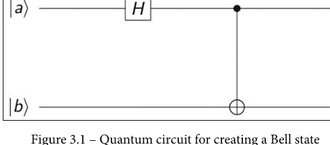

图 3.1 – 创建贝尔态的量子电路

在前述电路中，哈达玛门作用于第一个量子比特（|a⟩），CNOT 门作用于 H|a⟩ 的输出和第二个输入量子比特（|b⟩）。作为练习，证明前述电路实际上在第一个量子比特 |a⟩ = {|0⟩, |1⟩} 且第二个量子比特 |b⟩ = {|0⟩, |1⟩} 时生成贝尔态。

在本节中，我们演示了如何使用 CNOT 门生成贝尔态。在接下来的两个部分中，我们将介绍两个以上量子态的纠缠。下一节将重点介绍 GHZ 态的生成。然后将跟随 W 态生成的讨论。

## 理解两个以上量子态的纠缠

在上一节中，我们演示了如何使用 CNOT 门生成贝尔态。在本节中，我们将介绍两个以上量子态的纠缠。下一小节将重点介绍 GHZ 态的生成。然后将跟随 W 态生成的讨论。

## W 态

除了 GHZ 态之外，通过三个或更多量子比特的纠缠可以形成的另一个复合量子态称为 **W 态**。三量子比特 W 态在数学上表示如下：

$$\psi_W = \frac{1}{\sqrt{3}}(|100\rangle + |010\rangle + |001\rangle)$$

一般来说，从纠缠 $n$ 个量子比特生成的 W 态如下所示：

$$\psi_W = \frac{1}{\sqrt{n}}(|10\cdots0\rangle + |01\cdots0\rangle + \cdots + |0\cdots01\rangle)$$

最后，使用 qutip 和 numpy 生成三量子比特 W 态的 Python 代码片段如下所示：

```
from qutip import *
import numpy as np

a = np.array([[1], [0]])
b = np.array([[0], [1]])

a = Qobj(a)
b = Qobj(b)

W = (1/np.sqrt(3)) * (tensor(b, a, a) + \
                    tensor(a, b, a) + \
                    tensor(a, a, b))

print("The W state is:", W)
```

如可观察，前述代码使用了两个模块，即 qutip 和 numpy。numpy 用于使用 array() 函数创建两个向量，即 a 和 b。然后这些向量使用 Qobj() 函数转换为 qutip 对象。然后生成 W 态，并将 W 变量分配给此类态。

现在我们已经使用 GHZ 态或 W 态讨论了多粒子纠缠，下一节将讨论量子纠缠如何用作量子信息处理中的资源。


## 理解纠缠作为一种资源 – 量子隐形传态

在量子信息处理中，纠缠是一种至关重要的资源，用于提供相对于传统信息处理的计算优势。因此，量子纠缠通常被用于量子信息处理的各个领域，例如量子密码学、量子计算和量子通信。

在量子通信中，量子纠缠被用作**超密编码**和**量子隐形传态**等应用中的资源。超密编码将在下一章（*第4章，使用量子电路*）中介绍，而量子隐形传态则在本节中介绍。必须指出的是，这里所讨论的隐形传态是指量子态的隐形传态，而不是科幻（science fiction）电影中通常所说的那种。

## 量子隐形传态

量子隐形传态涉及在纠缠的EPR对的协助下，将任意量子态从一个位置传输到另一个位置。在此量子通信协议中，量子纠缠被用作关键资源。如前所述，该协议中被传输的是量子态，而不是流行文化中通常描绘的诸如人体之类的经典物体。

在量子隐形传态中，目标是将一个未知的量子态从一个点转移到另一个点。这种转移是通过使用EPR对实现的，该EPR对由Alice和Bob（远程量子粒子）共享，并通过常规通信电路进行。因此，量子隐形传态的目标是使Alice能够将任意量子态传输给Bob。为了实现这一点，Alice和Bob都使用经典通信进行通信。

量子隐形传态电路的流程可由以下电路概括。该电路使用了四个酉量子门，即哈达玛门、X门、Z门和CNOT门，以及两个测量门：

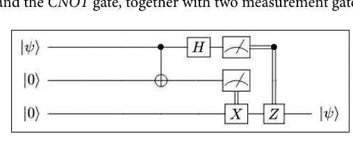

如图所示，Alice拥有未知的态 |ψ> 以及她与Bob共享的EPR对的一半。她随后对自己拥有的两个量子位进行测量，并通过经典信道将测量结果发送给Bob。由于她测量的是两个量子位状态，Alice可能的测量结果 m₁（来自待传输的量子位）和 m₂（来自EPR对的一半）为 00、01、10 或 11。

根据从Alice接收到的测量结果的值，Bob可以根据下表中的任意操作来重建态 |ψ>：

| m₁ | m₂ | Z^m₁ X^m₂ | Bob's Operation |
|---|---|---|---|
| 0 | 0 | I | I |
| 0 | 1 | X | X |
| 1 | 0 | Z | Z |
| 1 | 1 | ZX | ZX |

图 3.4 – 根据Alice接收到的测量结果值，Bob可以执行的操作表

使用IBM的Qiskit平台和Google的Colab环境，可以使用以下Python代码实现量子隐形传态：

```
#!pip install qiskit
from qiskit import *
from qiskit.visualization import plot_histogram

circuit = QuantumCircuit(3,3)

circuit.h(0)

circuit.h(1)
circuit.cx(1,2)

circuit.cx(0,1)
circuit.h(0)

circuit.measure([0, 1], [0, 1])

circuit.cx(1, 2)
circuit.cz(0, 2)
```

```
circuit.measure([2], [2])
circuit.draw(output='text')
simulator = Aer.get_backend('qasm_simulator')
result = execute(circuit, backend=simulator,
                shots=1024).result()
plot_histogram(result.get_counts(circuit))
```

代码可以总结如下。代码使用了qiskit Python模块。在将qiskit模块导入工作区后，使用QuantumCircuit()函数实例化电路，并将circuit变量分配给此实例化电路。该电路使用三个量子寄存器和三个经典寄存器。实例化电路后，酉电路随后被应用于量子态。最后，执行测量并将结果存储在经典寄存器中。代码的最后部分，从circuit.draw(output='text')语句到结束，仅用于可视化生成的量子隐形传态电路。

## 总结

在本章中，我们介绍了量子纠缠的基础知识。我们还看到了可用于确定关联量子性的不等式。这些不等式是贝尔不等式和CHSH不等式。

此外，我们介绍了贝尔基态。此外，我们在本章中了解到，CNOT门是负责纠缠的量子门，因此它也可以被称为纠缠门。

在本章中，我们还介绍了多于两个纠缠量子位的纠缠态，这些态是GHZ态和W态。此外，我们在本章中论证了量子纠缠是量子信息处理应用的关键资源。最后，我们提供了量子隐形传态的实践介绍。

下一章提供了对各种量子电路的实践阐述。它还讨论了超密编码量子通信协议的实现。

我们将在本章中介绍以下主要主题：

- 介绍经典逻辑门
- 介绍单量子位和多量子位门
- 介绍量子电路
- 探索量子纠错
- 探索超密编码

## 技术要求

本章的要求如下：

- 对Python编程语言有基本了解
- 能够导航Google的Colab环境

本章的GitHub链接可以在这里找到：

```
https://github.com/PacktPublishing/Hands-On-Quantum-Information-Processing-with-Python/tree/master/Chapter04
```

## 介绍经典逻辑门

让我们暂时从量子计算中脱离出来，专注于经典计算。你会回忆起，经典计算中信息的基本单位是二进制数字（bit）。此外，你会回忆起，位可以处于零（0）或一（1）状态。就像位是经典信息的基本单位一样，逻辑门是经典计算的基本单位。

有两个单位逻辑门。这些门是恒等（wire）门和非门。前者保持输入不变，而后者反转/否定输入。单位恒等门的真值表如下所示：

| Input | Output (Identity) |
| --- | --- |
| 0 | 0 |
| 1 | 1 |

表 4.1 – 单位恒等门的真值表

我们在第2章《量子态、操作和测量》中讨论了一些单量子位量子门。其中一个讨论的单量子位量子门是泡利X（NOT）门。对于计算基态 |0> 和 |1>，X门的真值表如下所示：

| Input | Output (X Gate) |
|---|---|
| |0> | |1> |
| |1> | |0> |

表 4.8 – X门的真值表

另一方面，对于相同的计算态 |0> 和 |1>，以及输入态 x 和 y，两量子位CNOT门的真值表（请回忆CNOT是纠缠量子位）如下所示：

| Inputs | | Outputs | |
|---|---|---|---|
| x | y | x | X XOR y |
| |0> | |0> | |0> | |0> |
| |0> | |1> | |0> | |1> |
| |1> | |0> | |1> | |1> |
| |1> | |1> | |1> | |0> |

表 4.9 – 两量子位CNOT门的真值表

需要注意的是，由于量子计算是可逆的，输入数与输出数相同。这就确保了计算过程中没有信息丢失。此外，可以从图4.9中的CNOT表中看出，CNOT门的操作类似于XOR经典逻辑门的操作。关键区别在于，在量子计算的情况下，输入 x 也构成输出的一部分，因此没有信息丢失（由于计算的可逆性）。

我们在经典计算的背景下讨论了通用门，其中我们确定了NOR和NAND逻辑门是经典计算的通用门。类似于经典计算，在量子计算中，CNOT门和任意单量子位门构成了一组通用量子门。


2. 该量子电路实现的下一个步骤是使用 `QuantumCircuit()` 实际定义电路。该电路包含一个经典寄存器和一个量子寄存器。定义电路后，初始处于 |0> 态的量子比特（初始化为 |0> 态）通过泡利 X 门进行翻转。翻转后，再应用 Hadamard 门。最后，测量量子系统的状态，这是通过对量子比特施加测量门来实现的。测量门的应用完成了该量子电路的构建，该电路随后既可以在真实量子计算机上实现，也可以在经典模拟器上实现：

```
# Define the Quantum and Classical Registers
qr = QuantumRegister(1)
cr = ClassicalRegister(1)

# Build the circuit
sup = QuantumCircuit(qr, cr)
sup.x(qr)
sup.h(qr)
sup.measure(qr, cr)
sup.draw(output='mpl')
plt.show()
```

3. 最后，使用 qiskit 中的 `qasm_simulator` 对先前定义的量子电路进行模拟。获得的结果随后显示如下：

```
# Execute the circuit (using the qasm simulator)
job = execute(sup, backend = \
    Aer.get_backend('qasm_simulator'),
    shots=1024)
result = job.result()

# Print the result
print(result.get_counts(sup))

#plot the results
counts = result.get_counts(sup)
plot_histogram(counts)
plt.show()
```

此外，该电路的框图如下所示。

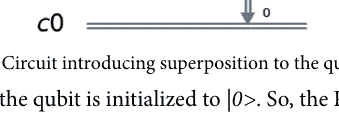

图 4.1 – 向量子态引入叠加态的电路

从图 4.1 中可以看出，量子比特初始化为 |0>。因此，泡利 X 门将 |0> 量子比特翻转为 |1>，而 Hadamard 门 (H) 则引入叠加。最后，应用测量算子，并将结果存储在经典寄存器中。

最后，以下结果证明给定电路确实是叠加电路：

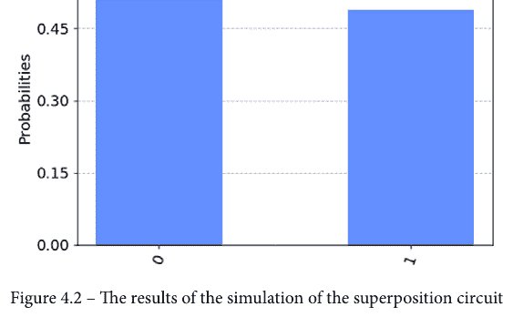

图 4.2 – 叠加电路模拟结果

此处展示另一个量子电路示例。该电路使用 IBM 的 Quantum Experience 平台和 Circuit Composer 工具生成。该电路使用 Hadamard 门、泡利 X 门和测量算子。初始时，量子态被初始化为 |0>。然后，使用 Hadamard 门引入量子叠加。此步骤之后，对所得状态应用 X 门。最后，对最终状态进行测量。可以观察到，该电路使用的所有门（Hadamard、X 和测量）均为单量子比特门：

下面的电路展示了用于贝尔态制备的量子电路：

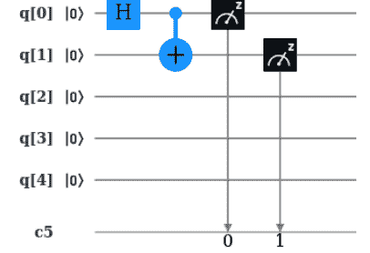

图 4.5 – 用于实现贝尔态制备的量子电路

此外，使用 IBM 经典模拟器运行此实验的结果总结如下：

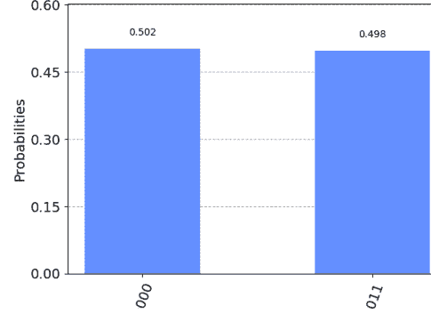

图 4.6 – 使用 IBM 经典模拟器模拟贝尔态制备电路获得的结果

最后，再次使用 Circuit Composer，5 量子比特电路可以表示如下：

## 探索量子纠错

在深入探讨量子纠错之前，明智的做法是先考虑经典/传统信息与编码理论中的纠错。

在经典信息与编码理论中，纠错码用于减轻数字系统中噪声的影响。纠错码的关键思想是确保从接收数据中检测并纠正错误。本质上，纠错是通过对消息进行编码，从而向消息中添加冗余信息来实现的。向消息中添加冗余是为了确保即使消息受到噪声影响，也有足够的信息可以用来恢复/解码原始消息。

基本的经典纠错码之一是**多数表决**码。该码也称为**重复码**。多数表决纠错的目标是检测并纠正单比特翻转。例如，使用三位多数表决纠错码，计算机可以将比特 '0' 和 '1' 编码如下：

```
'0' (physical bit) -> '000' (logical '0')
'1' (physical bit) -> '111' (logical '1')
```

显然，该编码可以纠正单比特翻转。例如，比特序列 '001'、'010' 和 '100' 可以通过多数表决纠错为 '000'，进而解码为 '0'。另一方面，使用多数表决纠错码，比特序列 '110'、'101' 和 '011' 可以纠错为 '111'，进而解码为 '1'。

纠错码的任务是检查这些比特，并根据多数规则决定编码消息应为 '000' 还是 '111'。如果零多于 1，则编码消息变为 '000'。反之，如果 1 多于零，则编码消息变为 '111'。

与经典信息论和编码一样，量子信息论和编码中也需要检测和纠正错误。量子纠错码推广了经典重复码。然而，由于量子态对相位也很敏感。量子重复码可以纠正量子比特翻转或相位翻转。

量子比特翻转量子纠错编码电路的电路图如下所示：

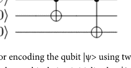

图 4.9 – 使用两个冗余量子比特编码量子比特 |ψ> 的量子电路，两个冗余量子比特均初始化为 |0>

本质上，上述电路将物理量子比特：

|ψ> = α|0> + β|1>

编码为逻辑量子比特 – α|000> + β|111>。另外两个初始化为 |0> 的量子比特用于提供冗余，以便能够恢复原始量子态。这些量子比特称为辅助量子比特。或者，辅助量子比特也被称为 ancilla 量子比特，本书不采用这种不幸的表达方式。

另一方面，量子比特相位翻转量子纠错编码电路的电路图如下所示：

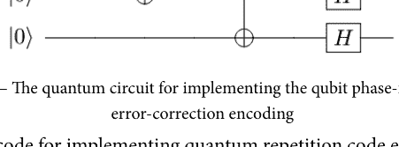

图 4.10 – 用于实现量子比特相位翻转量子纠错编码的量子电路

最后，使用 qiskit 实现量子重复码纠错的 Python 代码如下：

> 注意
> 该代码的链接可以在这里找到：https://github.com/PacktPublishing/Hands-On-Quantum-Information-Processing-with-Python/tree/master/Chapter04。

- 1. 第一步是导入实现此量子纠错方案所需的所有包：

```
from qiskit import *
from qiskit.ignis.verification.topological_codes\
import RepetitionCode
```

```
from qiskit.ignis.verification.topological_codes\
import GraphDecoder
from qiskit.ignis.verification.topological_codes\
import lookuptable_decoding, postselection_decoding
from qiskit.compiler import transpile
from qiskit.transpiler import PassManager
from qiskit import QuantumCircuit, execute, Aer
from qiskit.providers.aer import noise
from qiskit.providers.aer.noise import NoiseModel
from qiskit.providers.aer.noise.errors import\
pauli_error, depolarizing_error
from qiskit import QuantumRegister, ClassicalRegister
import numpy as np
import matplotlib.pyplot as plt

np.random.seed(42)
```

2. 以下阶段定义将在此量子电路中使用的噪声模型。误差模型模拟可能影响量子比特性能的物理效应。此噪声模型使用两种误差形式，即量子去极化噪声（将量子比特替换为随机状态）和测量噪声。此噪声模型以每种噪声（去极化噪声和测量噪声）5% 的概率实现：

```
def get_noise(p_meas,p_gate):
    error_meas = pauli_error([('X',p_meas),
                            ('I', 1 - p_meas)])
    error_gate1 = depolarizing_error(p_gate, 1)
    error_gate2 = error_gate1.tensor(error_gate1)
    noise_model = NoiseModel()
    noise_model.add_all_qubit_quantum_error(
        error_meas, "measure")
    noise_model.add_all_qubit_quantum_error(
        error_gate1, ["x"])
    noise_model.add_all_qubit_quantum_error(
```


9. 然后对纠错电路进行模拟，首先将编码量子比特置于状态 |11>，然后置于 |00> 和 |11> 的叠加态：

```
qc_init = QuantumCircuit(cq)
qc_init.x(cq)
(qc_init+qc).draw(output='mpl')

counts = execute(qc_init+qc,
                Aer.get_backend('qasm_simulator'))\
        .result().get_counts()
print('Results:',counts)

qc_init = QuantumCircuit(cq)
qc_init.h(cq[0])
qc_init.cx(cq[0],cq[1])
(qc_init+qc).draw(output='mpl')

counts = execute(qc_init+qc,
                Aer.get_backend('qasm_simulator'))\
        .result().get_counts()
print('Results:',counts)
```

10. 然后我们定义一个用于重复码的电路，重复三次并进行一次综合征测量。这是通过使用 RepetitionCode() 实现的：

```
code = RepetitionCode(3,1)

for reg in code.circuit['0']\
    .qregs+code.circuit['1'].cregs:
    reg.name = reg.name.replace('_','\ ') + '\ '

code.circuit['0'].draw(output='mpl')
code.circuit['1'].draw(output='mpl')
```

13. 最后，我们计算量子比特被翻转/损坏的概率：

```
P = lookuptable_decoding(raw_results,
    table_results)
print('P =',P)
plt.show()
```

本节对量子纠错进行了简要介绍。在下一节中，我将介绍量子信息处理中最重要的协议之一，即超密编码。超密编码用于利用量子系统传输比经典情况下更多的经典比特。

## 探索超密编码

在第 3 章《纠缠与量子隐形传态》中，我们接触了量子隐形传态协议。另一个与量子隐形传态密切相关的协议是超密编码。虽然量子隐形传态旨在使用两个经典比特的过程将一个未知的量子态从一个通信方（通常称为发送方 Alice）发送到另一个通信方（通常称为接收方 Bob），但超密编码旨在使用单个量子态将两个经典比特从一个通信方发送到另一个通信方。

超密编码的操作如下：

+   1. 首先，创建一个 EPR 对，并且该对由 Alice 和 Bob 共享。
+   2. 然后，根据 Alice 希望发送给 Bob 的比特，她对其量子比特（EPR 对的一部分）应用以下操作：

| 要发送的比特对 | 量子操作 |
|---|---|
| 00 | I |
| 01 | Z |
| 10 | X |
| 11 | ZX |

表 4.10 – Alice 可以根据她想要传达给 Bob 的比特对而执行的一组量子操作

+   3. 在接收端，Bob 首先应用 CNOT 门，然后是 Hadamard 门。这本质上是 Alice 在其侧面应用操作的逆过程。
+   4. 最后，Bob 执行测量以恢复 Alice 发送的两个经典比特。

作为示例，使用超密编码发送经典比特 '01' 的框图如下所示：

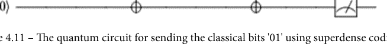

图 4.11 – 使用超密编码发送经典比特 '01' 的量子电路

同样，其他对经典比特也可以通过用适当的操作门替换前面的泡利 Z 门来发送，如前表所示。

使用 IBM 的 Circuit Composer，超密编码用于传输经典比特 '01' 如下所示：

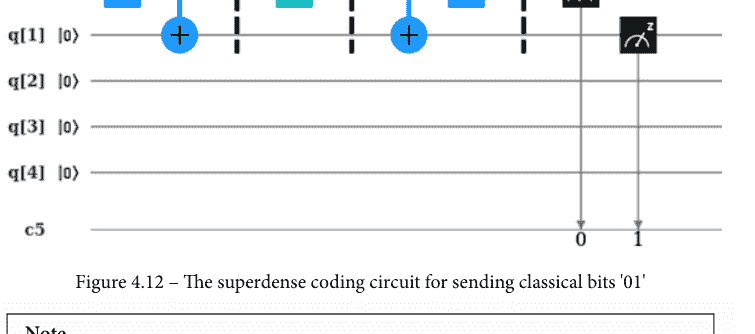

图 4.12 – 发送经典比特 '01' 的超密编码电路

注意
该电路使用 IBM 的 Circuit Composer 生成。

前图中超密编码电路中的虚线垂直线是屏障。屏障在 Circuit Composer 上用于提供清晰度并改善电路的可视化。在这种情况下，电路最左侧部分的大门用于生成 EPR 对。然后，泡利 Z 门是 Alice 对其 EPR 对部分执行的操作。此外，下一个门集用于解码。然后，最后，Alice 和 Bob 对其量子比特执行测量。

最后，使用 qiskit 平台，实现超密编码的 Python 代码如下。在此代码中，传输的量子比特为 '11'：

+   1. 第一步涉及导入实现超密编码所需的模块：

```
#Import modules
from qiskit import *
from qiskit.visualization import plot_histogram
import matplotlib.pyplot as plt
import numpy as np

np.random.seed(42)
```

+   2. 下一步是创建贝尔态，并且该纠缠态由 Alice 和 Bob 共享：

```
def create_bell_pair(qc, a, b):
    q.h(a)
    qc.cx(a,b)
```

+   3. 随后是 Alice 对要发送给 Bob 的经典比特进行编码，以及 Bob 对此类比特进行解码：

```
def encode_message(qc, qubit, msg):
    if msg == "00":
        pass
    elif msg == "10":
        qc.x(qubit)
    elif msg == "01":
        qc.z(qubit)
    elif msg == "11":
        qc.z(qubit)
        qc.x(qubit)

def decode_message(qc,a, b):
    qc.cx(a,b)
    qc.h(a)
```

4. 下一步是定义用于实现超密编码的量子电路：

```
qc = QuantumCircuit(2)

create_bell_pair(qc, 0, 1)
qc.barrier()

message = "11"
encode_message(qc, 0, message)
qc.barrier()

decode_message(qc, 0, 1)

qc.measure_all()

qc.draw(output = "mpl")
#plt.show()
```

5. 然后使用 IBM 的 'qasm_simulator' 对超密编码电路进行模拟，并显示获得的结果：

```
backend = Aer.get_backend('qasm_simulator')
job_sim = execute(qc, backend, shots=1024)
sim_result = job_sim.result()

measurement_result = sim_result.get_counts(qc)
print(measurement_result)
plot_histogram(measurement_result)
plt.show()
```

现在，让我简要介绍一下代码：

+   1. 首先，如同总是那样，导入所有所需模块。
+   2. 然后，创建用于创建贝尔态的函数。
+   3. 随后是定义要发送的经典消息编码的函数。
+   4. 此外，还创建了解码发送的经典消息的电路。

Deutsch 算法用于确定未知二元函数 f(x) 是 **常数** 还是 **平衡** 的。在说明什么是常数或平衡函数之前，让我们稍微退一步，讨论二元函数。二元函数是一个函数，它以一个比特作为输入并给出一个比特作为输出。因此，一元二元函数 f(x) 如下所示：

f(x): {0,1} → {0,1}

存在四种可能的二元函数，如下表所示：

| 输入 | f₁ | f₂ | f₃ | f₄ |
|---|---|---|---|---|
| 0 | 0 | 0 | 1 | 1 |
| 1 | 0 | 1 | 0 | 1 |

图 5.1 – 函数 f(x) 的四种可能的二元函数

正如您从图 5.1 中看到的那样，第一个函数，函数 f1，无论输入如何都给出 0 的输出。另一方面，函数 f2 给出的输出与输入相同。此外，函数 f3 给出输入的逆。最后，函数 f4 的输出无论输入如何都是 1。

前表中函数 f1 和 f4 被称为 **常数** 二元函数，而函数 f2 和 f3 被称为 **平衡** 二元函数。本质上，常数二元函数无论输入如何都给出相同的输出（0 或 1）。因此，对于常数二元函数，输出不依赖于输入。另一方面，平衡二元函数产生相等数量的 0 或 1。也就是说，对于平衡二元函数，输出取决于输入。

常数和平衡二元函数的另一种解释如下。二元函数 f 是常数，如果适用以下条件：

f(0) ⊕ f(1) = 0

另一方面，二元函数 f 是平衡的，如果适用以下条件：

f(0) ⊕ f(1) = 1

现在我们已经简要解释了平衡和常数函数，让我们进一步探究 Deutsch 算法。如前所述，该算法的目的是评估给定函数是常数函数还是平衡函数。此评估是通过查询“黑箱”（即预言机）完成的。


多伊奇问题可以这样表述。假设你有一个预言机，它会对你发送的任何查询给出响应。在这种情况下，假设预言机的响应要么是0，要么是1。现在，假设你想确定一个给定的二元函数是常函数还是平衡函数。那么，为了令人信服地确定这一点，你应该向预言机发送多少次查询？

在提出多伊奇问题后，现在让我们看看经典计算机完成此任务需要多少次函数求值。为了解决这个问题，我们将使用前面给出的表格。现在考虑这样一个场景：如果你发送0作为输入，得到的输出是0，你能判断该函数是常函数还是平衡函数吗？显然不能，因为函数f₁和f₂在输入为0时输出都为0，而我们已经知道函数f₁是常函数，函数f₂是平衡函数。为了令人信服地做出这一判断，我们需要第二次函数求值。

从前面的场景可以看出，对于经典计算机，一次函数求值不足以确定函数是常函数还是平衡函数。这个确定至少需要两次函数求值。现在的问题是，使用量子计算机是否能更好地完成这种求值。幸运的是，这个问题的答案是肯定的，并且构成了多伊奇算法的基础。

为了实现多伊奇算法，关键步骤是实现酉算子F，使得该算子作用于输入|x⟩和|y⟩的结果如下：

F(|x⟩ ⊗ |y⟩) = |x⟩ ⊗ |y ⊕ f(x)⟩

在图形上，这个酉门（F）可以表示如下：

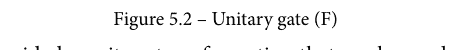

图5.2 – 酉门（F）

既然我们已经提供了可用于多伊奇算法的酉变换，那么探索可用于实现该算法的完整电路就很重要。该电路的图示如下：

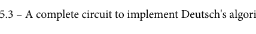

图5.3 – 实现多伊奇算法的完整电路

从前面的图可以看出，量子位首先被初始化为|0⟩态。因此，前述系统的第一个状态如下：

|ψ₀⟩ = |0⟩ ⊗ |0⟩

然后，通过翻转第二个量子位来演化这个状态。这是通过将X门应用于第二个量子位来实现的。系统的新状态变为：

|ψ₁⟩ = |0⟩ ⊗ |1⟩

这一步之后，对每个量子位应用哈达玛门，结果如下：

|ψ₂⟩ = H|0⟩ ⊗ H|1⟩

这也可以表示如下：

|ψ₂⟩ = 1/2 (|00⟩ − |01⟩ + |10⟩ − |11⟩)

现在，下一步是将酉变换F应用于前述状态。这会产生以下状态：

|ψ₃⟩ = 1/2 (|0⟩ ⊗ |f(0)⟩ − |0⟩ ⊗ |1 ⊕ f(0)⟩ + |1⟩ ⊗ |f(1)⟩ − |1⟩ ⊗ |1 ⊕ f(1)⟩)

现在我们必须考虑两种情况。第一种情况是所评估的函数是常函数。正如我们已经看到的，这意味着f(0) = f(1)。因此，前述状态将简化为：

|ψ₃⟩ = 1/2 [(|0⟩ + |1⟩) ⊗ (|f(0)⟩ − |1 ⊕ f(0)⟩)]

多伊奇算法的下一步涉及将哈达玛门应用于前述状态的第一个量子位。结果如下：

|ψ₄⟩ = 1/√2 [|0⟩ ⊗ (|f(0)⟩ − |1 ⊕ f(0)⟩)]

最后，对第一个量子位进行测量，得到比特0。这与函数是常函数的事实一致，因为我们现在知道对于常函数，以下等式成立：

f(0) ⊕ f(1) = 0

当f(0) = 1时，我们得到：

|f(0)⟩ − |1 ⊕ f(0)⟩ = |1⟩ − |0⟩

于是可以观察到：

|f(0)⟩ − |1 ⊕ f(0)⟩ = (−1)^{f(0)}(|0⟩ − |1⟩)

同样的分析也适用于函数f(1)。请参考本章末尾的测验来完成这个练习。

现在，有了这种直觉，我们可以将应用酉变换F后的状态表示为：

|ψ₃⟩ = 1/2 [|0⟩ ⊗ (−1)^{f(0)}(|0⟩ − |1⟩) + |1⟩ ⊗ (−1)^{f(1)}(|0⟩ − |1⟩)]

这可以简化为：

|ψ₃⟩ = 1/2 [(−1)^{f(0)}|0⟩ + (−1)^{f(1)}|1⟩] ⊗ [|0⟩ − |1⟩]

下一步是对第一个量子位应用哈达玛门。结果如下：

|ψ₄⟩ = 1/2 [((−1)^{f(0)} + (−1)^{f(1)})|0⟩ + ((−1)^{f(0)} − (−1)^{f(1)})|1⟩] ⊗ (|0⟩ − |1⟩)

最后，对第一个量子位进行测量。到现在应该很清楚，如果函数是常函数，则测量到的状态将为0；而如果函数是平衡函数，则测量到的状态将为1。

在概述了多伊奇算法之后，现在是时候探索如何实现该算法了。

**注意**

此代码取自 https://github.com/quantumlib/Cirq/blob/master/examples/deutsch.py。

此代码的链接可以在这里找到：https://github.com/PacktPublishing/Hands-On-Quantum-Information-Processing-with-Python/tree/master/Chapter05。

使用Cirq实现多伊奇算法的Python代码如下：

1. 第一步是引入必要的模块：

```python
import random
import numpy as np
import cirq
from cirq import H, X, CNOT, measure
```

2. 导入必要的模块后，下一步是为该算法选择要使用的量子位：

```python
q0, q1 = cirq.LineQubit.range(2)
secret_function = [random.randint(0,1) for _ in range(2)]
```

3. 定义用于实现预言机电路和完整多伊奇算法的函数：

```python
def make_oracle(a, b, c):
    if c[0]:
        yield [CNOT(a, b), X(b)]
    if c[1]:
        yield CNOT(a, b)

def make_deutsch_circuit(d, e, f):
    c = cirq.Circuit()
    c.append([X(e), H(e), H(d)])
    c.append(f)
    c.append([H(d), measure(d, key='result')])
    return c

oracle = make_oracle(q0, q1, secret_function)
circuit = make_deutsch_circuit(q0, q1, oracle)
print(circuit)
```

4. 最后，模拟用于实现多伊奇算法的量子电路：

```python
simulator = cirq.Simulator()
result = simulator.run(circuit)
print(result)
```

用于实现多伊奇-约萨算法的电路如下所示：

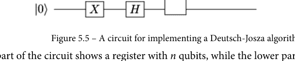

图5.5 – 用于实现多伊奇-约萨算法的电路

电路的上半部分显示了一个包含n个量子位的寄存器，而下半部分显示了一个包含单个量子位的寄存器。

与多伊奇-约萨算法一样，量子位被初始化为|0⟩态。因此，系统的状态如下：

|ψ₀⟩ = |0⟩ ⊗ ⋯ ⊗ |0⟩

然后，下一步涉及翻转最后一个量子位（即底部寄存器中的量子位），系统的最终状态如下：

|ψ₁⟩ = |0⟩ ⊗ ⋯ ⊗ |1⟩

现在，对处于|0⟩态的n个量子位中的每一个应用哈达玛门，并对最后一个量子位（现在处于|1⟩态）应用另一个哈达玛门。系统的最终状态如下：

|ψ₂⟩ = (H ⊗ ⋯ ⊗ H)(|0⟩ ⊗ ⋯ ⊗ |0⟩) ⊗ H(|1⟩)

以下等式成立：

(H ⊗ ⋯ ⊗ H)(|0⟩ ⊗ ⋯ ⊗ |0⟩) = 1/√(2ⁿ) Σ_{x=0}^{2ⁿ−1} |x⟩

不难看出，化简后，前述状态可以表示如下：

|ψ₂⟩ = 1/√(2ⁿ) Σ_{x=0}^{2ⁿ−1} |x⟩ [1/√2 (|0⟩ − |1⟩)]

4. 然后定义并绘制平衡预言机：

```python
balanced_oracle = QuantumCircuit(n+1)
b_str = "101"

for qubit in range(len(b_str)):
    if b_str[qubit] == '1':
        balanced_oracle.x(qubit)

balanced_oracle.barrier()

for qubit in range(n):
    balanced_oracle.cx(qubit, n)

balanced_oracle.barrier()

for qubit in range(len(b_str)):
    if b_str[qubit] == '1':
        balanced_oracle.x(qubit)

balanced_oracle.draw()
```

5. 构建预言机之后，下一步是构建可用于实现多伊奇-约萨算法的完整量子电路：

```python
dj_circuit = QuantumCircuit(n+1, n)

for qubit in range(n):
    dj_circuit.h(qubit)

dj_circuit.x(n)
dj_circuit.h(n)

dj_circuit += balanced_oracle

for qubit in range(n):
    dj_circuit.h(qubit)
```


```
dj_circuit.barrier()

for i in range(n):
    dj_circuit.measure(i, i)

dj_circuit.draw()
```

6. 最后，使用 `qasm_simulator` 模拟 Deutsch-Josza 算法的量子电路：

```
backend = BasicAer.get_backend('qasm_simulator')
shots = 1024
results = execute(dj_circuit,
                  backend=backend,
                  shots=shots).result()
answer = results.get_counts()
plot_histogram(answer)
```

模拟量子电路的输出如下所示：

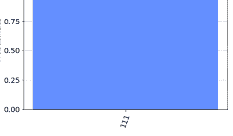

图5.6 – Deutsch-Josza 三量子比特算法的输出

上述代码可以总结如下。与往常一样，第一步是导入实现 Deutsch-Jozsa 算法时要用到的模块。该代码针对一个三量子比特函数实现了 Deutsch-Jozsa 算法。代码的下一步是构造常值 oracle，然后是构造平衡 oracle。接下来是实际实现 Deutsch-Jozsa 算法。最后，使用 `qasm_simulator` 对该算法进行模拟。值得注意的是，`qasm_simulator` 是一个本地模拟器，用于在经典计算机上模拟量子电路，而不是在真正的量子计算机上运行此类电路。

既然我们已经介绍了 Deutsch-Jozsa 算法，下一步是探索另一种本质上可以看作是 Deutsch-Jozsa 算法扩展的算法。该算法被称为 **Bernstein-Vazirani 算法**。

## 探索 Bernstein-Vazirani 算法

Bernstein-Vazirani 算法在某种意义上与前面讨论过的 *Deutsch-Jozsa 算法* 相似。因此，oracle 仍然使用以下函数：

$$f(x): \{0,1\}^n \to \{0,1\}$$

另一方面，与 Deutsch-Jozsa 算法旨在确定给定函数是**常数**还是**平衡**不同，Bernstein-Vazirani 算法的目标是找到秘密字符串 $s$：

$$s: s \in \{0,1\}^n$$

在给定以下承诺的情况下：

$$f(x)=\left(\sum_{i=1}^{n}s_i x_i\right)\operatorname{mod}2$$

Bernstein-Vazirani 算法的工作原理如下。首先，两个寄存器——一个是由 $n$ 个量子比特组成的输入寄存器，另一个是单个量子比特的输出寄存器——被初始化为状态 $|0\rangle$。因此，系统的状态如下所示：

$$\psi_0\rangle = 0 \otimes \cdots \otimes 0\rangle \otimes 0\rangle$$

然后，第二个寄存器中的量子比特被翻转，系统的新状态如下：

$\psi_1\rangle = 0 \otimes \cdots \otimes 0\rangle \otimes 1\rangle$

算法的下一步是对两个寄存器中的每个量子比特应用 Hadamard 门。然后，我们得到以下状态：

$\psi_2\rangle = \frac{1}{\sqrt{2^n}} \sum_{x=1}^{n} x\rangle \otimes \left(\frac{1}{\sqrt{2}}[0\rangle - 0\rangle]\right)$

接下来是查询 oracle，然后对输入寄存器中的每个量子比特应用 Hadamard 门。最后，对输入寄存器进行测量，以检索秘密字符串。

> 注意
> 本代码摘自 https://github.com/qiskit-community/qiskit-community-tutorials/blob/master/Coding_With_Qiskit/ep6_Bernstein-Vazirani_Algorithm.ipynb。
> 此代码的链接可以在这里找到：https://github.com/PacktPublishing/Hands-On-Quantum-Information-Processing-with-Python/tree/master/Chapter05。

使用 Qiskit，实现 Bernstein-Vazirani 算法的 Python 代码如下所示：

- 1. 第一步是引入实现 Bernstein-Vazirani 算法所需的模块：

```
import numpy as np
from qiskit import *
from qiskit.visualization import plot_histogram

np.random.seed(42)

s = input("Enter the secret bit string:\n")

n = len(s)
```

2. 接下来是构建量子电路，该电路将用于构造 Bernstein-Vazirani 算法：

```
circuit = QuantumCircuit(n+1,n)
```

由于所有量子比特都初始化为状态 |0>，步骤0涉及通过应用 X 门来翻转这些量子比特：

```
circuit.x(n)
```

```
circuit.barrier()
```

3. 下一步是对所有量子比特应用 Hadamard 门：

```
circuit.h(range(n+1))
```

```
circuit.barrier()
```

4. 下一步是在量子比特上应用受控门：

```
for ii, yesno in enumerate(reversed(s)):
```

```
    if yesno == '1':
```

```
        circuit.cx(ii, n)
```

```
circuit.barrier()
```

5. 下一步涉及对量子比特应用 Hadamard 门，然后对这些量子比特进行测量：

```
circuit.h(range(n+1))
```

```
circuit.barrier()
```

```
circuit.measure(range(n), range(n))
```

```
%matplotlib inline
```

```
circuit.draw(output='mpl')
```

- 6. 最后，使用 qasm_simulator 模拟 Bernstein-Vazirani 算法的操作：

```
simulator = Aer.get_backend('qasm_simulator')
result = execute(circuit, backend=simulator,
    shots=1024).result()
plot_histogram(result.get_counts(circuit))
```

上述代码包含四个关键阶段。第一阶段初始化两个寄存器中的量子比特。然后，对两个寄存器中的所有量子比特应用 Hadamard 门。此外，第三阶段涉及实现由 CNOT 门组成的 oracle。最后，最后一个阶段测量输入寄存器中的所有量子比特。

Bernstein-Vazirani 算法（使用输入比特字符串 100）的输出如下所示：

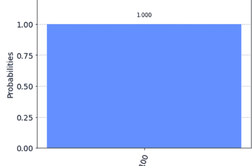

图5.7 – 输入比特字符串为 100 时 Bernstein-Vazirani 算法的输出

到目前为止，我们已经在本章中介绍了三个量子算法。在本节中，我们学习了 Bernstein-Vazirani 算法，并了解了如何使用这种算法来找到秘密比特字符串。在下一节中，我们将介绍另外两种技术，它们将在本章稍后讨论的量子算法中发挥关键作用。这两种技术是量子傅里叶变换（QFT）和量子相位估计。

## 介绍量子傅里叶变换和量子相位估计

如前所述，本节要讨论的量子技术将在本章稍后讨论的量子算法中发挥关键作用。因此，有必要在本节中介绍以下技术：

- QFT
- 量子相位估计

首先，让我们介绍并探索 QFT。

### 量子傅里叶变换（QFT）

已经发现，QFT 在量子计算机上的计算速度比在经典计算机上更快。QFT 是离散傅里叶变换的量子模拟。我们将回顾一个离散傅里叶变换，该变换将输入向量

$$x = \sum_{i=0}^{N-1} x_i$$

映射到输出向量

$$y_k = \frac{1}{\sqrt{N}} \sum_{j=0}^{N-1} x_j w_N^{jk};$$

其中

$$w_N^{jk} = e^{2\pi i \frac{jk}{N}}$$

如前所述，QFT 是前面讨论的离散傅里叶变换的量子模拟。因此，QFT 将输入量子系统 |x> 变换为输出量子系统 |y>，使得以下成立：

$$|x\rangle \rightarrow \frac{1}{\sqrt{N}} \sum_{y=0}^{N-1} W_N^{xy} |y\rangle$$

2. 现在，我们构建用于实现量子相位估计技术的量子电路。这个量子电路随后将用于执行两个、四个和八个量子比特的量子相位估计：

```
def run_estimate(unknown_gate, qnum, repetitions):
    ancilla = cirq.LineQu-1)
    qubits = cirq.LineQubit.rangem)

    oracle_raised_to_power= [
        unknown_gate.on(ancilla).controlled_by\
        (qubits[i])**i
        for i in range(qnum)
    ]
    circuit = cirq.Circuit(cirq.H.on_each(*qubits),
                           oracle_raised_to_power,
                           cirq.QFT(*qubits,
                                   without_reverse=True)**-1,
                           cirq.measure(*qubits,
                                        key='phase'))
    return cirq.sample(circuit, repetitions=repetitions)

def experiment(qnum, repetitions):
    def example_gate(phi):
        gate = cirq.MatrixGate(
            matrix=np.array([
                [np.exp(2 * np.pi * 1.0j * phi), 0],
                [0, 1]]))
        return gate
```

3. 下一步是使用均方根（RMS）误差作为指标来测试量子相位估计的准确性。RMS 越低，估计越好：

```
print(f'Testing with {qnum} qubits.')
errors = []
for target in np.arange(0, 1, 0.1):
    result = run_estimate(example_gate(target),
                          qnum, repetitions)
```


mode = result.data['phase'].mode()[0]
guess = mode / 2**qnum
print(f'target={target:0.4f}, '
f'estimate={guess:0.4f}={mode}/{2**qnum}')
errors.append((target - guess)**2)
rms = np.sqrt(sum(errors) / len(errors))
print(f'RMS Error: {rms:0.4f}\n')

4. 对两个、四个和八个量子比特执行量子相位估计：

```
def main(qnums = (2, 4, 8), repetitions=100):
    for qnum in qnums:
        experiment(qnum, repetitions=repetitions)

if __name__ == '__main__':
    main()
```

前述代码实现了对两个、四个和八个量子比特的量子相位估计。此外，为了获得结果，相位估计电路（experiment）总共运行 100 次重复。

在本节中，我们已经介绍了两种在某些量子算法中起关键作用的量子技术。这些技术是 QFT 和量子相位估计。在下一节中，我们将介绍另一种已被证明比其经典对应方法更强大的量子算法。该算法是 Simon 算法。

## 介绍 Simon 算法

Simon's algorithm 建立在 Bernstein-Vazirani 算法的基础上，该算法已在本章前面讨论过。对于 Simon 算法，假设对于 n 个量子比特，我们有以下函数：

f: {0,1}^n → {0,1}^n

这伴随着一个承诺，即对于某个非零比特串 s，使得：

s ∈ {0,1}^n

并且对于所有 x、y 值，使得：

x, y ∈ {0,1}^n

则：

```
$$f(x) = f(y)$$
```

当且仅当：

```
$$x \oplus y \in \{0^n, s\}$$
```

Simon's algorithm 可以总结如下。首先，使用两个寄存器，每个寄存器有 n 个量子比特。因此，量子系统的初始状态如下所示：

```
$$|\psi_0\rangle = |0 \otimes \cdots \otimes 0\rangle \otimes |0 \otimes \cdots \otimes 0\rangle$$
```

此步骤随后是对第一寄存器中每个量子比特应用 Hadamard 门。这导致以下量子状态：

```
$$|\psi_1\rangle = H|0 \otimes \cdots \otimes 0\rangle \otimes (|0 \otimes \cdots \otimes 0\rangle)$$
```

Simon's algorithm 实现中的下一步是应用酉变换 F（oracle 函数），使得系统的新的状态变为以下：

```
$$|\psi_2\rangle = \frac{1}{\sqrt{2^n}} \sum_{x \in \{0,1\}^n} |x\rangle \otimes |f(x)\rangle$$
```

此外，我们测量第二个寄存器。此步骤随后是对第一寄存器上的所有量子比特应用 Hadamard 门，然后测量这些量子比特。

> **注意**
> 此代码取自 https://qiskit.org/textbook/ch-algorithms/simon.html。
> 
> 此代码的链接可以在这里找到：https://github.com/PacktPublishing/Hands-On-Quantum-Information-Processing-with-Python/tree/master/Chapter05。

正如前面所说，Shor’s algorithm 高效地找到周期函数的周期。周期函数 f(x) 给出如下：

```
f(x) = a^x mod N
```

这里，mod 是模运算符，a 和 N 是没有共同因子的正整数（因此 a 和 N 互质），并且以下适用：

```
a < N
```

此外，周期 r 是使以下条件成立的最小非零整数：

```
a^r mod N = 1
```

Shor’s algorithm 的实现可以总结如下：

- 1. 首先，使用两个寄存器。
- 第一个寄存器由 m 个量子比特组成，而第二个寄存器由 n 个量子比特组成，其中以下适用：

```
m = 2n
```

实现 Shor’s algorithm 的电路如下图所示：

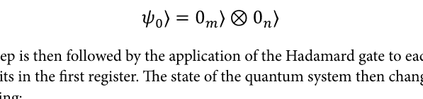

图 5.9 – 实现 n 量子比特 Shor 算法的量子电路

Shor 算法的两个寄存器都初始化为所有量子比特的 |0> 状态。因此，初始状态如下：

```
ψ₀⟩ = |0⟩ₘ ⊗ |0⟩ₙ
```

- 2. 此步骤随后是对第一个寄存器中的 m 个量子比特中的每一个应用 Hadamard 门。量子系统的状态然后变为以下：

```
ψ₁⟩ = H|0⟩ ⊗ ⋯ ⊗ |0⟩ ⊗ |0⟩ₙ
```

3. 在对第一个寄存器中的量子比特应用 Hadamard 门之后，Shor 算法中的下一步是应用酉变换 F，将系统的状态变换为以下：

$$\psi_2\rangle = \frac{1}{\sqrt{2^m}} \sum_{x\in\{0,1\}^m} |x\rangle \otimes |a^x \bmod N\rangle$$

4. 此步骤随后是对顶部寄存器应用逆 QFT。这随后是对第二个寄存器中的量子比特进行测量。最后，第一寄存器中的量子比特也被测量。

> **注意**
> 此代码的链接可以在这里找到：https://github.com/PacktPublishing/Hands-On-Quantum-Information-Processing-with-Python/tree/master/Chapter05。

使用 Qiskit 实现 Shor 算法的 Python 代码如下所示：

- 1. 第一步涉及导入实现 Shor 算法所需的模块：

```
from qiskit import BasicAer
from qiskit.aqua import QuantumInstance
from qiskit.aqua.algorithms import Shor
```

- 2. 下一步涉及使用 qasm_simulator 实际实现 Shor 算法并对其进行模拟：

```
number = Shor(N=15, a=7)
simulator = BasicAer.get_backend('qasm_simulator')
results_dictionary = number.run(QuantumInstance(
                                    backend=simulator,
                                    shots=5))
#result = results_dictionary['number']
print(results_dictionary)
```

前述代码可以总结如下。

在导入必要的模块和类之后，使用 Qiskit 的 Aqua 元素中的 Shor 类构建用于计算 Shor 算法的电路。

3. 在对元素和 oracle 进行编码之后，Grover 算法实现的下一步是初始化 n 个量子比特。因此，系统状态 |s> 在此阶段将如下所示：

```
$\psi_0\rangle = 0 \otimes \cdots \otimes 0\rangle$
```

4. 下一步是对所有 n 个量子比特应用 Hadamard 门，使得 |s> 变为以下：

```
$\psi_1\rangle = H0 \otimes \cdots \otimes 0\rangle$
```

5. 此步骤随后是对状态应用 F1。下一步是应用另一个变换 F2。对于状态 |s>，该变换如下所示：

```
$F_2(s) = 2s\langle s - I$
```

这里，I 是单位矩阵。因此，量子系统的新的状态将如下所示：

```
$\psi_2\rangle = F_2 F_1 \psi_1\rangle$
```

6. 上一步重复 t 次，使得最终量子系统的状态变为以下：

```
$\psi_t\rangle = (F_2 F_1)^t \psi_1\rangle$
```

7. 最后，对 n 个量子比特执行测量。

> 注意
> 此代码的链接可以在这里找到：https://github.com/PacktPublishing/Hands-On-Quantum-Information-Processing-with-Python/tree/master/Chapter05。

使用 Qiskit 实现 Grover 算法的 Python 代码如下所示：

- 1. 第一步涉及导入实现 Grover 算法所需的模块：

```
from qiskit import QuantumRegister, ClassicalRegister, \
QuantumCircuit, execute, BasicAer
from qiskit.visualization import plot_histogram
import matplotlib.pyplot as plt
```

2. 下一步是定义量子电路以实现 Grover 算法。在这种情况下，要使用的电路包括一个两量子比特量子寄存器和一个两比特经典寄存器：

```
c = ClassicalRegister(2, 'c')
q = QuantumRegister(2,'q')
qc = QuantumCircuit(q,c)
```

3. 然后，实现量子门以实现该电路：

```
qc.h([q[0]])
qc.h([q[1]])
qc.x([q[0]])
qc.x([q[1]])
qc.cz(0,1)
qc.x([q[0]])
qc.x([q[1]])
qc.h([q[0]])
qc.h([q[1]])
qc.z(q[0])
qc.z(q[1])
qc.cz(0,1)
qc.h([q[0]])
qc.h([q[1]])
```


## 延伸阅读

- Nielsen, M. A 和 Chuang, I. L. (2011) *量子计算与量子信息：第10版。* 纽约，纽约州，美国：剑桥大学出版社，1107002176，9781107002173。
- Bernhardt, C. (2019) *面向所有人的量子计算。* 麻省理工学院出版社。
- Abraham Asfaw、Luciano Bello、Yael Ben-Haim、Sergey Bravyi、Lauren Capelluto、Almudena Carrera Vazquez、Jack Ceroni、Richard Chen、Albert Frisch、Jay Gambetta、Shelly Garion、Leron Gil、Salvador De La Puente Gonzalez、Francis Harkins、Takashi Imamichi、David McKay、Antonio Mezzacapo、Zlatko Minev、Ramis Movassagh、Giacomo Nannicini、Paul Nation、Anna Phan、Marco Pistoia、Arthur Rattew、Joachim Schaefer、Javad Shabani、John Smolin、Kristan Temme、Madeleine Tod、Stephen Wood 和 James Wootton. (2020). *使用 Qiskit 学习量子计算。* IBM。可在线获取：http://community.qiskit.org/textbook。
