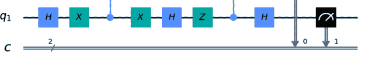
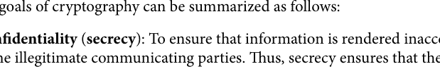
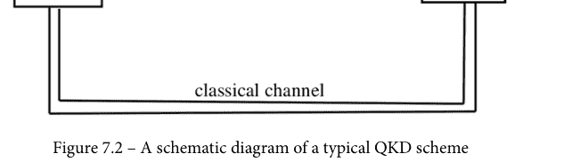
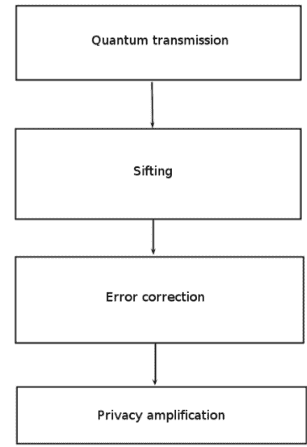
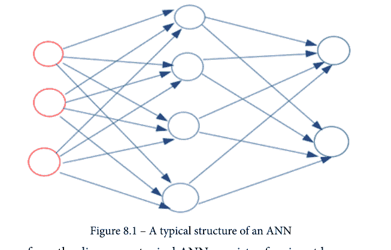

## 6 非局域量子博弈

本章将涵盖量子信息处理的另一个方面，即**量子博弈论**。此外，在本章中，我们将展示一些任务，在这些任务中，量子力学可以让参与者（玩家）比不使用量子资源时表现得更加优化。

在本章中，我们将首先介绍经典博弈论，然后过渡到量子博弈论。此外，我们将讨论玩家在非局域量子博弈中可以使用的策略，并进而实现 *CHSH* 和 *GHZ* 博弈的示例。

在本章中，我们将涵盖以下主要主题：

- 理解经典博弈论
- 理解量子博弈论
- 理解非局域量子博弈
- 理解 CHSH 博弈
- 理解 GHZ 博弈
- 理解 XOR 博弈

### 了解博弈论中的策略

正如本章所述，策略是每个玩家在博弈中采取的一组行动。策略是博弈论的重要组成部分。策略给出了玩家行为的完整说明。这种（完整的）说明描述了玩家在其每个决策点（信息集）将要采取的行动。

本质上，对于 n 人博弈，策略是一个函数，它将每个玩家的信息集（玩家做出决策的地方）分配给该玩家在该信息集处可用的行动。因此，可以看出，策略可以被视为在所有可能情况下如何玩博弈的处方。

考虑一个 n 人博弈。在这样的设定中，每个玩家 *i* 都有自己的一组可能策略，记为 S_i。为了玩一个博弈，每个玩家 *i* 随后选择策略：

s_i ∈ S_i

在这样的设定中，由玩家选择的策略向量（策略组合）由下式给出：

s = (s_1, ⋯, s_n)

值得注意的是，在 n 人博弈中，玩家选择的策略向量最终决定了博弈中每个玩家的结果。

无论其他玩家采取何种策略，都能使玩家获得最佳结果的策略称为支配策略。另一方面，无论其他玩家采取何种策略，都会导致最差结果的策略称为被支配策略。

博弈论中策略的另一种比较涉及策略是否确定性。如果玩家的策略涉及一组确定性的行动，则称其为纯策略。另一方面，如果策略是随机的（在这种情况下，玩家在一组可能的行动中随机选择），则该策略被称为混合策略。

在本小节中，我们涵盖了博弈论中使用的策略。此外，我们简要讨论了支配策略。最后，我们对比了纯策略和混合策略。下一节将探讨合作博弈与非合作博弈之间的差异。

使用收益矩阵，Alice 和 Bob 之间的两人囚徒困境博弈可以表示如下：

| Alice \ Bob | 坦白 | 不坦白 |
|---|---|---|
| 坦白 | (3, 3) | (1, 4) |
| 不坦白 | (4, 1) | (2, 2) |

表 6.1 – 两人囚徒困境博弈的收益矩阵

使用 Python、NumPy 和 Nashpy 库，实现两人囚徒困境的代码片段如下：

```python
import nashpy as nash
import numpy as np

Alice = np.array([[3, 1], [4, 2]])
Bob = np.array([[3, 4], [1, 2]])
prisoner_dilemma = nash.Game(Alice, Bob)
print(prisoner_dilemma)

Alice_sigma = np.array([1, 0])
Bob_sigma = np.array([1, 0])
print(prisoner_dilemma[Alice_sigma, Bob_sigma])

for eq in prisoner_dilemma.support_enumeration():
    print(eq)
```

从前面的代码片段可以看出，第一步是导入两个 Python 库，即 NumPy 和 Nashpy，前者被赋予别名 np，后者被赋予别名 nash。

导入必要的库后，下一步是为 Alice 和 Bob 构建收益矩阵。接着使用 `nash.Game` 类创建囚徒困境博弈。创建博弈后，计算效用（收益），然后计算纳什均衡。

使用 Python、Nashpy 和 NumPy 实现匹配硬币博弈的 Python 代码如下：

```python
import nashpy as nash
import numpy as np

Alice = np.array([[1, -1], [-1, 1]])
Bob = np.array([[-1, 1], [1, -1]])
matching_pennies = nash.Game(Alice, Bob)
print(matching_pennies)

Alice_sigma = np.array([1, 0])
Bob_sigma = np.array([1, 0])
print(matching_pennies[Alice_sigma, Bob_sigma])

for eq in matching_pennies.support_enumeration():
    print(eq)
```

前面的代码可以总结如下。首先，导入实现匹配硬币博弈所需的 Python 模块。然后是构建收益矩阵，接着计算收益和纳什均衡。

在本小节中，我们涵盖了零和合作博弈的一个例子，即匹配硬币博弈。在下一小节中，我们将介绍零和合作博弈的另一个例子，即石头剪刀布博弈。

### 探索石头剪刀布博弈

零和合作博弈的另一个著名例子是石头剪刀布博弈。在这个博弈中，两个玩家从三个选项中选择出招，即石头、布和剪刀。在这个零和博弈中，我们可以有以下结果：

- 石头击败剪刀。
- 剪刀击败布。
- 布击败石头。

4. 在如前一个代码块所示应用了 Hadamard、X、Z 和受控非门之后，下一步是对两个量子比特执行测量，并将结果存储在两比特经典寄存器中：

```python
qc.measure(q[0], c[0])
qc.measure(q[1], c[1])
qc.draw('mpl')
plt.show()
```

5. 最后，使用 `qasm_simulator` 在本地模拟器上模拟此量子电路：

```python
simulator = BasicAer.get_backend('qasm_simulator')
job = execute(qc, simulator, shots=1024)
result = job.result()
count = result.get_counts(qc)
plot_histogram(count)
plt.show()
```

前面的代码可以总结如下。

首先，导入必要的模块。然后构建实现 Grover 算法的电路。该电路可以用下图总结：



图 5.11 – 实现 Grover 算法的电路

构建 Grover 电路后，使用 `qasm_simulator` 模拟该电路的执行。


上述结果适用于玩家 Alice 和 Bob，也就是说，如果 Alice 选择剪刀而 Bob 选择石头，则 Bob 赢得游戏。另一方面，如果 Alice 选择布而 Bob 选择石头，则 Alice 获胜。

石头-剪刀-布游戏的收益矩阵如下所示：

| Alice 对 Bob | 石头 | 布 | 剪刀 |
|---|---|---|---|
| 石头 | (0,0) | (-1,1) | (1,-1) |
| 布 | (1,-1) | (0,0) | (-1,1) |
| 剪刀 | (-1,1) | (1,-1) | (0,0) |

表 6.4 – 石头-剪刀-布游戏的收益矩阵

使用 python、numpy 和 nashpy 实现石头-剪刀-布游戏的 Python 代码如下所示：

```
import nashpy as nash
import numpy as np
Alice = np.array([[0, -1, 1], [1, 0, -1], [-1, 1, 0]])
Bob = np.array([[0, 1, -1], [-1, 0, 1], [1, -1, 0]])
rock_paper_scissors = nash.Game(Alice, Bob)
print(rock_paper_scissors)

Alice_sigma = np.array([0, 0, 1])
Bob_sigma = np.array([0, 1, 0])

for eq in rock_paper_scissors.support_enumeration():
    print(eq)
```

上述代码在结构上与之前讨论的代码类似。它先导入必要的 Python 模块，然后构建收益矩阵，接着计算效用和纳什均衡。

在本节中，我们学习了博弈论的历史和各种各样的博弈策略。我们还学习了合作博弈与非合作博弈，以及零和博弈与非零和博弈。至此，经典博弈论部分结束。下一节将介绍量子博弈论。

## 理解量子博弈论

基本上，量子博弈可以被理解为任何可由两方或多方操控的量子系统，并且这些操控方所采取行动的收益可以被合理地量化。

量子博弈由以下要素组成：

- 玩家数量 N
- 策略集合 S
- 效用/收益泛函 P
- 初始量子态 ρ
- 希尔伯特空间 H（有关希尔伯特空间的更多细节，请参阅第 2 章“量子态、操作与测量”）

本质上，量子博弈论将上一节讨论的经典博弈论推广到量子领域，并对其进行量子化。简而言之，量子博弈论是利用量子力学思想的博弈论框架。

在量子博弈论中，诸如态的量子叠加和纠缠等量子力学概念可以通过以下方式使用：

- 初始态的量子叠加
- 初始态的量子纠缠
- 策略的量子叠加

如前所述，量子博弈论将经典博弈量子化。量子化经典博弈有以下几点原因：

- 利用已有的经典博弈来发展新的博弈论框架。这是因为经典博弈和量子力学都基于概率论。
- 研究博弈论效应是否能在量子力学支配规则的亚原子层面被观察到。
- 研究博弈论与量子通信理论之间的联系。
- 探索量子力学是否能提供优势，以赢得一些特殊设计的非合作博弈。

第一个量子博弈由 Meyer 于 1999 年提出。在这项工作中，Meyer 提出了一个称为“便士翻转硬币”（penny flip coin）的量子博弈。该博弈与之前讨论过的“匹配便士博弈”（matching penny game）密切相关。此外，Meyer 在这项工作中证明，通过使用量子策略，玩家可以提高他们的期望收益。

继 Meyer 的工作之后，Eisert 等人也很快开展了相关工作，他们进一步引入了量子博弈和量子策略。自这些早期贡献以来，量子博弈论框架的发展取得了重大进展。

到目前为止，我们已经对量子博弈论进行了简要介绍。在下一小节中，我们将通过探索非局部量子博弈来进一步深入量子博弈论。

### 理解非局部量子博弈

非局部量子博弈是指量子玩家在参与博弈时位于不同地点的博弈。非局部博弈通常用于检验量子系统中的非局域性。一个双人非局部博弈涉及两名玩家（Alice 和 Bob）以及一个裁判。

在这种情况下，裁判的角色是确保任何一方玩家（Alice 或 Bob）在博弈过程中都不与另一方通信。然而，Alice 和 Bob 可以将他们的量子比特纠缠在一起（以共享关联）。通常，在非局部量子博弈中，玩家被允许在完全了解输入分布的情况下确定联合策略。

在本小节中，我们介绍了量子非局部博弈。在下一小节中，我们将简要探讨非局部量子博弈中的量子策略。

### 探索非局部量子博弈中的量子策略

在经典博弈论中，策略可以是纯策略（确定性的）或混合策略（概率性的）。另一方面，在量子博弈论中，策略只能是概率性的。

每个玩家的量子策略（记为 s_i）是玩家根据自身信息决定采取何种行动的过程。量子策略空间 S = {s_j} 是玩家可用的策略集合。

为了进一步探究量子策略，考虑一个如下特征描述的双人量子博弈 τ：

τ = (H, ρ, S_A, S_B, P_A, P_B)

其中 H 是希尔伯特空间，ρ 是初始量子态，S_A 和 S_B 是两位玩家的策略，P_A 和 P_B 是这些玩家的收益泛函。在这种情况下，量子策略 s_A 和 s_B（可表示为 s_A ∈ S_A 和 s_B ∈ S_B）是量子操作。

如果对于所有量子策略对，期望收益总和为零，则双人量子博弈被称为零和量子博弈。否则（如果不是这种情况），则称为非零和量子博弈。

进一步，考虑策略 s_A、s'_A、s_B 和 s'_B，其中 s_A、s'_A ∈ S_A，s_B、s'_B ∈ S_B。

此外，如果对于所有 s_B，P_A(s_A, s_B) = P_A(s'_A, s_B) 且 P_B(s_A, s_B) = P_B(s'_A, s_B)，则量子策略 s_A 和 s'_A 是等价的。

类似地，如果对于所有 s_A，P_B(s_A, s_B) = P_B(s_A, s'_B) 且 P_A(s_A, s_B) = P_A(s_A, s'_B)，则量子策略 s_B 和 s'_B 是等价的。

此外，如果满足以下条件，则量子策略 s_A 称为支配策略：

P_A(s_A, s'_B) ≥ P_A(s'_A, s'_B)

类似地，如果满足以下条件，则量子策略 s_B 称为支配策略：

P_B(s'_A, s_B) ≥ P_B(s'_A, s'_B)

在此，值得注意的是，如果 s_A 和 s_B 分别是这个双人量子博弈中两位玩家的支配策略，则称量子策略对 (s_A, s_B) 为策略均衡。

最后，如果 P_A(s_A, s'_B) ≥ P_A(s'_A, s'_B) 且 P_B(s'_A, s_B) ≥ P_B(s'_A, s'_B)，则量子策略对 (s_A, s_B) 称为纳什均衡。

在本小节中，我们对非局部量子策略进行了简要阐述。在下一小节中，我们将讨论非局部量子博弈的一个例子，即克劳泽-霍恩-希莫尼-霍尔特（CHSH）量子博弈。

### 理解 CHSH 博弈

CHSH 量子博弈是非局部量子博弈的一个例子。它利用本书前面第 3 章“纠缠与隐形传态”中讨论过的 CHSH 不等式。它将不等式转化为一个由 Alice 和 Bob 在裁判在场的情况下进行的量子博弈。

CHSH 量子博弈可应用于见证量子系统中的二分纠缠。

CHSH 量子博弈可概述如下。考虑两位玩家 Alice 和 Bob。他们分别从裁判那里收到比特 x 和 y，并且必须分别以比特 a 和 b 作为回应。此外，如果满足以下条件，则 Alice 和 Bob 获胜：

$a \oplus b = x \cdot y$

并且 Alice 和 Bob 在博弈开始前就联合策略进行沟通，但在博弈过程中不允许通信。

以下步骤总结了实现 CHSH 博弈所使用的过程：

- 在博弈开始前，Alice 和 Bob 共享一个贝尔态（Bell pair）。
- 如果 Alice 收到 x = 0，她测量自己的量子比特并输出结果。
- 如果她收到 x = 1，她沿 y 轴施加 π/2 的旋转门 Ry(π/2)，并测量自己的量子比特。
- 如果 Bob 收到 y = 0，他施加旋转门 Ry(π/4)，然后测量自己的量子比特。
- 如果 Bob 收到 y = 1，他施加旋转门 Ry(-π/4)，然后测量自己的量子比特。

以下步骤演示了使用 Python 实现 CHSH 博弈：

1. 导入必要的模块：

```
from qiskit import *
import numpy as np

np.random.seed(42)
```


2. 然后，定义实现 CHSH 游戏的量子线路：

```
def CHSH_circuit(x,y):
    a0=0
    a1=np.pi/2
    b0=np.pi/4
    b1=-np.pi/4
    circ = QuantumCircuit(2,2)
    circ.h(0)
    circ.cx(0,1)
    if(x==0):
        circ.ry(a0,0)
    else:
        circ.ry(a1,0)
    if(y==0):
        circ.ry(b0,1)
    else:
        circ.ry(b1,1)
    circ.measure([0,1], [0,1])
    return circ
```

3. 此外，定义 Alice 和 Bob 赢得该游戏的概率：

```
def winning_probability(backend, shots):
    a0=0
    a1=np.pi/2
    b0=np.pi/4
    b1=-np.pi/4
    total = 0
    circuits = [CHSH_circuit(0,0), CHSH_circuit(0,1),
                CHSH_circuit(1,0), CHSH_circuit(1,1)]
    job = execute(circuits, backend=backend,
                  shots = shots)
    for qc in circuits[0:3]:
        counts = job.result().get_counts(qc)
```
```
```python
if ('00' in counts):
    total += counts['00']
if ('11' in counts):
    total += counts['11']
counts = job.result().get_counts(circuits[3])
if ('01' in counts):
    total += counts['01']
if ('10' in counts):
    total += counts['10']
return total/(4*shots)
```
```

4. 最后，使用 'qasm_simulator' 模拟 CHSH 电路并显示获胜概率：

```
```python
backend = Aer.get_backend('qasm_simulator')
print(winning_probability(backend, shots=1024))
```
```

前述代码可以总结如下。首先，导入必要的 Python 模块。然后构建 CHSH 量子电路，使用两个量子位（Alice 和 Bob）。该量子电路首先将两个量子位初始化为量子态 |0>。然后创建 Bell 对。此外，根据 Alice 和 Bob 的经典比特 *x* 和 *y*，Alice 和 Bob 分别应用适当的旋转门。最终，Alice 和 Bob 测量各自的量子位。

在构建实现 CHSH 游戏的量子电路之后，前述 Python 代码中的下一步是使用 'qasm_simulator' 模拟电路。然后显示获得的结果。

在本小节中，我们介绍了 CHSH 量子游戏。我们还提供了实现 CHSH 游戏的 Python 代码。在下一小节中，我们将探索 GHZ 游戏。

## 理解 GHZ 游戏

就像之前讨论的 CHSH 量子游戏一样，**Greenberger-Horne-Zeilinger (GHZ)** 量子游戏也是非局域量子游戏的一个例子。它用于见证量子系统中的三体纠缠。然而，与 CHSH 游戏不同，GHZ 游戏是一个三人游戏（Alice、Bob 和 Charlie 是玩家）。

本质上，GHZ 游戏的设置与 CHSH 游戏相似，只是前者中有三个玩家（Alice、Bob 和 Charlie）最初共享纠缠（三体纠缠），而后者只有两个玩家（Alice 和 Bob）共享纠缠（二体纠缠）。

三人 GHZ 量子游戏可以总结如下。考虑三个玩家，即 Alice、Bob 和 Charlie。裁判将比特 x、y 和 z 分别发送给 Alice、Bob 和 Charlie。作为回应，玩家 Alice、Bob 和 Charlie 分别输出比特 a、b 和 c。玩家获胜的条件为：

a ⊕ b ⊕ c = x ∨ y ∨ z

以下流程总结了 GHZ 量子游戏的实现：

- 在游戏开始之前，确保三个玩家共享三体纠缠。
- 每个玩家在收到 1 时对其量子位应用 Hadamard 门。
- 每个玩家测量其量子位状态。

以下步骤展示了使用 Python 实现 GHZ 量子游戏：

1. 第一步是导入所需的模块：

```
from qiskit import *
from qiskit.visualization import plot_histogram
import numpy as np

np.random.seed(42)
```

2. 下一步是定义用于实现三量子位 GHZ 游戏的量子电路：

```
circ = QuantumCircuit(3,3)
circ.h(0)
circ.cx(0,1)
circ.cx(0,2)
circ.h(0)
circ.h(1)
circ.h(2)
circ.measure([0,1,2], [0,1,2])
```

3. 下一步是使用 'qasm_simulator' 模拟 GHZ 游戏：

```
backend = Aer.get_backend('qasm_simulator')
shots= 1024
job = execute(circ, backend=backend, shots = shots)
result = job.result()
count = result.get_counts(circ)
```

4. 最终，计算并显示赢得 GHZ 游戏的概率：

```
total = 0
if('000' in count):
    total += count['000']
if('011' in count):
    total += count['011']
if('101' in count):
    total += count['101']
if('110' in count):
    total += count['110']
probability_winning = total/shots
print("Probability of winning is:", probability_winning)
```

前述代码可以总结如下。在导入实现 GHZ 量子游戏所需的模块之后，然后构建游戏的电路。随后使用 'qasm_simulator' 模拟电路，并显示获得的结果。

到目前为止，我们在本小节中介绍了 GHZ 量子游戏。在下一小节中，我们将介绍 XOR 量子游戏。

## 理解 XOR 游戏

就像 CHSH 和 GHZ 游戏一样，XOR 游戏也是非局域量子游戏的一个例子。此外，XOR 游戏是非局域量子游戏中最受研究且最简单的游戏。

密码学首先通过将普通信息（称为明文）转换为不可理解的字符字符串（称为密文）来进行。这种转换过程是为了确保从发送方（通常称为 Alice）传输的信息不会在途中被窃听者（通常称为 Eve）截获，到达接收方（通常称为 Bob）。

一旦明文被转换为密文，它就可以通过信道传输给 Bob。在信道中，Eve 可以访问此类密文，但无法理解此类信息（密文），因为它是不可理解的。在接收方（Bob 侧），密文随后被转换回明文。

从之前讨论的细节可以看出，密码学可以分为两个过程。这些过程是加密和解密。前者（加密）包括使用加密密钥将明文转换为密文。另一方面，后者（解密）包括在加密密钥的帮助下将密文转换为明文。

密码系统（密码系统）的示意图如下所示：



密码学的主要目标可以总结如下：

- **保密性（秘密性）**：确保信息无法被非法通信方访问。因此，秘密性确保信息没有未经授权的访问。
- **数据完整性**：确保信息在传输过程中不会被非法通信方修改。
- **认证**：保证信息的发送者就是他们声称的那个人。这反过来又确保唯一可以合法通信的各方是经过验证为真实的各方。
- **不可否认性**：防止通信中涉及的实体之一否认参与了此类通信。

根据所使用加密密钥的性质，密码学可以大致分为两个分支，即：

- 对称密码学（秘密密钥密码学）
- 非对称密码学（公钥密码学）

对称密码学使用一个由 Alice 和 Bob（请记住 Alice 和 Bob 是合法通信方）共享的加密密钥。为了保证 Alice 和 Bob 之间共享的信息得到保护，只要信息保持秘密，所使用的加密密钥就必须保持秘密。

现在我们已经提供了对称密码学的简要描述，是时候将注意力转向非对称密码学了。在密码学的这一分支中，使用两个单独但相关的加密密钥。其中一个密钥称为私钥，保持秘密，而另一个密钥称为公钥，被公开（因此可以通过不安全但经过身份验证的通信信道传输）。

在提供了有关密码学的一些背景信息后，现在是时候简要探讨密码学的历史了。因此，下一个小节将介绍密码学的历史。

## 古典密码学史

在历史上，密码学已被用于各种目的，例如以下用途：

- 外交通信
- 军事行动
- 商业活动
- 私人通信
- 宗教应用

早期实现的密码学，即古典密码学，主要关注消息中字符的替换。古典密码学中最著名的方案之一是凯撒替换密码。

## 凯撒密码

凯撒密码加密方案使用循环字母表，并用字母表中后面三个位置的另一个字符替换一个字符。因此，字符 *a* 将被替换为字符 *d*。


作为一个例子，假设你想使用凯撒密码来传达消息 YES。那么，加密后的消息将是：

- Y = B
- E = H
- S = V

这是 BHV。

实现凯撒密码的 Python 代码如下所示：

```
message = "YES"
shift = 3
encryption = ""

for c in message:
    if c.isupper():
        c_unicode = ord(c)
        c_index = ord(c) - ord("A")
        new_index = (c_index + shift) % 26
        new_unicode = new_index + ord("A")
        new_character = chr(new_unicode)
        encryption = encryption + new_character
    else:
        encryption += c

print("Plain text:", message)
print("Encrypted text:", encryption)
```

前述 Python 代码可以总结如下。首先，提供要使用凯撒密码加密的消息。在本例中，消息是 YES。然后提供三步位移（以循环方式三个字母）。此后，消息的每个字符都使用三步位移进行位移。最后，同时显示原始消息和加密消息。

在介绍完凯撒密码后，我们现在将把注意力转向一次性密码本。这将在下一部分介绍。

由于 Bob 的公钥也为 Alice 所知（对 Eve 也是如此），Alice 就可以计算。

(g^b)^(a) mod p =  
(g^a)^(b) mod p

因此，Alice 和 Bob 最终生成了一个共享密钥，g^ab mod p。

这对 Alice 和 Bob 来说是相同的。然而，由于 Eve 无法访问 a 或 b，因此她无法计算上述共享密钥。这样，Alice 和 Bob 就成功地安全交换了一个可用于信息加密的密码密钥。

实现 Diffie-Hellman 方案的 Python 代码如下所示：

```
import math

p = input("Enter the shared prime number: \n")
p = int(p)
g = input("Enter the shared base: \n")
g = int(g)

a = input("Enter Alice's secret key: \n")
a = int(a)
b = input("Enter Bob's secret key: \n")
b = int(b)

AlicePublicKey = (g ** a) % p
BobPublicKey = (g ** b) % p

AliceSecret = (BobPublicKey ** a) % p
BobSecret = (AlicePublicKey ** b) % p

print(AliceSecret)
print(BobSecret)
```

前述代码片段可以总结如下。首先，输入所需参数。这些参数包括前面讨论过的 p、g、a 和 b。由于在 Python 中，输入默认是字符串数据类型，因此这些输入随后使用 int() 函数转换为整数数据类型。

MD5 并不是唯一可以在 Python 中实现的哈希函数。其他几种，包括 SHA 和 BLAKE，也可以实现。以下代码显示了使用 hashlib 模块的 SHA 方案的 Python 实现：

```
import hashlib

AliceMessage = hashlib.sha3_512()
Alice = "This is Alice"
Alice = Alice.encode(encoding='utf-8')
AliceMessage.update(Alice)
print("Alice's SHA digest is: \n", AliceMessage.hexdigest())

print("Alice's digest size is: \n", AliceMessage.digest_size)
print("Alice's block size is: \n", AliceMessage.block_size)

BobMessage = hashlib.sha3_512()
Bob = "This is Bob"
Bob = Bob.encode(encoding='utf-8')
BobMessage.update(Bob)
print("Bob's SHA digest is: \n", BobMessage.hexdigest())

print("Bob's digest size is: \n", BobMessage.digest_size)
print("Bob's block size is: \n", BobMessage.block_size)
```

就像前一个示例的代码片段（MD5 代码片段）一样，前述代码片段计算 Alice 和 Bob 消息的哈希函数。唯一的区别是，与使用 MD5 算法不同，上面提供的 Python 代码使用的是安全哈希算法（SHA）。因此，此例中使用的函数是 hashlib.sha3_512() 函数，它使用 SHA-3 且具有 512 位哈希值。

到目前为止，我们已经考虑了两种密码学原语，即伪随机数生成器和哈希函数。本章要考虑的最后一个密码学原语是秘密共享。接下来将探讨这一原语。

## 秘密共享

到目前为止，我们是从两个通信方想要共享秘密消息的角度来考虑密码学的。然而，这种通信可能涉及两个以上的通信方。在这种情况下，一个合适的密码学原语是秘密共享。

秘密共享是一种用于在多个通信方之间分配秘密值的密码学原语。这种分配是通过将原始消息拆分为各种小片段，并将每个片段发送给每个通信方来完成的。

为了恢复共享的原始消息，通信方必须协作，以便将他们的片段组合成原始消息。这种密码学原语的安全性在于，为了恢复原始消息，通信方必须与其他方协作并重新组合消息的各个片段。这样，没有个人可以在不先与其他通信方协作的情况下访问整个消息。

秘密共享密码学原语由 Adi Shamir 和 George Blakley 于 1979 年独立提出。在这里，我们仅关注 Shamir 版本的秘密共享原语。

Shamir 版本的秘密共享密码学原语可以总结如下。考虑一个用 S 表示的秘密消息，然后将其分为 n 部分，使得：

S = s₁, s₂, ⋯, sₙ

然后，选择一个数字 k，使得如果

sᵢ ≥ k

消息 S 就可以成功恢复。然而，如果组合在一起的消息部分是

sᵢ ≤ (k − 1)

则原始消息 S 无法成功恢复。

我们已经介绍了密码学原语。此外，我们还对经典密码学和现代密码学进行了简要介绍。在下一节中，我们将介绍量子密码学。

## 量子密码学

我们在上一节了解到，现代密码学对窃听者的计算能力做出假设。虽然这种密码学方法仍然被广泛使用，但它面临的一个严重挑战是，其安全性无法从理论上证明。

作为现代密码学的替代方案，还有另一种数据保护方法。这种方法提供的是信息论安全保证，而不是现代密码学提供的计算安全保证。这种方法被称为量子密码学。

本质上，量子密码学是一种利用量子力学概念（如量子纠缠、叠加和量子不可克隆定理（这些概念在第 2 章《量子态、操作和测量》中已讨论过））来保护数据的密码学方法。

### 量子密码学史

量子密码学的历史可以追溯到 1970 年代，当时 Stephen Wiesner 提出了一种可用于提供安全量子货币的方案。Wiesner 的工作中的思想随后被 Charles Bennett 和 Gilles Brassard 扩展，以在 1984 年提出第一个量子密钥分发（QKD）协议。这个 QKD 协议后来被称为 BB84 协议。

量子密码学中的另一个重大突破出现在 1991 年，当时 Artur Ekert 提出了一种基于量子纠缠的 QKD 协议。Ekert 提出的这个 QKD 协议后来被称为 E91 协议。

自数十年前诞生以来，量子密码学多年来取得了巨大发展。如今，它可以说是量子信息处理中最成功的领域。

在本小节中，我们刚刚介绍了量子密码学的简史。在下一小节中，我们将介绍量子密码学原语。

### 量子密码学原语

本章前面我们探讨了现代密码学的密码学原语。在这里，我们探讨一些量子密码学原语。要探讨的密码学原语包括以下内容：

- 量子随机数生成器（QRNG）
- 量子密钥分发（QKD）


## 量子随机数生成器

与 PRNG 不同，QRNG 是真正随机的。其随机性源于对量子系统进行测量时固有的内在随机性。

使用 Python 实现 QRNG 的代码片段如下：

- 1. 首先，导入必要的模块：

```
import random
from qiskit import *
from qiskit.visualization import plot_histogram

random.seed(42)
```

- 2. 然后，定义用于实现 QRNG 的电路：

```
circuit = QuantumCircuit(5,5)

circuit.h(0)

circuit.x(1)
circuit.h(1)

circuit.h(2)

circuit.x(3)
circuit.h(3)

circuit.h(4)

circuit.measure([0,1,2,3,4], [0,1,2,3,4])
circuit.draw(output='text')
```

- 3. 最后，使用 `'qasm_simulator'` 模拟该电路：

```
simulator = Aer.get_backend('qasm_simulator')
result = execute(circuit, backend=simulator,
                shots=1024).result()
plot_histogram(result.get_counts(circuit))
```

上述代码片段展示了如何使用 Python 和 qiskit 实现一个五量子比特的 QRNG。默认情况下，这五个量子比特被初始化为量子态 |0>。因此，我们所做的是在奇数编号的量子比特上应用 Hadamard 门，同时对所有偶数编号的量子比特先应用 X 门，再应用 Hadamard 门。下一步是对五个量子比特中的每一个进行测量。最后，使用 `'qasm_simulator'` 来模拟结果。

既然我们已经介绍了第一种量子密码学原语，现在是时候将注意力转向另一种原语，即密钥交换原语。这种密钥交换原语在量子环境中的形式被称为量子密钥分发。

## 量子密钥分发

**量子密钥分发（QKD）** 是一种密钥分发方案，它利用量子力学的概念，使得合法通信双方（Alice 和 Bob）能够共享加密密钥。量子力学的应用确保了窃听者 Eve 的存在能够被 Alice 和 Bob 察觉。

QKD 使用两种通信信道，即量子信道和经典信道。量子信道用于量子通信，而经典信道用于经典后处理。下图展示了一个典型 QKD 方案的原理图：



图 7.2 – 典型 QKD 方案的原理图

通常，一个 QKD 协议应解决以下部分或全部问题：安全性、可行性和通信距离。

QKD 协议（将在本章后面讨论）大致可分为两类，即：

- *制备-测量 QKD 协议。* 前面讨论的 BB84 协议就是此类协议的一个例子。
- *基于纠缠的 QKD 协议。* E91 协议就是此类协议的一个例子。

一个典型的 QKD 协议通过下图中总结的各个阶段来实现：



图 7.3 – 典型 QKD 协议实现的示意图

到目前为止，我们已经介绍了另一种量子密码学原语，这个原语被称为 QKD。在提供了 QKD 的背景信息之后，现在是时候关注一些 QKD 协议了。这将在下一小节中讨论。

## 量子密钥分发协议

在本小节中，我们将介绍一些 QKD 协议。本小节将涵盖的协议包括以下内容：

- BB84 QKD 协议
- B92 QKD 协议
- SARG04 QKD 协议
- E91 QKD 协议

## BB84 协议

BB84 协议是由 Bennett 和 Brassard 发明的第一个 QKD 协议。它使用四个量子态，这些量子态包含任意一对共轭态。BB84 协议的工作原理如下：Alice 随机选择一个量子态并将其发送给 Bob。在接收端，Bob 随后随机选择一个测量基并执行测量。

一旦量子通信完成，Alice 和 Bob 都使用经典信道来比较他们的值。在他们使用相似基进行态制备（Alice）和测量（Bob）的情况下，他们保留对应于这种情况的比特值。否则，他们丢弃这些值。

用于实现 BB84 协议的 Python 代码片段如下所示：

- 1. 第一步涉及导入必要的模块：

```
from qiskit import QuantumCircuit, execute, Aer
from qiskit.visualization import *
import matplotlib.pyplot as plt
import numpy as np
np.random.seed(42)
```

- 2. 下一步是定义用于生成随机比特串序列的电路：

```
circ = QuantumCircuit(1,1)
circ.x(0)
circ.barrier()
circ.h(0)
circ.barrier()
circ.measure(0,0)
circ.barrier()
backend = Aer.get_backend('qasm_simulator')
```

```
else:
    circ_send.id(0)
    circ_send.measure(0,0)
    result = execute(circ_send, backend, shots = 1,
                    memory = True).result()
    bits_bob.append(int(result.get_memory()[0]))
print(bits_bob)
```

4. 最后，Alice 和 Bob 双方进行通信，以生成并商定所生成的密钥：

```
key = []
for i in range(n):
    if bits_alice[i] == bits_bob[i]:
        key.append(bits_bob[i])
print("Key length is:", len(key))
print("The secret Key is:", key)
```

上述代码片段可以总结如下。首先，一如既往，导入必要的模块。下一步涉及 Alice 随机生成她要传输给 Bob 的比特。根据生成的比特值，Alice 可以执行两种操作。如果生成的比特值为 '0'，Alice 不改变基（应用单位门）。另一方面，如果生成的比特为 '1'，Alice 改变基（应用 Hadamard 门）。

在 Bob 一方，Bob 随机选择用于测量的基。然后，Alice 和 Bob 比较他们所使用的基。如果基相对应，他们保留对应的比特值。否则，他们丢弃该比特值。

## SARG04 QKD 协议

SARG04 QKD 协议由 Scarani、Acin、Ribordy 和 Gisin 于 2004 年发明。该协议是对前面讨论过的 BB84 协议的改进。该协议旨在即使 Alice 使用相干光源（而非单光子光源）来制备量子态时也具有鲁棒性。

与 BB84 协议一样，SARG04 协议也是一种四态量子密钥分发协议。这两种协议之间的关键区别在于经典后处理。

到目前为止，我们已经介绍了三种 QKD 协议，即 BB84、B92 和 SARG04。所有这些 QKD 协议都是制备-测量类别 QKD 方案的例子。接下来，我们将讨论另一种协议，即 E91 协议。与前三种 QKD 协议不同，E91 协议是基于纠缠类别 QKD 方案的一个例子。

## E91 QKD 协议

如前所述，E91 协议使用量子纠缠作为量子资源来保护数据。此外，该协议由 Ekert 在 David Deutsch 提出的思想基础上开发（Deutsch 在前面本书的第 5 章“量子算法”中已被提及）。

E91 QKD 协议的工作原理如下。首先，Alice 和 Bob 共享 EPR 对。然后，他们对各自一侧的 EPR 对部分进行测量。由于纠缠态是相关的，Alice 或 Bob 对 EPR 对的任何测量都会在另一方（Bob 或 Alice）一侧产生相关的状态。

以下步骤展示了使用 Python 实现 E91 协议的过程：

- 1. 首先，导入实现 E91 协议所需的模块：

```
from qiskit import *
import numpy as np
import matplotlib.pyplot as plt

np.random.seed(42)
```

- 2. 然后，Alice 和 Bob 都选择他们要使用的基：

```
A = [0, np.pi/8, np.pi/4]
B = [0, np.pi/8, -1*np.pi/8]
basesA = []
basesB = []
output = []
```

- 3. 下一步涉及定义 Alice 和 Bob 将使用的电路，以生成一个 100 比特的随机密钥：

```
for i in range(100):
    circ = QuantumCircuit(2, 2)
```


```
circ.h(0)
circ.cx(0,1)
Ta = np.random.choice(A)
Tb = np.random.choice(B)
circ.rz(Ta, 0)
circ.rz(Tb, 1)
circ.measure([0, 1], [0, 1])
```

4. 然后，使用 `'qasm_simulator'` 对电路进行模拟：

```
backend = Aer.get_backend('qasm_simulator')
result = execute(circ, backend, shots=1,
                memory=True).result()
```

最后，生成并显示随机密钥。

```
value = result.get_memory()
output.append(value)

print("The output is:", output)
```

前面用于实现 E91 QKD 协议的 Python 代码可总结如下。第一步是导入必要的模块。接下来是构建用于生成纠缠态的电路。现在 Alice 和 Bob 共享一个纠缠态，下一步是 Alice 为她的每一个量子比特随机且均匀地选择一个测量轴。她通过随机且均匀地选择将她的态旋转 0、π/8 或 π/4 中的任意角度来实现这一点。然后她对自己的量子比特执行测量。

另一方面，Bob 选择测量轴的方式是随机且均匀地选择将他的态旋转 0、π/8 或 -π/8 中的任意角度。与 Alice 一样，Bob 也对自己的量子比特执行测量。

在前面代码中实现 E91 QKD 协议的最后一步涉及使用 `'qasm_simulator'` 来模拟用于该实现的电路。所获得的结果随后以 Alice 和 Bob 的测量结果对列表形式显示。

我们已经对 QKD 协议进行了简要讨论。在下一节中，我们将超越量子密码学，探索一个旨在开发能够抵抗量子计算机的非量子密码方案的研究领域。这个研究领域被称为后量子密码学。

## 后量子密码学

后量子密码学涉及开发被认为能够抵抗量子计算机破解的密码算法。目前，已知大多数现代密码算法在面对量子计算机的攻击时都是脆弱的。

后量子密码学利用一些数学概念来设计即使对于拥有强大量子计算机的密码分析者来说也难以攻破的密码系统。与前面讨论的现代密码系统一样，后量子密码系统提供的是计算安全性，而不是量子密码学所提供的信息论安全性。

后量子密码学可以通过以下任何方法/类别来实现：

- 基于格的密码学，可用于开发数字签名和密钥交换密码方案
- 多元二次方程密码学，通常用于开发数字签名密码方案
- 基于哈希的密码学，通常用于开发数字签名
- 基于编码的密码学，通常用于开发密钥交换密码方案
- 超奇异椭圆曲线同源密码学，可用于开发加密方案

现在我们已经对后量子密码学进行了简要介绍，接下来的小节将涵盖一些后量子密码技术。在下一小节中，我们将探索一种称为 **NewHope 密钥交换方案**的基于格的密钥交换技术。

### NewHope 密钥交换方案

后量子密码工具的最佳示例之一是 NewHope 密钥交换方案。该方案采用基于格的方法。作为一种基于格的方法，NewHope 密码技术能够抵抗所有已知的量子算法。此外，NewHope 密钥交换技术是最快且因此最高效的基于格技术之一。

前面的 Python 代码可以总结如下。首先，导入必要的模块。然后是提供消息并对消息进行数字签名。接下来，执行验证以确认消息未被篡改。

我们现在已经完成了对后量子密码学的介绍。下一节将总结本章内容。

## 总结

在本章中，我们探索了量子信息处理中被称为量子密码学的领域。此外，我们还讨论了使用 Python 实现密码方案，既包括非量子密码学，也包括量子密码学。此外，我们还介绍了被认为能够抵抗量子计算机攻击的密码学领域。这个密码学领域被称为后量子密码学。

此外，在本章中，你应该已经学习了更多关于经典密码学、现代密码学和量子密码学中的一些概念。此外，你应该已经获得了使用 Python 实现密码学的实践技能。

本章所获得的技能可以应用于网络安全领域，在这些领域中，此类技能可用于密码系统的实际设计和工程。

在下一章中，我们将探索量子信息处理的另一个领域——量子机器学习。

## 延伸阅读

- Schneier, Bruce. *Applied Cryptography: Protocols, Algorithms, and Source Code in C.* John Wiley & Sons, 2007.
- Mafu, Mhlambululi, and Senekane, Makhamisa. *Security of Quantum Key Distribution Protocols.* In Advanced Technologies of Quantum Key Distribution, pp. 3-15, IntechOpen, 2018.
- Bernstein, Daniel J. *Introduction to Post-Quantum Cryptography.* In Post-quantum cryptography, pp. 1-14. Springer, Berlin, Heidelberg, 2009.

## 无监督学习

在无监督学习中，只提供训练数据，而不提供目标数据。在这种情况下，目标不是使用训练数据进行预测。相反，无监督学习是学习并/或发现输入（训练）数据的分布。

无监督学习算法的示例包括以下内容：

- 聚类
- 推荐
- 降维
- 主成分分析
- 异常检测

## 强化学习

最后，在强化学习算法中，计算机被诱导从一系列强化信号（即惩罚或奖励）中学习。如果算法成功地采取了正确的动作，它会得到奖励。然而，如果算法未能采取正确的动作，它会受到惩罚。

强化学习中奖励和惩罚的概念可以总结如下。计算机采取一系列步骤，这些步骤可能导致期望的结果，也可能不会。如果这些步骤导致了期望的结果，那么计算机就会受到奖励，以便它知道采取哪些步骤可以达到期望的结果。如果这些步骤没有导致期望的结果，那么计算机就会受到惩罚，以便它将来不再重复这些步骤。

强化学习算法的示例包括以下内容：

- Q-learning
- Sarsa

如前所述，机器学习算法用于使计算机能够准确地进行预测。为了衡量此类算法的性能，可以使用各种性能指标。这些指标包括以下内容：

- 准确率
- 精确率和召回率
- 混淆矩阵
- **受试者工作特征（ROC）**曲线

到目前为止，我们已经对经典机器学习进行了简要介绍。在接下来的小节中，我们将讨论两种最突出的监督学习算法，即人工神经网络和支持向量机。

## 探索人工神经网络

**人工神经网络（ANN）**的灵感来源于大脑中生物神经元的工作方式。一个典型的 ANN 结构如下面的示意图所示：



图 8.1 – ANN 的典型结构

从图中可以看出，一个典型的 ANN 由一个输入层、一个或多个隐藏层和一个输出层组成。在这种设置中，每一层由若干节点组成，这些节点代表人工神经元。这些节点通过权重连接。

输入节点将输入数据编码到 ANN 算法中。另一方面，除输入节点外的每个其他节点都包含两个函数：

- 传递函数
- 激活函数


2. 随后加载用于实现 ANN 算法的数据，然后将数据集划分为训练集和测试集。20% 的数据用于测试算法的准确性，80% 的数据用于训练模型：

```
iris = load_digits()
X = iris.data
Y = iris.target

x_train, x_test, y_train, y_test = \
train_test_split(X,Y, test_size=0.2, random_state=42)
```

3. 下一步是实际实现 MLP ANN 算法：

```
clf = MLPClassifier(alpha=1, max_iter=1000)
clf.fit(x_train, y_train)
y_pred = clf.predict(x_test)
```

4. 最后，探究 MLP ANN 算法的准确性，如以下代码片段所示：

```
print('Accuracy is:', accuracy_score(y_test, y_pred))
print('\nClassification Report is:\n',
    classification_report(y_test, y_pred))
print('\nConfusion Matrix is:\n',
    confusion_matrix(y_test, y_pred))
```

前面的代码可以总结如下：

1. 第一步是导入将要使用的所有包，然后导入将要使用的数据集。在本例中，要使用的数据集是 MNIST 手写数字数据集，这是机器学习中一个非常流行的数据集。
2. 导入数据集后，进行预处理，然后使用 MLP 分类器对数字进行分类。
3. 最后，计算不同的性能指标。这些指标包括准确性和混淆矩阵。

既然我们已经对 ANN 做了基本介绍，下一步是介绍另一种机器学习算法，即支持向量机（SVM）。

## 探索 SVM

SVM 适用于复杂但小型或中型的数据集。它们利用最大间隔分离器的特性来线性分离数据点。如果无法进行线性分离，则将数据点投影到更高维度，在那里可以实现线性可分性。这种将数据点投影到更高维度的操作是通过核函数完成的。

SVM 可以用于以下任务：

-   线性分类和非线性分类
-   回归
-   异常检测

使用 sklearn 实现 SVM 的 Python 代码片段如下：

> **注意**
> 本章的 GitHub 链接可以在以下位置找到：
> https://github.com/PacktPublishing/Hands-On-Quantum-Information-Processing-with-Python/tree/master/Chapter08

1. 此代码片段中的第一步是导入必要的模块：

```
import numpy as np
from sklearn.datasets import load_digits
from sklearn.model_selection import train_test_split
from sklearn.svm import SVC
from sklearn.metrics import accuracy_score, classification_report, confusion_matrix

np.random.seed(42)
```

2. 随后加载用于 SVM 分类算法的数据，并将数据划分为训练集和测试集。在本例中，20% 的数据将用于测试算法，80% 的数据将用于训练 SVM 算法：

```
iris = load_digits()
X = iris.data
```

通常，根据所使用的数据集类型（经典或量子）以及所使用的计算平台/算法（经典或量子），机器学习可以总结为下图：

| 数据类型 | 经典 | 量子 |
| --- | --- | --- |
| 经典 | CC | CQ |
| 量子 | QC | QQ |

图8.2 – 机器学习方法总结

在上图中，CC 方法表示在经典硬件上使用经典数据集，而 QC 方法表示在经典计算机上使用量子数据集。另一方面，CQ 方法表示在量子计算机上使用经典数据集，而 QQ 方法表示在量子计算机上使用量子数据集。

CQ 和 QQ 方法都可以视为量子机器学习。本章中，我们将重点关注 CQ 方法——在量子计算机上使用经典数据集。

到目前为止，已经开发出多种量子机器学习算法，包括：

-   量子神经网络
-   量子主成分分析
-   量子 SVM
-   变分量子机器学习算法，如**变分量子本征求解器（VQE）**和**量子近似优化算法（QAOA）**

到目前为止，我们已经对量子机器学习做了简要介绍。我们还看到，在 CQ 方法中，可以在量子计算机上使用经典数据集。接下来，我们将讨论如何对经典数据进行编码，以便量子计算机能够处理。

## 数据编码

有多种方法可以对经典数据进行编码，以便在量子计算机上进行处理。本节简要讨论这些数据编码技术：基编码、振幅编码和哈密顿量编码。

### 基编码

基编码将数据编码到量子计算机的基本（计算）态中。也就是说，每个数据点表示为基本态的叠加。这种编码形式仅限于二进制数据。

### 振幅编码

另一方面，振幅编码将数据编码到量子态的振幅上。与基编码不同，振幅编码不限于二进制数据。然而，振幅编码容易受到噪声的影响，因为信息编码在振幅上，而振幅可能随噪声变化。

### 哈密顿量编码

最后，哈密顿量编码使用系统的哈密顿量来编码数据。也就是说，在这种数据编码方案中，系统的哈密顿量与表示数据的厄米矩阵相关联。

我们简要介绍了一些数据编码技术。下一小节将介绍量子 SVM。

## 量子 SVM

量子 SVM 是一类重要的量子机器学习算法。本质上，量子 SVM 是前一节中介绍的传统 SVM 的量子对应物。量子计算机可以加速 SVM 的学习过程。

接下来展示的 Python 代码片段说明了如何使用 qiskit 实现量子 SVM：

> **注意**
> 本章的 GitHub 链接可以在以下位置找到：
> https://github.com/PacktPublishing/Hands-On-Quantum-Information-Processing-with-Python/tree/master/Chapter08

1. 第一步涉及导入实现量子 SVM 算法所需的模块：

```
from qiskit import BasicAer
from qiskit.aqua import QuantumInstance, aqua_globals
from qiskit.aqua.algorithms import VQC, QSVM
from qiskit.aqua.components.multiclass_extensions import *
from qiskit.aqua.components.optimizers import COBYLA
from qiskit.aqua.components.feature_maps import RawFeatureVector
from qiskit.circuit.library import ZZFeatureMap, ZFeatureMap, PauliFeatureMap
from qiskit.ml.datasets import breast_cancer
from qiskit.circuit.library import TwoLocal

seed = 42
aqua_globals.random_seed = seed
```

2. 随后加载数据集并准备数据（预处理），用于实现量子 SVM：

```
feature_dim = 4
_, training_input, test_input, _ = breast_cancer(
    training_size=12,
    test_size=4,
    n=feature_dim)

feature_map = ZZFeatureMap(feature_dimension=feature_dim,
```

## 量子变分分类器

另一类重要的量子机器学习算法是量子变分算法。本质上，量子变分算法是经典-量子混合学习算法。

下面展示的 Python 代码片段说明了如何使用 qiskit 实现量子变分分类器：

> **注意**
> 本章的 GitHub 链接可以在以下位置找到：
> https://github.com/PacktPublishing/Hands-On-Quantum-Information-Processing-with-Python/tree/master/Chapter08

1. 实现量子变分分类器的第一步是导入必要的模块：

```
from qiskit import BasicAer
from qiskit.aqua import QuantumInstance, aqua_globals
from qiskit.aqua.algorithms import VQC
from qiskit.aqua.components.optimizers import COBYLA
from qiskit.circuit.library import ZZFeatureMap,\
ZFeatureMap, PauliFeatureMap
from qiskit.aqua.components.feature_maps import RawFeatureVector
from qiskit.ml.datasets import breast_cancer
from qiskit.circuit.library import TwoLocal

seed = 42
aqua_globals.random_seed = seed
```

2. 下一步是准备用于实现量子变分分类器算法的数据：

```
feature_dim = 4 # dimension of each data point
_, training_input, test_input, _ = breast_cancer(
    training_size=12,
    test_size=4,
    n=feature_dim)
```


