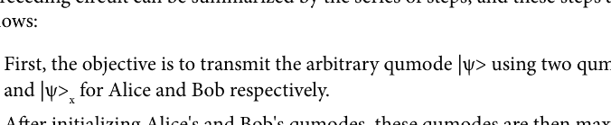

## 9
连续变量量子信息处理

量子系统既可以具有离散变量谱，也可以具有连续变量谱。

在本章中，我们首先介绍连续变量量子信息处理（QIP）领域。此外，我们还将涵盖连续变量QIP中的关键概念和思想。

我们将在本章中涵盖以下主题：

- 介绍连续变量量子信息处理
- 理解连续变量量子系统的理论
- 探索连续变量量子隐形传态
- 连续变量量子密钥分发
- 理解连续变量量子机器学习

在本章结束时，你应该能够做到以下几点：

- 区分离散变量QIP和连续变量QIP。
- 理解连续变量QIP中的关键思想和概念。

在下一节中，我们将介绍必要的技术要求，以便你能够学习本章。

## 技术要求

本章的要求如下：

- 对Python编程语言有基本理解
- 能够使用Google的Colab环境

本章的GitHub链接可以在这里找到：

```
https://github.com/PacktPublishing/Hands-On-Quantum-Information-Processing-with-Python/tree/master/Chapter09
```

下一节将介绍连续变量QIP。

## 介绍连续变量量子信息处理

到目前为止，我们只关注了使用量子比特的QIP。正如我们在本书前面所述，量子比特可以存在于二维（有限）希尔伯特空间中（关于量子比特的更多细节，请参阅第2章“量子态、操作与测量”）。这意味着使用量子比特的QIP是离散变量QIP的一个例子。

另一种QIP方法涉及使用存在于无限维希尔伯特空间中的量子系统。也就是说，与离散变量QIP——信息存储在量子比特等离散量子系统中——不同，连续变量QIP使用希尔伯特空间（因此量子态具有连续基）。

让我们回顾一下，对于二维希尔伯特空间中的量子系统，量子信息的单位是量子比特。另一方面，连续变量量子系统的信息单位是qumode。

## 探索连续变量量子隐形传态

我们记得，量子隐形传态用于将任意量子态（无论是量子比特还是qumode）从爱丽丝传输/传送到任意距离外的鲍勃。在本书前面（第3章“纠缠与量子隐形传态”），我们在离散变量QIP的背景下讨论了量子隐形传态。

在本节中，我们将讨论使用连续变量QIP框架的量子隐形传态。让我们回顾一下，量子隐形传态需要使用纠缠量子态和经典信道。所需的纠缠在离散变量QIP框架中是可能的，但在连续变量QIP中并不实际。

在连续变量QIP设置中，量子隐形传态通过以下过程实现，如电路所示：



图9.1 – 用于实现连续变量量子隐形传态的电路图

上述电路可以通过一系列步骤来总结，这些步骤如下：

- 1. 首先，目标是使用分别属于爱丽丝和鲍勃的两个qumode |ψ>ₚ和|ψ>ₓ来传输任意qumode |ψ>。
- 2. 在初始化爱丽丝和鲍勃的qumode之后，使用分束器将这些qumode最大程度地纠缠起来。这在图9.1中标记为BS1。
- 3. 在将两个qumode从爱丽丝到鲍勃最大程度地纠缠之后，下一步是将爱丽丝和鲍勃分隔任意距离。然而，就像离散变量量子隐形传态的情况一样，爱丽丝和鲍勃仍然可以通过经典信道进行通信。这一步之后，实际的任意qumode态从爱丽丝到鲍勃的隐形传态开始。为了实现这一点，爱丽丝在她自己那一侧，将纠缠对的一部分与被传送的任意态进行最大程度的纠缠。这也是通过使用分束器（在图9.1中标记为BS2）完成的。一旦完成，爱丽丝就在她那一侧进行测量。

```
plt.title('Mode 2')
plt.show()
fock_probs = state.all_fock_probs()
fock_probs.shape
np.sum(fock_probs, axis=(0,1))
```

我们现在已经讨论了连续变量量子隐形传态的实现。此外，我们还探索了如何使用Strawberry Fields框架实现连续变量量子隐形传态。下一节将涵盖连续变量量子博弈论。

## 理解连续变量量子博弈论

在本书前面（第6章“非局部量子博弈”），我们介绍了将传统博弈量子化为离散变量量子博弈。现在是时候介绍另一种实现量子博弈的方式了。然而，这次我们的重点将放在使用连续变量方法实现量子博弈上。因此，在本节中，我们将探索传统博弈的量子化，但这次是将它们量子化为连续变量量子博弈。

离散变量量子博弈方法与连续变量量子博弈方法之间的关键区别在于每种方法中使用的策略（玩家可用的策略空间）。在前一种方法中，玩家可以使用的策略数量是有限的。另一方面，在后一种方法中，玩家可以从连续统的策略中进行选择。因此，由于连续变量量子博弈中的玩家可以使用连续统的策略，这样的博弈可以使用无限维量子系统（qumode），而不是像量子比特这样的有限维系统。

连续变量量子博弈方法比离散变量对应方法提供了对传统博弈更现实的量子化。这是因为在现实生活环境中，许多情况可以用玩家具有连续统策略的博弈来表示。

爱丽丝和鲍勃之间的连续变量QKD交换操作可以总结如下：

- 1. 爱丽丝首先随机选择位置和动量变量。然后她使用这些随机变量来制备相干态。
- 2. 然后，爱丽丝通过噪声信道将制备好的相干态发送给鲍勃。
- 3. 在另一边，鲍勃执行零差或外差测量，随机选择位置和动量基。
- 4. 最后，爱丽丝和鲍勃通过经典信道进行通信，以执行经典后处理。

在本节中，我们提供了连续变量QKD的背景信息。在下一节中，我们将探索连续变量QIP的另一个领域，即连续变量量子机器学习。

## 理解连续变量量子机器学习

在本节中，我们讨论量子机器学习的连续变量版本。正如我们已经了解到的，这种机器学习方法使用连续变量量子系统，而不是诸如量子比特之类的离散变量量子系统。

可用于实现连续变量量子机器学习的软件工具包之一是PennyLane框架。该框架同时支持离散变量量子机器学习和连续变量量子机器学习。此外，基于Python编程语言的PennyLane软件工具包还支持经典-量子混合算法，如变分算法。


以下代码片段展示了 Python 和 PennyLane 框架在量子变分算法设计中的使用，该算法用于寻找氢分子的基态：

> Note
> 以下代码取自 www.pennylane.ai。
> 本章的 GitHub 链接可在此处找到：
> https://github.com/PacktPublishing/Hands-On-Quantum-Information-Processing-with-Python/tree/master/Chapter09

+   1. 第一步是导入必要的模块：

```
#hydrogen variational quantum eigensolver
import pennylane as qml
from pennylane import numpy as np
```

+   2. 下一步涉及对本算法中使用的氢分子的描述/规范：

```
geometry = 'h2.xyz'
name ='h2'
charge = 0
multiplicity=1
basis= 'sto-3g'
h, nr_qubits = qml.qchem.generate_hamiltonian(
    name,
    geometry,
    charge,
    multiplicity,
    basis,
    mapping='jordan_wigner',
    n_active_orbitals=2,
    n_active_electrons=2,
)
print("Hamiltonian is: \n", h)
print("Number of qubits is: \n", nr_qubits)
```

3. 在指定氢分子之后，下一步是构建一个 ansatz。Ansatz 是对氢分子状态的粗略猜测。它用作量子变分算法的起点，然后从那里对氢系统进行优化，直到找到基态（最低能量态）：

```
dev = qml.device('default.qubit', wires=nr_qubits)

def ansatz(params, wires):
    qml.BasisState(np.array([1, 1, 0, 0]), wires=wires)
    for i in wires:
        qml.Rot(*params[i], wires=i)
    qml.CNOT(wires=[2, 3])
    qml.CNOT(wires=[2, 0])
    qml.CNOT(wires=[3, 1])

cost_fn = qml.VQECost(ansatz, h, dev)
```

4. 随后是量子变分算法的实现：

```
opt = qml.GradientDescentOptimizer(stepsize=0.4)
np.random.seed(42)
params = np.random.normal(0, np.pi, (nr_qubits, 3))

print(params)

max_iterations = 250
step_size = 0.05
conv_tol = 1e-06

prev_energy = cost_fn(params)
for n in range(max_iterations):
    params = opt.step(cost_fn, params)
    energy = cost_fn(params)
    conv = np.abs(energy - prev_energy)

    if n % 20 == 0:
```

```
print('Iteration = {:}',
    Ground-state energy = {:.8f} Ha,
    Convergence parameter = '{:.8f} Ha'\
    .format(n, energy, conv))

if conv <= conv_tol:
    break

prev_energy = energy
```

5. 最后，显示获得的结果：

```
print()
print('Final convergence parameter = {:.8f} Ha'\
    .format(conv))
print('Final value of the ground-state energy = \
    {:.8f} Ha'.format(energy))
print('Accuracy with respect to the FCI energy: \
    {:.8f} Ha ({:.8f} kcal/mol)'.format(
    np.abs(energy - (-1.136189454088)), \
    np.abs(energy - (-1.136189454088))*627.503))
print()
print('Final circuit parameters = \n', params)
```

该 VQE 算法的实现始于 ansatz 的初始化，然后对其进行训练，目标是找到氢分子的基态。最后，对 VQE 电路进行优化，优化运行 250 步。然后给出获得的结果。

执行该 VQE 算法获得的结果显示在下图中：

```
Final convergence parameter = 0.00000564 Ha
Final value of the ground-state energy = -1.13600250 Ha
Accuracy with respect to the FCI energy: 0.00018695 Ha (0.11731347 kcal/mol)

Final circuit parameters =
[[ 1.56047353e+00 -1.04676705e-14  2.03477355e+00]
 [ 4.78473941e+00 -3.14789937e-14 -7.35562944e-01]
 [ 4.96124338e+00 -2.08614783e-01 -1.00326059e-01]
 [ 1.70450265e+00 -9.33663429e-17 -1.46313317e+00]]
```

图 9.2 – 实现 VQE 算法获得的结果
