# 关于审阅者

**Sanjan Rao** 是一名拥有超过五年机器学习、深度学习和网络安全解决方案经验的高级数据科学家。他拥有机器学习和人工智能专业的硕士学位。他的主要兴趣在于自然语言处理、自然语言推理和强化学习。

**Joel Edmond Nguemeta** 是来自喀麦隆的全栈 Web 开发者。他在 Python、Django、JavaScript 和 React 的单体和微服务架构软件开发方面经验丰富。他曾在 OpenClassrooms 担任自由职业导师/评估员，支持学生在 Python/Django 和 JavaScript/React 应用开发方面的学习，并对他们进行评估。此外，他还在 Tamangwa Shipping 担任移动开发者。他通过自己的 YouTube 频道 proxidev 与大家分享知识。他是初创公司 EasyLern 的联合创始人。

# 目录

# 第 3 部分：高级爬取概念

# 6

- Working with the Secure Web — 137
- Technical requirements — 137
- Exploring secure web content — 138
  - Form processing — 138
  - Cookies and sessions — 139
  - User authentication — 141
- HTML `<form>` processing using Python — 142
- User authentication and cookies — 147
- Using proxies — 151
- Summary — 155
- Further reading — 155

# 7

- Data Extraction Using Web APIs — 157
- Technical requirements — 157
- Introduction to web APIs — 158
  - Types of API — 159
  - Benefits of web APIs — 160
- Data formats and patterns in APIs — 162
  - Example 1 – sunrise and sunset — 163
  - Example 2 – GitHub emojis — 164
- Example 3 – Open Library — 165
- Web scraping using APIs — 166
  - Example 1 – holidays from the US calendar — 166
  - Example 2 – Open Library book details — 168
  - Example 3 – US cities and time zones — 169
- Summary — 171
- Further reading — 171

# 8

- Using Selenium to Scrape the Web — 173
- Technical requirements — 173
- Introduction to Selenium — 174
- Advantages and disadvantages of Selenium — 175
- Use cases of Selenium — 175

# 9

# 使用正则表达式和 PDF 195

Technical requirements 196
Overview of regex 196
Regex with Python 197
re (search, match, and findall) 198
re.split 201
re.sub 202
re.compile 202
Regex flags 204
Using regex to extract data 206

Example 1 – Yamaha dealer information 206
Example 2 – data from sitemap 208
Example 3 – Godfrey’s dealer 210
Data extraction from a PDF 211
The PyPDF2 library 212
Extraction using PyPDF2 213
Summary 217
Further reading 218

# 第 4 部分：高级数据相关概念

# 10

# 数据挖掘、分析和可视化 221

Technical requirements 222
Introduction to data mining 222
Predictive data mining 224
Descriptive data mining 224
Handling collected data 225
Basic file handling 225
JSON 227
CSV 229

SQLite 233
Data analysis and visualization 234
Exploratory Data Analysis using ydata_profiling 235
pandas and plotly 237
Summary 246
Further reading 247


## 11 机器学习与网络抓取 249

- 技术要求 249
- ML 简介 250
- ML 与 Python 编程 251
- ML 类型 255
- 使用 scikit-learn 进行 ML 261
- 简单线性回归 261
- 多元线性回归 267
- 情感分析 268
- 总结 273
- 延伸阅读 274

## 第 5 部分：结论

## 12 抓取之后 – 下一步与数据分析 277

- 技术要求 277
- 抓取后会发生什么？ 277
- Web 请求 278
- pycurl 278
- 代理 281
- 数据处理 283
- PySpark 283
- polars 284
- 工作与职业 285
- 总结 286
- 延伸阅读 287

## 索引 289

## 你可能喜欢的其他书籍 300

第 4 章，使用 Pyquery 进行抓取，Pyquery 是 Python 的类 jQuery 库，对类 jQuery 的 Python 库 pyquery 进行了介绍。本章提供了有关安装和探索 pyquery 在网页文档上的功能的介绍。还涵盖了使用 pyquery 进行抓取以及将数据写入 JSON 和 CSV 的示例。

第 5 章，使用 Scrapy 和 Beautiful Soup 进行网络抓取，提供了使用和部署流行的网络爬虫框架 Scrapy 的概述和示例。它还介绍了使用 BeautifulSoup 进行解析和抓取。

第 6 章，处理安全网络，提供了处理安全网页内容、利用会话和 Cookie 的概述。本章还指导你处理 HTML 表单和身份验证相关问题以抓取内容，并提供了在 HTTP 通信期间使用代理的指南和示例。

第 7 章，使用 Web API 进行数据提取，提供了对 Web API 的详细概述，其在与 HTTP 内容一起使用时的优势，以及 API 中可用的数据格式和模式。本章还提供了几个抓取 Web API 的示例。

第 8 章，使用 Selenium 进行网络抓取，介绍了 Selenium WebDriver，它有助于在 Web 浏览器中自动化操作，并涵盖了如何使用 Selenium 抓取数据。

第 9 章，使用正则表达式和 PDF，提供了正则表达式的详细概述及其使用和在 Python 中的实现。本章还提供了使用正则表达式和 PDF 文档使用 PyPDF2 Python 库进行数据提取的示例。

第 10 章，数据挖掘、分析和可视化，提供了使用 pandas Python 库进行数据挖掘和数据分析以及使用 Plotly 进行可视化的介绍和详细概述。本章还介绍了使用 ydata_profiling Python 库进行探索性数据分析的概念。

第 11 章，机器学习与网络抓取，提供了对机器学习这一人工智能分支的详细介绍。本章还提供了使用 scikit-learn Python 库的几个机器学习主题的示例，以及从抓取和收集的数据中进行情感分析。

第 12 章，抓取之后 – 下一步与数据分析，提供了与成长型技术相关的下一步的概述和介绍，详细涵盖了诸如 Web 请求和数据处理等主题。本章还提供了有关探索与抓取和数据相关的前景职业和工作的信息并指导开发人员。

## 如何充分利用本书

具备 Python 编程的基础或中级知识将有助于你充分利用本书的内容和示例。

| 书中涵盖的软件/硬件 | 操作系统要求 |
|---|---|
| Python 3.11 | Windows、macOS 或 Linux |
| Google Chrome 或 Mozilla Firefox | Windows、macOS 或 Linux |
| Visual Studio Code 或 JetBrains PyCharm Community Edition | Windows、macOS 或 Linux |

**如果你使用的是本书的数字版，我们建议你自己输入代码或从本书的 GitHub 仓库访问代码（链接在下一节中提供）。这样做将有助于你避免与复制和粘贴代码相关的任何潜在错误。**

## 下载示例代码文件

你可以从 GitHub `https://github.com/PacktPublishing/Hands-On-Web-Scraping-with-Python-Second-Edition` 下载本书的示例代码文件。如果代码有更新，将在 GitHub 仓库中更新。

我们还有来自我们丰富的图书和视频目录的其他代码包，可在 `https://github.com/PacktPublishing/` 获取。快去看看吧！

## 使用的约定

本书通篇使用了多种文本约定。

`Code in text`：表示文本中的代码词、数据库表名、文件夹名、文件名、文件扩展名、路径名、虚拟 URL、用户输入和 Twitter 账号。举例：“Here, we have expressed our interest in only finding the information from the content attribute with the `<meta>` tag, which has the name attribute with the keywords and description values, respectively.”

代码块如下所示：

```python
source.find('a:contains("Web")')  # [<a.menuitem>, <a>, <a>, <a>, <a>]
source.find('a:contains("Web"):last').text()
# 'Web Scraper'
source.find('a:contains("Web"):last').attr('href')  # '#'
```

任何命令行输入或输出写成如下形式：

```
(secondEd) C:\HOWScraping2E> pip install jupyterlab
```

代码块中的输出和注释如下所示：

```
# [<a.menuitem>, <a>, <a>, <a>, <a>]
# 'Web Scraper'
# '#'
```

**粗体**：表示新术语、重要词语或你在屏幕上看到的词语。例如，菜单或对话框中的词语以**粗体**显示。举例：“In addition, we will create separate files for **author** and **quotes**.”

**提示或重要说明** 如下所示出现。

## 联系我们

我们始终欢迎读者的反馈。

### 一般反馈

如果您对本书的任何方面有疑问，请发送电子邮件至 `customercare@packtpub.com`，并在邮件主题中提及书名。

### 勘误

尽管我们已尽一切努力确保内容的准确性，但难免会出错。如果您在本書中发现错误，我们将非常感激您向我们报告。请访问 `www.packtpub.com/support/errata` 并填写表格。

### 盗版

如果您在互联网上以任何形式发现我们作品的非法副本，我们将非常感激您提供位置地址或网站名称。请联系我们 `copyright@packt.com` 并附上材料链接。

### 如果您有兴趣成为作者

如果您在某个主题方面有专业知识，并且有兴趣撰写或为一本书做出贡献，请访问 `authors.packtpub.com`。

## 分享您的想法

一旦您阅读了 *Hands-On Web Scraping with Python Second Edition*，我们很乐意听到您的想法！请访问 https://packt.link/r/1837636214 获取本书并分享您的反馈。

您的评论对我们和技术社区都很重要，并将帮助我们确保提供优质内容。

## 下载本书的免费 PDF 副本

感谢您购买本书！

您喜欢随时阅读但无法随身携带印刷书籍吗？您的电子书购买与您选择的设备不兼容？

不用担心，现在购买每本 Packt 书籍，您都将免费获得该书的 DRM 免费 PDF 版本。

随时随地在任何设备上阅读。直接从您喜爱的科技书籍中搜索、复制和粘贴代码到您的应用程序中。

福利还不止于此，您可以每天通过电子邮件获得独家折扣、新闻通讯和优质免费内容。

按照以下简单步骤获取福利：

1. 扫描二维码或访问下面的链接
2. 提交您的购买证明
3. 就这样！我们会直接将您的免费 PDF 和其他福利发送到您的电子邮件


https://packt.link/free-ebook/9781837636211


## Web Scraping 基础

本书关于网络抓取涵盖了实用概念，并附有详细解释和示例代码。我们将向您介绍从网站提取或抓取数据（即高质量数据）的必备主题，使用来自网络和 Python 编程语言的有效技术。

在本章中，我们将了解与网络抓取相关的基本概念。无论您在此领域是否有任何先前经验，您都能够轻松地继续本章。

在我们的上下文中，对网络或网站的讨论指的是使用诸如 HTML 之类的标记语言构建的页面或文档，包括文本、图像、样式表、脚本和视频内容。它几乎是一个包含各种内容的容器。

以下是此上下文中的几个常见问题：

- 为什么要进行网络抓取？
- 它用于什么？

我们大多数人都遇到过数据概念以及数据在获取信息、决策、从事实中获得洞察力或甚至知识发现方面的益处或用途。全球大多数行业（例如 *治理、医学科学、人工智能、农业、商业、体育和研发*）对数据或高质量数据的需求日益增长。

我们将学习网络抓取到底是什么，探索与其相关的技术和技术，并借助 Python 编程语言在接下来的章节中从网络上查找和提取数据。

在本章中，我们将涵盖以下主要主题：

- 什么是网络抓取？
- 了解最新的网络技术
- 数据查找技术

## 技术要求

您可以使用任何操作系统（OS）（例如 Windows、Linux 或 macOS），并在您的 PC 或笔记本电脑上安装最新的网络浏览器（例如 Google Chrome 或 Mozilla Firefox）。

## 什么是网络抓取？

抓取是提取、复制、筛选或收集数据的过程。从网络（由网站、网页和互联网相关资源构成）抓取或提取数据以满足特定需求通常称为网络抓取。数据收集和分析在信息收集、决策和研究相关活动中至关重要。然而，由于数据可能被轻易操纵，网络抓取应谨慎进行。

互联网和基于网络资源的普及导致信息领域每天都在演变，这也导致了对原始数据的需求不断增长。数据是科学技术和管理领域的基本需求。收集或组织的数据经过处理、分析，与历史数据进行比较，并使用机器学习（ML）以及各种算法和逻辑进行训练，以获得估计和信息并获得进一步的知识。

网络抓取提供了从网站收集数据的工具和技术，适用于个人或业务相关需求，但需考虑法律因素。

如图 1.1 所示，我们根据需要从各种网站获取数据，编写/执行爬虫，收集必要内容并存储它。在此收集的数据之上，我们进行某些分析并得出与决策相关的一些信息。

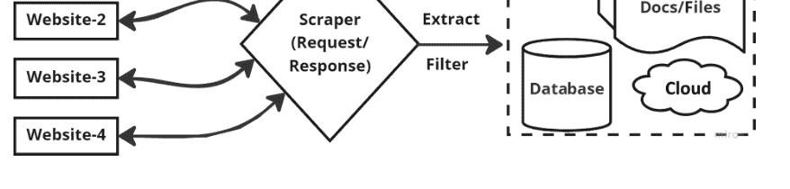

图 1.1：网络抓取 – 将网页内容存储为数据

我们将在后面的章节中更深入地探讨抓取和数据分析。

在执行抓取任务之前，还需要考虑一些法律因素。大多数网站都包含隐私政策、关于我们和条款和条件等页面，其中包含有关法律行动和禁止内容的法律信息以及一般信息。在计划对网站进行任何抓取活动之前，开发者有道德义务遵守这些条款和条件。

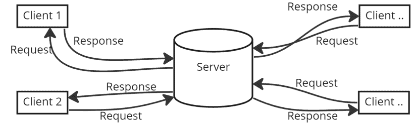

图 1.2：HTTP（客户端和服务器或请求-响应通信）

请求和响应本质上是循环的——它们就像客户端与服务器之间的问答，反之亦然。

HTTP 协议的另一种加密且更安全的版本是超文本传输安全协议（HTTPS）。它使用安全套接层（SSL）（了解有关 SSL 的更多信息请访问 https://developer.mozilla.org/en-US/docs/Glossary/SSL）和传输层安全（TLS）（了解有关 TLS 的更多信息请访问 https://developer.mozilla.org/en-US/docs/Glossary/TLS）来在客户端和服务器之间通信加密内容。这种类型的安全性允许客户端以安全的方式与服务器交换敏感数据。银行、在线购物和电子支付网关等活动使用 HTTPS 使敏感数据安全，防止其暴露。

**重要说明**
HTTP 请求 URL 以 http:// 开头，例如，http://www.packtpub.com，而 HTTPS 请求 URL 以 https:// 开头，例如，https://www.packtpub.com。

您现在已经了解了一些关于 HTTP 的知识。在下一节中，您将学习有关 HTTP 请求（或 HTTP 请求方法）的知识。

## HTTP 请求（或 HTTP 请求方法）

网络浏览器或客户端向服务器提交其请求。请求使用各种方法（通常称为 HTTP 请求方法）转发到服务器，例如 GET 和 POST：

- GET：这是请求信息的最常见方法。它被认为是一种安全的方法，因为这里资源状态不会被更改。此外，它用于提供查询字符串，例如 https://www.google.com/search?q=world%20cup%20football&source=hp，这是在基于 q（world cup football）和 source（hp）参数发送的请求向 Google 请求信息。信息或查询（本例中的 q 和 source）及其值会显示在 URL 中。

- POST：用于向服务器发出安全请求。请求的资源状态可能被更改。发布或发送到请求 URL 的数据不会在 URL 中显示，而是在请求正文中传输。它用于以安全的方式向服务器提交信息，例如登录和用户注册。

我们将在 *第 2 章* 的 *实现 HTTP 方法* 部分更深入地探讨 HTTP 方法。

如 *图 1.2* 所示，HTTP 通信有两个主要部分。了解了 HTTP 请求的基本概念后，让我们在下一节中探索 HTTP 响应。

## HTTP 响应

服务器处理请求，有时还处理指定的 HTTP 头部。当请求被接收和处理后，服务器会向浏览器返回其响应。大多数时候，响应以 HTML 格式找到，甚至以 JavaScript 和其他文档类型、**JavaScript 对象表示法（JSON）** 或其他格式。

响应包含状态代码，其含义可使用 **开发者工具（DevTools）** 揭示。以下列表包含一些状态代码以及它们含义的简要信息：

- **200**：OK，请求成功
- **404**：未找到，请求资源无法找到
- **500**：内部服务器错误
- **204**：无内容可发送
- **401**：未授权请求已发送到服务器

还有一些响应组可以根据 HTTP 响应状态的范围来识别：

- **100–199**：信息性响应
- **200–299**：成功响应
- **300–399**：重定向响应
- **400–499**：客户端错误
- **500–599**：服务器错误

> **重要说明**
> 有关 cookie、HTTP、HTTP 响应和状态代码的更多信息，请参阅官方文档 https://www.w3.org/Protocols/ 和 https://developer.mozilla.org/en-US/docs/Web/HTTP/Status。

现在我们对 HTTP 响应和请求有了基本概念，让我们探索 HTTP cookie（网络抓取中最重要的因素之一）。

## HTTP cookie

HTTP cookie 是服务器发送到浏览器的數據。此数据由网站在您的系统或计算机上生成和存储。它有助于识别用户向网站发出的 HTTP 请求。Cookie 包含有关会话管理、用户偏好和用户行为的信息。

服务器根据 cookie 中存储的信息识别并与浏览器通信。存储在 cookie 中的数据帮助网站访问和传输某些保存的值，例如会话 ID 和过期日期和时间，提供网络请求和响应之间的快速交互。

图 1.3 显示了使用 Chrome DevTools 从 https://www.fifa.com/fifaplus/en 收集的请求 cookie 列表：

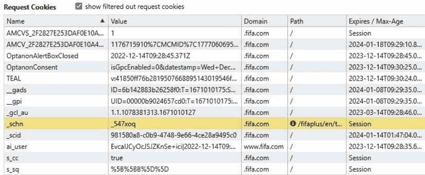

我们将在即将到来的章节和第 3 章中探索并收集有关浏览器 DevTools 的更多信息。

重要说明
有关 cookie 的更多信息，请访问 About Cookies http://www.aboutcookies.org/ 和 All About Cookies http://www.allaboutcookies.org/。

与 cookie 的作用类似，HTTP 代理在抓取中也很重要。我们将在下一节中探讨代理，也将在一些后面的章节中探讨。


## HTTP 代理

代理服务器充当客户端与主 Web 服务器之间的中间服务器。Web 浏览器向服务器发送请求，这些请求实际上会通过代理传递，而代理则将服务器的响应返回给客户端。

代理通常用于监控/过滤、性能提升、翻译以及互联网相关资源的保护。代理也可以作为服务购买，这可能还用于处理跨域资源。代理实现也有各种形式，例如 Web 代理（可用于绕过 IP 封锁）、CGI 代理和 DNS 代理。

你可以购买或与代理卖家或类似组织签订合同。他们会根据你运营的国家为你提供各种类型的代理。在爬取过程中频繁进行代理切换——代理允许我们绕过受限内容也是如此。通常，如果请求通过代理路由，我们的 IP 就会相对安全，不会被泄露，因为接收方在他们的详情或服务器日志中只会看到第三方代理。你甚至可以通过切换到不同的代理来访问在你所在位置不可用的网站（即你在本国会看到访问被拒绝的消息）。

使用 HTTP GET 请求传递的基于 Cookie 的参数、与 HTML 表单相关的 HTTP POST 请求，以及修改或适配头部，将在管理代码（即脚本）和在网页抓取过程中访问内容时至关重要。

> **重要说明**
> 有关 HTTP、头部、Cookie 等的详细信息将在即将到来的章节 *Data-finding techniques used in web pages* 中进一步探讨。请访问 MDN Web 文档中的 HTTP 页面（https://developer.mozilla.org/en-US/docs/Web/HTTP）以获取有关 HTTP 及相关概念的更详细信息。请访问 https://www.softwaretestinghelp.com/best-proxy-server/ 以获取有关最佳代理服务器的信息。

你现在已经了解了有关 HTTP 的一般概念（包括请求、响应、Cookie 和代理）。接下来，我们将了解用于创建 Web 内容或以某些预定义格式提供内容的[content]

## HTTP 代理

代理服务器充当客户端与主 Web 服务器之间的中间服务器。Web 浏览器向服务器发送请求，这些请求实际上会通过代理传递，而代理则将服务器的响应返回给客户端。

代理通常用于监控/过滤、性能改善、翻译以及互联网相关资源的安全。代理也可以作为服务购买，这可能还用于处理跨域资源。代理实现也有各种形式，例如 Web 代理（可用于绕过 IP 封锁）、CGI 代理和 DNS 代理。

你可以购买或与代理卖家或类似组织签订合同。他们会根据你运营的国家为你提供各种类型的代理。爬取时经常进行代理切换——代理也允许我们绕过受限内容。通常，如果请求通过代理路由，我们的 IP 相对安全且不会被泄露，因为接收方在其详情或服务器日志中只会看到第三方代理。你甚至可以通过切换到不同的代理来访问在你所在位置不可用的网站（即你在本国会看到访问被拒绝的消息）。

使用 HTTP GET 请求传递的基于 Cookie 的参数、与 HTML 表单相关的 HTTP POST 请求，以及修改或适配头部，将在管理代码（即脚本）和网页抓取过程中访问内容时至关重要。

> **重要说明**
> 有关 HTTP、头部、Cookie 等的详细信息将在即将到来的章节 *Data-finding techniques used in web pages* 中进一步探讨。请访问 MDN Web 文档中的 HTTP 页面（https://developer.mozilla.org/en-US/docs/Web/HTTP）以获取有关 HTTP 及相关概念的更详细信息。请访问 https://www.softwaretestinghelp.com/best-proxy-server/ 以获取有关最佳代理服务器的信息。

你现在已经了解了有关 HTTP 的一般概念（包括请求、响应、Cookie 和代理）。接下来，我们将了解用于创建 Web 内容或以某些预定义格式提供内容的

## HTML

网站由包含文本、图像、样式表和脚本等内容的页面或文档组成。它们通常使用 **Hypertext Markup Language (HTML)** 和 **Extensible Hypertext Markup Language (XHTML)** 等标记语言构建。

HTML 通常被称为用于构建网页的标准标记语言。自 1990 年代初以来，HTML 已独立使用，也与服务器端脚本语言（如 PHP、ASP 和 JSP）结合使用。XHTML 是 HTML 的高级扩展版本，是 Web 文档的主要标记语言。XHTML 也比 HTML 更严格，从编码角度来看，也被视为使用 **Extensible Markup Language (XML)** 构建的应用程序。

HTML 定义并包含网页的内容。可以在 HTML 页面内找到可提取的数据和任何信息揭示的数据源，这些数据位于预定义指令集或称为标签的标记元素中。HTML 标签通常是一个带有某些预定义属性的命名占位符，例如 `<a>`、`<b>`、`<table>`、`` 和 `<script>`。

HTML 是一种容器或标记语言类型。构建 HTML 涉及各种因素；下一节将使用一些示例定义这些因素。

### HTML 元素和属性

HTML 元素（也称为文档节点）是 Web 文档的构建块。HTML 元素由开始标签 `<...>` 和结束标签 `</...>` 构建，中间包含某些内容。HTML 元素还可以包含属性，通常定义为 `attribute-name = attribute-value`，为元素提供额外信息：

```
```html
<p>normal paragraph tags</p>
<h1>heading tags there are also h2, h3, h4, h5, h6</h1>
<a href="https://www.google.com">Click here for Google.com</a>

<br />
```
```

前面的代码可以分解如下：

- `<p>` 和 `<h1>` 是包含一般文本信息（元素内容）的 HTML 元素。
- `<a>` 定义了 href 属性，其中包含当点击文本 **Click here for Google.com** 时将被处理的实际链接。链接指向 `https://www.google.com/`。
- `` 图像标签还包含一些属性，如 src 和 alt 及其各自的值。`src` 的值保存资源，即图像地址或图像 URL，而 `alt` 保存 `` 的替代文本值（主要在连接缓慢或图像无法加载时显示）。
- `<br />` 在 HTML 中表示换行符，没有属性或文本内容。它用于在文档布局中插入新行。

HTML 元素也可以以树状结构嵌套，具有父子层级关系，如下所示：

```
```html
<div class="article">
    <p id="mainContent" class="content">
        <b>Paragraph Content</b>
        
    </p>
    <p>
```

```
```html
<h3> Paragraph Title: Web Scraping</h3>
</p>
</div>
```
```

如前面的代码所示，两个 `<p>` 子元素位于 HTML `<div>` 块内。两个子元素都带有某些属性以及作为其内容的不同子元素。通常，HTML 文档以上述结构构建。

如最后一个示例中前面的代码块所示，有一些额外的键值对。下一节将探讨这一点。

### 全局属性

HTML 元素可以包含一些额外信息，例如键值对。这些也称为 HTML 元素属性。属性保存值并提供标识，或包含在抓取活动中的许多方面可能有帮助的额外信息，例如识别确切的 Web 元素并从中提取值或文本以及遍历（*移动沿着*）元素。

某些属性是 HTML 元素的通用属性或可应用于所有 HTML 元素。以下列表提到了一些被识别为全局属性的属性（https://developer.mozilla.org/en-US/docs/Web/HTML/Global_attributes）：

- `id`：该属性的值应唯一于其应用的元素
- `class`：该属性的值主要与 CSS 结合使用，提供相等状态的格式化选项，可用于多个元素
- `style`：这为元素指定内联 CSS 样式
- `lang`：这有助于识别文本的语言

> **重要说明**
> 
> `id` 和 `class` 属性主要用于标识或格式化单个元素或其组。这些属性也可以由 CSS 和其他脚本语言管理。当与 CSS 一起使用或在遍历和应用解析技术时，可以通过在属性名称前分别放置 `#` 和 `.` 来识别这些属性。

HTML 元素属性也可以使用脚本语言动态覆盖或实现。如以下示例所示，`itemscope` 属性用于向元素添加属性，而 `data-*` 用于存储元素本身固有的数据：

```
```html
<div itemscope itemtype="http://schema.org/Place">
    <h1 itemprop="university">University of Helsinki</h1>
    <span>Subject: <span itemprop="subject1">Artificial
        Intelligence</span>
```

```
</span><span itemprop="subject2">Data Science</span>
</div>

```

HTML 标签和属性在提取数据时非常有帮助。

> **重要说明**
> 请访问 https://www.w3.org 或 https://www.w3schools.com/html 获取有关 HTML 的更详细信息。

在第 3 章中，我们将使用不同的工具探索这些属性。我们还将执行各种逻辑操作并将它们用于提取或抓取目的。

我们现在对 HTML 和与 HTML 相关的一些重要属性有了一些了解。在下一节中，我们将学习 XML 的基础知识，也称为标记语言之父。

## XML

XML 是一种用于在互联网上分发数据的标记语言，具有用于编码可读且易于在机器和文档之间交换的文档的规则集。XML 文件由 .xml 扩展名识别。

XML 强调文本数据在各种格式和系统中的可用性。XML 设计用于携带便携式数据或存储在标签中的数据，而这些数据不是使用 HTML 标签预先定义的。在 XML 文档中，标签由文档开发者或自动化程序创建以描述内容。

以下代码显示了一些示例 XML 内容：

```
<employees>
  <employee>
    <fullName>Shiba Chapagain</fullName>
    <gender>Female</gender>
  </employee>
  <employee>
    <fullName>Aasira Chapagain</fullName>
    <gender>Female</gender>
  </employee>
</employees>
```

在前面的代码中，<employees> 父节点有两个 <employee> 子节点，而每个子节点又包含 <fullName> 和 <gender> 的其他子节点。


## JavaScript

**JavaScript**（也称为 **JS** 或 **JScript**）是一种用于编程 HTML 和在浏览器中运行的 Web 应用的编程语言。JavaScript 主要用于为网页添加动态功能并提供基于用户的交互。JavaScript、HTML 和 CSS 是最常用的 Web 技术之一，现在它们也与无头浏览器一起使用（你可以在 `https://oxylabs.io/blog/what-is-headless-browser` 阅读更多关于无头浏览器的内容）。JavaScript 引擎的客户端可用性也加强了其在应用测试和调试中的使用。

`<script>` 包含使用 JavaScript 变量、运算符、函数、数组、循环、条件和事件的编程逻辑，目标是 HTML **文档对象模型 (DOM)**。JavaScript 代码可以通过 `<script>` 添加到 HTML 中，如以下代码所示，也可作为文件嵌入：

```html
<!DOCTYPE html>
<html>
<head>
    <script>
        function placeTitle() {
            document.getElementById("innerDiv").innerHTML =
                "Welcome to WebScraping";
        }
    </script>
</head>
<body>
    <div>Press the button: <p id="innerDiv"></p></div>
```

## AJAX

AJAX 是一种 Web 开发技术，它使用客户端的一组 Web 技术来创建异步 Web 应用。

JavaScript XMLHttpRequest (XHR) 对象用于在网页上执行 AJAX，并在不刷新或重新加载页面的情况下加载页面内容。有关 AJAX 的更多信息，请访问 W3Schools 上的 AJAX 页面（https://www.w3schools.com/js/js_ajax_intro.asp）。从抓取的角度来看，对 JavaScript 功能的基本概述对于理解页面是如何构建或操作的以及识别使用的动态组件非常有价值。

> **重要说明**
> 
> 请访问 https://developer.mozilla.org/en-US/docs/Web/JavaScript、https://www.javascript.com/、https://www.w3schools.com/js/js_intro.asp 和 https://www.w3schools.com/js/js_ajax_intro.asp 以获取有关 JavaScript 和 AJAX 的更多信息。

我们已经了解了一些今天在 Web 开发中常见的基于 JavaScript 的技术和工具。在下一节中，我们将学习关于数据存储对象的内容。

## JSON

JSON 是一种用于从服务器向网页存储和传输数据的格式。它与语言无关，并且由于其大小和可读性，在基于 Web 的数据交换操作中很受欢迎。JSON 文件是具有 .json 扩展名的文件。

JSON 数据通常格式化为 name:value 对，被评估为 JavaScript 对象并遵循 JavaScript 操作。JSON 和 XML 通常被比较，因为它们都承载并在各种 Web 资源之间交换数据。JSON 通常因其结构而被评为高于 XML，其结构简单、可读、自描述、可理解且易于处理。

对于使用 JavaScript、AJAX 或 RESTful 服务的 Web 应用，JSON 由于其快速且易于操作而优于 XML。JSON 和 JavaScript 对象可以互换。JSON 不是一种标记语言，它不包含任何标签或属性。相反，它是一种纯文本格式，可以通过服务器访问，并且可以由任何编程语言管理。

JSON 对象也可以表示为数组、字典和列表：

```
{"mymembers": [
{ "firstName":"Aasira", "lastName":"Chapagain","cityName":"Kathmandu"},
{ "firstName":"Rakshya", "lastName":"Dhungel","cityName":"New Delhi"},
{ "firstName":"Shiba", "lastName":"Paudel","cityName":"Biratnagar"},
]}
```

你已经了解了 JSON，它是一个内容持有者。在下一节中，我们将讨论使用 CSS 进行 HTML 样式设置以及为 HTML 标签提供额外标识。

> **重要说明**
> 
> JSON 也以其在 Python 中提供的字典和列表对象的混合而闻名。JSON 以字符串形式编写，我们可以找到大量将 JSON 字符串转换为 JSON 对象的网站，例如 `https://jsonformatter.org/`、`https://jsonlint.com/` 和 `https://www.freeformatter.com/json-formatter.html`。
> 
> 请访问 `http://www.json.org/`、`https://jsonlines.org/` 和 `https://www.w3schools.com/js/js_json_intro.asp` 以获取有关 JSON 和 JSON Lines 的更多信息。

## CSS

我们迄今为止介绍的基于 Web 的技术处理内容，包括绑定、开发和处理。CSS 描述了 HTML 元素的显示属性和网页的外观。CSS 用于样式设置并提供 HTML 元素的所需外观和呈现。

通过使用 CSS，开发人员/设计师可以控制 Web 文档的布局和呈现。CSS 可以应用于页面中的特定元素，也可以嵌入到单独的文档中。样式细节可以使用 `<style>` 标签描述。

`<style>` 标签可以包含针对块中重复和各种元素的细节。如以下代码所示，存在多个 `<a>` 元素，并且它还具有 `class` 和 `id` 全局属性：

```html
<html>
<head>
<style>
a{color:blue;}
h1{color:black; text-decoration:underline;}
#idOne{color:red;}
.classOne{color:orange;}
</style>
</head>
<body>
<h1> Welcome to Web Scraping </h1>Links:<a href="https://www.google.com"> Google </a> &nbsp;
<a class='classOne' href="https://www.yahoo.com"> Yahoo </a>
<a id='idOne' href="https://www.wikipedia.org"> Wikipedia </a>
</body>
</html>
```

使用 CSS 属性提供的属性或在前述代码块中 `<style>` 标签内样式化的属性将导致图 1.4 所示的输出：

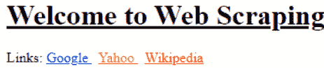

图 1.4：使用 CSS 的 HTML 代码输出

尽管 CSS 用于管理 HTML 元素的外观，但 CSS 选择器（用于选择元素或元素位置的模式）在抓取过程中通常发挥主要作用。我们将在第 3 章详细探讨 CSS 选择器。

> **重要说明**
> 
> 请访问 https://www.w3.org/Style/CSS/ 和 https://www.w3schools.com/css/ 以获取有关 CSS 的更详细信息。

在本节中，你了解了一些可用于 Web 抓取的技术。在即将到来的部分中，你将学习关于数据查找技术。它们大多数都是用你已经介绍过的 Web 技术构建的。

## Web 页面中使用的数据查找技术

要从网站或网页中提取数据，我们必须确定数据确切位于何处。这是自动化从 Web 收集数据的过程中最重要的一步。

当我们在 Web 浏览器中浏览或请求任何 URL 时，我们可以看到内容作为对我们的响应。这些内容可以是动态添加的值，或通过处理某些 API 或 JavaScript 代码动态生成或渲染到 HTML 模板中。知道响应内容的 URL 或查找内容在某些文件中的可用性是抓取的第一步。内容也可以使用第三方来源检索，有时甚至嵌入到最终用户视图中。

在本节中，我们将探索一些关键技术，这些技术将帮助我们识别、搜索和定位通过 Web 浏览器接收的内容。

### HTML 源页面

Web 浏览器用于客户端-服务器基于 GUI 的交互以探索 Web 内容。浏览器地址栏提供 Web 地址或 URL，请求的 URL 与服务器（主机）通信，并收到响应，这意味着它被浏览器加载。此获得的响应或页面源可以进一步探索并以原始格式搜索所需内容。


# 网页抓取基础

> **重要说明**
> 
> 你可以自由选择使用哪个网页浏览器。大多数网页浏览器会显示相同或相似的内容。我们将在本书的大部分示例中使用 Google Chrome，安装在 Windows 操作系统上。

要访问 HTML 源页面，请按照以下步骤操作：

- 1. 在你的网页浏览器中打开 `https://www.google.com`（你可以用任何其他 URL 尝试相同场景）。
- 2. 页面完全加载后，*右键单击*页面的任意部分。*图 1.5* 中显示的菜单应该可见，其中包含 **查看页面源代码** 选项：

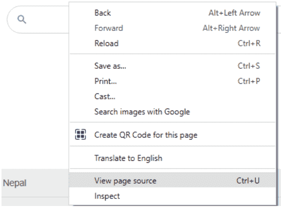

图 1.5：查看页面源代码（右键单击任意页面并找到此选项）

- 3. 如果你点击 **查看页面源代码** 选项，它将在浏览器中加载一个新标签页，如 *图 1.6* 所见：

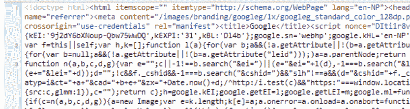

图 1.6：页面源代码（网页浏览器中加载的新标签页，显示原始 HTML）

你可以看到浏览器中会新增一个标签页，其中文本 **view-source:** 前置于原始 URL，https://www.google.com。同样，如果我们在 URL 中添加文本 *view-source:*，URL 加载后会显示页面源代码或原始 HTML。

> **重要说明**
> 你可以通过在页面源代码中搜索来在网页浏览器中查找任何文本或 DOM 元素。加载 URL https://www.google.com 并搜索 *web scraping*。使用页面源代码找到 Google 显示的部分内容。

我们现在对数据查找技术有一个基本概念。本节中使用的技术是主要或基础概念。还有一些更复杂的技术，附带大量功能和工具，有助于或指导我们在数据查找上下文中的工作——我们将在下一节中介绍它们。

## 开发人员工具

DevTools 已嵌入当今市场上大多数浏览器中。开发人员和终端用户都可以识别和定位资源，并在客户端-服务器通信期间或在 HTTP 请求和响应期间搜索网页内容。

DevTools 允许用户检查、创建、编辑和调试 HTML、CSS 和 JavaScript。它们还允许我们处理和解决性能问题。它们促进了浏览器动态或安全呈现的数据提取。

DevTools 将用于大多数数据提取案例。有关 DevTools 的更详细信息，这里有一些链接：

- **Google Chrome**：`https://developer.chrome.com/docs/devtools/`
- **Firefox**：`https://firefox-source-docs.mozilla.org/devtools-user/`

与 *HTML 源页面* 部分中讨论的 **查看页面源代码** 选项类似，当我们右键单击网页时，可以找到 **检查** 菜单选项，这也是查看页面源代码的另一种选择。

或者，你可以通过浏览器主菜单访问 DevTools。点击 **更多工具 | 开发人员工具**，或按 Ctrl + Shift + I，如 *图 1.7* 所见：

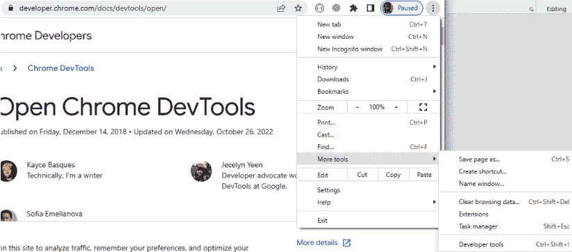

图 1.7：访问 DevTools（网页浏览器菜单栏）

让我们尝试在网页浏览器中加载 URL `https://en.wikipedia.org/wiki/FIFA`。页面加载后，请按照以下步骤操作：

- 1. **右键单击** 页面并点击 **检查** 菜单选项。
  
  我们会注意到浏览器中出现了一个新的菜单部分，其中包含标签 (**元素、控制台、来源、网络、内存** 等)，如 *图 1.8* 所见：

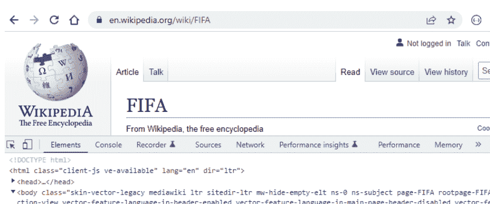

图 1.8：检查 DevTools 面板

- 2. 按 Ctrl + Shift + I 访问 DevTools 或从检查菜单选项中点击网络标签，如图 1.9 所示：

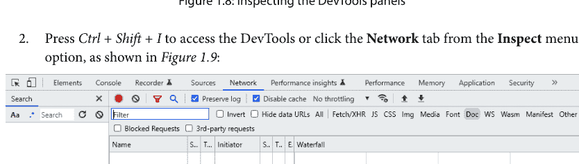

图 1.9：DevTools 网络面板

### 重要说明

搜索和过滤字段，如图 1.9 所见，通常用于在 HTML 页面源代码或网络面板中可用的其他资源中查找内容。搜索框可以提供正则表达式模式——区分大小写的用于查找或定位内容的信息，静态或动态。

```
<!DOCTYPE html>
<html class="client-js ve-available" lang="en" dir="ltr">
<head></head>
<body class="skin-vector-legacy mediawiki ltr sitedir-ltr mw-hide-empty-elt ns-0 ns-subject page-FIFA rootpage-FIFA ...">
<div id="mw-page-base" class="noprint"></div>
```

DevTools 内部找到的所有面板和工具都有指定的角色。让我们接下来对其中几个重要的面板做一个基本概述。

## 探索 DevTools

以下是 DevTools 中找到的所有面板和工具列表：

- **元素**：显示所查看页面的 HTML 内容。这用于查看和编辑 DOM 和 CSS，以及查找 CSS 选择器和 XPath 内容。图 1.10 显示了在检查菜单选项中找到的图标，可以点击并移动到页面中的 HTML 内容或代码内部的元素面板，以定位 HTML 标签或 XPath 和 DOM 元素位置：


图 1.10：元素检查器或选择器

此图标的作用类似于鼠标光标在屏幕上移动。我们将在第 3 章进一步探索 CSS 选择器和 XPath。

> **重要说明**
> 在元素或网络 | 文档面板中显示或定位的 HTML 元素可能在页面源代码中不可用。

- **控制台**：用于运行和与 JavaScript 代码交互，并查看日志消息。
- **来源**：用于导航页面并查看可用的脚本和文档来源。脚本化工具可用于诸如脚本执行（即恢复和暂停）、单步执行函数调用、激活和停用断点以及处理异常等任务。
- **网络**：为我们提供 HTTP 请求和响应相关资源。这里找到的资源具有记录数据到网络日志、捕获屏幕截图、过滤网络资源（JavaScript、图像、文档和 CSS）、搜索网络资源以及分组网络资源等选项，也可用于调试任务。图 1.11 显示了通过从网络面板内的文档选项访问标头标签访问的 HTTP 请求 URL、请求方法、状态代码等。

对于上面列出的每个过滤选项，在名称面板中为所选资源提供了一些子标签，分别是：

- **标头**：加载特定请求的 HTTP/HTTPS 标头数据。还找到了一些重要且基于自动化的类型数据，例如，请求 URL、方法、状态代码、请求/响应标头、查询字符串、负载或 POST 信息。
- **预览**：提供找到的响应的预览，类似于在网页浏览器中查看的实体。
- **响应**：加载特定实体的响应。此选项卡显示 HTML 页面的 HTML 源代码、JavaScript 文件的 JavaScript 代码以及类似文档的 JSON 或 CSV 数据。它实际上显示了内容的原始源。
- **发起者**：提供发起者链接或发起者 URL 链。它类似于请求标头中的 referer。
- **时间**：显示资源调度、连接开始以及请求/响应之间的时间分解。
- **Cookie**：提供 cookie 相关信息，其键和值以及到期日期。

> **重要说明**
> **网络** 面板是最重要的资源中心之一。我们可以在此面板中找到/追踪每个请求/响应周期的大量信息和支持细节。有关 **网络** 面板的更详细信息，请访问 https://developer.chrome.com/docs/devtools/network/ 和 https://firefox-source-docs.mozilla.org/devtools-user/network_monitor/。

- **性能**：可以记录屏幕截图和内存时间线。获得的视觉信息用于优化网站速度、改善加载时间以及分析运行时或整体性能。
- **内存**：从此面板获得的信息用于修复内存问题并追踪内存泄漏。总的来说，**性能** 和 **内存** 面板中的详细信息允许开发人员分析网站性能并进行与优化相关的进一步规划。
- **应用程序**：最终用户可以检查和管理页面加载期间加载的所有资源存储。可以在此处查看甚至删除与 cookie、会话、应用程序缓存、图像、数据库等相关的信息，以创建新会话。
- **安全**：此面板可能并非在所有网页浏览器中都可用。它通常显示安全相关信息，例如资源、证书和连接。我们甚至可以浏览有关证书的更多详细信息，从此面板中可用的几个详细信息链接或按钮，如图 1.12 所示：


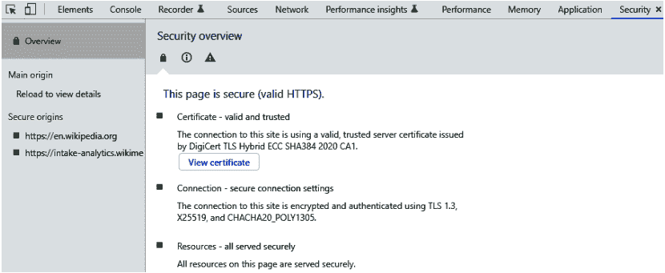

Figure 1.12: Security panel (details about certificate, connection, and resources)

在探索了 HTML 页面源代码和 DevTools 之后，我们现在对数据和请求/响应相关信息存储的位置以及如何访问它有了一些概念。总的来说，抓取过程涉及从网页中提取数据，我们需要识别或定位具有数据或可以承载数据的资源。在进行数据探索和内容识别之前，识别页面 URL、DevTools 资源、XHR、JavaScript 以及浏览器活动概览是有益的。

最后，还有更多与链接、子页面相关的话题。我们将在第 3 章中深入使用 sitemaps.xml 和 robots.txt 等技术。

> **Important note**
> 有关 sitemaps.xml 和 robots.txt 的基本概念，请访问 Sitemaps 网站 (https://www.sitemaps.org) 和 Robots Exclusion Protocol 网站 (http://www.robotstxt.org)。

在本章中，您学习了网络抓取、涉及的网络技术，以及如何使用数据查找技术。

## Summary

网站本质上是动态的，因此本章介绍的基本活动在大多数情况下都适用。我们还解释并探索了一些与万维网 (WWW) 和网络抓取相关的核心技术。使用 DevTools 和页面源来识别或查找目标内容是本章的重点。这些信息将指导您在网络抓取中采取初步和专业的步骤。

在下一章中，我们将使用 Python 编程语言与网络或数据源交互，并探索我们为数据提取而选择的几个主要库。

## Further reading

- *HTML:* https://developer.mozilla.org/en-US/docs/Web/HTML
- *CSV:* https://docs.python.org/3/library/csv.html
- *JSON:*
  - https://www.json.org/json-en.html
  - https://developer.mozilla.org/en-US/docs/Learn/JavaScript/Objects/JSON
- *XML:*
  - https://aws.amazon.com/what-is/xml/
  - https://www.w3.org/XML/
- *HTTP:*
  - https://developer.mozilla.org/en-US/docs/Web/HTTP
  - https://http.dev/methods
  - https://www.rfc-editor.org/rfc/rfc9110.html
- *JavaScript:*
  - https://www.javascript.com/
  - https://developer.mozilla.org/en-US/docs/Web/JavaScript
- *jQuery:*
  - https://jquery.com/
  - https://www.w3schools.com/jquery/default.asp
- *Browser developer tools:*
  - https://developer.chrome.com/docs/devtools/
  - https://developer.mozilla.org/en-US/docs/Learn/Common_questions/Tools_and_setup/What_are_browser_developer_tools
- *Web technology:* https://developer.mozilla.org/en-US/docs/Web
- *Reverse engineering:* https://insights.globalspec.com/article/7367/how-does-reverse-engineering-work

## Technical requirements

我们将使用安装在 Windows 上的 Python 3.11.1。代码编辑器的选择很多；选择一个方便您使用且能处理本章代码示例中使用的库的编辑器。我们将并行使用来自 Jupyter 的 Notebooks 和 JupyterLab (https://jupyter.org/)、集成开发和学习环境 (IDLE)（来自 Python 的默认编辑器）以及 Windows 的命令提示符 (cmd)。

要跟上本章的学习，您需要安装以下应用程序：

- Python 3.11.* 或适用于您操作系统的最新版本，来自 https://www.python.org/downloads/
- pip Python 包管理工具 (https://pypi.org/project/pip/)
- JupyterLab (https://jupyter.org/install) 用于访问 .ipynb 扩展名的笔记本或文件
- Google Chrome、Mozilla Firefox 或任何其他配备开发者工具 (DevTools) 的网络浏览器
- JetBrains PyCharm (https://www.jetbrains.com/pycharm/)、Visual Studio Code (https://code.visualstudio.com/) 或您习惯使用的任何编辑器

本章所需的 Python 库如下：

- requests
- urllib

本章的代码文件可在 GitHub 上在线获取：https://github.com/PacktPublishing/Hands-On-Web-Scraping-with-Python-Second-Edition/tree/main/Chapter02。

## Why Python (for web scraping)?

Python 是一种流行的编程语言，用于编写各种类型的应用程序，从简单的脚本到软件开发、ML/AI 算法和 CLI/GUI 应用，以及创建 Web 应用程序。Python 简单的面向对象编程 (OOP) 语法非常易读，这使得开发人员可以用不多行代码编写代码并在不同平台上工作（这意味着 Python 是平台独立的），使其成为编程语言中的首选。

Python 是当今编程领域的热门词汇。相当多的工具和 Web 应用程序都是使用 Python 生产和管理的，它兼容小型和大型应用，并由其全球开发者社区提供充足且最新的库。

网络抓取需要各种工具和技术来从网站收集数据，以满足个人或业务需求，但同时要考虑到任何法律限制。使用 Python，我们可以使用许多有效的库来访问和管理项目，例如 `requests`、`http`、`urllib`、`json`、`csv` 和 `cookielib`。

Python 开发以及 Python 语言本身都在不断增长并定期更新。它解决了大多数市场需求，帮助用户提高生产力，同时为开发人员提供有效高效的库。在撰写本书时，Python 的版本 3.11.1 可在 `https://www.python.org` 获取，如 *Figure 2.3* 所示：


Figure 2.3: Python website (latest versions, jobs, and documentation)

Python 还拥有在全球备受推崇的用于各种任务和领域的库。这些库在 Python 社区中很有名：

- `requests`、`http`、`urllib`、`cookielib` 和 Starlette：用于 **HTTP** 通信
- `lxml`、PyQuery 和 BeautifulSoup：用于 **HTML**、**XML** 和 **DOM** 解析
- `json` 和 `csv`：用于文件管理和内容管理
- `numpy` 和 `pandas`：用于处理和分析数值和表格数据
- `scipy`：用于科学计算
- `nltk`、textblob 和 vader：用于 NLP
- PyTorch：一个开源 ML 框架
- `scikit-learn`：用于预测性数据分析的高效工具
- `matplotlib`、seaborn 和 plotly：可视化库
- PySpark：用于处理大数据、流式传输和块管理
- FastAPI、Flask 和 Django：基于 Web 的框架
- Pydantic 和 Pandera：数据验证和数据测试工具包
- PyArrow：用于互操作性和集成 Python 对象

有关这些库的更详细信息，请访问 https://www.python.org、https://pypi.org 和 https://pymotw.com/3/。

在本节中，您学习了 Python、其流行度、一些库以及 Python 在顶级公司中的使用。在下一节中，我们将设置 Python、安装所需的库并使用 Python 与 Web 通信。

## Accessing the WWW with Python

正如我们在 Why Python (for web scraping)? 部分所看到的，有许多 Python 库可用于与 HTTP 交互。requests 和 urllib 是我们感兴趣使用的两个库，因为它们具有深入的功能、处理 HTTP 通信的各种函数、易于阅读的文档和流行度。

为了开始使用这些库通过 Python 访问万维网，让我们验证是否已安装所有必需资源。在以下小节中，我们将开始设置，例如安装 Python、创建虚拟环境、在创建的环境中安装库以及使用 Python 库访问 Web。

### Setting things up

假设您系统上已安装了最新版本的 Python。如果没有，请访问 https://www.python.org/downloads/ 获取适用于您操作系统的最新 Python 版本。关于通用设置和安装程序，请访问 https://docs.python.org/3/using/windows.html 并按照详细步骤操作。

> **Important note**
> 在安装期间，Python 用户可以选择 **Customize Installation** 并选择诸如 **Add Python... to PATH** 之类的功能。此外，对于初学者和中级用户，建议使用易于定位的位置或根文件夹来设置 Python，例如 C:\Python311 或 D:\Python\Py311。

我们将在 Windows 上使用 Python 3.11.1。安装完成后，我们可以使用以下步骤确认 Python 在操作系统中的可用性：

1. 按 Windows + R 打开运行窗口并输入 cmd 以加载命令行界面 (CLI)。
2. 移动到您的根目录或所需路径。
3. 输入 python -h。这将加载 Python 选项，如 Figure 2.4 所示：


在 *Figure 2.6* 中，我们导入了 `sys` 库（也称为 system），并且 `sys` 有一个名为 `version` 的属性，用于显示当前的 Python 版本以及一些系统信息。有关 sys 和 IDLE 的更多信息，请分别访问 `https://docs.python.org/3/library/sys.html` 和 `https://docs.python.org/3/library/idle.html`。

默认的 Python 安装会安装大部分内部或默认库（sys、urllib、os、math 等），但如果我们想要使用不可用的库，系统会抛出 `ModuleNotFoundError` 错误，如 *Figure 2.7* 所示：

```
```text
>>> import urllib
>>> import requests
Traceback (most recent call last):
  File "<pyshell#3>", line 1, in <module>
    import requests
ModuleNotFoundError: No module named 'requests'
>>> import pycurl
Traceback (most recent call last):
  File "<pyshell#4>", line 1, in <module>
    import pycurl
ModuleNotFoundError: No module named 'pycurl'
```
```

Figure 2.7: ModuleNotFoundError encountered when importing the requests library

与 *Figure 2.7* 类似的情况需要额外安装此类库，可以使用 pip 来处理。

到目前为止，Python 已安装完成，并且我们已使用 CLI 和 Python 的 **Graphical User Interface (GUI)**、IDLE 验证了安装。为了设置额外的库，例如 requests，我们首先需要采取一些额外的步骤，我们将在下一节中介绍。

## Creating a virtual environment

在继续安装所需库或 Python 默认不可用的额外库之前，建议为项目创建一个虚拟环境。

虚拟环境为项目及其所需库维护一个目录，以避免库与系统之间的冲突。它通常为具有特定需求和规范的目标项目提供完整的环境。有关虚拟环境的更多信息，请访问 `https://docs.python.org/3/tutorial/venv.html` 或 `https://docs.python-guide.org/dev/virtualenvs/`。

我们将在虚拟环境中安装本书所需的所有库和工具。因此，让我们开始创建环境，并通过以下步骤使用 pip 加载所需库：

- 1. 首先创建一个目录，例如 HOWScraping2E（这是我们希望将本书中的所有代码放置的位置），在根驱动器中（C:\HOWScraping2E>）。
- 2. 在 HOWScraping2E 中，运行以下命令：
- 3. 要激活我们创建的环境（secondEd），请使用 secondEd\Scripts 运行 activate 命令，如 Figure 2.8 所示：
- 4. 要停用或关闭环境，我们只需发出 deactivate 命令，例如，(secondEd) C:\HOWScraping2E> deactivate。建议在结束时或关闭系统前停用环境。

```
C:\HOWScraping2E>python -m venv secondEd
```

这里我们使用 venv 创建了一个名为 secondEd 的虚拟环境。

此步骤还在 HOWScraping2E 目录内创建了一个名为 secondEd 的目录，其中包含几个文件夹。

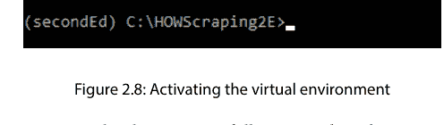

Figure 2.8: Activating the virtual environment

虚拟环境已成功激活，因为 secondEd 环境可见于命令提示符的开头，如 Figure 2.8 所示。

现在位置和环境已准备就绪，我们需要使用 pip 安装所需的库和工具。pip 包管理系统用于安装和管理用 Python 编写的软件包。有关更多信息，请访问 https://pypi.org/project/pip/ 和 https://packaging.python.org/en/latest/tutorials/installing-packages/。

让我们获取我们将要使用的 pip 的版本信息，以及 pip 在我们虚拟环境中的路径，如 Figure 2.9 所示：

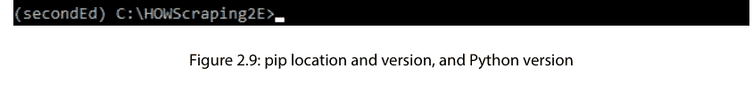

Figure 2.9: pip location and version, and Python version

> **Important note**
> 
> 通常，`lib` 文件夹包含系统默认 Python 安装的库，而外部库位于 `site-packages` 内。如 Figure 2.9 所示，我们现在在虚拟环境中以及项目特定或专用文件夹内拥有 `lib` 和 `site-packages`。因此，任何库的安装或更新都将在我们的目标环境中进行。
> 
> 如果你更喜欢使用 *Anaconda*，请参考 `https://docs.anaconda.com/free/navigator/tutorials/manage-environments/` 和 `https://conda.io/projects/conda/en/latest/user-guide/tasks/manage-environments.html`。

到目前为止，我们的环境已准备就绪并正常工作。我们已验证 pip 存在于我们的系统中。在下一节中，我们将安装所需的库。

## Installing libraries

在本节中，我们将在环境中安装一些库，例如 `requests`、`jupyterlab` 以及根据需要安装的其他库。

Python 笔记本现在需求量很大——它们提供代码的清晰可见性，并对输入和输出有很大控制。此外，导出功能非常有用，可用于导出代码以进行演示或解释。让我们安装 JupyterLab（`https://jupyter.org`），以便我们可以使用 Python 笔记本（`.ipynb` 文件）。我们可以使用 pip install 按以下命令安装 JupyterLab：

```
```console
(secondEd) C:\HOWScraping2E> pip install jupyterlab
```
```

成功安装 JupyterLab 后，让我们运行它并检查其他库的可用性（在 JupyterLab 设置期间会安装许多依赖库）。要加载 `jupyterlab`，请使用以下命令：

```
```console
(secondEd) C:\HOWScraping2E>jupyter-lab
```
```

这将在默认浏览器中打开一个新窗口，指向 `http://localhost:8888/lab`，如 *Figure 2.10:* 所示：

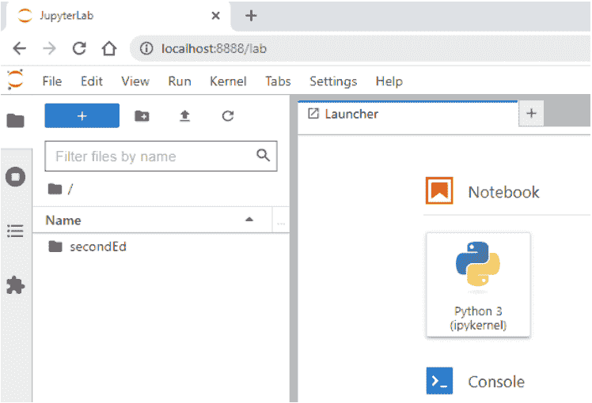

Figure 2.10: JupyterLab (the default window in Google Chrome)

> **Important note**
> 
> 有关使用 Python 笔记本和 JupyterLab 的更多信息，请访问 `https://docs.jupyter.org/en/latest/`。此外，你可以创建一个笔记本并检查是否需要安装其他库——如果缺少，我们也可以从笔记本本身安装它们（使用 `!pip install requests`）。

我们决定安装和使用 JupyterLab 非常方便，因为主要库如 requests 会自动安装并可供我们使用。如 *Figure 2.7* 所示，requests 库在默认 Python 安装中不可用。让我们验证我们的其他所需库是否工作正常；在使用笔记本中导入它们，如 *Figure 2.11* 所示（代码可在 `https://github.com/PacktPublishing/Hands-On-Web-Scraping-with-Python-Second-Edition/blob/main/Chapter02/test_install_libraries.ipynb` 文件中找到）：

```
[2]: import requests
```

```
[3]: requests.__version__
```

```
[3]: '2.28.1'
```

```
[4]: import urllib
```

```
[5]: list(dir(urllib))
```

```
[5]: ['__builtins__', '__cached__', '__doc__', '__file__', '__loader__', '__name__', '__package__', '__path__', '__spec__', 'error', 'parse', 'request', 'response']
```

Figure 2.11: Verifying the requests and urllib libraries

如果你不想使用 JupyterLab，可以从终端使用以下代码设置库：

```
(secondEd) C:\HOWScraping2E> pip install requests
```

现在，我们的环境已设置完成，所需库已在我们的系统中。我们将在下一节中使用这些库与 URL 通信（向网络发送请求并收集响应）。

## Loading URLs

加载 URL 通常涉及 HTTP 通信，例如向服务器发送请求并从服务器接收响应。本章即将介绍的 URL 处理和操作以及 Implementing HTTP methods 部分将更详细地探讨这些主题。数据提取活动将在第 3 章中介绍。

> **Important note**
> 在使用 Python 加载 URL 之前，最好先验证 URL 是否正常工作并包含我们正在寻找的数据。这种基本的可行性检查将在运行和管理项目时节省大量资源。


让我们加载两个不同的 URL，一个使用 urllib，另一个使用 requests：

- Task 1: 使用 urllib 加载 https://www.python.org。我们在笔记本中使用代码，如图 2.12 所示：

```
[1]: from urllib import request
[2]: url_a='https://www.python.org/'
```

Figure 2.12: Import request from urllib

urllib 有许多子模块，例如 request、response、parse 和 error。要向 https://www.python.org 发送请求或加载 URL，我们需要导入 requests 并执行 urlopen() 方法，将 URL 作为参数传入，该方法返回 HTTPResponse 对象，如图 2.13 所示：

```
[3]: response_a = request.urlopen(url_a)
[4]: response_a
```

```text
[4]: <http.client.HTTPResponse at 0x191b0387880>
```

Figure 2.13: Reading the URL and the HTTPResponse object

我们需要使用 read() 方法读取对象的内容并显示从网站接收到的页面源或 HTML 内容，如图 2.14 所示：

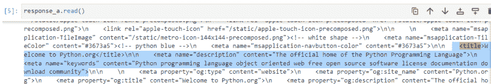

Figure 2.14: Displaying content by executing read() on the HTTPResponse object

- Task 2: 使用 requests 加载 https://pypi.org/project/pycurl/。如图 2.15 所示，我们已定义要处理的 URL 并导入了 requests 库。requests 中的 get() 方法以 URL 作为参数加载 URL，并带上 content 属性，返回响应：

以下是可在我们的代码中使用的 DevTools 中的可用信息：

- **Request URL**：我们可能会找到隐藏或重定向的 URL、具有所需内容的 API，或其他更易于处理的 URL。
- **Request Headers**：浏览器在请求处理期间发送到服务器的信息，例如 cookies、user-agent、referer 和 pragma。
- **Response Headers**：服务器在响应期间与浏览器交换的信息，例如服务器信息、content/types 和 etags。
- **Cookies**：具有过期日期和时间的键值对中的安全、权限或会话内容。cookies 的优先级决定了基于 HTTP 的通信周期的复杂性。
- **Status Code**：有关 HTTP 响应的信息，它们是客户端、服务器还是资源问题。
- **Request Method**：发送请求或接收响应时使用的 HTTP 方法（GET/POST）。

开发人员还可能遇到需要 URL 操作的情况（例如更改或清理）。可能存在一些隐藏的 URL、API，甚至是浏览器中无法直接看到的包含我们所需数据的静态内容。

毕竟，我们正在开发爬虫或 Python 脚本来自动化基于浏览器的活动。因此，我们需要充分了解 DevTools 并开发能够像浏览器一样执行、并具有一些额外任务（例如提取数据）的爬虫。为此，我们需要管理和处理 URL 和 HTTP 通信，我们将在下一节中介绍。

> **Important note**
> DevTools 显示了在服务器或其他第三方请求和响应期间的完整通信日志。请查看 *Chapter 1* 的 *Developer tools* 部分了解更多信息，或查看以下网址：https://developer.chrome.com/docs/devtools/ 和 https://firefox-source-docs.mozilla.org/devtools-user/。

## requests – Python library

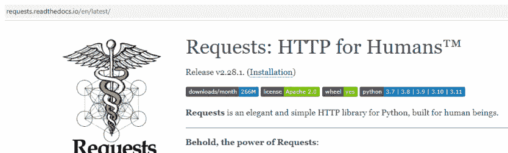

Figure 2.16: requests library – HTTP for Humans

我们在 Installing libraries 部分查看了 requests。对于我们的目的，我们使用的是 requests 版本 2.28.1。

与 Python 中的其他 HTTP 库相比，requests 因其可读性、开发人员友好性和易用性而备受好评。其主要优点如下：

- 短小、简单且可读的函数和属性
- 访问各种 HTTP 方法
- 自动内容解码和解压缩
- 轻松处理查询字符串
- 自定义 HTTP 头
- 会话和 cookie 处理
- 能够处理 JSON 请求和内容
- 代理支持
- 多部分文件上传（表单处理）
- 连接池和超时

我们将使用 requests 库，并探索其一些主要属性。在 Loading URLs 部分，我们使用 get() 方法加载 URL 并使用 content 查看其源。我们实际上是在使用 get() 通过 HTTP GET 方法与 URL 通信。

requests 库还支持其他 HTTP 方法，例如 PUT、POST、DELETE、HEAD 和 OPTIONS，分别使用 put()、post()、delete()、head() 和 options() 方法。

通过这段简短的介绍和 requests 的概述，我们将在下一节中通过代码示例介绍更多细节。

## General usage

让我们通过一些示例探索 requests 库的一些关键功能，如 *Figure 2.17* 所示。代码可在 `https://github.com/PacktPublishing/Hands-On-Web-Scraping-with-Python-Second-Edition/blob/main/Chapter02/requests.ipynb` 获取：

```python
import requests
```

```python
link="https://requests.readthedocs.io/"
```

```python
response = requests.get(link)    #making HTTP Request to link
```

```python
type(response)
```

```text
requests.models.Response
```

```python
response
```

```text
<Response [200]>
```

Figure 2.17: Using get() and showing the response type and status code

> **Important note**
> 
> 我们建议使用 `dir(requests)` 和 `dir(response)`，或在代码中找到新对象时使用 `dir()`。这将显示该对象的详细信息，甚至可以帮助您决定使用哪些功能。

如 *Figure 2.17* 所示，我们已导入 `requests` 并加载了 `link` 中定义的 URL。`response` 通常是 `requests.models.Response` 的对象，并且它还显示 HTTP 状态码，为 200。

如 *Figure 2.18* 所示，要获取实际状态码，我们可以使用 `status_code` 属性：

```python
response.status_code  #status_code
```

```text
200
```

```python
response.status_code == requests.codes.ok
```

```text
True
```

```python
response.url
```

```text
'https://requests.readthedocs.io/en/latest/'
```

```python
response.history
```

```text
[<Response [302]>]
```

Figure 2.18: Using requests with status_code, url, and history

此外，`response.url` 显示 HTTP 通信完成后最终的 URL。我们可以看到 `response.url` 的值与 *Figure 2.17* 中的 `link` 不同——如果这是真的，则必须发生了重定向，这一点通过 `history` 收到的状态码得到证实（302 表示临时重定向）。

编码也是一个重要因素；我们可以在 *Figure 2.19* 中获取有关编码的一些信息：

```python
response.encoding
```

```text
'ISO-8859-1'
```

Figure 2.19: The encoding attribute of a response returning the encoding value

在这里，我们借助几个代码示例探索了 `requests` 的一些基本用法。在下一节中，我们将探索 HTTP 头。

## Request/response headers

如 *URL handling and operations* 部分的介绍中所述，HTTP 头对开发人员来说非常重要；服务器和客户端共享的 HTTP 头在请求和响应之间可能不同。*Figure 2.20* 显示了一些示例：

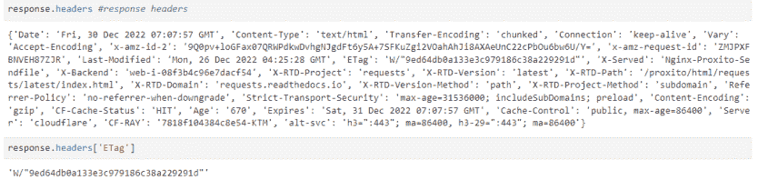

response.request.headers 返回 HTTP 请求期间的头，而 response.headers 返回 HTTP 响应期间的头。两个头都可用作字典，我们可以使用其值在处理爬取脚本时设置和更新字典所需的键值对。

有时对于爬虫脚本来说，在进行 HTTP 请求时设置并传递 User-Agent、Accept、Referer 和 Cookies 等头是强制性的。在下一节中，我们将探索 cookies。

## Cookies/session

HTTP cookies 是服务器发送到浏览器的数据。Cookies 是网站在用户系统或计算机上生成和存储的数据。存储在 cookies 中的数据有助于识别用户向网站发出的 HTTP 请求。Cookies 包含有关会话管理、用户偏好和用户行为的信息。许多网站在您浏览网页时会要求您允许设置 cookies。

如 Figure 2.21 所示，cookies 以 RequestCookieJar 对象的形式返回：

```python
response.cookies
```

```text
<RequestsCookieJar[]>
```

```python
response_github = requests.get('https://www.github.com/anishchapagain')
```

```python
response_github.cookies
```

```text
<RequestsCookieJar[Cookie(version=0, name='gh_sess', value='GPeekFKsJbT9t9xKxV4hH8Q1T7gV0LNUERBn8V2o0x1aestEgpMaDkNJM7mTrUFQZkOVSmA0K2BS7vJg0ZVwWq0MvKX2F28PMR2BvGN8VBo1ZcNs1v2BzA8PEk5rCs0StdPfb6xQk1c4MPhnQq2PjHixTgCbrWmXhbb0U0xce1FiykQqsJAsRpqQy12z4dpgN302iKED3dGZX284ACY5Fspk7Y7usr8S1KPM0ESu5cM3H2F7R2TGwDZmIppdRJN8Z0U0gP0PPI1A3S0D3D -FxvagsYkwaK2Fv5m-1I38FjbbdELXJHBysYjJ2BkuW43Q3D', port=None, port_specified=False, domain='github.com', domain_specified=False, domain_initial_dot=False, path='/', path_specified=True, secure=True, expires=None, discard=True, comment=None, comment_url=None, rest={'HttpOnly': None, 'SameSite': 'Lax'}, rfc2109=False), Cookie(version=0, name='__Host-github_user', value='GH1.1.504589393.1672387987', port=None, port_specified=False, domain='.github.com', domain_specified=True, domain_initial_dot=False, path='/', path_specified=True, secure=True, expires=1783923987, discard=False, comment=None, comment_url=None, rest={'SameSite': 'Lax'}, rfc2109=False), Cookie(version=0, name='logged_in', value='no', port=None, port_specified=False, domain='.github.com', domain_specified=True, domain_initial_dot=False, path='/', path_specified=True, secure=True, expires=1783923987, discard=False, comment=None, comment_url=None, rest={'HttpOnly': None, 'SameSite': 'Lax'}, rfc2109=False)]>
```


服务器会识别 cookie 的值，并根据存储在 cookie 中的信息与浏览器进行通信。cookie 中的数据帮助网站访问和传递诸如会话 ID、过期日期以及 cookie 信息存储时间等值。

会话（session）或 Web 会话通常被标识为存储在服务器端（临时）的信息，它在用户与网站交互的整个过程中持续存在。

如图 2.24 所示，会话通常与用户在网站上的凭据相关联：

```
session_obj = requests.Session()
```

```
response_obj = session_obj.get('https://httpbin.org/cookies', cookies={'name': 'anishchapagain','date':'30-dec-2022'})
response_obj.text
```

'{\n  "cookies": {\n    "date": "30-dec-2022", \n    "name": "anishchapagain"\n  }\n}\n'

```
response_obj.headers
```

{'Date': 'Fri, 30 Dec 2022 09:24:12 GMT', 'Content-Type': 'application/json', 'Content-Length': '88', 'Connection': 'keep-alive', 'Server': 'gunicorn/19.9.0', 'Access-Control-Allow-Origin': '*', 'Access-Control-Allow-Credentials': 'true'}

```
response_test = session_obj.get('https://httpbin.org/cookies')
response_test.text
```

'{\n  "cookies": {}\n}\n'

图 2.24：使用 `requests.Session()` 对象发起 HTTP 请求

## 重要说明

在 HTTP 请求过程中，务必对从 DevTools 或代码输出中获取的 header、cookie 和 session 值进行监控，并经常更新或替换为代理、header/cookie 键等值。在运行爬虫脚本时，使用这些更新后的值和键将有助于绕过服务器异常并检测机器人程序。有关会话和代理的更多信息，请访问 https://requests.readthedocs.io/en/latest/user/advanced/#advanced 。

现在你已经对 HTTP 请求属性（如 cookie、header、session 和方法）有了基本了解。在下一节中，我们将重点讨论 URL 的内容，或者更准确地说，HTTP 响应。

## 响应内容

我们可以使用 `content` 属性以字节形式接收页面或响应，或所请求 URL 的页面源码，而 `text` 属性则返回字符串对象，如图 2.25 所示：

```
response.content[0:500] #content 500 Chars

b'\\n<!DOCTYPE html>\\n<html lang="en">\\n  <head>\\n    <meta charset="utf-8" />\\n    <meta name="viewport" content="width=device-width, initial-scale=1.0" />\\n    <meta name="generator" content="Docutils 0.17.1: http://docutils.sourceforge.net/" />\\n    <title>Requests: HTTP for Humans\\x84&#8212; Requests 2.28.1 documentation</title>\\n    <link rel="stylesheet" type="text/css" href="_static/pygments.css" />\\n    <link rel="stylesheet" type="text/css" href="_static/alabaster.css" />\\n    <link rel="stylesheet" type="text/css" href="_static/ty'

response.text[0:500]

'\\n<!DOCTYPE html>\\n<html lang="en">\\n  <head>\\n    <meta charset="utf-8" />\\n    <meta name="viewport" content="width=device-width, initial-scale=1.0" />\\n    <meta name="generator" content="Docutils 0.17.1: http://docutils.sourceforge.net/" />\\n    <title>Requests: HTTP for Humans\\x84&#8212; Requests 2.28.1 documentation</title>\\n    <link rel="stylesheet" type="text/css" href="_static/pygments.css" />\\n    <link rel="stylesheet" type="text/css" href="_static/alabaster.css" />\\n    <link rel="stylesheet" type="text/css" href="_static/ty'
```

此外，requests 还返回一个原始套接字响应，如图 *2.26* 所示。我们可以通过带 `stream` 参数的 `get()` 方法获取响应：

```
new_response = requests.get(link,stream=True)

new_response.raw.read(200) #first 200

b'\\x1f\\x8b\\x08\\x00\\x00\\x00\\x00\\x00\\x00\\x03\\x00\\x00\\x00\\xff\\xff\\xbc\\x...'
```

原始响应是尚未被自动转换或解码的字符字节。

在收到响应或页面内容后，大多数情况下将其保存到本地文件是相当有用的。这样做是为了研究内容，以揭示代码格式、确定 DOM 树结构或查找元素。如图 *2.27* 所示，我们将这个本地文件命名为 `test.html`：

```
f = open('test.html','wb') #open the file in 'w' mode
f.write(response.content) #write response.content to the file
f.close() #close file handler
```

现在我们有了响应，并且它们保存在一个本地 HTML 文件中。该文件可用于分析 DOM 结构、查找与查询相关的模式以及许多其他用途。我们会遇到不同类型的 HTTP 响应（JSON、PDF、HTML 和 XML），下一节将帮助我们处理 JSON 响应。

## 读取 JSON

requests 凭借其内置解码器非常高效地处理 JSON。你可以在图 2.28 中看到 `json()` 的用法：

```
json_response = requests.get("https://feeds.citibikenyc.com/stations/stations.json").json()
for i in range(5):
    print(json_response['stationBeanList'][i]['stationName'])
```

W 52 St & 11 Ave
Franklin St & W Broadway
St James Pl & Pearl St
Atlantic Ave & Fort Greene Pl
W 17 St & 8 Ave

图 2.28：加载和读取 JSON 内容

Web 抓取和爬行任务可能会使用前面提到的任何过程（HTTP header、获取 cookie 信息、状态码，或将响应内容保存到本地文件）来进行 HTTP 通信以及收集或验证内容。大多数情况下，Python 库提供的方法和属性使事情变得方便而简单。原因如下：

- 某些库中用少量逻辑步骤（如带条件的循环）编写成的简短代码片段，这些片段在需要的地方发挥特定用途，并封装为函数，比过程式编码更方便使用。
- 大多数新库通过嵌入和封装一个或多个函数来克服限制和逻辑约束，因为旧库中已有的新特性由最新库来管理。
- 新库中某些函数可能还有一些冗长且难以管理的额外功能。在这种情况下，开发者会选择使用旧库。

在下一节中，我们将使用 requests 来实现 HTTP GET 和 POST 方法。

## 实现 HTTP 方法

通常，网站与用户之间基于 Web 的交互或通信通过以下方式实现：

- 1. 用户访问一个网页或浏览他们可获得的内容。
- 2. 然后，用户通过 HTML 表单向网站提交信息，例如搜索、登录、注册等，最终收到他们请求的内容。

在本节中，我们将使用 Python requests 库来实现适合上述场景的 HTTP 方法。

GET 是默认的 HTTP 方法。类似地，我们还有 POST，它稍微更严格一些，将在下一节中进行说明。

## POST

POST 请求被认为是向源或服务器发出的安全请求。被请求资源的状态也可能被更改。发布或发送到所请求 URL 的数据在浏览器中不可见（与 GET 查询字符串不同）；相反，它会被传输到所请求的主体中。使用 POST 方法的请求无法被缓存或添加书签，并且在字符长度方面没有限制。

在示例代码中，如图 2.30 所示，使用了 `https://httpbin.org/post` URL（一个简单的 HTTP 请求和响应服务）来演示 POST 请求：

```
```python
pageUrl = 'http://httpbin.org/forms/post'
postUrl = 'http://httpbin.org/post'
params = {'customer': 'Mr Anish', 'custtel': '', 'custemail': 'anish@anishchapagain.com', 'size': 'medium', 'topping': ['cheese', 'mushroom'], 'delivery': '14:45', 'comments': 'No comments'}
headers = {'accept': 'text/html, */*', 'referer': pageUrl}

response = requests.post(postUrl, data=params, headers=headers).json()
print(response)
```
```

图 2.30：HTTP POST 请求

pageUrl 接受要发布的数据（由 params 定义），并发送到 postUrl。自定义 header 被分配给 headers。`post()` 函数接受几个参数：URL（例如 postUrl）、data（要发布的数据）以及 headers，并返回 JSON 格式的响应。

图 2.30 中的 POST 请求代码自动化了 params 和 headers（部分地），并配合所需的 URL，就像我们在 http://httpbin.org/forms/post 上提交实际的 HTML 表单，并从浏览器将其发布到 http://httpbin.org/post 一样。

你也可以从浏览器手动执行相同的任务——打开 DevTools 并验证 Network 面板中使用的参数或 Payload，如图 2.31 所示：


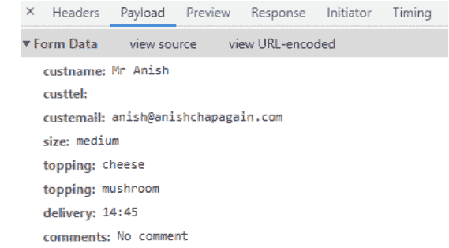

图 2.31：带有表单数据的 Payload（代码中使用的一个实际 params 键值对）

如图 2.31 所示，表单数据与图 2.30 中的 params 类似。始终建议通过浏览器和 DevTools 学习、记录并检测任何站点的请求/响应序列。

我们可以从 DevTools 中获取大量信息，并使用这些信息来部署脚本和自动化流程。在当前场景中，图 2.32 显示了 Headers 中 General 和 Request Headers 部分所包含的最大信息量：

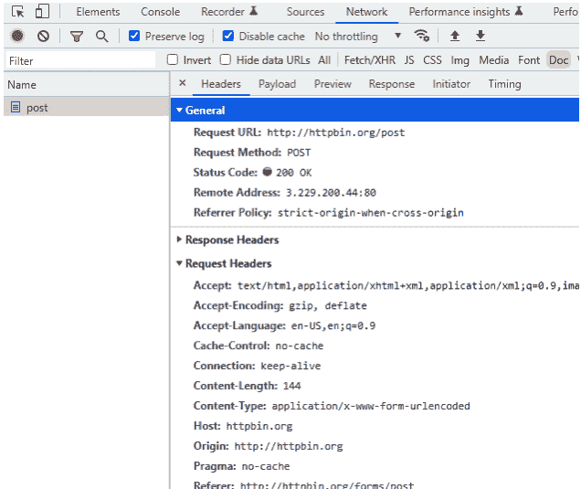

图 2.32：HTTP POST 请求中使用的请求 URL、方法和请求头

本部分中的示例和图片涉及 HTTP POST 方法的功能，以及 POST 及提供给 POST 的参数与 GET 方法相比有何不同。实现 HTTP 方法是 HTTP 活动的核心。有关 HTTP 方法的更多详细信息，请访问 https://requests.readthedocs.io/en/latest/api/ 和 https://www.w3schools.com/tags/ref_httpmethods.asp。

## 小结

在本章中，我们学习了 Python 编程、搭建虚拟环境，以及安装 Python 库来向 Web 资源发送请求并收集响应和其他一些信息。

本章的主要目标是展示 requests 库的核心功能。我们的主要目标是学习如何处理 HTTP 请求和响应循环、如何使用 HTTP 方法（带额外参数）、如何使用 DevTools，以及在这个领域中使用 Python 的好处。

在下一章中，我们将学习并使用一些基本技术，从 Web 内容中识别和提取数据。

## 延伸阅读

- **Python 编程：**
  - https://www.python.org/doc/
  - https://www.w3schools.com/python/default.asp
- **数据与数据分析：**
  - https://www.diesel-plus.com/the-importance-of-data-collection-10-reasons-why-data-is-so-important/
  - https://www.simplilearn.com/data-analysis-methods-process-types-article
  - https://www.ncbi.nlm.nih.gov/pmc/articles/PMC8274472/
  - https://scientific-publishing.webshop.elsevier.com/research-process/when-data-speak-listen-importance-of-data-collection-and-analysis-methods/
- **requests、urllib、JSON：**
  - https://requests.readthedocs.io/en/latest/
  - https://pymotw.com/3/
- **虚拟环境：**
  - https://docs.python.org/3/library/venv.html
  - https://docs.python-guide.org/dev/virtualenvs/
  - https://conda.io/projects/conda/en/latest/user-guide/tasks/manage-environments.html
  - https://docs.anaconda.com/free/navigator/tutorials/manage-environments/
- **Jupyter Notebooks：**
  - https://jupyter.org/
  - https://code.visualstudio.com/docs/datascience/jupyter-notebooks
- **Cookies：**
  - https://www.cloudflare.com/en-gb/learning/privacy/what-are-cookies/
  - https://www.cookieyes.com/blog/session-cookies/
- **URL 和 HTTP：**
  - https://blog.hubspot.com/marketing/parts-url
  - https://developer.mozilla.org/en-US/docs/Web/HTTP/Overview
