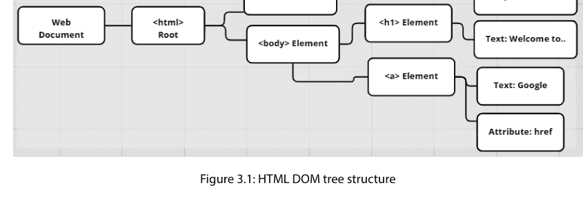
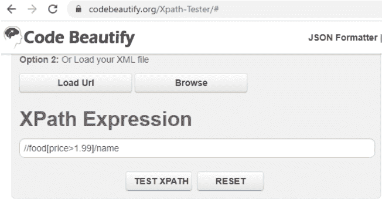
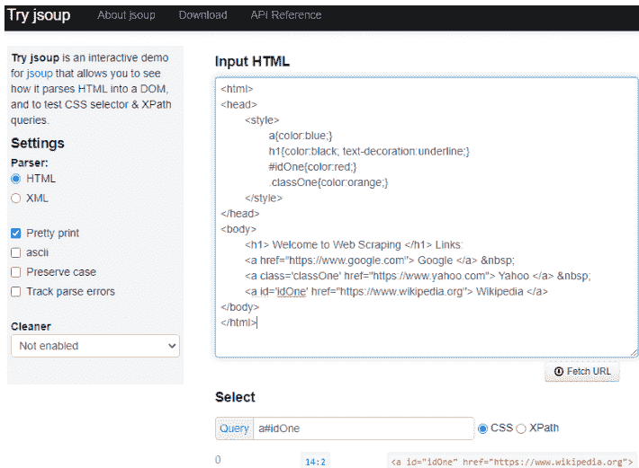
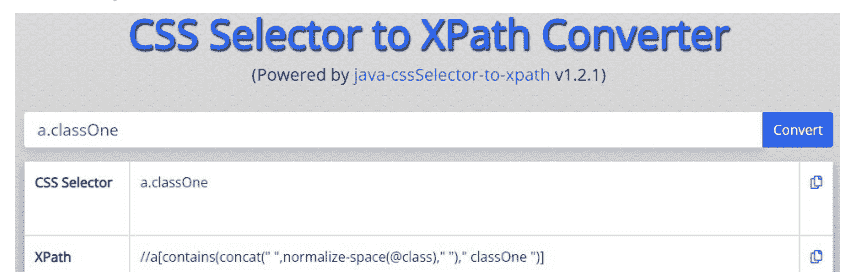
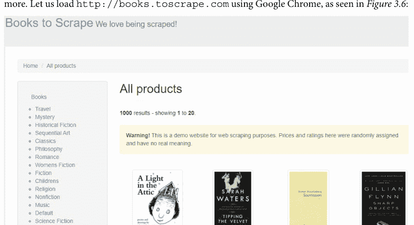
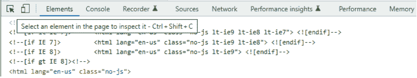
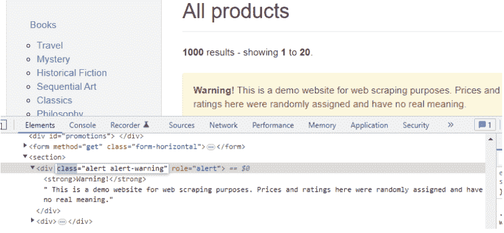
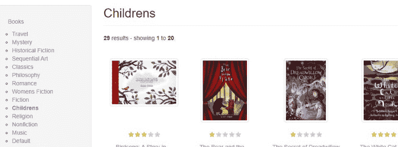
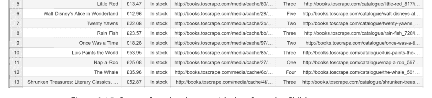

## 搜索与处理 Web 文档

到目前为止，我们已经了解了 Web 爬取、数据查找技术以及有助于我们进行爬取的相关技术，并且也确定了选择 Python 编程语言的一些原因。

基于 Web 或网站的内容以 HTML 元素、预定义文档或某种对象（JSON）的形式存在。为了提取，我们需要分析和识别此类内容、模式和对象。基于 HTML 的元素通常通过 XML 路径（XPath）和层叠样式表（CSS）选择器来识别，并通过爬取逻辑对所需内容进行遍历和处理。本章将使用 lxml 库来处理标记文档。我们将使用基于浏览器的开发者工具（DevTools）来查找内容和识别元素。

具体而言，在本章中我们将学习以下主题：

- 介绍用于处理标记文档的 XPath 和 CSS 选择器
- 使用 Web 浏览器 DevTools 访问 Web 内容
- 使用 lxml（一个 Python 库）进行爬取
- 解析 robots.txt 和 sitemap.xml

## 技术要求

需要 Google Chrome 或 Mozilla Firefox 浏览器，我们将使用 JupyterLab 和 Python Notebook。

请参阅第 2 章的“环境搭建”和“创建虚拟环境”部分，并继续使用我们创建的环境。

本章所需的 Python 库如下：

- `lxml`
- `urllib`

本章的代码文件可在 GitHub 上获取：`https://github.com/PacktPublishing/Hands-On-Web-Scraping-with-Python-Second-Edition/tree/main/Chapter03`。

> **重要提示**
> 
> 基于 Web 或网站的内容是指向 URL 发送请求后收到的响应或页面源代码。内容的类型可以多种多样，如 PDF、CSV、TXT、XML、HTML 和 JSON。一般来说，在本章中，除非另有说明，否则我们将 HTML、页面源代码或标记文档作为主要内容进行讨论。

## 介绍用于处理标记文档的 XPath 和 CSS 选择器

在 *第 1 章* 的 *理解 Web 页面中使用的最新 Web 技术和数据查找技术* 各节中，我们探讨并讨论了 **HTML** 和 **XML** 标记文档及其在整个 Web 中的可用性。

通常，标记是一种对文档中的部分、章节或任何实体进行标注或加标签的方式，有助于识别内容，甚至可以使用第三方应用程序处理内容。在 HTML 中，我们称它们为**标签**（`https://www.w3.org/html/`），在 XML 中称为**节点**（`https://www.w3.org/standards/xml/`）。因此，标记文档是一种树状结构，包含标签或节点（嵌套或单独的），这种结构也称为**元素树**。

> **重要提示**
> 
> 自互联网时代开始发展以来，XML 文档在 Web 上一直非常流行和普遍。可读性、编码支持、互操作性和数据可交换性是 XML 的一些核心优势。最新的 Web 技术仍然支持 XML，XML 也是标记文档最重要的支柱。

在了解了这里关于标记和 XML 的简要概述之后，接下来的章节将介绍**文档对象模型（DOM）**、XPath 和 CSS 选择器，并借助 Python 库将它们用于 Web 爬取。

## 文档对象模型（DOM）

**树型结构**或元素树是大多数标记语言的基础模型，通常被称为 DOM。请访问以下链接以了解有关 DOM 的更多详细信息：https://www.w3.org/TR/WD-DOM/introduction.html 和 https://developer.mozilla.org/en-US/docs/Web/API/Document_Object_Model。

DOM 处理、DOM 解析、DOM 操作以及更多类似术语指的是与 DOM 相关的活动。借助 DOM 及其定义的约定，我们可以访问、遍历和操作标记文档。许多与 Web 相关的技术都支持 DOM 的使用，例如 **JavaScript（JS）**、模板引擎和网页开发工具。

DOM 元素（标签或节点）大多数时候是预定义的或用户自定义的。我们可以在标记文档中找到开放型和闭合型约定。元素在父元素内部以结构化或嵌套的形式存在，也可能同时是某些其他元素的父元素或子元素。这种由 DOM 元素组成的树状结构基于某种语言或约定，可用于构建标记文档，如图 3.1 所示：



图 3.1：HTML DOM 树结构

理解 DOM 或元素树（HTML 树或 XML 树）是理解文档作为元素容器并遵循提取过程的基本步骤。信息可能嵌套在树结构中，并可能带有表示内容的属性以及其他附加信息。有关更多详细信息，请参阅 *第 1 章的 HTML 部分*。

XPath 和 CSS 选择器用于沿 DOM 导航，并用于在找到的节点或元素中搜索所需内容。我们将在下一节中探讨 XPath。


```xml
<?xml version="1.0" encoding="UTF-8"?>
<breakfast_menu>
    <food>
        <name>Brown Toast-Honey</name>
        <price>$2.99</price>
        <description>All time famous, honey and toast combination.</description>
    </food>
    <food>
        <name>Oat-Pancake</name>
        <price>$4.95</price>
        <description>Delicious pancake, with cheese and berry on top.</description>
    </food>
    <food>
        <name>Creamy Yoghurt</name>
        <price>$3.99</price>
        <description>Dried nut filled yoghurt, thick and creamy.</description>
    </food>
</breakfast_menu>
```

如 *Figure 3.2* 所示，我们可以推导出以下内容：

- XML 中的一切都是节点 – `breakfast_menu`、`food`、`name` 等
- 一个 XML 节点本身可以是一个元素，具有开始和结束标签
- `breakfast_menu` 父节点有三个名为 `food` 的子节点
- 每个 food 节点都有自己的子节点：`name`、`price` 和 `description`
- 任何节点中都没有名称-值对或属性

对于 *Figure 3.2* 中的此类 XML 文档，大多数文本或代码编辑器都提供一些格式化选项，例如折叠或展开元素或父节点并美化文本、XPath 查询相关功能等。

> **重要说明**
> 
> 在线或离线有大量平台和应用程序提供 XML 格式化（以及代码相关功能）、美化选项和 XPath 表达式测试。其中一些在线提供商有 https://codebeautify.org、https://www.freeformatter.com、https://xpathtester.com、https://try.jsoup.org/ 和 https://www.webtoolkitonline.com/ 等。

在下面的示例中，我们将使用 Code Beautify 的 XPath Tester（https://codebeautify.org/Xpath-Tester）来格式化 XML 内容并测试 XPath 表达式：



Figure 3.3: XPath Expression – //food[price>1.99]/name

如 Figure 3.3 所示，//food[price>1.99]/name 表达式应用于 Figure 3.2 中的 XML 文件。

如以下输出所示，Figure 3.3 中应用的 XPath 表达式仅返回那些谓词定义为 [price>1.99] 且价格值大于 1.99 的 food 节点的 name 元素：

```
<name>Brown Toast-Honey</name>
<name>Oat-Pancake</name>
<name>Creamy Yoghurt</name>
```

谓词用于识别特定的节点或元素。它们使用方括号编写，其语法类似于 Python 列表。以下是应用于 Figure 3.2 中看到的 breakfast.xml 文件的几个 XPath 表达式及其一般解释：

- // : 文档节点
- *: 文档中的所有元素
- //breakfast_menu: 根元素以及 breakfast_menu 内的所有元素
- //food: 选择所有 food 元素
- //food/name: 从所有 food 元素中选择 name 元素
- //food[1]/name/text(): 仅返回第一个 food 元素的 name 的文本
- //food[1]/name: 选择第一个 food 元素的 name，例如 <name>Brown Toast-Honey</name>
- //food[2]/*: 选择第二个位置的 food 的所有元素

- `//food[position() <3]/price`: 选择位置小于 3 的 food 元素的价格
- `//food[price>3.99]/name`: 过滤并选择价格值大于 3.99 的 food 元素的 name 元素，例如 <name>Oat-Pancake</name>
- `//food[last()]/name`: 选择最后一个 food 元素的 name 元素
- `//food[last()]/name | //food[last()]/price`: 选择最后一个 food 元素的 name 和 price 元素
- `sum(//food/price)`: 对 food 内部的所有 calories 值求和，总计为 11.9
- `//food/name[contains(.,"Toast")]`: 选择包含 "Toast" 字符串的 food 元素的 name 元素
- `//food/description[starts-with(.,"Dried")]`: 选择 description 元素，其匹配以 "Dried" 字符串开头的选项
- `//food[price>1.99 and price<4.00]/name`: 选择 price>1.99 且 price<4.00 过滤选项匹配的 food 元素的 name 元素

现在，有了关于 XPath 表达式的基本概念，让我们考虑一些带属性的表达式。属性是标识给定节点或元素的某些参数的额外属性。单个元素可以包含一些唯一或常见的属性。HTML 中的属性在高效有效的遍历中起着重要作用。让我们考虑 https://github.com/PacktPublishing/Hands-On-Web-Scraping-with-Python-Second-Edition/blob/main/Chapter03/books.xml XML 文件，其内容如下：

```
<books>
    <book id="1491946008" price="47.49">
        <author>Luciano Ramalho</author>
        <title>Fluent Python: Clear, Concise, and Effective Programming</title>
    </book>
    <book id="1491939362" price="29.83">
        <author>Allen B. Downey</author>
        <title>Think Python: How to Think a Computer Scientist</title>
    </book>
</books>
```

XPath 表达式通过在键前添加或前置 @ 字符来接受关键属性。以下是使用属性的几个表达式及其简要解释：

- `//book/@price`: 选择所有可用书籍的价格属性

- `//book[@price>30]`: 选择价格属性大于 30 的 book 元素
- `//book[@price<30]/title`: 选择价格小于 30 的 book 的所有 title 元素
- `//book/@id`: 选择 id 书籍属性及其值
- `//@id`: 选择 id 属性及其值
- `//book[@price="29.83"]/author`: 选择价格属性匹配 29.83 的 book 的作者
- `sum(//@price)`: 返回价格属性值的总和，即 77.3

在本节中，我们查看了一些示例和表达式来学习 XPath 以及如何使用此类表达式检索所需内容。与 XPath 类似，我们也有基于 CSS 的选择器，我们将在下一节中更详细地探讨。

## CSS selectors

在 *Chapter 1* 的 *Understanding the latest web technologies* 和 *Data-finding techniques used in web pages* 部分，我们学习了 CSS 及其用于设置 HTML 样式的方法。有多种方法可以将 CSS 应用于 HTML。

CSS 选择器（CSS 查询或 CSS 选择器查询）是 CSS 用于选择元素的定义模式。与用于查找和识别元素的 XPath 表达式类似，CSS 选择器用于选择或查找 HTML 元素并为其定义样式。在提取过程中，我们使用 CSS 选择器搜索和查找元素。

以下代码显示了带有基本标签的纯 HTML：

```html
<html>
<head>
    <style>
        a{color:blue;}
        h1{color:black; text-decoration:underline;}
        #idOne{color:red;}
        .classOne{color:orange;}
    </style>
</head>
<body>
    <h1> Welcome to Web Scraping </h1> Links:
    <a href="https://www.google.com"> Google </a> &nbsp;
    <a class='classOne' href="https://www.yahoo.com"> Yahoo
    </a> &nbsp;
    <a id='idOne' href="https://www.wikipedia.org">
```

```
Wikipedia </a>
</body>
</html>
```

如前面的代码所示，我们在 https://github.com/PacktPublishing/Hands-On-Web-Scraping-with-Python-Second-Edition/blob/main/Chapter03/css_selector.html 文件中定义了基本 HTML，我们可以收集以下信息：

- <h1> 是一个 HTML 标签、一个元素和一个选择器
- 第一个选择器 <a> 有一个 href 属性，包含文本 Google
- 第二个 <a> 选择器具有多个属性，例如 class，其值为 classOne
- 最后一个 <a> 选择器还具有多个 id 属性，其值为 idOne，href 有一些值，以及文本 Wikipedia

前述源代码中带或不带属性的区分选择器可用于单独或成组选择该特定元素。与 XPath Tester 类似，在线和离线有大量 DOM 解析器提供商提供 CSS 查询相关功能。我们将使用 https://try.jsoup.org，如 Figure 3.4 所示：



Figure 3.4: Evaluating CSS query a#idOne


CSS 选择器与 XPath 表达式相比具有更多样化的选择。与此同时，它们根据复杂性、代码模式和可用功能被归类为四个基本组。让我们在以下小节中了解有关可用组的更多信息。

## 元素选择器

这些是一些基本选择器，甚至被称为通用选择器，用于从 HTML 中选择或挑选元素。通常，这些选择器是 HTML 的基本标签，如以下列表所示：

- `h1`: 选择文档中所有的 `<h1>` 元素
- `a`: 选择文档中所有的 `<a>` 元素
- `body *`: 选择 `<body>` 内部的元素组
- `div a`: 选择 `<div>` 内部所有的 `<a>` 元素
- `h1, a`: 选择所有的 `<h1>` 和 `<a>` 元素
- `h1 + a`: 选择紧跟在 `<h1>` 元素之后的 `<a>` 元素
- `h1 ~ a`: 选择所有由 `<h1>` 之前的 `<a>` 元素

## ID 和类选择器

这种选择器为元素选择器增加了额外的功能。在使用 CSS 的 HTML 中，我们可以找到大量属性，例如用 # 符号表示的 ID 和用 . 表示的 class。这些也被称为 HTML 元素中的全局或通用属性。这些全局属性通常比其他属性更受欢迎，因为它们为结构和标识定义了标签。

以下是代码中发现的全局属性，并表达如下：

- `.classOne`: 选择具有 `class=classOne` 的单个或一组元素
- `#idOne`: 选择具有 `id=idOne` 的元素
- `a.classOne`: 选择具有 `class=classOne` 的单个或一组 `<a>` 元素
- `a#idOne`: 选择具有 `id=idOne` 的单个 `<a>` 元素

## 属性选择器

HTML 标签包含属性（单个或多个），有助于识别携带其值的特定元素。这些与 XPath 中使用的谓词类似，如下所示：

- `a[href*=".org"]`: 选择具有 `href` 属性的 `<a>`，并在其值中找到 `.org`。
- `a[href^="https"]`: 选择具有 `href` 属性且值以 `https` 开头的 `<a>`。
- `a[href$=".com"]`: 选择具有 `href` 属性且值以 `.com` 结尾的 `<a>`。
- `a[href~=google]`: 选择具有 `href` 属性并包含文本 google 的 `<a>`。这类似于 `[href*="google"]`。
- `[class=classOne]`: 选择具有 `class=classOne` 的元素。
- `[href]`: 选择所有具有 `href` 属性名的元素。

如前面的 CSS 选择器列表所示，一些 **正则表达式（regex 或 Regex）** 相关语法也被使用。这使得 CSS 选择器几乎就像 HTML 文档的正则表达式。以下是正则表达式中使用的符号的一些基本解释：

- `*` 和 `~`: 表示查找或搜索，尽管两者使用方式不同
- `$`: 表示字符串的结尾
- `^`: 表示字符串的开头

## *伪选择器*

这种选择器是一组方便的选择，用于根据其位置来识别或选择元素。以下是一些基本解释：

- `a:eq(1)`: 选择位置为一或文档中第一个 `<a>`
- `a:gt(1)`: 选择位置大于一的所有 `<a>` 元素
- `:not(h1)`: 选择 HTML 中除 `<h1>` 外的所有元素
- `a:first-child`: 适用于嵌套元素，选择作为其父元素的第一个子元素的每个 `<a>` 元素
- `a:last-child`: 选择作为其父元素的最后一个子元素的每个 `<a>` 元素
- `a:nth-child(1)`: 选择从其父元素的第一个子元素开始的每个 `<a>` 元素
- `a:nth-last-child(2)`: 选择从其父元素的最后一个子元素开始的每个第二个 `<a>` 元素
- `a:nth-of-type(2)`: 选择从其父元素开始的每个第二个 `<a>` 元素
- `a:nth-last-of-type(2)`: 选择从其父元素的最后一个开始的第二个位置的每个 `<a>` 元素
- `a:last-of-type`: 选择其父元素的最后一个 `<a>` 元素

CSS 选择器可用作 XPath 表达式的便捷替代方案。它们在长度上相对较短，并且在表达式中使用简单和类似正则表达式的模式。CSS 选择器可以转换为 XPath 表达式，但反之则不行。

许多处理 XPath 和 CSS 选择器的开源工具和应用程序都提供在两者之间转换的功能，但测试此类表达式并相应地在代码中应用它们是开发人员的责任。正如我们所见，在 https://try.jsoup.org 中也存在这样的选项。

https://css-selector-to-xpath.appspot.com/ 在开发者中相当受欢迎，如图 3.5 所示：



图 3.5：CSS 选择器到 XPath

在本节中，我们探索并学习了最流行的网络相关模式查找技术，即 XPath 和 CSS 选择器。我们可以根据方便、代码要求以及所选库中的可用性使用两者或其中之一。在下一节中，我们将探索并学习如何使用基于浏览器的 DevTools。

## 使用网络浏览器 DevTools 访问网络内容

DevTools 是我们用来探索任何类型响应内容的最重要工具之一，例如 HTML、JSON、XML 或 TXT。

在第 1 章的开发者工具部分，我们介绍了基于浏览器的 DevTools，其包含各种信息丰富的面板和简要介绍。在本节中，正如标题所述，我们将使用 DevTools 来定位、查找或访问我们正在寻找的网络内容。通常，我们将以与使用 XPath 和 CSS 选择器表达式处理方式类似的方式搜索并找到保存内容的元素。

我们将使用 Google Chrome 探索网络内容。Chrome 内置了 DevTools，拥有大量功能，可帮助我们提供有关 cookie、标头、curl 脚本、美化 DOM、DOM 导航、显示行号、折叠/展开代码块、元素选择、元素识别、内容搜索以及生成 XPath 和 CSS 选择器表达式的信息。

**重要说明**
cURL，或 curl，是一种命令行工具和库，用于与服务器通信，并被机器和脚本用于处理 URL 中的资源传输。许多编程语言使用与 curl 通信的库来处理与网络的通信。有关 curl 的更多信息，请访问 https://curl.se/。您也可以探索 cURL 的 Python 接口（PycURL） http://pycurl.io/。

我们现在将继续在 Chrome 中加载一些 URL 并使用 DevTools 在响应内容中访问一些元素或导航 DOM。

## HTML 元素和 DOM 导航

访问元素和 DOM 导航的步骤在我们将概念编码化或规划爬虫时非常重要。

此时，我们还应该足够灵活，以至于我们尝试加载和处理的任何 URL 都可能被更改或更新。因此，为了应对此类情况的发生，我们选择了一些在线可用的站点，供人们学习网络抓取并实现抓取。我们还在本书的第一版《Hands-On Web Scraping with Python》by Packt Publishing 中使用了这些站点。您可以自由地使用类似的概念和步骤与任何其他 URL。

我们将使用 https://toscrape.com。该站点提供了两个不同的 URL，http://books.toscrape.com 和 http://quotes.toscrape.com/，两者都加载了大量类别、标签、分页内容、DOM 元素、与授权相关的部分等。让我们使用 Google Chrome 加载 http://books.toscrape.com，如图 3.6 所示：



图 3.6：加载 books.toscrape.com

页面内容成功加载后，我们可以通过在页面上右键单击并选择检查选项，或按 Ctrl + Shift + I 来加载 DevTools。有了 DevTools 后，首先，我们可以在左侧找到一个指针图标。这用于从页面中选择元素，如图 3.7 所示。此元素选择器（也称为元素检查器）位于 DevTools 的左上角，可以通过单击它或按 Ctrl + Shift + C 来打开和关闭：




我们可以通过点击元素检查器来移动已加载网页上的鼠标，也可以按 *Ctrl + Shift + C*。鼠标或屏幕光标也可以在 **元素** 面板中的代码中移动。

我们使用元素选择器搜索我们所指向的确切 HTML 元素 `<div class="alert alert-warning"...>`，如图 *3.8* 所示：



从 *图 3.8* 中可以看到以下内容：

- 已选中 `<section>` 内部找到的 `<div class="alert alert-warning"...>` 元素。
- 警告文本位于包含 `<strong>` 节点的 `<div>` 内。页面上该特定元素也有高亮显示。

我们可以重复 *图 3.7* 和 *图 3.8* 中讨论的步骤，选择页面的任意部分，找到 HTML 标签，或在 HTML 中移动并找到高亮的页面部分。我们还可以右键单击元素代码，找到如 **添加属性、编辑属性、复制元素、删除元素、剪切、复制 XPath** 和 **复制选择器** 等选项。

以下是通过上述步骤获得的一些结果：

- **复制 XPath：** `//*[@id="default"]/div/div/div/div/section/div[2]/ol/li[1]/article/h3/a`
- **复制完整 XPath：** `/html/body/div/div/div/div/section/div[2]/ol/li[1]/article/h3/a`
- **复制选择器：** `#default > div > div > div > div > section > div:nth-child(2) > ol > li:nth-child(1) > article > h3 > a`
- **复制元素：** `<a href="catalogue/a-light-in-the-attic_1000/index.html" title="A Light in the Attic">A Light in the ...</a>`

类似地，你可以为选定的元素收集所需的表达式。在收集并验证或测试这些表达式之后，将使用 Python 应用爬取逻辑来自动化数据收集过程。理解 DOM 元素（及其属性）和 HTML 页面源是你必须熟悉的常见领域。

没有特定或完美的方法来确定与表达式相关的 HTML 元素。我们应该使用本节讨论的工具以及可用的页面源代码。你可以选择市场上任何可用的工具或插件，或基于浏览器的扩展来确定元素表达式。

在本节中，我们检查并探索了用于元素识别和 DOM 导航的“元素”面板。在下一节中，我们将使用 lxml Python 库，通过 XPath 和 CSS 选择器从 toscrape.com 爬取代码并收集数据。

## 使用 lxml 进行爬取——一个 Python 库

lxml 库是一个 XML 工具包，具有丰富的库集来处理 XML 和 HTML。lxml 因其高速度和有效的内存管理而在 Python 中被优先选择，同时它还具有处理小型和大型 XML 文件的各种其他特性。

Python 程序员使用 lxml 来处理 XML 和 HTML 文档。Python 中还有很多其他类似的库，有些甚至在 lxml 之上构建了额外的附加功能。lxml 也被用作 Python 库中的解析引擎，例如 Beautiful Soup (https://www.crummy.com/software/BeautifulSoup/bs4/doc/) 和 pandas (https://pandas.pydata.org/)。

DOM 解析、遍历元素树、XPath 和 CSS 选择器是使 lxml 对网页爬取等任务足够有效和高效的功能。有关 lxml 及其文档的更多详细信息，请访问 https://lxml.de/。

> **重要说明**
> lxml 原生支持 XPath 和 XSLT，并基于强大的 C 库 libxml2 和 libxslt 构建。它的库集通常与 XML 或 HTML 一起使用，以访问 XPath，并解析、验证、序列化、转换和扩展 ElementTree 的功能 (https://lxml.de/tutorial.html)。

XML 和 HTML 等标记语言的元素具有开始和结束标签。标签也可以具有属性，并且可以包含其他元素。ElementTree 是一个包装器，它将 XML 文件加载为元素树。Python 内置的 xml.etree (https://docs.python.org/3/library/xml.etree.elementtree.html) 库用于搜索、解析元素和构建文档树。元素对象还表现出与 Python 列表和字典相关的各种可访问属性。

lxml 包含重要的模块，如下所示：

- lxml.etree (https://lxml.de/tutorial.html)：用于解析和实现 ElementTree 元素。支持 XPath、迭代等。
- lxml.html (https://lxml.de/lxmlhtml.html)：解析 HTML 并支持 XPath、CSS 选择器、HTML 表单和表单提交。
- lxml.cssselect (https://lxml.de/cssselect.html)：将 CSS 选择器转换为 XPath 表达式。接受 CSS 选择器或 CSS 查询作为表达式。

在对 lxml 做了基本介绍之后，让我们在下一节中探索一些示例。

## lxml 示例

lxml 是一个核心库，拥有庞大的模块集。在本节中，我们将通过示例探索 lxml 最常见的功能，例如读取 XML 和 HTML 文件以及使用 lxml 模块进行爬取。

### 读取 XML 文件

在本示例中，我们将使用 lxml 读取位于 https://github.com/PacktPublishing/Hands-On-Web-Scraping-with-Python-Second-Edition/blob/main/Chapter03/breakfast.xml 文件中的 XML 内容，如图 3.10 所示：

### 读取“breakfast.xml”并遍历元素

```
[1]: from lxml import etree
```

读取 XML

```
[2]: xml = open('breakfast.xml','rb').read()
```

```
[3]: xml #bytes
```

```
[3]: b'<?xml version="1.0" encoding="UTF-8"?>\n<breakfast_menu>\n <food>\n  <name>Belgian Waffles</name>\n  <description>ffiles with plenty of real maple syrup</description>\n  <calories>650</calories>\n </food>\n <food>\n
```

图 3.10：使用 lxml 读取 XML 文件

如图 3.10 所示，xml 变量现在以字节形式包含文件内容。我们需要解析它，将其转换为 etree 元素。我们可以使用 lxml 默认解析器，例如 etree.parse()，或者由于此处内容是 XML 文件，我们选择了 etree.XML()。在图 3.11 中，我们还可以通过使用 etree.get_default_parser() 来找出正在使用哪个解析器。

```
[4]: tree=etree.XML(xml) #parsing using XML()
```

```
[5]: tree # element object
```

```
[5]: <Element breakfast_menu at 0x26cc572f9c0>
```

```
[6]: type(tree)
```

```
[6]: lxml.etree._Element
```

图 3.11：解析文件内容

我们可以看到 tree 是 lxml.etree 的 Element 对象。元素树已经定义；现在我们可以遍历并获得基于节点的结果，例如迭代。如图 3.12 所示，我们首先使用 tree.iter() 遍历所有树节点。如果我们要针对某些特定节点（如 name 和 calories），那么我们可以选择它们，例如 tree.iter('name', 'calories')：

```
[: for element in tree.iter(): #iteration with all elements
    print(f"{element.tag} - {element.text}")
```

### 在树中选定的节点之间迭代

```
[9]: for element in tree.iter('name','calories'):
    print(f"{element.tag} - {element.text}")
```

```
name - Belgian Waffles
calories - 650
name - Strawberry Belgian Waffles
calories - 900
```

图 3.12：遍历所有树节点，然后遍历选定的树节点

在图 3.13 中，我们正在对元素标签及其文本应用逻辑，并使用 tree.xpath() 方法应用 XPath 来获取所需结果：

### 当文本小于 800 时对“calories”元素应用条件

```python
for element in tree.iter():
    if element.tag=="calories":
        if int(element.text)>800:
            print(f"{element.text}")
```

### 使用 XPath 当文本小于 800 时对“calories”元素应用条件

```python
for element in tree.xpath('//food'):
    if int(element.xpath('./calories/text()')[0])<800:
        print(f"{element.xpath('./name/text()')[0]} - {element.xpath('./calories/text()')[0]}")
```

Belgian Waffles - 650
French Toast - 600

图 3.13：使用特定节点迭代并应用逻辑，以及使用 XPath

如本节所示，我们需要先解析内容，然后才能对内容的局部或整体应用基于元素的逻辑。本示例仅使用了 etree 的基本用法及其与读取和遍历相关的核心功能。在下一节中，我们将读取并进一步处理 HTML 文档。

### 读取 HTML 文档

在本示例中，我们将使用 `urllib.request` 向 URL `http://httpbin.org/forms/post` 发起请求，使用 `lxml.html` 解析网页内容，并作为 `lxml.html.HTMLElement` 遍历元素，应用 XPath 和 CSS 选择器。让我们导入并定义要使用的 URL，如下代码所示：

```python
from lxml import html
from urllib.request import urlopen   #loading URL
url='http://httpbin.org/forms/post'
```

现在，我们将使用 `urlopen()` 向定义的 url 字符串发起请求，并解析收到的响应。如下代码所示，`parse()` 返回 `lxml.etree`，但使用 `getroot()` 时，我们将 HTMLElement 作为根。由于本示例涉及 HTML，我们对 HTMLElement 感兴趣：

```python
tree = html.parse(urlopen(url))  # load URL using urlopen and parse
type(tree)                     # lxml.etree._ElementTree
root = tree.getroot()          # returns the document root node <html>
type(root)                     # lxml.html.HtmlElement
```


我们可以像处理XML文件并遍历元素一样处理树。在本例中，我们将使用几个新函数，如下所列：

- `find()`：用于定位第一个元素并返回Element。与`find()`和`findall()`类似，可用于查找并遍历所有元素。
- `text_content()`：返回匹配元素的文本。
- `findtext()`：从提供的路径返回文本。

这些新函数在以下代码中使用：

```
tagP = root.find('.//p')              # .//p
print(tagP.text_content())
"Customer name: "
tagP1 = root.findtext('.//p/')      # .//p/
print(tagP1)
"Customer name: "
```

现在，由于我们能够从元素中查找并打印文本，我们将应用XPath并在爬虫代码中使用CSSSelect（CSSSelect将CSS选择器转换为XPath）。

如下面的代码所示，XPath以`root.xpath()`应用，CSS选择器以`root.cssselect()`应用，得到的结果与`xpath()`和`cssselect()`完全相同：

```
print(root.xpath('//p/label/input/@value'))
print(root.xpath('//legend/text()'))
print([formP.text_content().strip() for formP in root.xpath('//form/p')])
...
print([e.get('value') for e in root.cssselect('p label input[value]')])
print([l.text_content() for l in root.cssselect('legend')])
print([p.text_content().strip() for p in root.cssselect('form > p')])
```

上述代码将产生与以下完全相同的输出：

```
['small', 'medium', 'large', 'bacon', 'cheese', 'onion', 'mushroom']
[' Pizza Size ', ' Pizza Toppings ']
['Customer name:', 'Telephone:', 'E-mail address:', 'Preferred delivery time:', 'Delivery instructions:', 'Submit order']
```

由于HTML页面源代码中有一个`<form>`元素，并且如示例中的表达式所示，我们也可以针对特定元素——比如`root`中可用的`<form>`元素。

如下面代码所示，只找到一个`<form>`元素：

```
print(root.forms)
[<Element form at 0x1.......>]
print(root.forms[0].items())
[('method', 'post'), ('action', '/post')]
print(root.forms[0].keys())
['method', 'action']
print(root.forms[0].method)
POST
print(root.forms[0].action)
http://httpbin.org/post
```

该元素拥有`items()`和`keys()`方法，我们可以获取更多关于method（方法属性，值为GET/POST等）和action（动作属性，带有链接，表单值将提交到该链接）的信息。

在本节中，我们学习了如何读取、加载和解析内容。我们还看了一些基于元素的活动示例，例如遍历、查找元素、返回文本以及应用XPath和CSS选择器表达式。通过本概述以及对处理XML和HTML的代码示例的回顾，在下一节中，我们将使用lxml来抓取一个网站。

## 使用lxml进行Web抓取

在本节中，我们将演示一个使用lxml进行Web抓取的示例。我们将从http://books.toscrape.com抓取并收集数据。更具体地说，我们将以儿童类别的书籍为目标（http://books.toscrape.com/catalogue/category/books/childrens_11/index.html）：



图3.14：儿童类别页面

如*图3.14*所示，此页面有**29个结果**，每页显示**20**个，因此我们必须实现**分页**概念：找到总页数，用表达式定位所需元素，并将数据写入CSV文件。

> **重要说明**
> 
> 由于我们将处理所选类别的多个页面，因此最好使用DevTools探索并检查Web响应或页面源代码，定位我们正在寻找的页面URL和信息。分页的URL可能包含与第一页不同的内部页面模式。此外，识别并收集元素名称和XPath或CSS选择器表达式。另外，在追踪内容时，内容可能出现在页面源代码中或通过API在某个内部链接中。如果存在API，那么抓取任务将更容易。

在对页面结构和所需URL进行初步研究后，我们部署如下代码：

```
import lxml.html as web
from lxml.etree import XPath
...
baseUrl="http://books.toscrape.com/"  # URLs and Columns
bookUrl=baseUrl+"catalogue/category/books/childrens_11/index.html"
pageUrl=baseUrl+"catalogue/category/books/childrens_11/page-"  # page-
1,2
columns=['title','price','stock','imageUrl','rating','url']  #
Columns for CSV header

dataSet=[]  # container for collected data
page=1       # default
totalPages=1 # default
```

如前面的代码所示，我们将使用lxml、XPath、math库（用于处理分页）和csv（将数据写入CSV文件）。我们已经探索了站点的页面，并提出了用于分页的链接，例如baseUrl、bookUrl和pageUrl。首先，对于分页，我们有相同或默认值的page和totalPages，并且一个空的dataSet列表将用于存放收集到的数据：

```
while page <= totalPages:
    source = web.parse( pageUrl + str(page) + ".html")
        .getroot()  # read and parse
    if page==1:          # pagination
        perpageArticles =
            source.xpath("//form[@class=\"form-
            horizontal\"]/strong[3]/text()")  # 20
        totalArticles = source.xpath( "//form[@class=
```

```
\"form-horizontal\"/strong[1]/text()"
# 29
totalPages = math.ceil( int(totalArticles[0]) /
    int(perpageArticles[0])) # 1.45
print("Processing Page "+ str(page) +" from ",
    totalPages)
```

在前面的代码中，我们启动了一个循环，并读取和解析了pageUrl以获得根元素。然后我们使用表达式找到了totalArticles（article是表示单个书籍元素的DOM块）的计数、在单个页面上找到的perPageArticles计数以及总页数或totalPages。`math.ceil()`用于获取totalPages的浮点值。

继续循环，我们使用XPath将每个书籍的DOM表达式声明为articles，然后对所需的所有元素使用XPath，例如titlePath：书名，ratingPath：评分等等，针对要获取数据的特定元素：

```
articles = XPath("//ol[contains(@class,'row')]/li[position()>0]")
titlePath = XPath("./article[contains(@class,'product_pod')]/h3/a/@title")
.....
ratingPath = XPath("./article/p[contains(@class,'star-rating')]/@class")
```

借助少量XPath表达式，我们循环遍历页面响应或源代码中找到的articles，以获取选定的实体：

```
for row in articles(source):
    title = titlePath(row)[0].strip()
    link = linkPath(row)[0].replace('.../.../',
        baseUrl+'catalogue/').strip()

    price = pricePath(row)[0]
    availability = stockpot(row)[0].strip()
    image = imagePath(row)[0].replace('.../.../.../',
        baseUrl).strip()
    rating = ratingPath(row)[0].replace(
        'star-rating','').strip()
```

在接收实体、清理它们并删除不需要的文本（使用`replace()`和`strip()`）之后，我们将它们添加到dataSet：

```
if len(title)>0:      # if title is not missing, add to dataSet
    dataSet.append( [title, price, availability,
        image, rating, link] )
```

最后，我们借助csv库将dataSet写入CSV文件：

```
def writeto_csv(data, filename, columns):
    with open(filename, 'w+', newline='', encoding="UTF-8") as file:
        writer = csv.DictWriter(file, fieldnames=columns)
        writer.writeheader()
        writer = csv.writer(file)
        for element in data:
            writer.writerows([element])
```

我们构建了`writeto_csv()`函数，将dataSet中的data转换为CSV文件。它接受三个参数，如下所列：

- `data`：数据收集对象，在此示例中为dataSet
- `filename`：要生成的CSV文件的名称，例如books.csv
- `columns`：CSV文件中要提取的那些字段的列名

将所有所需数据追加到dataSet后，我们最终调用`write_to_csv`函数，如`writeto_csv(dataSet, 'books.csv', columns)`。这将创建books.csv文件，如图3.15所示：



图3.15：books.csv的输出，包含儿童类别的数据

还需注意，直接从DevTools复制的CSS选择器查询或XPath查询可能与我们在本节示例中使用的不同。我们尝试使用可能的短表达式，并采用一些额外和深入的策略，以及应用Python程序设计中的额外方法。


Figure 3.16 shows that User-agent: Nutch is not allowed to crawl python.org:

```
# Directions for robots.  See this URL:
# http://www.robotstxt.org/robotstxt.html
# for a description of the file format.

User-agent: HTTrack
User-agent: puf
User-agent: MSIECrawler
Disallow: /

# The Krugle web crawler (though based on Nutch) is OK.
User-agent: Krugle
Allow: /
Disallow: /~nguido/orlijn/
Disallow: /webstats/

# No one should be crawling us with Nutch.
User-agent: Nutch
Disallow: /

# Hide old versions of the documentation and various large sets of files.
User-agent: *
Disallow: /~nguido/orlijn/
Disallow: /webstats/
```

Figure 3.16: robots.txt file

Let us try to understand a few directives shown in *Figure 3.16*:

+   - **Allow:** Permits robots to access the link or directories defined.
+   - **Disallow:** Restricts robots from accessing the link or directories defined.
+   - **User-agent:** Agents, robots, or browser platforms mentioned should follow the directives mentioned for those User-agent objects. If * (an asterisk) is found mentioned in User-agent, it represents all agents. Sometimes, User-agent provides an agent name, such as Nutch, in *Figure 3.16*.

As mentioned in this section, we obey and follow the directives mentioned in the robots.txt file. Often, there might not be simple or easy-to-read content and, during automation, if we wish to test the directives’ response on the fly, then parsing robots.txt is very helpful.

## Parsing robots.txt

Using a parser, we do not need to read the file manually and follow or instruct the steps upon the code found. Also, there might be cases that require iteration, validating User-agent for some links, or determining the crawl-delay value of the sitemap.xml file (the prescribed time that must take place during processing). This information is extremely valuable to automate crawlers for some websites and even decide the level of information or coding tactics that might be required.

As seen in the following code, urllib has robotparser, which allows developers to read robots.txt and validate or verify the necessary actions:

```python
import urllib.robotparser
robot = urllib.robotparser.RobotFileParser()
robot.set_url("https://www.python.org/robots.txt")
robot.read()
robot
# <urllib.robotparser.RobotFileParser at ....>
```

We can see examples for methods such as can_fetch(), which deals with the Allow and Disallow directives and returns a **Boolean** value of True or False, respectively. Similarly, if the sitemap.xml file exists, then robot.site_maps() will return the links:

```python
robot.can_fetch('*','https://docs.python.org/3/library/urllib.robotparser.html')
robot.can_fetch('Nutch','https://docs.python.org/3/library/urllib.robotparser.html')
robot.site_maps()
```

For more information on robots.txt directives, please visit http://www.robotstxt.org. For parsing, visit https://docs.python.org/3/library/urllib.robotparser.html for more details.

## Sitemaps

A sitemap, or sitemap.xml, is an XML file that holds the information related to links for a website. Links can be page URLs or to specific media. A sitemap is an easy way to inform search engines about URLs (*added, updated, modified* date, *removed* URL, *priority, changefreq, and more*) or URL management on the site. Search engine scripts crawl the links in sitemaps and use the links found for indexing and various purposes, such as **Search Engine Optimization (SEO)**.

Similar to `robots.txt`, we can find sitemaps for a domain by appending a URL with `sitemap.xml`. Contents inside a sitemap keep changing and sitemaps may not be available for all websites. As seen in Figure 3.17, the sitemap of https://www.schools.com/sitemap.xml, there are plenty of `<url>` nodes, with a few child nodes:

```
<urlset xmlns="http://www.sitemaps.org/schemas/sitemap/0.9">
  <url>
    <loc>https://www.schools.com/</loc>
    <lastmod>2021-02-03</lastmod>
    <changefreq>daily</changefreq>
    <priority>1.0</priority>
  </url>
  <url>
    <loc>https://www.schools.com/online-colleges/south-carolina</loc>
    <lastmod>2021-02-03</lastmod>
    <changefreq>daily</changefreq>
    <priority>0.9</priority>
  </url>
  <url>
    <loc>https://www.schools.com/online-colleges/west-virginia</loc>
    <lastmod>2021-02-03</lastmod>
    <changefreq>daily</changefreq>
    <priority>0.9</priority>
  </url>
```

Figure 3.17: sitemap.xml

Information in the child nodes, such as `<lastmod>`, notifies us when the last modification took place for the `<loc>` child element. Similarly, `<changefreq>` is the changing duration of the `<loc>` element's contents. We can deal with sitemap content or parse a sitemap as we did in the Reading XML files section.

Important note
There are plenty of Python libraries available that read and parse `sitemap.xml` and `robots.txt`. Among those, https://pypi.org/project/advertools/ is one of the popular ones among the developer community. We also can parse and apply logic in sitemaps using lxml. For more details on sitemaps, explore https://www.sitemaps.org/.

## Summary

In this chapter, we learned about DOM navigation, XPath, and CSS selectors using the page source and DevTools. We also learned about reading and accessing XML and HTML files and defining and using XPath and CSS selector expressions for content extraction.

We also looked at various aspects of content extraction, plus the benefits and restrictions imposed by `robots.txt` and sitemaps. The main objective of the chapter was to demonstrate core features related to nodes, element identification from HTTP responses received, using the `lxml` and `urllib` libraries as required, and dealing with XML and HTML files. Finally, web scraping techniques were deployed using an example and data was collected and written to a CSV file.

In the next chapter, we will learn more about web scraping techniques and about some new Python libraries.

## Further reading

+   - **XPath:**
+     - `https://www.w3.org/TR/xpath-31/`
+     - `https://www.w3schools.com/xml/xpath_intro.asp`
+   - **CSS selectors:**
+     - `https://www.css3.info/`
+     - `https://www.w3schools.com/cssref/css_selectors.php`
+     - `https://developer.mozilla.org/en-US/docs/Web/CSS/CSS_Selectors`
+   - **lxml:** `https://lxml.de/`
+   - **XML:**
+     - `https://www.w3.org/XML/`
+     - `https://developer.mozilla.org/en-US/docs/Web/XML/XML_introduction`
+   - **HTML DOM:**
+     - `https://html.spec.whatwg.org/multipage/`
+     - `https://www.w3schools.com/html/`
+     - `https://www.w3schools.com/xml/dom_intro.asp`
+   - **robots.txt:**
+     - `https://developers.google.com/search/docs/crawling-indexing/robots/intro`
+     - `https://www.robotstxt.org/robotstxt.html`

+   - **Sitemaps:**
+     - `https://www.sitemaps.org/`
+     - `https://www.wordstream.com/blog/ws/2022/11/14/what-is-a-sitemap`
+     - `https://developers.google.com/search/docs/crawling-indexing/sitemaps/overview`

+   - **DevTools:**
+     - `https://developer.chrome.com/docs/devtools/`
+     - `https://developer.mozilla.org/en-US/docs/Learn/Common_questions/Tools_and_setup/What_are_browser_developer_tools`
