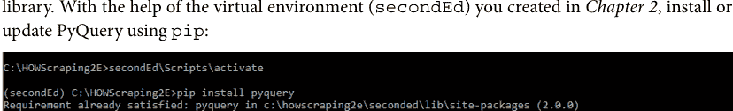
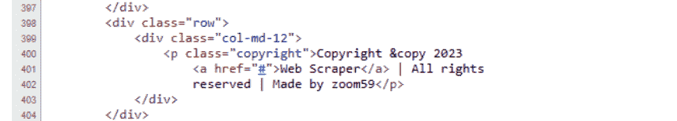
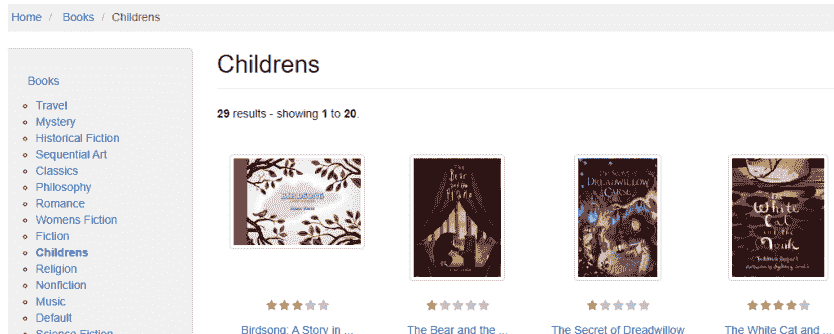
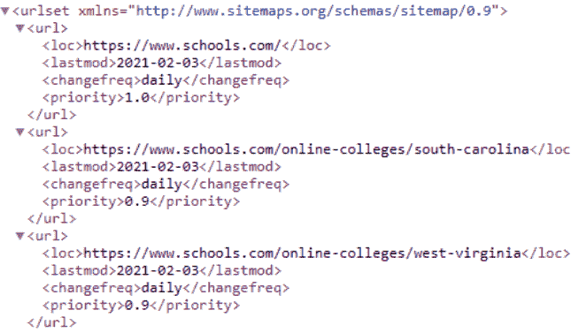
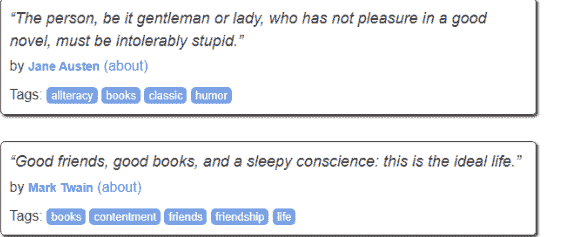
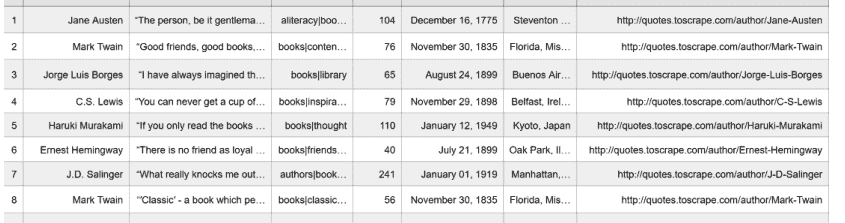

# Scraping Using PyQuery, a jQuery-Like Library for Python

In the previous chapters, you learned about the basics of web scraping, the technologies involved, data-finding techniques, and traversing markup documents for data with the help of some **Python** code.

Web scraping is a handful of tasks that involve **reverse engineering** techniques. It entails exploring a website (examining its content-related structure, **DevTools**, paginations, and more), preparing or installing tools (libraries and so on), coding and testing, and finally, collecting data in files, clouds, databases, and many more places. In this chapter, we will be learning about web scraping using the **PyQuery** Python library; this library assists us in the use of concepts such as **XPath**, **CSS selectors**, and parsing markup documents. PyQuery provides a **jQuery**-like ability to write less, *do more*, which is very significant when coding web scrapers.

In particular, this chapter will cover the following topics:

+   - PyQuery overview
+   - Exploring PyQuery
+   - Web scraping using PyQuery

## Technical requirements

A web browser (**Google Chrome** or **Mozilla Firefox**) will be required, and we will be using **Jupyter notebooks** for code using **JupyterLab**.

Please refer to the *Creating a virtual environment* section in *Chapter 2* to continue setting up and using the created environment.


本章所需的 Python 库如下：

- pyquery
- urllib
- requests

本章的代码文件可在 GitHub 上在线获取：https://github.com/PacktPublishing/Hands-On-Web-Scraping-with-Python-Second-Edition/tree/main/Chapter04

## PyQuery 概述

PyQuery 是一个类似 jQuery 的 Python 库，可方便地实现和使用 lxml 和 CSS 选择器。

顾名思义，PyQuery 使用简短易读的代码行增强了查询相关操作（XPath 和 CSS 选择器表达式）。正如大家所知，网络爬虫需要解析和遍历功能，这些功能位于各种类型网络文档之上。

PyQuery 提供了与 DOM 和 ElementTree 相关的额外功能，并使用 CSS 选择器执行查询。使用 PyQuery 表达式（或查询）的目的与使用 XPath 或基于 CSS 选择器的表达式类似。PyQuery 与用于网络文档的 jQuery 几乎相同。

下面的列表包含从 <a class="main"> 元素收集 href 属性的表达式的基本比较：

- PyQuery: response.find('a.main').attr('href')
- lxml XPath: response.xpath(".//a[contains(@class,'main')]/@href")
- lxml cssselect: response.cssselect("a.main").get('href')
- jQuery: $('a.main').attr('href');

> **重要说明**
> 有关 PyQuery 的更多详细信息及其最新文档，请访问 https://pyquery.readthedocs.io/en/latest/ 和 https://pypi.org/project/pyquery/。同样，有关 lxml（XPath 和 cssselect），请访问 https://lxml.de/index.html。

在简要介绍了 PyQuery 及其与 XPath 和 CSS 选择器的相似之处后，让我们回顾一下 jQuery 的基础知识。

## 介绍 jQuery

jQuery（*write less, do more; see https://jquery.com/*）是最受欢迎的 JavaScript 库之一，轻量级、符合 CSS3、跨浏览器兼容且速度快。它支持与网络文档相关的众多功能，如 DOM、HTML 和 CSS。

基于 Web 的文档遍历、操作、事件处理、动画和 AJAX 是 jQuery 应用的核心功能之一。PyQuery 表达式与 jQuery 表达式相似，因此任何具有先前 jQuery 和 JavaScript 知识的人都很容易使用 Python 使用 PyQuery。

在本章中，你将专注于仅使用 Python 库。今天的 Web 开发涉及 JavaScript 与动态性、开发和测试以及许多其他方面相关。对于全栈开发人员或 Web 相关程序员而言，JavaScript 以及 AJAX 和 jQuery 的知识几乎是必不可少的。请访问 https://learn.jquery.com/ 了解有关 jQuery 的更多信息。

在本节中，你已对 PyQuery 和 jQuery 进行了基本介绍。下一节将深入探讨 PyQuery，并向你展示如何使用它来编写爬虫脚本或抓取网站。

## 探索 PyQuery

PyQuery 以快速、简单和有效的方式处理 **DOM** 基于的表达式或查询。在本节中，我们将安装 PyQuery 并探索其中一些重要功能，以便我们准备好开发网络爬虫脚本。

> **重要说明**
> 你可以找到许多与 PyQuery 类似的 Python 库。一些示例有 parsel (https://pypi.org/project/parsel/)、beautifulsoup (https://pypi.org/project/beautifulsoup4/)、selectolax (https://pypi.org/project/selectolax/)，当然还有 lxml (https://pypi.org/project/lxml/)。

## 安装 PyQuery

在继续安装 PyQuery 库之前，请参阅 *Technical requirements* 部分。在 *Chapter 2* 中创建的虚拟环境（`secondEd`）的帮助下，使用 pip 安装或更新 PyQuery：



图 4.1：安装 PyQuery

如图 4.1 所示，安装 PyQuery 还会安装或更新 lxml 和 cssselect 库。为了验证安装，让我们使用以下代码导入 PyQuery：

```
import pyquery
print(dir(pyquery)) # Explore pyquery
# ['PyQuery', '__builtins__', '__cached__', '__doc__', '__file__', '__loader__', '__name__', '__package__', '__path__', '__spec__', 'cssselectpatch', 'openers', 'pyquery', 'text']
```

在前面的代码中，我们导入了 PyQuery 并使用 dir() 检查了库的资源。其中有一些函数和类；在这里，我们将主要使用 PyQuery 类：

```
print(dir(pyquery.PyQuery)) #Class PyQuery provides DOM related features
['Fn', '__add__',..., 'add_class', 'after', 'append', 'appendTo', 'append_to', 'attr', 'base_url', 'before', 'children', 'clear', 'clone', 'closest', 'contents', 'copy', 'count', 'css', 'each', 'empty', 'encoding', 'end', 'eq', 'extend', 'filter', 'find', 'fn', 'hasClass', 'has_class', 'height', 'hide', 'html', 'index', 'insert', 'insertAfter', 'insertBefore', 'insert_after', 'insert_before', 'is_', 'items', 'length', 'make_links_absolute',..., 'parent', 'parents', 'pop', 'prepend', 'prependTo', 'prepend_to', 'prev', 'prevAll', 'prev_all', 'remove', 'removeAttr', 'removeClass', 'remove_attr', 'remove_class', 'remove_namespaces', 'replaceAll', 'replaceWith', 'replace_all', 'replace_with', 'reverse', 'root', 'serialize', 'serializeArray', 'serializeDict', ..., 'show', 'siblings', 'size', 'sort', 'text', 'toggleClass', 'toggle_class', 'val', 'width', 'wrap', 'wrapAll', 'wrap_all', 'xhtml_to_html']
```

在前面的代码中，我们探索了 PyQuery 类，并发现了许多方法和属性，这些方法和属性或多或少类似于 DOM 概念，例如 attr、children、eq、root、parent、next 和 hasClass。

Important note
代码和输出均复制自 Jupyter notebook。单行注释 # 已用于呈现简短输出和注释。如果输出分布在多行，则使用带 # 的新行。此外，多行输出将按需要缩短。

在本节中，你安装了 PyQuery 并了解了其中一些功能。在下一节中，你将探索使用 PyQuery 的一些示例。

## 加载 Web URL

我们现在将借助一些代码示例实际探索 PyQuery 的功能。有各种类型的网络文档。我们将使用 requests 库以如下方式定位 HTML 和 XML 内容：

```
```python
from pyquery import PyQuery as pq
import requests
response = requests.get
    ("https://webscraper.io/test-sites/")
type(response)       # requests.models.Response
source = pq(response.content) # convert HTTP Response to pyquery
type(source) # pyquery.pyquery.PyQuery
```
```

正如你在前面的代码中所看到的，我们使用了 requests 库进行 HTTP 通信。在此示例中，我们正在处理 https://webscraper.io/test-sites/ URL，并检查 response 和 source 的类型。在处理 DOM 之前，我们需要将页面源或 HTTP 响应转换为 PyQuery 对象，pyquery.source = pq(response.content) 将来自网络的 response.content 页面源转换为 PyQuery 对象。

手头有了 PyQuery 对象 source，我们现在准备进入下一节，在那里我们将探索 PyQuery 的更多功能。

## 元素遍历、属性和伪类

使用上一节中的 source PyQuery 对象，我们将探索 PyQuery 提供的一些属性和方法。在实现代码之前，建议你浏览浏览器中的页面源，或使用 DevTools 识别或检查元素。

以下示例可用于分析页面源中的元素及其内容：

```
```python
source.find('title')          # [<title>]
source.find('title').text()   # Web Scraper Test Sites

source.find('a')              # source('a')
# [<a>,..., <a.menuitem>, <a.menuitem>, <a.menuitem.dropdown-
toggle>, <a>,………, <a>, <a.btn-menu1.install-extension>, <a.btn-menu2>,
<a>, <a>, <a>,……, <a>, <a>, <a>]
```
```

前面的代码使用 find() 方法查找提供给它的元素、标签或 CSS 选择器并识别这些元素。find(a) 返回 <a> 元素的列表以及一些类名，例如 menuitem 和 btn-menu。找到元素后，有各种方法，例如 text()、attr() 和 html()，它们返回所需的内容或使用属性名称或表达式捕获 key:value。在前一种情况（source.find('title').text()）中，text() 返回 <title> 标签中找到的内容。


这里，我们尝试在具有 name 属性且值分别为 keywords 和 description 的 <meta> 标签的 content 属性中查找信息：

```
source.find('meta[name="keywords"]').attr('content')
# web scraping, Web Scraper, Chrome extension, Crawling,
  Cross platform scraper
source.find('meta[name="description"]').attr('content')
# You need to train your web scraper? We have created
  simple test sites that allow you to try all corner cases
  and proof test your scraper. Try it now.
```

以下代码演示了 html() 函数的使用。它返回所提供表达式的 HTML 内容：

```
source.find('ul.dropdown-menu').html()
# \n\t...\t<li>\n\t...\t<a href="/documentation">Documentation</a>\n\t...\t</li>\n\t...\t<li>\n\t...\t<a href="/tutorials">Video Tutorials</a>\n\t...\t</li>\n\t...\t<li>\n\t...\t<a href="/how-to-videos">How to</a>\n\t...\t</li>\n\t...\t<li>\n\t...\t<a href="/test-sites">Test Sites</a>\n\t...\t</li>\n\t...\t<li>\n\t...\t<a href="https://forum.webscraper.io/" target="_blank" rel="noopener">Forum</a>\n\t...\t</li>\n\t\t\t\t\t
```

这种技术对于在不使用 DevTools 元素选择器或用于验证 DevTools 的输出的情况下识别内部或子元素及其属性和内容非常方便。

> **重要说明**
> 类和 id CSS 属性分别用 . 和 # 表示。例如，<a class="main" id="mainLink"> 将表示为 a.main 和 a#mainLink。

PyQuery 还包含与表达式一起使用的伪类或伪元素。这些元素以 : 字符开头，例如 :eq()、:last 和 :first。它们就像实现某些快捷方式的预定义常量。大多数情况下，伪元素与已识别的可迭代（集合）类型的元素一起使用。我们将在 Iterating using PyQuery 部分更详细地介绍迭代。

以下代码块中显示了 PyQuery 伪元素的使用。这些元素类似于快捷方式，并且大多数情况下消除了迭代的需要：

```
source.find('a:eq(0)').text()    # Toggle navigation
source.find('a.menuitm:first').text() # Web Scraper
source.find('a.menuitm:last').text()    # Learn
source.find('a.menuitm:eq(1)').attr('href')
# /cloud-scraper
```

让我们讨论一下在前面的代码中使用的一些伪元素：

- `:eq()`: 接受一个索引号（在 Python 中索引从 0 开始）。它评估匹配的表达式并收集与其关联的文本。这也可以用作 `source.find('a')`. `eq(0).text()`. 还有一些元素与 `:eq()` 类似：
  - `:lt()`: 接受一个索引号并且仅返回 *小于* 所提供索引号的值，例如，`source.find('a:lt(2)')`
  - `:gt()`: 接受一个索引号并且仅返回 *大于* 所提供索引号的值，例如，`source.find('a:gt(0)')`
- `:first`: 返回匹配表达式的元素的 *第一个出现*，与 `:eq(0)` 相同。
- `:last`: 返回匹配表达式的元素的 *最后一个出现*。

还有一些 *伪元素*，不过它们与前一个代码块中列出的有所不同：

```
source.find(':input')
# [<button.navbar-toggle.pull-right.collapsed>]

source.find(':header')
# [<h1>, <h2.site-heading>, <h2.site-heading>, <h2.site-heading>, <h2.site-heading>, <h2.site-heading>, <h2.site-heading>, <h2.site-heading>]

source.find(':empty')
# [<meta>, <meta>, <meta>, <meta>, <link>, <meta>, <link>, <link>, <link>, <script>, <iframe>, <span.icon-bar.top-bar>, <span.icon-bar.middle-bar>, <span.icon-bar.bottom-bar>, , <a>, … <hr.test-site-divider>, , <hr.test-site-divider>, … <div.clearfix>, <div.push>, <br>, , ]

source.find('meta:empty')
# [<meta>, <meta>, <meta>, <meta>, <meta>]

source.find(':empty:even')
# [<meta>, <meta>, <meta>, <link>, <link>, <iframe>, <span.icon-bar.middle-bar>, , <div.crta>, <div.crta>, <hr.test-site-divider>, <hr.test-site-divider>, <hr.test-site-divider>, <hr.test-site-divider>, <hr.test-site-divider>, <div.clearfix>, <br>, ]

source.find(':header:odd')
# [<h2.site-heading>, <h2.site-heading>, <h2.site-heading>, <h2.site-heading>]
source.find('meta:empty:odd')   # [<meta>, <meta>]
```

让我们探索一下在前面的代码中使用的 *伪元素*：

- `:input`: 返回所有 <form> 输入元素或接收某些操作的元素，例如 <button>。`source(' :input ' )` 等同于 `source.find(' :input ')`。HTML 中还有 <input> 元素，可以表示为 `source.find('input')`。
- `:header`: 返回找到的 HTML 标题元素（<h1>、<h2>... <h6>）。
- `:empty`: 返回所有没有子元素的元素。这有助于在继续迭代内部元素之前进行检查。
- `:even`: 返回所有偶数索引的元素。它们也可以与其他 *伪元素* 一起使用。这里有两个示例：`source.find('meta:empty:even')` 和 `source('meta;empty:even')`。
- `:odd`: 与 `:even` 类似，但返回奇数索引的元素。

除了索引相关任务和查找元素之外，*伪元素* 还可用于搜索具有所提供文本的元素：

```
source.find('a:contains("Web")')
# [<a.menuitm>, <a>, <a>, <a>, <a>]

source.find('a:contains("Web"):last').text()
# 'Web Scraper'
source.find('a:contains("Web"):last').attr('href') # '# '
```

如前面的代码所示，`:contains()` 接受一个字符串参数，该参数区分大小写并返回匹配的元素。

PyQuery 还具有一些验证函数。这些函数在许多情况下非常有效（例如更新现有爬虫），用于搜索具有属性的元素并确认属性的值。

图 4.2 显示了 https://webscraper.io/test-sites 的页面源代码块，其中包含 <p class="copyright">：



图 4.2：页面源视图

在前面的代码中，source.find('a.menuitm, a[class*="btn-menu"]').items() 收集与表达式 a.menuitm 和 a[class*="btn-menu"] 匹配的元素。遍历它们找到了 items() 的 href 属性；我们总共有六个结果。

我们在 Element traversing, attributes, and pseudo-classes 部分遇到了许多 <meta> 标签。让我们收集常见 <meta> 标签的 name 和 content 属性的值（如果存在）：

```
meta=[]
count=0
for item in source.find('meta').items():
    if item.attr('name') and item.attr('content'):
        meta.append({'index':count,'name':item.attr('name')
            , 'content':item.attr('content')})
        count+=1
```

前面的代码遍历 source.find('meta').items()。对于每个 <meta> 标签或项目，已应用逻辑步骤来检查 name 和 content 属性是否存在。如果存在，它们将作为 Python 字典或 dict() 对象附加到 meta 输出列表。最终的 meta 输出列表如下所示：

```
[ {'index': 2,  'name': 'keywords',  'content': 'web scraping,Web Scraper,Chrome extension,Crawling,Cross platform scraper'},
{'index': 3,  'name': 'description',  'content': 'You need to train your web scraper? We have created simple test sites that allow you to try all corner cases and proof test your scraper. Try it now.'},
{'index': 4,  'name': 'viewport',  'content': 'width=device-width, initial-scale=1.0'}]
```

前面的代码中的输出提供了以下信息：

- 总共有五个 <meta> 标签（索引 0 到 4）
- 在五个 <meta> 标签中，第一和第二个标签要么没有 name 和 content 属性，要么缺少其中一个

在本节中，我们学习了如何部署 PyQuery 功能以获得特定结果，并测试了迭代和伪类等技术。在下一节中，我们将学习如何实现前面章节和前几节中的所有概念来从网络抓取数据。

## 使用 PyQuery 进行网络抓取

本节包含大量示例，解释如何编写网络抓取脚本。我们将使用 PyQuery 和 requests 库并处理来自网络的 HTML 和 XML 内容。我们将把这些示例中收集的数据写入 CSV 或 JSON 文件。


# 示例 1 – 抓取图书详情

在本示例中，我们将抓取 http://books.toscrape.com 上“Childrens”（儿童）分类（http://books.toscrape.com/catalogue/category/books/childrens_11/index.html）下列出的图书。本示例与第 3 章中提供的另一个示例类似，当时使用了 lxml 库。本示例的代码可在 GitHub 上获取：https://github.com/PacktPublishing/Hands-On-Web-Scraping-with-Python-Second-Edition/blob/main/Chapter04/example_1.ipynb。

如图 4.3 所示，Childrens 分类包含 29 条结果（单页仅显示 20 条结果）：



图 4.3：包含 29 条结果的 Childrens 分类页面

## 重要说明

建议你使用 DevTools 浏览所选分类的页面，并通过元素检查工具在页面中移动来找出 URL 或内容之间的差异，或者查看页面源码并识别目标元素。

在学习了处理页面和 URL 的基础知识后，我们可以继续编写脚本。以下代码定义了所需的库、URL、默认分页值以及用于收集数据的空 dataSet：

```
from pyquery import PyQuery as pq
import requests, math
siteUrl="http://books.toscrape.com/"
baseUrl=siteUrl+"catalogue/category/books/childrens_11/index.html"
pageUrl=siteUrl+"catalogue/category/books/childrens_11/page-"
```

```
```python
dataSet=[]
page=1
totalPages=1
```
```

pageURL 保存了在浏览 **Childrens** 页面时找到的分页链接模式（例如，`../page-1.html` 和 `../page-2.html` 分别代表一个页面的 URL）。

通过分页循环，使用 requests 处理 pageUrl，最后生成一个名为 source 的 PyQuery 对象：

```
```python
response = requests.get(pageUrl+str(page)+".html")
source = pq(response.content)
if page==1:
    pageValues=[value.text() for value in
        source.find('form.form-horizontal strong').items()]
    if len(pageValues)>0:
        pageValues = list(map(int,pageValues)) # converts
        to int [29 1 20]
        totalPages = math.ceil(pageValues[0]/pageValues[2])
print(f"Page {page} from Total {totalPages}")
```
```

有了 source，我们现在可以找到所需的确切元素块，并对其进行迭代以获取目标值。pageValues 在此情况下会得到三个元素：`['29','1','20']`。使用 `map(int,pageValues)`，这些字符串形式的 pageValues 结果会被转换为 int（整数）值，并计算出 totalPages。

使用 find()、attr() 和 text() 等 PyQuery 方法，可以追踪所需的值，最后通过 strip() 和 split() 进行清理和拆分：

```
```python
books = source.find('article.product_pod') #book
for book in books.items():  #iterate
    image = book.find('.image_container a img').attr('src')
    rating = book.find('p.star-rating').attr('class')
        .split()
    title = book.find('h3:first a').attr('title').strip()
    url = book.find('h3:first a').attr('href')
    price = book.find('p.price_color').text().strip()
    stock = book.find('p.availability').attr('class')
        .split()
```
```

如下面的代码所示，在收集到所需值并进行清理和处理后，它们最终会以 Python 字典的形式添加到 dataSet：

```
dataSet.append({
    'name':title,
    'price':price.replace('£',''),
    'stock':stock[0],
    'rating':rating[1],
    'image':image.replace('../../../../',
        'http://books.toscrape.com/catalogue/'),
    'url':url.replace('../../../../',
        'http://books.toscrape.com/catalogue/')
})
```

将数据添加到 dataSet 后，下面的代码使用 json 库中的 json.dump() 以 dataSet 中的数据创建一个 childrens_books.json 文件：

```
import json
with open("childrens_books.json", "w") as file:
    json.dump(dataSet, file, indent=4, sort_keys=False)
```

对于格式正确且带缩进的 JSON 内容，可以使用任何支持 JSON 文件格式的代码编辑器或文本编辑器。

**重要说明**
有关 json 库的更多信息，请访问 https://docs.python.org/3/library/json.html。

在本示例中，我们学习了如何从存在于多页的 HTML 文档中抓取数据、如何处理多页 URL，以及如何维护 items() 循环。我们还进行了一些基本的数据清理工作，最后从集合对象创建了一个 JSON 文件。在下一个示例中，我们将处理不同的内容格式。

# 示例 2 – 站点地图转 CSV

在本示例中，我们将解析站点地图或 XML 文件，遍历它，并生成一个 CSV 文件。本示例的代码可在 GitHub 上获取：https://github.com/PacktPublishing/Hands-On-Web-Scraping-with-Python-Second-Edition/blob/main/Chapter04/example_2.ipynb。我们加载的 URL 是 https://www.schools.com/sitemap.xml，其内容如图 4.4 所示：



`<urlset>` 节点包含 `<url>` 子节点，这些子节点又包含 `<loc>`、`<lastmod>`、`<changefreq>` 和 `<priority>` 等子元素。在确定了这些节点后，我们将遍历每个子节点 `<url>`，将它们的子元素信息收集到列表中，最后写入 CSV 文件：

```
```python
from pyquery import PyQuery as pq
import requests, csv
url = "https://www.schools.com/sitemap.xml"
columns=['loc','lastmod','changefreq','priority']
#Columns for CSV header
```
```

代码中已经声明了所需的库、url 属性以及 CSV 格式所需的列名（columns）。

如下面的代码所示，为 PyQuery 对象提供了一个额外的参数 `parser='html'`。这使得 PyQuery 能够将源页面中遇到的节点和子节点解释为 HTML 文档：

```
```python
xmlFile = requests.get(url).content  #loading the url
urlXML = pq(xmlFile, parser='html')  #parser
print("Child-Length: ",urlXML.children().__len__())
# Child-Length: 530
```
```

urlXML 指的是 `<urlset>` 节点，urlXML.children() 指的是 `<urlset>` 的 `<url>` 子节点，共计 530 个。

Python 提供了非常有用的 range(start, stop, step) 函数。它为我们提供了 start 与 stop（在我们的代码中为 0 和 530）之间的范围。由于共有 530 个目标的 `<url>` 元素，因此我们通过 eq(loop) 提供索引号来启动循环：

```
```python
dataSet=[]
loops = range(0, urlXML.children().__len__())
# range(start, stop)
for loop in loops:
    child = urlXML.children().eq(loop)  #0, 1, 2, 3..,529
    dataSet.append([
        child.find('loc').text(),
        child.find('lastmod').text(),
        child.find('changefreq').text(),
        child.find('priority').text()
    ])
```
```

在识别出相应的 `<url>` 实例后，它们的 `<loc>`、`<lastmod>`、`<changefreq>` 和 `<priority>` 值会被追加到 dataSet 中。

下面的代码定义了一个在*第 3 章*中也使用过的函数。它接受诸如数据（在我们的例子中即集合对象 dataSet）、要创建的文件名以及 CSV 文件首行的列列表（columns）等参数，如下所示：

```
```python
def writeto_csv(data,filename,columns):
    with open(filename,'w+',newline='',encoding="UTF-8") as
        file:
            writer = csv.DictWriter(file, fieldnames=columns)
            writer.writeheader()
            writer = csv.writer(file)
            for element in data:
                writer.writerows([element])
```
```

使用正确的参数调用 writeto_csv(dataSet, 'schoolXML.csv', columns) 函数会创建 schoolXML.csv 文件，如图 4.5 所示：

|  | loc | lastmod | changefreq | priority |
|---|---|---|---|---|
| 1 | https://www.schools.c... | 2021-02-03 | daily | 1.0 |
| 2 | https://www.schools.c... | 2021-02-03 | daily | 0.9 |
| 3 | https://www.schools.c... | 2021-02-03 | daily | 0.9 |
| 4 | https://www.schools.c... | 2021-02-03 | daily | 0.9 |
| 5 | https://www.schools.c... | 2021-02-03 | daily | 0.9 |
| 6 | https://www.schools.c... | 2021-02-03 | daily | 0.9 |
| 7 | https://www.schools.c... | 2021-02-03 | daily | 0.9 |
| 8 | https://www.schools.c... | 2021-02-03 | daily | 0.9 |
| 9 | https://www.schools.c... | 2021-02-03 | daily | 0.9 |
| 10 | https://www.schools.c... | 2021-02-03 | daily | 0.9 |

图 4.5：schoolXML.csv

在本示例中，我们从 XML 节点收集了数据并创建了一个 CSV 文件。这在表示和可视化 XML 参数时非常有用，例如某个 loc（URL 或位置）的 lastmod（最后修改日期）和 priority。在下一个示例中，我们将引入更多对网页抓取有帮助的概念。

# 示例 3 – 抓取带作者详细信息的引言

在本示例中，我们将从 http://quotes.toscrape.com/tag/books 的 books 标签下收集数据或引言。本示例的代码可在 GitHub 上找到：https://github.com/PacktPublishing/Hands-On-Web-Scraping-with-Python-Second-Edition/blob/main/Chapter04/example_3.ipynb。本示例处理的几个场景与示例 1 – 抓取图书详情和示例 2 – 站点地图转 CSV 略有不同：

- 我们需要处理分页，这与示例 1 – 抓取图书详情不同。
- 我们需要深入列表中的单个页面或链接，以收集一些额外的详细信息。
- 每位作者也可能有多条引言。本示例会在同一页面上反复循环，这可能会消耗内存和时间。
- 此外，我们还将为作者和引言分别创建文件。

主页（http://quotes.toscrape.com/tag/books）如图 4.6 所示：


### Quotes to Scrape

#### Viewing tag: books



#### Top Ten tags

Figure 4.6: Base page to be scraped

Data related to authors (from the about link), tags, author names, and quote statements are the main targets.

The following code shows the declaration of basic requirements, with the format of pagination URLs to be http://quotes.toscrape.com/tag/books/page/1/ and http://quotes.toscrape.com/tag/books/page/2/:

```python
from pyquery import PyQuery as pq
import requests, csv
url = "http://quotes.toscrape.com/tag/books/page/"
columns=['id', 'author', 'quote', 'tags', 'quote_length', 'born_date', 'born_location','author_url']
authorSet=dict()
dataSet=list()
page=1
nextPage=True
uid=0
```

Two different types of collection objects (dictionaries and lists) are also defined (authorSet and dataSet), along with some default values carrying variables.

In the following code, while (nextPage) initiates the loop, and the value of nextPage is now True:

```python
while (nextPage):
    response = requests.get(url+str(page))
    source = pq(response.content)
    if source.find('ul.pager li.next a:contains("Next")') :
        nextPage=True
    else:
        nextPage=False
```

While browsing through the pages, we did find the URL pattern, but there is no mention of how many total quotes are available. This restricts us from calculating values such as the final page number or the total number of pages to maintain the loop. To do this, we have used the nextPage Boolean variable, which is always True if the browsed page contains the text Next. If the browsed page does not have the text Next, then we assume that the browsed page is the final page and maintain the loop accordingly by updating nextPage to False. Maintaining the loop is always a priority and needs to be checked while browsing each page.

The following code iterates on the class attribute value quote and collects the required data with some basic data-cleaning activities:

```python
for quotes in source.find('.quote').items():
    quote = quotes.find('[itemprop="text"]').text().strip()
    author = quotes.find('[itemprop="author"]').text().strip()
    tags = quotes.find('[itemprop="keywords"]').attr('content').strip()
    authorUrl = quotes.find('a[href*="/author/"]').attr('href')
```

In each iteration over quote, authorUrl is collected. During the preliminary study, we found that there are a few different quotes from the same author on the page.

As we have to browse each authorUrl encountered, some system resources are wasted when loading duplicate URLs, and even in the final output, duplicate values will be available. To deal with this situation, we must verify whether authorUrl has been accessed or not.

The following code inserts the formatted value of author (author name) or authorKey in authorSet:

```python
if authorUrl:
    authorKey = author.replace('.', '_').replace(' ', '_').strip()

if authorUrl and authorKey not in authorSet.keys():
    authorUrl = "http://quotes.toscrape.com"+authorUrl
    source_author = pq(requests.get(authorUrl).content)
    bornDate = source_author.find('.author-born-date').text()
    bornLocation = source_author.find('.author-born-location').text().replace('in ', '').strip()
```

### Important note

Targeting only required values and unique values and cleaning and formatting the data before inserting it into its final destination (files, database tables, or cloud storage) will help the quality analysis (QA) and data analysis processes a lot. These processes, also known as data verification, are among the basic steps to take with a dataset before carrying out machine learning (ML) and data visualization, and exploratory data analysis (EDA) helps us to find out how much data verification is required.

These activities are often forwarded to the QA team to find issues (duplicate, missing, and unformatted data) in the dataset or for preprocessing (finding duplicates, cleaning, and formatting) the dataset.

After browsing the author detail page and collecting data on individual quotes, the desired, cleaned values are appended to dataSet:

```python
dataSet.append([
    uid,
    author,
    quote,
    tags.replace(',', '|'),
    len(quote),
    authorSet[authorKey]['date'],
    authorSet[authorKey]['location'],
    authorSet[authorKey]['url']
])
page += 1  # continue with pagination value

# After looping through all pages
writeto_csv(dataSet, 'quotes.csv', columns)
```

After collecting all the data and progressing through all the pages, the dataSet content is finally written to a CSV file, as shown in Figure 4.8, using the writeto_csv() function, as described in Example 2 – sitemap to CSV:



Figure 4.8: Output (quotes.csv)

As defined in the following code, we are also exporting the author details from authorSet to a JSON file (quotes_author.json) using the json library:

```python
import json
# Writing Dictionary authorSet to JSON file using json.dump()
with open("quotes_author.json", "w") as file:
    json.dump(authorSet, file, indent=4, sort_keys=False)
```

The final output of the JSON file will look as shown in Figure 4.9:

```
▼ root:
  ▶ Jane_Austen:
  ▶ Mark_Twain:
  ▶ Jorge_Luis_Borges:
  ▶ C_S__Lewis:
  ▶ Haruki_Murakami:
  ▶ Ernest_Hemingway:
  ▼ J_D__Salinger:
    name: "J.D. Salinger"
    url: "http://quotes.toscrape.com/author/J-D-Salinger"
    date: "January 01, 1919"
    location: "Manhattan, New York, The United States"
  ▶ Madeleine_L'Engle:
  ▼ George_R_R__Martin:
    name: "George R.R. Martin"
    url: "http://quotes.toscrape.com/author/George-R-R-Martin"
    date: "September 20, 1948"
    location: "Bayonne, New Jersey, The United States"
```

Figure 4.9: JSON data (quotes_author.json)

In this section, we used some scraping techniques to extract the desired content from a website. Content identification on the web and a preliminary study before scraping is compulsory and is based on the structure of the website. Libraries such as PyQuery provide the necessary tools and techniques to scrape effectively and efficiently.

### Summary

In this chapter, we explored and learned about PyQuery, applying various scraping techniques with examples. Short, simple code that is easy to deal with is always in demand, and PyQuery provides and assists with this. PyQuery supports CSS selectors and its applicability across various markup documents is one of its major advantages. In the next chapter, we will learn more about web scraping techniques and some new Python libraries.

### Further reading

- PyQuery, a jQuery-like library for Python: https://pyquery.readthedocs.io/en/latest/
- jQuery: https://jquery.com/
- CSS:
  - https://www.w3.org/Style/CSS/Overview.en.html
  - https://developer.mozilla.org/en-US/docs/Web/CSS
- CSS selectors:
  - https://www.w3schools.com/css/css_selectors.asp
  - https://developer.mozilla.org/en-US/docs/Web/CSS/CSS_Selectors
- JSON: https://developer.mozilla.org/en-US/docs/Learn/JavaScript/Objects/JSON
- Sitemaps: https://sitemaps.org/
