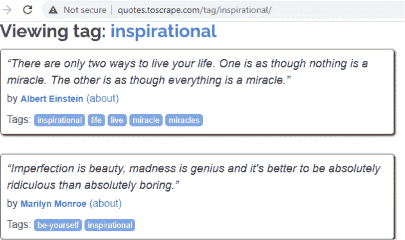
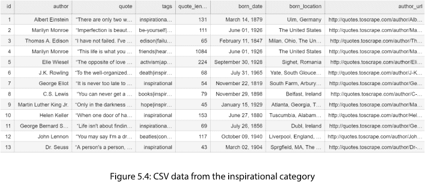
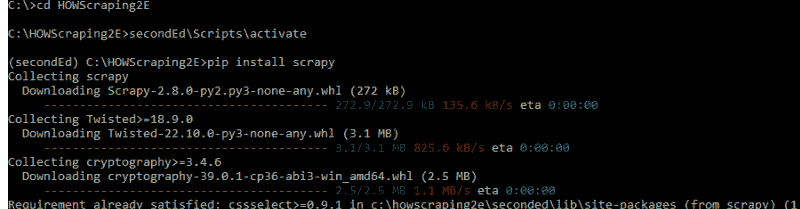
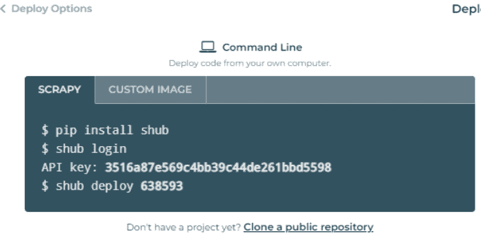
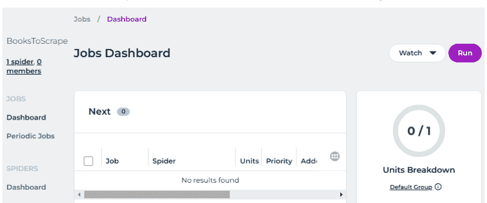
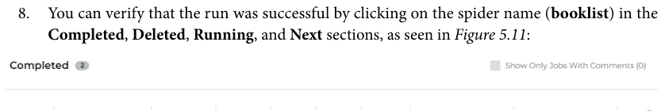
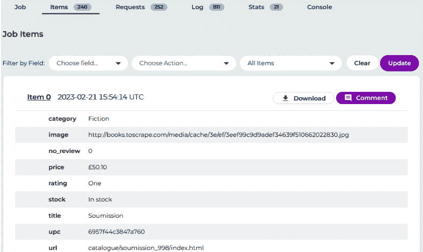

## Scraping the Web with Scrapy and Beautiful Soup

In previous chapters, we learned about web scraping-related technologies, data-finding techniques, and using various Python libraries to scrape data from the web.

In this chapter, we will explore and learn practically about two popular Python libraries, Scrapy and Beautiful Soup. Scrapy is a web crawling framework for Python and provides a project-oriented scope for web scraping. Beautiful Soup, on the other hand, deals with document or content parsing. Parsing a document is normally done to effectively traverse and extract content. Apart from this, both libraries are heavily loaded with DOM-related features.

In particular, we will learn about the following topics in this chapter:

- Web parsing using Python
- Web scraping using Beautiful Soup
- Web scraping using Scrapy
- Deploying a web crawler

### Technical requirements

A web browser (Google Chrome or Mozilla Firefox) will be required and we will be using Python notebooks for the code using JupyterLab.

Please refer to the Setting things up and Creating a virtual environment sections in Chapter 2 to continue setting up and using the environment created.

The Python libraries that are required for this chapter are as follows:

- lxml
- urllib


- `requests`
- `html5lib`
- `beautifulsoup4`
- `scrapy`

本章的代码文件可在 GitHub 上在线获取：https://github.com/PacktPublishing/Hands-On-Web-Scraping-with-Python-Second-Edition/tree/main/Chapter05

## 使用 Python 进行网页解析

在之前的章节中，无论是在解释还是代码示例中，我们都了解到网页抓取是一种根据我们的需求和选择从网站中提取数据的流程。借助一些 Python 库，从编码角度来看，数据收集可以很顺畅且无错误，但至少需要识别内容并遍历元素 个别或嵌套 的，才能完成任务。

为了确保收集到高质量的数据，网页上的内容必须完整且无错误。我们在 DOM 结构中使用基于 CSS 或 XPath 的表达式。如果 DOM 的结构不完善或包含错误，例如不完整的标签、缺少闭合标签或标签拼写错误，那么部署的代码表达式和查询路径将无法指向 DOM 的原始节点或元素。这将导致提取不完整或不必要的内容，这可能需要额外的任务，例如数据清洗或预处理，甚至拒绝数据，因为它不符合模式或数据验证规则。

网页解析，或更准确地说网页文档 如 HTML 或 XML 解析，是指分解、暴露或识别内容中元素、节点或 HTML 标签等组件的活动。网页解析是为了结构化网页内容并克服网页内容中非结构化数据元素的问题。解析很重要，因为它使遍历、搜索和从所需元素中收集信息变得更容易。使用有效的解析器 对网页内容进行解析可使抓取任务更高效、更无忧。

在第 3 章处理 lxml 和第 4 章使用 pyquery 时，我们使用了库提供的默认解析器。在第 3 章中，我们还使用了一个特殊解析器来解析 robots.txt。

> **重要说明**
> 
> lxml 在 Python 中仍然被广泛使用，因为它具有各种基于 DOM 的功能。它是默认解析器，具有内存高效的功能并与其他库协作。有关 lxml 的更多信息，请访问 https://lxml.de/index.html。

在 Python 编程中，基于网页的文档解析任务主要由 Beautiful Soup 完成，也称为 bs4 Python 库。在下一节中，我们将进一步探索这个主题。

## 介绍 Beautiful Soup

Beautiful Soup 是用于处理 HTML 和 XML 文档的 Python 解析库。它生成与 Python lxml 库类似的解析树 使用 lxml.etree 和 ElementTree 等属性和类 ，该树进一步用于遍历、搜索和识别元素以提取数据并抓取网页。

Beautiful Soup 提供了使用 lxml 和 html5lib 库可用的相同解析相关功能。Beautiful Soup 中提供了大型、简单且易于使用的方法和属性来处理与 DOM 相关的活动。

Beautiful Soup 相对于其他 Python 库的几个区别特征如下：

- 它可以解析带有损坏、不完整、拼写错误或缺失标签的文档。
- 与其他解析器不同，它允许处理重复和多值属性。
- 也可以仅解析内容中特定选定的部分或章节，从而节省内存和时间。
- 文档编码会自动处理。编码细节也可以提供给 Beautiful Soup 构造函数。

有关 Beautiful Soup 的更详细信息，请访问官方文档 https://www.crummy.com/software/BeautifulSoup/bs4/doc/。现在我们已在本节中介绍了 Beautiful Soup，我们将在即将到来的章节中安装并进一步探索它。

## 安装 Beautiful Soup

请参考本章中的 技术要求 部分，以及 https://www.crummy.com/software/BeautifulSoup/bs4/doc/#installing-beautiful-soup 链接来安装 Beautiful Soup。

如图 5.1 所示，pip install beautifulsoup4 安装或更新 bs4 库及其依赖库，例如 soupsieve：

```
(secondEd) C:\HOWScraping2E>pip install beautifulsoup4
Requirement already satisfied: beautifulsoup4 in c:\how scraping2e\seconded\lib\site-packages (4.11.1)
Requirement already satisfied: soupsieve>1.2 in c:\how scraping2e\seconded\lib\site-packages (from beautifulsoup4) (2.3.2.post1)

(secondEd) C:\HOWScraping2E>cd Chapter05

(secondEd) C:\HOWScraping2E\Chapter05>jupyter-lab
```

图 5.1：安装 Beautiful Soup

让我们验证 bs4 的安装和版本 完整代码可在 GitHub 上获取：https://github.com/PacktPublishing/Hands-On-Web-Scraping-with-Python-Second-Edition/blob/main/Chapter05/bs4_setup.ipynb：

```
import bs4
bs4.__version__        # 4.11.1
dir(bs4)
# ['BeautifulSoup', 'BeautifulStoneSoup', 'CData', 'Comment',
'Counter', 'DEFAULT_OUTPUT_ENCODING', 'Declaration', 'Doctype',...,
'SoupStrainer', 'StopParsing', 'Stylesheet', 'Tag',..., '__version__',
'_s', '__soup', 'builder', 'builder_registry', 'dammit', 'element',
'formatter', 'os', 're', 'sys', 'traceback', 'warnings']
```

前面的代码导入 bs4 Beautiful Soup ，打印其版本信息，为 4.11.1，并探索 bs4。我们可以在输出中看到有几个重要的类可用，例如 BeautifulSoup 和 SoupStrainer。

在本节中，我们已安装 Beautiful Soup 并验证了其安装及其版本信息。在下一节中，我们将探索 Beautiful Soup 的各种功能。

## 探索 Beautiful Soup

我们现在将探索 Beautiful Soup 中也称为 bs4 Python 库 的一些选定重要功能和类。本节将涵盖解析网页文档以及使用 Beautiful Soup 进行遍历、搜索和迭代的活动。

在进行解析和使用 bs4 的功能时，我们将使用 BeautifulSoup 和 SoupStrainer 类来定位网页文档的某些部分或元素：

```
from bs4 import BeautifulSoup as BSoup
from bs4 import SoupStrainer
```

如前面的代码所示，BeautifulSoup 和 SoupStrainer 类是从 bs4 导入的。在下一节中，我们将演示使用 bs4 进行解析。

## 解析

如前几节所述，解析是一种纠正内容错误的活动。使用解析器始终是推荐的，以从不同平台和系统上的网页内容中获得相似的结果。此外，我们需要计划或准备好接受，使用 BeautifulSoup 时，由于解析，项目会比平常花费更长时间。

HTML 内容或代码块将连同所选解析器或类似 BSoup 的解析器 一可以是字符串或 HTML 解析器 传递给 BeautifulSoup，也称为 BSoup 构造函数。如果未指定解析器，系统将使用默认 HTML 解析器，通常是 lxml。

通常，BeautifulSoup 支持两种类型的解析器：

- 标记类型：html、xml 和 html5
- 解析器库名称：lxml、html5lib 和 html.parser lxml 和 html5lib 必须安装后才能使用；html.parser 是内置 HTML 解析器

> **重要说明**
> lxml 被推荐为与 BeautifulSoup 一起使用的最佳解析器，因为其内存和速度。html5lib 通常是第二选择，但解析输出也可以用于根据内容或 DOM 要求确定要使用的解析器的偏好。

还需要注意的是，生成的解析树 输出 或解析内容将根据所使用的解析器而有所不同。为了演示解析，这里声明了一个带有不完整错误代码的 markup 变量：

```
markup = "<a></p></a></p>"
```

以下代码使用 markup 的默认解析器：

```
BSoup(markup)    # <html><body><a></a></body></html>
```

已使用 html.parser 解析器，并且仅解析了 <a>；</p> HTML 标签未从 markup 字符串变量中返回：

```
BSoup(markup,"html.parser")      # <a></a>
```

lxml 解析器和默认解析器的输出看起来相似：

```
BSoup(markup,"lxml")    # <html><body><a></a></body></html>
```

与 lxml 和 html.parser 相比，html5lib 解析器似乎提供了更详细的信息：

```
BSoup(markup,"html5lib")
# <html><head></head><body><a><p></p></a><p></p></body>
  </html>
```

所有不完整的标签都已列在输出中，并且完整的 HTML 结构 <html>、<head>、<body> 也已保持。


<html>
<head><title>睡鼠的故事</title></head>
<body>
<p class="title"><b>睡鼠的故事</b></p>
<p class="story">从前有三个小妹妹，她们的名字是
<a href="http://example.com/elsie" class="sister" id="link1">埃尔西</a>、
<a href="http://example.com/lacie" class="sister" id="link2">莱西</a> 和
<a href="http://example.com/tillie" class="sister" id="link3">蒂莉</a>；
她们住在井底。
</p>
<p class="story">...</p>
<h1>秘密特工</h1>
<ul>
<li data-id="10784">Jason Walters, 007: 在《致命魔术》中被发现死亡。</li>
<li data-id="97865">Alex Trevelyan, 006: 成为恐怖分子头目；James 在《黄金眼》中的宿敌。</li>
<li data-id="45732">James Bond, 007: 主角；风流倜傥但不失稳重。</li>
</ul>
</body>
</html>

图 5.2：HTML 源代码

以下代码导入 bs4 和 re（Python 正则表达式，或正则表达式）库：

```
from bs4 import BeautifulSoup as BSoup
import re                 # regex
html = open("testHTML.html","r").read()  # html file
soup = BSoup(html) # default parser
```

如图 5.2 所示的 HTML 内容，使用指定路径加载并通过 BeautifulSoup 库的默认解析器转换为 soup 对象。

有了 bs4 soup 对象，现在我们可以进一步处理 DOM 或 HTML 内容。我们处理的 HTML 内容可以是单一的或嵌套的。单个元素可以像访问属性一样访问，如以下代码所示：

```
soup.a  # <a class="sister" href="http://example.com/elsie" id="link1">Elsie</a>
soup.h1 # <h1>Secret agents</h1>
```

soup.a 类似于 soup.find('a')；默认情况下它会找到第一个 <a> 元素并显示该元素的完整 HTML（文本和属性）。

许多元素具有各种属性，或至少有一个属性。元素属性是重要的资源，因为它们提供了内容的标识。

在以下代码中，使用了 soup 对象的一些主要函数和属性：

```
soup.a.attrs
# {'href': 'http://example.com/elsie', 'class': ['sister'], 'id': 'link1'}
```

```
soup.a.has_attr('class')      # True
soup.a.has_attr('name')      # False
soup.a.get('class')          # ['sister']
soup.a.get('href')      # 'http://example.com/elsie'
```

下面对前述代码中使用的函数和属性进行简要说明：

+   - **attrs**：列出找到的任何元素的全部属性
+   - **has_attr()**：接受属性名作为参数以检查其是否存在；搜索查询后返回布尔（true/false）答案
+   - **get()**：接受属性名作为参数并返回所提供属性的值

可以使用 text 和 string 属性以及 get_text() 函数从任何元素检索字符串值或内容，如以下代码中使用：

```
soup.a.text      # Elsie
soup.a.get_text()      # Elsie
soup.a.string      # Elsie
```

这里，我们探索了具有其属性的单个元素。在下一节中，我们将搜索元素。

## find()

soup 对象还支持 find() 方法，该方法根据提供的参数返回单个结果。如果没有结果，则 find() 返回 None。

在以下代码中，显示了各种形式的 find()，默认情况下识别或选择 <a>，输出为 <a class="sister" href="http://example.com/elsie" id="link1">Elsie</a>：

```
soup.find('a')
soup.find('a',string="Elsie")
soup.find('a',{'id':"link1"})
soup.find('a',"sister")
soup.find("a",attrs={'class':'sister'},text="Elsie")
```

让我们尝试理解这里列出的各种形式的 find()：

+   - **find('a')**：找到第一个可用的 <a>。
+   - **find('a',string="Elsie")**：找到第一个字符串值为 Elsie 的 <a>。
+   - **find('a',{'id':"link1"})**：找到第一个具有 id 属性且值为 link1 的 <a>。

+   - `find('a', "sister")`：找到默认具有 class 值为 `sister` 的 `<a>`。这与 `find('a', attrs={'class': "sister"})` 和 `find('a', {'class': 'sister'})` 相同。
+   - `find("a", attrs={'class': 'sister'}, text="Elsie")`：找到第一个文本值为 Elsie 且也拥有名为 class 且值为 sister 的属性的 `<a>`。

接下来的示例显示了一些 `find()` 的常见和区别用法。

在以下代码中，默认搜索 `<ul>` 元素，这将返回其内容，包括其子 `<li>` 元素：

```
soup.find('ul') # <ul>
<li data-id="10784">Jason Walters, 003: Found dead in "A
    View to a Kill".</li>
<li data-id="97865">Alex ... "Goldeneye".</li>
<li data-id="45732">James Bond, 007: The main man; shaken
    but not stirred.</li>
</ul>
```

如以下代码所示，`find()` 已用于连接。代码搜索 `<ul>` 然后找到 `<li>`（找到的 `<ul>` 的第一个子元素）：

```
soup.find('ul').find('li')
# <li data-id="10784">Jason Walters, 003: Found dead in "A
    View to a Kill".</li>
```

以下代码在查找 `<li>` 时使用额外的过滤选项，提及其 data-id 属性并使用 `get_text()` 方法显示其内容：

```
soup.find('ul').find('li', attrs={'data-id': '97865'})
    .get_text()
# 'Alex Trevelyan, 006: Agent turned .... nemesis in
"Goldeneye".'
```

我们在本节中处理了单元素搜索。现在，我们将在下一节学习如何查找所有匹配元素。

## find_all()

soup 对象还包含 `find_all()` 方法，该方法返回一个或多个结果，或在查询不匹配时返回一个空的 `list()` 对象。

以下代码块使用 `find_all()` 方法以及主要参数：

```
soup.find_all('a') # soup("a")
soup.find_all('a',attrs={'id':re.compile(r"link")})
soup.find_all('a',attrs={'href':re.compile(r".*ie$")})
soup.find_all("a",text=re.compile(r".*ie$"))
```

使用 soup `find_all()` 方法的前述代码会产生以下输出：

```
[<a class="sister" href="http://example.com/elsie"
    id="link1">Elsie</a>,
<a class="sister" href="http://example.com/lacie"
    id="link2">Lacie</a>,
<a class="sister" href="http://example.com/tillie"
    id="link3">Tillie</a>]
```

让我们尝试使用 `find_all()` 理解代码的各个方面：

+   - `find_all('a')`：找到所有 `<a>` 元素。此代码类似于 `soup("a")`、`find_all('a','sister')` 和 `find_all('a',{'class':'sister'})`。
+   - `find_all('a',attrs={'id':re.compile(r"link")})`：这里使用了 re Python 库，以匹配 id 属性值中包含文本 link 的 `<a>` 元素。同样，可以使用 `find_all('a',attrs={'href':re.compile(r".*ie$")})` 在以字符 ie 结尾的 href 属性值上匹配正则表达式模式。
+   - `find_all("a",text=re.compile(r".*ie$"))`：与在属性（id 或 href）上匹配正则表达式类似，也可以在以字符 ie 结尾的文本参数中形成模式。

本节中即将出现的示例显示了使用 `find_all()` 的一些额外功能。

以下代码返回 `<a>` 和 `<title>` 元素的列表：

```
soup.find_all(['a','title'])
# [<title>The Dormouse's story</title>,
<a class="sister" href="http://example.com/elsie"
    id="link1">Elsie</a>,
<a class="sister" href="http://example.com/lacie"
    id="link2">Lacie</a>,
<a class="sister" href="http://example.com/tillie"
    id="link3">Tillie</a>]
```

以下代码查找具有 `class` 属性且值为 `title` 或 `story` 的所有 `<p>` 元素：

```
```python
soup.find_all("p",attrs={"class":["title","story"]})
# [<p class="title"><b>The Dormouse's story</b></p>,
<p class="story">Once upon a time there were three little
sisters; ...
<a class="sister" href="http://example.com/elsie"
    id="link1">Elsie</a>,
<a class="sister" href="http://example.com/lacie"
    id="link2">Lacie</a> ...
<a class="sister" href="http://example.com/tillie"
    id="link3">Tillie</a>;
... well. </p>,
<p class="story">...</p>]
```
```

`find_all()` 还支持使用 `limit` 参数限制结果，如下所示：

```
```python
soup.find_all('a',limit=2)
# [<a class="sister" href="http://example.com/elsie"
    id="link1">Elsie</a>,
<a class="sister" href="http://example.com/lacie"
    id="link2">Lacie</a>]
```
```

如前例所示，仅返回两个 `<a>` 元素。

> **重要提示**
> 
> *CSS 选择器* 也可以与 BeautifulSoup 对象一起使用。有两个方法允许使用 CSS 选择器与 bs4：`select()`，类似于 `find_all()`，和 `select_one()`，类似于 `find()`。有关更多信息，请访问 https://www.crummy.com/software/BeautifulSoup/bs4/doc/#css-selectors。

我们在本节中查看了元素的搜索，这也可以用于迭代的目的（请参阅 *Iteration* 部分）。在下一节中，我们将介绍搜索和沿 DOM 内容遍历的组合。

## next_element 和 previous_element

在元素之间前后移动时，沿 DOM 遍历非常有效。它是通过使用 `next_element` 和 `previous_element` 实现的。`next_elements` 和 `previous_elements` 也可以用于返回多个元素。在开始理解遍历之前，理解解析树或 DOM 树的概念非常重要。DOM 树通常显示 HTML 代码结构、父子标签组合以及嵌套或链式标签。


The following code shows the use of `next_element`. While traversing along a DOM (normally from top to bottom), various elements can be found with `next_element`:

```
soup.find('p','story').next_element
# 'Once upon a time there were three little sisters; and
#  their names were\n '

soup.find('p','story').next_element.next_element
# <a class="sister" href="http://example.com/elsie"
#  id="link1">Elsie</a>
```

Let us understand the details of the preceding code:

+   - `find('p','story').next_element`: Searches for a `<p>` element for the story value in class, and points to the next element. Here, the next element after `<p class="story">` is the text itself, as seen in the preceding code output.
+   - `find('p','story').next_element.next_element`: Points to the `<a>` child element with the text `Elsie`.

`previous_element` is similar to `next_element`, but the direction of traversing is reversed.

The following code shows the use of `previous_element`, which can be extended or chained:

```
soup.find('b').previous_element
# <p class="title"><b>The Dormouse's story</b></p>

soup.find('li',{'data-id':'45732'}).previous_element
    .previous_element
# 'Alex Trevelyan, 006: Agent turned terrorist leader;
#  James\'... in "Goldeneye".'
```

Regarding the preceding code, let us understand a few details:

+   - `find('b').previous_element`: There’s only one `<b>` element in the HTML content inside `<p>`, so it returns the element at `previous_element` or `<p class="title">`
+   - `find('li',{'data-id':'45732'}).previous_element.previous_element`: With `<li data-id="45732">`, we find that the previous element is `<li data-id="97865">`, hence we get the text

The `next_element` and `previous_element` attributes can be chained, as seen in the preceding code.

We have explored a lot regarding searching and traversing so far in this section. The next section demonstrates performing iteration.

## Iteration

We have already come across the concept of iteration in previous sections. For example, find_all(), next_elements, and previous_elements result in one or more elements, where a loop can be used.

The following code iterates on the child elements of the <ul> elements, which are <li> using find_all(), and uses the name attribute to show the element name:

```
for li in soup.ul.find_all('li'):
    text = li.get_text().strip()
    print(f"{li.name} : {li.get('data-id')} :
        ({len(text)}) - {text}")
```

Similarly, the get_text() function returns the text string of an element, and the get('data-id') function returns the values of the data-id attribute. Printing all those return values with their text lengths, the output looks as follows:

```
li : 10784 : (53) - Jason Walters, 003: Found dead in "A
    View to a Kill".
li : 97865 : (82) - Alex Trevelyan, 006: ...; James' nemesis
    in "Goldeneye".
li : 45732 : (54) - James Bond, 007: The main man; shaken
    but not stirred.
```

Various alternate mechanisms exist to perform iteration and the extraction process.

In this and previous sections, we explored the main concepts related to BeautifulSoup. We will scrape content using BeautifulSoup in the upcoming section.

> **Important note**
> BeautifulSoup has various other methods related to the find activity, such as find_all_next, find_next, and find_previous_siblings, to deal with parent-child and traversing-related instances. There have been updates to the names and supporting arguments of methods in bs4. For the complete and updated documentation, please visit https://www.crummy.com/software/BeautifulSoup/bs4/doc/.

## Web scraping using Beautiful Soup

In this section, we will build and execute a web crawler using Beautiful Soup. To set things up, we have chosen to scrape quotes from http://quotes.toscrape.com. Specifically, we will be scraping from the page http://quotes.toscrape.com/tag/inspirational, as seen in Figure 5.3:



Figure 5.3: Category “inspirational”

The example we are dealing with is similar to *Example 3 – scraping quotes with author details* in Chapter 4. Only the links and compositions have changed, by carrying out a few additional logical steps. The code for the example can be found on GitHub: https://github.com/PacktPublishing/Hands-On-Web-Scraping-with-Python-Second-Edition/blob/main/Chapter05/bs4_scraping.ipynb.

The following code declares the paginated link as url, and columns contains a column header for the CSV file to be generated:

```
```python
url = "http://quotes.toscrape.com/tag/inspirational/page/"
columns=['id','author','quote','tags','quote_length',
         'born_date','born_location','author_url']
```
```

Inside the paginated loop, a response from url has been collected and provided to BSoup to be parsed with the default parser:

```
```python
response = requests.get(url+str(page))
source = BSoup(response.content)
    if source.find('ul','pager').find('li','next'):
        txtNext = source.find('ul','pager')
                  .find('li','next').find('a').get_text()
```
```

txtNext holds the value for the next page.

As seen in the following code, the nextPage pagination variable is controlled based on the "Next" string if it exists for txtNext:

```
if txtNext and
    re.findall(r".*(Next).*",txtNext)[0]=="Next":
        nextPage=True
```

Multiple variables, such as quote, author, and tags, are created with the content available from iterating <div> with the quote class value:

```
for quotes in source.find_all('div','quote'):
    quote = quotes.find(attrs={'itemprop':'text'})
        .get_text().strip()
    author = quotes.find(attrs={'class':'author'})
        .get_text().strip()
    tags = quotes.find(attrs={'itemprop':'keywords'})
        .get('content').strip()
    authorUrl = quotes.find(href=re.compile(r"/author/"))
        .get('href')
```

Similarly to the quote-based information, a unique authorUrl string has been identified and its content is parsed to collect author-related information, such as bornDate and bornLocation:

```
if authorUrl and authorKey not in authorSet.keys():
    authorUrl = "http://quotes.toscrape.com"+authorUrl
    source_author = BSoup(requests.get(authorUrl).content)
    bornDate = source_author.find(attrs=
        {'class':'author-born-date'}).get_text().strip()
    bornLocation = source_author.find(attrs=
        {'class':'author-born-location'}).get_text()
        .replace('in', '').strip()
```

Finally, author-related information is collected in authorSet, and dataSet holds quote and author details:

```
authorSet[authorKey]={
    'name':author,
    'url':authorUrl,
    'date':bornDate,
    'location':bornLocation
}
dataSet.append([
    uid,
    author,
    quote,
```

```
tags.replace(',', '|'),
len(quote),
authorSet[authorKey]['date'],
authorSet[authorKey]['location'],
authorSet[authorKey]['url']
)
```

The collected set of information (author, quote, tags, and a few more) is finally written into JSON (quotes_author_inspirational.json) and CSV (quotes_inspirational.csv) files, as seen in Figure 5.4:

| id | author | quote | tags | quote_len | born_date | born_location | author_url |
|---:|---|---|---|---:|---|---|---|
| 1 | Albert Einstein | "There are only two w..." | inspirationa... | 131 | March 14, 1879 | Ulm, Germany | http://quotes.toscrape.com/author/Alb... |
| 2 | Marilyn Monroe | "Imperfection is beaut..." | be-yourself/... | 111 | June 01, 1926 | The United States | http://quotes.toscrape.com/author/Ma... |
| 3 | Thomas A. Edison | "I have not failed. I've ..." | edison|fallu... | 65 | February 11, 1847 | Milan, Ohio, The Un... | http://quotes.toscrape.com/author/Th... |
| 4 | Marilyn Monroe | "This life is what you ..." | friends|hear... | 1084 | June 01, 1926 | The United States | http://quotes.toscrape.com/author/Ma... |
| 5 | Elie Wiesel | "The opposite of love ..." | activism|ap... | 224 | September 30, 1928 | Sighet, Romania | http://quotes.toscrape.com/author/Eli... |
| 6 | J.K. Rowling | "To the well-organized..." | death|inspir... | 68 | July 31, 1965 | Yate, South Glouc... | http://quotes.toscrape.com/author/J-K... |
| 7 | George Eliot | "It is never too late to ..." | inspirational | 54 | November 22, 1819 | South Farm, Arbury... | http://quotes.toscrape.com/author/Ge... |
| 8 | C.S. Lewis | "You can never get a ..." | books|inspir... | 79 | November 29, 1898 | Belfast, Ireland | http://quotes.toscrape.com/author/C... |
| 9 | Martin Luther King Jr. | "Only in the darkness ..." | hope|inspir... | 45 | January 15, 1929 | Atlanta, Georgia, T... | http://quotes.toscrape.com/author/Ma... |
| 10 | Helen Keller | "When one door of ha..." | inspirational | 153 | June 27, 1880 | Tuscumbia, Alabam... | http://quotes.toscrape.com/author/Hel... |
| 11 | George Bernard S... | "Life isn't about findin..." | inspirationa... | 69 | July 26, 1856 | Dublin, Ireland | http://quotes.toscrape.com/author/Ge... |
| 12 | John Lennon | "You may say I'm a dr..." | beatles|con... | 117 | October 09, 1940 | Liverpool, England... | http://quotes.toscrape.com/author/Jo... |
| 13 | Dr. Seuss | "A person's a person, ..." | inspirational | 43 | March 02, 1904 | Springfield, MA, The ... | http://quotes.toscrape.com/author/Dr... |



> **Important note**
> 
> BeautifulSoup also supports CSS selectors, and there is a short, small crawler available as an example in the GitHub repository: https://github.com/PacktPublishing/Hands-On-Web-Scraping-with-Python-Second-Edition/blob/main/Chapter05/bs4_scraping_css_select.ipynb.

In this section, we have developed Beautiful Soup-based crawlers and extracted data into files. In the next section, we will learn about the Python scrapy library and develop a crawler using it.

## Web scraping using Scrapy

We have learned about, explored, and used different Python libraries for web scraping in the current and previous chapters. Scrapy is one of the few open source web crawling frameworks written in Python that allows dynamic adaptation, a project-based scope, and modular extensibility for web scraping tasks.


根据 Scrapy 官方网站，https://scrapy.org/，它 *简单、快速、协作且可扩展*。Scrapy 之前由 **Scrapinghub** 维护，现在由 **Zyte**（https://www.zyte.com/）和其他一些贡献者维护。

以下是一些重要的特性，使 Scrapy 流行并使其在 Python 网页爬取框架中脱颖而出的列表：

- 内置支持 *解析、遍历、XPath、CSS 选择器和正则表达式*
- 使用内置库处理 HTTP 请求和响应
- 模块化结构和组件允许开发者专注于特定任务并协作管理编码
- 提供 **命令行界面 (CLI)** 来处理项目、数据导出、管理数据库等
- 可用的中间件和扩展非常丰富，可以轻松处理 *cookie、会话、身份验证、robots.txt、项目日志、用量统计、电子邮件等*

为了开始使用 Scrapy 尝试一些抓取任务，让我们在预设环境中使用 pip 安装它，如图 5.5 所示，或按照 https://docs.scrapy.org/en/latest/intro/install.html 中的说明进行操作：



图 5.5：Scrapy 安装

在对 Scrapy 进行本次基本介绍并在系统中成功安装后，接下来我们将设置一个项目。

## 设置项目

Scrapy，如前一节所述，提供了一个命令行工具 scrapy。该工具包含大量命令，可帮助设置项目和与数据提取相关的活动。代码可在 GitHub 上获取：https://github.com/PacktPublishing/Hands-On-Web-Scraping-with-Python-Second-Edition/tree/main/Chapter05/bookScrapy。

scrapy genspider booklist books.toscrape.com 命令在 bookScrapy\books\spiders 子文件夹中创建名为 booklist.py 的爬虫，并将 books.toscrape.com 设置为 allowed_domains 参数：

```
import scrapy
class BooklistSpider(scrapy.Spider):
    name = "booklist"
    allowed_domains = ["books.toscrape.com"]
    start_urls = ["http://books.toscrape.com/"]
    def parse(self, response):
```

如前述代码所示，刚创建的 booklist.py 爬虫包含默认代码。要开发爬虫，我们必须在 booklist.py 文件中使用 parse() 实现必要的代码和逻辑。bookScrapy\books 文件夹还包含一些额外的文件：items.py、middlewares.py、pipelines.py 和 settings.py，以及 spiders 文件夹。

> **重要说明**
> Spider 是一个包含用于抓取和数据收集逻辑的代码的 Python 类文件。可以存在多个针对特定抓取活动的 spider 类。spider 类在爬取过程中使用。诸如 scrapy list 和 scrapy list spider list 等命令可列出项目的爬虫。请访问 https://docs.scrapy.org/en/latest/intro/tutorial.html?highlight=Spider#our-first-spider 了解更多信息。

这些文件各自对最终爬虫具有控制和实现。以下是这些文件的简要说明：

- items.py：Item 就像一个 Python 字典，保存键和值（列名和值）。有关更多详细信息，请访问 https://docs.scrapy.org/en/latest/topics/items.html。
- pipelines.py：在收集数据后，抓取的项目会发送到管道以执行其他操作，例如清理和丢弃。有关更多详细信息，请访问 https://docs.scrapy.org/en/latest/topics/item-pipeline.html。
- settings.py：可以控制和添加项目相关设置。有关更多详细信息，请访问 https://docs.scrapy.org/en/latest/topics/settings.html。
- middlewares.py：我们可以指定一些钩子或扩展，可在爬虫中执行其他任务（处理输入和输出）。请访问 https://docs.scrapy.org/en/latest/topics/spider-middleware.html 了解更多详细信息。

> **重要说明**
> 处理或更新我们刚刚提到的文件不是强制性的。这些文件用于实现功能完善的爬取项目，通过允许用户使用 Scrapy 提供的深入功能和变体。

我们现在已准备好项目和默认爬虫文件以开始编码或进一步处理。在下一节中，我们将使用 `items.py` 文件处理 `scrapy.Item`。

## 创建项目

Item 通常被理解为用于收集值以在爬虫中实现的值的字典对象的列名或键。`items.py` 文件包含一个默认类，该类实现 `scrapy.Item`。该类（`BooksItem`）是在处理 `scrapy startproject` 命令期间生成的。

以下代码块探索了 BooksItem 项目类，并与之关联了 `scrapy.Field()` 类型的对象：

```
import scrapy
class BooksItem(scrapy.Item):
    # define the fields for your item here like:
    title = scrapy.Field()
    no_review = scrapy.Field()
    ...
    url = scrapy.Field()
    image = scrapy.Field()
```

根据我们的爬虫计划，`items.py` 将包含 `scrapy.Field()` 的默认对象。这些字段将从爬虫或 `spiders\booklist.py` 获取其值，如我们在下一节中将发现的那样。

## 实现爬虫

在规划和收集项目准备就绪后，我们将实现爬虫以使用 `items.py` 并进一步进行代码实现。代码可在 GitHub 上获取：https://github.com/PacktPublishing/Hands-On-Web-Scraping-with-Python-Second-Edition/blob/main/Chapter05/bookScrapy/books/spiders/booklist.py。

与爬取相关的逻辑和代码由 `parse()` 函数提供，该函数存在于 `booklist.py` 中，如下所示：

```
def parse(self, response):
    listings = response.xpath("//article[@class='product_pod']")
    #root
    nextPage = response.xpath("//ul[@class='pager']/li[@class='next']/a/@href")
    for listing in listings:
```

前述代码从 http://books.toscrape.com 识别 listings 并将使用 XPath 进行迭代。下一页的链接 nextPage 也已被解析。CSS 选择器和 XPath 表达式都可与 response（对 start_urls 的 HTTP 响应）一起使用。

如以下代码所示，已从 items.py 创建了 Python BooksItem 类，该类具有列对象，已识别或计划的字段正在被解析并添加到列中：

```
column = BooksItem() # from books.items import BooksItem
column['title'] = listing.xpath("./h3/a/@title[normalize-space()]").extract_first()
column['url'] = listing.xpath("./h3/a/@href").extract_first().strip()
...
yield response.follow('http://books.toscrape.com/catalogue/'+column['url'],
    callback=self.parse_page, meta={'column':column})
```

为了使用 column['url'] 提供的链接解析详细列表页，Scrapy 提供了 follow() 函数，该函数链接到 parse 函数以作为回调处理（parse_page），并且收集的项目被添加到 BooksItem 类的 column 对象中。

以下代码实现了基于循环的逻辑，并在每次有下一页链接可用时调用 parse()：

```
if nextPage:
    nextPage = 'http://books.toscrape.com/catalogue/'+nextPage
    yield scrapy.Request(nextPage, callback=self.parse)
```

此爬虫（booklist）可使用 scrapy crawl booklist 命令执行。它列出了大量日志，例如经过时间和日期。

爬虫准备好处理或爬取后，我们将在下一节中导出数据。

## 导出数据

scrapy 命令使导出数据到文件变得非常容易。我们可以使用以下命令：

- scrapy crawl booklist -o bookRecords.csv
- scrapy crawl booklist -o bookRecords.json

4. 项目创建后，Zyte 将引导您进入 **Deploy** 部分，或您可以从菜单中选择该选项。在这里，我们必须指定如何将项目加载到 app.zyte.com。多个选项可用，如 *图 5.8* 所示：



图 5.8：代码与部署 – Scrapy 选项

5. 根据 *步骤 4* 下 **SCRAPY** 中的说明，我们将使用 `pip install shub` 安装 shub，登录并使用 *图 5.9* 中显示的代码进行部署。成功安装和登录将创建 API 密钥，提供部署 ID（638593），并向项目文件夹添加一些文件，例如 `scrapinghub.yml` 和 `setup.py`：

```text
(seconded) C:\HOWScraping2E\Chapter05\book\scrapy>shub deploy 638593
C:\HOWScraping2E\seconded\Lib\site-packages\distutils\hack\__init__.py:33: UserWarning: Setuptools is replacing distutils.
distutils.warn("Setuptools is replacing distutils.")
Packing version 1.0
Deploying to Scrapy Cloud project "638593"
Run your spiders at: https://app.scrapinghub.com/p/638593/
{"status": "ok", "project": 638593, "version": "1.0", "spiders": 1}
```

图 5.9：shub（安装、部署）


6. *Step 5* 将部署的代码或项目加载为作业，这些作业将在 **Jobs Dashboard** 下可用，可执行、运行、调度，以及更多选项，如 *Figure 5.10* 所示：



Figure 5.10: Listing jobs and Spider links

7. *Step 6* 显示存在 **1 spider**。点击该蜘蛛，将带你进入 **Spider Details**，并提供有关蜘蛛的一些信息。我们现在可以通过从 **Jobs Dashboard** 点击 **Run** 选项，然后在 **Spider Details** 上运行蜘蛛。

8. 你可以通过在 **Completed, Deleted, Running** 和 **Next** 部分点击蜘蛛名称（**booklist**）来验证运行是否成功，如 *Figure 5.11* 所示：



Figure 5.11: Spider jobs completed

9. 如 *Figure 5.11* 所示，详细信息如 **Items, Requests, Runtime** 和 **Errors** 也可用，可点击以进行更详细的调查。*Figure 5.12* 向我们展示了 **Items** 下的信息：



Figure 5.12: Job Items (loading Item 0 or the first item)

10. 如 Figure 5.12 所示，在 Jobs Items 部分下有多个选项，例如 Download、Exporting to Files（CSV、JSON、XML）、Filtering、Dataset Publishing 和 Samples。

通过上述步骤，我们成功将 Scrapy 项目部署到 app.zyte.com 并根据蜘蛛（booklist）中可用的代码提取了详细信息。

Important note
最好你在本地机器上测试爬虫，以防出现任何异常和错误，测试所有功能（例如运行爬虫和导出数据）并使用最新的库（如果可能）。关于部署或 Zyte 中的任何问题，请访问 https://support.zyte.com。

在本节中，我们专注于在服务器上部署我们的爬虫。

## Summary

在本章中，我们探索并学习了使用 *Beautiful Soup* 和 *Scrapy* 从网页解析和提取数据。

到目前为止，在本书中，我们已经确定了许多有效且适合网页抓取的库和技术。Beautiful Soup 为开发人员提供了一些用于解析、遍历和创建爬虫的功能。Scrapy 提供了与 Beautiful Soup 相同的功能，可用于数据提取，但它更像是一个基于项目的框架，在幕后使用大量库，使你只需专注于自己的任务。由于 Scrapy 易于实现且架构协作性强，它在初学者、专业人士甚至像 Zyte、*ScrapeOps* 和 *Apify* 这样的基于网络的服务提供商中都很受欢迎。

在下一章中，我们将学习并探索更多抓取技术和与安全相关的问题。

## Further reading

- Beautiful Soup: https://www.crummy.com/software/BeautifulSoup/bs4/doc/
- lxml – XML and HTML with Python: https://lxml.de/
- Web crawlers:
  - https://www.cloudflare.com/en-gb/learning/bots/what-is-a-web-crawler/
  - https://research.aimultiple.com/web-crawler/
- Web scraping: https://www.zyte.com/learn/
- robots.txt: https://www.robotstxt.org/robotstxt.html
- Scrapy Cloud: https://www.zyte.com/scrapy-cloud/
- Scrapy: https://docs.scrapy.org/en/latest/index.html
