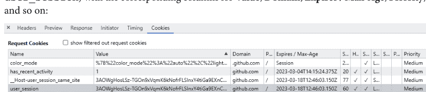
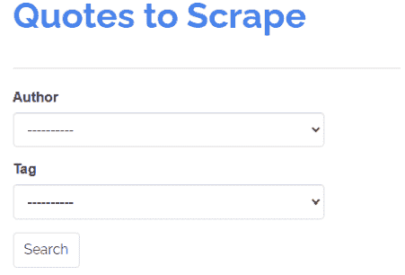
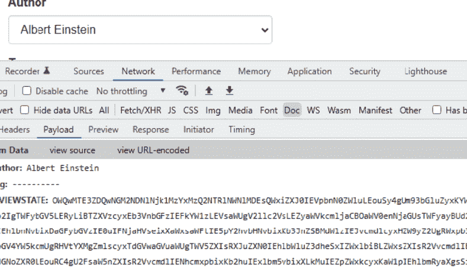
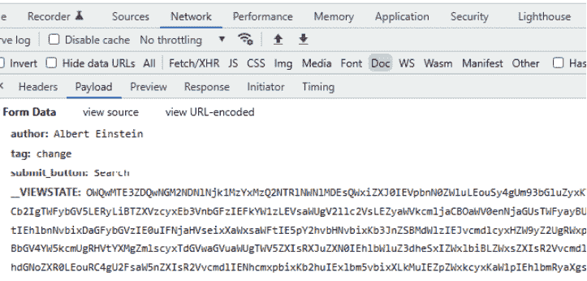
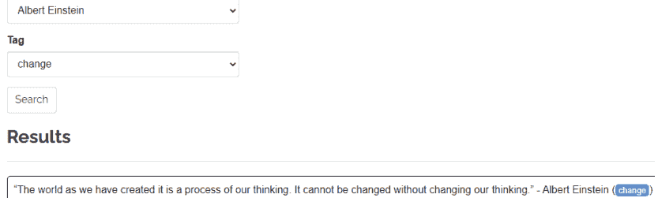
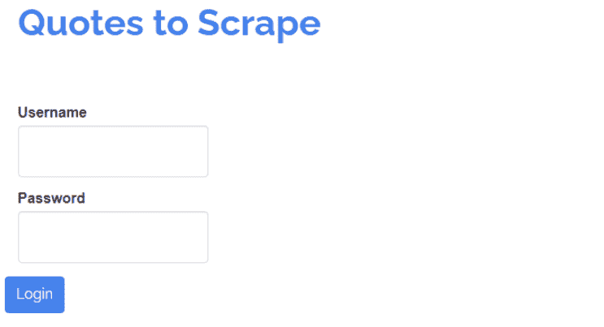
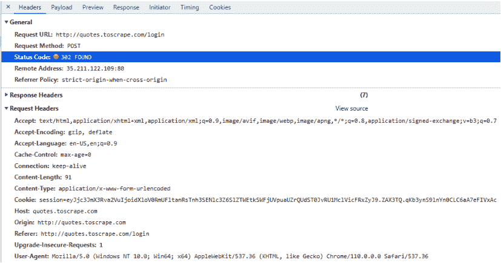
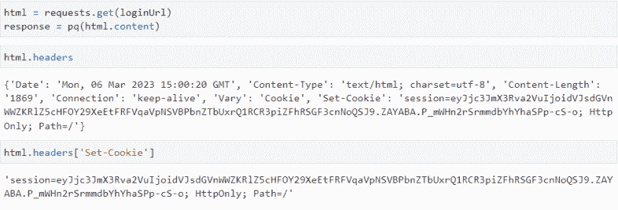

## Working with the Secure Web

到目前为止，我们已经学习了有关网络、网络内容、逆向工程技术、数据查找技术、一些 Python 库以及我们可以用来访问和抓取所需网络内容的框架。

如今网络平台上存在大量与安全相关的问题，以及确保安全的措施。存在大量网络应用程序、扩展程序，甚至网络服务提供商来保护我们和我们的网络系统免受未经身份验证的使用和未经授权的访问。

互联网应用程序和电子商务活动的不断增长要求将安全网络（或网络启用安全功能）作为处理有害甚至非法的行为的高优先级。我们经常收到不相关的电子邮件或垃圾邮件，其中包含我们没有要求的信息。

从网页抓取的角度来看，处理此类问题相当具有挑战性，但道德黑客的概念使其更具可行性，即使从应用程序和安全角度来看也是如此。我们将介绍一些处理网络安全的基本概念，然后继续查看网页抓取。

在本章中，我们将学习以下主题：

- Exploring secure web content
- HTML <form> processing using Python
- User authentication and cookies
- Using proxies

### Technical requirements

需要一个网络浏览器（*Google Chrome* 或 *Mozilla Firefox*），我们还将使用 *JupyterLab* 进行 Python 代码。

请参阅 *Chapter 2* 中的 *Setting things up* 和 *Creating a virtual environment* 部分以继续使用创建的环境。

本章所需的 Python 库如下：

- `requests`
- `pyquery`

本章的代码文件可在本书的 GitHub 仓库在线获取：https://github.com/PacktPublishing/Hands-On-Web-Scraping-with-Python-Second-Edition/tree/main/Chapter06。

### Exploring secure web content

当今的网络和互联网技术在网络安全方面相当脆弱（内容、授权、非法访问等）。我们希望网络是安全的，我们浏览、搜索或查看的内容是真实的，不违反任何法律或道德标准，也不影响人们的人权。

网络必须对寻求信息的所有人可访问且可用，并且有效且遵循道德实践。我们经常遇到网络内容并不完全是我们所寻找的，或者听说网络内容已被篡改或被黑客入侵，或者私人敏感信息被非法泄露等。虽然很多这些情况超出了我们的控制范围，但我们可以减少漏洞，使网络成为更安全的地方。

在许多新技术中，已经识别出与安全相关的问题并实施了解决方案。甚至还有关注基于网络安全的应用程序和组织，它们的需求正在增长并使用启用安全的技术。在政府部门，开发人员使用最新技术使网络更安全。随着技术的改进，抓取和爬取变得更具挑战性。网页抓取或提取网络上可用的信息在考虑道德问题时并无害处。

在接下来的部分中，我们将介绍一些可在网络上实现且易于获得的基本安全相关概念，然后使用 Python 探索、实现和访问它们。

### Form processing

表单或 HTML `<form>` 处理，也称为表单处理，在大多数情况下用于将收集或用户提供的数据传递或提交到后端或服务器。有大量网络表单（例如登录、联系我们、注册和订阅表单）被冒充他人提交的案例。

从用户角度来看，表单只是一个数据收集器，它有一些 `<form>` 元素，例如 `<select>`、`<option>`、`<textarea>` 和 `<input>`，要求提供一些输入或值。当提供数据时，它会在某个级别得到验证并由服务器或相关系统处理，并进行任何必要的进一步操作（例如用户登录、用户注册、重置忘记的密码、QR 处理和图像验证）。


（例如机器、配置文件或服务器上存储的信息）。此类 ID 用于识别和跟踪与用户相关的行为，并且在每次会话结束时都会更新。

在图 6.1 中，我们可以看到某些具有会话相关名称的行（例如 _gh_sess 和 user_session），以及对应的 Value、Domain、Expires / Max-Age、Priority 等列：



图 6.1：Cookie 中的会话相关信息

由于信息将存储在服务器上，并且在客户端和服务器之间共享或识别信息是必要的，因此 cookie 是存储信息的最佳位置。会话相关信息存储在 cookie 中，并提供给所需或访问的网页，保持稳定且经过身份验证的状态。

## 重要说明

> 请注意，我们可以通过拒绝接受 cookie，甚至使用浏览器或 DevTools 删除存储的 cookie 来禁止网站在 cookie 中存储信息。有关 cookie 和会话的更多信息，请访问 https://www.aboutcookies.org、https://developer.mozilla.org/en-US/docs/web/HTTP/Cookies 和 https://securiti.ai/blog/session-cookies/。

到目前为止，本节中我们介绍了 cookie 和会话的一些基本概念。在下一节中，我们将讨论用户身份验证以及使用不同类型的基于 Web 的安全措施。

## 用户身份验证

身份验证或基于 Web 的用户身份验证是与处理和管理用户识别相关的过程。这通常是一个组合过程，其中需要使用 HTML 表单处理和 cookie 相关信息和活动。

用户登录或注册是使用 HTML 表单处理完成的。收集的信息存储并插入到后端数据库或安全文件中。如今，Two-Factor Authentication（2FA）在整个网络上经常使用。通常，已注册用户会被验证并被允许登录或退出系统，在验证其用户名和密码的同时还需解决一些 CAPTCHAs。整个过程

被称为 **Single-Factor Authentication (SFA)**。相反，2FA 在 SFA 之上施加额外的验证，其中包括以下内容：

- 向手机（通过消息或应用）或电子邮件地址发送 *激活码* 或 OTP
- 向注册的电子邮件地址或手机（通过应用或消息）发送用于验证（登录、忘记密码、更新信息等）的安全 *一次性可点击链接*

这些身份验证过程需要 HTML 表单处理的组合，在某些预配置或分配的时间内，以及一些安全的识别 ID 或 *key:value* 对来管理会话或会话管理、cookie 等，帮助完成身份验证过程。

现在你已经了解了身份验证的基础知识，在下一节中，我们将使用 Python 编程语言处理安全和身份验证相关的基于 Web 的案例。

## 使用 Python 处理 HTML <form>

表单处理有各种标题和功能，例如搜索、过滤、登录、注册、提交和验证。在本节中，我们将探索 http://quotes.toscrape.com/search.aspx，如图 6.2 所示，并处理或使用页面上可用的表单来提取或过滤结果，基于选项的选择（**Author** 或 **Tag**）：



图 6.2：搜索表单（作者和标签）

**重要说明**
我们需要调查可用的 <Form> 标签、存在的选项或表单元素，以及表单提交时出现的页面结果。还建议使用 DevTools 探索与表单相关的操作，这将帮助你了解系统的流程、链接、可用性和资源，例如 HTTP 头、cookie 和负载。

在页面分析期间，我们发现只有一个名为 filterform 的表单，并且仅列出了 Author 名称的选项；Tag 没有任何选项。Tag 相关选项在我们选择 Author 选项时动态加载（http://quotes.toscrape.com/filter.aspx 使用 HTTP POST 方法执行并加载 Tag 的选项），并且最终搜索结果在 http://quotes.toscrape.com/filter.aspx 下加载，使用 HTTP POST，当同时选择 Author 和 Tag 选项并按下或点击提交按钮（Search）时。

要通过代码启动基于表单的活动，我们必须识别并列出使用的或加载的 URL：

```
baseUrl="http://quotes.toscrape.com/search.aspx"
# POST URL: Tag and result.
filterUrl="http://quotes.toscrape.com/filter.aspx"
```

让我们逐步分解此 <form> 处理并捕获最终结果：

- 1. 在分析期间，我们注意到仅列出了 Author 选项，并且在我们选择 Author 的任何选项时表单会自动提交。HTTP POST 请求使用有效负载进行处理，如图 6.3 所示：



图 6.3：HTTP POST（负载和表单数据）

2. 从步骤 1 可以清楚地看出，我们需要至少三个值（author、tag 和 __VIEWSTATE）；它们使用以下代码收集和处理：

```
author = response.find('select#author option:gt(0)')
    .attr('value')  # 'Albert Einstein'
tag = response.find('select#tag option').attr('value')
search = response.find('input[name="submit_button"]')
    .attr('value')  #'Search'

viewState = response.find('form[name="filterform"]'
    input#__VIEWSTATE' ).attr('value')
formData={'author':author, 'tag':tag,
    '__VIEWSTATE':viewState}  # Payload info
# process internal URL: filterUrl to load Tag option

responseA = requests.post(filterUrl, data=formData)
# POST request
tag = responseTag.find('select#tag option:gt(0)')
    .attr('value')      # change
```

## 重要说明

__VIEWSTATE 或 viewState 是网站生成的唯一随机值，用于识别页面的各个状态，通常作为隐藏的 <input> 值存在。此 <form> 值存在于大多数使用 ASP.NET 技术构建的网站中。viewState 值在客户端使用，它保留或保留 <form> 元素的值以及页面身份。有关 ASP.NET 基于表单管理的更多详细信息，请访问 https://www.c-sharpcorner.com/article/Asp-Net-state-management-techniques。

filterUrl 的值 http://quotes.toscrape.com/filter.aspx 是一个内部 URL，只要在 Author 选项中进行更改或选择，以及在最终结果加载期间就会处理它。直接访问 filterUrl 将导致 405 HTTP 状态码（Method Not Allowed）。有关 HTTP 状态码的更多详细信息，请访问 https://developer.mozilla.org/en-US/docs/web/HTTP/Status。

3. 从步骤 2 继续，随着 Author 的选择，Tag 选项将被列出。如图 6.4 所示，我们现在已选择 Tag 选项（change）并提交了带有文本 Search 的表单按钮。此提交导致负载下表单数据发生变化，如图 6.4 所示：



因此，对于结果，我们需要诸如 `author`、`tag`、`submit_button` 和 `__VIEWSTATE` 等值。将这些值作为表单数据提交到 `filterUrl` 将加载并更新 `<div class="results">` 中的引语元素，如以下代码所示：

```
```python
finalFormData= {'author':author, 'tag':tag,
    'submit_button':search, '__VIEWSTATE':viewState}
# payload

responseB = requests.post(filterUrl,
    data=finalFormData)   # HTTP POST filterUrl

responseFinal = pq(responseB.content)
result = responseFinal.find('.results .quote').text()
result
# "The world as we have created it is a process of
   our thinking. It cannot be changed without changing
   our thinking." - Albert Einstein (change)
```
```

结果将如图所示 6.5 所列：



图 6.5：表单提交后的结果（带作者和标签）

可能存在一个或多个结果，如图 6.5 所示。结果在 <div class="quote"> 元素中找到，如以下代码所示：

```
<div class="results">.....
  <div class="quote">
    <span class="content">"The world as we have created it is a process of our thinking. It cannot be changed without changing our thinking."</span> -
    <span class="author">Albert Einstein</span>
    (<span class="tag">change</span>)
  </div>
</div>
```

如果存在多个结果，则可能存在多个 <div class="quote"> 实例，我们需要相应地提取这些结果。

- 4. 我们可以对不同的 Author 和 Tag 值重复步骤 1-3。

从这些步骤可以清楚地看出，<form> 处理是一个重要的概念，需要适当的规划和分析。我们成功管理和处理了加载隐藏元素的多步骤表单。此示例的完整代码可以在 GitHub 上找到：https://github.com/PacktPublishing/Hands-On-web-Scraping-with-Python-Second-Edition/blob/main/Chapter06/chapter06_htmlform.ipynb。

在下一节中，我们将查看身份验证（用户登录和注销）过程。


# 用户认证与 Cookie

用户认证（管理与处理用户凭证）是另一种形式的网络安全。在本节中，我们将使用 http://quotes.toscrape.com/login 站点上可用的用户认证功能，以及 Cookie。

如图 6.6 所示，http://quotes.toscrape.com/login 包含一个带有 Login 文本的页面，以及一个要求输入 Username 和 Password 的表单：



图 6.6：用户登录页面

分析页面源代码，仅找到一个单一的 <form> 元素，其中包含一个名为 csrf_token 的隐藏输入元素、两个 type="text" 的文本输入元素（username 和 password），最后是一个 submit 类型的对象，其值为 Login，如图 6.7 所示：

```
<form action="/login" method="post" accept-charset="utf-8">
  <input type="hidden" name="csrf_token" value="KGVfWfPoucWyElYtaReDdkrB5SbHCjQQsLzvTMfxgiopIZnUAhNXmq"/>
  <div class="row">
    <div class="form-group col-xs-3">
      <label for="username">Username</label>
      <input type="text" class="form-control" id="username" name="username" />
    </div>
  </div>
  <div class="row">
    <div class="form-group col-xs-3">
      <label for="username">Password</label>
      <input type="password" class="form-control" id="password" name="password" />
    </div>
  </div>
  <input type="submit" value="Login" class="btn btn-primary" />
</form>
```

图 6.7：登录页面 – <form> 源代码

## 重要说明

http://toscrape.com 是一个用于抓取相关目的而丰富内容的演示站点。站点不提供用户注册链接。为了练习认证，我们可以使用用户名和密码的任意凭证。成功登录后会加载 http://quotes.toscrape.com 并显示用户注销选项，或我们可以使用 http://quotes.toscrape.com/logout 链接。

如以下代码所示，所需的链接已定义。我们现在需要从 loginUrl 可用的 HTML 表单中收集与表单相关的数据（如图 6.7 所示）：

```
import requests
from pyquery import PyQuery as pq
baseUrl="http://quotes.toscrape.com/"  # main URL
loginUrl="http://quotes.toscrape.com/login" # POST URL (Credentials and results)

logoutUrl="http://quotes.toscrape.com/logout"
```

为了处理登录步骤，我们已声明了必要的 URL。在以下代码中，我们已使用一些测试值定义了 user 和 passw 变量。这两个值将用于在 payload 中提交。loginUrl 已被处理，我们已收集了 csrf_token、username 和 password 的值：

```
user = "test"
passw = "password"
html = requests.get(loginUrl)  # load loginUrl
response = pq(html.content)
# collect <form> data, required for submission

csrf = response.find('form:first input[name="csrf_token"]')
    .attr('value')
username = response.find('input[id="username"]')
    .attr('name')
password = response.find('input[id="password"]')
    .attr('name')
```

在获取到表单数据后，需要创建 payload 信息：payload = {"csrf_token":csrf, username:user, password:passw}。此 payload 将提交到表单属性 action 中提及的路径或 loginUrl，在本例中即为 loginUrl。经调查（使用 DevTools），看起来 loginUrl 在表单提交时使用 payload 处理，但会被重定向（如图 6.8 所示）到 baseUrl，加载 logoutUrl 的链接：



图 6.8：HTTP 状态码 302

> **重要说明**
> 
> 原始 URL 产生 **状态码：302 Found** 错误并被重定向到另一个 URL。有关更多信息，请访问 https://developer.mozilla.org/en-US/docs/Web/HTTP/Status/302。

如以下代码块所示，使用 DevTools 找到并确认的所需 `payload` 字典对象已发布到 `loginUrl`。在提交表单时（如 *图 6.8* 所示），重定向必须发生，但它（`postHTML.url`）仍显示 `loginUrl`：

```
payload = {"csrf_token":csrf, username:user,
          password:passw}

postHTML = requests.post(loginUrl, data=payload)
postHTML.url
# http://quotes.toscrape.com/login
```

对于当前场景，要么 payload 有问题，要么存在代码相关错误。经过多次尝试和验证，发现迄今为止处理的代码没有问题，但 POST 请求也在寻找可在 Cookie 中提交的会话相关数据。

如 *图 6.8* 所示，我们可以看到 **Request Headers** 选项卡中有一个 **Cookie** 条目，其中包含一些 *session* 相关的值。我们需要收集 HTTP 头和 Cookie 才能成功处理表单。有关 HTTP 头和 Cookie 的详细信息，请参阅 *第 2 章* 的 *URL 处理和操作* 部分。

为了继续认证部分，如 *图 6.9* 所示，`html.headers` 输出 HTTP 请求头：



**图 6.9：** 收集 HTTP 头和所需值

我们正尝试从返回的头数据中收集 Set-Cookie (`html.headers['Set-Cookie']`) 的值。

如以下代码所示，Python requests 库支持各种参数，例如 data 和 headers：

```
```python
payload = {"csrf_token":csrf, username:user,
        password:passw}

postHTML = requests.post(
    loginUrl,
    data=payload,
    headers={'Cookie':html.headers['Set-Cookie']}
    )    # POST request

postHTML.url      # http://quotes.toscrape.com/
verify =
    pq(postHTML.content).find('a[href="/logout"]').text()
    # Logout
```
```

向 `loginUrl` 发送 HTML POST 请求并使用 `headers={'Cookie':html.headers['Set-Cookie']}` 参数似乎现在可以正常工作，这显示了重定向后的 URL，`http://quotes.toscrape.com`，我们也可以在那里找到注销的 URL（`verify`）。用户认证的完整代码可在 GitHub 上找到：https://github.com/PacktPublishing/Hands-On-web-scraping-with-Python-Second-Edition/blob/main/Chapter06/chapter06_authentication.ipynb。

在 Cookie 和会话的帮助下，认证过程已成功完成。用户在完成任何任务后注销会话是其道德责任。`requests.get(logoutUrl)` 仅终止现有的用户会话。

## 重要说明
还需考虑一个重要因素是，在当前情况下，仅 `Cookie` 头值就足以成功提交表单。HTTP 头中还有大量其他键（例如 `Accept`、`Origin`、`Host` 和 `User-Agent`），它们也很重要，必须与 HTTP GET 或 POST 参数一起传递才能成功提交表单。

除了表单元素之外，HTTP 头和 Cookie 值在表单提交中也起着重要作用，甚至在从处理的链接接收预期响应时也起着重要作用。在下一节中，我们将介绍并学习如何使用 HTTP 代理。

# 使用代理

代理（HTTP 代理或网络代理）被视为网络的中介。代理是用于在客户端和服务器之间通信的网关。简单来说，代理是一个 **Internet Protocol (IP)** 地址，并分配了一些随机端口。在网络上，HTTP 请求从客户端端以其自己的 IP 开始，当通过代理路由时，其 IP 会更新为新的 IP，然后转发到实际目的地以寻找响应。因此，代理在这里充当位于客户端和服务器或目的地之间的传输层。

在互联网上，有大量服务（付费和免费）由各种组织提供，这些代理作为其客户的过滤层运作，并处理不同种类的安全相关威胁、恶意软件、内容过滤、间谍保护以及许多其他活动。使用代理有许多好处，其中一些列在这里：

- **隐私**：目标服务器无法识别实际客户端。隐私问题得到缓解，因为客户端使用网络代理发起请求。
- **安全**：考虑到隐私，客户端信息不会与最终位置即服务器共享。安全功能得以实施，例如阻止多个相关请求的范围以及在一定时间内阻止和列入黑名单 IP。
- **内容过滤**：除了安全和隐私之外，代理服务器或中间方充当客户端和服务器之间的中间件。在此过程中，中间方可以充当安全层，根据某些预配置设置向客户端过滤内容。例如，父母可以使用关于向其子女交付内容的设置（基于年龄、电影证书等诸多因素）。此外，此类设施为终端用户提供针对恶意软件、间谍软件、基于地理位置的垃圾邮件以及任何被检测为有害或可能对客户端机器有害的内容的安全保护。
- **速度**：大多数代理提供商使用其服务器接受客户端请求并代表其执行任务。这些服务器还拥有内置的缓存管理系统，如果内容已存在于缓存中，则会立即将其传回客户端。这加快了请求和响应周期所需的时间。


使用代理或将其用于抓取任务或项目中被视为一种性能增强手段，用于应对或绕过与网络相关的安全措施（例如 CAPTCHAs）、IP 封锁、地理位置限制（例如某些网站，如美国的政府或组织网站，要求使用美国 IP；否则拒绝访问该网站），以及更多其他限制。

HTTP 代理会隐藏客户端 IP 地址，使其对服务器不可见。例如，当客户端 IP 地址 192.168.0.1 通过或使用代理时，它会被转换为 11.xyz.4x.y2，或类似地址，然后将请求转发给服务器。在这种情况下，服务器会识别到请求来自 11.xyz.4x.y2 而非 192.168.0.1。

在 *用户认证和 cookies* 部分，我们遇到了在发起请求时需要 HTTP 头的需求。网络代理用于生成随机的 HTTP 头（组合不同的头键，如 User-Agent、Accept、Origin 和 Referer），经过处理后，这些头会像对服务器发起全新的请求一样，代理从而成功完成相关任务（大多数情况下）。

> **重要说明**
> 在开发者中广泛接受的一个事实是，向 HTTP 请求转发随机的 HTTP 头组合，无论是否使用代理，大多数情况下都能奏效，因为它会绕过某些基于网络的限制。

从抓取的角度来看，代理主要分为两种类型：

- **住宅代理**：这些被认为是在代理类型中最好、最安全、最可靠的。它们最常是真实设备的 IP 地址，很难被检测为虚假 IP 或代理地址。服务器或终端用户机器通常会将来自此类代理的请求视为真实请求，并且不会立即以安全措施做出响应。与其他类型的代理相比，这些代理成本非常高昂，许多提供商会设置条件，例如尝试次数限制、每小时或每日使用量限制，以及带宽总消耗限制。
- **轮换或旋转代理**：轮换代理，有时也称为 **数据中心代理**，通常被认为是一组各种类型的代理（*住宅、共享、公共、免费可用* 等等）。如果某个地址被封锁，则会转发其他地址。服务器或终端机器会将请求视为来自不同客户端的新请求，从而绕过某些限制。由于混合了大量代理类型，该设备被服务器识别为代理或代理的几率并不高。

> **重要说明**
> 
> 代理有各种类型。以下是更多信息的几个链接：
> 
> - https://developer.mozilla.org/en-US/docs/web/HTTP/Proxy_servers_and_tunneling
> - https://blog.apify.com/types-of-proxies/
> - https://www.zyte.com/blog/python-requests-proxy/
> - https://smartproxy.com/proxies
> - https://scrapfly.io/blog/how-to-rotate-proxies-in-web-scraping/
> - https://www.webscrapingapi.com/best-shared-dedicated-proxy-providers
> 
> 通过 Google 搜索（https://www.google.com/search?q=web+proxy+provider）可以轻松找到大量代理提供商。
> 
> 在网络上找到的免费或共享代理不建议或不安全使用。

根据代理类型，我们可以从代理提供商处找到 IP，并收集和使用代理来发起 HTTP 请求。此外，许多提供商要求您注册并付费以获得 API 密钥，该密钥可用于发起 HTTP 请求。

以下代码展示了示例，附带演示链接，说明如何获取代理并使用它来发起 HTTP 请求并推进当前任务：

```
```python
import requests, random
from pyquery import PyQuery
urlA = "https://www.somewebsite.com"  # demo URL
urlB = "http://www.anotherdomain.io"   # demo URL
proxyPool = ["3.168.X.X", "104.X.X.12", "107.194.X.X",
    "202.45.X.X"]  # demo
proxyAPI =
    "https://www.someprovider.com/proxy?key=API_KEY"
    # demo
```
```

代理提供商通常会向其客户提供一些 IP 地址列表或 API URL，或提供单个 IP（可用于特定时长）。proxyPool 返回可用 IP 的列表，而 proxyAPI 在被调用时会返回一个代理。

本节已涵盖了代理的基础介绍，并通过一些代码示例说明了其用法。考虑到代理在互联网、网络服务和服务提供商上提供的可靠性和安全功能，代理使用是一个不断增长的市场。

> **重要说明**
> 
> 市场上有大量代理服务提供商。他们提供各种付费方案，并在需要时可联系定制方案。其中一些是 `https://proxyempire.io/`、`https://oxylabs.io/`、`https://brightdata.com/`、`https://mobilehop.com/` 和 `https://smartproxy.com/`，但还有更多。

# Summary

网络安全是当前互联网革命的强制性组成部分。我们需要以道德的方式参与网络抓取和提取过程，以改善网络上各处可用的信息。我们已学习了使用 Python 编程语言从网络抓取的角度处理 HTML 表单、cookies 和会话的基础知识，以及使用代理。

在下一章中，我们将使用基于网络的 API 来收集相关数据。

# Further reading

- Cookies and sessions:
  - `https://www.kaspersky.com/resource-center/definitions/cookies`
  - `https://developer.mozilla.org/en-US/docs/web/HTTP/Cookies`
  - `https://www.ibm.com/docs/en/sva/9.0?topic=cookies-session-concepts`
- HTTP headers:
  - `https://jkorpela.fi/http.html`
  - `https://developer.mozilla.org/en-US/docs/web/HTTP/Headers`
- HTML forms:
  - `https://www.w3schools.com/html/html_forms.asp`
  - `https://developer.mozilla.org/en-US/docs/web/HTML/Element/form`
  - `https://www.w3.org/TR/html401/interact/forms.html`
- User authentication:
  - https://www.sciencedirect.com/topics/computer-science/user-authentication
  - https://www.ibm.com/docs/en/aix/7.2?topic=passwords-user-authentication
- Proxy:
  - https://www.fortinet.com/resources/cyberglossary/proxy-server
  - https://smartproxy.com/proxies
  - https://www.upguard.com/blog/proxy-server
  - https://www.zyte.com/learn/use-proxies-for-web-scraping/
