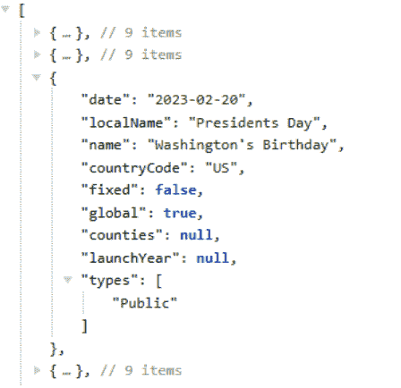
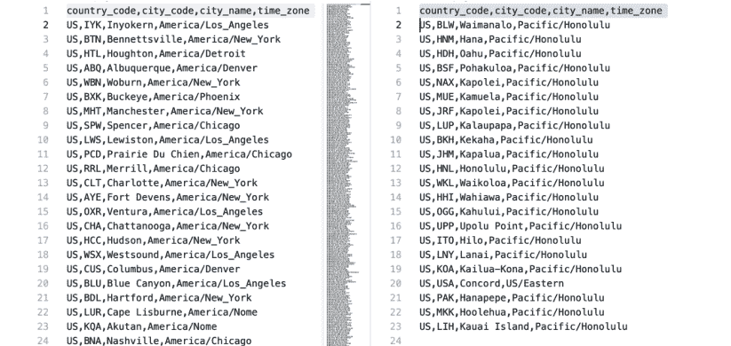

# Data Extraction Using Web APIs

到目前为止，我们已在本書的各章中学习了网络、基于网络的技术、定位和提取数据的技术，以及大量数据相关服务。

Web **应用程序编程接口**（APIs）旨在与查询信息进行交互。Web API 提供接口来查询和访问格式化的數據（通常为 JSON 格式）或易于使用和处理的結構化數據。根据所携带的信息类型（例如 HTTP POST 负载、JSON 内容、第三方认证、集合元数据或中间件）和所涉及的服务类型，通常还需要认证和某种形式的令牌化。

总体而言，Web API 是加载、查找、传输和嵌入页面或其他 API 中的信息的媒介。

在本章中，我们将学习以下主题：

- Introduction to web APIs
- Data formats and patterns in APIs
- Web scraping using APIs

# Technical requirements

需要一个网络浏览器（*Google Chrome* 或 *Mozilla Firefox*），我们将使用 *JupyterLab* 进行 Python 编码。

请参阅 *Chapter 2* 中的 *Setting things up* 和 *Creating a virtual environment* 部分，以继续设置和使用我们创建的环境。

本章所需的 Python 库如下：

- `requests`
- `csv`

本章的代码文件可在本书的 GitHub 仓库在线获取：https://github.com/PacktPublishing/Hands-On-Web-Scraping-with-Python-Second-Edition/tree/main/Chapter07。

# Introduction to web APIs

信息共享和处理在网络和基于网络的服务中需求巨大。Web API 是网络上提供对资源（如原始数据、过滤信息以及嵌入式和动态内容）访问的服务，通常以 JSON、CSV 或 XML 等即用型和可交换格式提供。

信息交换或传输是 Web API 的核心目的。我们可以将 API 视为基于网络或浏览器的服务或 **用户界面（UI）**，用于根据对 Web 服务器或 API 提供商的请求检索、共享或访问信息。鉴于存在大量与安全相关的漏洞，许多提供商要求以 *API 密钥*（用于识别用户或客户端与 API 或服务器的唯一标识块，具有特定长度）或某些代码的形式进行认证，以使 API 处理更高效、更有效。

Web API 不依赖于任何单一编程语言（如 ASP、PHP 或 JSP）；用户和开发人员可以使用任何工具或语言从 API 读取数据并将其复制到其系统或平台中。数据收集和交换，即使是大量数据，也已通过 API 的使用成为可能，并且 API 在需要时也包含一些安全措施。网络上找到的许多 API 提供商将其 API 作为 **软件即服务（SaaS）** 和 **产品即服务（PaaS）** 提供给其客户。

**重要说明**
作为开发人员和数据收集者，我们应始终分析网络链接（使用 DevTools）以查找任何可能的 API 或其他相关链接（如果有）。如果我们使用 DevTools，与使用 regex、PyQuery、lxml 等处理 HTML 代码相比，抓取活动会变得相当容易和快速。

在使用 DevTools 进行抓取时，可能需要处理一些代码级处理（例如 HTTP 请求），例如 HTTP 头、HTTP 方法以及使用代理设置请求。

市场上用于网络相关服务和产品的 Web API 数量已大幅增长。产品和服务用户通常会提供 API 令牌和 API 密钥，并且他们可以为其任务使用 API（银行、获取日志、HTTP 请求分析、Web 流量分析、访问 HTTP


状态代码日志、客户支持以及访问联系我们和网站地图页面、经销商列表等。API数量的增长推动了移动应用系统的发展。许多服务提供商在其移动或相关系统中使用API，并使用API中的内容创建或生成各种类型的消息，并在其移动应用中显示生成的这些信息。

从用户角度来看，如果用户只是在寻求信息，API就是巨大的缓解，因为用户不必学习复杂的系统或编程语言。服务提供商会提供API链接，可用于实时加载和查看结果，并按需使用。

API扩展了基于浏览器的功能和数据服务的可能用途。在下一节中，我们将简要讨论API类型。

## API类型

Web API在通过浏览器正常使用时，会接受一些输入、授权凭据或密钥，以及现有密钥或键值对的信息。生成的API结果显示数据，甚至将数据传输或交换到配置的系统。开发人员还可以扩展Web API的功能和特性，根据需要集成必要的逻辑。

基于*作为服务的网络*，API可分为四种不同类型：

- **公共API**：这是网络上最常见的API类型。这些API是网站为其客户和用户提供的服务。它们以服务为导向，用于信息交换。网络上有很多免费的公共API，与Twitter、天气预报、股市、NBA比赛等有关，还有很多。此外，网络上大多数免费API对每个IP地址或机器，或时间都有使用限制。

- **合作伙伴API**：这是一种受限的公共API类型。服务提供商允许其已批准的客户或注册用户基于授权、付费服务和需求使用此API。服务提供商提供API密钥或凭据，客户端在使用API时必须使用该密钥或凭据。

- **私有或内部API**：这些API用于内部、公司或组织目的。它们也被称为内部API，并为员工和员工提供组织功能，如日历、**人力资源(HR)**、休假管理、通知等。

- **复合API**：也称为统一API，这些API将一个系统中的多个不同API合并在一起。系统中可能实现了特定任务的API，需要按特定顺序实现为一个流程（即一个API的输出成为另一个API的输入）；在这种情况下，统一API非常有用。客户端访问复合API时，不确定内容来自何处，因为这种类型的API可能会出现重定向和时间相关问题。

API按请求提供数据和执行服务。在基于Web的通信*协议和设计架构*场景中，它们可分为两种类型：

- **REST：**最常见和流行的API架构，**表述性状态转移(REST)**。它是无状态的（请求之间不存储数据），支持缓存，并且被认为安全。它使用标准的HTTP方法（GET/POST）提供未公开的服务。HTTP状态代码会被跟踪，也可作为响应提供。它支持各种响应格式，如JSON、XML和CSV。使用HTTP时不需要外部库支持。*RESTful*（这是Web服务的REST API的称呼）API为用户和资源之间的通信提供接口；许多公共API是RESTful的。在大多数情况下，REST API执行**创建、检索、更新**和**删除(CRUD)**活动。

- **SOAP：简单对象访问协议(SOAP)**通常是Web的消息协议。它支持Web上的各种其他协议，如HTTP、**简单邮件传输协议(SMTP)、远程过程调用(RPC)**和**传输控制协议/互联网协议(TCP/IP)**，以在Web上交换或共享信息。SOAP独立于平台和编程语言。SOAP因其功能驱动方法、严格规则、结构和受控标准而在分布式企业环境中很受欢迎。SOAP支持XML作为消息服务，被称为基于XML的协议。HTTP POST方法用于信息交换，并且也被开发人员认为难以使用。

我们现在已经根据其架构和集成的服务研究了不同类型的API。随着对数据的需求不断增长，Web API因其在多样化Web系统、应用程序和用户中的适用性和使用而已被广泛使用。

> **重要说明**
> 
> 有关Web API、REST和SOAP的更多信息，请访问以下网址：https://www.w3.org/api/、https://www.w3.org/TR/soap/、https://restfulapi.net/、https://www.ics.uci.edu/~fielding/pubs/dissertation/rest_arch_style.htm、和https://www.altexsoft.com/blog/engineering/。

在下一节中，我们将从数据收集的角度讨论Web API的优点和局限性。

## Web API的优点

尽管Web API并不是Web抓取的解决方案，但API是可用于检索数据的一种首选且最广泛搜索的数据源。API不仅处理Web查询（带参数的URL）；它们还显示已请求的信息。

我们可以将API作为信息源、转换器或交换器、查询引擎、内部Web系统以及数据通信所需的大量其他形式和格式来访问。我们只需要Web浏览器、API访问权限和API的URL即可开始。随着开发人员和用户的需求不断增长，Web API正在部署，或被直接或间接使用。

- **验证**：API检索的数据可能需要验证和校验。通常，API内容不会显示返回数据的日期或期间，尽管它被认为提供最新信息。
- **限制**：API可以过滤和查询其输出，但它们返回的资源有限。API可能每页返回20个结果，但总共只有100个。API不是Web相关内容的替代品。此外，API支持的参数可能有限，这反过来限制了预期结果。
- **无关数据**：API返回的数据可能与您的目的不完全匹配。可能存在大量无关数据，需要额外的清理和过滤。
- **不完整数据**：API返回的数据可能满足您抓取需求中的一些，但可能无法完全或准确地满足期望或要求。例如，电子商务数据的基本信息可能存在，但详细的信息可能无法通过API获得，因此可能需要爬取单个产品URL。跨类别和多页面可用的API的数据收集可能很繁琐。

在这些利弊之下，API的使用在互联网上不断增长。各种网站允许或使用基于API的数据通信。从Web抓取的角度来看，API可能满足某些数据需求，但不完全满足。可用数据可能有所帮助，可用于应对JSON类型格式数据的紧急需求，甚至可用于检查目的。

> **重要说明**
> Web API不是Web抓取的替代品。它们确实提供及时支持和各种过滤器。此外，如果我们找到隐藏的API链接，我们可以直接访问数据。

在下一节中，我们将了解如何使用API，使用不同参数加载请求，并探索API的格式、URL等。

## API中的数据格式和模式

通过API可用的数据可能与您预期不同，或可能不完全符合计划——在*Web API的优点*部分，我们涵盖了数据可能不同的几种方式（限制、无关性等）。

从API获取数据是一个直接的过程，有或没有API授权。通过API接收的内容可能以多种格式出现，如键名、嵌套列表和字典、命名或数字索引块等。我们通常发现API内容以JSON格式出现，由Python列表和字典组成。

在进入API或API内容的数据格式、模式和结果之前，重要的是演示API如何被调用或使用。大多数时候，API服务提供商会保持更新


他们文档中的 API 版本。以下是 Web 用户通常用来从 API 访问数据的一些示例（示例 URL：exampledomain.com）：

- http://api.exampledomain.com
- https://api.exampledomain.com/resource?key1=value1
- https://demo.exampledomain.com/api/v1/holidays/2023
- https://api.exampledomain.com?query=somevalue&limit=10&sort=asc
- http://content.exampledomain.com/search?key=value&key_a=value_a&fields=field1,field2,field3
- https://api.exampledomain.com?start=0&end=10&step=2
- https://api.exampledomain.com/find?apiKey=somevalue&key1=value1&format=json
- https://api.sunrise-sunset.org/json?lat=36.7201600&lng=-4.4203400&date=today
- https://api.sunrise-sunset.org/json?lat=36.7201600&lng=-4.4203400&formatted=0

以下是上述示例 URL 列表中的几点提示：

- 可以找到各种类型的 URL，它们看起来像 API 链接。
- 使用 Key=value 参数来更具体地过滤数据。如果提供了不想要的 key 和 value 组合，API 将返回错误消息或空模式。
- 可以使用各种 HTTP 方法（GET/POST/PUT 等）来加载 URL。HTTP GET 方法是访问 URL 的默认方法。

通过对可能的 API URL 格式的简要概述，让我们探索以下示例中的一些示例及其响应。

## 示例 1 – 日出和日落

https://sunrise-sunset.org/api 提供了一个 REST API，根据提供的地理坐标返回日出和日落时间。API 支持 GET HTTP 方法以及坐标和其他一些参数。

例如，https://api.sunrise-sunset.org/json?lat=36.7201600&lng=-4.4203400 为 lat（纬度）和 lng（经度）提供了值。此请求会产生 JSON 内容，如图 7.1 所示：

```
{
  "results": {
    "sunrise": "6:26:01 AM",
    "sunset": "6:26:43 PM",
    "solar_noon": "12:26:22 PM",
    "day_length": "12:00:42",
    "civil_twilight_begin": "6:01:34 AM",
    "civil_twilight_end": "6:51:10 PM",
    "nautical_twilight_begin": "5:31:31 AM",
    "nautical_twilight_end": "7:21:13 PM",
    "astronomical_twilight_begin": "5:01:11 AM",
    "astronomical_twilight_end": "7:51:33 PM"
  },
  "status": "OK"
}
```

图 7.1：API 结果（日出-日落）

响应，如图 7.1 所示，可用两个键访问：results 和 status。

## 示例 2 – GitHub 表情符号

https://api.github.com/emojis 提供可在 GitHub 评论和内容中使用的表情符号列表。总共有 1,876 个项目；我们可以在图 7.2 中看到其中一些：

```
{
  "100": "https://github.githubassets.com/images/icons/emoji/unicode/1f4af.png?v8",
  "1234": "https://github.githubassets.com/images/icons/emoji/unicode/1f522.png?v8",
  "+1": "https://github.githubassets.com/images/icons/emoji/unicode/1f44d.png?v8",
  "-1": "https://github.githubassets.com/images/icons/emoji/unicode/1f44e.png?v8",
  "1st_place_medal": "https://github.githubassets.com/images/icons/emoji/unicode/1f947.png?v8",
  "2nd_place_medal": "https://github.githubassets.com/images/icons/emoji/unicode/1f948.png?v8",
  "3rd_place_medal": "https://github.githubassets.com/images/icons/emoji/unicode/1f949.png?v8",
  "8ball": "https://github.githubassets.com/images/icons/emoji/unicode/1f3b1.png?v8",
  "a": "https://github.githubassets.com/images/icons/emoji/unicode/1f170.png?v8",
  "ab": "https://github.githubassets.com/images/icons/emoji/unicode/1f18e.png?v8",
  "abacus": "https://github.githubassets.com/images/icons/emoji/unicode/1f9ee.png?v8",
  "abc": "https://github.githubassets.com/images/icons/emoji/unicode/1f524.png?v8",
  "abcd": "https://github.githubassets.com/images/icons/emoji/unicode/1f521.png?v8"
}
```

图 7.2：GitHub 表情符号

如图所示，API 结果为 JSON 格式。每个实体都是一个不同的 key:value 对。API 没有嵌套或数组结果。

## 示例 3 – Open Library

https://openlibrary.org/search.json?q=python&author=Wes 使用两个参数提供已过滤的数据：q=python 和 author=Wes。我们正在查询 python 文本，作者的姓名为 Wes 或包含文本 Wes。Open Library 是一个实验性搜索 API（https://openlibrary.org/dev/docs/api/search）。我们可以看到，在此示例中 URL 中没有提到术语 API。URL 看起来像是一个带有一些 GET 参数的常规 HTTP GET 请求。

图 7.3 显示了结果，总计 11 个。每个结果都是 docs 块中发现的可能数组的元素。docs 中还有多个 key:value 对以及一些列表和数组实体，其中包含其中的一些项目。

```
{
  "numFound": 11,
  "start": 0,
  "numFoundExact": true,
  "docs": [
    {
      "key": "/works/OL17422847W",
      "type": "work",
      "seed": [...], // 10 items
      "title": "Python For Data Analysis",
      "title_suggest": "Python For Data Analysis",
      "title_sort": "Python For Data Analysis",
      "edition_count": 4,
      "edition_key": [...], // 4 items
      "publish_date": [...], // 3 items
      "publish_year": [...], // 2 items
      "first_publish_year": 2012,
      "number_of_pages_median": 550,
      "lccn": [...], // 1 item
      "oclc": [...], // 2 items
      "lcc": [...], // 2 items
      "isbn": [...], // 8 items
    }
  ]
}
```

图 7.3：Open Library API

### 重要说明

开发人员或用户应该打开或继续调查浏览器的 DevTools 并打开 Network 面板，以获取 HTTP 方法、HTTP 头、cookie、内容类型等内容和信息，以查看是否可以找到任何 API 链接。某些基于 Web 的逻辑用于生成内容时，后面也可能会使用多个 API。

在本节中，我们探索了通过 API 找到的各种类型的数据。嵌套的、非嵌套的、key:value 对以及组合输出通常是 Web API 的预期结果。除此之外，API 相关链接也很难找到，除非网站提供它们，否则 robots.txt 和 sitemap.xml 以及 DevTools 就需要彻底调查。

在下一节中，我们将使用一些可自由使用的 Web API。我们将使用 Python 来抓取其内容。

## 使用 API 进行 Web 抓取

从技术上讲，从 API 获取数据很容易，也与 Web 抓取场景不同。大多数数据为 JSON 格式，不使用 XPath、CSS Selector 或任何其他解析库。某些使用 API 找到的数据可能包含大量 HTML 代码。要处理此内容，可能需要 XPath 和 CSS Selector。

### 重要说明

本节中的示例中，我们尝试省略需要 API 密钥（walmartlabs.com、nasa.gov、nytimes.com、maps.googleapis.com）或用户身份验证工具的 API。API 密钥是由服务提供商（用户注册后）提供的经过身份验证的值，用于识别使用 API 的用户。这些示例中使用的是可自由使用的 API。

借助一些示例，我们将收集通过某些 API 返回的数据。然后将收集到的数据导出为 JSON 和 CSV 文件。

## 示例 1 – 美国日历中的假日

https://date.nager.at/ 包含有关全球公共假期的信息。https://date.nager.at/PublicHoliday/Country/US 显示美国公共假期的列表。可用于抓取的表格数据可用，但我们将使用 https://date.nager.at/api/v3/PublicHolidays/2023/US API 获取 2023 年的假日。

以下代码声明 apiUrl，其中包含内容 URL：

```
apiUrl= "https://date.nager.at/api/v3/PublicHolidays/2023/US"
headers= {          # HTTP Request Header
'accept':'text/html,application/xhtml+xml,application/xml;q=0.9,image/avif, image/webp,image/apng,*/*;q=0.8,application/signed-exchange;v=b3;q=0.7',
'accept-language': 'en-US,en;q=0.9',
'cache-control':'max-age=0',
'upgrade-insecure-requests':'1',
'user-agent': 'Mozilla/5.0 (Windows NT 10.0; Win64; x64) AppleWebKit/537.36 (KHTML, like Gecko) Chrome/111.0.0.0 Safari/537.36'
}
response = requests.get(apiUrl, headers=headers).json()
```


响应是通过 requests 库中的 `json()` 函数收集的。HTTP 请求头，`headers`，也提供给 `requests.get()`。请求头实体或 headers 已通过 DevTools 中的 **Copy | Copy as cUrl (bash)** 收集。

如 *Figure 7.4* 所示，`apiUrl` 以 JSON 格式返回 HTTP 响应。为了处理 JSON 内容，requests 库有一个名为 `json()` 的方法（它完成了 JSON 内容的加载和转储，因此无需导入 json Python 库）用于处理 JSON 内容。



Figure 7.4: JSON response from the API

JSON 响应看起来简洁明了，易于处理。已决定仅从所有 JSON 列表中收集 `date` 和 `name`。

以下代码块显示 `date` 和 `name` 条目正被收集到 lists 收集器中：

```
```python
lists=[]                 # empty list
for holiday in response:
    lists.append([holiday['date'],holiday['name']])

lists                     # final list
writeto_csv(lists,'holidays.csv',['Date','Name'])       # Export to CSV
```
```

最后，`lists` 使用预定义的 `writeto_csv()` 函数导出到名为 `holidays.csv` 的文件，其中列标题为 Date 和 Name。

## Example 2 – Open Library book details

Open Library (https://openlibrary.org/developers/api) 提供了一个实验性搜索 API。它为其书籍和类似内容的集合提供了各种 API 相关选项。对于本示例，将使用 https://openlibrary.org/dev/docs/api/search 来查找主题为 python 且作者为 Wes 的书籍数据（结果可通过 https://openlibrary.org/search.json?q=python&author=Wes 获取）。

如以下代码所定义，apiUrl 在 openlibrary.org 中搜索定义的 subject 和 author 变量。apiUrl 的响应为 JSON 格式，但结构嵌套。对 apiUrl 的 HTTP 请求连同几个选定的 HTTP 头一起处理。`json()` 方法和 `requests.get()` 显示内容为 JSON 格式：

```
subject="python"
author="Wes"
apiUrl="https://openlibrary.org/search.json?q="+subject+"&author="+author

headers={
'Upgrade-Insecure-Requests': '1',
'User-Agent': 'Mozilla/5.0 (Windows NT 10.0; Win64; x64) AppleWebKit/537.36 (KHTML, like Gecko) Chrome/111.0.0.0 Safari/537.36'
}
response = requests.get(apiUrl, headers=headers).json()
```

有关书籍的信息提供在各种索引、标题或键下，位于 response['docs'] 内部。字段如 'book_title'、'published_date'、'publisher'、'author' 和 'subjects' 的值（如果可用）被收集到名为 lists 的列表中：

```
lists=[]  # Collector
for book in response['docs']:
    if 'subject_key' in book: # check if subject_key exists
        lists.append([book['title'],
        book['publish_date'][0],
        book['publisher'][0],
        book['author_name'][0],
        "|".join(book['subject_key'])])
    else:
        lists.append([book['title'],
        book['publish_date'][0], book['publisher'][0],
        book['author_name'][0], ''])
```

收集完所有值后，数据随后写入 CSV 文件 python_wes.csv：

```
writeto_csv(
    lists,
    'python_wes.csv',
    ['book_title', 'published_date', 'publisher', 'author', 'subjects']
)
```

收集的数据显示在 Figure 7.5 中：

| book_title | published_date | publisher | author | subjects |
|---|---|---|---|---|
| Python For Data Analysis | Oct 04, 2022 | O'Reilly Media, Incor... | Wes McKinney | data_mining|programming... |
| Python Programming f... | 2019 | Independently Publis... | Jason Wes | |
| Python for Data Analysis | 2019 | Independently Publis... | Clark Wes | |
| Python for Data Analysis | 2012 | O'Reilly Media, Incor... | Wes McKinney | |
| Python for Data Science | 2019 | Independently Publis... | Jason Wes | |
| Python Programming L... | 2019 | Independently Publis... | Clark Wes | |
| Python Para Análise d... | Sep 07, 2000 | Novatec | Wes McKinney | |
| Genuine _ use Python ... | Jan 01, 2014 | Machinery Industry P... | MAI JIN NI (Wes McK... | |
| Python Programming f... | 2019 | Independently Publis... | Tony Wes | |
| Python for Data Analys... | Oct 20, 2017 | O'Reilly Media, Inc. | Wes McKinney | computers|data_mining|da... |
| Python for Data Analysis | 2019 | Independently Publis... | Tony Wes | |

Figure 7.5: Book details from the search API

尽管 publish_date、publisher 和 author_name 有多个值，但只收集找到的第一个数据。本示例中使用的 API 包含许多嵌套且相似的数据块。开发者有责任决定捕获哪些元素。

## Example 3 – US cities and time zones

在本示例中，我们使用免费的 https://api.travelpayouts.com/data/en/cities.json API。该 URL 包含全球城市及其坐标、国家和城市代码以及时区。API 的数据为 JSON 格式，转换为 Python dict 对象列表。有超过 9,000 条记录。

从全球记录中，我们只对美国的详细信息感兴趣。此外，经过简要分析，你会注意到美国城市存在不同的时区，因此我们将数据收集到两个数据集中。zone_america 数据集包含时区包含单词 America 的记录，而 zone_not_america 数据集包含时区不包含单词 America 的城市记录，如以下代码块所示：

```
apiUrl="https://api.travelpayouts.com/data/en/cities.json
response = requests.get(apiUrl).json() # Load API
zone_america=[] # time zone like "America"
zone_not_america=[] # time zone without word "America"
for info in response:
    if info['country_code']=="US" and "America" in
    info['time_zone']:
        zone_america.append([info['country_code'],
        info['code'],info['name'],info['time_zone']])

    if info['country_code']=="US" and "America" not in
    info['time_zone']:
        zone_not_america.append([info['country_code'],
        info['code'],info['name'],info['time_zone']])
```

根据前述代码中实现的条件，从迭代中收集数据。数据写入 zone_america.csv 和 zone_not_america.csv 文件：

```
# Write collected data to CSV
writeto_csv(zone_america,'america_timezone.csv',['country_code','city_code','city_name','time_zone'])
writeto_csv(zone_not_america,'not_america_timezone.csv',['country_code','city_code','city_name','time_zone'])
```

收集的数据显示在 Figure 7.6 中：



Figure 7.6: US – time zones with city names and codes

在本示例中，我们过滤 API 结果仅返回美国的城市，并按时区文本是否包含单词 America 进行过滤。将所需数据收集到 CSV 文件后，进行数据分析任务和数据可视化会容易得多。

## Summary

Web APIs 为查找和抓取数据提供了许多好处。由于 API 返回的数据具有预定义格式，你无需使用 XPath 或 CSS 选择器执行额外的查询相关任务，从而节省时间。Web API 结构化、易于访问、可过滤，并且可随时在机器、平台和协议之间交换数据。

在下一章中，我们将学习使用 Selenium 进行自动化，并用它来抓取数据。

## Further reading

- APIs:
  - https://restfulapi.net/
  - https://developer.mozilla.org/en-US/docs/Web/API
  - https://auth0.com/blog/developing-restful-apis-with-python-and-flask/
- JSON:
  - https://www.json.org/json-en.html
  - https://developer.mozilla.org/en-US/docs/Learn/JavaScript/Objects/JSON
- HTTP methods: https://developer.mozilla.org/en-US/docs/Web/HTTP/Methods
- SOAP: https://www.soapui.org/learn/api/soap-vs-rest-api/
- REST:
  - https://www.ibm.com/topics/rest-apis
  - https://pythonbasics.org/flask-rest-api/


