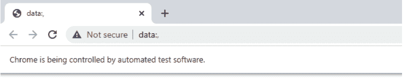
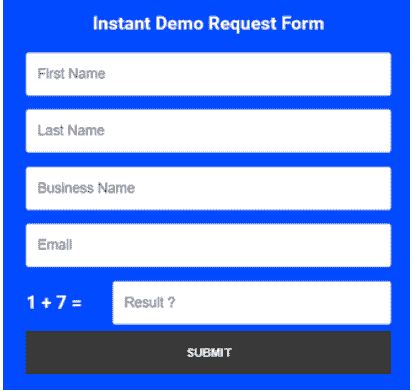

## 使用 Selenium 进行网络爬取

到目前为止，我们在第 1 章到第 7 章中学习了一些 Python 库、Web 和基于 API 的技术、数据查找与元素定位、提取技术以及大量与数据相关的服务。

Selenium 可以自动化浏览器——这句话引自 https://www.selenium.dev/，它主要是一组工具的集合，也被称为测试框架。Selenium 用于自动化 Web（应用程序、网站表单等）以达到测试目的。除了使用自动化进行测试外，还有许多潜在的服务和基于任务的场景可以通过 Selenium 来执行和处理。Selenium 框架由各种模块或组件组成。我们将使用 Selenium WebDriver。

总的来说，我们将安装并学习 Selenium WebDriver，使用 WebDriver 自动化网站，并使用 Selenium 从 Web 上抓取数据。

在本章中，我们将涵盖以下主题：
- Selenium 简介
- 使用 Selenium WebDriver
- 使用 Selenium 进行抓取

### 技术要求

你需要一个网页浏览器（Google Chrome 或 Mozilla Firefox），我们将使用 JupyterLab 来运行 Python 代码。

请参阅第 2 章的“环境设置”和“创建虚拟环境”部分，继续设置和使用所创建的环境。我们将使用 Google Chrome 和 Selenium WebDriver v4.10.0。

要安装 `selenium` Python 库，以下链接会很有帮助：
- `https://selenium-python.readthedocs.io/installation.html`
- `https://www.selenium.dev/documentation/webdriver/getting_started/install_library/`
- `https://pypi.org/project/selenium/`

本章需要以下 Python 库：
- `requests`
- `selenium`
- `re`
- `csv`
- `json`

本章的代码文件可在本书的 GitHub 仓库中在线获取：`https://github.com/PacktPublishing/Hands-On-Web-Scraping-with-Python-Second-Edition/tree/main/Chapter08`。

### Selenium 简介

根据**系统开发生命周期（SDLC）**，对基于 Web 的应用程序或系统进行测试是强制性的，这一步骤在应用程序于 Web 上发布之前完成。Selenium 是一个开源项目，它以网页浏览器作为自动化的接口，可用于与 Web 相关或基于 Web 的活动。

使用 JavaScript（JS）、Cookie/会话、其他 JS 脚本以及许多其他 Web 组件的动态和安全 Web 应用程序，都可以借助 Selenium 进行处理、加工、自动化和爬取。*Selenium 是一个包含多种工具和库的综合性项目，用于支持和实现网页浏览器的自动化。*（`https://www.selenium.dev/documentation/overview/`）。虽然它主要用于基于浏览器的自动化，但凡是可以在浏览器中管理或使用的不同场景，都可以通过 Selenium 来解决。这使得 Selenium 成为最受欢迎且备受赞誉的基于浏览器的自动化工具。

Selenium 主要用于 Web 测试。在接下来的章节中，我们将探讨 Selenium 的优点和用法，以及如何将其用于网络爬取。

### Selenium 的优点与缺点

Selenium 通过其组件之一 WebDriver 支持不同的网页浏览器。有许多优点使 Selenium 广受欢迎，其中包括：
- 易于实现
- 支持跨浏览器
- 开源且免费
- 支持并行测试
- 支持多种**操作系统（OS）**
- 支持多种语言（Java、Python、Ruby、PHP 等）
- 拥有大量可用的文档和资源
- 支持远程服务器和云设备

在应用程序测试中使用和实现 Selenium 有很多优势，但也存在一些限制或缺点：
- 处理多个标签页和框架较为复杂
- 执行速度较慢（取决于机器）

尽管 Selenium 提供了大量的优势和可扩展性，但与其一些竞争对手（**Playwright**、**Puppeteer**）相比，它在处理速度上较慢，而且其巨大的内存消耗仍然是一个值得争论的问题，这一话题常在 Web 相关的小组和社区中讨论。

> **重要提示**
> 有关一些精选自动化库和框架的更多详细信息，请参阅 Selenium https://www.selenium.dev/about/、Puppeteer https://pptr.dev/ 和 Playwright https://playwright.dev/。

### Selenium 的使用场景

Selenium 在项目中有许多使用场景。从网络爬取的角度来看，Selenium 既可用于普通场景，也可用于复杂场景。对于普通的抓取场景，我们完全可以使用前面在第 *2 章到第 7 章* 中学到的其他库和技术。

Selenium 用于 Web 上的自动化和测试。在特定情况下，或者当其他库和技术无法完成抓取时，通常会优先选择使用 Selenium（很多时候甚至是最后的选择）。以下是可能需要使用 Selenium 完成抓取任务的一些情况：
- 处理警报、iframe 和弹窗（有时间限制的）
- 收集和使用 Cookie 与会话
- 处理滚动和点击活动（以应对网站上的反机器人措施）
- 处理基于 JavaScript 的网站（具有动态值或动态元素的网站）
- 获取屏幕截图
- 使用无头模式（减少资源消耗）
- 绕过基本身份验证（隐藏或动态值）
- 处理 HTML 表单
- 执行和注入 JavaScript 代码
- 在页面上模拟人类操作

Selenium 是一个框架，或者说是一组基于任务的模块（库）的集合。我们将在下一节介绍这些模块。

### Selenium 的组件

基于 Web 的应用程序测试在开发周期的各个阶段都会进行，甚至会进行多次。这种类型的测试确保开发符合需求或按计划推进。它还有助于发现任何可能的缺陷或错误，并克服或记录它们。

通常，测试是手动（由用户）和/或使用自动化工具（如 Selenium）完成的。自动化测试和验证任务是应用程序生命周期的核心组成部分之一。Selenium 由以下三个主要组件或项目组成（https://www.selenium.dev/projects/）：
- **Selenium WebDriver**：这是一个面向对象（OO）的 API，也是用于自动化浏览器的主要组件之一。浏览器自动化是通过借助内置 API 和其他语言（Java、PHP 和 Python）向第三方浏览器驱动程序（如 Google Chrome、Mozilla 和 Opera）提供命令来实现的。**WebDriver** 允许程序或脚本以原生方式访问浏览器，就像用户操作一样。对于与抓取相关的任务，我们通常会与 WebDriver 打交道，我们将在“使用 Selenium WebDriver”部分探讨其功能。有关 WebDriver 的更多详细信息，请访问此链接：https://www.selenium.dev/documentation/webdriver/。
- **Selenium IDE**：这是一个即装即用的浏览器扩展，也被称为 Selenium 的**用户界面（UI）**，用于记录用户在浏览器中的操作。IDE 还提供了一个功能，可以回放已记录的操作，同时包含所部署的命令和带值的已定义参数。它还具有调试功能，如设置断点、通过 IDE 处理异常、创建可运行命令的脚本以及支持控制流结构。此扩展适用于 Google Chrome 和 Mozilla Firefox。有关 Selenium IDE 的更多详细信息，请访问此链接：https://www.selenium.dev/documentation/ide/。
- **Selenium Grid**：这允许跨多台机器、多种浏览器以及跨平台执行测试或自动化操作。Grid 还支持基于组件的配置，可部署在多台机器或平台上。基本上，Selenium Grid 支持分布式测试。这有助于缩短测试时间，并行识别不同系统的性能问题。有关 Selenium Grid 的更多详细信息，请访问此链接：https://www.selenium.dev/documentation/grid/。

通过以上对 Selenium 的简要概述和介绍，我们将在下一节中安装 Selenium WebDriver，并通过代码和示例进行探索。

### 使用 Selenium WebDriver

Selenium 用于浏览器自动化，其重要组件之一 WebDriver 是访问浏览器的核心工具。WebDriver 为选定的浏览器实现了自动化过程中所需的代码逻辑。它也是将 Selenium 框架与浏览器绑定在一起的核心系统，通常被称为 **Selenium 驱动** 或简称为 **driver**。更详细的信息，请访问此链接：https://www.selenium.dev/documentation/webdriver/getting_started/。

在深入了解自动化或使用该框架之前，让我们先在下一节安装所需的库。

### 环境设置

要使用 Python 和 Selenium WebDriver 探索浏览器自动化，首先需要安装 `selenium` 库（一个 Python 库）以及与浏览器相关的驱动程序。

> **重要提示**
> Selenium 是一个包含 WebDriver 等各类组件的框架，而 `selenium` 是一个 Python 库（https://www.selenium.dev/documentation/webdriver/getting_started/install_library/），我们使用它来编写和维护绑定 WebDriver 与所选浏览器的代码和逻辑。


让我们先验证 selenium 库的设置：

```
import selenium
selenium.__version__    # 4.10.0
selenium.__spec__
ModuleSpec(name='selenium',..... submodule_search_locations=['C:\\HOWScraping2E\\secondEd\\Lib\\site-packages\\selenium'])
```

此代码块显示 Python selenium 库版本 4.10.0 已成功安装在我们的目标环境中（请参阅第 2 章的 Setting things up 和 Creating a virtual environment 部分）。

在验证 Python 库之后，我们将在下一节中安装驱动程序（浏览器驱动程序）。

## 安装驱动程序

在安装浏览器驱动程序之前，识别系统规范是必不可少的。为本书的目的，我们将使用 Windows 操作系统并选择 Google Chrome 作为我们的浏览器驱动程序。

> **重要说明**
> Selenium 支持多种网络浏览器，例如 Firefox、Internet Explorer、Safari、Chrome 等。如果您使用 Firefox，请访问 https://firefox-source-docs.mozilla.org/testing/geckodriver/Support.html 链接以获取有关设置的更多详细信息。

让我们按照以下几个步骤为 Google Chrome 设置驱动程序：

- 1. 访问 https://www.selenium.dev/downloads/ 并进入 Selenium 支持的平台部分。
- 2. 现在进入 Browsers | Chrome 选项。文档链接到 https://chromedriver.chromium.org/ 应该可用。
- 3. 点击 ChromeDriver Documentation 选项下带有 Getting started with ChromeDriver on Desktop 文本的链接。
  
点击链接后，您将被带到 https://chromedriver.chromium.org/getting-started 页面。
- 4. 在 Setup 部分，有一个 Downloads 链接。点击 Downloads 文本将把您路由到 https://chromedriver.chromium.org/downloads URL。
- 5. 进入 https://chromedriver.chromium.org/downloads URL，并点击带有 ChromeDriver 111.0.5563.64 文本的链接，如图 8.1 所示：

- 8. 根据操作系统（就我们而言是 Windows 操作系统），选择 chromedriver，如图 8.2 所示，并下载它。

- 9. 成功下载压缩文件（chromedriver_win32.zip）后，可以将其解压或将内容（chromedriver.exe）提取到项目根文件夹或任何适当的位置。chromedriver.exe 的路径可以设置在变量中并用于开发代码。

> **重要说明**
> 使用 selenium 安装和访问 chromedriver 有多种方法。请按照提供的链接获取更详细的信息：https://selenium-python.readthedocs.io/installation.html 和 https://www.selenium.dev/documentation/webdriver/getting_started/install_drivers/。如果尝试或测试任何不同的浏览器，也可以遵循类似的步骤。

完成与设置相关的步骤后，在下一节中，我们将借助代码示例验证设置。

## 验证设置

在设置阶段，我们必须访问和处理一些链接，下载文件等等。为了验证设置并确认驱动程序运行正常，让我们部署加载 https://www.python.org URL 到浏览器（Chrome）中的代码，借助 selenium 和 chromedriver：

```
from selenium import webdriver
from selenium.webdriver.chrome.service import Service
chromedriver_path="C:\HOWScraping2E\driver\chromedriver.exe"    # path
service = Service(service=chromedriver_path)
driver = webdriver.Chrome(service=service)
# initiate an empty Chrome window
driver.get('https://www.python.org')  # loads URL in browser
driver.quit() # closes browser & terminates the session
```

在此代码块中，我们首先导入了 webdriver 然后导入了 Service。selenium.webdriver 由各种工具和类组成。Service 是来自 webdriver.chrome.service 的类之一。Service 主要与基于浏览器的功能和函数相关联。chromedriver.exe 的路径（位置）很重要，必须提供给 service。

> **重要说明**
> 
> Selenium 的早期版本可以接受 `chromedriver.exe` 的路径作为 executable_path 属性。executable_path 属性现已弃用。现在，Chrome() 需要一个作为 Service 对象的路径。

`driver = webdriver.Chrome(service=service)` 创建一个新会话并显示一个空的浏览器窗口，如 *图 8.3* 所示：



图 8.3：Chrome 的空浏览器窗口

总是在顶部有一个警报消息，包含文本 **Chrome is being controlled by automated test software**，如 *图 8.3* 所示。该文本传达 Selenium WebDriver 正在工作，并且 Chrome 正被自动化相关软件使用。

通常，到目前为止的步骤可以被视为在机器上加载网络浏览器。`driver.get('https://www.python.org')` 代码加载 URL（就像用户在浏览器中输入 URL 一样）。`get()` 方法接受 URL 并将其传递给驱动程序，几乎就像 HTTP 请求一样。最后，`driver.quit()` 代码关闭加载了 `https://www.python.org` 的浏览器窗口并终止驱动程序会话。

在下一节中，我们将更详细地探索 `selenium.webdriver` 和 selenium 库，并附带示例。

## 探索 Selenium

一旦 Selenium WebDriver 成功安装并正常工作，就可以使用自动化完成大量活动。我们将探索一些基本的事情，并深入研究将自动化作为解决问题方案的使用，同时附带代码示例。

> **重要说明**
> 
> 有关更多详细信息和解释性文档，请访问 `https://www.selenium.dev/documentation/webdriver/` 和 `https://selenium-python.readthedocs.io/getting-started.html`。

## 基本探索

在以下代码示例中，我们将了解使用 Selenium 进行的一些基本活动，这些活动通常是优先任务：

```
from selenium import webdriver
from selenium.webdriver.chrome.service import Service
chromedriver_path="C:\HOWScraping2E\driver\chromedriver.exe"
service = Service(service=chromedriver_path)
driver = webdriver.Chrome(service=service)
# chromedriver
```

这里，一个空的新 Chrome 窗口被加载，与图 8.3 中显示的浏览器窗口类似。

我们现在将提供三个不同的 URL 并通过获取一些信息来迭代它们：

```
urls = {
    'google':'https://www.google.com',
    'python':'https://www.python.org',
    'selenium':'https://www.selenium.dev'
}
```

现在，让我们迭代 urls 字典中的 items()：

```
for key,url in urls.items():    # iterate the urls items
    driver.get(url)
    driver.implicitly_wait(1)      # Wait 1 sec
    print(driver.title)           # HTML <title>
    print(driver.current_url)     # Current URL
```

driver.get(url) 在浏览器中加载 URL。implicitly_wait(1) 方法被用作睡眠时间，在采取任何进一步操作之前等待分配的 1 秒。driver.title 代码返回 <title> HTML 值。driver.current_url 显示重定向 URL 或当前在浏览器中加载的最新 URL。

Selenium 还支持与屏幕截图相关的功能。get_screenshot_as_file() 是用于此目的的常用方法之一：

```
print(driver.get_cookies())
driver.get_screenshot_as_file(key+".png")  # png files
print(driver.page_source)      # HTML page source
driver.implicitly_wait(3)      # wait 3 sec before page Refresh
driver.refresh()               # refresh the page
```

driver.get_cookies() 列出以 JSON 格式存在的所有 cookie 相关值。

接收、更新和设置 cookie 相关值以绕过某些安全功能是很常见的。从网络抓取的角度来看，使用 selenium 获取 cookie 值并处理它们是主要任务之一。

driver.page_source 返回页面的页面源或页面的 HTML 源。从 Selenium 获取 page_source 也是 Selenium 的重要功能之一。在 page_source 中，我们可以找到使用 JavaScript 动态形成或生成的数值。page_source 内容是必需的，可以使用 lxml、pyQuery、bs4 和其他 Python 库进行解析。refresh() 方法就像浏览器基于的页面刷新按钮。

浏览器基于的历史遍历按钮由 driver 方法 back() 和 forward() 处理：

```
driver.back() # history Python.org
driver.forward() # go forward
```

back() 带您到上一页，而 forward() 带您到下一页。

在此示例中，我们使用了与 driver 相关的特性和函数。在下一节中，我们将查找和定位 HTML 元素并处理动态值。

## HTML 表单和元素，以及 JavaScript

表单（HTML <form>）管理或处理是自动化、测试和整体质量分析（QA）的优先任务之一。使用 Selenium 进行此类任务在时间方面很方便（迭代值、并行处理）。

尽管我们将使用自动化工具，但我们需要使用 CSS Selector、XPath 或 Selenium 中可用的一些新方法来识别元素。识别 HTML 元素（id、name）、它们的位置和值是处理它们所必需的。对于以下示例，我们将使用来自 https://phptravels.com/demo 的 HTML <form>。

在分析期间，似乎 Instant Demo Request Form 表单（如图 8.4 所示）总共有五个 <input> 元素和一个用于提交信息的 <button> 元素。




图 8.4：即时演示请求表单

该表单还实现了基本的安全验证。它要求提交两个数值之和。当通过页面源代码或 DevTools 浏览时，这两个数值无法直接被识别，只能通过它们对应的元素（`span#numb1`、`span#numb2`）来识别，如图 8.5 所示。

```html
<input type="text" name="first_name" class="first_name input mb1" placeholder="First Name">
<input type="text" name="last_name" class="last_name input mb1" placeholder="Last Name">
<input type="text" name="business_name" class="business_name input mb1" placeholder="Business Name">
<input type="email" name="email" class="email input mb1" placeholder="Email">

<div class="row fcr">
  <div class="col-lg-6 mb1">
    <button id="demo" class="btn w100">Submit</button>
  </div>
  <div class="col-lg-6">
    <!-- div style="margin-bottom:10px" class="g-recaptcha" data-sitekey="6LdX3oUAAAAAFCG5tmOMFJaCF3LkXUN4p" -->
    <div class="df">
      <h2 class="cv mv100" style="margin-top:10px"><span id="numb1"></span> + <span id="numb2"></span> = </h2>
      <input id="number" type="text" placeholder="Result ?" >
    </div>
  </div>
</div>
```

图 8.5：动态内容 numb1、numb2（用于提交）

HTML 元素 `<span id="numb1">` 和 `<span id="numb2">` 都是空的。它们的值由 JavaScript 动态生成，如图 8.6 中的代码所示：

```javascript
<script type="daf78653d796298cd9e56337-text/javascript">
    numb1 = Math.floor((Math.random() * 10) + 1);
    numb2 = Math.floor((Math.random() * 10) + 1);

    document.getElementById("numb1").innerHTML = numb1;
    document.getElementById("numb2").innerHTML = numb2;
</script>
```

图 8.6：JavaScript 向 HTML 元素提供随机值

JavaScript 代码 `document.getElementById("numb1").innerHTML = numb1` 会将 numb1 的值（某个随机数值）设置/赋给 `id="numb1"` 的 HTML 元素（`<span id="numb1"></span>`）。例如，如果 numb1 的值为 10，`<span id="numb1"></span>` 将变成 `<span id="numb1">10</span>`。同样，numb2 也会被赋予一个数值：

```python
num1 = driver.find_element(By.ID,"numb1").text
num2 = driver.find_element(By.ID,"numb2").text
result = int(num1)+int(num2)
```

这段代码从 ID 为 `numb1` 和 `numb2` 的 `<span>` 元素中提取文本字符串值。然后使用 Python 的 `int()` 方法将这些文本值转换为整数：

```python
driver.find_element(By.ID,"number").send_keys(result)
```

使用 `send_keys()` 将两个整数的和 `result` 输入或提供给 `id="number"` 的 `<input>` 元素。

> **重要提示**
>
> `send_keys()` 是可与文本字段和包含内容的元素配合使用的交互式命令之一。如需更详细的信息，请访问 https://www.selenium.dev/documentation/webdriver/elements/interactions/。

`selenium.webdriver` 提供了多种元素定位器，用于识别 HTML 元素及其相关属性。这些定位器作为参数传递给 driver 的方法：

- `find_element()`：返回单个元素
- `find_elements()`：返回多个元素或元素列表

通过导入或使用 `By` 类（`from selenium.webdriver.common.by import By`），可以找到各种定位器和属性。其中一些如下：

- `By.ID`：查找带有 `id` 属性的元素，例如使用 `driver.find_element(By.ID, "numb1")` 定位 `<span id="numb1">`
- `By.XPATH`：通过提供 XPath 表达式查找元素，例如 `driver.find_element(By.XPATH, "//*[@id='demo']")`
- `By.NAME`：查找带有 `name` 属性的元素，例如 `driver.find_element(By.NAME, "first_name")`
- `By.TAG_NAME`：按标签名查找元素，例如 `driver.find_element(By.TAG_NAME, "h2")`
- `By.CLASS_NAME`：查找带有 `class` 属性的元素，例如 `driver.find_element(By.CLASS_NAME, "email")`
- `By.CSS_SELECTOR`：使用 CSS 选择器表达式查找元素，例如 `driver.find_element(By.CSS_SELECTOR, ".completed > h2")`
- `By.LINK_TEXT`：从可用链接中查找与所提供的完整字符串匹配的元素，例如 `driver.find_element(By.LINK_TEXT, "Childrens")` 将匹配包含 “Childrens” 文本的锚标签（`<a>`）元素
- `By.PARTIAL_LINK_TEXT`：从可用链接中查找与所提供的字符串的一部分匹配的元素，例如 `driver.find_element(By.PARTIAL_LINK_TEXT, "click")` 将匹配包含文本（或文本的一部分）click 的锚标签（`<a>`）元素

有关 XPath 和 CSS 选择器的更多信息，请参阅第 3 章的*“使用 XPath 和 CSS 选择器处理标记文档”*一节。除了定位器之外，还有许多辅助方法和属性。下面列出一些常用的及其示例：

- `text`：提取或复制内容。例如，代码 `num1 = driver.find_element(By.ID, "numb1").text` 将从 `id="numb1"` 的元素中提取内容。
- `tag_name`：返回所提供定位器对应的 HTML 标签名。例如，`driver.find_element(By.ID, "numb1").tag_name` 将返回 `id="numb1"` 定位器所引用的标签名。
- `click()`：在网页上执行交互操作，例如鼠标点击。例如，`driver.find_element(By.ID, "demo").click()` 将点击 `id="demo"` 的元素。
- `clear()`：清除可编辑元素中的文本。例如，`driver.find_element(By.NAME, 'first_name').clear()` 将清除 `<input name='first_name'>` 中的文本或已有值。
- `get_attribute()`：如果属性值可用，则返回该属性值。例如，`driver.find(By.NAME,'first_name').get_attribute('class')` 将返回带有 `name="first_name"` 属性的元素的 class 属性值。
- `get_screenshot_as_file()`：捕获网页指定区域或默认屏幕的截图。例如，`driver.get_screenshot_as_file('filename.png')` 将在代码所在位置捕获一张文件名为 `'filename.png'` 的截图。
- `is_enabled()`：根据元素的启用或禁用属性，为所提供的定位器返回一个布尔值（True 或 False）（*禁用的表单元素不可用或无法交互*）。例如，`driver.find_element(By.NAME,'first_name').is_enabled()` 将返回 True。HTML 元素可以带有 `disabled` 属性，例如 `<input type="text" value="something" disabled />`。

> **重要提示**
>
> 关于 WebDriver 更详细的列表、信息和示例，请访问 `https://www.selenium.dev/documentation/webdriver/`。

本节让我们对 Selenium WebDriver（`selenium.webdriver`）有了选择性的概述，包括如何使用它，以及如何通过一些示例探索各种方法和属性。从抓取的角度来看，我们需要将 Selenium 和其他解析库中可用的数据与信息，绑定到逻辑或已实现的上下文中，或对其进行管理。

在下一节中，我们将使用 Selenium 抓取网站并收集数据。

## 使用 Selenium 进行抓取

Selenium 用于自动化——主要是 Web 测试——可使用各种浏览器，并以不同语言编写代码。除了自动化，它提供的优点或功能也非常方便，可用于 Web 抓取等任务。

在本节中，我们将使用并探索 `selenium` 库中用于 Web 抓取的不少功能。

### 示例 1——图书信息

在本示例中，我们将从 `http://books.toscrape.com` 上 **Childrens（儿童）** 类别中列出的书籍收集一些详细信息，这些书籍可在 `https://toscrape.com` 这个虚构书店网站上找到。

```python
imageSrc = image.find_element(By.TAG_NAME,
    'img').get_attribute('src')
…
price = article.find_element(By.CLASS_NAME,
    "price_color").text
```

`articleLink` 变量包含指向特定书籍详情页的 `href` 值。有些信息只在详情页上提供，例如 UPC 和*库存情况（库存状态、数量）*。这里还使用了 XPath 定位器。例如，`//th[contains(text(),'UPC')]/following-sibling::td` 指向在包含 UPC 文本的 `<th>...</th>` 之后出现的 `<td>` 元素。请参阅第 3 章的*“使用 XPath 和 CSS 选择器处理标记文档”*一节：

```python
if articleLink:
    listing.find_element(By.TAG_NAME,'img').click()
    upc = driver.find_element(By.XPATH,
        "//th[contains(text(),'UPC')]/
            following-sibling::td").text

    stockQty= driver.find_element(By.XPATH,
        "//th[contains(text(),'Availability')]/
            following-sibling::td").text
```

至此，上述代码会从列表中每本书收集信息，并加载详情页。从列表和详情页收集的数据会使用 Python 的 `strip()` 和 `replace()` 方法进行清理和预处理，然后添加到临时收集器或临时列表 `temp` 中。最后，将 `temp` 添加到主数据收集器 `dataSet` 中：

```python
temp = [upc, title, price,
    rating.replace('star-rating','').strip(),
    stockQty.split('(')[0].strip(),
    stockQty.split('(')[1].replace('available', '').
        replace(')','').strip(), articleLink, imageSrc]
dataSet.append(temp) # append temp list details to main dataSet.
```

> **重要提示**
>
> `strip()` 会清理或删除字符串左右两边的多余空白字符。`replace()` 用于将一个字符替换为另一个字符。Python `list()` 的 `append()` 方法用于向现有的 Python `list()` 对象添加/推入元素。更多详情请参阅 https://docs.python.org/3/library/index.html。


在收集所需数据后，`driver.back()` 会再次加载列表页面（它提供即时历史记录，类似于浏览器窗口中可用的后退按钮），并迭代下一个可用的 `<li>` 列表元素。Selenium WebDriver 通过 `back()` 和 `forward()` 方法支持浏览器历史相关控件：

```python
# 返回历史记录（从图书详情页到列表页）
driver.back()
```

由于“儿童”类别中有多个页面，代码会以 `pagination(True)` 值迭代页面，并搜索带有“next”文本的链接。本例中使用 Python 异常处理来验证带有“next”文本的元素是否存在：

- 如果元素存在，则页面计数递增，并加载另一个列表页面
- 如果元素不存在，则捕获 `NoSuchElementException` 异常，通过将分页布尔值更新为 `False` 来禁用页面循环：

```python
try:
    # 在列表页面中检查带有文本 'next' 的分页
    driver.find_element(By.LINK_TEXT,'next').click()
    page = page+1
except NoSuchElementException:
    pagination = False
    print(f"Further Pagination is not possible, currently at {page}")
```

> **重要提示**
> 有关异常处理的更多信息，请访问以下链接：https://docs.python.org/3/tutorial/errors.html 和 https://selenium-python.readthedocs.io/api.html。

在页面和列表的循环完成后，收集在 `dataSet` 中的最终数据被赋予计划好的列名，这些列名列在列表 `['Upc', 'Title', 'Price', 'Rating', 'Stock', 'Stock_Qty', 'Url', 'Image']` 中，并用于创建 CSV 和 JSON 文件。

## 示例 2 – 表单与搜索

在示例 2 中，我们将使用 Selenium 登录、注销，并遍历可用页面，从 http://quotes.toscrape.com/ 收集基于各种引用的数据。与示例 1 类似，我们将从 http://toscrape.com 定位并处理包含“Login”文本的链接。

以下代码搜索带有“Login”文本的锚元素，并收集 `href` 属性。`click()` 操作应用于该“Login”元素。这会加载 http://quotes.toscrape.com/login 页面。WebDriver 有一些属性，例如 `current_url`。该属性返回浏览器中加载页面的 URL：

```python
mainUrl=https://toscrape.com/
driver.get(mainUrl)  # 加载 toscrape.com
loginPage = driver.find_element(By.LINK_TEXT,
    "Login").get_attribute('href')
print(loginPage)
http://quotes.toscrape.com/login

driver.find_element(By.LINK_TEXT, "Login").click()

print(f"Before Login : {driver.current_url}")
http://quotes.toscrape.com/login
```

带有“Login”文本的元素位于所加载页面页脚附近，我们需要向下滚动才能看到该元素。如果浏览器窗口有垂直滚动条（取决于窗口尺寸，如果已配置），`driver.find_element(By.LINK_TEXT, "Login").click()` 代码将垂直向下滚动页面，直到带有“Login”文本的元素可见，然后点击它。这减少了在 4.1.0 版本之前必须编写的窗口滚动相关代码。

http://quotes.toscrape.com/login 页面包含 HTML `<form>` 元素，其中包含几个输入框和一个提交按钮。该表单接受任何凭据，例如 `username=test` 和 `password=test`。由于必须用凭据填充 `<input>` 类型，因此先识别它们，使用 `clear()` 清除，最后使用 `send_keys()` 输入文本值。这些操作自动化了滚动或移动到元素、点击元素以及键入字符的过程：

```python
username = driver.find_element(By.ID, "username")
username.clear()  # 清除可能存在的任何字符
username.send_keys("test") # 输入值
password = driver.find_element(By.ID, "password")
password.clear()
password.send_keys("test")
```

在向相应的输入元素提供用户名和密码值后，必须进行表单提交。提交相关方法在 4.0 版本之前可用，但我们可以通过定位提交表单值的按钮并点击它（使用 `click()` 方法）来实现相同的目的：

```python
driver.find_element(By.CLASS_NAME,'btn').click()
# 点击提交按钮
quotesUrl = driver.current_url
print(f"After Login : {quotesUrl}") http://quotes.toscrape.com/
logoutUrl = driver.find_element(By.LINK_TEXT,
    "Logout").get_attribute('href')
print(f"Logout : {logoutUrl}") http://quotes.toscrape.com/logout
```

提交登录表单后，您会注意到有一个带有“Logout”文本的链接，指向 http://quotes.toscrape.com/logout URL。这验证了登录相关步骤已成功完成。

**重要提示**
读者和开发人员会发现处理 HTML 表单相当容易。如果使用 **DevTools** 跟踪，HTTP POST 方法会随有效负载数据（用户名、密码和 csrf_token）一起提交。

页面上有多个引用 `<div>` 块，带有分页元素（`driver.find_element(By.CSS_SELECTOR,'li.next a').click()`）。`quotes` 标识使用 `find_elements()` 定位的各个引用块。分页使用布尔值管理，并从每个引用块中提取所需或计划的数据。最后，将数据添加到主 `dataSet` 收集器中：

```python
quotes = driver.find_elements(By.CSS_SELECTOR,
    "div.row .quote")
for quote in quotes: # 迭代可用的引用
    content =
        quote.find_element(By.CSS_SELECTOR,'.text').text
    author =
        quote.find_element(By.CLASS_NAME,"author").text
    authorLink =
        quote.find_element(By.PARTIAL_LINK_TEXT,"about")
        .get_attribute('href')
    authorGoodread =
        quote.find_element(By.PARTIAL_LINK_TEXT,"Goodread")
        .get_attribute('href')
    tags =
        quote.find_element(By.TAG_NAME,'meta')
        .get_attribute('content')
```

```python
.....:
# 将值添加到 dataSet
dataSet.append([author, content, tags, tag_count,
    authorLink, authorGoodread])
```

在分页循环和每个页面的引用完成后，最后执行注销操作。注销后，浏览器加载 http://quotes.toscrape.com 页面：

```python
driver.get(logoutUrl)
print(f"Current URL: {driver.current_url}")
http://quotes.toscrape.com/
```

有了数据在手或主 `dataSet` 收集器中，这些数据可以写入 CSV 文件（使用“author”、“quote”、“tags”、“tag_count”、“author_url”、“goodread_url”作为表头）或 JSON 文件。最后，使用 `driver.quit()` 关闭由 WebDriver 加载的浏览器。

本节中的网页抓取示例使用了 selenium 库中的各种标识符、定位器、属性和方法。WebDriver 对于自动化任务（无论是重复性还是非重复性）非常有效。Selenium 常用于 Web 应用相关测试，但我们在这里探讨了它用于抓取的目的。要进一步探索 Selenium，请查看本章中分享的内容和链接。

## 总结

Selenium 框架具有许多功能，并广泛用于应用测试和浏览器自动化。通过探索其功能，我们学习了如何使用 WebDriver 进行与抓取相关的任务。Python 编程确实有独立的库来处理 HTML 或 Web 内容、浏览器属性、网络、解析等。Selenium 可以独立处理这些功能，这是 Selenium 相对于其他各种 Python 库的主要优势。该框架也在不断更新，用测试、自动化和开发人员友好的功能丰富了平台。

在下一章中，我们将学习正则表达式以及如何使用它们来提取或抓取数据。

## 进一步阅读

- Selenium：
  - https://selenium-python.readthedocs.io/
  - https://developer.mozilla.org/en-US/docs/Web/HTML
  - https://www.lambdatest.com/blog/selenium-webdriver-tutorial-with-examples/


- *浏览器自动化：*
  - https://www.browserstack.com/guide/what-is-browser-automation
  - https://community.dataquest.io/t/web-scraping-without-selenium/456297
- *自动化练习站点：*
  - https://www.automationexercise.com/
  - https://practicetestautomation.com/practice-test-login/
- *Chromium:* https://chromedriver.chromium.org/documentation
- *Puppeteer, Playwright:*
  - https://pptr.dev/
  - https://playwright.dev/
