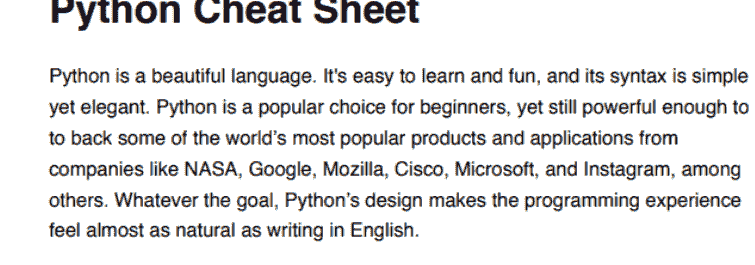

# 使用正则表达式和 PDF

到目前为止，我们已经学习并探索了一些核心 Python 库在网络通信、内容读取和浏览器自动化方面的应用，用于数据查找和提取。

**正则表达式**（也称为 **Regex**、**regex** 或 **RegEx** —— 在本章剩余部分我们将使用 **regex**）是使用预定义的一组字符构建的，用于搜索和类似活动的一种模式。在 *第 3 章和第 4 章* 中，在进行网页抓取时，我们测试并应用了各种可用功能，例如 *CSS 选择器*、*XPath* 和 *PyQuery*，以查找和定位特定类型的活动。Regex 帮助我们进行模式匹配 —— 在处理文档或任何文本内容时，我们有意识或无意识地大部分时间都在使用 regex。

在数据相关上下文中，很难避免查找、搜索和匹配等活动。Regex 为处理此类活动提供了一种简单而优雅的方法。数据以结构化或非结构化格式存在于各种形式和类型的文档中。**便携式文档格式（PDF）** 是一种安全、功能齐全、压缩良好的文档格式，可轻松通过互联网传输。与其他文本文档格式相比，PDF 不同。我们将在本章学习从 PDF 中提取数据。

在本章中，我们将学习以下主题：

- regex 概述
- 使用 Python 的 regex
- 使用 regex 提取数据
- 从 PDF 提取数据

# 技术要求

需要一个网络浏览器（*Google Chrome* 或 *Mozilla Firefox*），并且我们将使用 *JupyterLab* 进行 Python 代码。

请参考 *第 2 章* 中的 *设置事项* 和 *创建虚拟环境* 部分以继续设置和使用创建的环境。请参考 https://pypdf2.readthedocs.io/en/3.0.0/user/installation.html 安装 **PyPDF2。**

本章所需的 Python 库如下：

- `requests`
- `re`
- `pypdf2`

本章的代码文件可在本书的 GitHub 仓库在线获取：https://github.com/PacktPublishing/Hands-On-Web-Scraping-with-Python-Second-Edition/tree/main/Chapter09。

# regex 概述

在很多情况下，使用 XPath 和 CSS 选择器定位某些基于网络的内容或元素是相当困难的，甚至是不可能的。幸运的是，我们可以使用 regex 克服这种情况。regex 是一个使用字符串构建的表达式，用于通过识别现有模式来查找或搜索内容。

在网页抓取和提取相关活动中，regex 也被用作最终或首选的模式匹配选项。模式可以使用各种步骤定义，通常伴随表示预定义规则的特殊符号。regex 就像对纯文本进行分组和书写一样，许多库和文本相关功能都使用这些表达式，为我们提供方便易用的函数。

最新的代码编辑器、文档阅读器和写作程序都提供诸如在文件、多页和项目文件夹内搜索，以及查找和替换等功能。要使用这些选项，我们需要输入文本或 regex；无论如何，模式匹配或 regex 都将用于搜索内容。

regex 通常在其他选项不起作用时使用，有时甚至是首选方法。范围可以扩展到一些重要功能，例如以下内容：

- 将内容拆分为块，也称为爆炸或将内容切片成块
- 查找所有或多个匹配项
- 基于模式替换或替换内容

以下是数据提取过程中 regex 被广泛使用的一些常见用例：

- 验证电子邮件地址
- 从地址中匹配或收集邮政编码或邮编
- 从地理地址中匹配纬度和经度
- 查找页面上列出的项目数量
- 验证电话/手机号码
- 验证日期和时间
- 使用生成的（用户定义）模式提取内容

regex 可以在大多数支持文本的应用程序或服务中定义和运行。外观相当简单、优雅的表达式可用于处理任何类型的用例。其可用性和可扩展性取决于内容，使其成为强大的文本功能。请访问 https://www.regular-expressions.info/ 和 https://developer.mozilla.org/en-US/docs/Web/JavaScript/Guide/Regular_expressions 获取有关 regex 的详细信息。

**重要说明**
基于 Unix/Linux 的 grep（global regular expression print，全球正则表达式打印）命令非常强大，在 Unix/Linux 用户和开发者中很著名。grep 用于匹配和过滤模式，甚至被认为是一种模式匹配引擎。请访问 https://www.gnu.org/software/grep/ 获取更详细信息。

在下一节中，我们将更详细地探索 regex 并在实际示例中使用 re Python 库。

# 使用 Python 的 Regex

Python 编程以其简单、可读、可重用和简短的代码而闻名。Python 也因其科学计算和文本计算功能而流行（**自然语言处理（NLP）**、**情感分析（SA）** 等等）。Regex 也是 Python 的核心能力之一，因为 re（regex 库）作为系统或内置库提供，随 Python 安装即可使用。

让我们深入研究 re 并通过代码查看其中的一些功能。对于此示例，我们将使用 Sadhguru 的以下著名名言（可在 https://isha.sadhguru.org/us/en/wisdom/type/quotes 获取）：

> *如果你不与自己为敌，人类的潜能是无限的。*

我们定义了一个名为 quote 的 Python 变量，其值包含前述引语：

```
quote="If you do not turn against yourself, the Human Potential is limitless"
```

在接下来的部分中，我们将使用 re 方法查找至少三个字符长的单词，或字符串长度为三的单词，这些是数据相关任务中常用的方法。

# re（search、match 和 findall）

Python 的 re 库提供了各种类型的搜索相关方法。一些通常用于在任何代码中搜索模式的常见方法列于此处：

- search(): 在字符串中查找与给定模式匹配的位置并返回第一个匹配对象（re.Match）。如前述代码所示，只返回您或在 quote 字符串中找到的第一个匹配项。
- match(): 此方法在字符串开头查找匹配项。在前述代码的情况下，它不匹配任何内容。re.match() 在成功时也返回各种函数（start、end、span、group、groups 等）和属性（lastindex 和 lastgroup），这在任何情况下都有信息性，但在与 re.finditer() 一起使用时更有用。请访问 https://docs.python.org/3/library/re.html?highlight=regular%20expressions#functions 获取更详细信息。
- findall(): 此方法接受一个模式以在字符串中搜索所有匹配项。它类似于从头到尾迭代 search() 方法。

在即将到来的小节中，我们将学习如何生成 regex 并通过示例应用它。

# 使用字符集的 Regex

在 regex 中，我们可以使用 [] 查找一组字符。如以下代码所示，[a-z] 查找由 a 到 z 字符组成的任何单词组合：

```
re.search(r"([a-z]{3})",quote) # <re.Match object; span=(3, 6), match='you'>
```

在前述代码中，为了固定长度或检查出现次数，我们使用 {}；因此表达式 [a-z]{3} 中的 {3} 正在查找由最多三个字母字符组成的单词的匹配项（例如 you、not 和 the）。

通常，regex 模式以 r 字符开头的字符串提供。r"[a-z]" 是一个字符串，但也是 regex，也称为原始字符串。此外，我们需要小心字符大小写（小写或大写），因为 regex 模式区分大小写。在一般情况下，我们


可以应用 `flags=re.IGNORECASE` 来忽略文本大小写，如下例所示。我们还可以看到，在以下代码块中返回了所有三个字符组合的结果：

```
re.findall("([a-z]{3})",quote)
# ['you', 'not', 'tur', 'aga', 'ins', 'you', 'rse', 'the', 'uma', 'ote', 'nti', 'lim', 'itl', 'ess']
re.findall(r"([a-z]{3})",quote, flags=re.IGNORECASE)
# ['you', 'not', 'tur', 'aga', 'ins', 'you', 'rse', 'the', 'Hum', 'Pot', 'ent', 'ial', 'lim', 'itl', 'ess']
```

## 使用转义代码的正则表达式

除了提及一组字符外，我们还可以使用字符序列。例如，`\w` 代表任意字母数字字符，`\w{3}` 代表任意总长度为三个字符的单词，如下所示：

```
re.findall(r"\w{3}",quote)
#['you', 'not', 'tur', 'aga', 'ins', 'you', 'rse', 'the', 'Hum', 'Pot', 'ent', 'ial', 'lim', 'itl', 'ess']
```

类似地，`\s` 匹配空白字符（空格、制表符和换行符）。重复次数和出现次数也可以通过列出的量词来确定：

- `*`：表达式中的单词出现零次或多次。
- `+`：给定表达式中的单词出现一次或多次。
- `?`：匹配表达式中的单词出现零次或一次（也称为懒惰量词）。
- `{, }`：匹配不限数量的字符。出现次数的作用范围是`{最小值, 最大值}`。以下是一些示例：
  - `{2,10}`：匹配 2 到 10 个字符
  - `{,5}`：最多匹配五个字符
  - `{2,}`：至少两个字符
  - `{3}`：匹配每三个字符的出现

## 正则表达式的串联

正则表达式的另一个主要优势是它可以串联使用。请看以下示例：

- `\s+(\w{3})\s+`：匹配长度为三个字符且在单词前后至少有一个或多个空格的单词
- `\s*(\w{3})\s*`：匹配长度为三个字符且在单词前后有零个或多个空格的单词

在以下代码中，使用了许多正则表达式（涉及字符的长度、集合和出现次数）：

```
re.findall(r"\s*(\w{3})\s*",quote)
# ['you', 'not', 'tur', 'aga', 'ins', 'you', 'rse', 'the', 'Hum', 'Pot', 'ent', 'ial', 'lim', 'itl', 'ess']
re.findall(r"\s+(\w{3})\s+",quote)      # ['you', 'not', 'the']
re.findall(r"\s+([a-z]{3})\s+",quote)      # ['you', 'not', 'the']
```

以下是上述代码中使用的一些正则表达式的简要说明：

- 字符集合或 `[]`（方括号）：
  - `[A-Z]`：大写字符集合
  - `[a-z]`：小写字符集合
  - `[0-9]`：从 0 到 9 的数字字符集合

**重要说明**
表达式 `[a-zA-Z0-9]` 匹配所有字母数字字符。此外，在正则表达式中，除 `[A-Z0-9a-z]` 之外的其他字符应写成转义字符（`\,` 表示逗号，`\?` 表示问号字符，`\+` 表示加号字符）。字符集合也可以包含特殊字符或转义字符；例如，`[0-9\+\-\.]` 表示包含数字 0-9 以及 `+`、`-`、`.` 字符，或这些数字和字符的任意组合。

- 表达式中的圆括号 `()` 用于保存一组匹配值。例如，`r"([a-z]+)[0-9]{3}"` 保存匹配一个或多个从 a 到 z 的字符的值。
- 转义代码，有时也称为预定义快捷方式，使用 `\` 进行转义。以下是一些转义代码的示例：
  - `\s`：表示空格（键盘空格键）字符或空白字符；例如，`\s+` 添加一个或多个空格
  - `\n`：换行符，用于多行内容
  - `\t`：制表符
  - `\S`：非空白字符
  - `\w`：匹配字母数字字符；类似于 `[a-z0-9A-Z]`
  - `\W`：匹配非字母数字字符；与 `\w` 相反
  - `\b`：匹配单词边界
  - `\B`：匹配非单词边界

- `\d`：匹配数字或 `[0-9]`
- `\D`：匹配非数字

**重要说明**
转义字符或代码需要谨慎使用，因为它们是区分大小写的。例如，`\w` 和 `\W` 具有完全相反的效果。

正则表达式还通过使用 `|`（管道符）支持 OR 逻辑运算。在表达式 `r"([A-Z]\w+ | [a-z]\w+)"` 中，它匹配 `[A-Z]\w+` 或 `[a-z]\w+`，结果是返回所有任意大小写的单词：

```
matches = re.findall(r"([A-Z]\w+|[a-z]\w+)",quote)
matches # ['If', 'you', 'do', 'not', 'turn', 'against', 'yourself',
'the', 'Human', 'Potential', 'is', 'limitless']
```

除了本节探索的正则表达式功能外，还有一些更重要的方法和表达式语法。为了进一步探索，让我们在下一节中统计 quote 字符串中的单词总数。

在下一节中，我们将使用 re 的 `split()` 方法根据匹配的表达式或提供的条件（如字符）创建分块。

## re.split

以下代码提供了 `re.split()` 作用于表达式的示例。基于字符串的 Python `split()` 方法默认使用空格作为分隔字符。如下面的代码所示，`\s` 或空格用于拆分 quote 中的所有单词，正如我们在“正则表达式概述”一节中提到的那样：

```
words = re.split("\\s",quote)
words
# ['If', 'you', 'do', 'not', 'turn', 'against', 'yourself', 'the',
'Human', 'Potential', 'is', 'limitless']
print(f"Total words in quote: {len(words)}")
Total words in quote: 12
wordsA = re.split(",",quote)
# ['If you do not turn against yourself', ' the Human Potential is
limitless']
print(f"Total words in wordsA: {len(wordsA)}")
Total words in wordsA: 2
```

Python 的 re 还支持使用 `sub()` 方法进行替换或替换操作。在下一节中，我们将使用 `re.sub()`。

## re.sub

`re.sub()` 的工作方式与查找替换或字符串的 `replace()` 方法完全相同。在以下代码块中，表达式 `r"(H[a-z]+)"` 匹配任何以 H 开头且包含一个或多个 `[a-z]` 范围字符组合的单词，并将其替换为 HumanBeing：

```
newQuote = re.sub(r"(H[a-z]+)", 'HumanBeing', quote)
newQuote
# If you do not turn against yourself, the HumanBeing Potential is limitless
```

在以下代码中，`\,` 匹配 `,`（逗号），并使用 `sub()` 将其替换为空值：

```
newQuoteA = re.sub(r"\,",'',quote)
# If you do not turn against yourself the Human Potential is limitless
```

还有一种基于我们的模式返回对象的方法，称为 `compile()`。在下一节中，我们将探讨 `re.compile()` 以及一些重要的正则表达式基础知识。

## re.compile

正如方法名称所示，`re.compile()` 编译正则表达式并创建一个模式对象。使用模式对象不是强制性的，但它使代码更具可读性和可扩展性。

在以下代码中，我们有一个名为 `languages` 的 Python 列表，包含各种编程语言的名称：

```
languages = ["Javascript","Python","Go","Java","Kotlin",
"PHP","C#","Swift","R", "Ruby","C","C++","Matlab",
"TypeScript","Scala","SQL","HTML","CSS","NoSQL", "Rust", "Perl"]
vowel_start = r"^[AEIOU]"
vowel_end = r".*[aeiouAEIOU]$"
print(f" Expression {vowel_start}, Type:{type(vowel_start)}")
# Expression ^[AEIOU], Type:<class 'str'>
```

我们定义了两个正则表达式模式，如下所示：

- `vowel_start`：检查 `languages` 中的元素是否以元音开头（区分大小写）
- `vowel_end`：检查 `languages` 中的元素是否以元音结尾（不区分大小写）

还需要注意，尽管 `vowel_start` 和 `vowel_end` 被定义为保存正则表达式，但它们仍然是字符串对象。

以下是一些在 `vowel_start` 和 `vowel_end` 中出现的正则表达式字符：

- `^`（脱字符）：这是一个位置字符。它匹配字符串的起始位置或开头。例如，`(^\d+)` 查找任何以数字开头的模式。
  
  当 `^` 在字符集合中使用时，它表示否定或排除。例如，`[a-z]` 匹配从 a 到 z 的字符，而 `[^a-z]` 匹配除了从 a 到 z 的字符之外的任何内容。
- `$`：这也是一个位置字符，它匹配结束位置。例如，`(\d$)` 匹配以数字结尾的字符串。表达式 `r".*[aeiouAEIOU]$"` 查找以以下任意一个字符结尾的字符：`aeiouAEIOU`。
- `.`（点或句点）：匹配任意字符，但不匹配换行符或 `\n`。例如，`r".*[aeiouAEIOU]$"` 匹配任何具有任意数量字符并以 `aeiouAEIOU` 之一作为结尾字符的单词。

定义表达式后，让我们编译它们。`re.compile(expression)` 创建一个 `re.Pattern`（patternS 和 patternE）类型的对象：

```
patternS = re.compile(vowel_start)
patternE = re.compile(vowel_end)
print(f"{patternS}, {type(patternS)}")
re.compile('^[AEIOU]'), <class 're.Pattern'>

print(dir(patternS))
['__class__',...', 'findall', 'finditer', 'flags', 'fullmatch',
'groupindex', 'groups', 'match', 'pattern', 'scanner', 'search',
'split', 'sub', 'subn']
```

`compile()` 方法以正则表达式的形式提供指令。编译后，我们可以在需要的地方使用编译后的表达式集合，如前面的代码块和后面的代码块所示。

如下面的代码所示，执行列表迭代以使用 `re.match()` 检查模式，结果只有三个匹配项，即以元音结尾的语言名称：

```
for language in languages:
    if re.match(patternS, language):
        print(f"{language} starts with vowel character")
    if re.match(patternE, language):
        print(f"{language} ends with vowel character")
Output---
Go ends with vowel character
Java ends with vowel character
Scala ends with vowel character
```


模式对象拥有各种方法。前面代码中已使用了一些。还有更多可以使用的，需要对正则表达式进行全面研究。欲了解更多详情，请访问 https://www.regular-expressions.info/。

构建正则表达式相当具有挑战性。任何特定任务都可以用一个或多个表达式处理。编写表达式没有唯一正确的方式，但学习正则表达式的基础知识会很有帮助。

在下一节中，我们将看到使用正则表达式编写的实体的多种处理方式，以及通过 `re` 函数和逻辑步骤来处理。

## 正则表达式标志

正则表达式标志通常被视为对基本表达式的额外补充或增强。可用的标志类型有多种，但最常见的如下：

-   `re.IGNORECASE`：此标志忽略大小写（大写或小写）问题，可以使用简写形式（`re.I`），也可以内联使用 `(?i)`。
-   `re.MULTILINE`：此标志有助于在跨多行的表达式中搜索和匹配模式。可简写为 `re.M` 或内联写为 `(?m)`。

如下代码块所示，如果使用 HTTP 头相关值声明，sentence 变量就是一个多行字符串。其中还包含换行符（`\n`）。让我们探索在带标志和不带标志的情况下实现正则表达式结果的各种方法：

```
sentence="""Accept:text/html,application/xhtml+xml,application/
xml;q=0.9,image/avif,image/webp,image/apng,*/*;q=0.8,application/
signed-exchange;v=b3;q=0.7\nAccept-Encoding: gzip, deflate\nAccept-
Language: en-US,en;q=0.9\nCache-Control: max-age=0\nConnection: keep-
alive\nCookie: ci_session=%22session_id%2A40495f61c71a8ca8712e\nhost: anishchapagain.com\nIf-Modified-Since: Sun, 1 Apr 2023
11:22:33 GMT\nIf-None-Match: 64a-5f9724a6cdcf2-gzip\nUpgrade-
Insecure-Requests: 1\nUser-Agent: Mozilla/5.0 (Windows NT 10.0;
Win64; x64) AppleWebKit/537.36 (KHTML, like Gecko) Chrome/111.0.0.0
Safari/537.36"""
```

Python `re` 方法接受 `flags` 参数。如下代码所示，在 `re.findall("(if.*)",sentence, flags = re.IGNORECASE)` 中，`re.IGNORECASE` 被传递给 `flags` 参数：

```
re.findall("(if.*)",sentence) ['if,image/webp,image/
apng,*/*;q=0.8,application/signed-exchange;v=b3;q=0.7', 'ified-Since:
Sun, 1 Apr 2023 11:22:33 GMT']
re.findall("(if.*)",sentence, flags = re.IGNORECASE) ['if,image/
webp,image/apng,*/*;q=0.8,application/signed-exchange;v=b3;q=0.7',
'If-Modified-Since: Sun, 1 Apr 2023 11:22:33 GMT', 'If-None-Match:
64a-5f9724a6cdcf2-gzip']
re.findall("(If.*)",sentence)
['If-Modified-Since: Sun, 1 Apr 2023 11:22:33 GMT', 'If-None-Match:
64a-5f9724a6cdcf2-gzip']
```

从上面的代码块可以看出，当提供 `re.IGNORECASE` 时，输出会有所不同。

除了输出之外，我们还可以使用一些简写形式来修改或更改上述代码；例如，`re.findall("(if.*)",sentence,flags = re.IGNORECASE)` 也可以写成：

-   `re.findall("(if.*)",sentence, re.IGNORECASE)`
-   `re.findall("(if.*)",sentence, flags = re.I)`
-   `re.findall("(if.*)",sentence, re.I)`
-   `re.findall(r"(?i)(if.*)",sentence)`（这是内联标志表示法；`(?i)` 与 `re.I` 含义相同）

在下面的代码中，`re.MULTILINE` 标志用于多行字符串，使用和不使用该标志正则表达式时的输出可以很容易地区分：

```
re.findall (r"^Accept.*", sentence)
['Accept: text/html, application/xhtml+xml, application/xml; q=0.9, image/avif, image/webp, image/apng, */*; q=0.8, application/signed-exchange;v=b3;q=0.7']
re.findall (r"^Accept.*", sentence, flags = re.MULTILINE)
['Accept: text/html, application/xhtml+xml, application/xml; q=0.9, image/avif, image/webp, image/apng, */*; q=0.8, application/signed-exchange;v=b3;q=0.7', 'Accept-Encoding: gzip, deflate', 'Accept-Language: en-US,en;q=0.9']
re.findall(r"(?m)^Accept.*",sentence) # inline flag (?m) multi-line
['Accept: text/html, application/xhtml+xml, application/xml; q=0.9, image/avif, image/webp, image/apng, */*; q=0.8, application/signed-exchange;v=b3;q=0.7', 'Accept-Encoding: gzip, deflate', 'Accept-Language: en-US,en;q=0.9']
```

表达式 `re.findall (r"^Accept.*",sentence,flags=re.MULTILINE)` 也可以写成如下形式：

-   `re.findall(r"^Accept.*",sentence, re.MULTILINE)`
-   `re.findall(r"^Accept.*",sentence, flags = re.M)`
-   `re.findall(r"^Accept.*",sentence, re.M)`
-   `re.findall(r"(?m)^Accept.*",sentence)`（内联标志）

标志也可以组合使用；例如，`flags=re.MULTILINE|re.IGNORECASE` 将同时施加两个标志，如下所示：

```
re.findall(r"^accept.*",sentence, re.MULTILINE|re.IGNORECASE)
re.findall(r"^accept.*",sentence, re.M|re.I)
re.findall(r"(?im)^accept.*",sentence) # (?im) the inline flag together
```

上述代码将产生以下输出：

```
[ 'Accept:text/html,application/xhtml+xml,application/xml;q=0.9,image/avif,image/webp,image/apng,*/*;q=0.8,application/signed-exchange;v=b3;q=0.7',
'Accept-Encoding: gzip, deflate',
'Accept-Language: en-US,en;q=0.9' ]
```

如上面的代码块所示，内联标志在表达式之前提及，并以 `?` 开头，例如 `(?i)` 或 `(?im)`。

**重要说明**

有关编写表达式、标志和正则表达式的更详细信息，请探索以下链接：https://www.regular-expressions.info/、https://regex101.com/（你也可以使用此链接进行练习和生成代码）、https://developer.mozilla.org/en-US/docs/Web/JavaScript/Guide/Regular_expressions/Cheatsheet 和 https://learnbyexample.github.io/python-regex-cheatsheet。

在下一节中，我们将使用正则表达式处理 Web 响应以进行数据提取。

## 使用正则表达式提取数据

在本章前面的章节中，我们通过示例探讨了正则表达式的各个方面。正则表达式可以应用于所有类型的内容，例如内容分析、可扩展性以及时间和资源（机器）分析。这种分析对于确定选择哪些与提取相关的选项（如 XPath、CSS 选择器和 PyQuery）非常重要。

**重要说明**

文献中经常提到，正则表达式只应在内容为非结构化时应用（用于数据提取），但事实并非如此。正则表达式可用于任何类型的内容（结构化或非结构化）。

从爬取的角度来看，为了提取数据，我们将探索几个使用正则表达式的示例，并探讨其部分功能和特性。

## 示例 1 – 雅马哈经销商信息

在本示例中，我们将从 https://yamaha-moto.cfaomotors.ng/en/dealership/yamaha-nigeria-cfao-motors 收集摩托车经销商的信息（更准确地说，是经销商的地理位置）。要收集的数据是 Dealer_ID、Name（经销商名称）、City（位置）、Latitude（纬度）和 Longitude（经度）。

dataSet 将产生如下所示的数据：

```
[['261', 'AUSTINE BEST VENTURES LTD', 'Igbo-Ora', '7.435186', '3.2874431'],
...
['259', 'S. AKINMADE NIGERIA LTD', 'Akure', '7.2455287', '5.1887157']]
```

收集完所有数据后，将创建 CSV 和 JSON 文件。

如前面的代码块所示，`re` 的 findall、sub 和 split 方法在多个地方和不同时间被使用，并在数据提取中发挥着非常重要的作用。

## 示例 2 – 从站点地图获取数据

在本示例中，我们将从 https://www.zyte.com/post-sitemap.xml 的站点地图链接中提取数据。

由于站点地图文件是 JSON 格式，它包含一些系统定义和用户定义的标签。source 使用 Python requests 收集 Web 响应：

```
url="https://www.zyte.com/post-sitemap.xml"
source = requests.get(url).text
```

source 输出的一部分，或者 sitemap.xml 中找到的单个链接的内容，如下面的代码块所示——有多个具有类似输出的链接，需要识别、提取和收集这些链接以提取所需数据：

```
<url>
    <loc>https://www.zyte.com/blog/json-parsing-with-python/</loc>
    <lastmod>2023-04-06T14:42:05+00:00</lastmod>
</url>
```

我们感兴趣的链接中的数据如下：

-   **类型**：从 `<loc>` 中提取的类别，如博客、网络研讨会或未分类文本
-   **主题**：链接中可用的链接文本或标题文本，显示在我们之前定义的类型之后
-   **日期**：在 `<lastmod>` 中找到的 Y-M-D 值
-   **时间**：在 `<lastmod>` 中的 H:M:S 值

在这里，由于 source 中存在可识别的 XML 标签（每个链接或 `<url>` 的 `<loc>` 和 `<lastmod>`），我们将分别收集所有可用的 `<loc>` 和 `<lastmod>` 详细信息。locs 收集


来自所有可用的 `<loc>...</loc>` 标记的数据；同样地，`mods` 列出所有 `<lastmod>...</lastmod>` 标记中的内容：

```python
locs = re.findall(r"<loc>(.*)</loc>", source)
mods = re.findall(r"<lastmod>(.*)</lastmod>", source)
```

`locFinals` 是一个 Python 列表，其中包含来自 `locs` 和 `mods` 的各个元素，并以元组形式呈现。Python 的 `zip(locs, mods)` 函数的作用类似于合并器，它合并传入的参数，并将迭代得到的 `locs` 和 `mods` 值创建为一个元组：

```python
locFinals = list(zip(locs, mods))
print(locFinals[0])    # (locs[0], mods[0])
('https://www.zyte.com/blog/json-parsing-with-python/', '2023-04-06T14:42:05+00:00')
```

`locFinals` 包含多个元素。在迭代时，我们同时进行元组解包，并使用 `re.sub()` 和 `re.split()` 对数据进行清理和拆分，以便获取目标数据：

```python
for locFinal in locFinals:
    loc, datetime = locFinal
    # unpacking tuple (extracting tuple elements)
    loc = re.sub('^(http\:|https\:)', '', loc)
    # cleaning
    loc = re.sub('[\/]{2}', '', loc)
    loc = re.sub('\/$', '', loc)
    locSplit = re.split(r"/", loc)
    # breaking
    category = locSplit[1]
    categoryTopic = re.sub('[-]', ' ', locSplit[2])
    ymdTime = re.split("T", datetime)
    # separating date and time
    ymd = ymdTime[0]
    time = re.sub("\+.*", "", ymdTime[1])
    # cleaning
```

最终，识别出的目标数据被加载到 `dataSet` 数据容器中：

```python
dataSet.append(["Zyte", category, categoryTopic, ymd, time])
print(dataSet)
[['Zyte', 'blog', 'json parsing with python', '2023-04-06', '14:42:05'], ...,
 ['Zyte', 'webinars', 'the right data fields for e commerce data project', '2023-03-21', '06:17:35'], ...]
```

如本示例所示，re 方法（`findall()`、`sub()` 和 `split()`）以及 Python 的 `zip()` 方法发挥了重要作用。通过结合 Python re 和内建方法，可以高效且轻松地完成基于正则表达式的数据提取。

### 示例 3——Godfrey 的经销商

在本示例中，我们将从 `https://godfreysfeed.com/dealersandlocations` 提取经销商详细信息。

使用 Python 的 requests 库发起 HTTP 请求，并将响应收集为 source：

```python
url = "https://godfreysfeed.com/dealersandlocations"
source = requests.get(url).text
```

我们将从 source 中获取与目标列（如 Name、Address、City、State、Zip、Lat 和 Lng）相关的数据。经销商相关数据仅在 *JavaScript* 中可用。这些数据还分散在多行中，并且包含一些 HTML 标签，如下所示：

```javascript
var infoWindowContent = "<div style='overflow:hidden; width:200px'>";
infoWindowContent = infoWindowContent + '<strong><span style='color:#e5011c;'>American Cowboy Shop</span></strong><br><strong>513 D Murphy Hwy</strong><br><strong>Blairsville, GA</strong><br><strong>30512</strong><br><br>';
infoWindowContent += '</div>';
var infowindow = new google.maps.InfoWindow({maxWidth: 450});
infowindow.setContent(infoWindowContent);
var latLng = new google.maps.LatLng(34.8752421, -83.9716038);
```

定义正则表达式以使用 `latlngs` 变量收集所有坐标数据，而 `contents` 则保存承载地址信息的 `infoWindowContent` 变量。最后，使用 Python 内建的 `zip()` 创建 `details`：

```python
latlngs = re.findall(r"var\s+latLng.*\.LatLng\((.*)\);", source)
contents = re.findall(r"infoWindowContent\+\s*\"(.*)\";", source)
details = list(zip(contents, latlngs))  # zip
```

现在，我们已在 `details` 中识别出 `latlngs` 和 `contents` 数据。接下来需要对 `details` 进行迭代，将 `detail` 元组解包为一组 `fullAddress` 和 `coordinate`：

```python
for detail in details:
    fullAddress, coordinate = detail
```

大家可以了解到，*Word 文档*、*PowerPoint 演示文稿*、*HTML*、*Jupyter 笔记本*、*来自各种应用程序的分析报告*，以及更多内容类型都支持将文件导出并保存为 PDF。

我们经常会在 PDF 文件中发现各种类型的数据（例如文本、表格和图像）。在*第 3 章和第 4 章*中，我们了解了如何使用 Python 提取基于 Web 的内容。在这里，我们将使用 PyPDF2 Python 库从 PDF 文件中提取数据。

在接下来的小节中，我们将从数据提取的角度安装并探索 PyPDF2。

## PyPDF2 库

PyPDF2（https://pypdf2.readthedocs.io/en/3.0.0/index.html）是一个免费、开源（https://github.com/py-pdf/PyPDF2）的 Python 库，用于处理 PDF 文件，并因其丰富的功能在 Python 开发者和社区中广受欢迎。

以下是它的一些主要功能：

- 文本提取
- 图像提取
- 元数据（文档详细信息）的可用性与提取
- 文件转换（PDF 转 Word 等）
- 文本修改（PDF 文件）
- 为现有或新建的 PDF 文件添加水印
- 添加安全性，例如为 PDF 文件设置密码保护
- 将 PDF 文件拆分为多个页面
- 将多个 PDF 文件合并为一个 PDF
- 处理页面布局、裁剪、变换和方向（例如旋转页面）

还应注意，PDF 文件可以使用 PDF 应用程序创建，也可以从其他文档格式导出并保存。虽然 PDF 文件保留了原始文档的适当格式，但其内容不像 HTML 或基于标记的文档那样。PDF 内容以原始格式（包含换行符、空格和制表符）存在，因此几乎必须使用正则表达式来定位和提取所需信息。

> **重要提示**
> 有大量处理 PDF 文件的 Python 库，例如 `pdfminer`、`pdfquery`、`xpdf`、`pdfrw`、`pikepdf` 和 `pymupdf`。在上述这些库中，PyPDF2 是我最喜欢的，因为它具有多种功能。正如 https://pypdf2.readthedocs.io/en/3.0.0/user/installation.html 中所介绍的，PyPDF2 可用于广泛的用例，也可以专注于某个特定领域，例如*加密（加密或解密）*和*图像处理*。

在下一节中，我们将使用 PyPDF2 来收集数据。

## 使用 PyPDF2 进行提取

PyPDF2 是一个完整的软件包，其中有各种类来处理其不同的功能。在提取方面，我们将使用 PyPDF2 中的 `PdfReader` 类（https://pypdf2.readthedocs.io/en/3.0.0/modules/PdfReader.html）。

如下代码所示，要进行提取，需要从 PyPDF2 导入 `PdfReader` 类。目标文件或文件路径（`pdffile`）被提供给 `PdfReader`。`reader` 是一个对象，承载着 `PdfReader` 的方法和属性：

```python
from PyPDF2 import PdfReader
pdffile = "python_cheat_sheet_v1.pdf" # file path or name
reader = PdfReader(pdffile)
# reader = PdfReader(open(pdffile,'rb'))
dir(reader)
['__class__',..., '__encryption__',...'isEncrypted', 'is_encrypted',
 'metadata', 'namedDestinations', 'named_destinations', 'numPages',
 'outline', 'outlines', 'pageLayout', 'pageMode', 'page_layout',
 'page_mode', 'pages', 'pdf_header', 'read', 'readNextEndLine',
 'readObjectHeader', 'read_next_end_line', 'read_object_header',
 'resolved_objects', 'stream', 'strict', 'threads', 'trailer',...]
```

PyPDF2 最近进行了一次更新，为其配备了新的方法和属性。此外，还有一些已弃用的实体，你在探索 PyPDF2 时可能会遇到。

PDF 的页数可以通过 `len(reader.pages)` 获取，而单个页面的来源或内容可以通过 `page1 = reader.pages[0]` 来定位（此处，索引 0 指第 1 页，1 指第 2 页，依此类推）。确定页码后，可以使用 `extract_text()` 方法提取内容：

```python
page1 = reader.pages[0]    # point to first page
page1_source = page1.extract_text()    # extract from first page
len(page1_source)                # 964
page1_source[:100]  # Python is a beautiful language. It's easy to learn and fun, and its syntax is simple yet elegant. Pyt
page1_source
"Python is a beautiful language. It's easy to learn and fun, and its syntax is simple yet elegant. ..... ...... Python Cheat Sheet\n1. Primitives Numbers"
```

上述代码使用 PyPDF2 加载了 PDF 文件的内容或页面。在接下来讨论的示例中，我们将应用正则表达式从 PDF 中提取所需内容。


## 示例 1 – 字符串提取

以下是我们想要提取的 python_cheat_sheet_v1.pdf PDF 文件中的第一段（PDF 文件可在本章的 GitHub 仓库中找到）：



图 9.1：来自 python_cheat_sheet_v1.pdf 文件的文本第一段

要提取如图 9.1 所示的第一段，正则表达式应应用于 page1_source，并使用 Python 的 list() 返回第一段的内容，在本例中，索引为 0 - python_definition[0]：

```
python_definition = re.findall(r"^(.*?)Check\s*out", page1_source)
python_definition[0]
"Python is a beautiful language. It's easy to learn and fun, and its syntax is simple yet elegant. Python is a popular choice for beginners, yet still powerful enough to back ...... Whatever the goal, Python's design makes the programming experience feel almost as natural as writing in English."
```

在本示例中，我们学习了如何识别内容并应用正则表达式来收集所需内容。

## 示例 2 – 表格内容

在本示例中，我们将提取 GeoBase_NHNC1_Data_Model_UML_EN.pdf 文件第 3 页上找到的表格数据，如图 9.2 所示（PDF 文件可在本章的 GitHub 仓库中找到），并创建 CSV 文件：

| Date | Version | Description |
|---|---|---|
| September 2002 | Draft 01 | First draft for discussion with Nova Scotia |
| January 2003 | Draft | Second draft after discussion with Nova Scotia and major review of the hydro network model through:<br>- Proposal of options |
| March 2003 | Alpha | Draft version after discussion and decisions made concerning NHNC1 scope and content with Nova Scotia and British Columbia |
| July 2003 | Draft 02 | Draft version after discussion and decisions made concerning the detailed NHNC1 model and content with Nova Scotia, British Columbia, and the Yukon. Meeting in Victoria, May 2003. |
| December 2003 | Draft | Integration of UML model for both LRS and Segmented views of the NHNC1. |
| February 2004 | Draft | English review;<br>Remove the UML model for the Segmented view. |
| May 2004 | Draft | Update from the March Workshop comments. |
| August 2004 | 2004.1 | The object metadata attribute « date » is renamed « validity_date » in section 3.1.6.2 and at all other parts referring to object metadata.<br>A new Feature type value is added for inland water (see section 3.1.5) |

图 9.2：从 PDF 文件中提取表格数据

首先，让我们提取 PDF 文件第 3 页的内容：

```
from PyPDF2 import PdfReader
import re
pdfFile="GeoBase_NHNC1_Data_Model_UML_EN.pdf"
reader = PdfReader(pdfFile)
page3 = reader.pages[2]
page3_source = page3.extract_text()
page3_source
'...\nDate Version Description \nSeptember 2002 Draft 01 First draft for discussion with Nova Scotia \nJanuary 2003 Draft Second draft after discussion with Nova Scotia and major review of the \nhydro network model through: \n\uf0b7 Proposal of options \nMarch 2003 Alpha Draft version after discussion and decisi .....\nFUTURE WORK \nKey word Description \n \n '
```

page3 变量（reader.pages[2]）指向第 3 页。page3_source 在部署 extract_text() 函数后保存 page3 的内容。在前面的代码中，可以看到 page3_source 的内容，其为原始格式，带有换行符。

```
Scotia'],...,/
['May 2004', 'Draft', 'Update from the March Workshop comments.'],...]
```

`dataSet` 中可用的数据保存为 CSV 文件，其看起来像 *图 9.3：*

|   | Date | Version | Description |
|---|---|---|---|
| 1 | September 2002 | Draft 01 | First draft for discussion with Nova Scotia |
| 2 | January 2003 | Draft | Second draft after discussion with Nova Scotia and major review of the hydro net... |
| 3 | March 2003 | Alpha | Draft version after discussion and decisions made concerning NHNC1 scope and ... |
| 4 | July 2003 | Draft 02 | Draft version after discussion and decisions made concerning the detailed NHNC... |
| 5 | December 2003 | Draft | Integration of UML model for both LRS and Segmented views of the NHNC1. |
| 6 | February 2004 | Draft | English review; Remove the UML model for the Segmented view. |
| 7 | May 2004 | Draft | Update from the March Workshop comments. |
| 8 | August 2004 | 2004.1 | The object metadata attribute « date » is renamed « validity_date » in section 3... |

图 9.3：PDF 提取后的表格数据作为 CSV

还需要注意的是，CSV 文件不具备如图 *9.2* 所示的原始表格的确切格式。

在本章处理 PDF 提取时，我们遇到了使用各种函数和技术的情况。使用正则表达式是其中一种选择，但使用哪种选项取决于开发人员。正则表达式的搜索、分割、替换、查找和迭代等功能在我们探索的示例中非常有用。

## 总结

正则表达式及其功能不仅适用于非结构化数据，也适用于结构化数据。正则表达式为我们提供了许多选项，并且代码肯定会因用例而异。正则表达式的优点是可以应用于各种情况；可能需要处理更多步骤，但我们可以使用正则表达式专注于目标。PDF 提取过程仍在不断发展。虽然可以采取其他方法，但正则表达式也是数据相关任务中最重要的组成部分之一。

本章涵盖的主题帮助你从实践角度了解如何按需使用正则表达式。正则表达式在数据提取活动中发挥着不可替代的作用，不受内容结构和文档类型的影响。

在下一章中，我们将学习数据挖掘和数据可视化。

## 进一步阅读

- *Regular expressions:* https://regexone.com/, https://www.regular-expressions.info/tutorial.html
- *Regular expressions – Python:*
  - https://docs.python.org/3/library/re.html
  - https://www.w3schools.com/python/python_regex.asp
- *Online regex tester and debugger:* https://regex101.com/
- *PDF:* https://www.adobe.com/acrobat/about-adobe-pdf.html
- *PDF – Python:*
  - https://pypdf2.readthedocs.io/en/3.0.0/
  - https://nanonets.com/blog/pypdf2-library-working-with-pdf-files-in-python/
- *Scrape PDF:*
  - https://towardsdatascience.com/scrape-data-from-pdf-files-using-python-fe2dc96b1e68
  - https://docparser.com/industries/pdf-scraper-data-providers/
