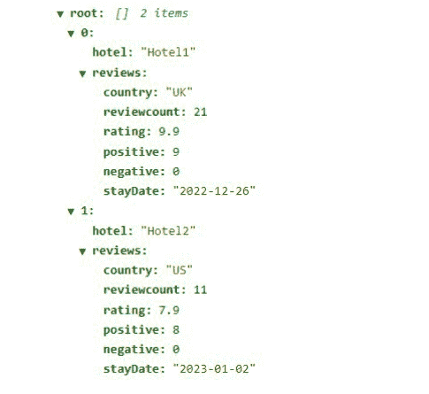
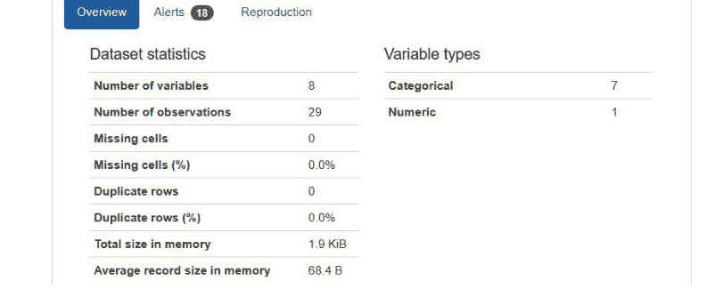
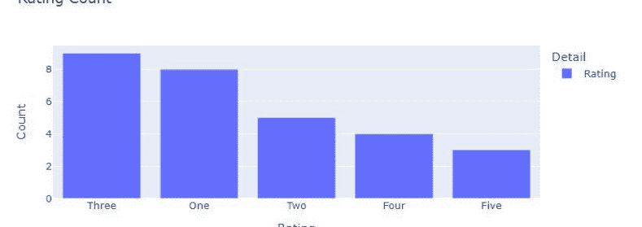
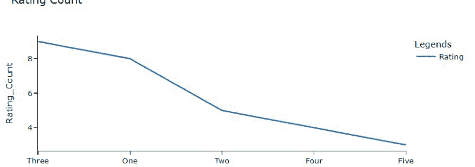
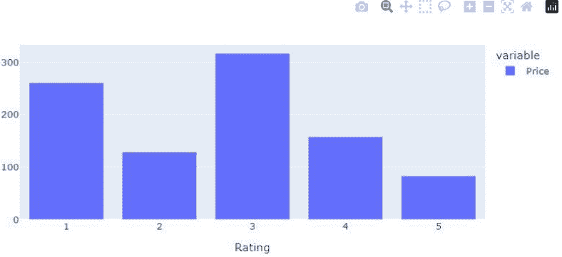
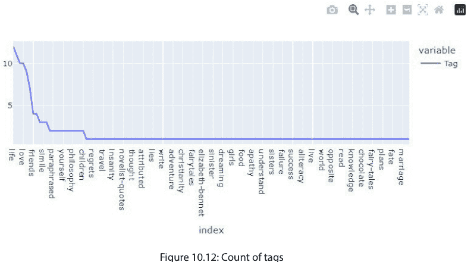
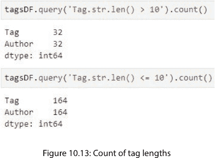
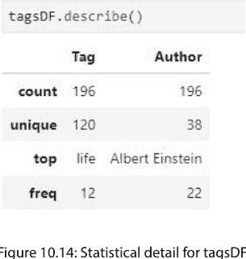
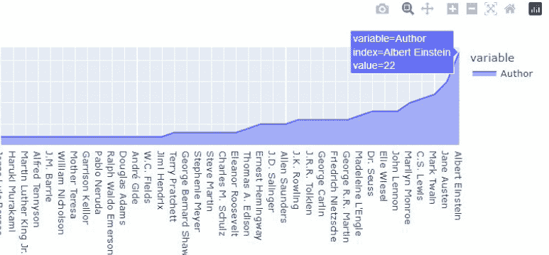
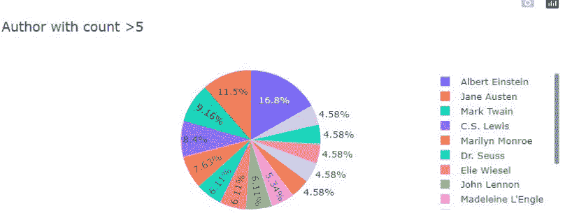

## 10 数据挖掘、分析和可视化

到目前为止，我们已经学习了一些关于 HTTP/HTTPS 通信、读取内容、浏览器自动化等方面的核心 Python 库和技术，从数据提取的角度来看。

数据是新石油（我们都同意这一点），但仅仅获取或收集数据并不能提供任何显著价值。收集的数据存储在文件（JSON、CSV 和 XML）、数据库等中。存储的数据需要在被许多服务和应用程序使用之前，使用算法进行识别、搜索、排列、清理、转换、探索或建模，有时才能从中获得信息带来的利润。

涉及识别和收集数据并处理以提取价值的各种技术和概念。数据分析使用数据相关应用程序和工具实现和执行逻辑和算法，以生成有价值的信息。可视化另一方面，使用图表、图形等以更易于呈现的格式显示数据。

在本章中，我们将讨论适用于收集数据的主题。我们还将讨论如何使用概念和技术来帮助我们获得关键信息和有价值的见解。这些概念和主题在 **数据科学**、**数据分析**、**知识发现 (KD)**、**人工智能 (AI)** 和 **机器学习 (ML)** 等领域需求很高。

为此，本章将涵盖以下主题：

- 数据挖掘
- 处理收集的数据
- 数据分析和可视化


# 技術要求

需要使用一個網絡瀏覽器（Google Chrome 或 Mozilla Firefox），我們將使用 JupyterLab 來運行 Python 代碼。

請參考第 2 章的「設置環境」和「創建虛擬環境」小節，繼續設置和使用我們創建的環境。請參考以下鏈接以安裝和升級所需的庫：

- pandas: https://pandas.pydata.org/docs/getting_started/install.html
- ydata_profiling: https://ydata-profiling.ydata.ai/docs/master/pages/getting_started/installation.html
- plotly: https://plotly.com/
- wordcloud: https://pypi.org/project/wordcloud/

本章所需的 Python 庫如下：

- csv
- json
- sqlite3

本章的代碼文件可在本書的 GitHub 倉庫中在線獲取：https://github.com/PacktPublishing/Hands-On-Web-Scraping-with-Python-Second-Edition/tree/main/Chapter10

## 數據挖掘簡介

「挖掘」（mining）一詞通常表示提取或提取某物的過程。數據挖掘是從數據中提取數據或發現信息的過程。數據挖掘是一個不斷發展的概念，它從數據集或數據庫中發現隱藏的、意想不到的以及其他各種形式的信息，有助於知識發現（KD）和決策。

就數據而言，挖掘被用作一種分析形式，以發現模式、隱藏事實等。當使用挖掘技術發現知識時，這被稱為資料庫中的知識發現（KDD，或知識發現與數據挖掘）。有許多術語用來描述數據挖掘，如 KDD、信息收集、從資料庫中進行模式發現等等；儘管最終結果相同，但這些術語在步驟和處理架構上有所不同。

### 重要說明

KDD 幾乎是一個循環過程，數據挖掘是其主要組成部分之一。KDD 使用多個步驟，例如數據選擇、清理、豐富化（預處理）、編碼和轉換、數據挖掘以及報告（解釋和評估）。每個步驟的輸出都會作為下一步的反饋或輸入進行處理，直到獲得所需的信息或知識。

數據分析和數據挖掘是數據科學的子集，經常被比較並視為相似的過程。數據挖掘基於科學和數學方法，而數據分析則使用分析模型和智能系統來完成。

數據挖掘也被認為是數據分析過程的一部分，但挖掘通常針對結構化數據進行，而分析則可以針對結構化、非結構化和半結構化數據進行。與知識發現（KD）和數據分析類似，「數據倉庫」是我們在討論數據挖掘時經常遇到的一個術語。

數據倉庫是各種類型數據（如近期數據、歷史數據和面向主題的數據）的中央存儲。數據倉庫中的數據用於決策支持系統或查詢。因此，從數據倉庫中有效且有意義地檢索數據以供挖掘過程使用，極大地影響著它們的效用。儘管數據倉庫在數據科學中很常見，但數據挖掘和數據倉庫之間沒有確切或嚴格的關係。然而，在與挖掘相關的實施階段，它們被證明是有價值的。

### 重要說明

查詢處理工具和數據挖掘工具也經常同時使用。數據挖掘不會取代查詢或與查詢相關的工具；相反，它會補充可能的附加組件。在通常情況下，使用**結構化查詢語言（SQL）**從數據庫中發現隱藏的知識比數據挖掘要困難得多。在一般實踐中，如果我們知道自己在找什麼，就會使用 SQL；否則，我們會使用數據挖掘。

全球範圍內，對來自與數據挖掘相關的系統和框架的各種類型和形式的信息的需求日益增長。人工智能（AI）和機器學習（ML）也被廣泛用於促進正確的程序、算法和基於時間的信息提取。數據挖掘過去主要僅處理文本內容。現在，有各種類型的內容需要挖掘，例如圖像、音頻、視頻、網頁內容和社交媒體。

數據挖掘用於收集和發現描述數據的新模式和知識。我們可以將其與一些智能自動化系統結合使用，以預測、發現和分析數據模式，處理大量各種類型的數據，並減少處理數據所需的時間。

通常，數據挖掘的目標是從數據中提取隱藏的、未識別的信息和知識。與數據挖掘相關的任務要么是預測性的（預測、分析），要么是描述性的（描述、建模）。在預測和描述過程中都有大量的技術。在本節中，我們只選擇了一些重要且需求量大的技術。

## 預測性數據挖掘

預測性數據挖掘主要預測未知或未來的值。它使用統計分析將數據轉化為有價值的信息。分析數據並預測輸出的技術屬於這一類別，具體如下：

- **分類**：這是最常見的挖掘技術之一，它根據一些預測變量（或稱預測因子）將數據分類到各種類別中。分類通過應用算法將數據集劃分為子集。分類通常將數據分類到預先定義的類別中。
- **回歸**：該技術用於預測、預報和分析變量之間的關係。有些變量可能依賴於其他變量，被稱為因變量。當自變量變化時，該技術有助於分析或預測因變量的值。通常，各種回歸方法（如線性和多元線性）會在各種類型的變量之間建立關係或聯繫。
- **預測**：該技術分析過去的事件並預測未來的值。它用於預測自變量和因變量之間以及這些變量內部的關係。它使用來自其他技術（如分類和聚類）的過去或原始信息。

## 描述性數據挖掘

描述性數據挖掘發現可解釋或可檢測的模式。此外，它被認為是數據處理的初步階段。它分析過去的數據，並使用下面列出的一些技術：

- **聚類**：該技術將相似或具有相似特徵的項目分組。它將數據劃分為具有相似內容的簇。它還盡量使簇之間盡可能不同。聚類和分類相似，但不同之處在於，聚類是根據數據的特徵而非預先定義的特徵來發現和存儲數據簇的。
- **摘要**：該技術提供數據集的簡明表示，包括生成報告和可視化。摘要存儲易於理解的描述性摘要。
- **關聯規則**：該技術關聯數據集中的多個變量。關聯規則描述了數據集中某些屬性之間的統計相關性。它有助於識別兩個或多個變量之間的關係（或關聯），這有助於發現隱藏的觀察結果或模式。該技術常用於市場分析。

> **重要說明**
> 市場分析是零售商用來發現商品之間關聯的一種建模技術。例如，如果客戶正在購買商品 A，那麼還可能購買哪些其他商品？

數據挖掘是當今組織中利用分析或類似信息進行決策的重要組成部分。公司或組織可以根據其客戶或顧客的使用模式預測和收集信息，對他們進行分類，並生成有助於管理的信息，這些信息可用於研究、預測客戶或顧客行為、檢測欺詐、**商業智能（BI）**、制定營銷策略、品牌管理、機器學習模型等。

數據挖掘中還有一些步驟需要認真且一貫地對待，以防止無效或錯誤的解釋和結果。數據的質量（乾淨、預處理、填充、豐富化、去除重複）和數量（每日、每筆交易、時間序列）決定著結果。

在下一節中，我們將探討如何收集、存儲和讀取數據，以及如何選擇各種文件格式或數據庫。

## 處理收集到的數據

在嘗試處理數據以獲取信息和模式檢測之前，數據的可用性是主要關注點。處理收集到的數據通常指將數據以某種格式收集到文件和數據庫中，並有效且高效地使用它。

有許多處理數據的工具和應用程序。選擇正確的工具或存儲和使用數據的方式，體現了你作為開發人員的專業性。

在以下小節中，你將學習與文件處理相關的概念，以及處理市場上需求量大且與大量 IT 驅動應用程序相關的文件類型（JSON 和 CSV）。

## 基本文件處理

文件處理是從文件存儲和讀取數據的核心或基本技術。這種處理和管理數據的技術在各種編程語言中被大量使用。文件處理不需要額外的軟件或工具，除非使用了一些應用程序擴展。格式是一個主要問題；我們幾乎是以非常原始的形式處理文件的內容。

在 Python 中，如以下代碼所示，使用名為 `open()` 的內置函數來讀取文件，`close()` 函數將文件從內存中移除，並且始終用於所有文件相關活動（如讀取和寫入）的末尾。`open()` 方法提供了一些可選參數，例如 mode 和 encoding：

```
content = open(file_with_path, mode, encoding)
# encoding is optional
try:
    ..... #file reading writing seeking positions
finally:
    content.close()
```


编码参数是可选的。默认情况下，它使用值 `utf-8`。文件可以以多种模式进行管理或操作：

- `r`: 读取模式；此模式读取文件。如果未提供其他模式，则 `open()` 的默认模式也是此模式。`r+` 揭示了同时用于读取和写入的组合模式，而 `rb` 以读取模式和二进制模式打开文件。如果要使用此模式，则应提供文件的完整文件名或位置。读取模式有以下方法：
  - `read()`: 读取完整文件内容并返回字符串，例如，`variable = content.read()` 或 `variable = content.read(200)` # 从 content 读取前 200 个字符
  - `readline()`: 从内容中读取单行，例如，`line_1 = content.readline()`
- `w`: 在文件中写入。`w+` 用于写入和读取，而 `wb` 用于写入二进制值。`write()` 方法将提供的参数写入文件，例如，`content.write(string)`。
- `a`: 追加模式用于在加载文件的末尾写入内容。如果找不到文件或提供了错误的文件名或文件路径，则会创建一个新文件，例如，`f = open("file.txt", "a")` 和 `f.write("this will be added to last line of file.txt")`

`rb+` 和 `wb+` 通常与二进制文件格式一起遇到。还有一些方法可以对文件中的内容进行操作：

- `tell()`: 返回文件对象在文件中的当前位置，例如，`content.tell()`。
- `seek()`: 将文件对象位置添加到或更改为提供的偏移值。一般来说，`seek(offset, whence)` 接受两个偏移量，`whence`，或 `from` 参数。

例如，`content.seek(199)` 指向文件中的第两百个字符，而 `content.seek(100,199)` 指向前 200 个字符之后的第 100 个字符。

Python 还支持一种称为 `with` 的语句，用于管理资源，例如文件和数据库连接。`with` 语句还用于使代码更简洁、更易读，并且有助于异常处理。无需使用诸如 `close()` 之类的方法，因为 `with` 会自动处理代码作用域。以下是一个示例：

```
with open(fileNamePath, "r+") as file:

content = file.read()
…...
```

如前面的代码模板所示，`with` 用于使用 `r+` 模式打开由 `fileNamePath` 引用的文件。加载文件后，使用 `read()` 函数读取文件内容。

在本节中，我们介绍了用于文件处理的一些重要技术和方法。

在下一节中，我们将探索一些结构化文件类型，并查看如何对其进行读写。

## JSON

**JavaScript object notation (JSON)** 是一种结构化文件格式。从 Web API 到本地文件内容，由于其基于字符串的特性和与 Python 的相似性，JSON 的使用正在增加。JSON 内容由 *dict()* 和 *list()* 的混合组成。Python 内置的 `json` 库可用于管理 JSON 文件。有多种读取文件的方式；我们可以使用 Python 文件处理技术，如以下代码所示：

```
import json
with open("book_details.json", "r") as file:
    books = json.loads(file.read())
    print(books[0]['Title'])
    Birdsong: A Story in Pictures

    print(books[0])
    {'Upc': '9528d0948525bf5f', 'Title': 'Birdsong: A Story
    in Pictures', 'Price': '£54.64',
    'Rating':'http://books.toscrape.com/media/cache/af/6e/
    af6e2.jpg'}
```

`json` 方法使用 `loads()` 方法加载内容，而内容由 `file` 对象使用 `read()` 方法返回。一旦 JSON 内容被加载，就可以通过使用键和索引将其作为 Python 字典访问和使用。

在下一节中，我们将处理使用 JSON 文件进行基本读写活动。

### *Reading JSON files*

当今的 Web 内容越来越多地由 JSON 驱动，JSON 已成为存储和分析数据的重要组成部分。pandas Python 库用于分析数据，它还提供了一个名为 `read_json()` 的方法来读取 JSON 文件。它将 JSON 内容转换为 DataFrame 格式，具有行和列（几乎是表格）结构。还有一个名为 shape 的属性，它返回 DataFrame 的形状（行、列），如以下代码块所示：

```
import pandas as pd
bookJson = pd.read_json("book_details.json")
print(type(bookJson))
pandas.core.frame.DataFrame
print(bookJson.shape)
(29,8)
```

获得 DataFrame 后，我们可以通过使用点链接列来读取列，例如 bookJson.Title。还可以使用 pandas 中的 iloc 为 DataFrame 提供索引；例如，bookJson.iloc[2] 将返回 DataFrame 中第三个索引的数据，如下所示：

```
bookJson.Title
0    Birdsong: A Story in Pictures
.......
28   Charlie and the Chocolate Factory (Charlie Buc...
Name: Title, dtype: object

bookJson.iloc[2]            # read index 3
Upc                         b5ea0b5dabed25a8
Title                       The Secret of Dreadwillow Carse
Price                       £56.13
Rating                      One
Stock                       In stock
Stock_Qty                   16
Url                         http://books.toscrape.com/catalogue/the-secret...
Image                       http://books.toscrape.com/media/cache/c4/a2/c4...
Name: 2, dtype: object
```

在本节中，我们使用 pandas 方法读取和加载 JSON 文件内容。在下一节中，我们将使用原生 Python 库 json 创建 JSON 文件。

### Writing JSON files

pandas 为创建 JSON 文件提供了一种名为 to_json() 的方法。我们将使用 json 库及其 dump() 方法来创建 JSON 文件。如以下代码所示，我们有一个空列表，其中加载了两个示例字典。demo.json 文件使用写入 (w) 模式打开，并将包含值的 dataSet 列表传递给 json.dump()。dump() 方法将 Python 对象转换为 JSON 字符串并将其提供给文件：

```
dataSet = []
dataSet.append({'hotel':'Hotel1','reviews':{'country':'UK',
    'reviewcount':21,'rating':9.9, 'positive':9,
    'negative':0, 'stayDate':'2022-12-26'}})
dataSet.append({'hotel':'Hotel2','reviews':{'country':'US',
    'reviewcount':11,'rating':7.9, 'positive':8,
    'negative':0,'stayDate':'2023-01-02'}})

import json
with open("demo.json", "w") as file:
    json.dump(dataSet, file, indent=4, sort_keys=False)
```

两个字典或 dict() 对象被追加到 dataSet 集合中，然后写入 demo.json 文件。

demo.json 文件的输出如 Figure 10.1 所示：



Figure 10.1: JSON output (Jupyter notebook)

正如我们在本节中所看到的，使用 JSON 文件格式读取和创建文件是最简单、最有效的方法。在下一节中，我们将处理 CSV 文件。

## CSV

逗号分隔值 (CSV) 是另一种结构化数据格式。CSV 文件在某种程度上是紧凑且庞大的。文件中的每个实体要么是列记录，要么是行记录，它们由分隔符分隔，通常是逗号 (,)。我们可以有不同的分隔符或分隔符，但在读取和处理此类文件时需要小心。

将 CSV 文件转换为表格在实践中很常见。CSV 以行和列格式存储数据，几乎是表格结构。CSV 标题，或第一行，包含列的标题。从第二行开始，数据按行列出。Python 提供了一个内置库 csv，其中包含一些方法，使编写 CSV 文件几乎像基本文件处理一样。

如以下代码所示，with 语句提供了 w+、encoding 和 newline 参数：

```
import csv
def writeto_csv(data, filename, columns):
    with open(filename, 'w+', newline='', encoding="UTF-8")
    as file:
        writer = csv.DictWriter(file, fieldnames=columns)
        # Column header

        writer.writeheader()                # writes header
        writer = csv.writer(file)
        for element in data:
            writer.writerows([element])
            # writes each list element as row
```

csv 库中有一个名为 DictWriter 的类，它有几个用于写入 CSV 标题 (writeheader()) 和行 (writerows()) 的专用方法。在整本书中，我们都在使用 writeto_csv() 函数，它接收以下三个参数：

- data: 将作为 CSV 行添加的元素列表
- filename: 将创建的文件名
- columns: CSV 文件的列名或标题的列表

使用以下 holidays 列表中提供的一些示例数据，对定义的 writeto_csv() 函数进行了调用，这将创建一个名为 holidays.csv 的文件，其中包含 Date 和 Name 列，以及来自 holidays 列表的行：

```
holidays = [['2023-01-02', "New Year's Day"],
['2023-01-16', 'Martin Luther King, Jr. Day'], .......,
['2023-11-10', 'Veterans Day'], ['2023-11-23',
'Thanksgiving Day'], ['2023-12-25', 'Christmas Day']]

writeto_csv(holidays, 'holidays.csv', ['Date', 'Name'])
# function call
```

原始 holidays.csv 文件如下所示 Figure 10.2：


但是，借助 `usecols` 参数，我们只读取选定的四列（在许多情况下，仅使用所需的值就可以控制或管理内存过载）：

```
import pandas as pd
books = pd.read_csv("books.csv", usecols = ["category",
    "price", "rating", "title"])
type(books)    # pandas.core.frame.DataFrame
books.shape    # (1000, 4)
```

如图 10.4 所示，正在显示包含四列和 1,000 行的 books DataFrame：

|   | 类别 | 价格 | 评分 | 标题 |
|---|------|------|------|------|
| 0 | 诗歌 | £51.77 | 3 | A Light in the Attic |
| 1 | 历史小说 | £53.74 | 1 | Tipping the Velvet |
| 2 | 诗歌 | £52.15 | 1 | The Black Maria |
| 3 | 青年文学 | £22.65 | 1 | The Requiem Red |
| 4 | 小说 | £50.10 | 1 | Soumission |
| ... | ... | ... | ... | ... |
| 995 | 漫画艺术 | £57.06 | 4 | Ajin: Demi-Human, Volume 1 (Ajin: Demi-Human #1) |
| 996 | 经典 | £55.53 | 1 | Alice in Wonderland (Alice's Adventures in Won... |
| 997 | 旅行 | £26.08 | 5 | 1,000 Places to See Before You Die |
| 998 | 悬疑 | £53.98 | 1 | 1st to Die (Women's Murder Club #1) |
| 999 | 历史小说 | £16.97 | 5 | A Spy's Devotion (The Regency Spies of London #1) |

1000 行 × 4 列

图 10.4：从 CSV 中选择列的 DataFrame

pandas 还支持使用 `to_csv()` 将 DataFrame 写入 CSV 文件。例如，`books.to_csv('books_4_col.csv')` 将创建一个包含 books DataFrame 数据的 CSV 文件。

> **重要说明**
> pandas 支持读取和创建各种文件类型，例如 JSON、CSV、XLSX（Excel）、HTML、XML、Parquet 和 ORC。更多详情请参阅 https://pandas.pydata.org/docs/reference/io.html。

下一节，我们将讨论轻量级数据库 SQLite。

## SQLite

数据库以表的形式存储数据，即行和列的结构。可以使用**关系数据库管理系统（RDBMS）**的功能来使用、关联和查询从各个表收集的数据。我们可以使用**结构化查询语言（SQL）**或通过嵌入或使用编程语言来管理数据库中的数据。当存在安全问题且需要 SQL 时，带表的数据库通常比文件处理更受青睐。

SQLite 是与 Python 一起使用的最常用的数据库引擎之一，https://docs.python.org/3/library/sqlite3.html。它被认为是快速且易于处理的，可以在有或没有应用程序的情况下使用。它在给定位置创建一个扩展名为 .db 的文件，并且还可以根据需要访问或读取数据库文件。

`sqlite3` 是标准的 Python 库。SQLite 支持整数、浮点数和文本等列类型。例如，请看下面的代码块：

```
import sqlite3 as db
connection = db.connect('sample.db')
connection.execute('create table holiday(ID int, Title text, Date text)')
```

上述代码的一些主要细节如下：

- `connect()` 方法将数据库与代码文件连接起来，并管理磁盘活动。
- SQLite 中的每个进程都应首先使用 `connect()` 建立与数据库的连接。`sqlite3.Connection` 类的连接对象用于处理数据库活动。
- `connection.execute()` 创建一个 `sqlite3.Cursor` 对象，用于处理 SQL 查询。游标对象用于执行 SQL 语句和处理表内的数据行。

根据上述代码块，sample.db 文件将在指定位置创建，其中包含一个使用 SQL 语句创建的名称为 holiday 的表。有关 SQL 的更多信息，请访问 https://www.sqltutorial.org。

`commit()` 方法用作保存选项。调用 `commit()` 可确保 SQL 语句在数据库中的可用性或执行：

```
connection.execute('insert into holiday(ID, Title, Date) values(1,"New Year Day", "2023-01-01")')
.....
connection.commit()
```

将行插入表后，可以使用 SQL 查询获取结果。此外，还可以使用 `fetchone()` 和 `fetchall()` 等方法分别检索单行和所有行：

```
results = connection.execute('select * from holiday')
for row in results:
    print(row)
    (1, 'New Year Day', '2023-01-01') (2,.......
result = cursor.execute('select * from holiday')
result.fetchone()  # (1, 'New Year Day', '2023-01-01')
```

使用 pandas 将 sqlite3 表转换为 CSV 文件很简单。pandas 提供了一个名为 `read_sql()` 的方法，它接受一个 SQL 查询，该查询可以与 sqlite3 连接对象 `dbConnect` 一起使用。pandas 的 `to_csv()` 方法用于创建 CSV 文件。创建文件时也可以移除 `index` 参数：

```
dbConnect = db.connect('sample.db')
holidayData = pd.read_sql('select * from holiday', dbConnect)

holidayData.to_csv('holiday_sqlite.csv')
holidayData.to_csv('holiday_sqlite_noindex.csv',
    index=False)
```

SQLite 也用于专业地学习和实践 DBMS 和 RDBMS 概念。它还可以用来建立从业者处理 MySQL 和 MongoDB 等 DBMS 的信心。

> **重要说明**
> 尽管 SQLite 没有内置安全功能，但也可以将加密数据存储在表中。这在一定程度上防止了访问级安全漏洞。请访问以下链接，了解有关 Python 数据库相关库的更多详情：https://www.sqlite.org/index.html (sqlite3)、https://pymongo.readthedocs.io/en/stable/ (pymongo) 和 https://pymysql.readthedocs.io (pymysql)。

下一节，我们将使用 pandas 和 plotly Python 库探索分析和可视化。

## 数据分析和可视化

Python 编程之所以流行，是因为它易于使用，并且有用于科学计算、文本计算、数据分析、机器学习等众多领域的库。数据分析是一个系统性的过程。通过数据分析，可以获得未知事实、隐藏模式、汇总数据以及许多其他信息。数据分析也被视为数据科学的一个子集，并且随着 Python 及其功能的使用而蓬勃发展。

在本节中，我们将分析一些数据集，探索 pandas 的一些重要功能，并使用 plotly 将结果可视化。

分析数据通常涉及几个基本步骤：

- **1. 识别**：识别数据的来源或出处，例如网站、PDF 文件或图像。
- **2. 收集**：使用抓取或其他技术收集已识别的数据。在此，存储数据也很重要。
- **3. 清洗**：预处理和清洗收集的数据。干净的数据更容易用统计工具处理，并且更有可能返回准确的结果。
- **4. 分析**：使用逻辑技术、统计学以及定性和定量方法处理干净且已收集的数据。获得的结果会被收集、存储和可视化。
- **5. 解释**：对可视化结果进行解释，并探索信息摘要。

分析数据有多种方法。在下一节中，我们将使用报告工具来探索我们拥有的数据。

### 使用 ydata_profiling 进行探索性数据分析

**探索性数据分析（EDA）**是对将用于分析的数据必须执行的一项强制性活动。执行和研究 EDA 报告可以提供有关数据的更多信息，也可以提供少量已分析的信息。对于数据干净、高质量且简单的数据集，在进行 EDA 之后，可能没有必要再通过编写代码进行进一步分析。

在 Python 中，EDA 的步骤和过程过去涉及使用各种 Python 分析库和绘图工具编写代码。EDA 已经有了很大的发展；我们现在有一个名为 `ydata_profiling` 的 Python 库，它可以根据提供的数据集自动创建报告。`ydata_profiling` 易于使用，只需几行代码即可生成报告（HTML、嵌入式笔记本等）。下面是使用这些 EDA 库的一些好处：

- 只需使用几行代码
- 生成的报告开箱即用
- 提供关于变量的详细统计信息（`count`、`duplicate`、`missing`、`types`、`distinct`、与其他变量的相关性等）
- 为相关性、交互、缺失值等提供可筛选的图表


如下方代码所示，`book_details.json` 数据集通过 `read_json()` 被加载到 pandas DataFrame 中。`ydata_profiling` 的 `ProfileReport` 类接收 books DataFrame，并根据提供的 title 属性创建报告。

这里，生成的报告已导出为名为 `book_details_rawdata.html` 的 HTML 文件：

```
import pandas as pd
from ydata_profiling import ProfileReport
books = pd.read_json("book_details.json")# input
books_profile = ProfileReport(books,
    title="Book Details - Raw Data , Report")

books_profile.to_file("book_details_rawdata.html")# output
```

生成的 `book_details_rawdata.html` 文件将包含各种菜单选项，如图 10.5 所示。此报告文件也可以在新的浏览器标签页中打开：



图 10.5：EDA – HTML 报告

浏览报告菜单时，我们还可以找到数据变量的详细统计描述，如图 10.6 所示。根据变量的类型（数值型、分类型等），详细分析报告会有所不同。

## 分位数统计

## 描述性统计

| 最小值 | 1 |
| 第 5 百分位 | 1.4 |
| 第一四分位数 (Q1) | 3 |
| 中位数 | 7 |
| 第三四分位数 (Q3) | 14 |
| 第 95 百分位 | 17.2 |
| 最大值 | 19 |
| 极差 | 18 |
| 四分位距 (IQR) | 11 |

| 标准差 | 5.8575033 |
| 变异系数 (CV) | 0.74177989 |
| 峰度 | -1.3381785 |
| 平均值 | 7.8965517 |
| 中位数绝对偏差 (MAD) | 4 |
| 偏度 | 0.52015565 |
| 总和 | 229 |
| 方差 | 34.310345 |
| 单调性 | 递减 |

图 10.6：EDA 报告中的统计描述

正如本节引言中提到的，分析的清洁度和准确性取决于我们使用的数据。本章使用了从 http://books.toscrape.com/ 抓取的图书数据。本章的 GitHub 仓库中提供了两份 EDA 报告：一份使用原始数据集，另一份使用清理后的数据文件。

### 重要说明
`ydata_profiling` 是现有 `pandas_profiling` 库的更新版本。如 https://pypi.org/project/pandas-profiling/ 中所述，`pandas_profiling` 即将过时。还有一个名为 `dataprep` 的库，来自 https://dataprep.ai/。`dataprep` 提供了比 `pandas_profiling` 更可定制、更细粒度的报告。

尽管 EDA 报告易于使用且无需编写冗长代码，但其输出有限，可能不适合对数据变量进行深入分析。在这种情况下，必须编写代码并执行手动分析，我们将在下一节中进行。

## pandas 和 plotly

pandas 是使用最广泛的数据分析库之一。性能、数据结构（Series、DataFrame）、易用性、可转换性、输入输出兼容性、功能可用性以及许多其他特性使 pandas 在其类别中保持领先地位。有关 pandas 的详细信息，请访问 https://pandas.pydata.org/。

另一方面，plotly 是一个绘图库（https://plotly.com/python/）。它包含一些高级图像功能，例如以 .png 格式下载图像、缩放、自动缩放、平移点击和拖动、重置坐标轴等。这些 plotly 功能无需使用代码即可在可视化图表的右上角使用，如图 10.7 所示：


图 10.7：Plotly 图像选项

pandas 可以与各种绘图库一起使用，例如 matplotlib 和 seaborn。pandas 的 `plot()` 方法可以直接用于数据之上。pandas 还提供了选择绘图库的选项，并可根据需要在代码或笔记本中应用它们。例如，`pd.options.plotting.backend = "plotly"` 将 pandas 的绘图库设置为 plotly：

```
import pandas as pd
import numpy as np
import plotly.express as px
pd.options.plotting.backend = "plotly"
```

由于代码示例中使用了 Jupyter 笔记本，我们会发现上述代码位于笔记本顶部。这段代码也可以在需要的地方调用或导入。

让我们通过一些示例来探索 pandas 的一些基本用法并分析数据。

## 示例 1 – 图书分析

此示例的代码可在 `data_analysis_book.ipynb` 中找到。

`read_json()` 方法读取 JSON 文件并创建一个名为 books 的 DataFrame。`shape` 属性返回一个元组对象，其中第一个值是行数，最后一个值是列数。`describe()` 显示数值列的统计详细信息。`describe()` 中的 `include="all"` 参数提供所有可用列或 `books.columns` 返回的列的统计详细信息：

```
books = pd.read_json("book_details.json")
books.shape            # (29, 8)
books.describe()
books.describe(include="all")
books.info

books.columns
Index(['Upc', 'Title', 'Price', 'Rating', 'Stock', 'Stock_Qty', 'Url', 'Image'], dtype='object')
```

列名可以用作属性，例如 `books.Title`，或以索引格式使用，例如 `books['Title']`。Python 支持 `[START: STOP: STEP]` 语法的索引。在 `books.Title[::3]` 中，提供了每第三本书的标题：

```
books.Title[::3]   # no start an stop, only step
0       Birdsong: A Story in Pictures
3        The White Cat and the Monk: A Retelling of the...
......
24                              Counting Thyme
27                              Matilda
Name: Title, dtype: object
```

pandas 中有多种用于访问行数据的方法和属性。最常见的是索引和位置，即 `iloc[]`：

```
books.iloc[2]                # returns row from index 3 (0,1,2)
Upc                                 b5ea0b5dabed25a8
Title                       The Secret of Dreadwillow Carse
......
Url     http://books.toscrape.com/catalogue/the-secret...
Image   http://books.toscrape.com/media/cache/c4/a2/c4...
Name: 2, dtype: object
```

检查唯一值并计算唯一值的总数在分析过程中非常适用。这里，books 有 29 行，但只有 5 个唯一值（`nunique()` 返回唯一元素的数量）。这表明 Rating 列中存在重复值。Rating 值是字符串，如果需要进行任何统计计算，这可能会导致问题。因此，需要对 Rating 列进行清理：

```
books["Rating"].unique()
# array(['Three', 'One', 'Four', 'Five',  'Two'], dtype=object)
books["Rating"].nunique() # 5
```

使用 pandas 的一个重要方面是数据过滤。可以使用多种方法进行过滤，例如 `filter()`、`where()` 和 `query()`。此外，如前面的代码所示，可以使用逻辑运算（例如 and 和 or）进行过滤。在 `query()` 操作之后，`[['Title',  'Price',  'Stock_Qty']]` 仅从提到的三列中收集并显示结果：

```
books.query("Stock_Qty >= 15 and Title.str.contains('Bear')")
[['Title', 'Price', 'Stock_Qty']]
```

与 `str.contains()` 方法类似，还有 `startswith()` 和 `endswith()` 方法。这些方法在处理字符串类型时起着至关重要的作用，并且在应用过滤技术时同样重要。

如前面的代码所示，`value_counts()` 方法计算所选列中提供的值的总出现次数：

```
ratingCount = books["Rating"].value_counts()
```

ratingCount 变量包含与图书评级相关的计数，并绘制条形图，如下方代码所示：

```
ratingCount.plot.bar(title="Rating Count", labels=dict(index="Rating", value="Count", variable="Detail"))
```

plotly 支持各种类型的图表，例如条形图、折线图、水平条形图和饼图。



图 10.8：使用 plotly 条形图

以下代码绘制了一个默认图（即折线图），并带有提供的标签：

```
ratingCount.plot(title="Rating Count", template="simple_white", labels=dict(index="Rating", value="Rating_Count", variable="Legends"))
```

如果未提及类型，plotly 将绘制折线图，如图 10.9 所示：



图 10.9：折线图（ratingCount）


pandas的`copy()`方法会创建一个重复的DataFrame。这里之所以需要复制，是因为我们要清理某些列的值。`inplace=True`参数相当敏感，因为它会直接修改bookDF这个DataFrame：

```
bookDF = books.copy()  # Duplicating a DataFrame
bookDF["Rating"].replace(["One","Two","Three","Four",
    "Five"],[1,2,3,4,5],inplace=True)

bookDF["Price"] = bookDF["Price"].str.replace("£","")
bookDF["Price"] = bookDF.Price.astype(float)
```

bookDF现在已经干净了，其中`Price`是浮点类型，`Rating`是整数类型。`groupby()`方法按每个`Rating`对`Price`值进行分组或合并，并使用`np.sum`对`Price`值求和：

```
price_groupby=bookDF.groupby("Rating")["Price"].agg(np.sum)
price_groupby.plot.bar()
```

上述代码的结果已绘制成柱状图，如*图10.10*所示：



图10.10：各评分的汇总价格

如*图10.10*所示，我们可以根据`Rating`数值（来自客户反馈）得出以下结论：

- `Rating`值为3和1的书籍销量位居前两名
- `Rating`值为5的书籍销量最低

最后，使用to_csv()将清理后的DataFrame（即bookDF）写入一个新的CSV文件。此外，使用book_details_clean.csv文件进行了EDA分析：

```
bookDF.to_csv('book_details_clean.csv', index=False)
```

> **重要说明**
> 同时包含未清理和已清理数据的EDA HTML报告文件已作为报告提供。建议查看这两份报告，了解它们在详细信息方面的差异。

book_details_clean.csv文件的内容经过清理和处理后用于后续代码中。在下一个示例中，我们将进一步探索图表和pandas操作。

## 示例2——语录分析

本示例的代码可在data_analysis_quote.ipynb中找到。

在示例1（书籍分析）中，我们通过读取JSON文件创建了一个DataFrame。此处，我们的数据在CSV文件中，使用read_csv()读取。可以给usecols参数赋值，以选择要放入新DataFrame中的列：

```
quotes = pd.read_csv("quote_details.csv",
 usecols=["author", "quote", "tags", "tag_count"])
```

标签之间用逗号（,）分隔。tag_count统计标签内的单词数。

以下代码在tag_count大于1的条件下生成了一个新的DataFrame（newQuoteDF）。这里只选择了tags和author两列：

```
newQuoteDF = quotes[quotes["tag_count"]>1][['tags', 'author']]
newQuoteDF
```

新的DataFrame（newQuoteDF）以及所选的两列（tags和author）如图10.11所示：

|   | tags | author |
|---|------|--------|
| 0 | change.deep-thoughts.thinking.world | Albert Einstein |
| 1 | abilities.choices | J.K. Rowling |
| 2 | inspirational,life,live,miracle,miracles | Albert Einstein |
| 3 | alliteration,books,classic,humor | Jane Austen |

图10.11：tag_count > 1的newQuoteDF示例

为了进行正确的分析，我们需要从tags中取出每个单词，并将其与作者关联。例如，change、deep-thoughts、thinking、world —— Albert Einstein这一行需要改为['change', 'Albert Einstein']、['deep-thoughts', 'Albert Einstein']、['thinking', 'Albert Einstein']、['world', 'Albert Einstein']。为此，需要按行迭代，以拆分标签并同时创建一个新的DataFrame（tagsDF）。使用value_counts()方法获得的值绘制在tagsDF的Tag列上的图表如图10.12所示：

```python
tmpData = []
for index, row in newQuoteDF.iterrows(): # tags, author
    tagList = row.tags.split(",")
    for tag in tagList:
        tmpData.append([tag, row.author])

tagsDF = pd.DataFrame(tmpData, columns=['Tag', 'Author'])
tagsDF.Tag.value_counts().plot()
```

如图10.12所示，包含life和love文本的标签在计数上似乎较高：



如下查询所示，共有11个以字母l开头的标签：

```python
tagsDF.query("Tag.str.startswith('l')")[['Tag']].nunique()    # 11
```

如*图10.13*所示，还有很多标签的长度小于或等于10——几乎占标签总数的80%：

```
tagsDF.query('Tag.str.len() > 10').count()

Tag       32
Author    32
dtype: int64

tagsDF.query('Tag.str.len() <= 10').count()

Tag       164
Author    164
dtype: int64
```



在*图10.14*中，使用`describe()`方法，我们可以看到在总共196行中，有120个唯一标签，并且有38位作者的语录。出现频率最高的标签是`life`，出现了12次。类似地，阿尔伯特·爱因斯坦是出现频率最高的作者，出现了22次：

```text
tagsDF.describe()

          Tag             Author
count     196             196
unique    120             38
top       life            Albert Einstein
freq      12              22
```



*图10.14*中显示的信息也可以通过`value_counts()`获得：

```
authorCount = tagsDF.Author.value_counts(ascending=True)
authorCount.plot.area()
```

tagsDF中的`Author.value_counts()`绘制在*图10.15*中。结果按升序排列，因此图中出现了陡峭的梯度：



图10.15：面积图

下面的代码对`authorDF1.Count`（出现频率）执行筛选操作，并以饼图显示：

```python
fig1 = px.pie(authorDF1[authorDF1.Count>5], values='Count',
              names='Author', title='Author with count >5')
fig1.show()
```

*图10.16*传达的信息与*图10.15*类似，但使用的是饼图。在38位作者中，提到了出现次数超过5次的作者，其中**阿尔伯特·爱因斯坦占该图表的16.8%**。



图10.16：作者饼图

在前面的示例中，我们能够找出出现次数最多的文本的数学统计信息。在pandas中处理原始数据并将其转移到新的DataFrame中进行分析也是目标之一。

此外，当你想对字符串数据进行可视化时，wordcloud是一个有用的库。在下面的代码中，我们从Python的wordcloud库导入了WordCloud类：

```
from wordcloud import WordCloud  # accepts string
```

WordCloud类在初始化时设置了少量属性，例如max_words和background_color，并传入tagsDF中Tag列的内容，结果如图10.17所示：

```
wordcloud2 = WordCloud(background_color="white",max_words=500).generate(' '.join(tagsDF.Tag))
px.imshow(wordcloud2)
```


图10.17：使用标签生成的词云

进行EDA、清理数据、将数据存储在文件和DataFrames中、分析数据集、创建可视化以及生成有意义或隐藏的模式和信息，是本部分的主要收获。使用pandas还有更多内容值得探索；请访问https://pandas.pydata.org/了解更多详细信息。

## 总结

使用不同的分析技术生成和收集信息，并将其用于决策，是一个不断发展的领域。商业智能（BI）、AI和ML等领域需要并使用各种数据分析技术。Python编程为数据收集、数据处理、信息抽象和知识发现等过程提供了强大的基础设施。pandas、NumPy、csv、json和plotly等库是整个系统化过程的核心Python库。

对数据挖掘、数据分析、EDA和数据可视化相关概念的实践性介绍是本章的主要目标。

在下一章中，我们将学习机器学习和网络爬虫。

## 延伸阅读

- *数据挖掘：*
  - https://www.ibm.com/topics/data-mining
  - https://www.springboard.com/blog/data-science/data-mining-python-tutorial/
  - https://www.investopedia.com/terms/d/datamining.asp
- *数据分析：*
  - https://monkeylearn.com/data-analysis/
  - https://www.datapine.com/blog/data-analysis-methods-and-techniques/
  - https://www.investopedia.com/terms/d/data-analytics.asp
- *探索性数据分析：*
  - https://ydata-profiling.ydata.ai/docs/master/index.html
  - https://www.digitalocean.com/community/tutorials/exploratory-data-analysis-python
  - https://www.kaggle.com/code/imoore/intro-to-exploratory-data-analysis-eda-in-python
- *可视化：*
  - https://plotly.com/python/
  - https://www.ibm.com/topics/data-visualization
  - https://matplotlib.org/stable/tutorials/introductory/pyplot.html
  - https://gilberttanner.com/blog/introduction-to-data-visualization-inpython/


