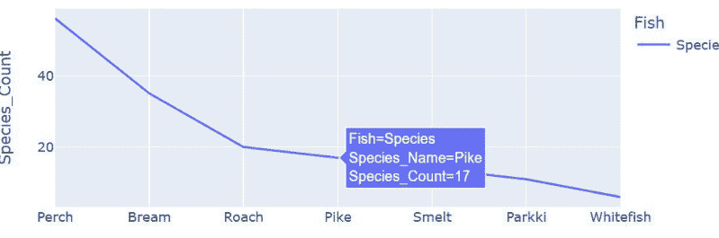
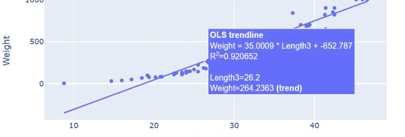
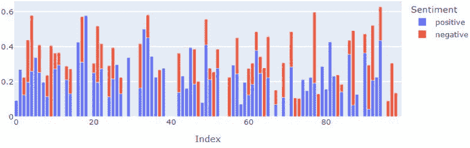

## 11 机器学习与网页抓取

到目前为止，我们已经学习了数据提取、数据存储，以及使用多个 Python 库从数据中获取和分析信息。本章将为您提供机器学习（ML）的入门信息，并附带一些示例。

网页抓取涉及研究一个网站，识别可收集的数据元素，并规划和处理脚本以提取和收集数据到数据集或文件中。这些收集到的数据将被清洗和进一步处理以生成信息或有价值的见解。ML 是人工智能（AI）的一个分支，通常处理统计和数学过程。ML 用于开发、训练和评估算法，这些算法可以自动化、从输出中持续学习并最大限度地减少人工干预。

ML 使用数据进行学习、预测、分类和测试情况，以及许多其他功能。数据是使用网页抓取技术收集的，因此 ML（其性能）与抓取数据之间存在相关性。网页抓取主要与 ML 关联，因为高质量的数据作为输入提供给 ML 算法。ML 也被认为可用于任何需要大量解释、迭代、处理大量数据（以 GB、TB 或 PB 计）、复杂数据集的任务，以及任何 ML 相比人类可以减少处理时间并减少错误的任务。

在本章中，我们将学习以下主题：
- ML 简介
- 使用 scikit-learn 的 ML
- 情感分析

## 技术要求

需要一个网络浏览器（Google Chrome 或 Mozilla Firefox），我们将使用 JupyterLab 进行 Python 代码。

请参考第 2 章的“设置事项”和“创建虚拟环境”部分以继续设置和使用创建的环境。

本章所需的 Python 库如下：
- scikit-learn（访问 https://scikit-learn.org/stable/install.html 进行安装）
- textblob（访问 https://textblob.readthedocs.io/en/dev/install.html 进行安装）
- vaderSentiment
- plotly
- numpy
- pandas
- matplotlib

本章的代码文件可在本书的 GitHub 仓库在线获取：https://github.com/PacktPublishing/Hands-On-Web-Scraping-with-Python-Second-Edition/tree/main/Chapter11。

## ML 简介

数据收集、分析和挖掘数据以提取信息是许多数据相关系统的重点议程。处理、分析和执行挖掘相关功能需要处理时间、评估和解释以达到期望状态。使用 ML，系统可以在相关或样本数据上进行训练，并且 ML 还可进一步用于评估和解释其他数据或数据集以获得最终输出。

基于 ML 的处理与数据挖掘和预测建模类似，可以进行比较，例如，将收件箱中的电子邮件分类为垃圾邮件和非垃圾邮件。垃圾邮件检测是一种根据内容对电子邮件进行分类的决策。系统或垃圾邮件检测算法在输入或数据集上进行训练，可以区分电子邮件是否为垃圾邮件。

ML 预测和决策模型依赖于数据。ML 模型可以建立在多个算法之上并使用这些算法，从而使系统能够提供最接近的预测和准确结果。在特定数据集上训练的模型也可以应用于新数据集，整合新数据并从额外收集的数据或从抓取器或爬虫获得的实时数据中学习。存在具有这些能力的 ML 系统，并帮助应用程序实现期望的输出，例如以下列出的：
- 股价预测
- 电影分类
- 情感分析（**自然语言处理（NLP）**）
- 疾病预测
- 天气预报
- 客户支持和翻译
- 推荐工具
- 欺诈检测系统和网络安全
- 文字转语音
- 图像识别
- 机器或自动驾驶车辆
- 定时分析和报告

ML 的适用性无界；它可用于研究和学习、健康和医学、商业和营销等领域。ML 中存在一些常见挑战（从数据角度来看）：
- 数据质量
- 无偏数据
- 数据可用性有限

ML 模型是在数据上训练的。原始数据大多数时候是无结构的、不完整的，并且可能还包含一些缺陷。以下部分将提供有关 ML 的基本信息。

在下一节中，将介绍在数学和 ML 相关领域经常使用的 Python 库。

## ML 与 Python 编程

Python 也被称为科学计算的编程语言。Python 的流行、其工具和可用库的完善文档，以及易用性、可维护性和多功能性，使 Python 成为 ML 和 AI 相关开发的首选。

在接下来的部分中，我们将介绍一些流行的 Python 库。为了展示 Python 在 ML 和 AI 等领域的使用方式，接下来的部分提到了一些对使用 Python 编程开始 ML 和 AI 之旅非常有用的重要库。

在下一节中，我们将识别某些类型的数据，因为输入 ML 算法的数据类型是需要考虑的重要因素。

## 数据类型

数据是可以用来生成期望输出的原材料。数据也可以被分类。ML 算法也是根据可用作输入的特定格式的数据类型进行分类的。不仅仅是基本数据类型，如数字（整数、小数或复数），还有布尔值、字符串等。

在我们进行 ML 项目时，经常会遇到数据处理和数据预处理的话题。数据在 ML 中的这一方面是关于准备、清洗和组织数据集，甚至将数据集转换为易于识别且准备好进行构建和训练 ML 模型的格式。该过程确保输入的准确性，并减少可能不必要消耗的时间。在第 10 章中，类似的话题已通过示例介绍。

这里，我们谈论的是数据类别——尽管大多数 AI 和 ML 库和框架接受各种类型的数据，提供主要类型或所需类型将增强并确保期望的结果。以下是几种数据类型：
- **定量**：具有数值的数据——可以计数和测量的数字。它在统计和数据分析项目的客观结果中发挥重要作用。散点图和折线图等图表主要用于可视化。定量数据可以是以下类型：
  - **离散**：包括可计数的整数或具体数字。例如，球队中的总球员数、班级中的女学生数或家中的孩子数。
  - **连续**：数据可能复杂、随时间变化或无限，只能测量而不能计数。例如，身高和体重、银行利率、鞋码或体温。
- **定性**：数据类别或分组，无法以数值格式表达。它大多数时候用于主观结果，因为这种类型的数据表达了数据的质量和特征。条形图、水平条形图和饼图等图表主要用于可视化此类数据。定性数据可以是以下类型：
  - **结构化**：此数据可以是数字，但不适用于数学运算：
    - **名义**：以标签形式存在的值，没有顺序或排名，例如，性别、宗教或国家
    - **二元**：只有两个选项，例如，是或否、真或假、通过或失败、好或坏
    - **序数**：可计数但不可测量，具有某种相关顺序，例如，血型、学业成绩、排名或电影评分
  - **非结构化**：没有适当格式，例如，图像或声音


定性数据收集自访谈和调查，其大多为非结构化、描述性和主观性的，需要大量的交互和解读。收集（抓取）和存储也比较困难。数据湖和非关系型**数据库管理系统（DBMSs）**通常被推荐用于存储此类数据。使用定性数据进行编码是一项挑战，因为它需要多轮处理和理解数据。

另一方面，定量数据大多结构化，易于获取，可存储在数据仓库和**关系型数据库管理系统（RDBMSs）**中。它也易于编码、搜索和分析。

> **重要说明**
> 从分析角度来看，如果定性数据未以正确的方式处理和准备，则易受多种风险因素的影响。Python 中有 ML 和分析库可协助将定性数据转换为定量数据（使用*演绎编码*、*归纳编码*，以及各种分析方法，如*内容分析*、*主题分析*、*扎根分析*和*文本向量化*）。

在下一节中，我们将列出具有科学和统计意义的 Python 库。

## *Python 用于统计和数值计算*

ML 相关算法甚至模型的开发都使用统计和数学概念。Python 提供了各种内置、可安装和开源模块用于数学和统计目的。

以下是从统计和数学角度来看的几个重要库：

- `numpy`：该 Python 库用于数值和科学计算，还处理*n 维矩阵、数组、线性代数*等。请访问 `https://www.numpy.org` 了解详细信息。
- `statsmodel`：一个用于*统计计算、统计建模、假设检验、数据探索、估计*等的库。请访问 `https://www.statsmodels.org` 了解详细信息。
- `scipy`：一个用于科学计算的 Python 库。`scipy` 用于*统计、线性代数、优化算法、n 维插值*等。请访问 `https://scipy.org` 了解详细信息。

我们刚刚列出的库都相当庞大——不断增长——在其各自领域深入覆盖了功能和特性。也可能存在模块之间某些常见功能的重叠，但开发者会发现库之间的重叠和相似之处，并选择最适合其实现的库。

还有大量 Python 包和项目建立在现有库的某些重要功能之上，例如 `numpy` 和 `scipy`，以及标准库，例如 `math`、`cmath`、`random` 和 `statistics`。请访问 `https://docs.python.org/3/library` 了解有关 Python 标准库的更多信息，以及 `https://pypi.org` 了解有关第三方和开源库的更多信息。

> **重要说明**
> 
> `https://pypi.org`（**Python 包索引**）是一个可找到包链接和通常完整细节的存储库，包括其主页、错误修复等。开发者也可以提交其项目以发布给全球 Python 受众和开发者。

在下一节中，我们将学习一些专门用于 ML 项目的 Python 库。

## Python 库用于 ML

在本节中，我们将探索一些在 Python 编程中相当流行的库，尤其是在 ML 和 AI 领域。统计和数学程序在 ML 中是必不可少的且被理解的。我们可以找到数十个专门用于 ML 的 Python 库和框架。此类库的数量在以下几个重要方面迅速增长：

- 适用于大量数据
- 能够处理不同类型的数据
- 可在各种系统和环境中部署和管理
- 可与挖掘、分析、可视化、多层处理等进行适配

ML 和 AI 领域的框架和库必须对变化（研究和环境）开放。ML 实施和范围的例子很多。以下是一些选定的 Python 模块，它们在 ML 和 AI 领域使用 Python 编程做出了、并且正在做出卓越的实践影响：

- **PyTorch**：一个基于 `torch` 库的开源深度学习库和 ML 框架，用于研究和生产。快速执行、处理非常大的数据集的能力、基于云的访问和支持，以及比竞争对手库更好的调试能力，使 PyTorch 更具意义。它在计算机视觉和 NLP 领域也很流行。请访问 `https://pytorch.org` 了解更多信息。
- **TensorFlow**：来自 Google 的免费开源 AI 和 ML 库，主要用于深度神经网络。其可扩展性、灵活性、与 ML 模型开发、训练和再训练相关的流程、高速度处理能力、部署简便性以及在各种平台上的适用性，使 TensorFlow 成为其竞争对手中最好的之一。请访问 `https://www.tensorflow.org` 了解更多详情。

## 监督学习

在此类学习中，机器使用训练数据（标记数据）提供或训练，最终基于训练数据预测或分类输出。输出基于提供的输入数据，算法从训练数据中学习。如果我们想要尽可能接近的输出或预测，必须有高质量的数据集（干净、格式化、预处理完成，并进行 EDA）。这里，输出变量依赖于输入变量。

以下是解释监督学习技术如何工作的几个步骤：

- 1. 选择一个输入数据集，也称为标记数据集。
- 2. 将数据集拆分为训练集和测试集（通常训练 80%，测试 20%）。记录或行是随机或顺序选择的。
- 3. 确定或挑选输入变量（或变量）。
- 4. 选择适用的学习算法（如线性回归）。
- 5. 在训练集上执行所选算法，而模型效率用测试集进行评估。
- 6. 如果输出或预测结果正确，则模型准确。如果不是，则使用不同算法重复步骤 1 到 5。
- 7. 向训练好的模型提供新数据并接收输出。

> **重要说明**
> 
> 如果输出未导致正确分类或未接近计算值，则再次使用 EDA 功能彻底分析输入数据集并进一步处理，并进行训练。在回归情况下，回归预测模型的有效性可通过计算**均方根误差（RMSE）**来衡量。

监督模型使用先前的观察、数据和输入来分类或预测新的输出。此类算法在日常基本活动中很有用。如果训练集和测试集的数据不同，则不会起作用。对于复杂、不准确的输入数据，这些模型需要大量计算，可能无法揭示准确结果。

监督学习可用于数据过滤、房屋价格预测、情感分析、垃圾邮件检测、图像分类、欺诈检测等。

根据适用的问题，监督学习算法基本上分为两种类型——分类和回归。

## 分类

根据属性对数据模型进行分组、识别或分类称为分类。分类技术通常涉及基于相似性或差异性的排列，也称为排序技术。在此技术中，类别或分类标签，也称为类，是预先确定或设定的。分类模型根据单个或多个自变量识别因变量属于哪个类别。

以下是一些常见的分类算法：

- **线性分类器**：最简单的分类算法形式，它根据简单的线性函数对一组数据进行分类，假设数据可通过在图表上绘制直线线性区分。
- **支持向量机（SVM）**：一种根据边界（超平面）将数据分离到多个集合的分类器，通过检测重叠数据实现。如果维度大于样本数，则可使用 SVM。SVM 算法创建最接近不同维度线上的点，称为**支持向量（SVs）**。SVM 算法在噪声较少（重叠）的数据集上产生高精度。异常值检测是 SVM 算法的主要优势之一。SVM 算法不太适合大型数据集，因为训练复杂度高，且模型在复杂边界上做出决策。
- **K-最近邻（kNN、k-NN 或 KNN）**：KNN 以高精度著称。它存储可用数据，基于相似性生成新数据点，并找到最近邻。它在 K 个邻居上计算*欧几里得距离*（两点之间）。KNN 通常用于大型数据集之上。它也稍慢，因为它必须生成并计算新数据点之间的距离。
- **决策树**：该算法使用一组规则来做出决策。规则以树结构形式设置，包含*根（问题）*、*分支（决策规则或决策节点）*和表示结果的*叶（叶节点）*。树分支节点可以有多个分支。通过应用规则，使用分类和定量数据将训练数据集分解为许多子集。树中的数据必须是数值。它类似于人类的思考能力和编码中深层嵌套的 if-elif 语句。分支数量大的决策树复杂且耗时。
- **随机森林**：这是一组随机的*决策树*（一片森林），其中多个结果合并为一个值作为输出。随机森林也称为**集成学习**。它减少过拟合，因为结果通常是决策树的平均值。由于其对噪声数据集的适用性、可扩展性、训练时间短和结果高度准确，因此在大型数据集上使用。

分类学习可应用于各种情况；例如，衣服图像可按颜色名称分类，收件箱中的电子邮件可分类为垃圾邮件或非垃圾邮件，或可通过研究症状对常见疾病进行分类。


## 回归

回归用于估计变量之间的关系，也被称为**预测算法**。回归模型试图确定因变量与一个或多个自变量之间关系的强度。回归中的输出变量通常是定量值。通常，回归技术用于根据一组给定的输入（称为**预测变量**）进行预测。处理回归算法需要扎实的统计学背景。

以下列举了几种常见的回归算法类型：

- **线性回归：** 也称为**简单线性回归（SLR）**，用于根据一个自变量的值预测一个（因变量）值。它通过最佳拟合直线发现变量之间的线性相关性。它最适合小数据集，并产生连续输出。
- **多元线性回归：** 也称为**多重线性回归（MLR）**，是一种线性回归模型。它使用多于一个自变量和一个因变量来建模线性和非线性关系。输出反映了多个自变量与单个因变量之间的影响或关系。
- **逻辑回归：** 也被称为*统计回归*模型或概率算法，有助于分析数据集。该算法用于寻找最佳拟合模型，计算二元类型（如是和否）的概率。它还描述了二元（涉及两种可能结果）因变量与预测变量集之间的关系。就变量数量而言，该算法描述了多个自变量与单个因变量之间的关系。这种回归技术产生离散输出，主要用于分类相关问题。
- **多项式回归：** 多项式回归描述*非线性关系*。通常，如果因变量和自变量之间不可能存在线性关系，则可能是多项式回归的情况。多项式回归也被视为MLR的特例。通过训练好的模型，可以创建非线性方程并用于预测。

回归学习还有许多其他形式。衡量算法的有效性也相当具有挑战性。一些技术，如**普通最小二乘法（OLS）**和**R平方（R2）**，用于最大程度减少误差的可能性。OLS估计线性回归的系数。它使实际值与预测值之间的残差平方和最小化。R2的值介于0和1之间，计算因变量的变化百分比。R2的值越大，模型越好。

基于回归的学习可用于天气预报、销售价格预测、房价预测和股票市场等场景。

## 重要说明

有几种监督机器学习算法可用于回归和分类。逻辑回归最常用于分类相关问题。SVM作为一种深度学习模型，既用于分类也用于回归。同样，随机森林、kNN和决策树等算法也用于这两种监督学习。

选择最佳学习模型取决于数据类型、数据量、数据列之间的相关性、处理时间、预期输出、数据中是否包含变化以及许多其他因素。

对于使用网络爬取收集的数据，监督形式的机器学习是用于分析和决策的最常用形式。在下一节中，我们将探讨无监督机器学习。

## 无监督学习

无监督学习在发现数据趋势和查找隐藏模式方面很有效。在无监督学习中，算法自行检测、探索和学习。没有任何东西来监督学习过程。这种学习在数据挖掘领域很有用，也适用于当我们不确定自己在寻找什么时。

与监督学习相比，无监督学习任务更复杂，面临许多挑战。在无监督学习中，不需要准备数据和进行初步分析的时间。数据中隐藏或未知的模式会被暴露出来，这在监督学习中是不可能的。与监督学习相比，无监督学习的结果可能准确性较低。

无监督学习主要分为两个部分：

- 聚类
- 关联

在下一节中，将介绍无监督学习的类型。

## 聚类

聚类是将数据或对象进行分组、排序、分类和归类的过程。监督学习中的分类模型也会对输入对象进行分组和归类。分类模型提供了预定义的类别或组名，而在聚类中，组或类别是在处理数据后生成的。

生成的数据组或簇将包含具有相似特征和类型的数据。聚类的灵活性是最受欢迎的特性。学习模型一旦训练好，就可以用于各种其他场景。

**K均值聚类**是最广泛使用的聚类算法之一，它要求有k值。这里，k指的是要创建的簇的数量，或者要划分并分组的数据数量。它确定当前簇中的一个种子点作为质心（均值点），并收集距质心最近的数据到簇中。

与kNN类似，在数据或数据点之间进行距离测量（*欧几里得距离*），用于创建或分离相似和不相似的簇。kNN和K均值聚类通常被归类为基于搜索的（学习）算法。数据点利用自身来查找其他数据点。

## 关联

关联有助于发现新模式、查找数据中的关系，并从大型数据集中产生信息。它识别数据集中模式的频率。此外，它还根据数据的依赖关系进行映射。

关联，也称为**关联规则挖掘（ARM）**，试图识别数据集变量之间的关联。用于ARM的常见算法之一是**Apriori**，它发现数据集中最频繁出现的数据项，并识别它们之间的关联和相关性。ARM通常在大型数据集中处理，但由于关联数量可能无限，很可能带有大量噪声。大多数情况下，使用是和否等二元属性来定义关联规则。

更多详细信息请参阅*第10章*。在下一节中，我们将学习强化学习类型的基础。

## 强化学习

这种类型的学习算法使用并识别其环境，通过访问数据模式来学习行为，或基于试错（也称为奖惩模型）来训练其学习模型。强化学习是关于（基于情况）做出决策或学习动作及其反馈，从而获得最大回报。

强化学习算法从一系列行动中学习，这几乎类似于决策树处理。例如，基于情况的输入产生输出，该输出成为下一周期的输入，依此类推，直到做出或获得决策。

**强化代理（RAs）**，也称为AI驱动系统，是自我训练的，并根据训练数据做出解决分配任务的决策。为了分析或识别情况，使用外部代理和系统，如软件（日志）、系统设置、基于浏览器的扩展、机器中的摄像头等，以获取尽可能多的关于情况的信息。

到目前为止，本章已经探讨了与机器学习相关的信息。现在，我们将构建一个ML模型，并应用一些ML类型的实际概念，这些概念可用于预测和情感分析。


在下一节中，我们将使用Python编程探索实际的机器学习（ML）。

## 使用scikit-learn进行机器学习

要开发模型，我们需要数据集。网络抓取再次成为收集所需数据并存储为相关格式的理想技术。Python中有大量与机器学习相关的库和框架，而且数量还在不断增加。scikit-learn是一个Python库，能够处理并帮助完成大多数监督式机器学习功能。

scikit-learn也被称为并使用为`sklearn`。它构建于`numpy`、`scipy`和`matplotlib`之上。该库提供了大量与机器学习方面相关的功能，如*分类*、*聚类*、*回归*和*预处理*。我们将使用scikit-learn探索*监督学习*类型中的*回归*，涵盖初学者和中级概念。你还可以在https://scikit-learn.org/stable/user_guide.html查看`sklearn`用户指南。

在本章前面的章节中，我们已经介绍了大量关于**回归**的信息。回归是一种监督学习技术，用于基于标记数据做出预测。在接下来的章节中，将通过几个示例探讨简单线性回归（SLR）。

## 简单线性回归

SLR用于估计自变量与单个因变量之间的关系。它通常被用作默认的回归技术，基于另一个变量的值来预测一个变量的值，这个另一变量也被称为SLR的预测变量或输入变量。

现在我们将使用代码讨论一些SLR概念。代码文件可在此找到：https://github.com/PacktPublishing/Hands-On-Web-Scraping-with-Python-Second-Edition/blob/main/Chapter11/Chapter11_regression.ipynb。

示例中使用的数据（`Fish.csv`）来自**Kaggle**（https://www.kaggle.com/datasets/aungpyaeap/fish-market/download），并使用pandas读取到名为`input`的DataFrame中。图表将使用`plotly`绘制。

如下代码所示，我们导入常规库，如`pandas`、`numpy`和`plotly`。`Fish.csv`数据文件已使用pandas的`read_csv()`方法读取，这将创建一个名为`input`的DataFrame类型对象：

```
import pandas as pd
import numpy as np
import plotly.express as px
pd.options.plotting.backend = "plotly" # use plotly as plotting option
input = pd.read_csv("Fish.csv")      # load data
```

`input`包含几种鱼类物种的数据，包括与测量相关的数据，具体如下：

- 物种：物种名称
- 长度1：垂直长度（cm）
- 长度2：对角长度（cm）
- 长度3：水平长度（cm）
- 重量：鱼的重量（g）
- 宽度：对角宽度（cm）

pandas的`info()`方法，如图11.1所示，显示列名、Dtype（数据类型，如object或float）以及来自DataFrame `input`的null或非null计数等信息：

```
input.info()
<class 'pandas.core.frame.DataFrame'>
RangeIndex: 159 entries, 0 to 158
Data columns (total 7 columns):
#   Column   Non-Null Count   Dtype
---  ------   --------------   -----
0   Species  159 non-null     object
1   Weight   159 non-null     float64
2   Length1  159 non-null     float64
3   Length2  159 non-null     float64
4   Length3  159 non-null     float64
5   Height   159 non-null     float64
6   Width    159 non-null     float64
dtypes: float64(6), object(1)
memory usage: 8.8+ KB
```

图11.1：Fish.csv数据集信息

从图11.1可以看出，数据集中共有七列。其中六列是浮点类型，总共159行记录。数据集看起来很干净，因为没有null值。

研究数据集是必须的，以便关注预处理活动，如填充null值、删除重复项、转换数据类型和排序。这些活动是强制性的，因为在回归处理过程中，我们需要找到作为变量的独立数据和依赖数据，并且不能影响输出（预测）质量。

`input.describe()`代码只处理携带统计值的列。通过`include='all'`参数，甚至字符串和其他对象也可以包含在内，如图11.2所示。我们可以看到，在七个独特的物种中，Perch出现次数最多；在159次中出现56次。

```
input.describe(include='all')
```

|  | Species | Weight | Length1 | Length2 | Length3 | Height | Width |
|---|---|---|---|---|---|---|---|
| 计数 | 159 | 159.000000 | 159.000000 | 159.000000 | 159.000000 | 159.000000 | 159.000000 |
| 唯一值数 | 7 | NaN | NaN | NaN | NaN | NaN | NaN |
| 众数 | Perch | NaN | NaN | NaN | NaN | NaN | NaN |
| 频数 | 56 | NaN | NaN | NaN | NaN | NaN | NaN |
| 均值 | NaN | 398.326415 | 26.247170 | 28.415723 | 31.227044 | 8.970994 | 4.417486 |
| 标准差 | NaN | 357.978317 | 9.996441 | 10.716328 | 11.610246 | 4.286208 | 1.685804 |
| 最小值 | NaN | 0.000000 | 7.500000 | 8.400000 | 8.800000 | 1.728400 | 1.047600 |
| 25% | NaN | 120.000000 | 19.050000 | 21.000000 | 23.150000 | 5.944800 | 3.385650 |
| 50% | NaN | 273.000000 | 25.200000 | 27.300000 | 29.400000 | 7.786000 | 4.248500 |
| 75% | NaN | 650.000000 | 32.700000 | 35.500000 | 39.650000 | 12.365900 | 5.584500 |
| 最大值 | NaN | 1650.000000 | 59.000000 | 63.400000 | 68.000000 | 18.957000 | 8.142000 |

图11.2：数据集列的详细描述

使用以下代码绘制各个物种的计数（即`value_counts()`方法的结果）：

```
species_count = input.Species.value_counts()
species_count.plot(title="Species Count", labels=dict(index="Species_Name", value="Species_Count", variable="Fish"))
```

如图11.3所示，从DataFrame `input`中统计Species_Count（即某些物种出现的次数），并以物种名称绘制：

# 物种计数



图11.3：绘制物种计数

在分析数据集时，似乎有许多相关因素。因此，我们将仅针对名为Perch的目标物种，通过基于Length3值训练模型来预测Weight：

```
perch = input[input.Species=="Perch"]
```

Plotly散点图支持通过`trendline`参数显示回归趋势（https://plotly.com/python/linear-fits/#linear-fit-trendlines-with-plotly-express），如下代码所示。该代码使用`ols`作为`trendline`参数：

```
fig = px.scatter(perch, x="Length3", y="Weight", trendline="ols")
fig.show()
```

如图11.4所示，我们可以找到线性方程以及计算出的R2值、系数、截距和所选Length3的预测重量。`trendline`的`ols`参数为我们计算了这些，我们可以从图11.4所示的图表中解读Perch的Length3与重量关系：



图11.4：Perch的OLS趋势线、Length3和重量

从图11.4中，我们可以获得SLR方程的以下列出属性：

- **R2：** 0.920652（准确率得分最高为1）
- **线性方程：** Weight = 35.0009 * Length3 + -652.787
- **截距：** -652.787
- **系数：** 35.0009

**重要说明**

R2和系数等值有助于我们验证模型。还应注意到我们尚未使用sklearn。

要使用sklearn通过`Length3`值（针对名为`Perch`的物种）预测`Weight`，我们需要执行以下步骤：

1. 确定因变量和自变量。
2. 将数据拆分为训练集和测试集。
3. 创建线性回归模型。
4. 使用训练数据拟合线性回归模型。
5. 最后，对测试数据进行预测。

如下代码所示，`sklearn`拥有多个模块，如`model_selection`、`linear_model`和`metrics`：

```
from sklearn.model_selection import train_test_split
from sklearn.linear_model import LinearRegression
from sklearn.metrics import mean_squared_error, r2_score, mean_absolute_error
```

`train_test_split()`接收Length3和Weight值。这将创建训练集和测试集。训练集将占用`train_size`设置的80%的值，其余20%由测试集使用。还使用了额外参数`shuffle`，它会随机打乱可用记录的顺序：

```
X_train, X_test, y_train, y_test = train_test_split(perch.Length3,
perch.Weight, train_size=0.8, shuffle=True)
```

通过使用训练数据拟合创建名为`lr`的模型。`fit()`方法传入训练数据：

```
lr = LinearRegression().fit(X_train, y_train)
type(lr)
sklearn.linear_model._base.LinearRegression

dir(lr)
['_abc_impl', '...', '_more_tags', '_parameter_constraints',
'coef_', 'copy_X', 'feature_names_in_', 'fit', 'fit_intercept',
'get_params', 'intercept_', 'n_features_in_', 'n_jobs', 'positive',
'predict', 'rank_', 'score', 'set_params', 'singular_']
```

从前面的代码可以看出，创建了`lr`模型后，我们可以探索一些重要的`lr`属性，如下所示：

```
lr.intercept_    # array([-634.55508041])
lr.coef_         # array([[34.68344575]])
lr.rank_         # 1
lr.score(X_train, y_train)        # 0.927768856667214
```

在前面的代码中，我们将基于可用数据或 X_test 来预测体重。现在可以使用 lr 模型、predict() 方法和 X_test 生成 weight_pred 预测数组，其中使用 20% 的记录来预测 Weight：

```
weight_pred = lr.predict(X_test)
weight_pred
array([[461.4418054 ], [180.5058948 ], [801.33957378], [659.13744619 ], [544.68207521], [801.33957378], [360.85981271], [204.78430682], [731.97268228], [284.55623206], [232.53106343], [274.15119833]])
```

与 X_test 值类似，我们可以向模型预测器提供一个 Length3 的新值，并获得预测结果（Weight）：

```
lr.predict(np.array([[20.5]])) [0] [0]
# 76.45555753771407
lr.predict(np.array([[29.5]]))
# array([[388.60656932]])
lr.predict([[29.9,]])
# array([[402.47994762]])
```

准备好预测模型后，我们还可以使用 sklearn.metrics 中的方法来计算性能并评估模型本身。r2_score(0.86) 也被解释为准确率得分，其值介于 0 和 1 之间——得分越高，准确度越好。这表明该模型在预测结果方面是可以接受的：

```
mean_squared_error(y_test, weight_pred)
# 9910.93927217145
mean_absolute_error(y_test, weight_pred)
# 87.86230207025248
mean_squared_error(y_test, weight_pred, squared=False)
# 99.5537004443
np.sqrt(mean_squared_error(y_test, weight_pred))
# 99.5537004443
r2_score(y_test, weight_pred)
# 0.8681631783134378
```

> **重要提示**
> **均方误差（MSE）** 值 9910.9392 是残差平方和的均值。RMSE 值 99.5537 是 MSE 的平方根。**平均绝对误差（MAE）** 值 87.8623 是残差绝对值之和的均值。在一般情况下，MSE 总是大于 MAE。

在本节中，我们通过代码示例探讨了 SLR 技术，并识别了 sklearn 中的各种属性。在下一节中，我们将使用 MLR。

## 多元线性回归

当多个自变量与一个因变量之间存在相关性时，使用 MLR。在本例中，我们希望检查在“简单线性回归”一节中用于 SLR 的数据集中，Perch 物种的 Width 和 Height 列的值与 Weight 的相关性。

现在，我们将通过代码讨论一些 MLR 概念，以下是代码文件的地址：https://github.com/PacktPublishing/Hands-On-Web-Scraping-with-Python-Second-Edition/blob/main/Chapter11/Chapter11_multi_regression.ipynb。

inDepd 包含从 Perch 收集的自变量，而 depd 是因变量 Weight：

```
inDepd = perch[['Width', 'Height']] # independent variables
depd = perch['Weight']                 # dependent variable
```

同样，80% 的数据用于训练，20% 用于测试。使用 sklearn.model_selection 模型的 train_test_split() 方法创建训练集和测试集：

```
X_train, X_test, y_train, y_test = train_test_split(inDepd, depd,
train_size=0.8, shuffle=True)
```

使用训练数据集创建并拟合（或训练）mlr 模型：

```
mlr = LinearRegression().fit(X_train, Y_train)
mlr.score(X_train, y_train)
0.9560246146854837
```

X_train 包含多个用于训练模型的数据，如图 11.5 所示：

|   | Width | Height |
|---|-------|--------|
| 113 | 6.7408 | 10.6091 |
| 86 | 3.4075 | 6.1100 |
| 96 | 3.7230 | 7.2930 |
| 75 | 2.6316 | 4.5924 |
| 106 | 4.2042 | 7.8204 |
| 101 | 4.1440 | 7.1680 |
| 74 | 2.4320 | 3.8240 |
| 76 | 2.9415 | 4.5880 |
| 119 | 7.1064 | 11.9286 |

图 11.5：包含多个自变量的 X_train

训练完成后，使用 mlr 模型来预测来自 X_test 的数据。还需注意，r2_score 为 0.81799，这在 MLR 情况下是可以接受的：

```
weight_pred_mlr = mlr.predict(X_test)
weight_pred_mlr
array([643.07827704, 96.06295718, 228.07992289, 76.27638592, 136.430909,
143.8607218, 163.98405844, -300.15848523,
446.23998044,  291.21291802,  944.3976018,  243.67945607])

r2_score(y_test, weight_pred_mlr)
0.817999125036539
```

也可以直接将 Width 和 Height 的输入提供给 mlr.predict()。例如，请参见以下代码块：

```
mlr.predict(np.array([[3.45, 6.05]]))
array([154.53150904])

mlr.predict(np.array([[7.10, 11.22]]))
array([807.225824])
```

**重要提示**
如本节代码实现所示，scikit-learn 拥有大量用于各种 ML 相关概念的工具。如果用户希望从其 ML 模型中获得大量统计和定量值，那么 statsmodel 和 scipy 更适用，因为代码更简短。

在下一节中，我们将使用一种与 NLP 相关的技术。

## 情感分析

NLP 是 ML 的子集，而情感分析是 NLP 的子集。通过情感分析，我们可以检测文本的情感是正面、中性还是负面。情感分析可用于文本、评论、反馈等内容。

这种分析有助于评估客户或顾客的评论和反馈，以及它们是正面还是负面。检测到的情感有助于更好地开展营销，公司、电子商务网站、银行、旅行社以及更多组织可以监控和管理其战略、营销政策、产品品牌、客户需求等。

在接下来的部分中，我们将使用代码和示例，这些内容可在 https://github.com/PacktPublishing/Hands-On-Web-Scraping-with-Python-Second-Edition/blob/main/Chapter11/Chapter11_textblob_vader.ipynb 获取。

nltk Python 库是 NLP 的先驱之一。NLP 有很多用途，例如分类。在目前的情况下，我们将使用 textblob 和 vaderSentiment 库：

- textblob：这是一个基于 nltk 构建的文本处理库。它可用于各种 NLP 方面，例如词性标注、情感分析、词形还原、分词和文本分类。为了分析文本的情感，textblob 计算并返回极性和主观性作为情感结果：
  - polarity：表示文本的正面或负面情感。取值范围从 -1（非常负面）到 1（非常正面），0 表示中性。
  - subjectivity：表示个人感受。取值范围从 0（客观）到 1（主观）。

- vaderSentiment：这是一个社交媒体情感分析器。与 TextBlob 类似，Valence Aware Dictionary and Sentiment Reasoner（VADER）是一个基于规则的情感分析器。VADER 已使用大量社交媒体文本进行训练。vaderSentiment 返回以下四个元素：
  - compound：这是词典中词语的效价得分。取值范围从 -1（极度负面）到 1（非常正面）。
  - pos：compound 得分 >=0.05 的正面值。
  - neg：compound 得分 <=-0.05 的负面值。
  - neu：compound 得分 >=-0.05 且 <0.05 的中性情感。

对 quote_details.csv 数据执行情感分析，这些数据是在第 8 章中从 http://quotes.toscrape.com/ URL 抓取的。在当前案例中，只需要名为 quote 的列。它是唯一将与 textblob 和 vaderSentiment 一起用于分析情感的字符串或文本元素。只能通过使用 pd.read_csv() 中的 usecols 参数，才能从文件中读取单个列或选定的列组：

```
import pandas as pd
quotes = pd.read_csv("quote_details.csv",usecols=["quote"])
quotes['quote'][0]
'The world as we have created it is a process of our thinking. It cannot be changed without changing our thinking.'
```

将内容作为 quotes DataFrame 读取后，在下面的示例中，我们将使用两个非常流行的 Python 库来分析内容的情绪。

如图 11.6 所示，quotes 现在拥有足够的情感信息，可以对其进行分析：

```
quotes.head()
```

|  | quote | polarity | subjectivity |
|---|---|---|---|
| 0 | The world as we have created it is a process o... | 0.000000 | 0.000000 |
| 1 | It is our choices, Harry, that show what we tr... | 0.300000 | 0.750000 |
| 2 | There are only two ways to live your life. One... | 0.003788 | 0.625000 |
| 3 | The person, be it gentleman or lady, who has n... | -0.050000 | 0.800000 |
| 4 | Imperfection is beauty, madness is genius and ... | -0.277778 | 0.833333 |

图 11.6：包含极性和主观性的 DataFrame quotes

使用 textblob 从所选数据集中获得情感相关细节。虽然我们在这样的示例中使用了现成的库，但结果可能不如使用该数据集所能获得的结果更具洞察力。

因此，在下一节中，将对同一数据集（quotes）使用 vaderSentiment，这将有助于生成更多信息，并有助于与 textblob 获得的结果进行比较。

### 示例 2 – 使用 vaderSentiment

vaderSentiment 的 SentimentIntensityAnalyzer 类包含 polarity_score() 方法，该方法接受一个字符串并返回四个键：pos、neg、neu 和 compound。每个返回键的值都会被收集并添加到原始 DataFrame quotes 中：

```
positive, negative, neutral, compound=[[], [], [], []]
from vaderSentiment.vaderSentiment import SentimentIntensityAnalyzer
analyzer = SentimentIntensityAnalyzer()
for quote in quotes["quote"]:
    text = analyzer.polarity_scores(quote)
    positive.append(text['pos'])
    negative.append(text['neg'])
    neutral.append(text['neu'])
    compound.append(text['compound'])
quotes['positive']=positive
quotes['negative']=negative
quotes['neutral']=neutral
quotes['compound']=compound
```


## 情感分析



图 11.9：正负值的绘图

在本节完成了一些数据和解析后，可以说语录中找到的大多数记录本质上是中性的。

> **重要说明**
> 
> 使用 `nltk` 进行情感分析比 `textblob` 和 `vaderSentiment` 涉及更多步骤。此外，它目前拥有最丰富的方法和属性集合。请访问 `https://www.nltk.org/` 了解更多详情。

在本章中，我们学习了机器学习的一些基础知识，以及当提供从网络抓取的高质量数据时，机器学习如何通过其各种技术在各种情境中提供帮助并发挥重要作用。

## 小结

Python 编程在人工智能和机器学习相关领域做出了巨大贡献。在本章中，我们仅仅看到了它的冰山一角。高质量数据在机器学习中扮演着非常重要的角色。无论是通过网络抓取收集数据并存储，还是将抓取到的数据即时提供给机器学习模型，经过处理的数据都是必需的。我们提供给机器学习算法用于绘图的数据质量越高、越精确，能期待的准确结果、可视化和描述性图表就越多。

现在，我们已经通过探索学习了机器学习的概念及其各个方面。我们还学习了如何实现机器学习模型，并在需要时从各种过程中收集结果。总而言之，我们现在已经了解了如何使用 scikit-learn 以及如何进行情感分析。机器学习是数据驱动的，高质量数据是机器学习模型提供准确性的基本要求。

在下一章中，我们将学习一些对网络抓取数据有益且适用的进一步步骤和主题，这些内容可以用于网络抓取过程。

## 延伸阅读

- **机器学习：**
  - https://www.ibm.com/topics/machine-learning
  - https://www.mygreatlearning.com/blog/what-is-machine-learning/
  - https://www.run.ai/guides/machine-learning-engineering/machine-learning-automation
- **机器学习——Python：**
  - https://scikit-learn.org/
  - https://www.w3schools.com/python/python_ml_getting_started.asp
  - https://realpython.com/tutorials/machine-learning/
  - https://machinelearningmastery.com/machine-learning-in-python-step-by-step/
- **回归分析：**
  - https://www.alchemer.com/resources/blog/regression-analysis/
  - https://www.investopedia.com/terms/r/regression.asp
- **自然语言处理：**
  - https://www.nltk.org/
  - https://www.ibm.com/topics/natural-language-processing
  - https://hbr.org/2022/04/the-power-of-natural-language-processing
- **情感分析：**
  - https://monkeylearn.com/sentiment-analysis/
  - https://huggingface.co/blog/sentiment-analysis-python
  - https://aws.amazon.com/what-is/sentiment-analysis/
